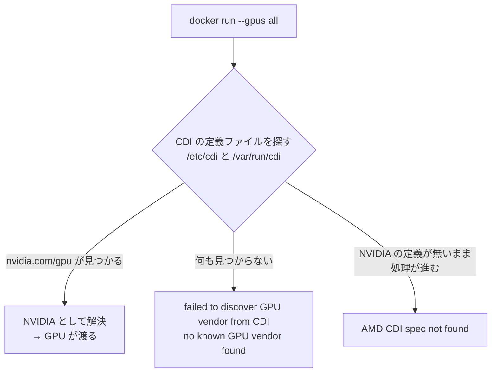

# NVIDIA GPU しか無いのに `AMD CDI spec not found` と言われる ── Docker の `--gpus all` が通らないとき

GPU サーバを借りて `docker run --gpus all` を試したら、NVIDIA の GPU しか挿さっていないのに
**AMD** の名前が出てきて止まった。NVIDIA Container Toolkit を入れても直らない。

原因は Toolkit の不足そのものではなく、**Docker が GPU をコンテナへ渡すための「経路」が
用意されていなかった**ことだった。この記事では、2 段階で出たエラーの意味と、
そこで何が起きているのか、どう直すかをまとめる。

## 症状

`nvidia-smi` はホストで正常に動き、GPU も認識されている。それなのにコンテナへ渡せない。
しかも **Toolkit を入れる前と後でエラーの文言が変わる**。

| 段階 | 実行したコマンド | エラー |
|---|---|---|
| **1. NVIDIA Container Toolkit 導入前** | `sudo docker run --rm --gpus all ubuntu:22.04 nvidia-smi -L` | `docker: Error response from daemon: failed to discover GPU vendor from CDI: no known GPU vendor found` |
| **2. NVIDIA Container Toolkit 導入後** | 同上 | `docker: Error response from daemon: AMD CDI spec not found` |

`docker run` 自体は動く（`hello-world` は通る）。GPU を要求したときだけ失敗する。

```console
$ sudo docker run hello-world
Hello from Docker!
...

$ sudo docker run --rm --gpus all ubuntu:22.04 nvidia-smi -L
docker: Error response from daemon: AMD CDI spec not found
```

**2 番目のエラーが紛らわしい。** AMD の GPU は 1 枚も無いのに AMD と言われるので、
「Docker が GPU を誤検出している」と読みたくなるが、そうではない。

## 発生した環境（前提条件）

| 項目 | 値 |
|---|---|
| OS | Ubuntu 24.04.4 LTS |
| GPU | NVIDIA Quadro RTX 6000（VRAM 24 GB・compute capability 7.5） |
| GPU の割り当て方 | Pass-Through（仮想化されていない実機の GPU） |
| NVIDIA ドライバ | 595.84（ホストで `nvidia-smi` は正常に動作） |
| Docker | CDI に対応した版（比較に使った正常な環境は 29.4.1） |
| NVIDIA Container Toolkit | 1.20.0-1（`apt` で導入） |

Toolkit は次のように導入した。導入自体はエラーなく完了している。

```bash
export NVIDIA_CONTAINER_TOOLKIT_VERSION=1.20.0-1
sudo apt-get install -y \
    nvidia-container-toolkit=${NVIDIA_CONTAINER_TOOLKIT_VERSION} \
    nvidia-container-toolkit-base=${NVIDIA_CONTAINER_TOOLKIT_VERSION} \
    libnvidia-container-tools=${NVIDIA_CONTAINER_TOOLKIT_VERSION} \
    libnvidia-container1=${NVIDIA_CONTAINER_TOOLKIT_VERSION}
```

導入ログには、次の 2 つの systemd ユニットが作られたことが出ている。**あとで効いてくる。**

```
Created symlink /etc/systemd/system/multi-user.target.wants/nvidia-cdi-refresh.path → ...
Created symlink /etc/systemd/system/multi-user.target.wants/nvidia-cdi-refresh.service → ...
```

## 背景・原因

### Docker 自身は GPU の渡し方を知らない

`--gpus all` は「GPU を渡してほしい」という**要求を書くだけ**のオプションであり、
Docker 本体に GPU をコンテナへ結びつける機能があるわけではない。実際にデバイスファイルと
ドライバのライブラリをコンテナの中へ入れるのは、**外部の仕組み**の仕事である。

その仕組みには 2 つの方式がある。

| 方式 | 何をするか | 実体 |
|---|---|---|
| **旧: runtime 方式** | Docker に「nvidia」という名前の OCI ランタイムを登録し、コンテナ起動時にそれが割り込んでデバイスとライブラリを注入する | `/etc/docker/daemon.json` の `runtimes` に `nvidia-container-runtime` を登録 |
| **新: CDI 方式** | 「この GPU を使うには、どのデバイスファイルとどのライブラリを入れればよいか」を書いた**定義ファイル**をあらかじめ置いておき、Docker がそれを読んで自分で注入する | `/etc/cdi/nvidia.yaml` または `/var/run/cdi/nvidia.yaml` |

**CDI**（Container Device Interface）は、GPU に限らず「特殊なデバイスをコンテナへ渡す手順」を
ベンダー非依存の書式で記述する仕様である。NVIDIA・AMD・Intel などがそれぞれ自分の定義ファイルを
提供し、コンテナランタイムはその書式さえ読めればどのベンダーにも対応できる。

**CDI に対応した Docker は、`--gpus all` をこの CDI 経由で解決しようとする。**
どの版から既定でそうなるかは版によって差があるので、`docker info` に
`CDI spec directories` が出るかどうかで判断するとよい。

### 定義ファイルが無いと、ベンダーを決められない

CDI の定義ファイルは `nvidia.com/gpu` のような**ベンダー名の名前空間**を持つ。
Docker は `--gpus all` を受け取ると、置かれている定義ファイルを探してベンダーを特定する。



ここまでで、2 つのエラーが素直に読める。

| エラー | 意味 |
|---|---|
| `failed to discover GPU vendor from CDI: no known GPU vendor found` | **Toolkit 導入前。**定義ファイルが 1 つも無いので、どのベンダーの GPU なのか決めようがない |
| `AMD CDI spec not found` | **Toolkit 導入後。**NVIDIA の定義ファイルがまだ置かれていないため、NVIDIA として解決できず、別のベンダー（AMD）の定義を探しに行って、そちらも無いと報告している |

**AMD という文字列は、AMD の GPU を検出したという意味ではない。**
「NVIDIA として解決できなかった結果、探索が他のベンダーまで流れた」ことの表れである。

### なぜ Toolkit を入れただけでは足りないのか

`apt install nvidia-container-toolkit` が入れるのは、**定義ファイルを生成する道具**
（`nvidia-ctk`）と、注入を実行する部品である。**定義ファイルそのものは、生成コマンドが
走って初めて置かれる。**

Toolkit 1.20 系は `nvidia-cdi-refresh.service` / `.path` という systemd ユニットを入れ、
起動時やドライバ更新時に定義ファイルを作り直すようになっている。ただし
**`apt install` を終えた直後にそれが済んでいるとは限らない**ので、その瞬間に
`--gpus all` を叩くと、まだ定義ファイルが無い状態を踏むことになる。

同じことは Docker への runtime 登録にも言える。`apt install` は
`/etc/docker/daemon.json` を書き換えない。**登録は別途 `nvidia-ctk runtime configure` を
実行する必要がある。**

## 解決策

**「Docker が GPU を渡す経路」を用意すればよい。** 方式が 2 つあるので、対応する手も 2 つある。
どちらか一方で通る。

### 方法 A: nvidia ランタイムを Docker に登録する（`--gpus all` をそのまま使いたい場合）

```bash
sudo nvidia-ctk runtime configure --runtime=docker
sudo systemctl restart docker
sudo docker run --rm --gpus all ubuntu:22.04 nvidia-smi -L
```

成功すると GPU の一覧が返る。

```console
GPU 0: Quadro RTX 6000 (UUID: GPU-********-****-****-****-************)
```

`nvidia-ctk runtime configure` は `/etc/docker/daemon.json` に次の登録を書き込む。
`systemctl restart docker` まで実行しないと反映されない点に注意する。

```json
{
    "runtimes": {
        "nvidia": {
            "args": [],
            "path": "nvidia-container-runtime"
        }
    }
}
```

### 方法 B: CDI の定義ファイルを生成する

```bash
sudo nvidia-ctk cdi generate --output=/etc/cdi/nvidia.yaml
nvidia-ctk cdi list
sudo docker run --rm --device nvidia.com/gpu=all ubuntu:22.04 nvidia-smi -L
```

`nvidia-ctk cdi list` が次のように返れば、定義ファイルが読める状態になっている。

```console
INFO[0000] Found 3 CDI devices
nvidia.com/gpu=0
nvidia.com/gpu=GPU-********-****-****-****-************
nvidia.com/gpu=all
```

**方法 B を採るときは、コンテナの起動オプションが `--gpus all` から
`--device nvidia.com/gpu=all` に変わる。** 既存のスクリプトや Compose ファイルが
`--gpus all` で書かれている場合は、そこを書き換えることになる。

### どちらを選ぶか

| | 方法 A（runtime 登録） | 方法 B（CDI 定義） |
|---|---|---|
| 起動オプション | **`--gpus all` のまま使える** | `--device nvidia.com/gpu=all` へ書き換えが要る |
| 位置づけ | 従来からある方式 | NVIDIA が推奨する新しい方式 |
| 向いている場面 | 既存のスクリプトを変えたくない | 新規に組む、Podman など他のランタイムとも揃えたい |

**既存の資産があるなら方法 A から試すのが手戻りが少ない。**
`--gpus all` を使っている箇所が多いほど、書き換えの手間が効いてくる。

### 直ったかどうかの見分け方

正常に動いている環境では、`docker info` に**両方の経路が見える**。
次は実際に GPU が使えているマシンでの出力である。

```console
$ docker info | grep -iE "Runtimes|CDI spec|cdi:"
 Runtimes: io.containerd.runc.v2 nvidia runc     ← 方法 A の登録
 CDI spec directories:
  /etc/cdi
  /var/run/cdi
  cdi: nvidia.com/gpu=0                          ← 方法 B の定義ファイル
  cdi: nvidia.com/gpu=all
```

定義ファイルの置き場所は `/etc/cdi` とは限らない。**`nvidia-cdi-refresh` が自動生成する場合は
`/var/run/cdi/nvidia.yaml` に置かれ、再起動のたびに作り直される。**

```console
$ ls -l /etc/cdi /var/run/cdi
ls: cannot access '/etc/cdi': No such file or directory
/var/run/cdi:
-rw-r--r-- 1 root root 22673 ... nvidia.yaml
```

`/etc/cdi` が無いこと自体は異常ではない。**両方の場所を見ること。**

## まとめ

- `--gpus all` は要求を書くだけで、GPU を渡す実務は外部の仕組みが担う
- CDI に対応した Docker はそれを **CDI**（定義ファイル）経由で解決しようとする
- `AMD CDI spec not found` は AMD の GPU を検出したのではなく、
  **NVIDIA の定義ファイルが無いまま探索が流れた**ことの表れ
- `apt install nvidia-container-toolkit` は道具を入れるだけで、
  **定義ファイルの生成も Docker への runtime 登録も自動では完了しない**
- `nvidia-ctk runtime configure --runtime=docker` + `docker` の再起動、
  または `nvidia-ctk cdi generate` のどちらかで経路を用意すれば通る
