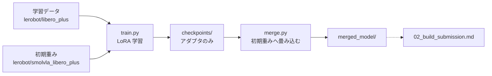

# 01. 再学習する

**この手順を最後まで実行すると、追加学習した重みが `merged_model/` として手元に残る。**
そこから提出物を作る手順は [02_build_submission.md](02_build_submission.md) にある。

## 先に読むこと：学習は最優先である

> **かつてここには「いま学習は最優先ではない」と書いてあった。撤回した。**
> 根拠にしていた成功率 0.875 は配布された 4 タスクでの数字で、同じ構成の本番は
> 0.096 だった。**手元の数字は本番を表していなかった。**

理由は 2 つある。**1 つ目は資格の問題**で、スコアより重い。

運営 Q&A No.36：

> **独自の学習を行うことが必須**である点（形式変換・名称変更・**推論パラメータ
> 変更のみの提出は不可**）は従来どおりですので、ご留意ください。

推論の設定値だけを変えた提出は、**スコアが出ても認められない。**

**2 つ目は、設定値では届かないところに壁があること。** 本番 8 エピソードのうち
4 本は、設定値を 2 通り変えても**どちらの回も 300 ステップを使い切ってゴールに
届いていない**（[../strategy/05_実測結果.md](../strategy/05_実測結果.md)）。
滑らかさの調整で動く場所ではない。

**狙いどころ。** 出発点の重みはすでに LIBERO-plus 14,347 エピソードで
20,000 ステップの全パラメータ学習を済ませている（[../reference/01_base_model.md](../reference/01_base_model.md)）。
**同じことを小さくやり直すと劣化する。** ずれているのは分布ではなく目的で、
学習データは「ゴールに着いたか」で選ばれており、**採点を左右する衝突の条件を
一度も見ていない。** 300 ステップでの測定では、背景テクスチャが変わったときの成功率が
0.60（照明は 0.82）と落ち込んでもいる。

## 全体像



**LoRA（Low-Rank Adaptation）**とは、元のモデルの重みを固定したまま、小さな
差分行列だけを学習する方式である。学習が終わった時点では**差分しか無い**ため、
そのままでは推論に使えない。元の重みへ足し込む操作を**マージ**と呼び、
`merge.py` がこれを行う。

## 学習は Docker（GPU マシン）でしか回さない

**Colab で学習する道は 8/23 に廃止した。** 手順を書いていた
`docs/solution/COLAB.md` も削除済みである。

| | Colab | Docker（GPU マシン） |
|---|---|---|
| 時間の上限 | **セッションが切れる**（実際 9,100 ステップで切れた） | 無し |
| 出力 | Drive へ同期しないと消える | **ホストのディレクトリに残る** |
| 切断対策 | 300 秒ごとに Drive へ同期する仕掛けを自分で差し込む必要がある | 不要 |
| 再現性 | ノートブックの手動編集 | **イメージと引数で固定** |

Colab は上限で切れるのが確定しており、そのための仕掛けを維持し続ける必要がある。
**16,000 ステップの学習が 3 時間近くかかるので、切断対策があっても完走しない。**

---

# A. Docker で回す

使うファイルは `solution/train/` の 3 つで完結する。

| ファイル | 役割 |
|---|---|
| [../../solution/train/Dockerfile](../../solution/train/Dockerfile) | 学習用イメージ。LeRobot v0.6.0 と GPU torch |
| [../../solution/train/train.py](../../solution/train/train.py) | エピソードの選択 ＋ 学習の実行 |
| [../../solution/train/merge.py](../../solution/train/merge.py) | LoRA を初期重みへ畳み込む |

マージのあとに 1 つ走らせる（コンテナの外でよい）。

| ファイル | 役割 |
|---|---|
| [../../solution/tools/weights/verify_merge.py](../../solution/tools/weights/verify_merge.py) | **畳み込みが本当に効いたか**を初期重みと比べて確かめる（A-6） |

## A-0. 前提を確かめる

**コンテナに CUDA は入れない。** torch の wheel に同梱されたものを使うため、
ホストに要るのは NVIDIA ドライバだけである。

```bash
nvidia-smi                                    # ドライバが入っていること
docker run --rm --gpus all ubuntu nvidia-smi  # nvidia-container-toolkit が効くこと
```

2 つ目が通らなければ
[nvidia-container-toolkit](https://docs.nvidia.com/datacenter/cloud-native/container-toolkit/latest/install-guide.html)
を入れる。

## A-1. イメージを作る

```bash
docker build -t parc2026-train solution/train
```

最後にこの行が出れば成功である。

```
torch 2.11.0+cu128 / torchcodec 0.11.1 / torchvision 0.26.0+cu128 整合
```

ホストのドライバが cu128 に対応していなければ index を変える。
`nvidia-smi` の `CUDA Version:` の欄を見て決める。

| 状況 | 指定 |
|---|---|
| **12.8 以上** | そのまま |
| 13.0 以上でそちらに寄せたい | `--build-arg TORCH_INDEX=https://download.pytorch.org/whl/cu130` |
| x86_64 のマシンで GPU 無しに配線だけ見る | `--build-arg TORCH_INDEX=https://download.pytorch.org/whl/cpu` |

> **`cpu` は arm64（Apple Silicon など）では通らない。**
> torchcodec 0.11.1 の aarch64 向け wheel が `cpu` の index に無く、0.13.0 からしか
> 置かれていない（`cu128` / `cu130` にはある）。**0.13.0 へ上げる逃げ道も無い**
> ——LeRobot が `torchcodec<0.12.0` と宣言しているため、後続の
> `pip install lerobot[training]` で 0.11.x へ引き戻され、同じ壁に当たる。
>
> **arm64 で配線だけ見たいときは `cu128` を指定する。** GPU が無くても import は通る。

> ### なぜ torch と torchcodec を対で固定しているのか
>
> `torchcodec`（動画のデコーダ）は torch の ABI に直接リンクしているのに、
> **依存を一切宣言しない**。LeRobot 側の宣言も `torch>=2.7,<2.12` と
> `torchcodec>=0.3.0,<0.12.0` という緩いものでしかない。
>
> つまり **pip は不整合を検出できない。インストールは成功し、実行時に落ちる。**
> しかも落ちるのは最初のバッチを読むときなので、**学習データ 6.4 GB を
> 落としきったあと**である。
>
> Dockerfile は LeRobot v0.6.0 の `uv.lock` が解決した対
> （torch 2.11.0 / torchcodec 0.11.1）に固定し、**ビルドの最後で
> `VideoDecoder` を import して、崩れていればビルドを失敗させている。**
>
> **このチェックは消してはいけない。** LeRobot 側の自動フォールバックは
> `importlib.util.find_spec("torchcodec")` で判定しており、
> **入ってさえいれば壊れていても「使える」と答える。**
>
> ### 版だけでなく CUDA の系統も揃える（2026-08-10 に踏んだ）
>
> `TORCH_INDEX` は **torch と torchcodec の両方**に効かせる必要がある。
> torchcodec の README いわく「Linux では CUDA 入りの wheel が既定で入り、
> GPU が無くても動く」。ただしそれは `libnvrtc` があればの話である。
>
> `--index-url` を省いて PyPI から取ると、CPU 版の torch と組んだ時点で落ちる。
>
> ```
> OSError: libnvrtc.so.13: cannot open shared object file
> ```
>
> PyPI の 0.11.1 が要求するのは `.so.13`（CUDA 13）なので、
> **cu128 の torch（`.so.12` を持ってくる）と組んでも同じ失敗になる。**
> Dockerfile 側は修正済みで、両方に `--index-url ${TORCH_INDEX}` が付いている。
>
> **index ごとの 0.11.1 の在りか**（2026-08-10 に確認）。
>
> | index | x86_64 | aarch64 |
> |---|---|---|
> | PyPI（既定） | あり（CUDA 入り） | あり（CUDA 入り） |
> | `cpu` | あり | **無い（0.13.0 から）** |
> | `cu128` | あり | あり |
> | `cu130` | あり | あり |
>
> ### 足りないのは版だけではない。NPP を別に入れる（2026-08-11 に踏んだ）
>
> 版が正しく揃っていても、これで止まる。
>
> ```
> OSError: libnppicc.so.12: cannot open shared object file
> ```
>
> torchcodec のコアの `.so` は **CUDA の NPP**（画像の色空間変換をするライブラリ）
> に直接つながっている。GPU で動画をほどく気が無くても、import した時点で読まれる。
> ところが torch の cu128 wheel が連れてくる `nvidia-*-cu12` に NPP は入っていない
> （torch 自身は NPP を使わないため）。torchcodec もこれを依存として書いていない。
>
> **`pip install nvidia-npp-cu12` だけでは足りない。** torch が起動時に読み込む
> CUDA ライブラリの一覧は決め打ちで、そこに NPP は載っていない。`.so` を置いた
> だけでは OS 側が探す場所に入らないので、`ldconfig` に置き場所を教える必要がある。
> Dockerfile はこの 2 つをまとめてやり、**登録できたかをビルド中に確かめている。**

## A-2. 学習する

### 先に：`train.py` を直したらイメージを作り直す

**`train.py` はイメージの中に焼き込まれている**（`COPY train.py merge.py /workspace/`）。
**ホストのファイルを直しても、コンテナは古いものを実行する。**

```bash
git pull                                      # 新しい train.py を取る
docker build -t parc2026-train solution/train # COPY は最後の層なので数秒
```

**やらないと、足したはずの旗で argparse が落ちる。**

```
error: unrecognized arguments: --emphasize-tasks ...
```

> **`--rm -d` の組み合わせだと、このエラーが読めない。**
> 終了と同時にコンテナが消えるので `docker logs` は「そんなコンテナは無い」になり、
> **画面にもファイルにも何も残らない。** 8/11 に 1 度これで詰まった。
> **下の A-2-1 のように、まず前面で短く流すこと。**

### A-2-0. 流す前に 4 つ確かめる（1 分）

**4 時間の実行を仕掛ける前に、ここで落ちる条件を全部潰す。**

```bash
nvidia-smi -q | grep -A2 "License Status"     # ① 期限が実行時間をまたがないか
docker images parc2026-train                  # ② イメージが build 済みか
ls work/train                                 # ③ 同じ --run-name が残っていないか
df -h .                                       # ④ 空きが 20 GB 以上あるか
```

| 見るところ | 通っている | 外れていると |
|---|---|---|
| ① `License Status` の `Expiry` | 実行の終わりより後 | **途中で CUDA が止まる**（vGPU のライセンス。項目 23） |
| ② イメージの `CREATED` | `train.py` を直した時刻より後 | **`unrecognized arguments` で即落ち**（上） |
| ③ `work/train/<run-name>` | **無い** | **`FileExistsError` で学習が始まらない**（下） |
| ④ 空き | 20 GB 以上 | チェックポイント 40 個 ＋ データで詰まる |

> **③ が一番踏みやすい。** LeRobot は
> **空のディレクトリでも既存として拒否する**（`configs/train.py` の `validate` が
> `not resume and output_dir.is_dir()` で `FileExistsError`）。
> `train.py` は直し方を示して止めるので、**`--run-name` を変えるか `rm -rf` する。**

### A-2-1. まず `--steps 1` で前面で流す（数分）

**20,000 ステップを仕掛ける前に、引数が通って選び方が意図どおりかを見る。**

```bash
mkdir -p work/train

docker run --gpus all --rm -it \
    -v "$PWD/work/train:/out" \
    -v "$HOME/.cache/huggingface:/root/.cache/huggingface" \
    parc2026-train \
    python /workspace/train.py --steps 1 --run-name dryrun
```

**`-it` で前面。落ちればその場でエラーが読める。**
**旗を足すときは、その旗も一緒に付けて流すこと**（旗の解釈で落ちるのがここだから）。

#### 何を見るか

**`[train]` の行と、LeRobot が出す 3 行を見る。**

```
[train] 手本が 300 ステップを超える 401 本を落とした（全 14347 本の 2.8%）
[train]   丸ごと落ちたタスク 1 種: ['put both moka pots on the stove']
[train] 苦手 3 タスクを 3 倍にする（割合 8.7% → 26.1%）
[train]   得意タスクは 27% に間引いた
[train]   選んだのは 4,609 本 / 699,411 フレーム
[train]   引く回数 32 回 / 699,411 フレーム = **1 コマを見る回数 0.00 回**
[train]   選んだ分の明るさ 0.086 〜 0.723
[train]   落とす前の全体   0.086 〜 0.723
...
INFO  dataset.num_frames=699411 (699K)
INFO  dataset.num_episodes=4609
INFO  num_learnable_params=742656 (743K)
```

| 見るところ | 通っている | 外れていると |
|---|---|---|
| `選んだのは N 本 / M フレーム` | **`dataset.num_frames` と一致** | 選択が渡っていない |
| **`1 コマを見る回数`** | **`--steps 1` なら 0.00 回でよい**（分子が 32 だから） | — |
| **`num_learnable_params`** | **74 万前後**（451M のうち LoRA だけ） | **4.5 億なら LoRA が当たっていない** |
| `選んだ分の明るさ` と `全体` | **ほぼ一致** | 間引きが偏って見た目の幅が狭まった |
| `Training: 100%` | 出る | データの読み出しで落ちている |

> **`1 コマを見る回数` は下見では 0.00 回になる。** 分子が「ステップ数 × バッチ」なので、
> 1 ステップなら 32 回でしかない。**本番の 20,000 ステップでは 0.92 回**と出る。
> **この行が 1 回を大きく超えていたら、そこで止める**（4 回目の提出は 5.1 回で
> 本番スコアが 8.8 倍悪化した）。

### A-2-2. 本番は `-d` で流し、ログを追う

```bash
docker run --gpus all -d --name parc-train \
    -v "$PWD/work/train:/out" \
    -v "$HOME/.cache/huggingface:/root/.cache/huggingface" \
    parc2026-train \
    python /workspace/train.py

docker logs -f parc-train                     # 端末を閉じてよい。Ctrl-C で追うのをやめるだけ
```

> **`--rm` を付けない。** 落ちたときにログを読めるようにしておく。
> **`--rm -d` にすると終了と同時にコンテナが消え、`docker logs` が
> 「そんなコンテナは無い」になる**（8/11 に 1 度これで原因が追えなくなった）。
> 終わったら `docker rm parc-train` で消す。

#### 5 分後に速さを見る

**チェックポイントの時刻の差が、そのまま 500 ステップぶんの時間である**（`--save-freq 500`）。

```bash
ls -l --time-style=+%H:%M:%S work/train/<run-name>/checkpoints/
```

| 500 ステップぶん | 20,000 ステップぶん | 判断 |
|---|---|---|
| **5〜6 分** | **約 3.7 時間** | **見込みどおり**（バッチ 32 で 1 ステップ 0.66 秒） |
| 7〜9 分 | 5〜6 時間 | やや遅い。期限に間に合うなら続ける |
| **9 分超** | 6 時間超 | **止めてデータを減らす**（`--emphasis-multiplier 2` か `--episodes-per-task`） |

> **1.4 分という基準は古い。** あれは**バッチ 8・200 エピソード**での実測で、
> **バッチ 32 は 1 ステップあたり 4 倍のサンプルを流す。**

#### 途中の様子を見る

```bash
docker logs --tail 20 parc-train              # 直近だけ
docker logs parc-train 2>&1 | grep -c 'Checkpoint policy'   # 何回保存したか
docker stats --no-stream parc-train           # GPU ではなく CPU/メモリの詰まりを見る
nvidia-smi                                    # 使用率。低ければデータ供給が律速
```

**`nvidia-smi` の使用率が低いまま遅いなら、原因は動画のデコードである**
（CPU コア数に対して `--num-workers` が多すぎる／少なすぎる）。

#### 終わったか確かめる

```bash
docker ps -a --filter name=parc-train         # STATUS が Exited (0) なら正常終了
ls work/train/<run-name>/checkpoints/ | tail -3
cat work/train/<run-name>_episodes.json | head -c 200   # 使ったエピソードの記録
```

**`Exited (0)` 以外なら `docker logs parc-train 2>&1 | tail -40` を読む。**

**引数は要らない。既定値が「出発点の重みと同じ条件」になっている**（下の表）。

**HF のキャッシュをホストへマウントすること。** しないとコンテナを作り直すたびに
学習データを取り直すことになる（**全部使うと 16 GB 前後**）。

> **8/11 に既定値を全部入れ替えた。** それまでの既定（バッチ 8・学習率 3e-4・
> warmup 100・200 エピソード）で 20,000 ステップまわしたら、
> **本番スコアが 0.1409 から 0.016 へ落ちた**（8.8 倍の悪化）。
> **いまの既定は「出発点の重みが作られた条件」である**
> （`model_weights.bak/train_config.json` を読んで揃えた）。

| 引数 | 既定 | 出発点 | 意味 |
|---|---|---|---|
| `--steps` | `20000` | 20,000 | 学習率はこの値をかけて減衰する。途中で止めると焼き鈍しが効かない |
| `--batch-size` | **`32`** | 32 | **VRAM が足りなければ 16 へ。** LoRA なら 32 でも収まる |
| `--episodes-per-task` | **`0`** | 全部 | **0 は「全 14,347 本」。** 数を指定すると 1 タスクあたりの本数になる |
| **`--emphasize-tasks`** | なし | — | **割合を上げるタスクの指示文**（完全一致・複数）。A-2-3 |
| **`--emphasis-multiplier`** | `3.0` | — | **上の割合を何倍にするか。** 得意タスクを間引いて実現する |
| **`--max-demo-steps`** | **`0`** | 0 | **手本がこのステップ数を超えるエピソードを使わない。** 0 なら落とさない |
| `--learning-rate` | **`1e-4`** | 1e-4 | LeRobot の既定でもある。**3e-4 は続きを学ぶには強すぎた** |
| `--final-learning-rate` | **`2.5e-6`** | 2.5e-6 | 減衰後の学習率 |
| `--warmup-steps` | **`1000`** | 1,000 | |
| `--num-workers` | **`2`** | 4 | **CPU のコア数に合わせる。** 評価マシンは 2 コア |
| `--save-freq` | `500` | — | チェックポイントの間隔 |
| `--image-transforms` | **なし（無効）** | **無効** | **付けると画像拡張が入る。** 出発点は使っていない |
| `--video-backend` | `torchcodec` | — | `pyav` に切り替えられる。デコーダが壊れたときの逃げ道 |

**転送量はエピソード数に比例しない。** 動画が共有ファイルに詰められているため、
**200 本でも 6.4 GB 落ちる**（散らして選ぶと多くのファイルに触る）。
つまり**本数を絞っても通信は減らない。** 全部使うほうが得である。

実行すると、条件の確認が出る。

```
[train] **全エピソードを使う**（出発点の重みと同じ条件）
[train] 学習を開始（20000 ステップ、batch 32、lr 0.0001、warmup 1000、画像拡張 無効）
```

`--episodes-per-task` に数を渡したときは、選んだ結果が出る。

```
[train] 40 タスク × 5 本 = 200 エピソード
[train]   選んだ分の明るさ 0.086 〜 0.723
[train]   データセット全体 0.086 〜 0.723
```

**この 2 行が一致していれば、明るさで散らす選び方が効いている。**

> **正規化の基準はデータセットから来る。出発点の重みが持っている値は使われない。**
> lerobot は `normalizer_processor` の `stats` を `dataset.meta.stats` で上書きする
> （`lerobot_train.py` の `preprocessor_overrides`）。
>
> **本数を絞っただけなら基準は変わらない。** `meta.stats` は `meta/stats.json`
> （全 14,347 本ぶん）をそのまま読むだけで、`--dataset.episodes` で選んだ
> 部分から計算し直したりはしない（`datasets/dataset_metadata.py` の
> `load_stats(self.root)`）。**変わるのはデータセットごと差し替えたときだけ**で、
> そのときは基準まで入れ替わるので、**別のデータで評価してはいけない**
> （[05_scripted_demos.md](05_scripted_demos.md) の 6 節）。

### A-2-3. 苦手タスクに寄せて学習する

**84 件の検証用データで切り分けたら、落としているのは摂動ではなく特定のタスクだった。**
根拠と数字は [../talk/open_items_notes.md](../talk/open_items_notes.md) の 30。

```bash
docker run --gpus all -d --name parc-train \
    -v "$PWD/work/train:/out" \
    -v "$HOME/.cache/huggingface:/root/.cache/huggingface" \
    parc2026-train \
    python /workspace/train.py --run-name weak3x_max300 \
      --max-demo-steps 300 \
      --emphasis-multiplier 3 \
      --emphasize-tasks \
        "put the bowl on top of the cabinet" \
        "put both the alphabet soup and the cream cheese box in the basket" \
        "pick up the black bowl next to the ramekin and place it on the plate"
```

**指示文は完全一致である。** 学習データにある 40 種類の綴りをそのまま書く
（`meta/episodes/*.parquet` の `tasks` 列）。**1 文字違うと 0 本になり、
「苦手 0 タスクを 3 倍にする」と出る** —— そこで気づける。

| 旗 | なぜこの値か |
|---|---|
| `--emphasis-multiplier 3` | **3 倍でも 1 コマ 0.88 回で 1 周に届かない。** 同じコマの繰り返しが起きない |
| `--max-demo-steps 300` | **上限 300 ステップの採点では再現できない手本**を落とす。401 本（2.8%） |

**期待する出力は A-2-1 の「何を見るか」と同じである。**
`--steps 1` で確かめてから、この形で流す。

> **なぜ「重複させて重みを付ける」ではないのか。** LeRobot は
> `pa_ds.field("episode_index").isin(episodes)` で**集合として**扱うため、
> 同じ番号を並べても 1 回になる。**得意タスクを間引いて割合を上げるしかない。**

> **絞るときに摂動カテゴリでは選べない。** LeRobot のメタデータ
> （`meta/episodes/*.parquet`、62 列）に**変種名が入っていない。**
> あるのは指示文（40 種類）と動画の位置と統計値だけである。
> **`_light_N` や `_table_N` で直に絞る道は無い**（8/11 に確認）。
>
> **ただし「絞れない」と断定はしていない。** `meta/` の他のファイル・
> LIBERO-plus の変換スクリプト・データセットカードを見ていない。
> **明るさで `light` を代用できる可能性もある**（[open_items.md](../talk/open_items.md) の 28）。

### A-2-4. LoRA の当て先を広げて学習する

**これまで動かしていたのは 4.5 億個のうち 74 万個（0.17%）だけだった。**
言語も視覚も凍っていた。**候補 4 つと、どれを採ったかの理由は
[../reference/12_lora_targets.md](../reference/12_lora_targets.md) にある。**

```bash
docker run --gpus all -d --name parc-train-text \
    -v "$PWD/work/train2:/out" \
    -v "$HOME/.cache/huggingface:/root/.cache/huggingface" \
    parc2026-train \
    python /workspace/train.py --run-name text_lora32_40k --peft-scope text \
      --lora-r 32 --lora-alpha 32 --steps 40000
```

| 旗 | なぜこの値か |
|---|---|
| `--peft-scope text` | **action expert ＋ 言語**（69 層・3,123,712 個・0.69%）。既定の `expert` は 0.17% |
| `--lora-r 32` | 文献の推奨が 16〜32。**当て先を広げるのが主で、rank は従である** |
| `--lora-alpha 32` | **rank と同じにして倍率を 1.0 に保つ。** 従来も 16 / 16 だった |
| `--steps 40000` | 1 コマを見る回数が 0.29 → 0.57 回になる（20,000 ステップの 2 倍） |

**バッチは 32 のままにする。** 16 に落とすと引く回数が半分になり、
**ステップ数を増やした意味が消える**（40,000 × 16 は 20,000 × 32 と同じ 0.29 回）。
時間も減らない —— 律速は動画をほどく側なので、**時間はほぼ「引いた回数」で決まる。**

**流したら真っ先にこの 1 行を見る。**

```bash
docker logs parc-train-text 2>&1 | grep -E "num_learnable_params|OutOfMemory"
```

**`num_learnable_params=3123712` が出れば当て先が正しい。**
`742656` のままなら旗が効いていないので、その場で止める。

**8/12 の実測。** 500 ステップ 2 分 13 秒、**40,000 ステップを 2 時間 54 分 12 秒**で走り切った。
GPU は 9.1 GB（`mem_gb: 7.80`）で 11 GB 余る。**当て先を言語まで広げても、
expert だけのとき（1 ステップ 0.254 秒）から 5% しか遅くならない。**

**loss は最後まで 0.092〜0.099 で動かない。** 出発点が同じデータで学習済みなので
これは正常だが、**効いたかどうかは loss では判定できない**（[../reference/12](../reference/12_lora_targets.md)）。

> **`--peft-scope vlm`（視覚まで広げる）は 20 GB では入らない。**
> 8/12 に試して、**1 ステップも進まず `torch.OutOfMemoryError`** で落ちた。
> **入らない理由は当て先の数ではなく順番である** —— 視覚は言語より前にあるため、
> 視覚へ勾配を返すには言語の 16 層を必ず通り、**言語を外しても減らない。**
> 詳細は [../reference/12_lora_targets.md](../reference/12_lora_targets.md)。

## A-3. 中断したときに再開する

```bash
docker run --gpus all --rm -it \
    -v "$PWD/work/train:/out" -v "$HOME/.cache/huggingface:/root/.cache/huggingface" \
    parc2026-train \
    python /workspace/train.py --resume
```

最新のチェックポイントを数値順で選び、**最小限の引数だけ**渡す。

```
lerobot-train
--resume=true
--config_path=/out/<run-name>/checkpoints/009000/pretrained_model/train_config.json
--output_dir=/out/<run-name>
--batch_size=8 --num_workers=4 --persistent_workers=true --save_freq=500
```

**再開時に学習条件を渡し直してはいけない。** 条件はチェックポイントの
`train_config.json` から復元される。重ねて渡すと元の条件を上書きしてしまう。

| 引数 | 再開時に渡すか | 理由 |
|---|---|---|
| `--policy.*` | **渡さない** | `--policy.path` は `_resolve_pretrained_from_cli()` が優先するため、渡すと**再開が黙って無視される** |
| `--dataset.*` | **渡さない** | エピソードの選択も画像拡張も config に入っている |
| `--steps` | **渡さない** | 学習率は `scheduler_decay_steps` で決まる。変えるとスケジュールが途中で別物になる |
| `--output_dir` | **必ず渡す** | config には**元の環境のパス**が入っている。別のマシンで学習した回なら、その環境の置き場が残っている |
| `--batch_size` / `--num_workers` / `--save_freq` | 渡してよい | 学習条件を壊さない |

## A-4. 別のマシンで作ったチェックポイントから続ける

**時間貸しの GPU マシンから持ち帰ったチェックポイントで続けるときの話である。**
必要なのは 2 つのディレクトリで、両方揃っていないと再開できない。

```
work/train/<run-name>/checkpoints/009000/
├── pretrained_model/
│   ├── config.json                                      … 方策の設定
│   ├── adapter_model.safetensors                        … LoRA の重み
│   ├── train_config.json                                … 学習条件（--config_path が指す先）
│   ├── policy_preprocessor.json / *.safetensors         … 前処理
│   └── policy_postprocessor.json / *.safetensors        … 後処理
└── training_state/
    ├── optimizer_state.safetensors                      … 最適化器
    ├── optimizer_param_groups.json
    ├── scheduler_state.json                             … 学習率スケジュール
    ├── rng_state.safetensors                            … 乱数
    └── training_step.json                               … **何ステップ目か**
```

`checkpoints/` を丸ごと持ってくればよい。

```bash
mkdir -p work/train/<run-name>
cp -r "<持ち帰った場所>/checkpoints" work/train/<run-name>/

# 中身の確認。両方あることを必ず見る
ls work/train/<run-name>/checkpoints/009000/
```

**ディレクトリ名はゼロ埋め 6 桁である**（桁数は `max(6, len(str(steps)))`）。
`--steps 20000` なら `009000` になる。

**`training_state/` を持ってこないと `NotADirectoryError` になる。**
`pretrained_model/` だけコピーすると、再開ではなく「そのチェックポイントを
初期重みとして最初から学習」に近い状態になってしまう。

### 初期重みの置き場所は train.py が直す

LoRA のアダプタは「どの重みへの差分か」を**絶対パスで**覚えている。**マシンをまたぐと
その場所は存在しない**ため、ここを直さないと落ちる。

LeRobot はこの値を初期重みの指定としてそのまま使い、**場所として存在しなければ
HF のリポジトリ名として解釈する。** 出るのはこのエラーである（下の例は
`/content/hf_cache/...` という別環境の置き場が焼き付いていた回のもの）。

```
HFValidationError: Repo id must be in the form 'repo_name' or 'namespace/repo_name':
'/content/hf_cache/hub/models--lerobot--smolvla_libero_plus/snapshots/7bb70aa...'
```

`train.py` が `--resume` のときに `adapter_config.json` の
`base_model_name_or_path` を見て、存在しなければ**この環境での置き場所へ
書き換える。** 何を書き換えたかは出力に出る。

```
[train] 初期重みの場所を書き換えた（adapter_config.json）
[train]   前: /content/hf_cache/hub/models--lerobot--smolvla_libero_plus/snapshots/7bb70aa...
[train]   後: /root/.cache/huggingface/hub/models--lerobot--smolvla_libero_plus/snapshots/7bb70aa...
```

**モデルは同じもので、変わるのは場所の文字列だけである**（revision
`7bb70aa5bc92b82c9239142775d3a173103567ff` を指定して取り直している）。
別のモデルを指していた場合は書き換えずに止まる。

`config.json` と `train_config.json` にも同じパスが入っているが、こちらは
再開時に LeRobot がチェックポイント自身のパスで上書きするため読まれない。

### ステップ数をコードに伝える必要は無い

`load_training_state` が `training_state/training_step.json` から読む。
`train.py` はチェックポイントのディレクトリを数値順に並べて最新を選ぶだけで、
何ステップ目かは一切渡していない。

### バッチサイズは変えても構わない

VRAM が前のマシンより大きいなら上げてよい。
食い違うと次の警告が出るが、**エポックとオフセットは正しく復元される。**

```
Resuming with batch_size=8 but the checkpoint was written with batch_size=4.
The data order resumes at the right epoch/offset, but per-rank sample-exactness
requires the same batch size.
```

サンプル単位で完全に同じ順序にはならない、というだけの話である。

## A-5. マージする

**学習しただけでは提出できない。** チェックポイントには LoRA の差分しか入っていない。

**マウント先と `--run-name` は、学習で使ったものに合わせる。**
`merge.py` は `/out/<run-name>/checkpoints/` を見るので、**ここが食い違うと
別の回を畳むか、見つからずに止まる。**

```bash
docker run --rm -it \
    -v "$PWD/work/train2:/out" \
    -v "$HOME/.cache/huggingface:/root/.cache/huggingface" \
    parc2026-train \
    python /workspace/merge.py --run-name <run_name>
```

| 旗・マウント | 何に合わせるか |
|---|---|
| `-v "$PWD/work/train2:/out"` | **学習の `docker run` で `/out` に当てた場所と同じにする**（A-2-4 は `work/train2`、A-2-3 は `work/train`） |
| `--run-name` | **学習で渡した名前。** 省略すると `smolvla_lora_all_suites`（2026-08-10 の回）を探しにいく |
| `--step` | 省略すると最新。今回は 040000 |

**GPU は不要**なので `--gpus` は付けなくてよい。

出力は `work/train2/<run_name>/merged_model/` である。

**`merged_model/config.json` の `n_action_steps` は 50 のままだが、直さなくてよい。**
提出物側が重みを読んだあとに 5 で上書きする。なぜ学習後に変えて構うのか、逆に
`chunk_size` を触ってはいけないのかは
[../reference/07_chunk_params.md](../reference/07_chunk_params.md) にある。

> **出力はコンテナの root が書く。** そのままではホストのユーザーから読めないので、
> 次へ進む前に持ち主を移す。
>
> ```bash
> sudo chown -R "$USER:$USER" work/train2/<run_name>/merged_model
> chmod -R u+rw,go+r work/train2/<run_name>/merged_model
> ```

## A-6. マージが本当にできているか確かめる

**`merge.py` の検査だけでは足りない。** あれは「LoRA が残っていないこと」しか
見ていないので、**畳み込みに失敗して LoRA が消えただけの場合も通る。**
極端に言えば**初期重みをそのまま出しても合格する。**

初期重みと 1 テンソルずつ比べる。

```bash
python3 solution/tools/weights/verify_merge.py work/train2/<run_name>/merged_model \
    --base-model work/artifacts/model_weights_base
```

**`--base-model` を渡すと通信しない。** 省略すると HuggingFace から出発点の
`model.safetensors` を取り直す（手元の `work/artifacts/model_weights_base` は
それと同じもので、`lora20k` を測ると記録どおり 37 テンソルの変化になる）。

通ればこう出る（8/12 の `text_lora32_40k` の実物）。

```
変化したテンソル 68 個のうち、大きい順に 10 件
        相対変化         最大絶対差  テンソル名
    3.88e-01      2.58e-02  model.vlm_with_expert.lm_expert.layers.14.self_attn.q_proj.weight
    2.32e-01      1.54e-02  model.vlm_with_expert.lm_expert.layers.12.self_attn.q_proj.weight
    …

判定
  変化したテンソル      68 個（LoRA の対象 63 / 対象外 5）
  いちばん大きい相対変化 3.88e-01

  正常。学習の成果が入っており、壊れてもいない。
```

見ているのは 4 つである。**どれか 1 つでも外れると終了コード 1 で止まる。**

| 見るところ | 外れると何が起きていたか |
|---|---|
| **初期重みと 1 ビットでも違うか** | 違わなければ**学習の成果が入っていない**。チェックポイントを間違えている |
| 変化量が小さすぎないか（相対 1e-5 未満） | 学習が数歩しか進んでいない、または別のチェックポイントを見ている |
| 変化量が大きすぎないか（相対 1 超）・NaN や Inf | 重みが壊れている |
| **変化が LoRA の対象**（`q_proj` `k_proj` `v_proj` `o_proj`）**に出ているか** | LoRA の当たり先が想定と違う |

**変化するテンソルの数は当て先で決まる。** 出発点の重みのキーと突き合わせて数えた
（8/12）。ここと違う数が出たら、当て先の指定が効いていない。

| 当て先 | LoRA を当てた層 | 変化するテンソル | 「対象」と数えられる | 対象外 |
|---|---|---|---|---|
| `--peft-scope expert`（従来） | 37 | **37** | 32 | 5 |
| `--peft-scope text` | 69 | **68** | 63 | 5 |

**対象外の 5 個は当て先を広げても増えない。** 中身は
`state_proj` `action_in_proj` `action_out_proj` `action_time_mlp_in`
`action_time_mlp_out` で、**名前に `q_proj` などが入らないので「対象外」に
数えられるだけである。** これは正常で、判定も止まらない。

> ### `text` で 69 当てて 68 しか動かないのは正常である
>
> **動かないのは 1 つだけで、場所も決まっている** ——
> `vlm.model.text_model.layers.15.self_attn.q_proj`、**言語側のいちばん最後の層の
> `q_proj`** である（8/12 に実測。`layers.0`〜`14` の `q_proj` と、
> `layers.15` の `v_proj` はどれも動いている）。
>
> **理由は、最後の層の出力が誰にも読まれないことである。** 言語側は
> 「行動を出す側（action expert）へ渡す鍵と値」を作るために 1 度流れる。
> このとき各層の `key` と `value` は保管されるが、**最後の層が出した状態そのものは
> 捨てられる**（`past_key_values` だけが次に渡る）。
>
> - `v_proj` …… 保管される値を作る → **使われる → 勾配が来る → 動く**
> - `q_proj` …… その層の出力を作るためだけに要る → **捨てられる → 勾配が 0 → 動かない**
>
> **学習の失敗ではない。** 4.5 億個のうち 65,536 個が余っているだけである。

あわせて `config.json` の `use_peft` `pretrained_path` `load_vlm_weights` も見る。
**`pretrained_path` が残っていると、提出物の側では解決できないパスになる。**

初期重みは HuggingFace から取る（`model.safetensors` だけなので通信は 1 ファイル）。
手元にあるなら `--base-model <ディレクトリ>` で渡せば通信しない。

## A-7. この先は 2 つに分かれる

**`merged_model/` はそのままでは評価にも提出にも使えない。**
**`vlm/`（SmolVLM の設定とトークナイザ）が入っていないからである。**
`merge.py` はこれを出さないので、別に足す。**足し方が 2 通りある。**

### 測るだけなら —— 名前を付けて置き、`WEIGHTS` で指す

```bash
cp -r work/train2/<run_name>/merged_model work/artifacts/model_weights_<label>
cp -r work/artifacts/model_weights_base/vlm work/artifacts/model_weights_<label>/vlm

MUJOCO_GL=osmesa WEIGHTS=work/artifacts/model_weights_<label> LABEL=<label> \
    bash solution/tools/run_docker_eval.sh --detach
```

**回ごとに別の名前にする。** そうすれば前の回を消さずに並べて測れる
（`model_weights_base` `model_weights_lora20k` `model_weights_weak3x` が既にある）。
続きは [03_gpu_eval.md](03_gpu_eval.md)。

### 提出物に載せるなら —— `install_weights.py` で取り込む

```bash
work/venv310/bin/python solution/tools/weights/install_weights.py \
    work/train2/<run_name>/merged_model --dry-run
```

**こちらは置き場所が 1 つに決まっている**（`work/artifacts/model_weights/`）。
`vlm/` は**いまそこにあるものを引き継ぐ**ので、上のコピーは要らない。
取り込む前に 4 つ検査し、1 つでも外れれば書き換えずに止まる。
続きは [02_build_submission.md](02_build_submission.md) のケース 2。

> **`install_weights.py` は提出物を作るマシンで使うものである。**
> GPU マシンには `work/artifacts/model_weights/` を置いていない（回ごとの名前で
> 並べてある）。**測るだけの段階では上の `WEIGHTS` を使う。**

---

# B. 途中で打ち切るとき

学習率がどこまで落ちているかで、打ち切ってよいかが決まる。
スケジューラは `CosineDecayWithWarmupSchedulerConfig` で、ピーク 3e-4 から 3e-5 へ
コサインで落とす。**`--steps` と `--policy.scheduler_decay_steps` には同じ値が渡るので
自動スケールは働かず、途中で止めれば学習率は高いままである。**
`--steps 20000` なら次のとおりである。

| 打ち切り | 学習率 | 使えるか |
|---|---|---|
| 5,000 | 2.6e-4（ピークの 87%） | **まだ早い。** 焼き鈍しが全く効いていない |
| 9,000 | 1.8e-4（61%） | 実際にここで切れた。使えなくはないが物足りない |
| 15,000 | 7.4e-5（25%） | **実用の下限** |
| 20,000 | 3.0e-5 | 想定どおり |

**15,000 を超えていれば、打ち切っても大きくは損をしない。** 10,000 以下で止めるくらいなら、
`--steps` を小さくして最初から回し直した方がよい。

---

## つまずいたとき

| 症状 | 原因 | 対処 |
|---|---|---|
| **1 ステップも進まず** `torch.OutOfMemoryError` で落ちる | LoRA の当て先を視覚まで広げた（`--peft-scope vlm`）。**視覚の中間結果が 20 GB に入らない** | `--peft-scope text` にする（A-2-4）。当て先を減らさずに済ませたいならバッチを 16 へ |
| **ビルド中に** `libnppicc.so.12: cannot open shared object file` で落ちる | torchcodec が要求する CUDA の NPP が入っていない。**古い Dockerfile を使っている** | 新しい Dockerfile で A-1 をやり直す（`nvidia-npp-cu12` を入れて `ldconfig` へ登録する行が入っている） |
| データを落としきったあと `undefined symbol` で落ちる | torch と torchcodec の版が対になっていない | A-1 のイメージを作り直す。それでも駄目なら `--video-backend pyav` |
| `RuntimeError: operator torchvision::nms does not exist` | torch と torchvision の版が対になっていない | A-1 のイメージを作り直す（Dockerfile で torchvision を torch と同じ index から固定済み） |
| `--resume` したのに step 0 から始まる | `--policy.path` を渡している | A-3 の表のとおり、最小限の引数だけにする |
| `NotADirectoryError` | `training_state/` が無い | A-4 のとおり両方コピーする |
| `HFValidationError: Repo id must be in the form ...` で存在しないパスが出る | 学習した側のマシンの置き場所がアダプタに焼き付いている | `train.py` が `--resume` で直す（A-4 の「初期重みの置き場所は train.py が直す」）。古い train.py なら入れ替える |
| 毎回 6.4 GB を落とし直す | HF キャッシュをマウントしていない | `-v "$HOME/.cache/huggingface:/root/.cache/huggingface"` |
| 学習は終わったのに推論で使えない | マージしていない | A-5 を実行する |
| `can't open file '/workspace/merge.py'` | イメージが `train.py` しか持っていない古いもの | A-1 でイメージを作り直す（`COPY train.py merge.py` に修正済み。`COPY` は最後の行なのでキャッシュが効いて数秒で終わる） |
| **`error: unrecognized arguments: --…`** | **`train.py` を直したのにイメージを作り直していない**（`train.py` はイメージへ焼き込まれる） | `git pull && docker build -t parc2026-train solution/train`（A-2 の先頭） |
| **何のログも残らず即座に落ちる** | **`--rm -d` で流した。**終了と同時にコンテナが消えるので `docker logs` が読めない | **`--rm` を外す**か、まず `-it` で前面に流す（A-2-1） |
| `merged_model/` を読もうとして `PermissionError` | コンテナの root が書いたファイルの持ち主がホストのユーザーと違う | A-5 の `chown` を実行する |
