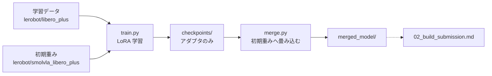
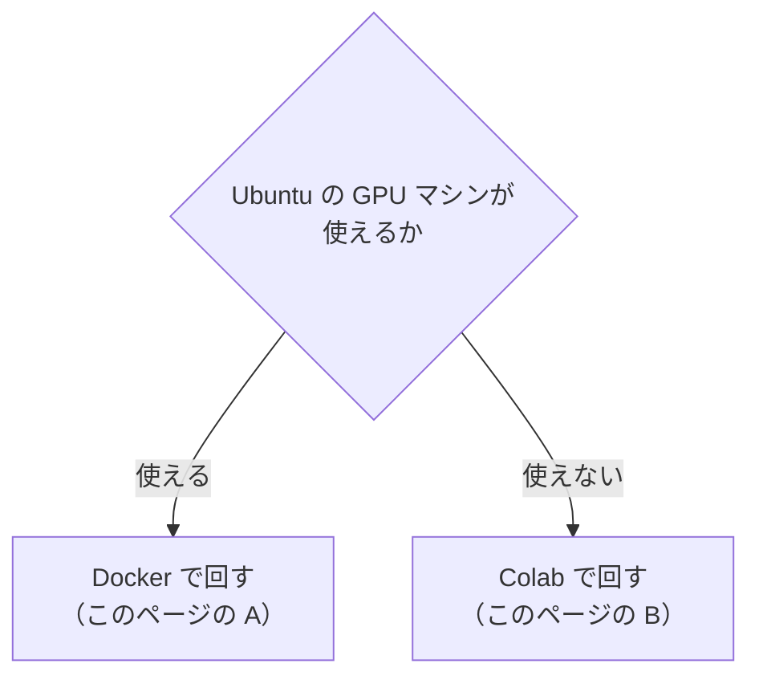

# 01. 再学習する

**この手順を最後まで実行すると、追加学習した重みが `merged_model/` として手元に残る。**
そこから提出物を作る手順は [02_build_submission.md](02_build_submission.md) にある。

## 先に読むこと：学習は最優先である

> **かつてここには「いま学習は最優先ではない」と書いてあった。撤回した。**
> 根拠にしていた成功率 0.875 は配布された 4 タスクでの数字で、同じ構成の本番は
> 0.096 だった。**手元の数字は本番を表していなかった。**

理由は 2 つある。**1 つ目は資格の問題**で、スコアより重い。

運営 Q&A No.36：

> **独自の学習を行うことが必須**である点（形式変換・名称変更・**推論パラメータ
> 変更のみの提出は不可**）は従来どおりですので、ご留意ください。

推論のつまみだけを変えた提出は、**スコアが出ても認められない。**

**2 つ目は、つまみでは届かないところに壁があること。** 本番 8 エピソードのうち
4 本は、つまみを 2 通り変えても**どちらの回も 300 歩を使い切ってゴールに
届いていない**（[../strategy/05_実測結果.md](../strategy/05_実測結果.md)）。
滑らかさの調整で動く場所ではない。

**狙いどころ。** 出発点の重みはすでに LIBERO-plus 14,347 エピソードで
20,000 歩の全パラメータ学習を済ませている（[../reference/01_base_model.md](../reference/01_base_model.md)）。
**同じことを小さくやり直すと劣化する。** ずれているのは分布ではなく目的で、
学習データは「ゴールに着いたか」で選ばれており、**採点を左右する衝突の条件を
一度も見ていない。** 300 歩での測定では、背景テクスチャが変わったときの成功率が
0.60（照明は 0.82）と落ち込んでもいる。

## 0. GPU マシンで始めるとき：Claude の設定を持ち込む

**このリポジトリを clone しただけでは足りない。** Claude 側の方針と skill は
`~/.claude/` にあり、git の管理外である。無いと「日本語は日常語で」
「コミットするパスは英語で」「一次情報を出典にする」を知らない状態から始まる。

手元のマシンで固めて、GPU マシンへ渡す。

```bash
bash solution/tools/export_claude_setup.sh          # work/claude-setup.tgz ができる
scp work/claude-setup.tgz <GPU マシン>:~/
```

GPU マシン側で展開する。

```bash
mkdir -p ~/.claude && tar xzf ~/claude-setup.tgz -C ~/.claude
ls ~/.claude/skills/                        # 7 個並ぶ
grep -c "How to apply" ~/.claude/CLAUDE.md  # 3 と出る
```

**認証情報は入っていない。** GPU マシンでは `claude` を改めて認証すること。

> `Ignoring unknown extended header keyword 'LIBARCHIVE.xattr...'` が並ぶ版が
> あった。**展開は成功していた**が（Linux の tar が macOS の拡張属性を
> 読み飛ばしていただけ）、失敗と見分けが付かないので送る側で載せないようにした。
> 上の 2 行で中身を確かめれば、警告の有無に関わらず判断できる。

## 全体像



**LoRA（Low-Rank Adaptation）**とは、元のモデルの重みを凍結したまま、小さな
差分行列だけを学習する方式である。学習が終わった時点では**差分しか無い**ため、
そのままでは推論に使えない。元の重みへ足し込む操作を**マージ**と呼び、
`merge.py` がこれを行う。

## どちらで回すか



| | Colab | Docker（GPU マシン） |
|---|---|---|
| 時間の上限 | **セッションが切れる**（実際 9,100 ステップで切れた） | 無し |
| 出力 | Drive へ同期しないと消える | **ホストのディレクトリに残る** |
| 切断対策 | [../solution/COLAB.md](../solution/COLAB.md) の A〜F の仕掛けが要る | 不要 |
| 再現性 | ノートブックの手動編集 | **イメージと引数で固定** |

**使えるなら Docker を選ぶ。** Colab は上限で切れるのが確定しており、
そのための仕掛けを維持し続ける必要がある。

---

# A. Docker で回す

使うファイルは `solution/train/` の 3 つで完結する。

| ファイル | 役割 |
|---|---|
| [../../solution/train/Dockerfile](../../solution/train/Dockerfile) | 学習用イメージ。LeRobot v0.6.0 と GPU torch |
| [../../solution/train/train.py](../../solution/train/train.py) | エピソードの選択 ＋ 学習の実行 |
| [../../solution/train/merge.py](../../solution/train/merge.py) | LoRA を初期重みへ畳み込む |

## A-0. 前提を確かめる

**コンテナに CUDA は入れない。** torch の wheel に同梱されたものを使うため、
ホストに要るのは NVIDIA ドライバだけである。

```bash
nvidia-smi                                    # ドライバが入っていること
docker run --rm --gpus all ubuntu nvidia-smi  # nvidia-container-toolkit が効くこと
```

2 つ目が通らなければ
[nvidia-container-toolkit](https://docs.nvidia.com/datacenter/cloud-native/container-toolkit/latest/install-guide.html)
を入れる。

## A-1. イメージを作る

```bash
docker build -t parc2026-train solution/train
```

最後にこの行が出れば成功である。

```
torch 2.11.0+cu128 / torchcodec 0.11.1 整合
```

ホストのドライバが cu128 に対応していなければ index を変える。
`nvidia-smi` の `CUDA Version:` の欄を見て決める。

| 状況 | 指定 |
|---|---|
| **12.8 以上** | そのまま |
| 13.0 以上でそちらに寄せたい | `--build-arg TORCH_INDEX=https://download.pytorch.org/whl/cu130` |
| x86_64 のマシンで GPU 無しに配線だけ見る | `--build-arg TORCH_INDEX=https://download.pytorch.org/whl/cpu` |

> **`cpu` は arm64（Apple Silicon など）では通らない。**
> torchcodec 0.11.1 の aarch64 向け wheel が `cpu` の index に無く、0.13.0 からしか
> 置かれていない（`cu128` / `cu130` にはある）。**0.13.0 へ上げる逃げ道も無い**
> ——LeRobot が `torchcodec<0.12.0` と宣言しているため、後続の
> `pip install lerobot[training]` で 0.11.x へ引き戻され、同じ壁に当たる。
>
> **arm64 で配線だけ見たいときは `cu128` を指定する。** GPU が無くても import は通る。

> ### なぜ torch と torchcodec を対で固定しているのか
>
> `torchcodec`（動画のデコーダ）は torch の ABI に直接リンクしているのに、
> **依存を一切宣言しない**。LeRobot 側の宣言も `torch>=2.7,<2.12` と
> `torchcodec>=0.3.0,<0.12.0` という緩いものでしかない。
>
> つまり **pip は不整合を検出できない。インストールは成功し、実行時に落ちる。**
> しかも落ちるのは最初のバッチを読むときなので、**学習データ 6.4 GB を
> 落としきったあと**である。
>
> Dockerfile は LeRobot v0.6.0 の `uv.lock` が解決した対
> （torch 2.11.0 / torchcodec 0.11.1）に固定し、**ビルドの最後で
> `VideoDecoder` を import して、崩れていればビルドを失敗させている。**
>
> **このチェックは消してはいけない。** LeRobot 側の自動フォールバックは
> `importlib.util.find_spec("torchcodec")` で判定しており、
> **入ってさえいれば壊れていても「使える」と答える。**
>
> ### 版だけでなく CUDA の系統も揃える（2026-08-10 に踏んだ）
>
> `TORCH_INDEX` は **torch と torchcodec の両方**に効かせる必要がある。
> torchcodec の README いわく「Linux では CUDA 入りの wheel が既定で入り、
> GPU が無くても動く」。ただしそれは `libnvrtc` があればの話である。
>
> `--index-url` を省いて PyPI から取ると、CPU 版の torch と組んだ時点で落ちる。
>
> ```
> OSError: libnvrtc.so.13: cannot open shared object file
> ```
>
> PyPI の 0.11.1 が要求するのは `.so.13`（CUDA 13）なので、
> **cu128 の torch（`.so.12` を持ってくる）と組んでも同じ失敗になる。**
> Dockerfile 側は修正済みで、両方に `--index-url ${TORCH_INDEX}` が付いている。
>
> **index ごとの 0.11.1 の在りか**（2026-08-10 に確認）。
>
> | index | x86_64 | aarch64 |
> |---|---|---|
> | PyPI（既定） | あり（CUDA 入り） | あり（CUDA 入り） |
> | `cpu` | あり | **無い（0.13.0 から）** |
> | `cu128` | あり | あり |
> | `cu130` | あり | あり |

## A-2. 学習する

```bash
mkdir -p work/train

docker run --gpus all --rm -it \
    -v "$PWD/work/train:/out" \
    -v "$HOME/.cache/huggingface:/root/.cache/huggingface" \
    parc2026-train \
    python /workspace/train.py --steps 20000 --batch-size 8
```

**HF のキャッシュをホストへマウントすること。** しないとコンテナを作り直すたびに
学習データ 6.4 GB を取り直すことになる。

主な引数は次のとおり。既定値は Colab で回していた条件に揃えてある。

| 引数 | 既定 | 意味 |
|---|---|---|
| `--steps` | `20000` | 学習率はこの値をかけて減衰する。途中で止めると焼き鈍しが効かない |
| `--batch-size` | `8` | VRAM に合わせる。Colab の T4 では 4 が上限だった |
| `--episodes-per-task` | `5` | 全 40 タスクから選ぶ。5 を超えると転送量が 6.4 GB → 15.8 GB に跳ねる |
| `--num-workers` | `4` | 動画デコードが律速。Colab は 0 だったのでここが効く見込み |
| `--save-freq` | `500` | チェックポイントの間隔 |
| `--no-image-transforms` | — | 付けると画像拡張を切る（既定は有効） |
| `--video-backend` | `torchcodec` | `pyav` に切り替えられる。デコーダが壊れたときの逃げ道 |

実行すると、まず選んだエピソードの確認が出る。

```
[train] 40 タスク × 5 本 = 200 エピソード
[train]   選んだ分の明るさ 0.086 〜 0.723
[train]   データセット全体 0.086 〜 0.723
```

**この 2 行が一致していれば、明るさで散らす選び方が効いている。**
評価側には照明を変える摂動があるため、暗い場面から明るい場面までを
学習に入れておく必要がある。

## A-3. 中断したときに再開する

```bash
docker run --gpus all --rm -it \
    -v "$PWD/work/train:/out" -v "$HOME/.cache/huggingface:/root/.cache/huggingface" \
    parc2026-train \
    python /workspace/train.py --resume
```

最新のチェックポイントを数値順で選び、**最小限の引数だけ**渡す。

```
lerobot-train
--resume=true
--config_path=/out/<run-name>/checkpoints/009000/pretrained_model/train_config.json
--output_dir=/out/<run-name>
--batch_size=8 --num_workers=4 --persistent_workers=true --save_freq=500
```

**再開時に学習条件を渡し直してはいけない。** 条件はチェックポイントの
`train_config.json` から復元される。重ねて渡すと元の条件を上書きしてしまう。

| 引数 | 再開時に渡すか | 理由 |
|---|---|---|
| `--policy.*` | **渡さない** | `--policy.path` は `_resolve_pretrained_from_cli()` が優先するため、渡すと**再開が黙って無視される** |
| `--dataset.*` | **渡さない** | エピソードの選択も画像拡張も config に入っている |
| `--steps` | **渡さない** | 学習率は `scheduler_decay_steps` で決まる。変えるとスケジュールが途中で別物になる |
| `--output_dir` | **必ず渡す** | config には**元の環境のパス**（Colab なら `/content/outputs/...`）が入っている |
| `--batch_size` / `--num_workers` / `--save_freq` | 渡してよい | 学習条件を壊さない |

## A-4. Colab で作ったチェックポイントから続ける

**必要なのは 2 つのディレクトリで、両方揃っていないと再開できない。**

```
work/train/<run-name>/checkpoints/009000/
├── pretrained_model/
│   ├── config.json                                      … 方策の設定
│   ├── adapter_model.safetensors                        … LoRA の重み
│   ├── train_config.json                                … 学習条件（--config_path が指す先）
│   ├── policy_preprocessor.json / *.safetensors         … 前処理
│   └── policy_postprocessor.json / *.safetensors        … 後処理
└── training_state/
    ├── optimizer_state.safetensors                      … 最適化器
    ├── optimizer_param_groups.json
    ├── scheduler_state.json                             … 学習率スケジュール
    ├── rng_state.safetensors                            … 乱数
    └── training_step.json                               … **何ステップ目か**
```

Drive から丸ごと持ってくればよい。

```bash
mkdir -p work/train/smolvla_lora_all_suites
cp -r "<Drive>/parc2026/260809_smolvla_lora_multiple_suites_001/train/checkpoints" \
      work/train/smolvla_lora_all_suites/

# 中身の確認。両方あることを必ず見る
ls work/train/smolvla_lora_all_suites/checkpoints/009000/
```

**ディレクトリ名はゼロ埋め 6 桁である**（桁数は `max(6, len(str(steps)))`）。
`--steps 20000` なら `009000` になる。

**`training_state/` を持ってこないと `NotADirectoryError` になる。**
`pretrained_model/` だけコピーすると、再開ではなく「そのチェックポイントを
初期重みとして最初から学習」に近い状態になってしまう。

### ステップ数をコードに伝える必要は無い

`load_training_state` が `training_state/training_step.json` から読む。
`train.py` はチェックポイントのディレクトリを数値順に並べて最新を選ぶだけで、
何ステップ目かは一切渡していない。

### バッチサイズは変えても構わない

Colab では VRAM の都合で小さくしていたはずだが、GPU マシンでは上げてよい。
食い違うと次の警告が出るが、**エポックとオフセットは正しく復元される。**

```
Resuming with batch_size=8 but the checkpoint was written with batch_size=4.
The data order resumes at the right epoch/offset, but per-rank sample-exactness
requires the same batch size.
```

サンプル単位で完全に同じ順序にはならない、というだけの話である。

## A-5. マージする

**学習しただけでは提出できない。** チェックポイントには LoRA の差分しか入っていない。

```bash
docker run --rm -it \
    -v "$PWD/work/train:/out" -v "$HOME/.cache/huggingface:/root/.cache/huggingface" \
    parc2026-train \
    python /workspace/merge.py
```

**GPU は不要**なので `--gpus` は付けなくてよい。`--step` を省略すると最新を使う。

出力は `work/train/<run-name>/merged_model/` である。
**ここまで来たら [02_build_submission.md](02_build_submission.md) へ進む。**

---

# B. Colab で回す

セルの書き換えが必要なため、手順は [../solution/COLAB.md](../solution/COLAB.md)
にある。**A〜H の順に読んで差し込む。**

| セル | 何をするか | なぜ必要か |
|---|---|---|
| A | Drive のマウントと同期ヘルパー | セッションが切れると `/content` は消える |
| B〜D | 学習条件の追加と、学習セルの修正 | 途中経過を Drive へ逃がす |
| E | マージ済みモデルを Drive へ | 持ち帰るのはこれ |
| H | 学習データの選び方を変える | 40 タスク・明るさで散らす・画像拡張 |

**300 秒ごとに Drive へ同期する。** セッションが切れても、直近の
チェックポイントから A-4 の手順で続きを回せる。

## 途中で打ち切るとき

学習率がどこまで落ちているかで、打ち切ってよいかが決まる。
`--steps 20000` のコサイン減衰なら次のとおりである。

| 打ち切り | 学習率 | 使えるか |
|---|---|---|
| 5,000 | 2.6e-4（ピークの 87%） | **まだ早い。** 焼き鈍しが全く効いていない |
| 9,000 | 1.8e-4（61%） | 実際にここで切れた。使えなくはないが物足りない |
| 15,000 | 7.4e-5（25%） | **実用の下限** |
| 20,000 | 3.0e-5 | 想定どおり |

詳細は [../solution/COLAB.md](../solution/COLAB.md) の
「途中のチェックポイントで打ち切るとき」にある。

---

## つまずいたとき

| 症状 | 原因 | 対処 |
|---|---|---|
| データを落としきったあと `undefined symbol` で落ちる | torch と torchcodec の版が対になっていない | A-1 のイメージを作り直す。それでも駄目なら `--video-backend pyav` |
| `--resume` したのに step 0 から始まる | `--policy.path` を渡している | A-3 の表のとおり、最小限の引数だけにする |
| `NotADirectoryError` | `training_state/` が無い | A-4 のとおり両方コピーする |
| 毎回 6.4 GB を落とし直す | HF キャッシュをマウントしていない | `-v "$HOME/.cache/huggingface:/root/.cache/huggingface"` |
| 学習は終わったのに推論で使えない | マージしていない | A-5 を実行する |
