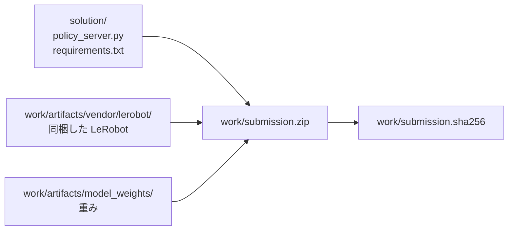
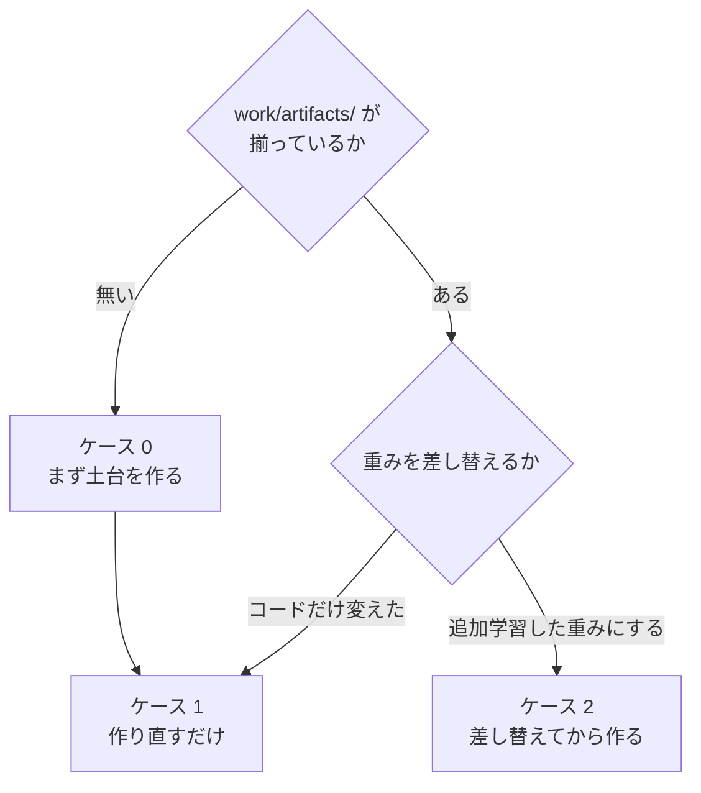

# 02. 提出物の zip を作る

**この手順を最後まで実行すると、Omnicampus へ出せる `work/submission.zip` ができる。**

追加学習した重みを使う場合は、先に
[01_retrain.md](01_retrain.md) を終えて `merged_model/` を用意しておく。

## 全体像

提出物は 2 か所から集める。**コードは `solution/` が正で、生成物だけが `work/` にある。**



コピーで同期させる運用にすると必ずどちらかが古くなるため、
`build_submission.py` は zip 化のときに両方から直接束ねる。

`work/` は git 管理外である。**壊しても下の手順で丸ごと作り直せる。**

## 自分がどの場合かを選ぶ



| | いつ | 所要 |
|---|---|---|
| ケース 0 | リポジトリを clone した直後、`work/` を消したとき | 20 分 |
| **ケース 1** | **`policy_server.py` を変えたとき（いちばん多い）** | **2 分** |
| ケース 2 | 学習した重みを載せるとき | 5 分 |

---

# ケース 1. 作り直すだけ

```bash
work/venv310/bin/python solution/tools/build_submission.py
```

これだけである。出力はこうなる。

```
[build] 検証     547 エントリ一致、必須構成あり
[build] 547 files / 918 MB
[build] sha256 8ed91671fdeb70a4f6b87866940dd87503ada9005c84797d5c41028fd175fc5e
[build] ハッシュを保存: work/submission.sha256
```

**`[build] 検証` の行が出ていることを必ず確かめる。** これが出ないビルドは信用しない。
何を検証しているかは[下の節](#zip-を書いたあとに自動でしていること)にある。

---

# ケース 2. 追加学習した重みに差し替える

入力は [01_retrain.md](01_retrain.md) が出す `merged_model/` である。これは GPU マシンで学習した結果をディレクトリごとコピしてくれば良い。

```bash
# 1. 検査だけする（何も書き換えない）
work/venv310/bin/python solution/tools/install_weights.py \
    work/train/smolvla_lora_all_suites/merged_model --dry-run

# 2. 問題なければ取り込む
work/venv310/bin/python solution/tools/install_weights.py \
    work/train/smolvla_lora_all_suites/merged_model

# 3. zip を作る
work/venv310/bin/python solution/tools/build_submission.py
```

## なぜ手でコピーしてはいけないのか

**マージセルの出力には `vlm/` が含まれない。** SmolVLM の設定とトークナイザは
いま `model_weights/vlm/` にあるものを引き継ぐ必要がある。
`install_weights.py` はこれを機械的に行う。手作業では必ず取りこぼす。

さらに、取り込む前に次を検査し、**1 つでも引っかかれば書き換えずに中止する。**

| 検査 | 見逃すと何が起きるか |
|---|---|
| 必須ファイルが揃っているか | 採点環境でモデルロードに失敗して 0 点 |
| `config.json` の `use_peft` が偽か | **LoRA が未マージのまま提出**（学習の効果がゼロ） |
| `model.safetensors` に `lora_` が残っていないか | 同上 |
| テンソル構成が既存と一致しているか | `MyPolicy` が重みを読めない |

## 戻し方

**既存の重みは削除せず `work/artifacts/model_weights.bak/` へ退避される。**
追加学習の結果が悪ければ、この 1 行で素の重みへ戻せる。

```bash
rm -rf work/artifacts/model_weights && \
  mv work/artifacts/model_weights.bak work/artifacts/model_weights
```

---

# ケース 0. 土台を作る

`work/artifacts/` が無い状態から始める。**3 つ作れば、あとはケース 1 に合流する。**

## 0-1. Python 3.10 の venv を作る

```bash
export UV_CACHE_DIR="$TMPDIR/uvcache"
uv venv --python 3.10.12 work/venv310
```

採点環境と同じ 3.10.12 に合わせる。

## 0-2. LeRobot を同梱用に書き換える

採点環境は Python 3.10 だが、**LeRobot v0.6.0 は `requires-python >= 3.12` を
宣言している**ため `pip install` できない。ソースを取得し、3.12 専用の構文と API
だけを書き換えて提出物へ同梱する。

```bash
python3 -c "
import io, tarfile, urllib.request, pathlib, shutil
url = 'https://codeload.github.com/huggingface/lerobot/tar.gz/refs/tags/v0.6.0'
data = urllib.request.urlopen(url, timeout=300).read()
dest = pathlib.Path('work'); target = dest / 'lerobot-src'
if target.exists(): shutil.rmtree(target)
with tarfile.open(fileobj=io.BytesIO(data), mode='r:gz') as tf:
    root = tf.getnames()[0].split('/')[0]; tf.extractall(dest)
(dest / root).rename(target)
"

work/venv310/bin/python solution/tools/vendor_lerobot.py \
    --python310 work/venv310/bin/python
```

`vendor_lerobot.py` は**置換対象が 1 箇所でなければ例外にする**。
LeRobot のバージョンが変われば、黙って壊れずにその場で落ちる。

## 0-3. 重みを置く

**VLM の `model.safetensors` は含めない。** VLM の重みはポリシー側の
チェックポイントに入っているため、設定とトークナイザだけでよい。

| 取得元 | revision | 置き場所 |
|---|---|---|
| `lerobot/smolvla_libero_plus` | `7bb70aa5bc92b82c9239142775d3a173103567ff` | `work/artifacts/model_weights/` |
| `HuggingFaceTB/SmolVLM2-500M-Video-Instruct`（設定とトークナイザのみ） | — | `work/artifacts/model_weights/vlm/` |

```bash
work/venv310/bin/python -c "
from huggingface_hub import snapshot_download
snapshot_download('lerobot/smolvla_libero_plus',
                  revision='7bb70aa5bc92b82c9239142775d3a173103567ff',
                  local_dir='work/artifacts/model_weights',
                  ignore_patterns=['eval/*', 'eval/**'])
snapshot_download('HuggingFaceTB/SmolVLM2-500M-Video-Instruct',
                  local_dir='work/artifacts/model_weights/vlm',
                  allow_patterns=['*.json', '*.txt', '*.model', 'tokenizer*'])
"
```

`eval/`（評価動画 402 ファイル・25.6 MB）は推論に使わないので除外する。

**ここまで来たらケース 1 に合流する。**

## 0-4. 追加学習の効き具合を λ で弱めた重みを提出する

**追加学習が素の重みより悪くなったときの手当てである。**
`θ = θ素 + λ·Δ` を作る（`Δ` は学習で動いた分）。**学習は要らない。**
なぜこれを採るのかは
[../talk/open_items_notes.md](../talk/open_items_notes.md) の 35。

**素の重みそのままは提出できない**（運営 Q&A No.36。独自の学習が必須）。
**λ を下げれば素に近づくが、選ぶのは検証用データの結果で行う** ——
「素にどれだけ近いか」で選ぶと要件の潜り抜けになる。

### ① 混ぜる（2 分・GPU 不要）

```bash
python3 solution/tools/blend_weights.py --lam 0.25 \
    --base       work/artifacts/model_weights.bak \
    --finetuned  work/artifacts/model_weights \
    --output     work/artifacts/model_weights_lam025
```

**`--base` は素の重み、`--finetuned` は追加学習してマージしたもの。**
どちらがどちらかを取り違えると λ の意味が逆になるので、
**先にハッシュで確かめる。**

```bash
shasum -a 256 work/artifacts/model_weights*/model.safetensors | cut -c1-16
```

**混ぜ方が壊れていないことを、両端で確かめられる。**

```bash
# λ=1.0 は --finetuned と、λ=0.0 は --base と 1 バイトも違わないはず
python3 solution/tools/blend_weights.py --lam 1.0 \
    --base work/artifacts/model_weights.bak \
    --finetuned work/artifacts/model_weights --output "$TMPDIR/lam100"
shasum -a 256 "$TMPDIR/lam100/model.safetensors" \
              work/artifacts/model_weights/model.safetensors
```

**BF16 の丸めで壊れやすいので、この確認は省かない。**

### ② 検証用データで評価してから取り込む

**混ぜた重みを 84 件の検証用データで評価する**（Colab なら 45 分。
[../solution/colab_eval/](../solution/colab_eval/README.md)）。
**素の重みの回と 1 件ずつ対にして比べる。**

```bash
python3 solution/tools/summarize_gpu_eval.py \
    --output-dir <混ぜた重みの出力先> --csv <その VAL_TASKS.csv> \
    --compare    <素の重みの出力先>
```

| 満たすべき条件 | 基準 |
|---|---|
| ① 1 件ずつ対にして負けていない | 拾った件数 ≧ 失った件数 |
| ② **グリッパ開閉 20 回以上の割合** | **素の重み以下**（8/11 は 13%） |
| ③ 平均ジャーク | **素の重み以下**（8/11 は 4.223） |

**満たさなければ λ を下げて組み直す**（混ぜは 2 分）。

### ③ 取り込んで zip にする

```bash
# **素の重みを別名で確保してから。** install_weights.py は .bak を上書きする
cp -r work/artifacts/model_weights.bak work/artifacts/model_weights_base

work/venv310/bin/python solution/tools/install_weights.py \
    work/artifacts/model_weights_lam025 --destination work/artifacts/model_weights
work/venv310/bin/python solution/tools/build_submission.py
work/venv310/bin/python solution/tools/validate_submission.py --static
```

> **`.py` を 1 行も変えないなら、リハーサルの枠は要らない。**
> 変わるのが `model.safetensors` の中身だけなら、
> **本番で通った zip と構造が同じ**である。
> **逆に `policy_server.py` を触ったら、提出枠 1 つをリハーサルに充てる**
> （参加者ガイド p.12。最終提出時のエラーに救済措置は無い）。

---

# 指示文の正規化を測る（版 3.5.0 から）

**`/reset` で来た文を、学習データの 40 種のうち最も近いものへ寄せている。**
**寄せ先を出すのと、正しく寄せられるかを測るのは、別の道具である。**

```bash
# 寄せ先 40 種を出す（policy_server.py に貼ってある値の出し方）
python3 solution/tools/instruction_targets.py --emit python

# 正しく寄せられるかを測る（変種 10,030 件・答え合わせ付き。torch 不要）
python3 solution/tools/check_instruction_normalization.py
python3 solution/tools/check_instruction_normalization.py --sweep   # 合格ラインを振って比べる
```

**本番の 2 カテゴリで 1 件でも誤って寄せたら、道具が終了コードを立てて落ちる。**
いま点が取れている場所なので、壊す変更を黙って通さないためである。

| 束 | 渡る文 | 寄せた（正しい） | **誤り** | 触らない |
|---|---|---|---|---|
| **本番の 2 カテゴリ** | **40 種** | **40 種すべて** | **0** | 0 |
| その他の摂動 | 30 種 | 30 種すべて | **0** | 0 |
| 言い換え | 1,527 種 | 468 種 | 4 | 1,055 |

**意味で寄せる道（Q&A No.31 の埋め込み最近傍）は既定で切ってある。**
`--embed` を付けると測れるが、**torch と重みが要るので Docker で回す**
（[03_gpu_eval.md](03_gpu_eval.md) の「指示文の正規化の精度を測る」）。

**採点ログで本番の中身が読める。** エピソードごとに次の行が出る。
**指示文そのものは出さない**（非公開タスクの特定に使えてしまう）。

```
[parc] reset  normalize=lexical score=0.708
```

| 出る語 | 意味 |
|---|---|
| `exact` | 学習と同じ文が来た（小文字化だけ） |
| `lexical` | **寄せた。** 語の重なりで 1 つに絞れた |
| `unchanged` | **迷ったので何もしなかった。** これが出れば言い換えが来ている |
| `off` | `PARC_NORMALIZE_INSTRUCTION=0` で切ってある |

---

# 出来上がった zip を確かめる

## zip を書いたあとに自動でしていること

`build_submission.py` は zip を書いたあと**開き直して**次を確認する。

| 確認 | なぜ |
|---|---|
| エントリの集合が一致するか | 書き込み漏れ |
| `policy_server.py` と `requirements.txt` がバイト単位で一致するか | **過去に「zip の中の `requirements.txt` だけ古い」事故を起こしている** |
| `model_weights/vlm/` と `vendor/lerobot/` があるか | どちらも欠けると起動に失敗する |
| `requirements.txt` に `lerobot` / `evdev` が無いか | 下記 |

> **`requirements.txt` に `lerobot` を書いてはいけない。**
> 採点環境では `pip install lerobot` が失敗する（依存の `evdev` がビルドできない）。
> 実際にこれで採点エラーになった参加者がいる。同梱方式では不要なので、
> うっかり書き足すと採点 1 回分を無駄にする。

## 採点環境に近い形で動かす

**ローカル（macOS）では採点環境を再現できない。** CUDA が無く、`torchvision` は
CUDA 13 ビルドのため import できない。**検証は Docker コンテナで行う。**

```bash
docker build -t parc2026 .
docker run -it --rm -v "$PWD/work:/host_work" parc2026
```

コンテナ内では、本番と同じく `--system-site-packages` 付きの提出物専用 venv を作る。

```bash
/usr/bin/python3.10 -m venv --system-site-packages /opt/subvenv
echo /workspace/venv/lib/python3.10/site-packages \
  > /opt/subvenv/lib/python3.10/site-packages/_kit_site_packages.pth
/opt/subvenv/bin/pip install -r /sub/requirements.txt

# ローカル検証時のみ。配布 Docker の torch は +cpu のため、
# PyPI の CUDA 13 ビルドの torchvision は import できない。
/opt/subvenv/bin/pip install --no-deps --force-reinstall \
  --index-url https://download.pytorch.org/whl/cpu torchvision==0.26.0

cd /workspace && /opt/subvenv/bin/python validate_submission.py /sub/submission.zip
```

> **`HF_HOME` を空ディレクトリに向け、`HF_HUB_OFFLINE=1` を立てて検証すること。**
> そうしないと、採点環境（通信遮断）でだけ起きる Hub アクセスの失敗を見逃す。

環境をまたいだときは、内容が一致しているかを確認する。

```bash
work/venv310/bin/python solution/tools/digest_submission.py --per-entry
```

## 既知のハッシュ

`work/` は git 管理外なので zip 自体は残らない。**素の重みで組んだ提出物の
ハッシュを記録しておく。** 作り直したときにこの値と一致すれば、
同じものが再生成できたと言える。

`policy_server.py` の先頭に `__version__` を置いてある。**採点ログの先頭に
構成が出る**ので、スコアと提出物の対応が後から辿れる。

```
[parc] policy_server 1.0.0  device=cuda  n_action_steps=5  ema_alpha=0.3  blend_steps=0  samples=1
```

| 版 | 重み | 設定 | sha256 | **本番スコア** |
|---|---|---|---|---|
| **0.1.0** | 素（`7bb70aa5`） | 後処理なし（n=50） | `f80abc7b…` | **0.05832** |
| **0.2.0** | 素 | n=10 | `8ed91671…` | **0.096** |
| **0.3.0** | 素 | n=5 ＋ EMA 0.3 | `c1685507…` | **0.1409** |
| **1.0.0** | LoRA 20,000 歩（均等） | 0.3.0 と同じ | `420aff5d…` | **0.016** |
| **2.0.0** | λ=0.25 ブレンド（素 75% ＋ 1.0.0 の学習分 25%） | 同じ | （zip の sha は未記録） | **0.09507** |
| **3.0.0** | weak3x（苦手 3 倍 ＋ 手本 300 歩超を落とす） | n=5 | `58751a22…` | **0.144**（成功 3/8。素 0.1409 と同水準・**学習済みで初めて到達**） |
| **3.1.0** | weak3x | **n=2** | `47ca6ff8…` | **0.166**（天井の 1 本を解いた。**資格ありの最高**） |
| **3.2.0** | weak3x | n=5・samples=3 | `2ef66638…` | 未提出（n=5 が n=2 に負けたため保留） |
| **3.3.0** | weak3x | **n=1** | `c3b8b901…` | **0.080**（**本物の悪化。1.9 本ぶん**） |
| **3.4.0** | weak3x | **n=2 ＋ samples=3** | `ff9b1b03…` | **0.168**（0.166 と **0.04 本ぶん**の差＝**同じ**。時間は 2.7 倍） |
| **3.5.0** | weak3x | **指示文の正規化**（n=2・**samples=1**。3.1.0 から 1 変数） | `8c53248f…` | **0.181 ← 過去最高**（重みを変えずに ep2 が 300→94 歩、ep7 が 300→155 歩） |
| **3.6.0** | weak3x | **n=2 → 5**（3.5.0 から 1 変数。正規化・EMA・samples は据え置き） | `046472fe…` | **0.184 ← 過去最高。しかも 272 秒**（3.5.0 の 487 秒の 56%）。1 歩 0.154 秒で見積もり 0.16 と一致 |
| **3.6.1** | weak3x | **`reset` の印字を完全に落とす**（挙動は変わらない＝patch） | 8/13 は `28be5eab…`／**8/14 に組み直して `e5fdfd3b…`** | **最終提出はこれ**（挙動は 3.6.0 と同じで 0.184 相当） |
| **3.7.0** | weak3x | **n=5 → 8**（3.6.1 から 1 変数） | `97d4e7af…` | 未提出（**用意済み。落ちたら 3.6.1 に戻す**） |
| **3.8.0** | **π0.5 24,000 歩**（`model_weights_pi05_024000`。SmolVLA ではない） | n=10・`num_inference_steps`=10・EMA 0.3・正規化入り | `ea951d5d…` | **0.177**（8/14。**weak3x 0.184 に 0.007 届かなかった**。ただし 183.1 秒＝3.6.0 の 272 秒の 67%） |

> **【8/14 13:10】3.8.0 は 0.177 で、weak3x の 0.184 に 0.007 届かなかった。**
> 採点ログは `outputs/260814_114832_pi0.5_bench.md`。**8 本のうち 6 本が
> 300 歩より前に終わっているのに点は上がらなかった** ——衝突でも早く終わるので、
> 歩数から成功本数は読めないという戒めの 4 度目の確認である
> （ep3 と ep7 だけが 300 歩に張り付いた）。
> **1 歩あたり 0.128 秒**（1,428 歩で 183.1 秒）で、事前の見積もり 0.095 秒より
> 遅いが、**3.6.0 の 0.154 秒より速い**のは当たった。
> **【8/14 13:50 訂正】「予選の最終提出は 3.6.1 に決めた」は取り消す。**
> **0.007 は勝ち負けを分ける幅ではない**（8 本しか走っておらず、しかも
> **総合スコアは成功率だけではない** ——
> [../reference/17_scoring_formula.md](../reference/17_scoring_formula.md)）。
> **3.6.1 は「そのまま出せる保険」として確保し、π0.5 は n=16 で測り直す。**
>
> **8/14 に 3.6.1 を組み直した。** 8/13 の zip は消えていたため
> `git checkout efe7fb5 -- solution/policy_server.py solution/requirements.txt` で
> 3.6.1 のコードに戻し、`--weights work/artifacts/model_weights_weak3x` で組んだ。
> **sha は `28be5eab…` と一致しない**（`archive.write` がファイルの更新時刻を
> zip に焼くため、vendor を作り直した時点でハッシュ一致は原理的に望めない）。
> **一致を確かめたのは中身である**: `policy_server.py` と `requirements.txt` は
> `efe7fb5` のバイトと一致、`model.safetensors` は `model_weights_weak3x` と一致、
> `validate_submission.py --static` は PASS。
>
> **このとき `model_weights/vlm/.cache/huggingface/` の 14 個が紛れ込んだ**
> （`snapshot_download` が重みの隣に作るダウンロード履歴）。
> **`build_submission.py` の除外リストに `.cache` を足して直した。**
>
> **3.8.0 だけモデルが違う。** 中身は π0.5（4.14B。SmolVLA の約 9 倍）で、
> `policy_server.py` は**重みの `config.json` の `type` を見て切り替える**。
> **SmolVLA の道は 1 行も変えていない**ので、3.7.0 以前の zip は作り直せば
> そのまま同じ挙動になる。
>
> **組み方が 2 つだけ違う。**
> - 重みは `--weights` で場所を指す（`build_submission.py`。zip の中では
>   `model_weights/` に固定される）。**本物のディレクトリを退避させない**
> - `model_weights/vlm/` に入れるのは **paligemma のトークナイザ**である
>   （SmolVLA では SmolVLM のもの）。π0.5 が外から要るのはこれだけで、
>   PaliGemma 本体は設定から組み立てられる
>
> **手元の 36 件では 0.667**（素 0.583・LoRA20k 0.528。同じ一覧・同じ 300 歩）。
> **ゴール到達は 0.861 で、落とした 7 件はすべて「届いたのに 1mm 動かして失格」**
> である。測定は `work/gpu_eval/0814_091240_pi05_24k_n10_ep1_max300/summary.txt`。
>
> **時間の心配は無い**（H100-20C 実測）。1 推論 **0.303 秒**で `/act` の 10 秒に
> 33 倍の余裕。1 歩は `0.065 + 0.303/10 = 0.095 秒`の見込みで、
> **n=5 の SmolVLA（0.154 秒）より速い。**

> **3.6.0 の狙いはスコアではなく打ち切りである。** 予選 PDF p.12 の
> 「Track 評価に 1 時間以上かかる場合はタイムアウト」に、採点 10 回ぶんの
> 秒数と歩数から出した `0.065 秒 + 0.464 秒 / n`（1 歩あたり）を当てると、
> **n=2 は 1 本 300 歩で 90 秒 → 39 本で上限、n=5 は 48 秒 → 74 本**まで持つ。
> **予選最終評価の件数は非公開**で、運営は「リーダーボードとは総 Trial 数が
> 異なる」と明言している（リーダーボードは 8 本）。
> **n=2 と n=5 のスコア差 0.022 は 0.5 本ぶんで測れない。**
> 測れない 0.5 本のために 0 になる目を買わない、という判断である。
>
> **同時に `[parc] reset` の点数の印字を落とした**（挙動は変わらない）。
> 3.5.0 の採点ログで点数が **0.851, 0.851, 0.819, 0.819, 0.972, 0.972,
> 0.902, 0.902** と並び、**4 タスク × 2 エピソード**と読めたうえ、手元の
> 10,030 変種と突き合わせれば**タスク名まで特定できてしまう。**
> 運営 Q&A No.33 が禁じるのはまさにこれなので、**特定できる状態を消した。**

> **3.5.0 は samples を 1 に戻してある。** 一度 samples=3 で組んだ
> （`c97b0b2e`）が、3.4.0 の結果で **samples の軸が閉じた**ので破棄した。
> **これで 3.1.0（0.166）との差は正規化だけになる。**

> **3.5.0 が変えるのは `/reset` で受け取る文だけである。** 本番の 2 カテゴリで
> 渡ってくる文は **40 種**しかなく、そのうち **25 種が学習データの書き方と
> ずれている**（配布 4 タスクの CSV が `Pick the akita black bowl …` を渡すのに、
> 学習データは `pick up the black bowl …`）。**40 種すべてを正しく寄せ、誤りは 0**
> だった（変種 7,280 件で実測。下の「指示文の正規化を測る」）。

**`n_action_steps` の実測（weak3x・EMA 0.3・samples=1 で固定＝n だけの差）。**

| n | 本番 | 早く終わった回 | 読み |
|---|---|---|---|
| 5 | 0.144 | 4/8 | — |
| **2** | **0.166** | 4/8 | **最良。天井の 1 本（ep3）を 300→202 に解いた** |
| 1 | **0.080** | 3/8 | **悪化。成功も滑らかさも落ちた** |

> **n=1 の悪化は講義資料が説明している**（`docs/第7回 講義資料part1.pdf` p.10）。
> 「**k が短すぎる（k=2）／チャンク境界のたびに分布から別のモードをサンプルしうる
> → mode-jumping・jerky（ガクガク）な動き**」。n=1 は毎歩がその境界になる。
> 逆に「k が長すぎる（k=100）」は open-loop 区間が伸びて応答性が落ちる。
> **一般には k=16〜32 が普通**で、我々が n=2 で最良なのは**モデルが弱く、
> 誤差の蓄積を頻繁に打ち切る必要がある**ためと読める。
> **モデルが強くなれば最適な n は上がる**（＝いま n を触る余地は小さい）。

> **版と本番ログの表示がずれている点に注意。** 1.0.0 の採点ログには
> `policy_server 0.3.0` と出ている（版を上げる前に重みだけ差し替えて出したため）。
> **重みとスコアの対応はこの表が正で、ログの版文字列ではない。**

0.1.0 はタグ `scored-0.05832` に対応する。**版の上げ方**は次のとおり。

| 桁 | 上げるとき |
|---|---|
| major | **重みが変わったとき**（追加学習の反映など） |
| minor | 推論の挙動が変わったとき（既定値の変更、後処理の追加） |
| patch | 挙動が変わらない修正 |

**本番で通ったことが確実なのはタグ `scored-0.05832` である。**
何かがおかしくなったときはここへ戻る。

```bash
git checkout scored-0.05832 -- solution/policy_server.py solution/requirements.txt
```

一致しない場合は、LeRobot のバージョン・重みの revision・`requirements.txt` の
いずれかが変わっている。追加学習した重みに差し替えれば当然変わる。

---

# 提出する

Omnicampus に `work/submission.zip` をアップロードする。

| 制約 | 値 |
|---|---|
| 提出回数 | **1 日 1 回**。採点が完了した時点で消費される |
| エラーで失敗したとき | **枠は消費されない**（運営 Q&A No.18） |
| サーバー起動 | 120 秒以内（実測 38 秒） |
| `/act` 1 回 | 10 秒以内（実測 0.85 秒） |
| トラック全体 | 1 時間以内（実測 147.6 秒） |

**出す前に、ローカル評価で成功率を確かめておくこと。**
ローカル評価は本番スコアを再現する（[../strategy/05_実測結果.md](../strategy/05_実測結果.md)）ので、
1 日 1 回の枠を試行錯誤に使う必要は無い。手順は
[../solution/colab_eval/](../solution/colab_eval/README.md) にある。

**スコアが返ってきたら、ハッシュと一緒に
[../strategy/05_実測結果.md](../strategy/05_実測結果.md) へ記録する。**
どの zip が何点だったかを後から辿れなくなると、比較ができなくなる。

---

## つまずいたとき

| 症状 | 原因 | 対処 |
|---|---|---|
| `[build] 検証` の行が出ない | 古い `build_submission.py` | `git pull` してやり直す |
| `requirements.txt に lerobot` で中止する | 同梱方式では不要な行を足した | その行を消す |
| `install_weights.py` が `use_peft が真` で中止する | マージしていないチェックポイントを渡した | [01_retrain.md](01_retrain.md) の A-5 を実行する |
| 採点で「モデルロードに失敗」 | `model_weights/vlm/` が欠けている | ケース 0 の 0-3 をやり直す |
| 採点で `evdev` のビルドエラー | `requirements.txt` に `lerobot` を書いた | 上と同じ |
| 追加学習したのにスコアが変わらない | LoRA が未マージ | `--dry-run` の検査結果を読む |
