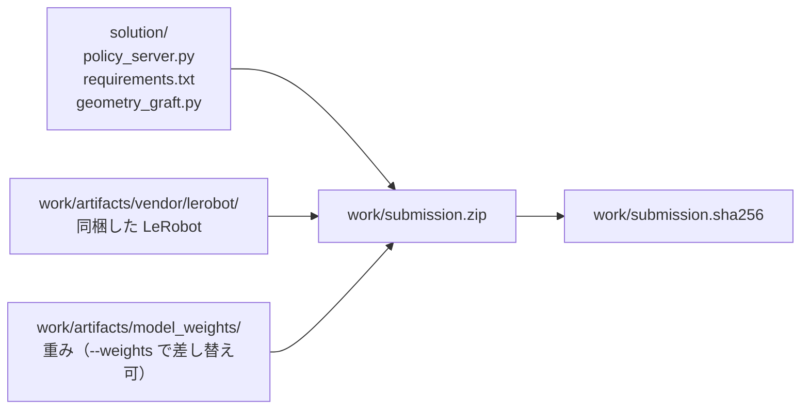
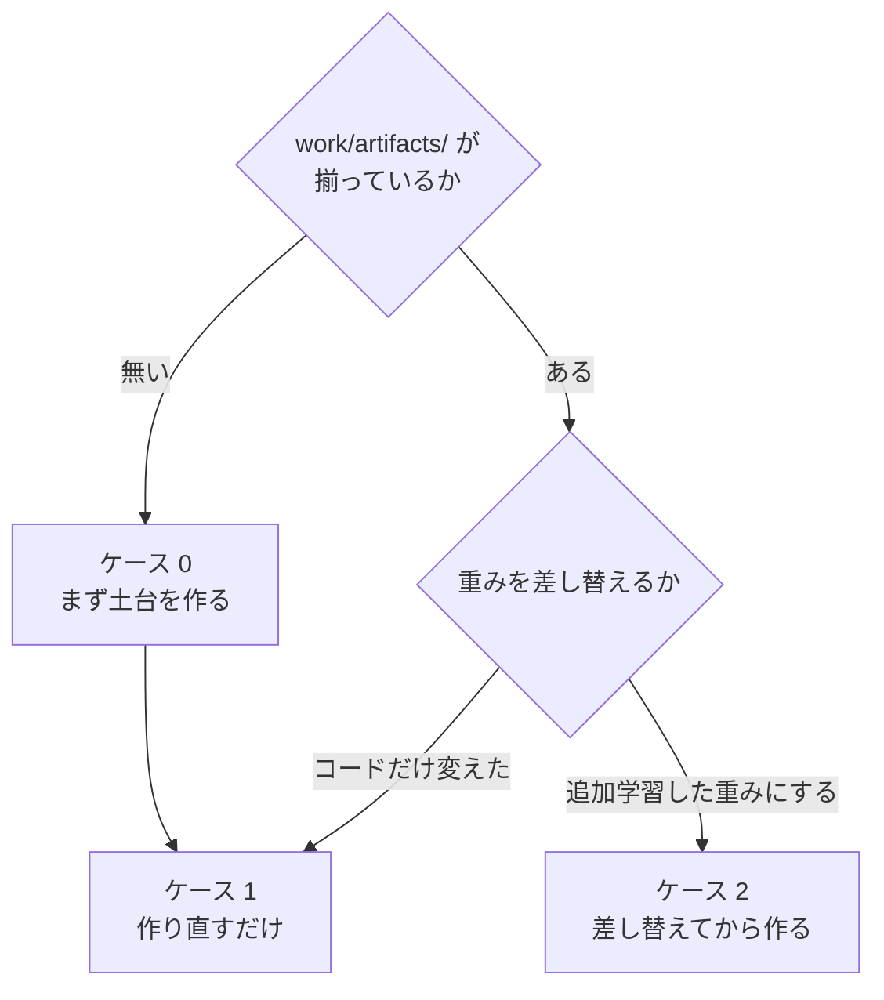
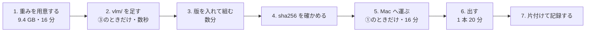

# 02. 提出物の zip を作る

**この手順を最後まで実行すると、Omnicampus へ出せる `work/submission.zip` ができる。**

**この文書は手順だけを持つ。**過去に何を出したか・点・sha256・どれが良かったかは置かない。

| 引きたいもの | 置き場 |
|---|---|
| **いま何を出すか** | [../talk/open_items.md](../talk/open_items.md) |
| 出した版・重み・点・zip の sha256 | [../reference/19_weights_catalog.md](../reference/19_weights_catalog.md)（実験台帳） |
| 点の一次資料 | [../knowledge/05_score_history.md](../knowledge/05_score_history.md)（採点ログから抽出したもの） |
| 予選期（0.1.0〜4.4.0）の zip の sha256 | [../reference/archive/16_qualifier_submission_zips.md](../reference/archive/16_qualifier_submission_zips.md) |
| 踏んだ事故と回避策 | [../knowledge/](../knowledge/) |

**提出のたびに要る値は 4 つだけである**——**版番号・重みの HF リポジトリ・歩数・どのトラックへ出すか。****この 4 つはそのつどチャットで渡す**（[「zip を 1 本組んで出す」](#zip-を-1-本組んで出す)の `<版>`・`<重み>` に入れる）。

追加学習した重みを使う場合は、先に
[01_retrain.md](01_retrain.md) を終えて `merged_model/` を用意しておく。

## 全体像

提出物は 2 か所から集める。**コードは `solution/` が正で、生成物だけが `work/` にある。**



コピーで同期させる運用にすると必ずどちらかが古くなるため、
`build_submission.py` は zip 化のときに両方から直接束ねる。

`work/` は git 管理外である。**壊しても下の手順で丸ごと作り直せる。**

## 自分がどの場合かを選ぶ



| | いつ | 所要 |
|---|---|---|
| ケース 0 | リポジトリを clone した直後、`work/` を消したとき、**別のマシンで初めて組むとき** | **`vendor/` が 3 分。重みを落とす時間は別** |
| **ケース 1** | **`policy_server.py` を変えたとき（いちばん多い）** | **2 分**（π0.5 の 9.4 GB なら 10〜20 分） |
| ケース 2 | 学習した重みを載せるとき | 5 分 |

---

# ケース 1. 作り直すだけ

```bash
python3 solution/tools/build/build_submission.py
```

**venv は要らない**（`build_submission.py` は標準ライブラリだけで動く。ケース 0 の 0-0）。
これだけである。出力はこうなる。

```
[build] 検証     547 エントリ一致、必須構成あり
[build] 547 files / 918 MB
[build] sha256 8ed91671fdeb70a4f6b87866940dd87503ada9005c84797d5c41028fd175fc5e
[build] ハッシュを保存: work/submission.sha256
```

**`[build] 検証` の行が出ていることを必ず確かめる。** これが出ないビルドは信用しない。
何を検証しているかは[下の節](#zip-を書いたあとに自動でしていること)にある。

---

# ケース 2. 追加学習した重みに差し替える

入力は [01_retrain.md](01_retrain.md) が出す `merged_model/` である。これは GPU マシンで学習した結果をディレクトリごとコピしてくれば良い。

```bash
# 1. 検査だけする（何も書き換えない）
work/venv310/bin/python solution/tools/weights/install_weights.py \
    work/train/smolvla_lora_all_suites/merged_model --dry-run

# 2. 問題なければ取り込む
work/venv310/bin/python solution/tools/weights/install_weights.py \
    work/train/smolvla_lora_all_suites/merged_model

# 3. zip を作る
work/venv310/bin/python solution/tools/build/build_submission.py
```

## なぜ手でコピーしてはいけないのか

> **ここは SmolVLA の節である。π0.5 には当てはまらない。**
> **`work/artifacts/model_weights/vlm/` は SmolVLM2 のトークナイザ置き場である**
> （`fetch_base_weights.sh` がそう埋める）。**π0.5 に写すと、動くのに課題を解かない
> 提出物になる**——2026-09-17 の 22.0.0 がこれで Track1 0.075 だった（正しくは 0.498）。
> **π0.5 は [0-3 節](#0-3-重みを置くπ05-の場合)を見ること。**
> `install_weights.py` は π0.5 を渡すと止まるようにしてある（2026-09-20）。

**マージセルの出力には `vlm/` が含まれない。** SmolVLM の設定とトークナイザは
いま `model_weights/vlm/` にあるものを引き継ぐ必要がある。
`install_weights.py` はこれを機械的に行う。手作業では必ず取りこぼす。

さらに、取り込む前に次を検査し、**1 つでも引っかかれば書き換えずに中止する。**

| 検査 | 見逃すと何が起きるか |
|---|---|
| 必須ファイルが揃っているか | 採点環境でモデルロードに失敗して 0 点 |
| `config.json` の `use_peft` が偽か | **LoRA が未マージのまま提出**（学習の効果がゼロ） |
| `model.safetensors` に `lora_` が残っていないか | 同上 |
| テンソル構成が既存と一致しているか | `MyPolicy` が重みを読めない |

## 戻し方

**既存の重みは削除せず `work/artifacts/model_weights.bak/` へ退避される。**
追加学習の結果が悪ければ、この 1 行で素の重みへ戻せる。

```bash
rm -rf work/artifacts/model_weights && \
  mv work/artifacts/model_weights.bak work/artifacts/model_weights
```

---

# ケース 0. 土台を作る

`work/artifacts/` が無い状態から始める。**作るのは `vendor/` だけで、あとは重みを
どこかに置けばケース 1 に合流する。**

## 0-0. 組めるかどうかは、この 5 つで決まる

**`build_submission.py` が集めるのは `solution/` の 3 ファイルと
`work/artifacts/{model_weights,vendor}` の 2 つだけである**（`build_submission.py:52`
の `_SOLUTION_FILES` と `:55` の `_ARTIFACT_DIRS`）。
**GPU も torch も venv も要らない。標準ライブラリだけで動く**
（`argparse`・`hashlib`・`re`・`zipfile`・`pathlib`）。
**だから重みが置いてあるマシンなら、どれでも組める。**

| 要るもの | 何のため | 無いとどうなるか |
|---|---|---|
| `solution/policy_server.py`・`requirements.txt`・`geometry_graft.py` | `_SOLUTION_FILES`。3 つとも zip の直下に入る | `必須ファイルがありません` |
| **`work/artifacts/vendor/lerobot/`**（487 ファイル・13 MB） | 採点環境は Python 3.10 固定だが、LeRobot v0.6.0 は `requires-python >= 3.12` を宣言していて `pip install` できない | `生成物がありません: .../work/artifacts/vendor`（**`--weights` では差し替えられない**） |
| 重み（`model.safetensors`・`config.json`・`vlm/`） | `--weights` でどのディレクトリを指してもよい。zip の中の名前は `model_weights/` に固定される | `zip に model_weights/... がありません` |
| 空き 9.4 GB（π0.5。SmolVLA なら 918 MB） | zip 本体 | 途中で切れた zip ができる |
| `python3` | 上記のとおり標準ライブラリだけ | — |

**`work/artifacts/model_weights/` という置き場は必須ではない。** `--weights` で
チェックポイントを直に指すなら要らない（`build_submission.py:168-169`）。

## 0-1. Python 3.10 の venv は要らない（構文検証に使うだけ）

**`build_submission.py` と `install_weights.py` はどちらも標準ライブラリだけで動く。**
venv が要るのは、下の `vendor_lerobot.py` に `--python310` を渡して
**書き換えた結果が 3.10 で構文として通ることまで検証する**ときだけである。
採点環境と同じ 3.10.12 に合わせたいなら作る。

```bash
export UV_CACHE_DIR="$TMPDIR/uvcache"
uv venv --python 3.10.12 work/venv310
```

## 0-2. LeRobot を同梱用に書き換える

採点環境は Python 3.10 だが、**LeRobot v0.6.0 は `requires-python >= 3.12` を
宣言している**ため `pip install` できない。ソースを取得し、3.12 専用の構文と API
だけを書き換えて提出物へ同梱する。

```bash
python3 -c "
import io, tarfile, urllib.request, pathlib, shutil
url = 'https://codeload.github.com/huggingface/lerobot/tar.gz/refs/tags/v0.6.0'
data = urllib.request.urlopen(url, timeout=300).read()
dest = pathlib.Path('work'); target = dest / 'lerobot-src'
if target.exists(): shutil.rmtree(target)
with tarfile.open(fileobj=io.BytesIO(data), mode='r:gz') as tf:
    root = tf.getnames()[0].split('/')[0]; tf.extractall(dest)
(dest / root).rename(target)
"

python3 solution/tools/build/vendor_lerobot.py \
    --python310 work/venv310/bin/python     # venv が無ければこの行は外す

find work/artifacts/vendor/lerobot -name '*.py' | wc -l    # 487 になること
```

`vendor_lerobot.py` は**置換対象が 1 箇所でなければ例外にする**。
LeRobot のバージョンが変われば、黙って壊れずにその場で落ちる。

**別のマシンで作り直しても同じものになる。** 2026-08-28 に確かめた——
v0.6.0 の tar を取り直して `vendor_lerobot.py` を走らせ、提出済みの zip 3 本に
入っている `vendor/lerobot` と `diff -r` した結果、**`__pycache__` 以外の差は 0 で
487 ファイルが一致した**（`__pycache__` は `_EXCLUDE_PARTS` で zip に入らない）。
**`scp` で 13 MB を運ぶ必要は無い。**

### 0-2-b. VGGT も同梱する（幾何の接ぎ木を入れた重みを出すときだけ）

**幾何の接ぎ木（`open_items.md` の F25・[plan/16](../plan/16_finals_initiative_priority.md) 7 節）を
入れた重みを提出するときは、VGGT のソースも要る。** `pip install vggt` は
PyPI に無くて失敗するので、LeRobot と同じく `vendor/` へ置く。

```bash
pip install --target /tmp/vggt-src "git+https://github.com/facebookresearch/vggt.git"
python3 solution/tools/build/vendor_vggt.py --source /tmp/vggt-src/vggt
```

**接ぎ木を入れていない重みでは要らない。** `policy_server.py` は重みの中に
`geometry_fuser.*` が無ければ VGGT を読まない。

| 確かめること | 打つもの |
|---|---|
| 同梱物が揃っているか | `python3 solution/tools/build/vendor_vggt.py --check` |
| どちらの vggt を読んでいるか | `vggt.models.vggt.__file__` を見る（**`vggt.__file__` は `None` になる**——`__init__.py` を持たない名前空間パッケージである） |

## 0-3. 重みを置く（π0.5 の場合）

**`vlm/` には π0.5 のトークナイザが要る。** `policy_server.py` は
`model_weights/vlm/` からトークナイザを読む。**無いと採点環境で Hub へ取りに行って
失敗するので、`build_submission.py:248` が zip を書いた後に検証で落とす。**

**π0.5 のトークナイザは PaliGemma / Gemma 系である。**
`added_tokens.json`・`special_tokens_map.json`・`tokenizer.json`・
`tokenizer_config.json` の 4 つ・合わせて 17 MB。
**VLM の `model.safetensors` は要らない**——VLM の重みはポリシー側の
チェックポイントに入っている。

**HF に上げた π0.5 のチェックポイントには `vlm/` が同梱してある**
（`siruku6/pi05_trial1500` の `000500`／`001000`／`001500` など。
[../reference/19_weights_catalog.md](../reference/19_weights_catalog.md)）。
**その場合は落として `--weights` で直に指すだけでよい。**

```bash
hf download siruku6/pi05_trial1500 --include '001500/*' \
    --local-dir work/artifacts/trial1500

python3 solution/tools/build/build_submission.py \
    --weights work/artifacts/trial1500/001500 \
    --output work/submission_<版>.zip
```

**学習が書いたチェックポイントには `vlm/` が付かない。** その場合は
`vlm/` を持っている重みから `cp` で足す（**`ln -s` は駄目である**——
zip に実体が入らない）。

```bash
cp -r work/artifacts/pi05_rp3000/vlm <チェックポイント>/vlm
```

**`build_submission.py` は、トークナイザの素性まで見る**（2026-09-20 に足した）。
`model_weights/config.json` の `type` が `pi05` なら、
`vlm/tokenizer_config.json` の `tokenizer_class` が `GemmaTokenizer` であることを要求する。
**別の模型の `vlm/` を写していれば、zip を書いた直後に止まる。**

> **SmolVLA を出すときだけ違う。**
> `lerobot/smolvla_libero_plus@7bb70aa5` を `model_weights/` に置き、
> `HuggingFaceTB/SmolVLM2-500M-Video-Instruct` のトークナイザを `vlm/` に入れていた。
> **π0.5 では入れてはならない**——トークナイザが別物になる。
> SmolVLA を出すときだけ、その 2 つを取り寄せる。

**ここまで来たらケース 1 に合流する。**

## 0-4. 追加学習の効き具合を λ で弱めた重みを提出する

**追加学習が素の重みより悪くなったときの手当てである。**
`θ = θ素 + λ·Δ` を作る（`Δ` は学習で動いた分）。**学習は要らない。**
なぜこれを採るのかは
[../talk/open_items_notes.md](../talk/open_items_notes.md) の 35。

**素の重みそのままは提出できない**（運営 Q&A No.36。独自の学習が必須）。
**λ を下げれば素に近づくが、選ぶのは検証用データの結果で行う** ——
「素にどれだけ近いか」で選ぶと要件の潜り抜けになる。

### ① 混ぜる（2 分・GPU 不要）

```bash
python3 solution/tools/weights/blend_weights.py --lam 0.25 \
    --base       work/artifacts/model_weights.bak \
    --finetuned  work/artifacts/model_weights \
    --output     work/artifacts/model_weights_lam025
```

**`--base` は素の重み、`--finetuned` は追加学習してマージしたもの。**
どちらがどちらかを取り違えると λ の意味が逆になるので、
**先にハッシュで確かめる。**

```bash
shasum -a 256 work/artifacts/model_weights*/model.safetensors | cut -c1-16
```

**混ぜ方が壊れていないことを、両端で確かめられる。**

```bash
# λ=1.0 は --finetuned と、λ=0.0 は --base と 1 バイトも違わないはず
python3 solution/tools/weights/blend_weights.py --lam 1.0 \
    --base work/artifacts/model_weights.bak \
    --finetuned work/artifacts/model_weights --output "$TMPDIR/lam100"
shasum -a 256 "$TMPDIR/lam100/model.safetensors" \
              work/artifacts/model_weights/model.safetensors
```

**BF16 の丸めで壊れやすいので、この確認は省かない。**

### ② 検証用データで評価してから取り込む

**混ぜた重みを 84 件の検証用データで評価する**（Colab なら 2.6 時間。28 件 × 3 に割る。
[11_colab_eval.md](11_colab_eval.md)）。
**素の重みの回と 1 件ずつ対にして比べる。**

```bash
python3 solution/tools/eval/summarize_gpu_eval.py \
    --output-dir <混ぜた重みの出力先> --csv <その VAL_TASKS.csv> \
    --compare    <素の重みの出力先>
```

| 満たすべき条件 | 基準 |
|---|---|
| ① 1 件ずつ対にして負けていない | 拾った件数 ≧ 失った件数 |
| ② **グリッパ開閉 20 回以上の割合** | **素の重み以下** |
| ③ 平均ジャーク | **素の重み以下** |

**満たさなければ λ を下げて組み直す**（混ぜは 2 分）。

### ③ 取り込んで zip にする

```bash
# **素の重みを別名で確保してから。** install_weights.py は .bak を上書きする
cp -r work/artifacts/model_weights.bak work/artifacts/model_weights_base

work/venv310/bin/python solution/tools/weights/install_weights.py \
    work/artifacts/model_weights_lam025 --destination work/artifacts/model_weights
work/venv310/bin/python solution/tools/build/build_submission.py
work/venv310/bin/python validate_submission.py --static
```

> **`.py` を 1 行も変えないなら、リハーサルの枠は要らない。**
> 変わるのが `model.safetensors` の中身だけなら、
> **本番で通った zip と構造が同じ**である。
> **逆に `policy_server.py` を触ったら、提出枠 1 つをリハーサルに充てる**
> （参加者ガイド p.12。最終提出時のエラーに救済措置は無い）。

---

# 指示文の正規化を測る（版 3.5.0 から）

**`/reset` で来た文を、学習データの 40 種のうち最も近いものへ寄せている。**
**寄せ先を出すのと、正しく寄せられるかを測るのは、別の道具である。**

```bash
# 寄せ先 40 種を出す（policy_server.py に貼ってある値の出し方）
python3 solution/tools/suite/instruction_targets.py --emit python

# 正しく寄せられるかを測る（variant 10,030 件・答え合わせ付き。torch 不要）
python3 solution/tools/suite/check_instruction_normalization.py
python3 solution/tools/suite/check_instruction_normalization.py --sweep   # 合格ラインを振って比べる
```

**本番の 2 カテゴリで 1 件でも誤って寄せたら、道具が終了コードを立てて落ちる。**
いま点が取れている場所なので、壊す変更を黙って通さないためである。

**測った結果は
[../knowledge/15_instruction_normalizer_inverted_a_task.md](../knowledge/15_instruction_normalizer_inverted_a_task.md) にある。**

**意味で寄せる道（Q&A No.31 の埋め込み最近傍）は既定で切ってある。**
`--embed` を付けると測れるが、**torch と重みが要るので Docker で回す**
（[03_gpu_eval.md](03_gpu_eval.md) の「指示文の正規化の精度を測る」）。

**採点ログで本番の中身が読める。** エピソードごとに次の行が出る。
**指示文そのものは出さない**（非公開タスクの特定に使えてしまう）。

```
[parc] reset  normalize=lexical score=0.708
```

| 出る語 | 意味 |
|---|---|
| `exact` | 学習と同じ文が来た（小文字化だけ） |
| `lexical` | **寄せた。** 語の重なりで 1 つに絞れた |
| `unchanged` | **迷ったので何もしなかった。** これが出れば言い換えが来ている |
| `off` | `PARC_NORMALIZE_INSTRUCTION=0` で切ってある |

---

# 出来上がった zip を確かめる

## zip を書いたあとに自動でしていること

`build_submission.py` は zip を書いたあと**開き直して**次を確認する。

| 確認 | なぜ |
|---|---|
| エントリの集合が一致するか | 書き込み漏れ |
| `policy_server.py` と `requirements.txt` がバイト単位で一致するか | **過去に「zip の中の `requirements.txt` だけ古い」事故を起こしている** |
| `model_weights/vlm/` と `vendor/lerobot/` があるか | どちらも欠けると起動に失敗する |
| `requirements.txt` に `lerobot` / `evdev` が無いか | 下記 |

> **`requirements.txt` に `lerobot` を書いてはいけない。**
> 採点環境では `pip install lerobot` が失敗する（依存の `evdev` がビルドできない）。
> 実際にこれで採点エラーになった参加者がいる。同梱方式では不要なので、
> うっかり書き足すと採点 1 回分を無駄にする。

## 採点環境に近い形で動かす

**ローカル（macOS）では採点環境を再現できない。** CUDA が無く、`torchvision` は
CUDA 13 ビルドのため import できない。**検証は Docker コンテナで行う。**

```bash
docker build -t parc2026 .
docker run -it --rm -v "$PWD/work:/host_work" parc2026
```

コンテナ内では、本番と同じく `--system-site-packages` 付きの提出物専用 venv を作る。

```bash
/usr/bin/python3.10 -m venv --system-site-packages /opt/subvenv
echo /workspace/venv/lib/python3.10/site-packages \
  > /opt/subvenv/lib/python3.10/site-packages/_kit_site_packages.pth
/opt/subvenv/bin/pip install -r /sub/requirements.txt

# ローカル検証時のみ。配布 Docker の torch は +cpu のため、
# PyPI の CUDA 13 ビルドの torchvision は import できない。
/opt/subvenv/bin/pip install --no-deps --force-reinstall \
  --index-url https://download.pytorch.org/whl/cpu torchvision==0.26.0

cd /workspace && /opt/subvenv/bin/python validate_submission.py /sub/submission.zip
```

> **`HF_HOME` を空ディレクトリに向け、`HF_HUB_OFFLINE=1` を立てて検証すること。**
> そうしないと、採点環境（通信遮断）でだけ起きる Hub アクセスの失敗を見逃す。

環境をまたいだときは、内容が一致しているかを確認する。

```bash
work/venv310/bin/python solution/tools/build/digest_submission.py --per-entry
```

## 出来上がった zip が同じものか確かめる

**組み直した zip が前と同じバイトなら、sha256 が一致する。**
突き合わせる相手は、**予選期（0.1.0〜4.4.0）は
[../reference/archive/16_qualifier_submission_zips.md](../reference/archive/16_qualifier_submission_zips.md)、
本選期（4.2.0 以降）は
[../reference/19_weights_catalog.md](../reference/19_weights_catalog.md)** にある。

```bash
shasum -a 256 work/submission_<版>.zip     # Linux では sha256sum
```

> **重みを 1 バイトでも変えれば sha256 は変わる。**一致を期待するのは
> **「同じ重み・同じコードで組み直した」ときだけである。**

## 環境変数ではなく、既定値そのものを書き換える

**採点環境はこちらの環境変数を渡してくれない。**だから**提出する zip では
`solution/policy_server.py` の既定値そのものを書き換えてから組む。**

**手元の評価だけなら書き換えは要らない。**下の 7 つはすべて環境変数で上書きできるので、
`PARC_NUM_INFERENCE_STEPS=20 bash solution/tools/eval/run_docker_eval.sh …` で足りる。

| 書き換える既定値 | 何の設定か |
|---|---|
| `__version__` | 採点ログの `[parc]` 行に出る版 |
| `PARC_N_ACTION_STEPS` | 1 回の推論で実際に実行する本数（π0.5 は 16・SmolVLA は 8） |
| `PARC_NUM_INFERENCE_STEPS` | ノイズ除去の回数（π0.5 だけ） |
| `PARC_BLEND_STEPS` | 行動列の継ぎ目を直前へ寄せる本数 |
| `PARC_EMA_ALPHA` | 出した行動を前の行動と混ぜる係数 |
| `PARC_SAMPLES` | 1 手ごとに何本サンプルして medoid を選ぶか |
| `PARC_NORMALIZE_INSTRUCTION` | タスク文の表記を寄せる処理 |

**行番号は書かない**——`policy_server.py` は動くので、
`grep -n 'PARC_SAMPLES' solution/policy_server.py` で引く。

**組み直した zip の sha256 は元と一致しない**（時刻が入る）。**提出済みの版のバイト列を
後から示す必要があるときは、[../reference/19_weights_catalog.md](../reference/19_weights_catalog.md)
の「出した zip の sha256」の表が唯一の手がかりである。**

## 版番号を決める

**メジャー番号は重みを指す。**minor は挙動が変わる既定値の変更、patch は挙動が変わらない修正。
**次に空いている番号と、過去のどの番号がどの重みかは
[../reference/19_weights_catalog.md](../reference/19_weights_catalog.md) の
「版番号だけから引きたいとき」にある。**

| 決めること | 決め方 |
|---|---|
| **メジャー** | **重みが変わったら上げる。**同じ重みなら据え置く |
| **`_MIN_LEXICAL`** | **0.50 にする。**5.0.1 以降の全部が 0.50 で組んであり、揃えないと「重みだけの 1 変数」にならない |
| **`PARC_EMA_ALPHA`** | **0.3 のまま動かさない** |

> **版が 6 文字（`10.0.0` 以上）なら、zip の中の書き換えでは付けられない。**
> 書き換えは `__version__ = "4.6.0"` を**長さを変えずに**置き換える手だからである。
> **6 文字の版は、組む前に `solution/policy_server.py` の `__version__` を直す**
> ——重みが変われば zip はどうせ組み直すので、余分な手間は無い。

**どのトラックへどれを出すかは手順書では決めない。**
**いま出すものは [../talk/open_items.md](../talk/open_items.md)、
過去に出したものと点は
[../reference/19_weights_catalog.md](../reference/19_weights_catalog.md) の
「本選の提出と点」にある。****課題 ID は Track1 が 1007・Track2 が 1008・Track3 が 1009 である。**

## zip を 1 本組んで出す

**1 本を提出まで終わらせてから次に移る。**2 本を並行して組むと、
どちらの zip に何を書き換えたのかが分からなくなる。

### 始める前に、3 つだけ決める

**道は 1 本である。変わるのはこの 3 つだけで、それぞれ手順の 1 か所に効く。**

| 分かれ道 | 見分け方 | どこが変わるか |
|---|---|---|
| **① どこで組むか** | **重みが Mac にあるか**。無ければ「重みが置いてある機械」で組む | **Mac で組めば手順 5（運ぶ）が消える。**9.4 GB が流れるのは重みを降ろす 1 回だけになる |
| **② 版が 5 文字か 6 文字か** | `8.0.0` は 5 文字、`12.0.0` は 6 文字 | **手順 3 で、組む前に直すか（6 文字）・組んだ後に zip を書き換えるか（5 文字）** |
| **③ 重みに `vlm/` があるか** | `ls <重み>/vlm \| wc -l` が **4** なら在る、**0** なら無い | **無ければ手順 2 が要る。**学習が書いたチェックポイントには入っていない |

> **版番号と重みの道は、提出のたびにチャットで渡す。**
> **この手順書には書かない**——書くと次の提出で必ず古くなる。
> いま何を出すかは [../talk/open_items.md](../talk/open_items.md) にある。



**要るのは空き 19 GB である**（重み 9.4 GB ＋ zip 9.4 GB）。**出したその日のうちに両方消す。**
**足りなければ [09_free_disk_space.md](09_free_disk_space.md)。**

### 1. 重みを用意する（律速。約 16 分）

**降ろすのと `vendor/` を作るのは同時に進む。**先に降ろし始める。

```bash
# ── ターミナル 1（先に打つ）
cd <リポジトリ> && git pull
hf download <HF のリポジトリ> --include '<歩数>/*' --local-dir work/artifacts/<置き場>
```

```bash
# ── ターミナル 2（裏で。約 3 分。`work/artifacts/vendor/lerobot` が既にあれば飛ばす）
cd <リポジトリ>
python3 -c "
import io, tarfile, urllib.request, pathlib, shutil
url = 'https://codeload.github.com/huggingface/lerobot/tar.gz/refs/tags/v0.6.0'
data = urllib.request.urlopen(url, timeout=300).read()
dest = pathlib.Path('work'); target = dest / 'lerobot-src'
if target.exists(): shutil.rmtree(target)
with tarfile.open(fileobj=io.BytesIO(data), mode='r:gz') as tf:
    root = tf.getnames()[0].split('/')[0]; tf.extractall(dest)
(dest / root).rename(target)
"
python3 solution/tools/build/vendor_lerobot.py
find work/artifacts/vendor/lerobot -name '*.py' | wc -l    # 487 になること
```

**降り終わったら 3 つ確かめる。**

| 打つもの | 出るはず |
|---|---|
| `ls <重み>` | `config.json model.safetensors policy_postprocessor.json policy_postprocessor_step_0_unnormalizer_processor.safetensors policy_preprocessor.json policy_preprocessor_step_2_normalizer_processor.safetensors train_config.json`（＋ `vlm` があれば手順 2 は不要） |
| `du -sh <重み>` | **`8.8G`**（`model.safetensors` が 9,354,050,752 バイト） |
| `shasum -a 256 <重み>/model.safetensors` | **HF の LFS のダイジェストと一致すること**（降ろし損ねの検出。各点の値は [../reference/19_weights_catalog.md](../reference/19_weights_catalog.md) の「一覧」） |

**`hf download` は `hf_xet` が入っていると速い。**入っていなければ
`pip install "huggingface_hub[hf_xet]"`。
**非公開リポジトリは `hf auth whoami` が通っていないと `not found` に見える。**

### 2. `vlm/` を足す（**③ のときだけ**・17 MB・数秒）

**`policy_server.py` は `model_weights/vlm/` からトークナイザを読む。**
**無いと採点環境で Hub へ取りに行って失敗するので、`build_submission.py:248` が
zip を書いた後に検証で落とす。**

```bash
hf download siruku6/pi05_full_runpod --include 'vlm/*' \
    --local-dir work/artifacts/pi05_rp3000        # 公開なので認証は要らない
cp -R work/artifacts/pi05_rp3000/vlm <重み>/vlm
ls <重み>/vlm | wc -l                             # 4 になること
```

> **`ln -s` は駄目である**——zip に実体が入らない。
> **π0.5 のトークナイザは Gemma 系である。**SmolVLA の SmolVLM のものを入れてはならない（別物になる）。

### 3. 版を入れて組む（数分）

**② で分かれる。****どちらの道でも出来上がるバイトは同じである**
（下の「なぜ 2 つの道があるのか」）。

**道 A —— 版が 6 文字（`10.0.0` 以上）。組む前に直して、組んだ直後に戻す。**

```bash
sed -i '' 's/_MIN_LEXICAL = 0.65/_MIN_LEXICAL = 0.50/' solution/policy_server.py
sed -i '' 's/__version__ = "4.6.0"/__version__ = "<版>"/' solution/policy_server.py
git diff --stat solution/policy_server.py          # 2 行だけ変わっていること

python3 solution/tools/build/build_submission.py \
    --weights <重み> --output work/submission_<版>.zip

git checkout solution/policy_server.py
grep -n '^_MIN_LEXICAL = \|^__version__' solution/policy_server.py   # 0.65 と 4.6.0 に戻ること
```

**道 B —— 版が 5 文字。組んでから zip の中の 2 行を書き換える。**

```bash
python3 solution/tools/build/build_submission.py \
    --weights <重み> --output work/submission_<版>.zip

python3 solution/tools/build/patch_zip_policy_server.py work/submission_<版>.zip \
    --replace '_MIN_LEXICAL = 0.65' '_MIN_LEXICAL = 0.50' \
    --replace '__version__ = "4.6.0"' '__version__ = "<版>"' \
    --in-place
```

- **`sed -i` は macOS では `sed -i ''` と空文字が要る。**
- **`_MIN_LEXICAL` を 0.50 にするのを忘れない**——5.0.1 以降は全部 0.50 で組んであり、
  忘れると「重みだけの 1 変数」が壊れる。
- **`--weights` に渡したディレクトリが、そのまま zip の `model_weights/` になる。**
  `install_weights.py` は使わない（**9.4 GB の複製を 2 つ作るうえ、`model_weights.bak/` を上書きする**）。

**出るはずのもの。**

```
[build] 検証     <数百> エントリ一致、必須構成あり
[build] コード   .../solution
[build] 生成物   .../work/artifacts
[build] 重み     .../<重み>
[build] 出力     .../work/submission_<版>.zip
[build] <数百> files / 9378 MB
[build] sha256 <64 桁>
[build] ハッシュを保存: .../work/submission_<版>.sha256
```

| 見るもの | 合格の線 | 違ったら |
|---|---|---|
| **`[build] 検証` の行** | **出ていること** | **出ないビルドは使わない。**`git pull` してやり直す |
| エントリ数 | **541**（π0.5・`vendor/` が v0.6.0 のとき） | 違えば `vendor/` が古い。手順 1 のターミナル 2 を打ち直す |
| `MB` | **9,3xx**（重み 9,372 MB ＋ 同梱 LeRobot 13 MB） | 小さければ重みが入っていない |
| `vlm/` のファイル数 | **4** | 0 なら `build_submission.py:248` が落とす。手順 2 へ |

### 4. sha256 を確かめる

| どちらの道を採ったか | sha256 |
|---|---|
| **道 A（組む前に直した）** | **`build_submission.py` が書いた値がそのまま最終である。取り直しは要らない** |
| **道 B（zip を書き換えた）** | **必ず取り直す**——`work/submission_<版>.sha256` は書き換える前の値である |

```bash
shasum -a 256 work/submission_<版>.zip | tee work/submission_<版>.sha256   # Linux では sha256sum
```

**この値を控える。**手順 5 で運ぶなら、降ろした先で突き合わせる相手である。

### 5. Mac へ運ぶ（**① で別の機械で組んだときだけ**・約 16 分）

**`scp` は 1.7 MB/s しか出ないので 9.4 GB に 1 時間半掛かる。**
**HF の非公開リポジトリを中継すると 16 分**（作り直した zip なら 50 秒。
Xet が同じ切れ端を送らない）。**置きっぱなしにしない**——
上げて、Mac で降ろしたら、**その場でリポジトリから消す。**

```bash
# ── 組んだ機械（送る）。引数は「ローカルの場所」「リポジトリ内での名前」の順である
hf auth whoami        # user=siruku6 が出ること
hf upload siruku6/parc2026-submission \
    work/submission_<版>.zip submission_<版>.zip \
    --repo-type model --commit-message "<版> <重み> (sha256 <頭 8 桁>)"
```

```bash
# ── Mac（受け取る）。**必ずハッシュを突き合わせる**——途中で切れても途中まで残る
hf download siruku6/parc2026-submission submission_<版>.zip \
    --repo-type model --local-dir ~/Downloads/parc2026
shasum -a 256 ~/Downloads/parc2026/submission_<版>.zip   # 手順 4 の値と一致すること
```

> **合わないものを出さない。**降ろし直す。
> **このリポジトリは非公開のままにする**（中身は π0.5 の重みと提出コードである）。
> **HF は古い LFS の版も容量に数える**ので、降ろしたその場で消す
> （[../knowledge/12_workbench_accidents.md](../knowledge/12_workbench_accidents.md)）。

### 6. 出す

Omnicampus にアップロードする。**課題 ID は Track1 が 1007・Track2 が 1008・Track3 が 1009**
（[../plan/14_finals1_gpu_and_submission_plan.md](../plan/14_finals1_gpu_and_submission_plan.md)
の「いまどこにいるか」のルール表）。**どのトラックへ出すかは
[../talk/open_items.md](../talk/open_items.md) にある。**

| 制約 | 値 |
|---|---|
| 提出回数 | **各トラック 1 日 1 回**（1 人あたり計 3 回/日）。**アップロードが完了した時点で消費される**——**だから日付が変わる前後の提出は、次の日の枠を食う可能性がある**と本選資料に明記されている |
| エラーで失敗したとき | **本選では枠を消費する**（同じルール表）。予選の Q&A No.18 は「消費されない」だったが、本選の資料で変わった |
| 枠の繰り越し | **できない。**使わなかったその日の枠は消える |
| **1 本の所要** | **Mac の回線から 9.4 GB で 20 分。3 本なら 1 時間。****放っておける待ちなので、この間に次の zip を組める** |
| サーバー起動 | **1200 秒以内**（本選。予選は 120 秒）。**π0.5 の実測 21 秒** |
| `/act` 1 回 | 10 秒以内（実測 0.85 秒） |
| トラック全体 | 1 時間以内（**π0.5 の実測 118.8 秒**） |

**採点は 10〜20 分で返る。**返ってきたら**採点ログを保存し**、
`b_PARC2026_final/outputs/submission_logs/track<N>/` へ置く。

```bash
grep -n '総合スコア' <保存した採点ログ>
grep -n '^\[parc\] policy_server' <保存した採点ログ>   # 出した版と設定を突き合わせる
```

**`[parc] policy_server <版> ... ema_alpha=0.3` と出ていれば、狙った zip が動いている。**

> **出す前に、ローカル評価で成功率を確かめておくこと**（[03_gpu_eval.md](03_gpu_eval.md) か
> [11_colab_eval.md](11_colab_eval.md)）。**ただし「手元で差が無いから出さない」と判断してはいけない。**
> 手元で測れるのは成功率までで、**滑らかさとステップ数が何点ぶんかは枠を使わないと分からない**
> （[../knowledge/07_local_eval_cannot_rank.md](../knowledge/07_local_eval_cannot_rank.md)・
> [../knowledge/18_local_eval_missed_the_gain.md](../knowledge/18_local_eval_missed_the_gain.md)）。

### 7. 片付けて記録する

```bash
git status --short                                   # 何も出ないこと
grep -n '^_MIN_LEXICAL = ' solution/policy_server.py # 0.65 のままであること
grep -n 'PARC_EMA_ALPHA' solution/policy_server.py   # 既定 "0.3" のままであること
rm -f work/submission_<版>.zip                       # その日のうちに。重みも消す
```

**リポジトリの `solution/policy_server.py` は 0.65・EMA 0.3 のまま残す**
（0.65 の由来は
[../knowledge/15_instruction_normalizer_inverted_a_task.md](../knowledge/15_instruction_normalizer_inverted_a_task.md)）。

**版・重み・sha256・大きさを
[../reference/19_weights_catalog.md](../reference/19_weights_catalog.md) に 1 行足す。**
採点が返ったら同じ行に点を書く。**採点ログそのものは
`b_PARC2026_final/outputs/submission_logs/track<N>/` へ置く**
——`outputs/` は git で追跡しているので、点の一次資料はこちらである。

---

## 道具と分かれ道

### `patch_zip_policy_server.py` の使い方（道 B の中身）

**`build_submission.py` が作る zip では `policy_server.py` が無圧縮（method=0）で入っている。**
だから**同じ長さの置き換えなら、バイトを差し替えて CRC を直すだけで済む。**
9.4 GB を組み直す必要は無い。**既にある zip から設定を 1 つだけ振るときにも使える**
（`PARC_EMA_ALPHA`・`PARC_NUM_INFERENCE_STEPS` など、文字数が変わらないもの）。

```bash
# ① まず中を見る（書き換える前に必ず打つ）
python3 solution/tools/build/patch_zip_policy_server.py work/submission_<版>.zip --show

# ② 元を残したまま書き換える
#    この道具は zip をその場で書き換えるだけで、別名では出せない
#    （`--in-place` が無いと「書いていない」と言って何もしない）。だから先に cp する
cp work/submission_<元の版>.zip work/submission_<新しい版>.zip
python3 solution/tools/build/patch_zip_policy_server.py work/submission_<新しい版>.zip --in-place \
    --replace '_MIN_LEXICAL = 0.50' '_MIN_LEXICAL = 0.99' \
    --replace '__version__ = "<元の版>"' '__version__ = "<新しい版>"'
```

> **手順 ① の `--show` を飛ばさない。**
> **どの版のどの設定が入っているかは、zip の中を見るまで分からない**（ファイル名は当てにならない）。
> **`--in-place` を付けない限り 1 バイトも書かない。**
> **道具は置き換えの左辺が zip の中に 1 か所だけあることを確かめる。**0 か所でも 2 か所でも止まる。

| 確かめること | 期待する値 |
|---|---|
| `--show` の `__version__` | **書き換え前は組んだときの値 → 書き換え後は狙った版** |
| `--show` の `_MIN_LEXICAL` | **`0.50`** |
| `"PARC_EMA_ALPHA"` | **`0.3` のまま**（動かさない） |
| 採点ログの `[parc]` 行 | **`policy_server <版>`**（違ったら別の zip を出している） |

> **しきい値（`_MIN_LEXICAL`）を振るためにこれを使うのは、もうやめた**
> （3 通り出して 3 回とも 0 / 8 だった。
> [../reference/19_weights_catalog.md](../reference/19_weights_catalog.md) の「9/1 の 5.2.0」）。

### なぜ 2 つの道があるのか

**出来上がるバイトは同じである**（道具がしているのは `text.replace(src, dst, 1)` で、
`build_submission.py` はファイルをそのまま格納する）。**選ぶ理由は 2 つだけである。**

| | 良いところ | 気をつけること |
|---|---|---|
| **道 A（組む前に直す）** | 手順が 1 つ減る。**6 文字の版はこれしかない** | **戻し忘れるとリポジトリの 0.65 が消える。****`git checkout` を必ず打つ** |
| **道 B（組んだ後に zip を書き換える）** | **リポジトリを汚さない。**書き換え前後の設定を印字し、`zipfile` で読み直して `testzip()` まで通す。**既にある zip から 10 分で作れる** | **長さが変わる置き換えは通らない**（6 文字の版は不可）。sha256 を取り直す |

### zip をどう運ぶか（3 つの道の比べ）

**そもそも zip を運ぶ必要が無い。** `build_submission.py` が集めるのは
`solution/` の 3 ファイルと `work/artifacts/{model_weights,vendor}` だけで、
**標準ライブラリしか使わない。****重みさえ Mac にあれば、Mac の `python3` で組める。**
`venv310` も要らない（あれは `vendor_lerobot.py` が使うもので、`vendor/` を作り終えていれば出番は無い）。

| 道 | Mac に届くバイト | Mac に一時的に置く量 | HF に新しく積む容量 | 掛かる時間 |
|---|---|---|---|---|
| **Mac で組む**（①で Mac を選ぶ） | 9.4 GB（重み） | **約 19 GB**（重み＋zip） | **0** | 16 分 ＋ 組む時間 |
| 別の機械で組み、HF を中継に運ぶ | 9.4 GB（zip） | **9.4 GB** | **＋9.4 GB** | 16 分（作り直した zip なら 50 秒） |
| 別の機械で組み、`scp` で運ぶ | 9.4 GB（zip） | **9.4 GB** | **0** | **1 時間半**（1.7 MB/s） |

**Mac に届くバイト数はどれも約 9.4 GB で同じである。**違うのは
**Mac のディスク**と **HF に新しく積む容量**、それに
**同じ重みから 2 本目を組むときの費用**（別の機械で組むなら毎回 zip を運ぶ。
Mac で組むなら重みが手元にあるので転送は 0）である。

### 分かれ道 —— 想定どおりでなかったとき

| 何が起きたか | どう見分けるか | どうするか |
|---|---|---|
| **`policy_server.py` が無圧縮でなかった** | `--show` が `policy_server.py が無圧縮ではない（method=8）。この道具は使えないので build_submission.py で組み直すこと` で止まる | **道 A へ切り替える**（組む前に直して組み直す） |
| **`vendor/` が無い** | `build_submission.py` が `生成物がありません` で落ちる。`ls work/artifacts/vendor/lerobot` が空 | **手順 1 のターミナル 2 を打つ**（13 MB・3 分） |
| **`__version__` の左辺が `4.6.0` でない** | `--show` の 1 行目が違う値を出す | **`--replace` の左辺を `--show` が出した実際の値に書き換える。**`4.6.0` はいまの `solution/policy_server.py` の値であって、将来も同じとは限らない |
| **`_MIN_LEXICAL` が既に `0.50`** | `--show` に `_MIN_LEXICAL = 0.50` が出る | **その `--replace` を 1 行落とす。**左辺が 0 か所だと道具が止まる |
| **長さが違う置き換えを書いた** | `長さが違う置き換えは通せない: N → M` で止まる | **桁数を合わせる**（`0.5` ではなく `0.50`）。合わせられないなら道 A |
| **左辺が 2 か所ある** | `... が 2 箇所ある（1 箇所でないと危ない）` で止まる | 道 A へ切り替える |
| **Mac で sha256 が合わない** | `shasum -a 256` が手順 4 の値と違う | **途中で切れている。**降ろし直す。**合わないものを出さない** |


---

## つまずいたとき

| 症状 | 原因 | 対処 |
|---|---|---|
| `[build] 検証` の行が出ない | 古い `build_submission.py` | `git pull` してやり直す |
| `requirements.txt に lerobot` で中止する | 同梱方式では不要な行を足した | その行を消す |
| `install_weights.py` が `use_peft が真` で中止する | マージしていないチェックポイントを渡した | [01_retrain.md](01_retrain.md) の A-5 を実行する |
| 採点で「モデルロードに失敗」 | `model_weights/vlm/` が欠けている | ケース 0 の 0-3 をやり直す |
| 採点で `evdev` のビルドエラー | `requirements.txt` に `lerobot` を書いた | 上と同じ |
| 追加学習したのにスコアが変わらない | LoRA が未マージ | `--dry-run` の検査結果を読む |
