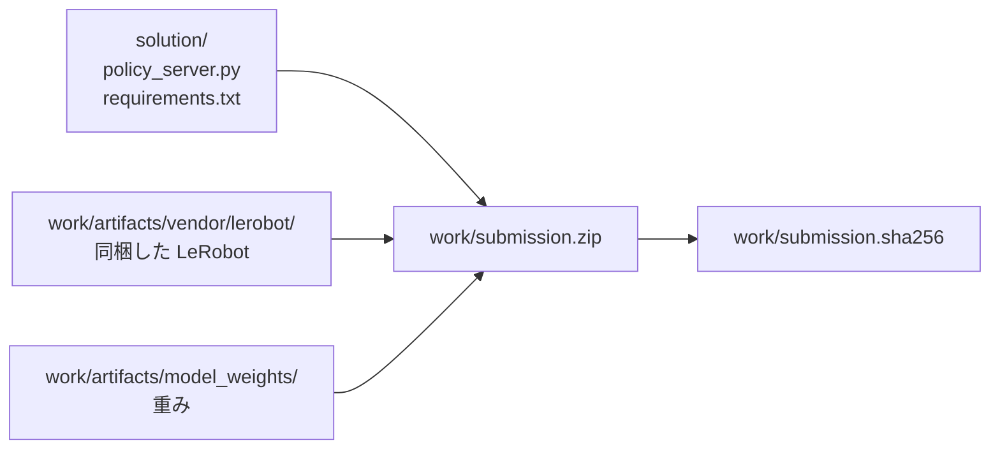
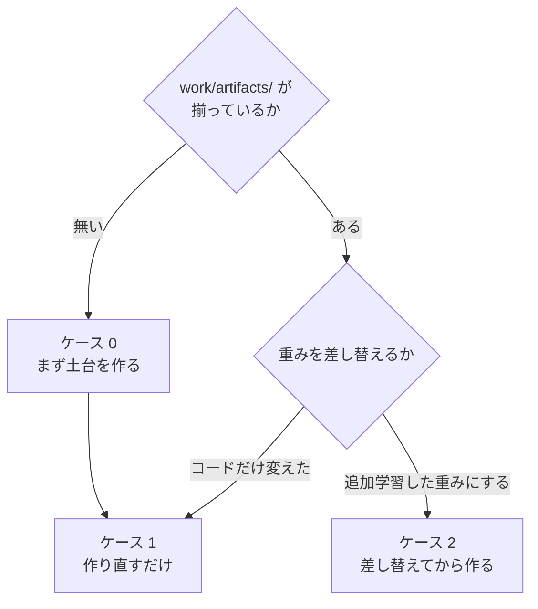

# 02. 提出物の zip を作る

**この手順を最後まで実行すると、Omnicampus へ出せる `work/submission.zip` ができる。**

追加学習した重みを使う場合は、先に
[01_retrain.md](01_retrain.md) を終えて `merged_model/` を用意しておく。

## 全体像

提出物は 2 か所から集める。**コードは `solution/` が正で、生成物だけが `work/` にある。**



コピーで同期させる運用にすると必ずどちらかが古くなるため、
`build_submission.py` は zip 化のときに両方から直接束ねる。

`work/` は git 管理外である。**壊しても下の手順で丸ごと作り直せる。**

## 自分がどの場合かを選ぶ



| | いつ | 所要 |
|---|---|---|
| ケース 0 | リポジトリを clone した直後、`work/` を消したとき | 20 分 |
| **ケース 1** | **`policy_server.py` を変えたとき（いちばん多い）** | **2 分** |
| ケース 2 | 学習した重みを載せるとき | 5 分 |

---

# ケース 1. 作り直すだけ

```bash
work/venv310/bin/python solution/tools/build_submission.py
```

これだけである。出力はこうなる。

```
[build] 検証     547 エントリ一致、必須構成あり
[build] 547 files / 918 MB
[build] sha256 8ed91671fdeb70a4f6b87866940dd87503ada9005c84797d5c41028fd175fc5e
[build] ハッシュを保存: work/submission.sha256
```

**`[build] 検証` の行が出ていることを必ず確かめる。** これが出ないビルドは信用しない。
何を検証しているかは[下の節](#zip-を書いたあとに自動でしていること)にある。

---

# ケース 2. 追加学習した重みに差し替える

入力は [01_retrain.md](01_retrain.md) が出す `merged_model/` である。これは GPU マシンで学習した結果をディレクトリごとコピしてくれば良い。

```bash
# 1. 検査だけする（何も書き換えない）
work/venv310/bin/python solution/tools/install_weights.py \
    work/train/smolvla_lora_all_suites/merged_model --dry-run

# 2. 問題なければ取り込む
work/venv310/bin/python solution/tools/install_weights.py \
    work/train/smolvla_lora_all_suites/merged_model

# 3. zip を作る
work/venv310/bin/python solution/tools/build_submission.py
```

## なぜ手でコピーしてはいけないのか

**マージセルの出力には `vlm/` が含まれない。** SmolVLM の設定とトークナイザは
いま `model_weights/vlm/` にあるものを引き継ぐ必要がある。
`install_weights.py` はこれを機械的に行う。手作業では必ず取りこぼす。

さらに、取り込む前に次を検査し、**1 つでも引っかかれば書き換えずに中止する。**

| 検査 | 見逃すと何が起きるか |
|---|---|
| 必須ファイルが揃っているか | 採点環境でモデルロードに失敗して 0 点 |
| `config.json` の `use_peft` が偽か | **LoRA が未マージのまま提出**（学習の効果がゼロ） |
| `model.safetensors` に `lora_` が残っていないか | 同上 |
| テンソル構成が既存と一致しているか | `MyPolicy` が重みを読めない |

## 戻し方

**既存の重みは削除せず `work/artifacts/model_weights.bak/` へ退避される。**
追加学習の結果が悪ければ、この 1 行で素の重みへ戻せる。

```bash
rm -rf work/artifacts/model_weights && \
  mv work/artifacts/model_weights.bak work/artifacts/model_weights
```

---

# ケース 0. 土台を作る

`work/artifacts/` が無い状態から始める。**3 つ作れば、あとはケース 1 に合流する。**

## 0-1. Python 3.10 の venv を作る

```bash
export UV_CACHE_DIR="$TMPDIR/uvcache"
uv venv --python 3.10.12 work/venv310
```

採点環境と同じ 3.10.12 に合わせる。

## 0-2. LeRobot を同梱用に書き換える

採点環境は Python 3.10 だが、**LeRobot v0.6.0 は `requires-python >= 3.12` を
宣言している**ため `pip install` できない。ソースを取得し、3.12 専用の構文と API
だけを書き換えて提出物へ同梱する。

```bash
python3 -c "
import io, tarfile, urllib.request, pathlib, shutil
url = 'https://codeload.github.com/huggingface/lerobot/tar.gz/refs/tags/v0.6.0'
data = urllib.request.urlopen(url, timeout=300).read()
dest = pathlib.Path('work'); target = dest / 'lerobot-src'
if target.exists(): shutil.rmtree(target)
with tarfile.open(fileobj=io.BytesIO(data), mode='r:gz') as tf:
    root = tf.getnames()[0].split('/')[0]; tf.extractall(dest)
(dest / root).rename(target)
"

work/venv310/bin/python solution/tools/vendor_lerobot.py \
    --python310 work/venv310/bin/python
```

`vendor_lerobot.py` は**置換対象が 1 箇所でなければ例外にする**。
LeRobot のバージョンが変われば、黙って壊れずにその場で落ちる。

## 0-3. 重みを置く

**VLM の `model.safetensors` は含めない。** VLM の重みはポリシー側の
チェックポイントに入っているため、設定とトークナイザだけでよい。

| 取得元 | revision | 置き場所 |
|---|---|---|
| `lerobot/smolvla_libero_plus` | `7bb70aa5bc92b82c9239142775d3a173103567ff` | `work/artifacts/model_weights/` |
| `HuggingFaceTB/SmolVLM2-500M-Video-Instruct`（設定とトークナイザのみ） | — | `work/artifacts/model_weights/vlm/` |

```bash
work/venv310/bin/python -c "
from huggingface_hub import snapshot_download
snapshot_download('lerobot/smolvla_libero_plus',
                  revision='7bb70aa5bc92b82c9239142775d3a173103567ff',
                  local_dir='work/artifacts/model_weights',
                  ignore_patterns=['eval/*', 'eval/**'])
snapshot_download('HuggingFaceTB/SmolVLM2-500M-Video-Instruct',
                  local_dir='work/artifacts/model_weights/vlm',
                  allow_patterns=['*.json', '*.txt', '*.model', 'tokenizer*'])
"
```

`eval/`（評価動画 402 ファイル・25.6 MB）は推論に使わないので除外する。

**ここまで来たらケース 1 に合流する。**

---

# 出来上がった zip を確かめる

## zip を書いたあとに自動でしていること

`build_submission.py` は zip を書いたあと**開き直して**次を確認する。

| 確認 | なぜ |
|---|---|
| エントリの集合が一致するか | 書き込み漏れ |
| `policy_server.py` と `requirements.txt` がバイト単位で一致するか | **過去に「zip の中の `requirements.txt` だけ古い」事故を起こしている** |
| `model_weights/vlm/` と `vendor/lerobot/` があるか | どちらも欠けると起動に失敗する |
| `requirements.txt` に `lerobot` / `evdev` が無いか | 下記 |

> **`requirements.txt` に `lerobot` を書いてはいけない。**
> 採点環境では `pip install lerobot` が失敗する（依存の `evdev` がビルドできない）。
> 実際にこれで採点エラーになった参加者がいる。同梱方式では不要なので、
> うっかり書き足すと採点 1 回分を無駄にする。

## 採点環境に近い形で動かす

**ローカル（macOS）では採点環境を再現できない。** CUDA が無く、`torchvision` は
CUDA 13 ビルドのため import できない。**検証は Docker コンテナで行う。**

```bash
docker build -t parc2026 .
docker run -it --rm -v "$PWD/work:/host_work" parc2026
```

コンテナ内では、本番と同じく `--system-site-packages` 付きの提出物専用 venv を作る。

```bash
/usr/bin/python3.10 -m venv --system-site-packages /opt/subvenv
echo /workspace/venv/lib/python3.10/site-packages \
  > /opt/subvenv/lib/python3.10/site-packages/_kit_site_packages.pth
/opt/subvenv/bin/pip install -r /sub/requirements.txt

# ローカル検証時のみ。配布 Docker の torch は +cpu のため、
# PyPI の CUDA 13 ビルドの torchvision は import できない。
/opt/subvenv/bin/pip install --no-deps --force-reinstall \
  --index-url https://download.pytorch.org/whl/cpu torchvision==0.26.0

cd /workspace && /opt/subvenv/bin/python validate_submission.py /sub/submission.zip
```

> **`HF_HOME` を空ディレクトリに向け、`HF_HUB_OFFLINE=1` を立てて検証すること。**
> そうしないと、採点環境（通信遮断）でだけ起きる Hub アクセスの失敗を見逃す。

環境をまたいだときは、内容が一致しているかを確認する。

```bash
work/venv310/bin/python solution/tools/digest_submission.py --per-entry
```

## 既知のハッシュ

`work/` は git 管理外なので zip 自体は残らない。**素の重みで組んだ提出物の
ハッシュを記録しておく。** 作り直したときにこの値と一致すれば、
同じものが再生成できたと言える。

`policy_server.py` の先頭に `__version__` を置いてある。**採点ログの先頭に
構成が出る**ので、スコアと提出物の対応が後から辿れる。

```
[parc] policy_server 1.0.0  device=cuda  n_action_steps=5  ema_alpha=0.3  blend_steps=0  samples=1
```

| 版 | 重み | 設定 | sha256 | **本番スコア** |
|---|---|---|---|---|
| **0.1.0** | 素（`7bb70aa5`） | 後処理なし（n=50） | `f80abc7b…` | **0.05832** |
| **0.2.0** | 素 | n=10 | `8ed91671…` | **0.096** |
| **0.3.0** | 素 | n=5 ＋ EMA 0.3 | `c1685507…` | **0.1409** |
| **1.0.0** | **LoRA 20,000 歩** | 0.3.0 と同じ | `420aff5d…` | 未提出 |

0.1.0 はタグ `scored-0.05832` に対応する。**版の上げ方**は次のとおり。

| 桁 | 上げるとき |
|---|---|
| major | **重みが変わったとき**（追加学習の反映など） |
| minor | 推論の挙動が変わったとき（既定値の変更、後処理の追加） |
| patch | 挙動が変わらない修正 |

**本番で通ったことが確実なのはタグ `scored-0.05832` である。**
何かがおかしくなったときはここへ戻る。

```bash
git checkout scored-0.05832 -- solution/policy_server.py solution/requirements.txt
```

一致しない場合は、LeRobot のバージョン・重みの revision・`requirements.txt` の
いずれかが変わっている。追加学習した重みに差し替えれば当然変わる。

---

# 提出する

Omnicampus に `work/submission.zip` をアップロードする。

| 制約 | 値 |
|---|---|
| 提出回数 | **1 日 1 回**。採点が完了した時点で消費される |
| エラーで失敗したとき | **枠は消費されない**（運営 Q&A No.18） |
| サーバー起動 | 120 秒以内（実測 38 秒） |
| `/act` 1 回 | 10 秒以内（実測 0.85 秒） |
| トラック全体 | 1 時間以内（実測 147.6 秒） |

**出す前に、ローカル評価で成功率を測っておくこと。**
ローカル評価は本番スコアを再現する（[../strategy/05_実測結果.md](../strategy/05_実測結果.md)）ので、
1 日 1 回の枠を試行錯誤に使う必要は無い。手順は
[../solution/COLAB_EVAL.md](../solution/COLAB_EVAL.md) にある。

**スコアが返ってきたら、ハッシュと一緒に
[../strategy/05_実測結果.md](../strategy/05_実測結果.md) へ記録する。**
どの zip が何点だったかを後から辿れなくなると、比較ができなくなる。

---

## つまずいたとき

| 症状 | 原因 | 対処 |
|---|---|---|
| `[build] 検証` の行が出ない | 古い `build_submission.py` | `git pull` してやり直す |
| `requirements.txt に lerobot` で中止する | 同梱方式では不要な行を足した | その行を消す |
| `install_weights.py` が `use_peft が真` で中止する | マージしていないチェックポイントを渡した | [01_retrain.md](01_retrain.md) の A-5 を実行する |
| 採点で「モデルロードに失敗」 | `model_weights/vlm/` が欠けている | ケース 0 の 0-3 をやり直す |
| 採点で `evdev` のビルドエラー | `requirements.txt` に `lerobot` を書いた | 上と同じ |
| 追加学習したのにスコアが変わらない | LoRA が未マージ | `--dry-run` の検査結果を読む |
