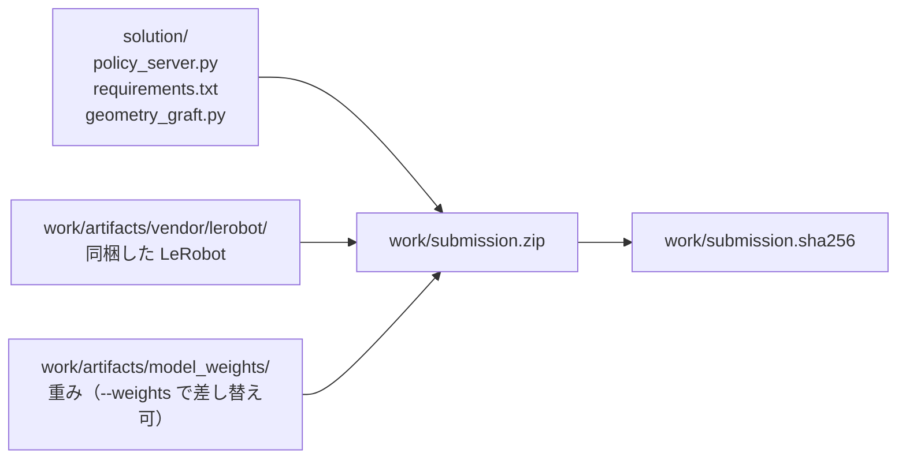
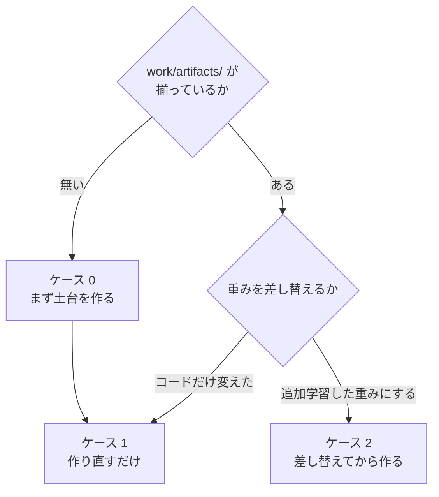
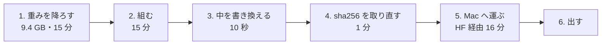

# 02. 提出物の zip を作る

**この手順を最後まで実行すると、Omnicampus へ出せる `work/submission.zip` ができる。**

追加学習した重みを使う場合は、先に
[01_retrain.md](01_retrain.md) を終えて `merged_model/` を用意しておく。

## 全体像

提出物は 2 か所から集める。**コードは `solution/` が正で、生成物だけが `work/` にある。**



コピーで同期させる運用にすると必ずどちらかが古くなるため、
`build_submission.py` は zip 化のときに両方から直接束ねる。

`work/` は git 管理外である。**壊しても下の手順で丸ごと作り直せる。**

## 自分がどの場合かを選ぶ



| | いつ | 所要 |
|---|---|---|
| ケース 0 | リポジトリを clone した直後、`work/` を消したとき、**別のマシンで初めて組むとき** | **`vendor/` が 3 分。重みを落とす時間は別** |
| **ケース 1** | **`policy_server.py` を変えたとき（いちばん多い）** | **2 分**（π0.5 の 9.4 GB なら 10〜20 分） |
| ケース 2 | 学習した重みを載せるとき | 5 分 |

---

# ケース 1. 作り直すだけ

```bash
python3 solution/tools/build/build_submission.py
```

**venv は要らない**（`build_submission.py` は標準ライブラリだけで動く。ケース 0 の 0-0）。
これだけである。出力はこうなる。

```
[build] 検証     547 エントリ一致、必須構成あり
[build] 547 files / 918 MB
[build] sha256 8ed91671fdeb70a4f6b87866940dd87503ada9005c84797d5c41028fd175fc5e
[build] ハッシュを保存: work/submission.sha256
```

**`[build] 検証` の行が出ていることを必ず確かめる。** これが出ないビルドは信用しない。
何を検証しているかは[下の節](#zip-を書いたあとに自動でしていること)にある。

---

# ケース 2. 追加学習した重みに差し替える

入力は [01_retrain.md](01_retrain.md) が出す `merged_model/` である。これは GPU マシンで学習した結果をディレクトリごとコピしてくれば良い。

```bash
# 1. 検査だけする（何も書き換えない）
work/venv310/bin/python solution/tools/weights/install_weights.py \
    work/train/smolvla_lora_all_suites/merged_model --dry-run

# 2. 問題なければ取り込む
work/venv310/bin/python solution/tools/weights/install_weights.py \
    work/train/smolvla_lora_all_suites/merged_model

# 3. zip を作る
work/venv310/bin/python solution/tools/build/build_submission.py
```

## なぜ手でコピーしてはいけないのか

**マージセルの出力には `vlm/` が含まれない。** SmolVLM の設定とトークナイザは
いま `model_weights/vlm/` にあるものを引き継ぐ必要がある。
`install_weights.py` はこれを機械的に行う。手作業では必ず取りこぼす。

さらに、取り込む前に次を検査し、**1 つでも引っかかれば書き換えずに中止する。**

| 検査 | 見逃すと何が起きるか |
|---|---|
| 必須ファイルが揃っているか | 採点環境でモデルロードに失敗して 0 点 |
| `config.json` の `use_peft` が偽か | **LoRA が未マージのまま提出**（学習の効果がゼロ） |
| `model.safetensors` に `lora_` が残っていないか | 同上 |
| テンソル構成が既存と一致しているか | `MyPolicy` が重みを読めない |

## 戻し方

**既存の重みは削除せず `work/artifacts/model_weights.bak/` へ退避される。**
追加学習の結果が悪ければ、この 1 行で素の重みへ戻せる。

```bash
rm -rf work/artifacts/model_weights && \
  mv work/artifacts/model_weights.bak work/artifacts/model_weights
```

---

# ケース 0. 土台を作る

`work/artifacts/` が無い状態から始める。**作るのは `vendor/` だけで、あとは重みを
どこかに置けばケース 1 に合流する。**

## 0-0. 組めるかどうかは、この 5 つで決まる

**`build_submission.py` が集めるのは `solution/` の 3 ファイルと
`work/artifacts/{model_weights,vendor}` の 2 つだけである**（`build_submission.py:52`
の `_SOLUTION_FILES` と `:55` の `_ARTIFACT_DIRS`）。
**GPU も torch も venv も要らない。標準ライブラリだけで動く**
（`argparse`・`hashlib`・`re`・`zipfile`・`pathlib`）。
**だから重みが置いてあるマシンなら、どれでも組める。**

| 要るもの | 何のため | 無いとどうなるか |
|---|---|---|
| `solution/policy_server.py`・`requirements.txt`・`geometry_graft.py` | `_SOLUTION_FILES`。3 つとも zip の直下に入る | `必須ファイルがありません` |
| **`work/artifacts/vendor/lerobot/`**（487 ファイル・13 MB） | 採点環境は Python 3.10 固定だが、LeRobot v0.6.0 は `requires-python >= 3.12` を宣言していて `pip install` できない | `生成物がありません: .../work/artifacts/vendor`（**`--weights` では差し替えられない**） |
| 重み（`model.safetensors`・`config.json`・`vlm/`） | `--weights` でどのディレクトリを指してもよい。zip の中の名前は `model_weights/` に固定される | `zip に model_weights/... がありません` |
| 空き 9.4 GB（π0.5。SmolVLA なら 918 MB） | zip 本体 | 途中で切れた zip ができる |
| `python3` | 上記のとおり標準ライブラリだけ | — |

**`work/artifacts/model_weights/` という置き場は必須ではない。** `--weights` で
チェックポイントを直に指すなら要らない（`build_submission.py:168-169`）。

## 0-1. Python 3.10 の venv は要らない（構文検証に使うだけ）

**`build_submission.py` と `install_weights.py` はどちらも標準ライブラリだけで動く。**
venv が要るのは、下の `vendor_lerobot.py` に `--python310` を渡して
**書き換えた結果が 3.10 で構文として通ることまで検証する**ときだけである。
採点環境と同じ 3.10.12 に合わせたいなら作る。

```bash
export UV_CACHE_DIR="$TMPDIR/uvcache"
uv venv --python 3.10.12 work/venv310
```

## 0-2. LeRobot を同梱用に書き換える

採点環境は Python 3.10 だが、**LeRobot v0.6.0 は `requires-python >= 3.12` を
宣言している**ため `pip install` できない。ソースを取得し、3.12 専用の構文と API
だけを書き換えて提出物へ同梱する。

```bash
python3 -c "
import io, tarfile, urllib.request, pathlib, shutil
url = 'https://codeload.github.com/huggingface/lerobot/tar.gz/refs/tags/v0.6.0'
data = urllib.request.urlopen(url, timeout=300).read()
dest = pathlib.Path('work'); target = dest / 'lerobot-src'
if target.exists(): shutil.rmtree(target)
with tarfile.open(fileobj=io.BytesIO(data), mode='r:gz') as tf:
    root = tf.getnames()[0].split('/')[0]; tf.extractall(dest)
(dest / root).rename(target)
"

python3 solution/tools/build/vendor_lerobot.py \
    --python310 work/venv310/bin/python     # venv が無ければこの行は外す

find work/artifacts/vendor/lerobot -name '*.py' | wc -l    # 487 になること
```

`vendor_lerobot.py` は**置換対象が 1 箇所でなければ例外にする**。
LeRobot のバージョンが変われば、黙って壊れずにその場で落ちる。

**別のマシンで作り直しても同じものになる。** 2026-08-28 に確かめた——
v0.6.0 の tar を取り直して `vendor_lerobot.py` を走らせ、提出済みの zip 3 本に
入っている `vendor/lerobot` と `diff -r` した結果、**`__pycache__` 以外の差は 0 で
487 ファイルが一致した**（`__pycache__` は `_EXCLUDE_PARTS` で zip に入らない）。
**`scp` で 13 MB を運ぶ必要は無い。**

### 0-2-b. VGGT も同梱する（幾何の接ぎ木を入れた重みを出すときだけ）

**幾何の接ぎ木（`open_items.md` の F25・[plan/16](../plan/16_finals_initiative_priority.md) 7 節）を
入れた重みを提出するときは、VGGT のソースも要る。** `pip install vggt` は
PyPI に無くて失敗するので、LeRobot と同じく `vendor/` へ置く。

```bash
pip install --target /tmp/vggt-src "git+https://github.com/facebookresearch/vggt.git"
python3 solution/tools/build/vendor_vggt.py --source /tmp/vggt-src/vggt
```

**接ぎ木を入れていない重みでは要らない。** `policy_server.py` は重みの中に
`geometry_fuser.*` が無ければ VGGT を読まない。

| 確かめること | 打つもの |
|---|---|
| 同梱物が揃っているか | `python3 solution/tools/build/vendor_vggt.py --check` |
| どちらの vggt を読んでいるか | `vggt.models.vggt.__file__` を見る（**`vggt.__file__` は `None` になる**——`__init__.py` を持たない名前空間パッケージである） |

## 0-3. 重みを置く（π0.5 の場合）

**`vlm/` には π0.5 のトークナイザが要る。** `policy_server.py` は
`model_weights/vlm/` からトークナイザを読む。**無いと採点環境で Hub へ取りに行って
失敗するので、`build_submission.py:248` が zip を書いた後に検証で落とす。**

**π0.5 のトークナイザは PaliGemma / Gemma 系である。**
`added_tokens.json`・`special_tokens_map.json`・`tokenizer.json`・
`tokenizer_config.json` の 4 つ・合わせて 17 MB。
**VLM の `model.safetensors` は要らない**——VLM の重みはポリシー側の
チェックポイントに入っている。

**HF に上げた π0.5 のチェックポイントには `vlm/` が同梱してある**
（`siruku6/pi05_trial1500` の `000500`／`001000`／`001500` など。
[../reference/19_weights_catalog.md](../reference/19_weights_catalog.md)）。
**その場合は落として `--weights` で直に指すだけでよい。**

```bash
hf download siruku6/pi05_trial1500 --include '001500/*' \
    --local-dir work/artifacts/trial1500

python3 solution/tools/build/build_submission.py \
    --weights work/artifacts/trial1500/001500 \
    --output work/submission_<版>.zip
```

**学習が書いたチェックポイントには `vlm/` が付かない。** その場合は
`vlm/` を持っている重みから `cp` で足す（**`ln -s` は駄目である**——
zip に実体が入らない）。

```bash
cp -r work/artifacts/pi05_rp3000/vlm <チェックポイント>/vlm
```

> **SmolVLA 時代の手順との違い。** 2026-08 の前半までは
> `lerobot/smolvla_libero_plus@7bb70aa5` を `model_weights/` に置き、
> `HuggingFaceTB/SmolVLM2-500M-Video-Instruct` のトークナイザを `vlm/` に入れていた。
> **π0.5 では入れてはならない**——トークナイザが別物になる。
> SmolVLA を出すときだけ、その 2 つを取り寄せる。

**ここまで来たらケース 1 に合流する。**

## 0-4. 追加学習の効き具合を λ で弱めた重みを提出する

**追加学習が素の重みより悪くなったときの手当てである。**
`θ = θ素 + λ·Δ` を作る（`Δ` は学習で動いた分）。**学習は要らない。**
なぜこれを採るのかは
[../talk/open_items_notes.md](../talk/open_items_notes.md) の 35。

**素の重みそのままは提出できない**（運営 Q&A No.36。独自の学習が必須）。
**λ を下げれば素に近づくが、選ぶのは検証用データの結果で行う** ——
「素にどれだけ近いか」で選ぶと要件の潜り抜けになる。

### ① 混ぜる（2 分・GPU 不要）

```bash
python3 solution/tools/weights/blend_weights.py --lam 0.25 \
    --base       work/artifacts/model_weights.bak \
    --finetuned  work/artifacts/model_weights \
    --output     work/artifacts/model_weights_lam025
```

**`--base` は素の重み、`--finetuned` は追加学習してマージしたもの。**
どちらがどちらかを取り違えると λ の意味が逆になるので、
**先にハッシュで確かめる。**

```bash
shasum -a 256 work/artifacts/model_weights*/model.safetensors | cut -c1-16
```

**混ぜ方が壊れていないことを、両端で確かめられる。**

```bash
# λ=1.0 は --finetuned と、λ=0.0 は --base と 1 バイトも違わないはず
python3 solution/tools/weights/blend_weights.py --lam 1.0 \
    --base work/artifacts/model_weights.bak \
    --finetuned work/artifacts/model_weights --output "$TMPDIR/lam100"
shasum -a 256 "$TMPDIR/lam100/model.safetensors" \
              work/artifacts/model_weights/model.safetensors
```

**BF16 の丸めで壊れやすいので、この確認は省かない。**

### ② 検証用データで評価してから取り込む

**混ぜた重みを 84 件の検証用データで評価する**（Colab なら 2.6 時間。28 件 × 3 に割る。
[11_colab_eval.md](11_colab_eval.md)）。
**素の重みの回と 1 件ずつ対にして比べる。**

```bash
python3 solution/tools/eval/summarize_gpu_eval.py \
    --output-dir <混ぜた重みの出力先> --csv <その VAL_TASKS.csv> \
    --compare    <素の重みの出力先>
```

| 満たすべき条件 | 基準 |
|---|---|
| ① 1 件ずつ対にして負けていない | 拾った件数 ≧ 失った件数 |
| ② **グリッパ開閉 20 回以上の割合** | **素の重み以下**（8/11 は 13%） |
| ③ 平均ジャーク | **素の重み以下**（8/11 は 4.223） |

**満たさなければ λ を下げて組み直す**（混ぜは 2 分）。

### ③ 取り込んで zip にする

```bash
# **素の重みを別名で確保してから。** install_weights.py は .bak を上書きする
cp -r work/artifacts/model_weights.bak work/artifacts/model_weights_base

work/venv310/bin/python solution/tools/weights/install_weights.py \
    work/artifacts/model_weights_lam025 --destination work/artifacts/model_weights
work/venv310/bin/python solution/tools/build/build_submission.py
work/venv310/bin/python validate_submission.py --static
```

> **`.py` を 1 行も変えないなら、リハーサルの枠は要らない。**
> 変わるのが `model.safetensors` の中身だけなら、
> **本番で通った zip と構造が同じ**である。
> **逆に `policy_server.py` を触ったら、提出枠 1 つをリハーサルに充てる**
> （参加者ガイド p.12。最終提出時のエラーに救済措置は無い）。

---

# 指示文の正規化を測る（版 3.5.0 から）

**`/reset` で来た文を、学習データの 40 種のうち最も近いものへ寄せている。**
**寄せ先を出すのと、正しく寄せられるかを測るのは、別の道具である。**

```bash
# 寄せ先 40 種を出す（policy_server.py に貼ってある値の出し方）
python3 solution/tools/suite/instruction_targets.py --emit python

# 正しく寄せられるかを測る（variant 10,030 件・答え合わせ付き。torch 不要）
python3 solution/tools/suite/check_instruction_normalization.py
python3 solution/tools/suite/check_instruction_normalization.py --sweep   # 合格ラインを振って比べる
```

**本番の 2 カテゴリで 1 件でも誤って寄せたら、道具が終了コードを立てて落ちる。**
いま点が取れている場所なので、壊す変更を黙って通さないためである。

| 束 | 渡る文 | 寄せた（正しい） | **誤り** | 触らない |
|---|---|---|---|---|
| **本番の 2 カテゴリ** | **40 種** | **40 種すべて** | **0** | 0 |
| その他の摂動 | 30 種 | 30 種すべて | **0** | 0 |
| 言い換え | 1,527 種 | 468 種 | 4 | 1,055 |

**意味で寄せる道（Q&A No.31 の埋め込み最近傍）は既定で切ってある。**
`--embed` を付けると測れるが、**torch と重みが要るので Docker で回す**
（[03_gpu_eval.md](03_gpu_eval.md) の「指示文の正規化の精度を測る」）。

**採点ログで本番の中身が読める。** エピソードごとに次の行が出る。
**指示文そのものは出さない**（非公開タスクの特定に使えてしまう）。

```
[parc] reset  normalize=lexical score=0.708
```

| 出る語 | 意味 |
|---|---|
| `exact` | 学習と同じ文が来た（小文字化だけ） |
| `lexical` | **寄せた。** 語の重なりで 1 つに絞れた |
| `unchanged` | **迷ったので何もしなかった。** これが出れば言い換えが来ている |
| `off` | `PARC_NORMALIZE_INSTRUCTION=0` で切ってある |

---

# 出来上がった zip を確かめる

## zip を書いたあとに自動でしていること

`build_submission.py` は zip を書いたあと**開き直して**次を確認する。

| 確認 | なぜ |
|---|---|
| エントリの集合が一致するか | 書き込み漏れ |
| `policy_server.py` と `requirements.txt` がバイト単位で一致するか | **過去に「zip の中の `requirements.txt` だけ古い」事故を起こしている** |
| `model_weights/vlm/` と `vendor/lerobot/` があるか | どちらも欠けると起動に失敗する |
| `requirements.txt` に `lerobot` / `evdev` が無いか | 下記 |

> **`requirements.txt` に `lerobot` を書いてはいけない。**
> 採点環境では `pip install lerobot` が失敗する（依存の `evdev` がビルドできない）。
> 実際にこれで採点エラーになった参加者がいる。同梱方式では不要なので、
> うっかり書き足すと採点 1 回分を無駄にする。

## 採点環境に近い形で動かす

**ローカル（macOS）では採点環境を再現できない。** CUDA が無く、`torchvision` は
CUDA 13 ビルドのため import できない。**検証は Docker コンテナで行う。**

```bash
docker build -t parc2026 .
docker run -it --rm -v "$PWD/work:/host_work" parc2026
```

コンテナ内では、本番と同じく `--system-site-packages` 付きの提出物専用 venv を作る。

```bash
/usr/bin/python3.10 -m venv --system-site-packages /opt/subvenv
echo /workspace/venv/lib/python3.10/site-packages \
  > /opt/subvenv/lib/python3.10/site-packages/_kit_site_packages.pth
/opt/subvenv/bin/pip install -r /sub/requirements.txt

# ローカル検証時のみ。配布 Docker の torch は +cpu のため、
# PyPI の CUDA 13 ビルドの torchvision は import できない。
/opt/subvenv/bin/pip install --no-deps --force-reinstall \
  --index-url https://download.pytorch.org/whl/cpu torchvision==0.26.0

cd /workspace && /opt/subvenv/bin/python validate_submission.py /sub/submission.zip
```

> **`HF_HOME` を空ディレクトリに向け、`HF_HUB_OFFLINE=1` を立てて検証すること。**
> そうしないと、採点環境（通信遮断）でだけ起きる Hub アクセスの失敗を見逃す。

環境をまたいだときは、内容が一致しているかを確認する。

```bash
work/venv310/bin/python solution/tools/build/digest_submission.py --per-entry
```

## 既知のハッシュ

`work/` は git 管理外なので zip 自体は残らない。**素の重みで組んだ提出物の
ハッシュを記録しておく。** 作り直したときにこの値と一致すれば、
同じものが再生成できたと言える。

`policy_server.py` の先頭に `__version__` を置いてある。**採点ログの先頭に
構成が出る**ので、スコアと提出物の対応が後から辿れる。

```
[parc] policy_server 1.0.0  device=cuda  n_action_steps=5  ema_alpha=0.3  blend_steps=0  samples=1
```

| 版 | 重み | 設定 | sha256 | **本番スコア** |
|---|---|---|---|---|
| **0.1.0** | 素（`7bb70aa5`） | 後処理なし（n=50） | `f80abc7b…` | **0.05832** |
| **0.2.0** | 素 | n=10 | `8ed91671…` | **0.096** |
| **0.3.0** | 素 | n=5 ＋ EMA 0.3 | `c1685507…` | **0.1409** |
| **1.0.0** | LoRA 20,000 ステップ（均等） | 0.3.0 と同じ | `420aff5d…` | **0.016** |
| **2.0.0** | λ=0.25 ブレンド（素 75% ＋ 1.0.0 の学習分 25%） | 同じ | （zip の sha は未記録） | **0.09507** |
| **3.0.0** | weak3x（苦手 3 倍 ＋ 手本 300 ステップ超を落とす） | n=5 | `58751a22…` | **0.144**（成功 3/8。素 0.1409 と同水準・**学習済みで初めて到達**） |
| **3.1.0** | weak3x | **n=2** | `47ca6ff8…` | **0.166**（天井の 1 本を解いた。**資格ありの最高**） |
| **3.2.0** | weak3x | n=5・samples=3 | `2ef66638…` | 未提出（n=5 が n=2 に負けたため保留） |
| **3.3.0** | weak3x | **n=1** | `c3b8b901…` | **0.080**（**本物の悪化。1.9 本ぶん**） |
| **3.4.0** | weak3x | **n=2 ＋ samples=3** | `ff9b1b03…` | **0.168**（0.166 と **0.04 本ぶん**の差＝**同じ**。時間は 2.7 倍） |
| **3.5.0** | weak3x | **指示文の正規化**（n=2・**samples=1**。3.1.0 から 1 変数） | `8c53248f…` | **0.181 ← 過去最高**（重みを変えずに ep2 が 300→94 ステップ、ep7 が 300→155 ステップ） |
| **3.6.0** | weak3x | **n=2 → 5**（3.5.0 から 1 変数。正規化・EMA・samples は据え置き） | `046472fe…` | **0.184 ← 過去最高。しかも 272 秒**（3.5.0 の 487 秒の 56%）。1 ステップ 0.154 秒で見積もり 0.16 と一致 |
| **3.6.1** | weak3x | **`reset` の印字を完全に落とす**（挙動は変わらない＝patch） | 8/13 は `28be5eab…`／**8/14 に組み直して `e5fdfd3b…`** | **最終提出はこれ**（挙動は 3.6.0 と同じで 0.184 相当） |
| **3.7.0** | weak3x | **n=5 → 8**（3.6.1 から 1 変数） | `97d4e7af…` | 未提出（**用意済み。落ちたら 3.6.1 に戻す**） |
| **3.8.0** | **π0.5 24,000 ステップ**（`model_weights_pi05_024000`。SmolVLA ではない） | n=10・`num_inference_steps`=10・EMA 0.3・正規化入り | `ea951d5d…` | **0.177**（8/14。**weak3x 0.184 に 0.007 届かなかった**。ただし 183.1 秒＝3.6.0 の 272 秒の 67%） |
| **3.9.0** | π0.5 24,000 ステップ | **n=10 → 16**（3.8.0 から 1 変数） | `5a9eead5…` | **0.264 ← 過去最高を 0.080 上回った**（8/14。**8 本すべてが 300 ステップより前に終わった**のは初。ep3 が 300→225、ep7 が 300→96。128.3 秒） |
| **3.10.0** | π0.5 24,000 ステップ（3.9.0 と**同一**） | **`PARC_BLEND_STEPS` の既定を 0 → 4**（3.9.0 から 1 変数） | `3e0f5446…` | **0.169。0.264 から 0.095 落ちた**（8/14 19:24 提出）。**手元 36 件では 0.778（28/36）で過去最高だったのに本番は負けた。**ステップ数が 1,142 → 1,471（**+29%**）になったのが原因 |
| **3.11.0** | π0.5 24,000 ステップ | **RTC を入れる**（`horizon=4`・blend 0） | `2e6d746a…` | **未提出。**同じ 12 件で成功 **8 → 4**・ステップ数 **+39.5%**。**blend と同じ機構で、より強く悪化した** |
| **3.12.0** | π0.5 24,000 ステップ | **`PARC_NUM_INFERENCE_STEPS` の既定を 10 → 20** | `f2226ce8…` | 未提出（単独では未測定） |
| **3.13.0** | π0.5 24,000 ステップ | **infer 20 ＋ samples 3**（3.9.0 から 2 変数） | `f3b1d3c3…` | 未提出。**手元 36 件でゴール到達 34/36 ＝取れる上限**・打ち切り 6 → 2・成功 25 → 28・ステップ数 −5.3% |
| **4.0.0** | **RunPod フルパラメータ 3,000 ステップ**（`pi05_rp3000`） | blend 4（3.10.0 から引き継ぎ） | `929fbf74…` | **未提出。**blend4 が本番で負けたので破棄した |
| **4.1.0** | 同上 | samples を π0.5 で使えるようにした（既定 1 なので挙動は 4.0.0 と同じ） | — | zip なし |
| **4.2.0** | **RunPod フルパラメータ 3,000 ステップ** | **3.9.0 と同一の設定**（n=16・blend 0・infer 10・samples 1）＝**重みだけの 1 変数** | **`5cf6b983…`** | **0.485 ← 過去最高。0.264 を 0.221 上回った**（8/14 21:25 提出）。**ステップ数 1,142 → 991（−13%）・110.4 秒。予選の最終提出はこれ** |
| **4.3.0** | 同上 | infer 20 | 8/14 は `7a2bc2b3…`／**8/23 に組み直して `71c6b3c6…`** | 未提出（**本戦 1 の 8/25 用に用意済み**） |
| **4.4.0** | 同上 | **infer 20 ＋ samples 3** | `02819ca3…` | **未提出。**4.2.0 が 0.485 で壁を超えたので、測っていない版に賭ける理由が消えた |

> **【8/23 12:10】過去の zip が残っているのは HuggingFace だけである。**
> `work/` は git 管理外なので、**ローカルには直前に組んだ 1 本しか無いのが普通である**
> （8/23 時点では 4.3.0 の `work/submission_rp3000_i20.zip` だけ）。
> 非公開リポジトリ `siruku6/parc2026-submission` にある 4 本が過去の現物である。
>
> | リポジトリ内の名前 | 版 | sha256 |
> |---|---|---|
> | `submission_361.zip` | 3.6.1（SmolVLA・保険） | `e5fdfd3b…` |
> | `submission_pi05_n16.zip` | 3.9.0 | `5a9eead5…` |
> | **`submission_rp3000_blend0.zip`** | **4.2.0（本番 0.485）** | `5cf6b983…` |
> | **`submission_rp3000_i20.zip`** | **4.3.0（8/23 に組み直した）** | `71c6b3c6…` |
>
> **HuggingFace は大きいファイルの sha256 を API で返すので、9.4GB を落とさずに
> 中身が本物かを確かめられる。** 上の 4 本はこの方法で記録と一致を確認した。
>
> ```bash
> .venv/bin/python -c "
> from huggingface_hub import HfApi
> for f in HfApi().list_repo_tree('siruku6/parc2026-submission',
>                                 recursive=True, expand=True):
>     if f.path.endswith('.zip'):
>         print(f.path, f.size, f.lfs.sha256)
> "
> ```
>
> **4.2.0 と 4.3.0 のコードは commit されていない。** `policy_server.py` を触った
> 32 個の commit を全部見たが、`__version__` が 4.2.0・4.3.0 のものは 1 つも無い。
> git にあるのは 4.4.0（`653398a`）までで、この 2 つは既定値を書き換えて
> 組んだだけである。
>
> **したがって「4.3.0 が何だったか」は、この表からしか復元できない**
> —— 4.3.0 は infer 20、4.4.0 は infer 20 ＋ samples 3 なので、
> **差は `PARC_SAMPLES` の既定 3 → 1 の 1 行**と読める。8/23 の組み直しは
> この読みに従って `653398a` から行った（`work/build_430/solution/` に置いた）。
> **原物と突き合わせて確かめたわけではない。**
> **HEAD から組んではいけない。** HEAD には量子化の分岐（`QUANT_SERVE_MODE`）・
> samples が 2 以上のときの `.clone()`・起動ログへの `quant_serve=off` の追記が
> 入っており、**本番で 1 度も走っていない。**

> **【8/14 13:10】3.8.0 は 0.177 で、weak3x の 0.184 に 0.007 届かなかった。**
> 採点ログは `outputs/260814_114832_pi0.5_bench.md`。**8 本のうち 6 本が
> 300 ステップより前に終わっているのに点は上がらなかった** ——衝突でも早く終わるので、
> ステップ数から成功本数は読めないという戒めの 4 度目の確認である
> （ep3 と ep7 だけが 300 ステップに張り付いた）。
> **1 ステップあたり 0.128 秒**（1,428 ステップで 183.1 秒）で、事前の見積もり 0.095 秒より
> 遅いが、**3.6.0 の 0.154 秒より速い**のは当たった。
> **【8/14 13:50 訂正】「予選の最終提出は 3.6.1 に決めた」は取り消す。**
> **0.007 は勝ち負けを分ける幅ではない**（8 本しか走っておらず、しかも
> **総合スコアは成功率だけではない** ——
> [../reference/17_scoring_formula.md](../reference/17_scoring_formula.md)）。
> **3.6.1 は「そのまま出せる保険」として確保し、π0.5 は n=16 で測り直す。**
>
> **8/14 に 3.6.1 を組み直した。** 8/13 の zip は消えていたため
> `git checkout efe7fb5 -- solution/policy_server.py solution/requirements.txt` で
> 3.6.1 のコードに戻し、`--weights work/artifacts/model_weights_weak3x` で組んだ。
> **sha は `28be5eab…` と一致しない**（`archive.write` がファイルの更新時刻を
> zip に焼くため、vendor を作り直した時点でハッシュ一致は原理的に望めない）。
> **一致を確かめたのは中身である**: `policy_server.py` と `requirements.txt` は
> `efe7fb5` のバイトと一致、`model.safetensors` は `model_weights_weak3x` と一致、
> `validate_submission.py --static` は PASS。
>
> **このとき `model_weights/vlm/.cache/huggingface/` の 14 個が紛れ込んだ**
> （`snapshot_download` が重みの隣に作るダウンロード履歴）。
> **`build_submission.py` の除外リストに `.cache` を足して直した。**
>
> **3.8.0 だけモデルが違う。** 中身は π0.5（4.14B。SmolVLA の約 9 倍）で、
> `policy_server.py` は**重みの `config.json` の `type` を見て切り替える**。
> **SmolVLA の道は 1 行も変えていない**ので、3.7.0 以前の zip は作り直せば
> そのまま同じ挙動になる。
>
> **組み方が 2 つだけ違う。**
> - 重みは `--weights` で場所を指す（`build_submission.py`。zip の中では
>   `model_weights/` に固定される）。**本物のディレクトリを退避させない**
> - `model_weights/vlm/` に入れるのは **paligemma のトークナイザ**である
>   （SmolVLA では SmolVLM のもの）。π0.5 が外から要るのはこれだけで、
>   PaliGemma 本体は設定から組み立てられる
>
> **手元の 36 件では 0.667**（素 0.583・LoRA20k 0.528。同じ一覧・同じ 300 ステップ）。
> **【8/14 15:20 訂正】「落とした 7 件はすべて届いたのに 1mm 動かして失格」は
> 間違いだった。** 映像と数字で当たると**4 つの型に割れ、2 件は誰がやっても
> 取れない**（採点ハーネスが落下中の物体の位置を初期位置として記録するため。
> 3 つの別モデルで 0.1mm も違わず同じ値が出る）。
> **設定値で動くのは 2 件だけ**で、残り 7 件は光への強さと物の見分けの話である。
> 内訳は [../reference/18_failure_breakdown.md](../reference/18_failure_breakdown.md)。
> ゴール到達率は 0.861（測定は
> `work/gpu_eval/0814_091240_pi05_24k_n10_ep1_max300/summary.txt`）。
>
> **時間の心配は無い**（H100-20C 実測）。1 推論 **0.303 秒**で `/act` の 10 秒に
> 33 倍の余裕。1 ステップは `0.065 + 0.303/10 = 0.095 秒`の見込みで、
> **n=5 の SmolVLA（0.154 秒）より速い。**

> **variant** = 元のタスク 1 つに摂動を 1 つ当てたもの（`.bddl` 1 個）。初期配置は元タスクのものを共有するので、**1 つの variant から最大 50 エピソード作れる。**
>
> **3.6.0 の狙いはスコアではなく打ち切りである。** 予選 PDF p.12 の
> 「Track 評価に 1 時間以上かかる場合はタイムアウト」に、採点 10 回ぶんの
> 秒数とステップ数から出した `0.065 秒 + 0.464 秒 / n`（1 ステップあたり）を当てると、
> **n=2 は 1 本 300 ステップで 90 秒 → 39 本で上限、n=5 は 48 秒 → 74 本**まで持つ。
> **予選最終評価の件数は非公開**で、運営は「リーダーボードとは総 Trial 数が
> 異なる」と明言している（リーダーボードは 8 本）。
> **n=2 と n=5 のスコア差 0.022 は 0.5 本ぶんで測れない。**
> 測れない 0.5 本のために 0 になる目を買わない、という判断である。
>
> **同時に `[parc] reset` の点数の印字を落とした**（挙動は変わらない）。
> 3.5.0 の採点ログで点数が **0.851, 0.851, 0.819, 0.819, 0.972, 0.972,
> 0.902, 0.902** と並び、**4 タスク × 2 エピソード**と読めたうえ、手元の
> variant 10,030 件と突き合わせれば**タスク名まで特定できてしまう。**
> 運営 Q&A No.33 が禁じるのはまさにこれなので、**特定できる状態を消した。**

> **3.5.0 は samples を 1 に戻してある。** 一度 samples=3 で組んだ
> （`c97b0b2e`）が、3.4.0 の結果で **samples の軸が閉じた**ので破棄した。
> **これで 3.1.0（0.166）との差は正規化だけになる。**

> **3.5.0 が変えるのは `/reset` で受け取る文だけである。** 本番の 2 カテゴリで
> 渡ってくる文は **40 種**しかなく、そのうち **25 種が学習データの書き方と
> ずれている**（配布 4 タスクの CSV が `Pick the akita black bowl …` を渡すのに、
> 学習データは `pick up the black bowl …`）。**40 種すべてを正しく寄せ、誤りは 0**
> だった（variant 7,280 件で実測。下の「指示文の正規化を測る」）。

**`n_action_steps` の実測（weak3x・EMA 0.3・samples=1 で固定＝n だけの差）。**

| n | 本番 | 早く終わった回 | 読み |
|---|---|---|---|
| 5 | 0.144 | 4/8 | — |
| **2** | **0.166** | 4/8 | **最良。天井の 1 本（ep3）を 300→202 に解いた** |
| 1 | **0.080** | 3/8 | **悪化。成功も滑らかさも落ちた** |

> **n=1 の悪化は講義資料が説明している**（`docs/materials/第7回 講義資料part1.pdf` p.10）。
> 「**k が短すぎる（k=2）／チャンク境界のたびに分布から別のモードをサンプルしうる
> → mode-jumping・jerky（ガクガク）な動き**」。n=1 は1 ステップごとが境界になる。
> 逆に「k が長すぎる（k=100）」は open-loop 区間が伸びて応答性が落ちる。
> **一般には k=16〜32 が普通**で、我々が n=2 で最良なのは**モデルが弱く、
> 誤差の蓄積を頻繁に打ち切る必要がある**ためと読める。
> **モデルが強くなれば最適な n は上がる**（＝いま n を触る余地は小さい）。

**π0.5 では n の山の頂上が 16 だった**（手元 36 件・EMA 0.3・samples=1 で固定）。

| n | 手元の成功率 | 打ち切り張り付き | 平均ジャーク | SPARC | 本番 |
|---|---|---|---|---|---|
| 10 | 0.667 | 0.139 | 4.300 | −2.474 | 0.177 |
| **16** | **0.694** | 0.167 | 3.699 | −2.595 | **0.264** |
| 32 | **0.583** | **0.361**（13/36） | **3.509** | **−2.810** | 未提出（出す価値なし） |

> **n を上げるほど平均ジャークは下がり続けるのに、SPARC は悪くなり続ける。**
> **段差の回数が減って 1 回が大きくなっている形**で、
> **chunk の継ぎ目が効いているという読みを 3 点で裏づけた**
> （`PARC_BLEND_STEPS` が狙うのはここである。既定 0）。
> n=32 は open-loop で流す区間が長すぎ、**3 分の 1 が 300 ステップに張り付いた。**
> 測定は `work/gpu_eval/0814_145933_pi05_24k_n32_ep1_max300/summary_compare.txt`。

**【8/14 23:15】本番スコアを決めているのはステップ数である。** 8 本の合計ステップ数
（採点ログの `POST /act` の回数）と総合スコアが、3 点で単調に並んだ。

| 版 | 変えたもの | **8 本の合計ステップ数** | 秒数 | **総合スコア** |
|---|---|---|---|---|
| 3.10.0 | blend 4 | **1,471** | 153.9 | **0.169** |
| 3.9.0 | 基準 | **1,142** | 128.3 | **0.264** |
| **4.2.0** | **RunPod の重み** | **991** | **110.4** | **0.485** |

> **数え方**: `grep -c "POST /act" outputs/<採点ログ>.md`。
> **ステップ数は「成功そのもの」に効く**（`max_steps=300` で打ち切られ、成功した回は
> 手本の 0.96 倍で終わっている＝余裕がゼロ）。**秒数は 1 時間の上限に対して
> 15 倍以上の余裕があるので、判断に使ってはいけない。**
> **ここから 2 つの方針が出る。**
> - **ステップ数を増やす施策は採らない** —— `blend_steps`（+29%・本番 −0.095）と
>   RTC（手元 +39.5%・成功 8→4）はどちらも「継ぎ目で前の計画へ引き戻す」ため
>   前へ進まなくなる。**手元 36 件の成功率では見抜けなかった**（blend4 は手元で
>   +3 件だった）。**ステップ数で見れば見抜ける。**
> - **秒数だけ払う施策は事実上ただ** —— `num_inference_steps` と `samples` は
>   推論の秒数しか増やさず、環境のステップ数を 1 ステップも増やさない。
> ステップ数で 1 件ずつ突き合わせる道具: `solution/tools/analysis/compare_steps.py`。

> **版と本番ログの表示がずれている点に注意。** 1.0.0 の採点ログには
> `policy_server 0.3.0` と出ている（版を上げる前に重みだけ差し替えて出したため）。
> **重みとスコアの対応はこの表が正で、ログの版文字列ではない。**

0.1.0 はタグ `scored-0.05832` に対応する。**版の上げ方**は次のとおり。

| 桁 | 上げるとき |
|---|---|
| major | **重みが変わったとき**（追加学習の反映など） |
| minor | 推論の挙動が変わったとき（既定値の変更、後処理の追加） |
| patch | 挙動が変わらない修正 |

**本番で通ったことが確実なのはタグ `scored-0.05832` である。**
何かがおかしくなったときはここへ戻る。

```bash
git checkout scored-0.05832 -- solution/policy_server.py solution/requirements.txt
```

一致しない場合は、LeRobot のバージョン・重みの revision・`requirements.txt` の
いずれかが変わっている。追加学習した重みに差し替えれば当然変わる。

---

# 同じ学習の別チェックポイントを 1 変数で出す（梯子）

> **2026-08-29 に書いて、9/1 に `ladder2500` の 4 点を足した。この節だけで zip が組めて、提出まで終わる。**

**`siruku6/pi05_trial1500` には、続いた 2 回の学習の地点が残してある。**

| 置き場 | 地点 | `rp3000` からの累計 |
|---|---|---|
| リポジトリの直下 | `001000` / `001500` | 1,000 / 1,500 |
| **`ladder2500/`** | **`001000` / `001500` / `002000` / `002500`** | **2,500 / 3,000 / 3,500 / 4,000** |

**どれも `vlm/` を同梱している**（`HfApi().list_repo_files('siruku6/pi05_trial1500')` で確認。
各ディレクトリに 11 ファイル、うち `vlm/` が 4 ファイル）。**`vlm/` が無いと採点が 5 秒で落ちる。**
**同じ設定で出せば、変わるのは重みだけになる。**

`001500` は **5.0.1** として 8/28 夜に 3 トラックへ出してあり、
Track1 **0.492**・Track2 **0.233**・Track3 **0.000** が返っている
（`b_PARC2026_final/outputs/submission_logs/track{1,2,3}/*_5.0.1.txt` の `総合スコア` の行）。
**この 3 つが比較の基準である。**

> **`ladder2500/001000` は組まない。****`--init-from` は学習の状態を読まないので、
> 新しい実行は毎回 warmup 1,000 歩から引き直される**（`train_pi05.py` の `_resolve_init_from`
> の説明。`--resume` だけが前回の `train_config.json` を読む）。**だからあの点は
> 全速に直すと 5.0.1 の +50% にしかならない**——[../reference/19_weights_catalog.md](../reference/19_weights_catalog.md)
> の「歩数を足しても学習量は足し算にならない」。

**組むのは会社の RTX6000 である**（`eng003sasaki01`。clone は `~/src/PARC2026_pre`）。
**JAIST サーバでは組めない。**`df -h /` の残りが **11 GB** しかなく、
重み 9.4 GB ＋ zip 9.4 GB が入らない。RTX6000 は **455 GB** 空いている
（[../resources/infra_and_docker.md](../resources/infra_and_docker.md) の 1 節）。

## 版番号の決まり —— メジャー番号は重みを指す

**この節の付け方は上の「版の上げ方」の表と同じである**（major は重みが変わったとき、
minor は挙動が変わる既定値の変更、patch は挙動が変わらない修正）。

| メジャー | 重み | 累計の歩数 |
|---|---|---|
| 4 | `pi05_rp3000`（RunPod 3,000 歩） | — |
| 5 | `trial1500` の `001500` | 1,500 |
| 6 | `trial1500` の `001000` | 1,000 |
| ~~7~~ | ~~`trial1500` の `000500`~~ | **出さないと決めた（8/30）** |
| **8** | **`ladder2500` の `002500`** | **4,000** |
| **9** | **`ladder2500` の `002000`** | **3,500** |
| **10** | **`ladder2500` の `001500`** | **3,000** |
| **11** | **`ladder2500` の `001000`** | **2,500**（**組まない**。上の warmup の話） |

**歩数の多い順に若い番号を振ってある。**5・6・7 と同じ向きで、**その順に出す。**

> **`10.0.0` と `11.0.0` は、zip の中の書き換えでは付けられない。**
> **`__version__ = "4.6.0"` を長さを変えずに置き換える手なので、版は 5 文字でないと通らない**
> （下の「つまずいたとき」の `長さが違う置き換えは通せない`）。**6 文字の版を出すときは、
> 組む前に `solution/policy_server.py` の `__version__` を直す**——重みが変われば zip は
> どうせ組み直すので、余分な手間は無い。**8.0.0 と 9.0.0 は 5 文字なので、この話に当たらない。**

**どの版でも、指示文を寄せるしきい値（`_MIN_LEXICAL`）は 0.50 にする**
——**5.0.1 と揃えないと「重みだけの 1 変数」にならない。**`PARC_EMA_ALPHA` は 0.3 のままである。

| 版 | 重み | `_MIN_LEXICAL` | `PARC_EMA_ALPHA` | いつ |
|---|---|---|---|---|
| **6.1.0** | `trial1500` の `001000` | **0.50** | 0.3 | 8/30 に提出済み（0.397 / 0.223） |
| **8.0.0** | **`ladder2500` の `002500`** | **0.50** | 0.3 | **9/1 に組む 1 本目** |
| **9.0.0** | **`ladder2500` の `002000`** | **0.50** | 0.3 | **8.0.0 の点を見てから**（`open_items.md` の判断 9） |

> **台帳の `6.0.1`（`000500` ＋ しきい値 0.65）は使わない。**未提出のまま 8/29 に zip を消しており、
> **「メジャー番号は重み」という決まりに反する**（6 は 1,000 歩である）。**500 歩は 7 系に統一した——
> そしてその 7.0.0 も出さないと決めた**（`001000` が `001500` に負けたので、下向きの梯子に意味が無くなった）。

> **`5.0.1` だけ付け方が違う。**しきい値 0.65 → 0.50 は挙動が変わる変更なので、決まりどおりなら
> `5.1.0` である。**採点ログに `policy_server 5.0.1` と焼かれているので、いまさら直せない。**

> **`ema_alpha` は 0.3 のまま動かさない。**0.3 → 0.5 で動くのは jerk の項だけで
> 0.478 → 0.508、5 項のうち 1 項・重み 0.2 なので**合計点では +0.006** である。
> 採点は 8 エピソードで、**成功 1 本が 0.061 動く**（標準偏差 0.075）。
> **+0.006 は原理的に見えない**——[../reference/26_score_formula_fit.md](../reference/26_score_formula_fit.md) の 8 節。

## どの zip をどのトラックへ出すか

**【9/1 に書き換えた】同じ実物を Track1 と Track2 の両方へ出す。**

| トラック | 出す zip | 5.0.1 の点 |
|---|---|---|
| **Track1**（課題 ID 1007） | **`submission_8.0.0.zip`** | 0.492 |
| **Track2**（課題 ID 1008） | **`submission_8.0.0.zip`**（Track1 と同じ実物） | 0.233 |
| **Track3**（課題 ID 1009） | **別の実物**——**Track3 だけはしきい値を 0.99 にする**（`open_items.md` の `F59`） | 0.000 |

**片方に当てる案は 8/31 に捨てた。**
8/30 に重みの差を映したのは **Track1（−0.095）で、Track2 は −0.010 と読めなかった**
——**「Track2 だけが重みの差を映す」は外れた**（`open_items.md` の `F37`）。
**横断の一致が、8 エピソードの雑音（1 本で 0.125）に勝つ唯一の手である**
（[../plan/20_submission_strategy_to_0917.md](../plan/20_submission_strategy_to_0917.md) 3 節の原則 1）。

**Track3 は最後に回す。**梯子の重みでは 0.000 の見込みで、**時間が無ければ飛ばしてよい。**
**ただし Track3 に出すなら、しきい値を 0.50 のままにしない**——
**0.50 は Track3 の 4 課題のうち 1 つの指示文を逆向きに書き換えてしまう**
（似ている度 0.607 で誤って寄る。[../plan/20_submission_strategy_to_0917.md](../plan/20_submission_strategy_to_0917.md) 4.3.1 節）。

## 順番 —— 1 本ずつ最後まで通す

**1 本を提出まで終わらせてから次に移る。**2 本を並行して組むと、
どちらの zip に何を書き換えたのかが分からなくなる。



以下は **8.0.0（`ladder2500/002500`）**の場合である。**別の点を出すときは、
`--include` に渡す道と版番号の 2 か所を読み替える。**

| 版 | `--include` に渡す道 | zip の名前 |
|---|---|---|
| **8.0.0** | **`'ladder2500/002500/*'`** | `submission_8.0.0.zip` |
| 9.0.0 | `'ladder2500/002000/*'` | `submission_9.0.0.zip` |
| 6.1.0（8/30 に済み） | `'001000/*'` | `submission_6.1.0.zip` |

### 1. 重みを降ろす

```bash
cd ~/src/PARC2026_pre
hf download siruku6/pi05_trial1500 --include 'ladder2500/002500/*' \
    --local-dir work/artifacts/trial1500
```

**確認と、出るはずのもの**（`001000` を出すときは道の `ladder2500/002500` を読み替える）。

| 打つもの | 出るはず |
|---|---|
| `ls work/artifacts/trial1500/ladder2500/002500` | `config.json model.safetensors policy_postprocessor.json policy_postprocessor_step_0_unnormalizer_processor.safetensors policy_preprocessor.json policy_preprocessor_step_2_normalizer_processor.safetensors train_config.json vlm` |
| `ls work/artifacts/trial1500/ladder2500/002500/vlm` | `added_tokens.json special_tokens_map.json tokenizer.json tokenizer_config.json` |
| `du -sh work/artifacts/trial1500/ladder2500/002500` | **`8.8G`**（`model.safetensors` が 9,354,050,752 バイト） |
| `sha256sum work/artifacts/trial1500/ladder2500/002500/model.safetensors` | **`cea403c9…` で始まる**（HF の LFS のダイジェストと一致する。降ろし損ねの検出。**他の 3 点は [../reference/19_weights_catalog.md](../reference/19_weights_catalog.md) の「一覧」にある**） |

**`vlm/` が無ければここで止まる。**採点で「モデルロードに失敗」になる（下の「つまずいたとき」）。

### 2. 組む

```bash
python3 solution/tools/build/build_submission.py \
    --weights work/artifacts/trial1500/ladder2500/002500 \
    --output work/submission_8.0.0.zip
```

**`--weights` に渡したディレクトリが、そのまま zip の `model_weights/` になる。**
`install_weights.py` は使わない（**9.4 GB の複製を 2 つ作るうえ、`model_weights.bak/` を上書きする**）。

**出るはずのもの。**

```
[build] 検証     <数百> エントリ一致、必須構成あり
[build] コード   .../solution
[build] 生成物   .../work/artifacts
[build] 重み     .../work/artifacts/trial1500/ladder2500/002500
[build] 出力     .../work/submission_8.0.0.zip
[build] <数百> files / 9385 MB
[build] sha256 <64 桁>
[build] ハッシュを保存: .../work/submission_8.0.0.sha256
```

| 見るところ | 合格の線 |
|---|---|
| **`[build] 検証` の行** | **出ていること。出ないビルドは使わない** |
| `MB` | **9,3xx**（重み 9,372 MB ＋ 同梱 LeRobot 13 MB） |
| `[build] ハッシュを保存` の行 | **この sha256 は捨てる。**次の手で中身を書き換えるので合わなくなる |

### 3. 中を書き換える（組み直さない）

**`build_submission.py` が作る zip では `policy_server.py` が無圧縮（method=0）で入っている。**
だから**同じ長さの置き換えなら、バイトを差し替えて CRC を直すだけで済む。**
9.4 GB を組み直す必要は無い。

**まず中を見る。書き換える前に必ず見ること**——どの版のどの設定が入っているかは
ファイル名からは分からない。

```bash
python3 solution/tools/build/patch_zip_policy_server.py \
    work/submission_8.0.0.zip --show
```

**出るはずのもの**（`solution/policy_server.py` の現在の既定値。8/29 に実行して確認）。

```
== submission_8.0.0.zip のいま
    __version__ = "4.6.0"
    _MIN_LEXICAL = 0.65
    _MIN_LEXICAL_MARGIN = 0.05
    _USE_EMBEDDING = False
    "PARC_NUM_INFERENCE_STEPS", "10"
    "PARC_N_ACTION_STEPS", "16"
    "PARC_BLEND_STEPS", "0"
    "PARC_EMA_ALPHA", "0.3"
    "PARC_SAMPLES", "1"
    "PARC_GAIN_TRANSLATION", "1.0"
    "PARC_GAIN_ROTATION", "1.0"
    "PARC_SEED", "0"
    "PARC_NORMALIZE_INSTRUCTION", "1"
    "PARC_RTC", "0"

--replace が無いので何もしない
```

**`__version__` の右辺が `4.6.0` であることを、この目で確かめてから次へ進む。**
違っていたら下の分岐へ。

**書き換える。**

```bash
python3 solution/tools/build/patch_zip_policy_server.py \
    work/submission_8.0.0.zip \
    --replace '_MIN_LEXICAL = 0.65' '_MIN_LEXICAL = 0.50' \
    --replace '__version__ = "4.6.0"' '__version__ = "8.0.0"' \
    --in-place
```

**出るはずのもの。**

```
== submission_8.0.0.zip のいま
    （上と同じ 14 行）

置き換え 2 件。CRC xxxxxxxx → yyyyyyyy
== submission_8.0.0.zip の書き換え後
    __version__ = "8.0.0"
    _MIN_LEXICAL = 0.50
    （残り 12 行は同じ）

書き換える前の sha256: <64 桁>
書き換えた後の sha256: <64 桁>
zipfile で読み直して一致。項目数 <数百>
```

| 見るところ | 合格の線 |
|---|---|
| **`zipfile で読み直して一致` の行** | **出ていること。**道具は `zipfile.testzip()` まで通してから言う。**出ないものは出さない** |
| `書き換え後` の `__version__` | **`8.0.0`**（`9.0.0` のときは `9.0.0`） |
| `書き換え後` の `_MIN_LEXICAL` | **`0.50`** |
| `"PARC_EMA_ALPHA"` | **`0.3` のまま**（動かさない） |

> **`--in-place` を付けない限り 1 バイトも書かない。**不安なら先に付けずに実行して、
> 印字だけ見てから付け直す。
>
> **道具は置き換えの左辺が zip の中に 1 か所だけあることを確かめる。**
> 0 か所でも 2 か所でも止まる。

### 4. sha256 を取り直す

**`build_submission.py` が書いた `work/submission_8.0.0.sha256` は書き換える前の値である。**
**必ず取り直す。**

```bash
sha256sum work/submission_8.0.0.zip | tee work/submission_8.0.0.sha256
```

**この値を控える。**Mac で降ろしたあとに突き合わせる相手である。

### 5. Mac へ運ぶ

**`scp` は 1.7 MB/s しか出ないので 9.4 GB に 1 時間半掛かる。HF の非公開リポジトリを
中継すると 16 分である**（作り直した zip なら 50 秒。Xet が同じ切れ端を送らない）。
背景は下の「zip を Mac へ運ぶ」にある。

```bash
# RTX6000 側
.venv/bin/hf auth whoami        # user=siruku6 が出ること
.venv/bin/hf upload siruku6/parc2026-submission \
    work/submission_8.0.0.zip submission_8.0.0.zip \
    --repo-type model --commit-message "8.0.0 ladder2500/002500 lexical 0.50"
```

```bash
# Mac 側
hf download siruku6/parc2026-submission submission_8.0.0.zip \
    --repo-type model --local-dir ~/Downloads/parc2026
shasum -a 256 ~/Downloads/parc2026/submission_8.0.0.zip   # 手順 4 の値と一致すること
```

> **Mac の空きは 50〜70 GB しかない。**zip 2 本で 18.8 GB を占める。
> **提出したその日のうちに Mac から消す**（`rm ~/Downloads/parc2026/submission_*.zip`）。
> **HF 側も、Mac で降ろしたその場で消す**——古い LFS の版も容量に数えられるため、
> 置きっぱなしにすると無料枠 100 GB を食い潰す。

### 6. 出す

Omnicampus にアップロードする。**課題 ID は Track1 が 1007・Track2 が 1008・Track3 が 1009**
（[../talk/260825_briefing.md](../talk/260825_briefing.md) の「提出のしくみ」）。
どの zip をどのトラックへ出すかは上の表のとおりである。

**採点は 10〜20 分で返る。**返ってきたら**採点ログを保存し**、
`b_PARC2026_final/outputs/submission_logs/track<N>/` へ置く。

```bash
grep -n '総合スコア' <保存した採点ログ>
grep -n '^\[parc\] policy_server' <保存した採点ログ>   # 出した版と設定を突き合わせる
```

**`[parc] policy_server 8.0.0 ... ema_alpha=0.3` と出ていれば、狙った zip が動いている。**

## 分岐 —— 想定どおりでなかったとき

| 何が起きたか | どう見分けるか | どうするか |
|---|---|---|
| **`policy_server.py` が無圧縮でなかった** | `--show` が `policy_server.py が無圧縮ではない（method=8）。この道具は使えないので build_submission.py で組み直すこと` で止まる | **リポジトリを一時的に書き換えて組み直す。**`solution/policy_server.py` の `_MIN_LEXICAL` と `__version__` を直接書き換えて `build_submission.py` を走らせ、**終わったら `git checkout solution/policy_server.py` で戻す。**戻したことを `git status --short` で確かめる |
| **`vendor/` が無い** | `build_submission.py` が `生成物がありません` で落ちる。`ls work/artifacts/vendor/lerobot` が空 | **ケース 0 の 0-2 を実行する**（LeRobot v0.6.0 のソースを取って `vendor_lerobot.py`。13 MB・3 分） |
| **`__version__` の左辺が `4.6.0` でない** | `--show` の 1 行目が違う値を出す | **`--replace` の左辺を `--show` が出した実際の値に書き換える。**`4.6.0` は 8/29 時点の `solution/policy_server.py` の値であって、将来も同じとは限らない |
| **`_MIN_LEXICAL` が既に `0.50`** | `--show` に `_MIN_LEXICAL = 0.50` が出る | **その `--replace` を 1 行落とす。**左辺が 0 か所だと道具が止まる |
| **長さが違う置き換えを書いた** | `長さが違う置き換えは通せない: N → M` で止まる | **桁数を合わせる**（`0.5` ではなく `0.50`、`6.1` ではなく `6.1.0`）。合わせられないなら組み直す |
| **左辺が 2 か所ある** | `... が 2 箇所ある（1 箇所でないと危ない）` で止まる | 組み直す側へ切り替える（1 行目の分岐と同じ） |
| **Mac で sha256 が合わない** | `shasum -a 256` が手順 4 の値と違う | **途中で切れている。**降ろし直す。**合わないものを出さない** |

## 終わったら確かめる

```bash
cd ~/src/PARC2026_pre
git status --short                                   # 何も出ないこと
grep -n '^_MIN_LEXICAL = ' solution/policy_server.py # 0.65 のままであること
grep -n 'PARC_EMA_ALPHA' solution/policy_server.py   # 既定 "0.3" のままであること
```

**リポジトリの `solution/policy_server.py` は 0.65・EMA 0.3 のまま残す。**
0.65 は 8/27 のバグ修正で入れたもので（Track3 の 1 文が意味の逆に書き換わっていた）、
**しきい値の違いは別の 1 変数として後日測る。**

---

# zip を Mac へ運ぶ

> **「Mac で組むのが第一手」は取り消した**（2026-08-28 に書き、8/29 に取り消し）。
> **Mac は業務用で、置けるものが限られる。**空きは 50〜70 GB あるが、
> **本当は 100 GB 以上空けておく必要があり、余計なものを探して消す時間で仕事に支障が出た。**
> だから**提出したらその日のうちに zip を消している。**
>
> **π0.5 を Mac で組むと、重み 9.4 GB ＋ zip 9.4 GB で約 19 GB を一時的に置くことになる。**
> 入るが、望ましくない。**組むのは重みが置いてある GPU マシンで行い、zip だけを Mac へ運ぶ。**
>
> **ただし Mac で組む道は HF の容量を 1 バイトも増やさない**（重みは学習の成果物として
> 既に HF にある）。**HF の枠が尽きたときは、19 GB を一時的に置く方と引き比べる。**

**zip を HF に置く道は、HF の容量を食い潰して止まった。**
`siruku6/parc2026-submission` を「運ぶ通り道」として何度も上書きした結果、
**HF が古い LFS の版も容量に数えるため、見えている 4 本（29 GB）よりずっと大きく
なっていた。**無料枠は非公開 100 GB である
（[Storage limits](https://huggingface.co/docs/hub/storage-limits) 2026-08-28 確認）。
**リポジトリごと消して 28 GB まで下がった。**

**そもそも zip を運ぶ必要が無い。** `build_submission.py` が集めるのは
`solution/` の 3 ファイルと `work/artifacts/{model_weights,vendor}` だけで、
**標準ライブラリしか使わない**（`argparse`・`hashlib`・`re`・`zipfile`・`pathlib`）。
**重みさえ Mac にあれば、Mac の `python3` で組める。**`venv310` も要らない
（あれは `vendor_lerobot.py` が使うもので、`vendor/` を作り終えていれば出番は無い）。

| 道 | Mac に届くバイト | Mac に一時的に置く量 | HF に新しく積む容量 | 掛かる時間 |
|---|---|---|---|---|
| **GPU マシンで組み、HF を中継に運ぶ**（既定） | 9.4 GB（zip） | **9.4 GB** | **＋9.4 GB** | 16 分（作り直した zip なら 50 秒） |
| GPU マシンで組み、`scp` で運ぶ | 9.4 GB（zip） | **9.4 GB** | **0** | **1 時間半**（1.7 MB/s） |
| Mac で組む | 9.4 GB（重み） | **約 19 GB**（重み＋zip） | **0** | 16 分 ＋ 組む時間 |

**Mac に届くバイト数はどちらも約 9.4 GB で同じである。** 違うのは
**Mac のディスク**と **HF に新しく積む容量**、それに
**同じ重みから 2 本目を組むときの費用**（GPU マシンで組むなら毎回 zip を運ぶ。
Mac で組むなら重みが手元にあるので転送は 0）である。

## Mac で組む —— **今日じゅうに出したいときはこれが最短**（20〜25 分）

**zip を運ばずに済む唯一の道である。**9.4 GB が回線を流れるのは
**重みを降ろす 1 回だけ**で、それがそのまま提出する台に着く。
GPU マシンで組むと、重みを降ろす回と zip を運ぶ回で 2 回流れる。

**要るのは空き 19 GB である**（重み 9.4 GB ＋ zip 9.4 GB）。**出したらその日のうちに両方消す。**

**律速は重みのダウンロード（9.4 GB で約 16 分）なので、先に始めて裏で `vendor/` を作る。**

```bash
# ── ターミナル 1（先に打つ。約 16 分）
cd <Mac のリポジトリ> && git pull
hf download siruku6/pi05_trial1500 --include '<歩数>/*' \
    --local-dir work/artifacts/trial1500

# ── ターミナル 2（裏で。約 3 分。`work/artifacts/vendor/lerobot` が既にあれば飛ばす）
cd <Mac のリポジトリ>
python3 -c "
import io, tarfile, urllib.request, pathlib, shutil
url = 'https://codeload.github.com/huggingface/lerobot/tar.gz/refs/tags/v0.6.0'
data = urllib.request.urlopen(url, timeout=300).read()
dest = pathlib.Path('work'); target = dest / 'lerobot-src'
if target.exists(): shutil.rmtree(target)
with tarfile.open(fileobj=io.BytesIO(data), mode='r:gz') as tf:
    root = tf.getnames()[0].split('/')[0]; tf.extractall(dest)
(dest / root).rename(target)
"
python3 solution/tools/build/vendor_lerobot.py
find work/artifacts/vendor/lerobot -name '*.py' | wc -l    # 487 になること

# ── 降り終わったら組む（数分）
python3 solution/tools/build/build_submission.py \
    --weights work/artifacts/trial1500/<歩数> \
    --output work/submission_<版>.zip

# ── 中の 2 行を書き換えて sha256 を取り直す（数秒）
python3 solution/tools/build/patch_zip_policy_server.py work/submission_<版>.zip \
    --replace '_MIN_LEXICAL = 0.65' '_MIN_LEXICAL = 0.50' \
    --replace '__version__ = "4.6.0"' '__version__ = "<版>"' \
    --in-place
rm -f work/submission_<版>.sha256
shasum -a 256 work/submission_<版>.zip | tee work/submission_<版>.sha256
```

**`hf download` は `hf_xet` が入っていると速い。**入っていなければ
`pip install "huggingface_hub[hf_xet]"`。

**`<版>` は `"4.6.0"` と桁数が同じ 5 文字にする**（`6.1.0` など）。
桁数が違うと `patch_zip_policy_server.py` がその場で止まる。

**`vendor/` を作り直しても提出済みの zip と同一になる**ので、
`scp -r work/artifacts/vendor <Mac>:<リポジトリ>/work/artifacts/` で運んでもよい（13 MB）。

### 組む前に `policy_server.py` を直さず、組んだあとに zip の中を書き換えるのはなぜか

**`patch_zip_policy_server.py` は「zip が既にあって、組み直すと 9.4 GB 掛かる」ときのための
道具である。**版 5.0.1 がまさにその場面だった——Mac にあった 5.0.0 の zip の 12 バイトだけを
書き換えて作った。**組むところから始めるなら、先にリポジトリの `policy_server.py` を
直してから組んでもよい。出来上がるバイトは同じである**（道具がしているのは
`text.replace(src, dst, 1)` で、`build_submission.py` はファイルをそのまま格納する）。

| | 良いところ | 気をつけること |
|---|---|---|
| **組んだあとに zip を書き換える**（既定） | **リポジトリを汚さない。**書き換え前後の設定を印字し、`zipfile` で読み直して `testzip()` まで通す | 手順が 1 つ増える |
| 組む前に `policy_server.py` を直す | 手順が 1 つ減る | **戻し忘れるとリポジトリの 0.65 が消える**（Track3 のバグ修正。[knowledge/15](../knowledge/15_instruction_normalizer_inverted_a_task.md)）。**macOS の `sed -i` は `sed -i ''` と空文字が要る** |

先に直す道を採るなら、**組んだ直後に必ず戻す。**

```bash
sed -i '' 's/_MIN_LEXICAL = 0.65/_MIN_LEXICAL = 0.50/' solution/policy_server.py
sed -i '' 's/__version__ = "4.6.0"/__version__ = "<版>"/' solution/policy_server.py
git diff --stat solution/policy_server.py          # 2 行だけ変わっていること
# ここで build_submission.py を打つ
git checkout solution/policy_server.py
grep -n '^_MIN_LEXICAL = ' solution/policy_server.py   # 0.65 に戻っていること
```

## それでも GPU マシンで組んで運ぶとき

**`scp` は 1.7 MB/s しか出ないので 9.4GB に 1 時間半掛かる。**
**非公開リポジトリを中継すると 1 分で済む。ただし置きっぱなしにしない**
——上げて、Mac で降ろしたら、**その場でリポジトリから消す。**

| やり方 | 9.4GB の実測 |
|---|---|
| `scp` | **1 時間半**（1.7 MB/s） |
| HF 経由・初回 | **16 分** |
| **HF 経由・作り直した zip** | **50 秒**（8/14 18:56 実測） |

**作り直した zip が速いのは、送る前に中身を細かく切って、既に置いてある zip と
同じ切れ端を送らないためである**（Xet。`hf_xet` が入っていると自動で効く）。
`policy_server.py` を 1 行変えただけの zip なら、実際に送るのは数十 MB で済む。

> **このリポジトリは非公開のままにする。** 中身は π0.5 の重み
> （PaliGemma / gemma 由来）と提出コードである。**公開してはいけない。**

## GPU マシン側（送る）

```bash
cd ~/lab/PARC2026_pre

# 入っていなければ  .venv/bin/pip install "huggingface_hub[hf_xet]"
.venv/bin/hf auth whoami        # user=siruku6 が出ることを確かめる

.venv/bin/hf upload siruku6/parc2026-submission \
    work/submission_pi05_blend4.zip \
    submission_pi05_blend4.zip \
    --repo-type model \
    --commit-message "3.10.0 blend_steps=4 (sha256 3e0f5446)"
```

**引数は「ローカルの場所」「リポジトリ内での名前」の順である。**
順番を取り違えると変な階層に入る。**コミットメッセージに sha256 の頭 8 桁を
入れておく**と、後からどの zip がどれか分かる。

送れたかを確かめる。**「サイズが手元と一致すること」まで見る。**

```bash
python3 -c "
from huggingface_hub import HfApi
for f in HfApi().list_repo_tree('siruku6/parc2026-submission', recursive=True):
    if f.path.endswith('.zip'):
        print(f'{f.path:34s} {getattr(f,\"size\",0):>13,}')
"
stat -c '%n %s' work/submission_pi05_blend4.zip
```

## Mac 側（受け取る）

```bash
hf download siruku6/parc2026-submission submission_pi05_blend4.zip \
    --repo-type model --local-dir ~/Downloads/parc2026

# **必ずハッシュを突き合わせる。** 途中で切れても途中まで残るため
shasum -a 256 ~/Downloads/parc2026/submission_pi05_blend4.zip
# 3e0f5446a1190433bf41924425883f46940e034af4d5eece938e2cec04b71dbb と一致すること
```

**`hf` が無ければ** `pip install "huggingface_hub[cli,hf_xet]"`。
**初回はログインが要る**（`hf auth login`。読み取り権限のトークンでよい）。

---

# 提出する

Omnicampus に `work/submission.zip` をアップロードする。

| 制約 | 値 |
|---|---|
| 提出回数 | **各トラック 1 日 1 回**（1 人あたり計 3 回/日）。**アップロードが完了した時点で消費される** |
| エラーで失敗したとき | **本選では枠を消費する**（[../talk/260825_briefing.md](../talk/260825_briefing.md) の「提出のしくみ」）。予選の Q&A No.18 は「消費されない」だったが、本選の資料で変わった |
| 枠の繰り越し | **できない。**使わなかったその日の枠は消える |
| サーバー起動 | **1200 秒以内**（本選。予選は 120 秒）。**π0.5 の実測 21 秒**（`.../track1/260829_pi0.5_5.0.1.txt:16` の `サーバー起動確認 (21秒)`） |
| `/act` 1 回 | 10 秒以内（実測 0.85 秒） |
| トラック全体 | 1 時間以内（**π0.5 の実測 118.8 秒**。同じログの `合計時間`） |

**出す前に、ローカル評価で成功率を確かめておくこと。** 手順は
[03_gpu_eval.md](03_gpu_eval.md)（GPU マシン）か
[11_colab_eval.md](11_colab_eval.md)（Colab）にある。

> **【8/14 17:30 訂正】「ローカル評価は本番スコアを再現する」は成り立たない。**
> **手元の 36 件で「差が無い」と出たものが、本番では 5 割増しになった。**
>
> | | 手元 36 件の成功率 | 本番 |
> |---|---|---|
> | 3.8.0（n=10） | 0.667 | 0.177 |
> | 3.9.0（n=16） | 0.694（**+0.028。符号検定 p=1.000**） | **0.264（+0.087）** |
>
> 原因は**総合スコアが成功率だけではない**ことである
> （[../reference/17_scoring_formula.md](../reference/17_scoring_formula.md)。配点は非公開）。
> n=16 は平均ジャークが 4.300 → 3.699（−14%）で、**8 本すべてが 300 ステップより前に
> 終わった**（ep3 が 300→225、ep7 が 300→96。合計 1,428→1,142 ステップ）。
> **手元で測れるのは成功率までで、滑らかさとステップ数が何点ぶんかは枠を使わないと分からない。**
> **「手元で差が無いから出さない」という判断はしてはいけない。**

**スコアが返ってきたら、ハッシュと一緒に
[../reference/19_weights_catalog.md](../reference/19_weights_catalog.md) へ記録する。**
どの zip が何点だったかを後から辿れなくなると、比較ができなくなる。
**採点ログそのものは `b_PARC2026_final/outputs/submission_logs/track<N>/` へ置く**——
`outputs/` は git で追跡しているので、点の一次資料はこちらである。

---

## つまずいたとき

| 症状 | 原因 | 対処 |
|---|---|---|
| `[build] 検証` の行が出ない | 古い `build_submission.py` | `git pull` してやり直す |
| `requirements.txt に lerobot` で中止する | 同梱方式では不要な行を足した | その行を消す |
| `install_weights.py` が `use_peft が真` で中止する | マージしていないチェックポイントを渡した | [01_retrain.md](01_retrain.md) の A-5 を実行する |
| 採点で「モデルロードに失敗」 | `model_weights/vlm/` が欠けている | ケース 0 の 0-3 をやり直す |
| 採点で `evdev` のビルドエラー | `requirements.txt` に `lerobot` を書いた | 上と同じ |
| 追加学習したのにスコアが変わらない | LoRA が未マージ | `--dry-run` の検査結果を読む |
