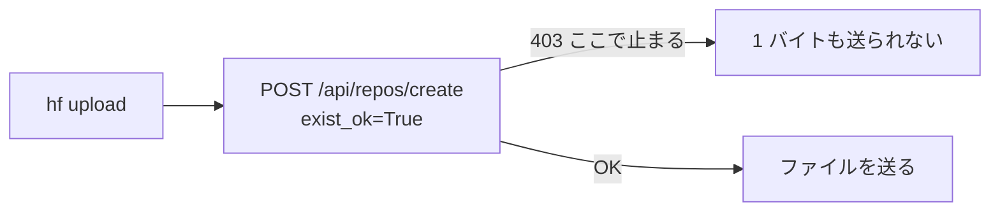

# 08. Hugging Face 経由で重みを運ぶときに詰まったら

**借りたGPUマシンと手元のマシンの間で、8〜10GBのチェックポイントを運ぶ話である。**
`scp`は1.7 MB/sしか出ず8.8GBに1時間以上かかるので、
**Hugging Faceの非公開リポジトリを中継に使う**(9.4GBで16分。
[06_runpod_pi05.md](06_runpod_pi05.md)の「持ち帰りは`scp`ではなく
Hugging Face経由にした」)。

**この文書を読むと、`hf upload`が止まったときに、原因を2つの問いで切り分けて、
10分以内に転送を始められる。** 締切前夜に踏むと致命的な場所なので、
**実際に踏んだ症状と、実際に効いた直し方**を残す。

## 実際に踏んだ症状 —— 403 Forbidden(2026-08-14 19:10)

```
$ hf upload siruku6/pi05_full_runpod \
      /workspace/out/pi05_full/checkpoints/003000/pretrained_model . --private
403 Forbidden: You don't have the rights to create a model under the namespace "siruku6".
Cannot access content at: https://huggingface.co/api/repos/create.
Make sure your token has the correct permissions.

$ hf auth whoami
✓ Logged in
  user: siruku6
```

**`whoami`が自分の名前を返しているのに、その名前で作れないと言われる。**
ここで「ログインできているのだから権限の話ではない」と読むと迷子になる。

### なぜこうなるか

`hf upload`は、**アップロードの前に必ず「リポジトリを作る」APIを叩く。**
既にあっても叩く(`exist_ok=True`を付けて呼ぶだけで、呼ぶこと自体は省かない。
`huggingface_hub` 1.27.0の`cli/upload.py:204`)。



**403の主語はトークンの権限であって、ユーザー名ではない。**
そして**`whoami`はトークンが有効かどうかしか確かめていない**ので、
読み取りしかできないトークンでも通る。**通ったことは何の証拠にもならない。**

| 見えたもの | 意味しないこと | 意味すること |
|---|---|---|
| `hf auth whoami`が名前を返す | 書ける | **トークンが失効していない** |
| `403 ... rights to create` | 名前が違う | **そのトークンでは作れない** |

## 切り分け —— 2つの問いに順に答える

### 問い1. そのリポジトリは本当に無いのか

**無ければ「作る」のは正しい動作なので、話は権限だけになる。**
**あるのに403なら、後述のBで避けられる。**
**受け取る側のマシン**(書けるトークンがある側)から見る。

```bash
python3 - <<'PY'
from huggingface_hub import HfApi
api = HfApi()
try:
    print("ある。private =", api.repo_info("<ユーザー名>/<リポジトリ名>").private)
except Exception as e:
    print("無い:", type(e).__name__)
print("--- 今ある非公開リポジトリ ---")
for m in api.list_models(author="<ユーザー名>"):
    print(" ", m.id, m.private)
PY
```

**8/14はここで`RepositoryNotFoundError 404`が出た。** 一覧に出たのは
`pi05_stage1`／`parc2026-tmp`／`parc2026-submission`／`parc2026-archive`の4つで、
**上げようとしていた名前は本当に存在しなかった。**

### 問い2. そのトークンは書けるのか

**送る側**(Pod)で見る。

```bash
# 環境変数が勝っていないか。値は出さない
env | grep -iE '^(HF_TOKEN|HUGGING_FACE_HUB_TOKEN)=' | sed 's/=.*/=（値が入っている）/'

python3 -c "
from huggingface_hub import HfApi
w = HfApi().whoami()
print(w['name'], w.get('auth'))"
```

`auth`の中に`role: read`と出れば、**読み取り専用のトークンで動いている。**

> **`hf auth login`をしても、環境変数の方が勝つ。**
> トークンを探す順番は**`HF_TOKEN` → `HUGGING_FACE_HUB_TOKEN` → 保存したファイル**
> である(`huggingface_hub/utils/_auth.py`の`get_token`)。
> **Pod作成画面でデータセットを取るために入れた読み取り専用トークンが、
> あとからログインしても居座り続ける**——これがいちばんありそうな筋である。

## 直し方

| | やること | 向いている場面 |
|---|---|---|
| **A** | **書けるトークンを入れ直す** | **リポジトリが無いとき。8/14はこれで解決した** |
| B | 既にあるリポジトリへ`upload_folder`で入れる | トークンが「特定のリポジトリだけ書ける」型のとき |

### A. 書けるトークンを入れ直す(実際に効いた)

https://huggingface.co/settings/tokens で**Write**のトークンを1つ作り、送る側で:

```bash
unset HF_TOKEN HUGGING_FACE_HUB_TOKEN
hf auth login          # 対話で貼る
hf upload <ユーザー名>/<リポジトリ名> <送るディレクトリ> . --private
```

> **`hf auth login --token <値>`は使わない。** シェルの履歴にトークンが残る。
> **トークンはリポジトリにも文書にも書かない。**

### B. 既にあるリポジトリへ入れる(「作る」APIを避ける)

**`hf upload`ではなくPythonの`upload_folder`を呼ぶのが要点である。**
こちらは**リポジトリを作らない**(無ければ失敗する)ので、
作る権限が無くても、中身を書く権限があれば通る。

```bash
python3 - <<'PY'
from huggingface_hub import HfApi
HfApi().upload_folder(
    repo_id="<ユーザー名>/<既にあるリポジトリ名>",
    folder_path="/workspace/out/<run名>/checkpoints/003000/pretrained_model",
    path_in_repo="pi05/full_runpod_003000",   # 中で場所を分ける
)
PY
```

受け取る側は、その場所だけを取る。

```bash
hf download <ユーザー名>/<既にあるリポジトリ名> \
    --include 'pi05/full_runpod_003000/*' \
    --local-dir work/train/pi05_full_runpod_dl
```

### なぜ案 B が要るのか —— fineGrained トークンには「作る」権限が存在しない(8/31 に確定)

**案 B が要る場面は「特定のリポジトリだけ書けるトークンのとき」に限らない。**
**`fineGrained` 型のトークンには、そもそも「リポジトリを作る」項目が無い。**
設定画面の `User permissions` の `Repositories` に並ぶのは 4 つだけで
(`Read contents of your repos` / `View access requests for your gated repos` /
`Read contents of public gated repos you can access` / **`Write contents/settings of your repos`**)、
**`Create repositories` という項目は存在しない**(`Create` は `Webhooks` の項目にしか出てこない)。

| したいこと | fineGrained トークンで | 対処 |
|---|---|---|
| **既にあるリポジトリへ書く** | **通る**(`repo.write` を持っている) | **案 B で済ませる** |
| **新しいリポジトリを作る** | **通らない** | ブラウザで作る、または **classic の Write トークン**を作る |

**そして `hf upload`(CLI)は、送る前に必ず「作る」API を叩く。**
**だからリポジトリが既にあっても 403 で止まる。**Python の `upload_folder` は作らないので通る。

### どの種類の資格情報で動いているかを 1 行で見る

**同じアカウントでも、機械ごとに種類が違う。**値は出さずに種類だけ出る。

```bash
python3 -c "
from huggingface_hub import HfApi
w = HfApi().whoami()
print({k: v for k, v in w.items() if k in ('name', 'type', 'auth')})"
```

| 出たもの | 意味 |
|---|---|
| `auth: {'type': 'oauth', 'expiresAt': ...}` | **ブラウザでログインしたセッション。本人の権限をそのまま持つので作れる。**ただし `expiresAt` で切れる |
| `auth: {'type': 'access_token', 'accessToken': {'role': 'fineGrained', ...}}` | **作れない**(上の表)。**期限は無い** |
| `role: read` | 読み取り専用。書き込みも通らない |

> **誰も見ていない機械には、期限が切れる資格情報を置かない。**
> OAuth のセッションは期限で切れ、**切れた瞬間に静かに 403 になる**ので、
> 夜間に上げ続ける機械では朝に何も残っていないことになる。
> **アクセストークン(期限なし)を `~/.hf_token` に置く方が、無人の機械では安全である。**
> **借り物のクラウド機に置くなら、アカウント全権の classic Write ではなく
> fineGrained(読み＋書き・作成なし)に寄せる。**

## そのまま運ぶときの手順

詰まりが解けたあとの、素の運び方である。

```bash
# 送る側(Pod)
hf upload <ユーザー名>/<リポジトリ名> \
    /workspace/out/<run名>/checkpoints/003000/pretrained_model . --private

# 受け取る側
hf download <ユーザー名>/<リポジトリ名> \
    --local-dir work/train/pi05_full_runpod/003000
```

**学習ログはチェックポイントに入らない**ので別に運ぶ。45KBしかないので`scp`で足りる
([06_runpod_pi05.md](06_runpod_pi05.md)の「学習ログの読み」)。

## 他に踏みうる詰まり

| 症状 | 原因 | 対処 |
|---|---|---|
| `hf: command not found` | 古い版では名前が違う | `huggingface-cli upload` を使う。引数は同じ |
| `403`だがメッセージが`gated` | ライセンス同意が済んでいない(paligemmaなど) | ブラウザでモデルのページを開いて同意する |
| 途中で切れる | — | **同じコマンドをもう一度打つ。**送り終えたファイルは送り直されない |
| 2回目が異様に速い | 中身が同じ部分を送り直さない仕組み(Xet)が効いている | 正常。組み直したzipは50秒で済んだ |
| `--local-dir`の中が空でエラー | `--include`のパターンが1件も当たっていない | 問い1のコマンドでファイル名の綴りを確かめる |
