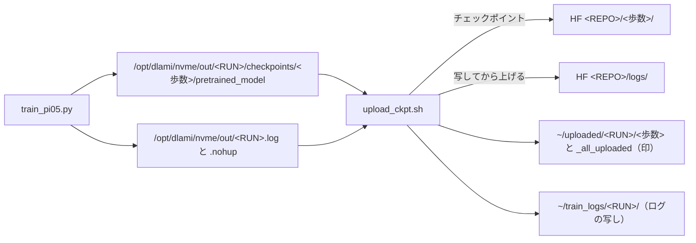

# 17. 学習したチェックポイントを HF へ運ぶ

> **この文書は「上げるループ」1 つだけを扱う。**どこで回すか・何歩回すかは
> [14](14_blackwell_session.md)・[16](16_bowl_regen_train_eval.md) にある。
> **上げようとして 403 や `not found` になったとき**は [08](08_hf_transfer_troubleshooting.md) へ。

**混ざりやすい 2 つを先に分ける。名前も目的も別である。**

| | **上げる** | **間引く** |
|---|---|---|
| 何をする | チェックポイントを **HF へ写す** | 古いチェックポイントを **手元から消す** |
| 道具 | `solution/train/upload_ckpt.sh` | `solution/train/prune_checkpoints.sh` |
| なぜ要る | **`/opt/dlami/nvme` はセッション終了で消える。**上がっていない歩数は存在しないのと同じ | LeRobot は古いものを消さない。1 個 11〜25 GB あるのでディスクが尽きる |
| どこで | **Blackwell だけ** | **どこでも**（JAIST・会社の RTX6000） |
| 止め時 | 全部上がったら自分で抜ける | 学習が終わるまで居座る |

**JAIST では上げるループを回していない。**あちらの `work/train` は消えないので、
学習が終わってから手で上げれば足りる（[4 節](#4-jaist-や手元から-1-個だけ上げる)）。

| 節 | 中身 |
|---|---|
| [1 何が動いているか](#1-何が動いているか--3-つの-プロセス) | 学習・上げる・間引くの 3 つ |
| [2 上げるループの摘み](#2-上げるループの摘み) | 渡す 5 つと、既定値がどこを指すか |
| [3 進み具合の読み方](#3-進み具合の読み方) | ログの 1 行で今どこか分かる |
| [4 JAIST や手元から 1 個だけ上げる](#4-jaist-や手元から-1-個だけ上げる) | ループを使わない道 |
| [5 詰まったとき](#5-詰まったとき) | 実際に踏んだ 4 つ |

---

## 1. 何が動いているか —— 3 つのプロセス

Blackwell で `blackwell_bowl5.sh`（または `blackwell_launch.sh`）を打つと、
**別々の 3 つが走り始める。**どれも `setsid` なので端末を閉じても生きる。



**印（`~/uploaded/`）が要である。**HF を読んで一致を確かめてから置くので、
**印があれば上がっている**と言い切れる。印が無ければ次の巡でやり直す。

**学習ログもチェックポイントと一緒に上がる**（2026-09-13 から）。
チェックポイントを 1 個確かめるたびに、その時点までのログを `logs/` へ上げる。
**ログはやり直しでは作れない唯一のものである**——`train_config.json` は設定を持つが、
loss の推移は持たない。9/13 に `pi05_bowl5_full` のチェックポイントだけが上がり、
ログが 1 行も上がっていなかったので足した。

**上げるのは `~/train_logs/<RUN>/` の写しである。**学習中のログは伸び続けるので、
そのまま上げると大きさが変わって HF と突き合わせられない。写しは `$HOME` にあるので、
**HF の認証が切れていてもセッションをまたいで残る。**

**`_all_uploaded` は「学習が終わった かつ 未上げ 0 個 かつ 最後のログが確かめられた」
ときだけ置かれる。**最後のログは学習が終わってから上げる——最後の保存のあとにも、
終了コードや落ちたときの traceback が書かれるからである。
監視セル（[14 の B6](14_blackwell_session.md)）は**これが在るときだけサーバを止める。**
在らなければ止めない——GPU 時間は減るが、上がっていないチェックポイントは消えない。

**`training_state` は上げない。**1 個 16 GB あり、`--resume` にしか使わない。
上げ終えた歩数のぶんはその場で消す。

---

## 2. 上げるループの摘み

```bash
RUN=pi05_bowl5_full REPO=siruku6/pi05_bowl5_full \
    LOG=~/upload_ckpt_pi05_bowl5_full.log \
    setsid nohup ~/tools/upload_ckpt.sh > ~/upload_ckpt.nohup 2>&1 &
```

| 変数 | 既定 | 何を指すか |
|---|---|---|
| `RUN` | **必須** | `--run-name` と**同じ文字列**。これで学習プロセスを探す |
| `REPO` | **必須** | 上げ先。**Blackwell はリポジトリを作れない**ので先に作っておく |
| `OUT` | `/opt/dlami/nvme/out/$RUN` | 学習の出力先。`--output-root` を変えたらここも渡す |
| `MARK` | `~/uploaded/$RUN` | 上げた印の置き場。**`$HOME` なので自動保存に乗る** |
| `LOG` | `~/upload_ckpt.log` | **走りごとに分けること**（下の 5.2） |
| `VERIFY` | `~/tools/verify_upload.py` | 一致を確かめる道具。**無いと印を付けられない** |
| `WAIT_START` | 600 | 学習が現れるのを待つ秒数。現れなければ**印を置かずに終わる** |
| `TRAIN_LOG_DIR` | `$(dirname "$OUT")` | 学習ログ（`<RUN>.log`・`<RUN>.nohup`）の在り処。**`--log-file` を変えたときだけ渡す** |
| `LOG_COPY` | `~/train_logs/$RUN` | ログの写しの置き場。HF の `logs/` へはここから上げる |

**`blackwell_bowl5.sh` と `blackwell_launch.sh` は、この 5 つを渡してループを起こす。**
手で起こすのは、ループだけ死んだときである（[5.3](#53-ループだけ死んだ)）。

**何個上がるかは `--save-freq` で決まる。**`pretrained_model` は 1 個 **8.8〜9.4 GB**
（[reference/27](../reference/27_blackwell_environment.md) で 8.8 GB・`blackwell_launch.sh` の実測で 9.35 GB）で、
**HF の非公開の枠は 100 GB** である。`blackwell_bowl5.sh` は 6 個以上になると止まる。

| 歩数 | `--save-freq` | 個数 | HF に載る量 |
|---|---|---|---|
| 5,000 | 2,000 | 3（2000・4000・5000） | 約 26 GB |
| 24,000 | 8,000 | 3（8000・16000・24000） | 約 26 GB |
| 24,000 | 2,000 | **12** | **約 108 GB —— 入らない** |

---

## 3. 進み具合の読み方

```bash
. ~/run_env.sh          # **これを読まないと $RUN が空である**
tail -f ~/upload_ckpt_$RUN.log
```

> **`~/env_pi05.sh` と `~/run_env.sh` は別物である。**前者（`omnicampus_setup.sh` が書く）は
> `OUTPUT_ROOT` や `HF_HOME` を置き、**`RUN` は置かない。**後者（起こすスクリプトが書く）が
> `RUN`・`REPO`・`STEPS` を置く。**前者だけ読むと `$OUTPUT_ROOT/$RUN.log` が
> `/opt/dlami/nvme/out/.log` になって「そんなファイルは無い」と言われる**（9/12 に踏んだ）。

**1 巡ごとに必ず 1 行出る。**出ていなければループが死んでいる。

| 出る行 | 意味 |
|---|---|
| `学習を見つけた（N 秒待った）` | 起動できた。**これが出るまで離席しない** |
| `<歩数> 大きさを測る` | 30 秒あけて 2 回測る。**書き終える前に上げないため** |
| `<歩数> まだ書いている（a → b）` | 保存中。次の巡でやり直す |
| `<歩数> 上げ始める（N MB）` | `hf upload` 実行中。最大 1 時間で打ち切る |
| `<歩数> **確かめた。印を付けた**` | **HF を読んで一致した。**ここまで来て初めて安全 |
| `<歩数> **確かめられない。印を付けない**` | 次の巡でやり直す。**放っておいてよい** |
| `ログ 上げ始める（N 個・写しは ...）` | チェックポイントを確かめた直後に、ログも上げている |
| `ログ **確かめた**` | その時点までの loss の推移が HF の `logs/` にある |
| `ログ **hf upload が失敗**` / `**確かめられない**` | 写しは `~/train_logs/` に残っている。途中の回なら放っておいてよい |
| `ログ **... に <RUN>.log も <RUN>.nohup も無い**` | ログの在り処が既定と違う。`TRAIN_LOG_DIR` を渡して起こし直す |
| `見回り 未上げ N 個・学習は走っている` | 平常。1 分ごとに出る |
| `見回り 未上げ N 個・学習は終わった` | 残りを上げ切るまで抜けない |
| `**チェックポイントは全部上がったが、最後のログが上がっていない。抜けない**` | 1 分ごとにやり直す。**続くなら [08](08_hf_transfer_troubleshooting.md) で認証を見る** |
| `=== 全部上がったことを確かめた（チェックポイントとログ） ===` | `_all_uploaded` を置いて終了。**ここで止めてよい** |

**止めてよいかの判定は 1 行で足りる。**

```bash
ls ~/uploaded/<RUN>/_all_uploaded && echo "止めてよい"
```

---

## 4. JAIST や手元から 1 個だけ上げる

**ループは要らない。**`work/train` は消えないので、終わってから上げる。

```bash
# 上げる
hf upload siruku6/pi05_bowl5 \
    work/train/pi05_bowl5/checkpoints/024000/pretrained_model 024000 --repo-type model

# **上がったことを確かめる。**終了コード 0 は「上がった」と同じではない
python3 solution/train/verify_upload.py --repo siruku6/pi05_bowl5 --step 024000 \
    --local work/train/pi05_bowl5/checkpoints/024000/pretrained_model
```

`verify_upload.py` は**ファイルの個数と 1 個ずつの大きさ**を HF と突き合わせ、
`OK <repo>/<step>: N 個・X GB が一致` を出す。**足りないものと大きさ違いは名前で挙げる。**

**手元で使うだけなら上げなくてよい。**評価は `work/artifacts/` の重みを読む。

```bash
python3 solution/tools/weights/install_pi05_weights.py \
    work/train/pi05_bowl5/checkpoints/024000/pretrained_model --name pi05_bowl5
```

---

## 5. 詰まったとき

### 5.1 `hf upload` は 0 で返るのに、HF に無い

**9/3 に実際に起きた**（`000500` の次から 1 個も上がらず、跡も残らなかった）。
**だから終了コードを信じない作りにしてある**——上げたあとに HF を読んで数え、
一致したときだけ印を置く。**印が無ければ次の巡でやり直される**ので、
`確かめられない` が続くとき以外は放っておいてよい。

続くときは [08](08_hf_transfer_troubleshooting.md) の切り分けへ。

### 5.2 ログが前の走りのものだった

**`LOG` を走りごとに分けること。**共通のログだと、前の走りの
`学習を見つけた` を読んで「掴んだ」と誤判定する（9/7 に踏んだ）。
`blackwell_bowl5.sh` は `~/upload_ckpt_$RUN.log` に分けている。

### 5.3 ループだけ死んだ

学習は生きているのにログが伸びない。**印は残っているので、起こし直せば続きから進む。**

```bash
pgrep -af upload_ckpt.sh                      # 本当に死んでいるか
ls ~/uploaded/<RUN>/                          # どこまで上がったか
RUN=<RUN> REPO=<REPO> LOG=~/upload_ckpt_<RUN>.log \
    setsid nohup ~/tools/upload_ckpt.sh > ~/upload_ckpt.nohup 2>&1 &
```

### 5.4 打ち直したいので全部止める

**順番がある。**監視セルを先に止めないと、途中でサーバを止められる。

```bash
# 1. 監視セル（B6）を止める —— これを飛ばさない
# 2. 上げるループを止め、HF に何が上がったかを見る
pkill -f upload_ckpt.sh
# 3. 子から落とす。親だけ殺すと GPU が空かない
pkill -f "train_pi05.py --run-name <RUN>" ; pkill -f "lerobot[-_]train"
nvidia-smi --query-compute-apps=pid,used_memory --format=csv   # 空いたか
# 4. 出力と印を片付ける（片付けないと打ち直せない）
rm -rf /opt/dlami/nvme/out/<RUN>
rm -rf ~/uploaded/<RUN>
```

**使った時間は戻らない。**打ち直す前に歩数を決め直すこと（[14 の A7](14_blackwell_session.md)）。
