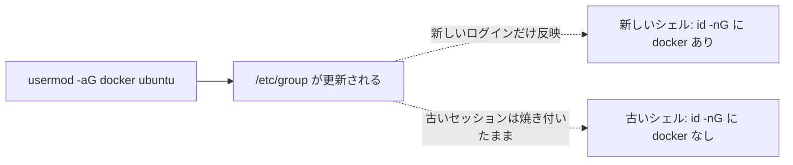

# 16. docker を sudo なしで使うのに、グループに入れただけでは直らないとき

**[../howto/12_bring_eval_to_rtx6000.md](../howto/12_bring_eval_to_rtx6000.md) の「手順 1 docker を sudo なしで
使えるようにする」で書いた `usermod -aG docker` + ログインし直す、が
`eng003sasaki01`（会社の RTX6000）では効かなかった。**

**2026-08-27 に解決した。効いたのは下の表の #4 —— コマンドパレットから
`Remote-SSH: Kill VS Code Server on Host` を実行し、ウィンドウを閉じて繋ぎ直す。**
`Reload Window` では足りない。以下は切り分けの記録である。

## 実際に踏んだ症状(2026-08-27)

```
$ docker images parc2026-final
permission denied while trying to connect to the docker API at unix:///var/run/docker.sock

$ id -nG; getent group docker; ls -l /var/run/docker.sock; systemctl is-active docker
ubuntu adm cdrom sudo dip plugdev lxd
docker:x:988:ubuntu
srw-rw---- 1 root docker 0 Aug 26 06:50 /var/run/docker.sock
active
```

**`getent group docker` はすでに `ubuntu` をメンバーとして返している**(=
`usermod -aG docker` 自体は誰かが既に実行済み)。**しかし `id -nG` には `docker` が
出てこない。** ソケットの所有・権限(`root:docker`, `rw-rw`)とデーモンの稼働は
どちらも正常。

## なぜこうなるか

**グループ所属は「ログインした瞬間のセッション」に焼き付く。**
`usermod -aG` で `/etc/group` を書き換えても、**それより前から動いている
シェルやプロセスには反映されない。** `id -nG` が返す一覧は今のプロセスが
持っている補助グループの一覧であって、`/etc/group` を毎回読み直しているわけではない。



## 試したこと・結果

| # | 試したこと | 結果 |
|---|---|---|
| 1 | `id -nG` で現状確認 | `docker` が含まれていない(上記) |
| 2 | VS Code の **Remote-SSH: Reload Window** | **直らなかった。** `docker images` は同じ `permission denied` |
| **4** | コマンドパレットから **Remote-SSH: Kill VS Code Server on Host** → ウィンドウを閉じて再接続 | **直った。**`docker images parc2026-final` が sudo 無しで通った |

**`Reload Window` では足りない理由。** リモート側の `vscode-server` は**ウィンドウの
再読み込みをまたいでプロセスが生き残る。** 生き残った親プロセスから新しい端末が
生えるので、端末を開き直しても古いグループ情報を引きずる。**プロセスを殺して
初めて、新しいログインとしてグループが読み直される。**

## 5 と 6 は試さずに済んだ（残しておく）

**#4 で直ったので、下の 2 つは実行していない。**#4 が効かなかったときの次の手として残す。

| # | やること | 目的 |
|---|---|---|
| 5 | VS Code を介さず**別ターミナルから生の SSH**で `ssh eng003sasaki01 "id -nG"` | VS Code 側の問題か、ホスト側(nscd/sssd 等)の問題かを切り分ける |
| 6 | 5 でも `docker` が出ない場合、NSS キャッシュ(`nscd`/`sssd`)の再起動を確認 | ホスト側のグループ解決自体が古い情報を持っている可能性を潰す |

**#4 でも直らない場合の逃げ道**(12 の手順 1 にも書いた代償):
`sudo -E bash solution/tools/eval/run_final_eval.sh ...` で `sudo` 運用に倒す。
`-E` を落とすと `$HOME` が `/root` になり HF キャッシュのマウント元がずれるので必須。

## 関連

| 知りたいこと | ファイル |
|---|---|
| このマシンで docker を使う手順の全体像 | [../howto/12_bring_eval_to_rtx6000.md](../howto/12_bring_eval_to_rtx6000.md) |
