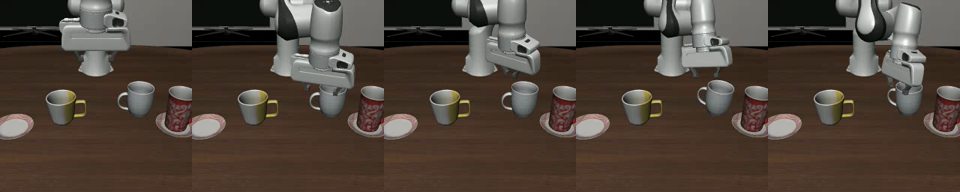
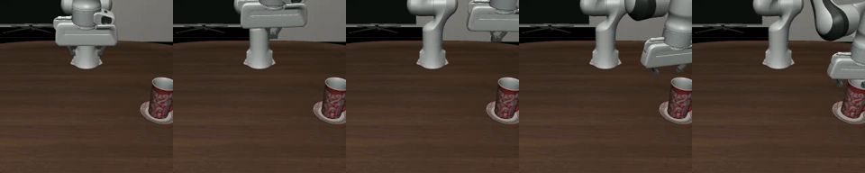

# 21. Track3 で掴めないのは「迷い」ではない —— **手先が 6〜20 cm 手前で止まる**

**2026-09-09 に、邪魔な物を場外へ移して 40 本回して分かったことである。**
道具は `solution/tools/probe/grasp_rollout.py`、生の値は `work/probe_grasp/*/grasp_rollout.json`。

> **なぜこの測りが要ったか。**動画では「違う物の上で漂う」が 4 課題すべてで起きていた。
> **「候補の間で迷っている」のか「掴む力を失った」のかで、次の手が正反対になる。**
> [20](20_probe_object_choice_without_rollout.md) は**選ぶところ**をロールアウト無しで測ったが、
> **掴めるかどうかはロールアウトでしか決まらない。**

| 節 | 中身 |
|---|---|
| [1 測り方](#1-測り方--変えるのは候補の数だけ) | 変えるのは候補の数だけ。**bddl は書き換えない** |
| [2 結果](#2-結果--邪魔な物を消しても掴めない) | **消しても掴めない。**40 本で最接近 59 mm が最良。**2.1 に動画** |
| [3 読み](#3-読み--接近が届いていない) | 選択でも把持能力でもない。**接近が届いていない** |
| [3.5 学習データの経路と並べる](#35-学習データの経路と並べると14-しか辿れていない9-に足した) | **止まるのではない。序盤で経路を外れて乗っていない**（9/9 に足した） |
| [4 踏んだ穴](#4-踏んだ穴--測る前に-2-回嘘の数が出た) | **測る前に 2 回、嘘の数が出た** |

---

## 1. 測り方 —— **変えるのは候補の数だけ**

**場面・指示文・カメラ・乱数をそのままにして、対象と競合する物だけを場面から除く。**

| 手順 | 理由 |
|---|---|
| `make_eval_env` で開く | **据え置き（棚・caddy・コンロ）の位置は `qpos` に入らず `reset()` の乱数で決まる。**キットと同じ `seed` で開かないと別の場面を測る |
| `set_init_state(配布 init[k])` | **無作為サンプルは使えない**（4 節） |
| **競合の自由関節を水平に 3 m 以上動かす** | **bddl から消してはいけない。**物の数が変わると配布 init を復元できない（次元で落ちる） |
| **空撃ち 10 歩**（キットと同じ） | 物は少し浮いた位置に置かれるので落ちて落ち着く |
| **ここで初期位置を記録** | 空撃ちの前に取ると、落ちたぶんを「動いた」と数える |

**残す物は bddl の述語から決める**——`:goal` が名指しする対象、それを支えている物、
目的地の領域を持つ物。**名前の当て推量をしない。**

**判定は `success` ではしない。**目標は「机の決まった場所へ置く」なので、
掴めても置き場所を外すと 0 になる。**掴む段だけを切り出す。**

| 出す数 | 判定 |
|---|---|
| `lift_mm` | 対象の z が初期値からどれだけ上がったか。**30 mm 超えたら「持ち上げた」** |
| **`min_dist_mm`** | **手先が対象へいちばん近づいた距離。これが本命である** |
| `others_moved_mm` | `:goal` に出てこない物が動いた最大量（キットと同じ 3 軸の L1） |

## 2. 結果 —— **邪魔な物を消しても掴めない**

**4 課題 × 2 条件 × 2 本 × 300 歩 を 2 つの重みで回した（計 40 本）。**

| 重み | 条件 | 最接近 中央値 | 最接近 最小 | **持ち上げた** | 他が動いた最大 |
|---|---|---|---|---|---|
| **`proto20`**（逆向き 20%） | 配布のまま | 178.5 mm | 103.3 mm | **1 / 10** | 682.0 mm |
| | **競合を除く** | 203.6 mm | **69.1 mm** | **0 / 10** | **0.0 mm** |
| **`rp3000`**（逆向きなし） | 配布のまま | 117.4 mm | 80.4 mm | **2 / 10** | 664.9 mm |
| | **競合を除く** | 149.8 mm | **58.9 mm** | **0 / 10** | 21.9 mm |

**3 つ読める。**

1. **競合を消しても掴めない。**40 本のうち持ち上げたのは 3 本で、**どれも「配布のまま」**である。
   **中央値は競合を消したほうが遠い**（178 → 204・117 → 150）。
2. **手先が対象へ 59 mm より近づいた回が 1 度も無い。**掴むには 20〜30 mm が要る。
3. **衝突は競合を消すと消える**（682 → 0 mm・665 → 22 mm）。
   **つまり衝突率が測っていたのは「競合にぶつかったこと」である。**

**課題ごとに見ると、消して近づく課題と遠くなる課題が半分ずつである**（`proto20`）。

| 課題 | 配布のまま | 競合を除く |
|---|---|---|
| 缶 | 161.4 mm | **69.1 mm** |
| 黄本 | 108.6 mm | **80.8 mm** |
| 赤マグ | **153.2 mm** | 174.3 mm |
| two mugs | **103.3 mm** | 152.2 mm |

**「迷っていたから遠かった」なら 4 課題すべてで近づくはずである。そうなっていない。**

### 2.1 動画で見ると —— **1 個だけにしても、横まで来て掴まない**

**赤マグの課題（`proto20`・300 歩を 60 コマごとに 5 枚）。**
**向きはモデルへ渡るのと同じ（180 度回転後）である**——生画像は上下が逆で、
回して初めて学習データと揃う（[../reference/10](../reference/10_observation_interface.md)）。

**配布のまま（マグ 3 個・皿 2 枚）**

**競合を場外へ（赤マグ 1 個と左の皿だけ）**

**下の映像が要点である。**紛れる物が 1 つも無く、**皿の上の赤いマグだけが置いてある。**
それでも腕は**マグの横まで来て、掴まずに 300 歩を使い切る。**
**「どれを取るか分からなくて漂っていた」のではない。**

**動画は `work/probe_grasp/video_proto20/videos/` に 8 本ある**
（4 課題 × 配布のまま／競合を場外へ）。`RECORD=1` で撮れる。

## 3. 読み —— **接近が届いていない**

**3 つの門のうち、落ちているのは 3 つ目である。**

| 門 | 測り | 結果 |
|---|---|---|
| 対象を選ぶ | [20](20_probe_object_choice_without_rollout.md) の向き | **黄本・缶は正しい**（`proto20` で cos +0.97・+0.76） |
| 1 歩ごとの行動を出す | 教師強制（`teacher_forcing.py`） | **学習データの 43 課題で再現する**（相対誤差 0.44〜0.66 対 基準 1.00） |
| **自分の出力で状態を進める** | **この文書** | **6〜20 cm 手前で止まる** |

**「学習が入っていない」でも「対象を選べていない」でもない。**
**1 歩ごとは合っているのに、自分の出力で状態が進むと届かない**——
**誤差の蓄積（分布のずれ）である。**

**いちばん有力な原因は学習データの欠陥である。**判定に使った 2 つの重みは
どちらも **v1 の逆向きデータ**で学習している。**v1 は接近の区間で手首の回転指令が
配布データの封筒を外れていた**——配布は ±0.375 に収まるのに v1 は ±1（クリップの上限）に
張り付き、**外れたコマは先頭 10% に 52.6% が集中する**
（[../reference/30 の 8 節](../reference/30_reverse_grasp_pose.md)）。
**落ちているのがまさにその接近の区間である。**

**v2 は 1 コマの回転を ±0.375 に制限してあり、\|z\|>10 のコマが 15.2% → 0.0% になっている。**
**まだ 1 度も学習に使っていない。把持について結論を出す前に v2 を 1 本回すこと。**

> **【9/9 に訂正】**当初ここに「v1 は置くときに物を 40 mm 空中で放していたので、
> その時間反転は『物の 40 mm 上で手を閉じる』」と書いたが、**誤りである。**
> **40 mm の欠陥は「置く」区間、つまり逆向きエピソードの終わりにある**
> （[../reference/31 の 8.1](../reference/31_reverse_place_without_contact.md)）。
> **置き方の欠陥は、接近が届かないことの説明にならない。**

## 3.5 **学習データの経路と並べると、1〜4% しか辿れていない**（9/9 に足した）

**上の読みには「止まる」と書いたが、正しくは「乗っていない」である。**
道具は `solution/tools/probe/divergence.py`、生の値は `work/probe_diverge/proto20_v1c/`。

**並べられる理由。**逆向きデータは **T3 の配布初期状態から作った**ので、
npz の名前の `_i<番号>` からその初期状態を引き、**1 歩目から同じ状況で回せる。**

| `proto20/002000`・3 課題 × 初期状態 4 通り・12 本 | 実測 |
|---|---|
| 経路を外れた量 中央 | **36.9〜120.1 mm** |
| **同じ初期状態の記録どうし（物差し）** | **1.0〜20.4 mm** |
| **50 mm 外れた歩数** | **6〜85**（全長 147〜248 コマ） |
| **先頭から 30 mm 以内で辿れた割合** | **0.01〜0.04** |
| 手首の角度差 中央 | **15〜87°** |
| **1 コマ目の画素差** | **0.80〜1.23 / 255** |

**3 つ言える。**

1. **序盤で外れる。**先頭 10〜20% で 5 cm 外れ、**経路の 1〜4% しか辿れない。**
   **「対象の近くまで正しく行って止まる」ではない。**
2. **物差しがあるので「外れている」と言える。**同じ課題の正しい経路どうしは
   **1〜20 mm しか違わない。**モデルはその 3〜100 倍外である。
3. **入力の画は同じ。**同じ初期状態の 1 コマ目が **1/255 の差**で一致する。
   **「評価時の入力が学習時と違う」は、少なくとも画については消えた。**

**回転だけは別で、v1 の欠陥と噛み合う。**モデルの回転指令の p95 は **0.079〜0.627** で、
**記録（v1）の 0.367〜1.000 より小さい**（11 本中 10 本）。
**v1 の回転目標はクリップの上限に張り付いていて学べる形ではなく、
モデルは平均へ潰して小さく出している。**だから手首が掴む姿勢に届かない。
**v2 は封筒内（±0.375・封筒外 0.0%）なので、目標が学べる形になる。**

> **「いちばん近い点の番号」を進み具合として使ってはいけない**（9/9 に踏んだ）。
> **逆向きの経路は掴んで戻ってくる往復**なので、腕が出発点の近くに居るだけで
> 「終点に居る」と出る（黄本で 5 歩目に 1.00）。**先頭から続けて辿れた長さで測る。**

## 4. 踏んだ穴 —— **測る前に 2 回、嘘の数が出た**

**どちらも「もっともらしい数」が出るので、照合を入れないと気づけない。**

| 穴 | 何が起きたか | 直し方 |
|---|---|---|
| **同じ型の物は 1 行に宣言される** | `plate_1 plate_2 - plate`・`yellow_book_1 yellow_book_2 - yellow_book`。行ごとに消すと**片方だけ残る。**「消した」と表示しながら**消したい当の競合が残っていた** | **行を消さず、行の中の名前を選び直す。**そして**消した後に env の物の集合を照合して落ちる** |
| **`env.reset()` の無作為サンプルは T3 では妥当でない** | 缶がトレイに食い込んだ状態で置かれ、物理が押し出して **y が 20 歩で 0.26 → 1.51 m** へ飛ぶ。`lift_mm` が **4 本すべてで 203.5 mm** と出た（**手先は 30 cm 離れたまま**） | **配布 init を使う**（`pruned` はこれを選り分けてある。20 歩で 1 mm も動かない）。物の数を変えられないので、**消すのではなく場外へ移す** |
| **場外へ移すのに z を下げてはいけない** | z = −2 m にしたのに **z = 0.009 で立っていた。**床に押し戻される | **水平に 3 m 以上動かす** |
| **初期位置を空撃ちの前に取ってはいけない** | 物は少し浮いた位置に置かれるので、空撃ちの 10 歩で落ちる。それを「動いた」と数える | **空撃ちの後に記録する**（キットの衝突判定と同じ基準） |
| **往復する経路で「いちばん近い点の番号」を進み具合にしてはいけない**（**9/9・3.5 節**） | 逆向きの経路は掴んで戻ってくるので、**腕が出発点の近くに居るだけで「終点に居る」と出た**（黄本で 5 歩目に 1.00） | **先頭から続けて許容内で辿れた長さ**で測る |
| **記録 1 本だけと比べてはいけない**（**9/9・3.5 節**） | 同じ初期状態の記録が 2〜3 本あり、元の順方向デモが違えば復路が違う。**「別の本に乗っていた」を「外れた」と数える** | **同じ初期状態の記録を全部相手にして、モデルにいちばん有利な本を代表にする** |

**共通する教訓は 1 つである——「消した／動かした」と言うだけでなく、
その場面を作ったあとに数えて照合する。**

---

## Claude 側

- **`success_rate` が 0 の理由を、門ごとに切り分けてから手を打つ。**
  この課題では 3 つの門のうち 2 つは通っていて、3 つ目だけが落ちていた。
  **積になっている指標は、切り分けの道具を作るまで何も教えない。**
- **場面を作り替える実験は、作り替えた結果を照合する。**
  4 節の 4 件はすべて「もっともらしい数が出る」形で間違っていた。
- **判定に使う重みが、どのデータで学習したものかを先に確かめる。**
  v1 と v2 を取り違えると、直したはずの欠陥を「直っていない」と読む。
- **「ずれている」と言う前に、ずれの物差しを同じ式で作る。**
  3.5 節の「外れ 37〜120 mm」は、**同じ課題の正しい経路どうしが 1〜20 mm** だと
  分かって初めて意味を持った。**物差しは追加のロールアウト無しで作れることがある**
  ——ここでは記録どうしを比べるだけだった。

## 人間側

- **「迷っているのでは」という筋は、消してみれば 1 変数で決まる。**
  この実験は数時間で、学習を 1 本回すより安い。**先にこれをやる価値がある。**
- **衝突率は「競合にぶつかった率」だった。**競合を消すと 0 になる。
  **衝突を減らしたいなら、当てないようにするより先に、対象へ届くようにする。**
