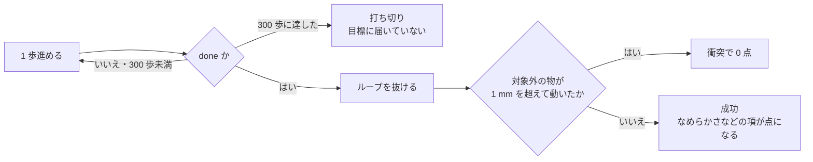

# 24. 目標に届いたのに 0 点になる道は衝突だけで、その失点の 65% は丼を掴む瞬間に出ていた

**2026-08-31 に採点コードを読んで点の門を確かめ、2026-09-12 に手元の評価 1,154 本で
失点の出どころを数えて分かったことである。**

> **これが分かると何が決まるか。**衝突を減らす手を**どこに当てるか**が決まる。
> 摂動で崩れた腕を立て直す手（ずれた姿勢の手本を足す）と、掴み方そのものを直す手
> （手本を作り直す）は別の手で、**失点の大半は後者の側にあった。**

## 目次

- [1. 採点コードが決めている点の門](#1-採点コードが決めている点の門)
- [2. 採点ログから届いた本数と 1 本あたりの質を分ける](#2-採点ログから届いた本数と-1-本あたりの質を分ける)
- [3. 手元の評価で失点を数える](#3-手元の評価で失点を数える)
- [4. 丼の周りの接触は摂動では増えない](#4-丼の周りの接触は摂動では増えない)
- [5. 寸法で説明がつく](#5-寸法で説明がつく)
- [6. 掴む向きを選んで手本を作り直した](#6-掴む向きを選んで手本を作り直した)
  - [6.1 手元では、狙った失点が 5 分の 1 に落ちた（2026-09-17 に 4 重みで確認）](#61-手元では狙った失点が-5-分の-1-に落ちた2026-09-17-に-4-重みで確認)
- [7. 確かめ直すコマンド](#7-確かめ直すコマンド)
- [8. Claude 側](#8-claude-側)
- [9. 人間側](#9-人間側)

---

## 1. 採点コードが決めている点の門

**採点ログに出る歩数だけでは「成功した」とは言えない。**配布された採点コード
（`b_PARC2026_final/pipeline/`）を読むと、1 エピソードの判定は次の順に進む。



| 根拠 | 場所 |
|---|---|
| ループを抜けるのは `done` のときだけ | `pipeline/rollout.py` 228 行 `if done:` |
| 衝突はループの後でまとめて判定する | 同 233 行 `collided = any(d > collision_threshold ...)` |
| 成功は「届いた かつ 衝突していない」 | 同 234 行 `success = bool(done) and not collided` |
| しきい値は 1 mm | `pipeline/total_score.py` 24 行 `"threshold_m": 0.001` |

ここで **`done`** は bddl の目標条件を満たしたこと、**衝突**は
「掴む対象（`obj_of_interest`）でもロボットでもない物が 1 mm を超えて動いたこと」を指す。

**だから採点ログの歩数はこう読む。**

| 歩数 | 意味 |
|---|---|
| **300**（打ち切り） | 目標に届いていない |
| **300 未満** | 目標に届いた。**ただし成功とは限らない** |
| **届いたのに 0 点** | **衝突だけ**が原因である |

## 2. 採点ログから届いた本数と 1 本あたりの質を分ける

**1 節の門を使うと、点の変化を「届いた本数」と「届いた 1 本あたりの質」に分けられる。**
成功した本だけがなめらかさなどの項で 0〜1 の点を持つので、
`総合スコア × 8 ÷ 届いた本数` は、届いた本が全部成功なら 0〜1 に収まるはずである。

**並進の倍率を 1.15 に上げた 4.5.0 の Track2 が、それに収まらない。**

| 版 | 歩数（8 本） | 届いた本数 | 総合スコア | **届いた 1 本あたり** |
|---|---|---|---|---|
| 4.2.0（基準） | 300\* 187 178 137 143 178 300\* 300\* | 5 / 8 | 0.154 | 0.2464 |
| **4.5.0**（倍率 1.15） | 300\* 300\* 297 121 167 178 139 175 | **6 / 8** | **0.035** | **0.0467** |

（\* は打ち切り。出典は `b_PARC2026_final/outputs/submission_logs/track2/` の 2 本。）

**届いた本数は増えたのに、1 本あたりが 5 分の 1 になった。**同じ版の Track1 は
届いた 1 本あたり 0.155 を保っているので、なめらかさが崩れただけでは説明が付かない。
**届いた 6 本のほとんどが衝突で 0 点になった**と読むのが素直である。
**倍率を上げて崩れたのは、遅くなったからではなく行き過ぎて物に当たったからである。**

## 3. 手元の評価で失点を数える

**採点ログは 8 本しかなく、どの本がどの課題かも分からない。**そこで手元の評価
6 回ぶん・1,154 本の `results/object_disp.jsonl`（1 本ごとに `done`・`collided`・
動いた物と量を持つ）を数えた。

| 見たもの | 割合 |
|---|---|
| 課題を達成した（`done`） | 84.4% |
| **達成したのに衝突で消えた** | **17.2 ポイント** |
| 成功（`done` かつ衝突なし） | 67.2% |

**接触をすべて消せたときの天井は 67.2% → 84.4% である。**

**その 17.2 ポイントは、1 つの幾何に集まっていた。**

| 群 | 中身 | 本数 | 成功 | **接触を消したときの伸び** |
|---|---|---|---|---|
| **A** | **黒い丼（`akita_black_bowl`）の隣か下に別の物がある 5 課題** | 236（20%） | 37.7% | **+11.3 ポイント** |
| B | それ以外 | 918（80%） | 74.7% | +6.0 ポイント |

**群 A は本数で 20% しかないのに、失点の 65% を出している**（11.3 ÷ 17.2）。
なお 6 回の評価に出てきた群 A は 5 課題のうち 4 課題で、
`next_to_the_ramekin` は含まれていない。

## 4. 丼の周りの接触は摂動では増えない

**ここで最初の読み（衝突は摂動で腕が崩れて起きる）が半分外れた。**
手先の初期位置のずれの大きさで分けると、2 つの群は逆の形をしている。

| 群 | ずれ 2 cm 未満 | ずれ 2 cm 以上 | 摂動なし |
|---|---|---|---|
| **A** | **69.4%**（n=36） | **52.8%**（n=72） | 62.5%（n=128） |
| B | 8.3%（n=108） | 14.4%（n=216） | 16.3%（n=594） |

（表の値は衝突率。）**群 B はずれとともに衝突が増える。群 A は増えない。**
**群 A の接触は、腕が崩れていなくても起きている。**

**局面ごとに分けると、どこで当てているかも見える。**人の手本を 1 課題 20 本ずつ
シムで再生し、対象外の物の変位の増分を局面ごとに積んだ
（`solution/tools/contact_clean/contact_phase.py`）。

| 課題 | 1 mm を超えた手本 | 近づく | **掴む** | 運ぶ |
|---|---|---|---|---|
| `next_to_the_cookie_box` | 15/20 | 14.1% | **85.9%** | 0.0% |
| `on_the_cookie_box` | 12/20 | 20.4% | 37.4% | 42.2% |
| `on_the_ramekin` | 20/20 | 2.7% | 45.8% | 50.4% |

**隣に物がある課題は、掴む瞬間に指が隣の物に当たる。**
**上に載っている課題は、持ち上げきる前に横へ動かして台を引きずる。**
運搬の経路で当てているのは後者だけである。

**しきい値の厳しさのせいでもない。**群 A で失点した回の超過は 1〜2 mm が 5.4% しかなく、
**5 mm 以上が 65.4%** である。**本当に押しのけている。**

## 5. 寸法で説明がつく

**丼は指の開きより広い**（`solution/tools/probe/gripper_frame.py` の実測）。

| 測ったもの | 値 |
|---|---|
| 丼の水平の張り出し | 5.65 cm |
| **指の開き** | **4.81 cm** |
| 丼とクッキー箱の隙間（面と面） | 3.46 cm |

**だから真上から包むように掴めず、縁を 2 本の指で挟むしかない。**
すると手首は丼の軸から約 4 cm 外へ出て、外側の指はさらに外へ張り出す。
**箱の側から縁をまたぐと、外側の指と箱の間に数 mm しか残らない。**
人の手本はそこを通しているが（それでも 15/20 が 1 mm を超える）、
**学習した方策にその精度は再現できない。**

**ただし、またぐ向きは自由である。**丼は縦軸まわりに回転対称なので、
どの方位からまたいでも同じように掴める。`next_to_the_cookie_box` では
**360 度のうち 209 度が空いている。**上に載っている 2 課題は台が真下にあるので、
向きではなく「真上へゆっくり上げてから運ぶ」で直す。

## 6. 掴む向きを選んで手本を作り直した

**人の手本を真似させても当たるなら、当たらない手本を作るしかない。**
scripted policy（物の位置を読みながら動く手書きの制御器）に、次の規則を足した
（`solution/tools/scripted_demo/scripted_demo.py` の `RimPickPlace`）。

| 規則 | なぜ |
|---|---|
| **5 度刻みで方位を試し、隣の物との余裕が 3 cm 以上ある方位のうち、ロボットの根元に近いものを選ぶ** | 余裕をひたすら最大にすると腕が遠回りし、歩数が 151 → 273 に伸びた |
| **手首は丼の縁の壁の中心（半径 4.71 cm）に置く** | 人の手本の値（4.00 cm）を写したら片側の指だけで押し、丼を 1.6 cm 押しのけて掴み損ねた（16/50） |
| 載っている課題は降りる速さに上限をかける | 勢いよく降りると指の衝撃で台が滑った（`on_the_ramekin` が 8/50 → 50/50） |
| **作った手本を選ぶ門は「掴む瞬間に隣の物まで 2 cm 以上」** | 「結果が 1 mm 未満」だけでは、方策の再現誤差を吸えない |

**結果（採点と同じ規則で判定・コミット `c641a6a`）。**

| 条件 | 成功 |
|---|---|
| 5 課題 × 初期配置 50 通り | **246 / 250**（規則を足す前は 141 / 250） |
| 手先の初期位置を 2.17 / 3.58 / 9.67 cm ずらす（各 5 課題 × 10 配置） | 38 / 39 / **47** of 50 |

**学習データの手先のずれは 1.0 cm までしか入っていないのに、9.67 cm でも 47/50 通る。**
制御器が物の位置を毎回読み直すので、**ずれた所から戻す行動そのものを作れる。**
**群 A（幾何の接触）と群 B（摂動で崩れる腕）を 1 つのデータで覆える見込みがある。**

**採点の点では「効いた」と言えない。**配布データの丼 5 課題 1,880 本をこの手本に入れ替えて
`pi05_libero_base` から全パラメータで 5,500 歩学習した重み（`bowl5_full`）は、
**版 15.0.0 で Track1 0.498（本選の Track1 で最高）・Track2 0.254** を出した。
**しかし比べる相手と 1 変数になっていない**——出発点・歩数・推論の設定
（`samples 3`・歩数の切り替えあり）がそれまでの版と違い、
**同じ条件で配布データのまま学習した対照は回していない**（2026-09-15 時点）。

### 6.1 手元では、狙った失点が 5 分の 1 に落ちた（2026-09-17 に 4 重みで確認）

**採点の点は 1 変数にできなかったが、狙った失点そのものは手元で分けて測れる。**
`compe/val/TRACK2_VAL72.csv` の**同じ 72 行を同じ 5 本ずつ**回した 4 つの重みについて、
**丼 5 課題の行だけ**を抜き、この節が狙った失点（目標に届いたのに衝突で 0 点）を数えた。

| 重み | 丼 5 課題の手本 | 丼の行 | **届いたのに 0 点** | 残り 67 行の成功率 |
|---|---|---|---|---|
| `pi05_full_local` | 配布のまま | 90 | **0.522** | 0.837 |
| `pi05_ladder2500` | 配布のまま | 90 | **0.500** | 0.822 |
| `pi05_bowl5_full` | **台本に入れ替え** | 90 | **0.289** | 0.885 |
| `pi05_l90clean_008000` | **台本に入れ替え** | 90 | **0.111** | 0.826 |

**入れ替えた 2 本がどちらも、入れ替えていない 2 本より低い。**
**残り 67 行は落ちていない**ので、丼の手本を替えたことが他の課題を壊してはいない。

**4 本は出発点・歩数・学習の範囲が違うので、これも 1 変数ではない。**
言えるのは**「入れ替えた側が 2 本とも低い」**までである。

**それでも失点の重さは変わっていない。**2026-09-17 に採点に近い 4,091 本
（判定セット 2,100・VAL72 1,440・TRACK1_VAL29 551）で数え直すと、
**丼 5 課題は本数で 22.6% しかないのに、衝突による失点の 68%（7.3 / 10.8 ポイント）を出している。**
3 節の「20% の本数で失点の 65%」は、重みを 5 つ替えた後も同じ形で残っている。

**残っているのは 1 課題と 1 物体である。**丼 5 課題を 1 つずつに割ると、
**`on_the_cookie_box` だけが入れ替え後も 0.532 のまま**で（295 本・届いた率 0.844）、
主犯は `cookies_1`（157 件）である。**丼が箱の上に載っているので、真上へ抜けないと台が動く**——
5 節が「向きではなく『真上へゆっくり上げてから運ぶ』で直す」と書いた側が、まだ直っていない。

**避けようのない失点ではない。**同じ場面の同じ 175 本のうち、
**`cookies_1` の変位が 1 mm 未満に収まった回が 43%** ある。
同じ場面のラメキンと 2 つ目の丼は **100% が 0.00 mm** である。

**場面の散らかり具合は関係ない。**非対象の物体が 5 個ある場面の「届いたのに 0 点」は 0.021、
3 個の場面は 0.288 で、**数が多いほうが低い。**当たっているのは**対象のすぐ下・すぐ隣の 1 個だけ**である。

> **確かめ直すコマンドは
> [reference/39 の 8 節](../reference/39_episodes_that_move_the_score.md#8-確かめ直すコマンド) にある。**

## 7. 確かめ直すコマンド

```bash
cd ~/src/PARC2026_pre

# 1 節: 点の門
grep -n 'if done\|collided = \|success = ' ../b_PARC2026_final/pipeline/rollout.py
grep -n 'threshold_m' ../b_PARC2026_final/pipeline/total_score.py

# 2 節: 届いた本数と 1 本あたりの質
python3 solution/tools/analysis/parse_grading_log.py \
    ../b_PARC2026_final/outputs/submission_logs/track2/260824_pi0.5_4.2.0.txt \
    ../b_PARC2026_final/outputs/submission_logs/track2/260826_pi0.5_4.5.0.txt

# 3 節: 手元 1,154 本の失点の内訳（群 A の行が 236 本・11.3 ポイント）
python3 solution/tools/eval/tier_contact_loss.py --detail

# 6 節: 作り直した手本の成否
git show c641a6a --stat
```

## 8. Claude 側

**「300 歩未満で終わった＝成功」と読まない。**採点コードの門を先に読む。

**「衝突を減らす」を方針にする前に、どの課題のどの局面で失点しているかを数える。**
最初の設計は衝突を「摂動で崩れた腕」のせいと読み、摂動下で手本を撃ち直すデータを
一番手に置いた。**数え直すと、失点の 65% は摂動と関係の無い掴み方の幾何だった。**
方針の段で失点の内訳を 1 回数えていれば、一番手を取り違えなかった。

**「接触 0・目標未達」を良い結果と読まない。**掴めていない合図である（6 節の半径の誤り）。

## 9. 人間側

**人の手本を真似させる前に、人の手本が採点の規則を満たしているかを見る。**
このコンペの配布データは、隣の物に 1 mm を超えて触れる手本を多く含んでいた。
**規則が「1 mm」なら、手本にはそれより大きな余裕を要求する**——
学習した方策は人の手本より粗くしか再現できない。

**しきい値のせいにする前に、超過の大きさを数える。**「1 mm は厳しすぎる」と感じても、
実際の超過の 65% は 5 mm 以上だった。
