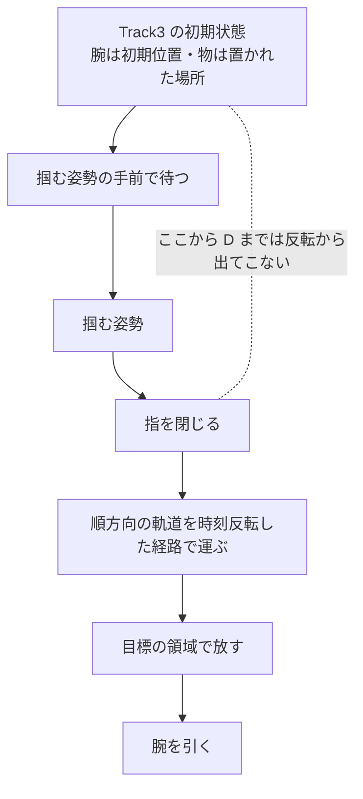

# 31. 逆向きの課題のデータは、時刻反転では半分しか作れない —— 掴む区間は自分で作り、壊れるのはいつも継ぎ目である

**Track3 向けの学習データを 2026-08-28〜09-11 に作って分かったことである。**

**Track3** は、2026-08-28 の運営の開示（`docs/materials/notifications/260828_1512_track3_contents.md`）で
**「逆向きのタスク」**と分かった課題群である。たとえば配布データには
「スープの缶をトレイに入れる」課題があり、Track3 は
**「トレイからスープの缶を出して机に置く」**を求める。

> **これが分かると何が決まるか。**「順方向の手本を逆にたどれば逆向きの手本になる」
> という見込みで工数を見積もらなくなる。**どこを自分で作る必要があり、どこで壊れるか**が先に分かる。

**Track3 の失敗の読み解き（違う物を運ぶ・選択は直った・接近が届かない・同じ物体の課題を壊す）は
[17](17_track3_picks_the_wrong_object.md)・[20](20_probe_object_choice_without_rollout.md)・
[21](21_track3_stops_short_of_the_object.md)・[22](22_reverse_data_interferes_with_same_objects.md) にある。**
ここはデータを**作る側**の学びだけを持つ。

## 目次

- [1. 順方向で学習した重みは逆向きを 1 本も終えなかった](#1-順方向で学習した重みは逆向きを-1-本も終えなかった)
- [2. 時刻反転で得られるのは掴んだ後だけである](#2-時刻反転で得られるのは掴んだ後だけである)
- [3. 壊れるのはいつも継ぎ目である](#3-壊れるのはいつも継ぎ目である)
- [4. 継ぎ目を直しても指令の形が残る](#4-継ぎ目を直しても指令の形が残る)
- [5. どこまで届いたか](#5-どこまで届いたか)
- [6. まだ覆っていないもの](#6-まだ覆っていないもの)
- [7. 確かめ直すコマンド](#7-確かめ直すコマンド)
- [8. Claude 側](#8-claude-側)
- [9. 人間側](#9-人間側)

---

## 1. 順方向で学習した重みは逆向きを 1 本も終えなかった

**まず「今の重みで逆向きが動くか」を確かめた。動かなかった。**

| 測ったもの | 結果 |
|---|---|
| **採点の Track3**（8 版・各 8 本） | **8 版すべて 0.000。どの版も `/act` が 2,400 回＝8 本 × 300 歩で、1 本も目標に届いていない** |
| 手元で、学習済みの課題の逆向きを 4 本（`work/probe_016`） | **0 / 4。4 本とも 300 歩** |
| 配布の 111 課題に広げて学習した重み（13.0.0） | Track3 は **0 / 8** のまま（[26](26_adding_data_lowered_the_score.md)） |

**変えたのは重み・推論の設定・学習した場面の種類で、どれも 0 を動かさなかった。**
学習データの指示文には「取り出す」がほとんど無い（[17](17_track3_picks_the_wrong_object.md) の 0 節）。
**足りないのは見たことのある場面ではなく、逆向きに動く行動のデータである**と読み、作りに行った。

## 2. 時刻反転で得られるのは掴んだ後だけである

**逆向きの手本は「順方向の手本の行動を逆順に流す」ものではない。**
シムを普通に前へ進めて録ったエピソードで、**時刻反転を使うのは、
掴んだ物を運ぶ復路の基準の経路を作るところだけ**である。



**反転から出てくるのは E だけである。**Track3 の初期状態では腕は初期位置にあり、
物は順方向の手本が置いた場所から少しずれている。**初期位置から掴むまでの区間は、
順方向の手本のどこにも無い。**

**掴む姿勢は自分で決めるしかない。**決め方で分かったことは 3 つある（詳細は
[reference/30](../reference/30_reverse_grasp_pose.md)）。

| 分かったこと | 中身 |
|---|---|
| 順方向で掴んだ相対姿勢を写せるのは、物の「立つ軸」が一致するときだけ | 缶は軸が食い違うので、真上からの握りを別に作った |
| **掴む姿勢 1 つで全部の初期配置は掴めない** | 順方向の手本を複数使い、掴み方を増やす |
| 1 本の手本が 2 回掴む課題（マグ 2 つ）がある | 指の開閉でサイクルに切り分ける |

**そもそも pick-and-place の反転は対称ではない。**順方向の「対象に精密に寄せる区間」は、
反転すると「物を置いたあと腕を粗く引く区間」に対応する。
**反転した軌道は、精密な接近の情報を持っていない。**

## 3. 壊れるのはいつも継ぎ目である

**反転した区間と自分で作った区間をつなぐと、つないだ所で壊れる。**継ぎ目は 4 か所あり、
壊れ方がそれぞれ違う（直し方の詳細は [reference/31](../reference/31_reverse_place_without_contact.md)）。

| 継ぎ目 | 何が起きたか | なぜ | 直し方 |
|---|---|---|---|
| 掴んだ直後 → 復路の頭（位置） | **物を下ろしたまま横へ引きずり、皿やトレイを動かす** | 復路の頭は順方向の手本が物を置いた位置で、今掴んだ位置とは横にずれている | 掴んだらまず真上へ上げ、高さの床を張る |
| 掴んだ直後 → 復路の頭（向き） | **物を大きく回してから、同じだけ回し戻す** | 掴む姿勢は「挟んだ瞬間」、復路の入口は「放した瞬間」の向きで、運搬中に手首が回った角度ぶん食い違う | 継ぎ目に橋を架けず、軌跡のほうを歪める |
| 復路の終わり → 放す | **空中で放して落とす**（缶は落ちて横倒しになった） | 順方向の「閉じろ」は指が閉じ切る前に出ている。その時刻を反転すると、手はもう戻り始めている | **物が台に触れた所で止めてから放す** |
| 放した直後 → 腕を引く | **引く腕が置いた物を叩いて倒す** | 引く区間の入口が、ちょうど物を置いた場所になっている | 開いたら進入の軸に沿ってまっすぐ引く |

**直したあとも、逆向きの目標を満たす本数は変わらなかった**
（3 課題 × 初期配置 5 行で、直す前も後もすべて達成）。
**目標の判定だけを見ていたら、この 4 つの壊れ方はどれも見えなかった。**
見えたのは、**対象外の物の変位**と**放してから落ちた高さ**を数え、動画を見たからである。

## 4. 継ぎ目を直しても指令の形が残る

**掴む区間を作った制御器が、別の穴を開けていた。**
目標姿勢との差を割って ±1 で切る比例制御なので、初期位置から 300 mm 離れた接近の区間では
**指令が上限のまま並ぶ。**

| 直した順 | 結果 |
|---|---|
| v1（最初の 389 本） | 回転の指令が配布データの範囲を大きく外れた（正規化後で最大 26 標準偏差） |
| v2（回転に上限 0.375 をかけて 397 本） | 外れ値は消えたが、**上限ちょうどの 1 点に積み上がった**（手首のひねりの 28.81%） |

**積み上がった指令は学習で解けない。**なぜ解けないかと、学習ログの勾配にどう出るかは
[27](27_clipped_gradients_do_not_shrink_adamw_steps.md) にある。
**作り直すなら、制御器の段で指令の形を配布データに合わせる**（同じ 27 の 7 節）。

## 5. どこまで届いたか

**v2 のデータを配布データに 49.5% 混ぜ、`pi05_libero_base` から 24,000 歩学習した重み
（`pi05_v2_base24k`）で、Track3 が初めて動いた。**

| 測ったもの | 結果 |
|---|---|
| 手元の Track3（配布 4 課題 × 4 本） | **16 本中 1 本が完全成功**（缶をトレイから出す課題・143 歩・衝突なし） |
| 提出した zip の中身そのもので回し直す | 同じく 16 本中 1 本（同じ課題・143 歩） |
| **採点の Track3（版 14.0.0）** | **0 / 8**。8 本とも 300 歩 |

**手元の 1/16 と採点の 0/8 は矛盾しない。**成功の確率が本当に 1/16 なら、
8 本で 1 本も出ない確率は (15/16)⁸ ≒ **60%** である。
**採点の 8 本では、この大きさの前進は見分けられない**（枠の読み方は [30](30_leaderboard_is_an_instrument.md)）。

**代償もあった。**逆向きで教えた 3 つの物体を使う順方向の課題が大きく落ちた
（[22](22_reverse_data_interferes_with_same_objects.md)）。**だから 14.0.0 は Track3 にだけ出した。**

## 6. まだ覆っていないもの

| 欠け | 何が起きるか |
|---|---|
| **マグ 2 つの課題の逆向きの手本が 0 本** | Track3 の配布 4 課題のうち 1 つを、1 本も教えていない |
| 逆向きの手本の**腕の初期姿勢が全部同じ** | 初期姿勢がずれた場面の手本が無い（Track2 で衝突を増やしたのと同じ形の欠け。[25](25_removing_bad_demos_teaches_nothing.md) の 3.1 節） |
| **色だけで見分ける手がかり** | 学習データのどの場面でも、物の同一性は位置で決まっていた（[20](20_probe_object_choice_without_rollout.md) の 4 節） |

## 7. 確かめ直すコマンド

```bash
cd ~/src/PARC2026_pre

# 1 節: Track3 の採点ログはすべて /act 2,400 回
grep -c 'POST /act' ../b_PARC2026_final/outputs/submission_logs/track3/*.txt

# 5 節: 手元の Track3 の成功
python3 - <<'EOF'
import json, pathlib
for d in ["work/final_eval/0910_224919_track3_v2_base24k", "work/final_eval/0911_072054_track3_zip14"]:
    rows = [json.loads(l) for l in pathlib.Path(d, "results/object_disp.jsonl").read_text().splitlines() if l.strip()]
    ok = [(r["task"], r["total_steps"]) for r in rows if r["success"]]
    print(d, len(rows), ok)
EOF

# 5 節: 1/16 の成功率で 8 本とも失敗する確率
python3 -c "print((15/16)**8)"
```

## 8. Claude 側

**工数を見積もる前に、反転で作れる区間と作れない区間を図に描く。**
「時刻反転すれば手本が出る」と見積もった段階では、掴む区間が丸ごと抜けていた。

**「目標が立った」だけで良いデータと判定しない。**継ぎ目ごとに、対象外の物の変位・
放してから落ちた高さ・指令の分布を数える。**目標の判定は 4 つの壊れ方のどれも拾わなかった。**

## 9. 人間側

**採点で 0 が続いても、手元の本数を増やせば小さな前進は見える。**
Track3 は 11 回の提出で 0 のままだったが、手元の 16 本で 1 本の成功が出た。
**採点の 8 本だけで打ち切りを決めない。**
逆に、**手元の 1 本は採点の点にならない**——ここから先は本数を増やして確率を上げる仕事になる。
