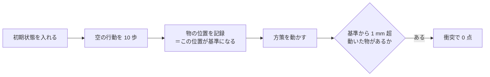

# 37. 場面が落ち着く前に基準を取るので、一部の行はどのモデルでも必ず 0 点になる —— 物差しの 2 割が定数だった

**2026-09-17 に `libero_90` の評価 630 本を 1 本ずつ数えて分かったことである。**

> **これが分かると何が決まるか。****評価集合に「学習では絶対に動かない行」が混ざっていないかを
> 先に確かめる**ようになる。混ざったまま候補を比べると、**差が薄まる方向にだけ偏る。**

**採点ハーネス**は、配布された採点コード `b_PARC2026_final/pipeline/` のことを指す。
**衝突**は「掴む対象でもロボットでもない物が 1 mm を超えて動いたこと」で、
届いていても衝突すると 0 点になる（[24 の 1 節](24_reached_but_zero_is_collision_at_grasp.md)）。

## 目次

- [1. 何が起きているか](#1-何が起きているか)
- [2. 方策と無関係であることの決め手](#2-方策と無関係であることの決め手)
- [3. どれだけ混ざっていたか](#3-どれだけ混ざっていたか)
- [4. 見分け方と外し方](#4-見分け方と外し方)
- [5. 判定セット側は無事だった](#5-判定セット側は無事だった)
- [6. 確かめ直すコマンド](#6-確かめ直すコマンド)
- [7. Claude 側](#7-claude-側)
- [8. 人間側](#8-人間側)

---

## 1. 何が起きているか

**採点ハーネスは、初期状態を入れてから空の行動を 10 歩だけ送り、その時点の物の位置を
「初期位置」として記録する**（`pipeline/rollout.py`）。



**10 歩でまだ落下が終わっていない物があると、残りの落下がそのまま「動いた量」に化ける。**
落下は数十 cm におよぶので、方策が何をしても 1 mm のしきい値を必ず超える。
**その場面の行は、どんな重みで回しても必ず 0 点になる。**

**方策には手が出ない。**制御周期は 0.05 秒で、成功した回の手先は 1 歩あたり 5 mm 前後しか進まない。
**方策が 1 歩で物を 10 cm 動かすことはできない。**

## 2. 方策と無関係であることの決め手

**8 回の評価（重みは 6 種類）で、同じ値が 0.01 mm も違わずに出る。**

| 素タスク | 物体 | 評価 8 回・全ロールアウトの変位 |
|---|---|---|
| `LIVING_ROOM_SCENE1_pick_up_the_alphabet_soup_and_put_it_in_the_basket` | `ketchup_1` | **544.50 mm ちょうど（例外なし）** |
| `LIVING_ROOM_SCENE2_pick_up_the_milk_and_put_it_in_the_basket` | `ketchup_1` | **544.50 mm ちょうど** |
| `LIVING_ROOM_SCENE2_pick_up_the_tomato_sauce_and_put_it_in_the_basket` | `ketchup_1` | **544.50 mm ちょうど** |
| `LIVING_ROOM_SCENE6_put_the_chocolate_pudding_to_the_right_of_the_plate` | `porcelain_mug_1` | 285.3〜347.9 mm |
| `KITCHEN_SCENE4_close_the_bottom_drawer_of_the_cabinet` | `akita_black_bowl_1` | 327.6〜376.2 mm |

**`ketchup_1` の 544.50 mm は `LIVING_ROOM_SCENE1〜3` の 12 課題・88 本すべてで同じ値である**
（0.01 mm の違いも無い）。

**ただし同じ `ketchup_1` でも、場面が変われば普通に振る舞う。**`KITCHEN_SCENE5` の
`ketchup_1` は 0.04・1.03・11.54・61.44・102.22・106.30・106.66・106.80・124.96・140.39 mm と
毎回違う値になる。**落下しているのは物体ではなく「その場面のその物体」である**——
落下の高さは bddl の置き方で決まるので、**（素タスク, 物体）の組で見ないと見分けられない。**

**`libero_90` 全体では 43 組の（素タスク, 物体）がこれに当たる**（全ロールアウトで 50 mm 超）。

## 3. どれだけ混ざっていたか

**データセットを選ぶときに使っていた `compe/val/LIBERO90_HALF45.csv`（45 行）で、
9 行がこれに当たった。**この 45 行は選定の重み付けで **20%** を持っていた。

```
KITCHEN_SCENE4_close_the_bottom_drawer_of_the_cabinet
LIVING_ROOM_SCENE1_pick_up_the_alphabet_soup_and_put_it_in_the_basket
LIVING_ROOM_SCENE2_pick_up_the_alphabet_soup_and_put_it_in_the_basket
LIVING_ROOM_SCENE2_pick_up_the_milk_and_put_it_in_the_basket
LIVING_ROOM_SCENE2_pick_up_the_tomato_sauce_and_put_it_in_the_basket
LIVING_ROOM_SCENE3_pick_up_the_butter_and_put_it_in_the_tray
LIVING_ROOM_SCENE5_put_the_yellow_and_white_mug_on_the_right_plate
LIVING_ROOM_SCENE6_put_the_chocolate_pudding_to_the_right_of_the_plate
STUDY_SCENE4_pick_up_the_book_in_the_middle_and_place_it_on_the_cabinet_shelf
```

**6 候補 × 45 行 = 270 本で、この 9 行は 1 本も成功していない。**

| | 成功率 |
|---|---|
| 45 行すべて | 0.263 |
| **9 行を外した 36 行** | **0.329** |

**2 割が定数なので、候補どうしの差もその 2 割ぶん薄まる。**
`libero_90` はそもそも到達率が 0.344 と低く、**そこに固定の 0 が 2 割入ると、
「どの候補も低い」という見え方になって順位が付きにくくなる。**

**厄介なのは、この 9 行が「難しい課題」に見えることである。**
実際には**届いてはいる**——`KITCHEN_SCENE4_close_the_bottom_drawer_of_the_cabinet` は
10 本中 10 本で目標条件を満たしており、**落としているのは衝突判定だけ**である。
**成功率だけを見ると「この課題は解けない」と読んでしまう。**

## 4. 見分け方と外し方

**`done` と `success` を分けて数え、変位の大きさで割る。**

| 見えるもの | 読み |
|---|---|
| `done` が立つのに `success` が 0 で、**変位が 50 mm 超** | **落下物。**どの重みでも同じ。**評価集合から外す** |
| `done` が立つのに `success` が 0 で、**変位が数 mm** | **かすり。**掴み方の作り直しで動く（[24](24_reached_but_zero_is_collision_at_grasp.md)） |
| `done` が立たない | 届いていない。衝突対策では動かない |

**50 mm という線は観測から引いた。**判定セット（`TRACK2_NOISE84`）で
「届いたのに 0 点」になった 210 本の変位は**中央 3.99 mm・50 mm 超はわずか 4 本**である。
一方 `libero_90` の 98 本は**中央 376 mm・84.7% が 50 mm 超**で、分布が重ならない。

**1 つの重みだけでは断定しない。**同じ行を**別の重みで 1 回**回し、
変位が同じ値なら落下物、違えば方策の問題である。

## 5. 判定セット側は無事だった

**採点に近い集合では、この現象はほとんど出ない。**

| 集合 | 本数 | 届いたのに 0 点 | **うち落下物** |
|---|---|---|---|
| `TRACK2_NOISE84` × 5 本（5 候補） | 2,100 | 10.0 ポイント | **0.0 ポイント** |
| `TRACK2_VAL72`（4 重み） | 1,440 | 11.5 ポイント | **0.0 ポイント** |
| `TRACK1_VAL29`（5 回） | 551 | 17.1 ポイント | **4.9 ポイント** |
| `libero_90` 系（8 回） | 630 | 15.6 ポイント | **12.7 ポイント** |

**Track1 側の 4.9 ポイントは `LIVING_ROOM_SCENE2` の 2 行に集中している**
（`put_both_the_alphabet_soup_and_the_tomato_sauce_in_the_basket` と
`put_both_the_cream_cheese_box_and_the_butter_in_the_basket`）。
**この 2 件は 2026-08-14 に別ルートで見つかっていた**
（[reference/18 の 2 節](../reference/18_failure_breakdown.md)）が、
**「同じ変位が 3 回以上」という数え方だったため 2 件で止まり、全数には広がっていなかった。**

**`libero_90` を物差しに使うこと自体は、この件だけでは否定されない。**
9 行を外した 36 行は方策で動く。**外す手当てをしてから使う。**

## 6. 確かめ直すコマンド

```bash
cd ~/src/PARC2026_pre

# 3 節: LIBERO90_HALF45 のうち、全ロールアウトで 50 mm 超が出る行を挙げる
python3 - <<'PY'
import json, collections, pathlib
RUNS = ["0915_101200_track2_pi05_c003000_l90half", "0915_135551_track2_pi05_c005500_l90half",
        "0915_223801_track2_pi05_f4000_l90half",   "0916_001540_track2_pi05_bowl5_full_l90half",
        "0916_012748_track2_pi05_a7000_l90half",   "0917_082733_track2_pi05_l90clean_008000_l90half"]
rows = [json.loads(l) for d in RUNS
        for l in pathlib.Path("work/final_eval", d, "results/object_disp.jsonl").read_text().splitlines() if l.strip()]
per = collections.defaultdict(list)
for r in rows:
    per[r["task"]].append(r)
dead = [t for t, v in per.items()
        if len(v) >= 5 and all(any(x * 1000 > 50 for x in r["max_disp_l2_m"].values()) for r in v)]
print(f"必ず 0 点になる行: {len(dead)} / {len(per)}")
for t in sorted(dead):
    print("   ", t)
alive = [r for r in rows if r["task"] not in dead]
print(f"全体 {sum(r['success'] for r in rows) / len(rows):.3f} → 外すと {sum(r['success'] for r in alive) / len(alive):.3f}")
PY

# 2 節: 同じ（素タスク, 物体）の組が、重みを替えても同じ値になるか
python3 - <<'PY'
import json, glob, collections
per = collections.defaultdict(collections.Counter)
for path in glob.glob("work/final_eval/*l90half*/results/object_disp.jsonl") + \
            glob.glob("work/final_eval/*libero90*/results/object_disp.jsonl"):
    for line in open(path):
        row = json.loads(line)
        disp = row.get("max_disp_l2_m", {})
        if "ketchup_1" in disp:
            per[row["task"]][round(disp["ketchup_1"] * 1000, 2)] += 1
for task, counts in sorted(per.items()):
    print(f"{task[:58]:58s} {dict(sorted(counts.items()))}")
PY
```

## 7. Claude 側

**「どのモデルでも同じ数」が出たら、それは方策の性質ではなく環境の性質である。**
今回は 6 種類の重み・8 回の評価で **544.50 mm が 1 度も揺れなかった**ことが決め手になった。
**揺れない数を見たら、まず方策の外を疑う。**

**「同じ値が N 回以上」という数え方は、本数が少ないと発火しない。**
2026-08-14 の検出器は「同じ変位が 3 回以上」で組まれており、
**1 課題 1 本の評価では 2 件しか拾えなかった。**
**回数ではなく物理（1 歩で動かせる量の上限）で判定すれば、本数に依らずに拾える。**

**評価集合を作ったら、何かを学習する前に 1 度「どの重みでも 0 点の行」を数える。**
物差しの目盛りが一部潰れていることに、候補を 6 つ比べ終わった後で気づいた。

## 8. 人間側

**「解けない課題」と「採点の都合で 0 になる課題」を分けて報告する。**
成功率だけの表では両者が同じ顔をしており、**前者だと思って対策を考える時間が失われる。**

**配布された評価ハーネスの前処理（ここでは空の行動 10 歩）は、
自分のデータの判定にも同じ基準で効いてくる。**学習データの接触判定も 10 コマ目を基準に取るので、
**同じ場面から作った手本は同じ理由で「汚れ」と判定される**（配布 14,347 本のうち 173 本）。
**どちらを見ているのかを言葉で区別しておくこと。**
