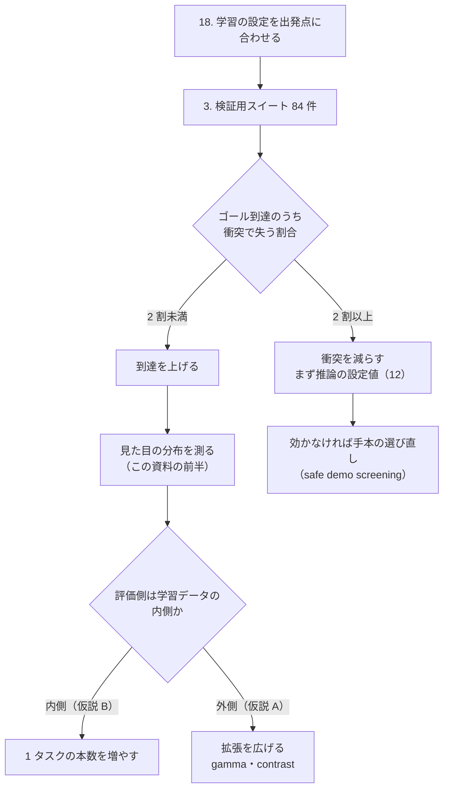

# 02. 見た目のずれと、学習データの選び直し

**これは着手前の設計である。** [01_failure_accounting.md](01_failure_accounting.md) と違い、
**まだ何も実装していない。** 順番と、着手の条件と、測り方だけを決めておく。

> **なぜ待つのか。** 4 回目の提出（追加学習後）で本番スコアが 0.1409 → 0.016 に
> 8.8 倍悪化した。**学習の当て方そのものが疑わしい状態**で（項目 18）、
> データの選び方を直しても同じことが起きる。**先に 18、次に 3 の結果、
> それから的を決める。**

---

## 何を疑っているか

検証用スイート（例のみ 4 件・80 エピソード）では、カテゴリ間に 22 ポイントの差が出た。

| カテゴリ | 成功率 |
|---|---|
| **Background Textures** | **0.60** |
| Light Conditions | 0.82 |

**照明には耐えているが、背景の模様が変わると届かない。** 説明として 2 つ立つ。

| # | 仮説 | 正しければ効く手 |
|---|---|---|
| **A** | 学習データに**その見た目が入っていない**（届く範囲の不足） | 拡張を広げる・データを選び直す |
| **B** | 範囲は入っているが**タスクごとの本数が足りない**（密度の不足） | 1 タスクあたりの本数を増やす |

**いまの材料は B に寄っている。** 学習データ（`lerobot/libero_plus`、14,347
エピソード）の平均輝度は **0.086〜0.723** で、外部の集計が測った評価側の幅
（`light` 0.287・`tb` 0.212〜0.689）を**含んでいる**。使っているのは
40 タスク × 5 本 = 200 エピソード、全体の **1.4%** にすぎない。

一方で、**拡張の範囲は足りていない。** LeRobot の既定は明るさ ×0.8〜1.2 で、
`table`/`tb` の平均を基準にすると `light` は ×0.71、`tb` の上端は ×1.70 に当たる
（数字と出典は [reference/04_track1_population.md](../reference/04_track1_population.md)）。

**A と B は排他ではない。** ただし打つ手が違うので、**先に切り分ける。**

## 切り分け方 — 見た目の分布を測る

**方策を動かさずに測れる。** 環境を作って初期状態を流し込み、10 ステップだけ進めて
画像を撮り、統計を取るだけである。84 件で数分。

### 道具の仕様（未実装）

```
solution/tools/analysis/measure_appearance.py --csv compe/val/VAL_TASKS.csv \
    --libero-plus <キット>/LIBERO-plus --output work/appearance.csv
```

| 項目 | 決めたこと |
|---|---|
| 読むもの | 検証用スイートの CSV（`task_id` / `suite` / `init_states_file` / `category`） |
| 環境の作り方 | **評価と同じ手順**（`register_t1` → `create_env` → 初期状態 → ゼロ入力 10 ステップ） |
| 撮るもの | `agentview_image` と `robot0_eye_in_hand_image`、128×128 |
| 出す統計 | 平均・標準偏差・5/50/95 パーセンタイル・RGB ごとの平均・**対象物と背景の差** |
| 出力 | 1 行 1 タスクの CSV と、接尾辞（`light`/`table`/`tb`）別の要約 |
| 突き合わせる相手 | 学習データの `stats/observation.images.front/*`（parquet。**描画不要**） |

**踏む穴は分かっている。**

| 穴 | 対処 |
|---|---|
| 評価環境の生画像は**上下逆**（モデルへ渡す前に回す） | 統計は回した後で取る。[rollout_recorder.py](../../solution/tools/eval/rollout_recorder.py) と同じ向きに揃える |
| CPU 描画（osmesa）だと 1 枚 300ms | `MUJOCO_GL=egl` を要求する。[run_gpu_eval.sh](../../solution/tools/eval/run_gpu_eval.sh) と同じ確認を通す |
| 平均輝度は 1 次元の代理値。**同じ明るさで別の模様**がありうる | 標準偏差とパーセンタイルも出す。**模様の違いは数字では埋まらない**ので画像も残す |
| 84 件は母集団 2,218 件の 3.8% | 接尾辞ごとの傾向を見るだけに使う。**確定には使わない** |

### 出た数字で何を決めるか

| 見え方 | 読み方 | 次 |
|---|---|---|
| 評価側の分布が学習データの分布の**内側** | 仮説 B。届いてはいる | 1 タスクあたりの本数を増やす。拡張は据え置き |
| 評価側に**学習データが持たない領域**がある | 仮説 A | その領域を作る拡張（gamma・contrast の幅を広げる）を足す |
| 明るさは合うのに `tb` だけ成功率が低い | **模様の問題**（明るさでは説明できない） | 背景テクスチャを差し替える拡張。または `tb` を含むエピソードを厚く選ぶ |

**拡張を広げるなら、既定の 6 種類に足す形で書く。** `gamma` は LeRobot の既定に
無いので（`ImageTransformsConfig`）、`--dataset.image_transforms.tfs.*` で
追加するか `brightness` の範囲を広げる。**`max_num_transforms=3` のままだと
足すほど 1 つあたりの出現率が下がる**ので、そこも合わせて決める。

## 学習データから「他の物を動かす手本」を外す

外部で共有された取り組みに、**衝突しない手本だけを選ぶ**（`safe_demo_screen`）
というものがある。採点が「操作対象以外が 1mm 超動いたら失格」である以上、
**手本の中に物をぶつけている軌道が混ざっていれば、それを学ぶ**という筋である。

**筋は通っている。ただし、いまは着手しない。** 理由を順に置く。

| # | 理由 |
|---|---|
| 1 | **こちらの失敗は衝突ではない可能性が高い。** 本番 8 本中 4 本が打ち切りで、ゴールに着いていない。**衝突を減らしても届かない回は届かない** |
| 2 | 使っているのは 200 エピソード（全体の 1.4%）。**そこから除くと更に減る** |
| 3 | 項目 18（学習の設定の食い違い）が未解決。**当て方が違うままデータを変えると、どちらが効いたのか分からない** |

**着手の条件はひとつだけ。** 3 の結果で
「**ゴールに着いた回のうち 2 割以上を衝突で失っている**」なら着手する。
そうでなければ、先に到達の問題を扱う。

### 実現できるかの見通し

**手本の中で物が動いたかは、データセットには入っていない。**
`lerobot/libero_plus` はロボットの状態・画像・行動を持つが、**物体の位置を持たない。**
測るには次のどれかになる。

| 道 | 費用 | 引っかかりそうな所 |
|---|---|---|
| **物理だけ再生して物体の変位を測る**（描画しない） | 40 タスク × 数十本 × 150 ステップ ≒ 10 分程度 | **LeRobot のエピソード番号と `pruned_init` の何番目が対応するかを確かめる必要がある。** ここが違うと全部無意味 |
| 元の LIBERO の hdf5（`states` を持つ）から測る | 中（取得が要る） | 版の対応。`lerobot/libero_plus` との突き合わせ |
| 学習を回して結果で見る | 高（1 回 90 分＋学習） | **区別が付かない**（設定も同時に変わる） |

**1 番目から始める。** 最初の 1 タスクで
「再生した軌道が手本と同じところに着く」ことを確かめるのが最初の関門で、
**ここが通らなければ道 1 は捨てる。**

## 順番



**衝突側は、学習より先に推論の設定値で試す。** `PARC_BLEND_STEPS` と
`PARC_N_ACTION_STEPS` は継ぎ目の段差を減らす方向の設定で、
**1 回 90 分で測れて学習が要らない**（項目 12）。手本の選び直しは、
設定値で足りなかったときの手である。
