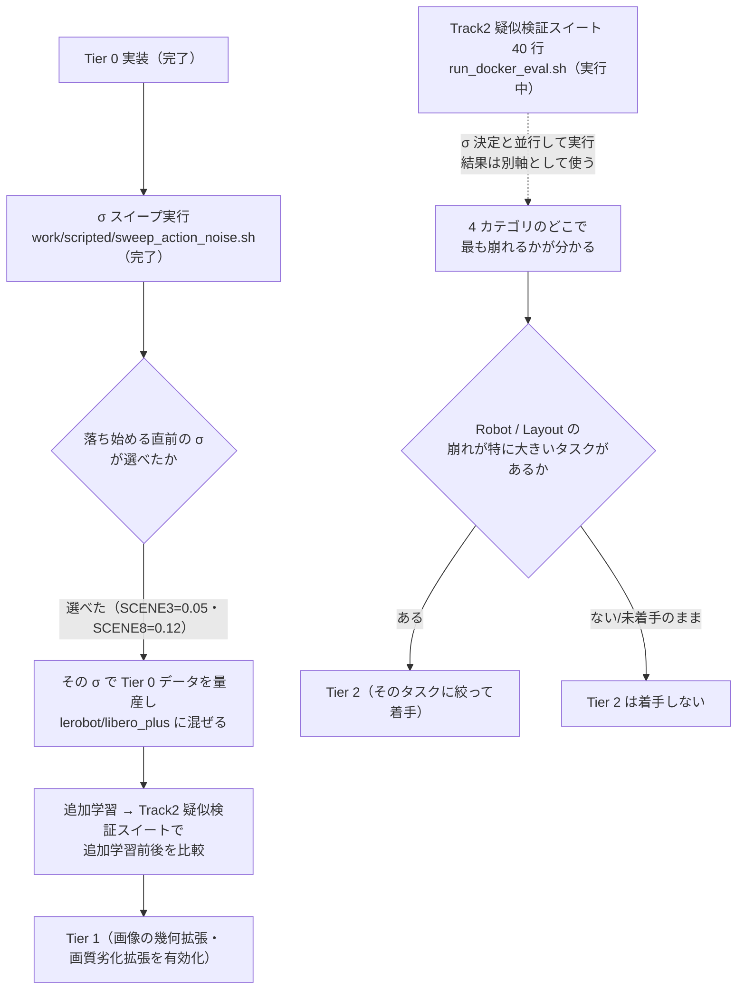

# 09. デモデータに摂動を加える作業の整理（Tier 0〜2）

**この文書の作り方**: 別セッションで下の報告メッセージを受け取った後、そのセッションの
jsonl が壊れて読み返せなくなった。**メッセージの文面だけを書き写すのではなく**、現在の
リポジトリの一次資料（`solution/tools/scripted_demo.py`、`work/scripted/sweep_action_noise.sh`、
[07_track2_preparation.md](07_track2_preparation.md)、
[08_training_data_creation_cautions.md](08_training_data_creation_cautions.md)、
`work/gpu_eval/tonight_0821.sh`、`compe/val/TRACK2_PROBE.csv`）を実際に開いて、
報告内容と食い違わないかを確かめながら書いた。**食い違いが 1 箇所あり**、4 節末尾に記す。

---

## 1. 何のために動画像データを作っているか

本選（8/24〜）の Track2 は「同一タスク・未知ドメイン」で、**位置・視点・ノイズ**を変えて
評価される（予選 PDF p8、[07 の 1.1 節](07_track2_preparation.md#11-track2-の位置視点ノイズとは何か)）。
評価環境 LIBERO-plus の 7 摂動軸のうち、Track1 で使われなかった 4 軸（Camera Viewpoints・
Robot Initial States・Objects Layout・Sensor Noise）が対応すると推測している。

この目的には、**互いに独立な 2 つの狙いがある。**

| # | 狙い | 何が根拠か |
|---|---|---|
| **1** | **視点・位置・ノイズという 4 カテゴリそのものへの耐性を足す。** いま使っている π0.5 系モデルは、この種の摂動で成功率が大きく落ちることが分かっている | LIBERO-plus 論文: OpenVLA-OFT で Camera −37.4pt・Robot −59.9pt（他カテゴリは −4.7〜−20.4pt）。π0.5・SmolVLA はセンサ劣化で 90%→2% まで落ちるという外部報告（CRT 論文） |
| **2** | **「ずれた状態から立て直す行動」の教師信号を足す。** 成功ロールアウトだけを集めるデータには、この信号が原理的に入っていない | Ross, Gordon, Bagnell 2011（誤りが積み重なる問題）。Qiita 記事: 「把持位置を外した後の観測が学習データにほとんど現れず、そこから戻る action にも教師がない」 |

**1 は「摂動カテゴリを増やす」話、2 は「摂動の種類に関係なく効く」話で、別問題として両方
やる**（[07 の 2.0 節・改訂 A](07_track2_preparation.md#20-2026-08-21-の方針改訂08-の調査を受けて)）。
以下の Tier 0〜2 は、この 2 つの狙いをどう割り振ったかの区分である。

---

## 2. シナリオ × 摂動 × 程度

まず全体を 1 枚の表で見る。

| 層 | 対象シナリオ（タスク） | 加える摂動 | 摂動の程度 | 状態 |
|---|---|---|---|---|
| **Tier 0** | 台本があるタスクのみ（現時点で 2 つ） | 台本が出す行動のうち、**手先の位置指令だけ**に、**シミュレータへ送る直前で**ガウスノイズを加える（学習ラベルとして記録するのはノイズを混ぜる前の行動——2.1 節で詳述） | σ = 0 / 0.02 / 0.05 / 0.08 / 0.12 / 0.20 を候補として振り、**実測した**（2.1 節）。SCENE3 は σ=0.05、SCENE8 は σ=0.12 が「落ち始める直前」 | **実装済み・σスイープ実行済み。データ量産はこれから（3 節）** |
| **Tier 1** | 既存の成功ロールアウト（撮り直し不要） | 画像側の幾何変換（クロップ・ズーム・微小回転）と画質劣化（ぼかし・霧・ガラス歪み） | LeRobot 側の拡張は既定で全て無効。まず有効化するだけ（程度は LIBERO-plus 実装の既定値に合わせる予定） | **未着手。次にやる作業** |
| **Tier 2** | 台本があるタスクのみ（対象を増やすには台本を書く作業が別途必要） | ロボットの初期関節角・物体配置を変えて、閉ループ台本を新しい初期状態から再実行 | 初期関節角は基準姿勢にランダムな単位ベクトル方向へ大きさ 0.1〜0.5 を加える（LIBERO-plus 実装の値） | **条件付きで後回し**（3 節） |

**シナリオが「台本の有無」で層を分けている理由**が要る。台本
（`solution/tools/scripted_demo.py`）は、実測の手先位置・物体位置から目標への差分を
毎ステップ計算し直す**閉ループ制御**である（`follow()` の `delta = targets[index] - self.eef_position`）。
閉ループなので、**カメラ設定や画質だけが変わる Tier 1 は既存の行動列を再利用できる**が、
**ロボット初期姿勢や物体配置という物理そのものが変わる Tier 2 は、台本を新しい初期状態から
動かし直す必要がある。** そして台本があるのはいまのところ 2 タスクだけなので、Tier 2 は
「台本があるタスク」という制約から外れられない。

### 2.1 Tier 0 — 台本の行動にノイズを乗せる（実装済み）

**対象タスクは `KITCHEN_SCENE3_turn_on_the_stove_and_put_the_moka_pot_on_it` と
`KITCHEN_SCENE8_put_both_moka_pots_on_the_stove` の 2 つだけ**（`scripted_demo.TASK_PLANS`
に台本があるのがこの 2 つのため。メッセージは「1 つ」と書いていたが誤りで、2 つが正しい
——これが後で報告された訂正である）。

作り方は、`scripted_demo.py` の `_take_step()` が、**観測とノイズを混ぜる前の行動を先に
記録し、混ぜたほうを環境へ送る**という順序で実装されている。台本は閉ループなので、
ノイズでずれた場所からも自分で目標へ戻る行動を出す。つまり**「ずれた観測 → そこから戻る
行動」の対が、台本を書き換えずに手に入る**（DART, Laskey+ 2017 の発想）。

**誤解しやすい点を先に潰しておく。** 「手先の位置指令にノイズを混ぜる」と聞くと、
**学習データの行動そのものがガクガク揺れる**ように思えるが、そうではない。

| 変数（npz のキー） | 中身 | 学習に使うか |
|---|---|---|
| `record.actions`（`action`） | 台本が**ノイズを混ぜる前に**計算した行動。「今の（ずれた）実測位置から目標への正しい差分」 | **使う。これが学習ラベル** |
| `record.executed_actions`（`action_executed`） | ノイズを混ぜた**後**にシミュレータへ実際に送った行動 | 使わない。ノイズが本当に効いていたかを後から確かめるためだけに残す |

**揺れるのはシミュレータの中で実際に動くロボットの軌道であって、学習データの行動ラベルではない。**
台本は閉ループなので、ノイズで実際の手先位置がずれても、記録される行動は常に
「その状態から見て正しい是正動作」であり、ノイズそのものが記録されるわけではない。

**成功しない回はエピソード単位で丸ごと捨てる。** `command_record()` の docstring に
明記されている：「`--action-noise` を付けたときも、失敗した本は既定で捨てる。これは
DART のやり方と合っている——欲しいのは『ずれたが戻って成功した』軌道であって、
戻れずに終わった軌道ではない。捨てた本の数はそのまま σ が大きすぎる合図」。
**つまり σ スイープ（2 節・3 節）は「捨てる本の割合が上がり始める直前の σ」を探す作業であり、
成功が困難になるほど大きな σ はそもそも採用対象にしない。**

**「どの step を教師にするか」を特定する必要が無い理由もここにある。** SIRIUS の
pre-intervention 除外（[08 の 3.3 節](08_training_data_creation_cautions.md#33-失敗介入データの収集siriusg本文まで確認)）は、
「自律方策が実際に悪い行動を出し続けていた区間」を除くための仕組みだが、Tier 0 では
**行動を出す主体が常に同一の閉ループ台本で、どの step でも『今の状態から見て正しい
是正動作』しか記録しない。** ノイズが乗った `action_executed` は学習に使わないので、
除外すべき「悪い行動そのもの」が最初から存在しない。加えて、フィルタリングが
step 単位ではなく episode 単位（上記）なので、「失敗に向かっていた区間」を含む
エピソードは失敗すれば丸ごと消える。**これが [07 の項目 6](07_track2_preparation.md#4-わからないこと確認が必要なこと)
が「解決（表現できた）……そもそも外す必要が無い」と結論づけた理由である。**

**ただしこれで懸念が完全に消えるわけではない。** 2 点、残るリスクとして認識しておく。

- σ が大きいと、是正動作自体が急激・不自然な軌道になりうる（これをσスイープで潰そうとしている）
- 「成功のみ採用」フィルタ自体にバイアスが乗りうる。たまたま補正できたケースに偏る可能性がある
  （MimicGen が自ら認めている限界。[08 の 3.6 節](08_training_data_creation_cautions.md)）

ノイズを混ぜる `_noisy()` には、コードの docstring に書かれた **3 つの決定**がある。

| 決めたこと | 変えるとどうなるか |
|---|---|
| **なました後に混ぜる**（`_smoothed` の後） | 先に混ぜると平滑化にノイズが吸われ、指定した大きさが実際に届く大きさと合わなくなる |
| **混ぜた行動を `_last_command` に戻さない** | 戻すとノイズが次のステップへ持ち越されて累積し、毎ステップ独立ではなく片側へ流れる（DART のノイズは各ステップ独立が前提） |
| **指の開閉（`action[6]`）と手首の向き（`action[3:6]`）には混ぜない** ＝ 手先の位置（`action[:3]`）だけに混ぜる | 指に混ぜると物を無作為に落とすだけで復帰は学べない。向きは台本が閉ループで直していない（`turn_arc` が固定値を入れるだけ）ので、混ぜるとずれが誰にも直されず誤った正解になる。手先の位置は `follow` が毎ステップ引き直すので、混ぜてもここだけが直される |

**ノイズを乗せる箇所を手先の位置だけに絞ったのは「指・手首に混ぜない」という決定の裏返し**
であり、実質は 1 つの決定である（メッセージは表の行を 4 つに分けていたが、コードの
docstring は 3 つと数えている——数え方の違いで、内容の食い違いではない）。

コードの docstring はさらに、**振り切れている軸では片側にしか効かない**という性質を
書いている。`_velocity_command` はいちばん大きい軸をちょうど ±1 に揃えるので、運搬中の
主軸はすでに端にいる。そこへ足したノイズは外へ出るぶんが `np.clip(..., -1.0, 1.0)` で
切られ、内へ入るぶんだけが残る。**つまり運搬中は「速さが揺らいで遅れる」働きになり、
横へ押し出す働きは減速中と目標の近くで強く出る。σ を上げても主軸方向のずれは増えない。**
これは環境が受け取る範囲そのものなので避けられない（切らなくても robosuite の制御器が
同じところで切る）。σ 別の結果を読むときに、この性質を思い出す必要がある。

#### 2.1.1 σスイープの実測結果（2026-08-22 実行）

`work/scripted/sweep_action_noise.sh` を実行し、6 点 × 2 タスク＝12 点すべてを実測した。

| σ | SCENE3 成功率 | SCENE3 ステップ数中央値（最大） | SCENE8 成功率 | SCENE8 ステップ数中央値（最大） |
|---|---|---|---|---|
| 0 | 88%（44/50） | 251（267） | 86%（43/50） | 230（247） |
| 0.02 | 98%（49/50） | 253（267） | 92%（46/50） | 229（240） |
| 0.05 | 92%（46/50） | 253（268） | 90%（45/50） | 233（243） |
| 0.08 | 80%（40/50） | 255（274） | 96%（48/50） | 233（262） |
| 0.12 | 78%（39/50） | 260（281） | 92%（46/50） | 238（271） |
| 0.20 | 52%（26/50） | 265（**300 に到達**） | 68%（34/50） | 251（279） |

**「落ち始める直前の σ」は 2 タスクで違う。**

- **SCENE3**: σ=0.08 から明確に下がり始める（92%→80%）。**σ=0.05 が落ち始める直前**
- **SCENE8**: σ=0.12 まではっきりした崩れが無く、σ=0.20 で急落する（92%→68%）。**σ=0.12 が落ち始める直前**

σ=0.20 はどちらのタスクでも成功率がはっきり落ち、**SCENE3 ではステップ数の最大が
上限 300 に到達している**（打ち切りで捨てられる本が出始めている合図）。σ=0.20 は
Tier 0 のデータ生成には使わない、という点は両タスクで一致する。σ=0.02〜0.05 の範囲で
基準（σ=0）を上回る成功率が出ている点は、50 本という標本数での揺れの範囲として扱い、
「σを上げるほど良い」とは読まない。

**残っている選択**: タスクごとに違う σ（SCENE3=0.05・SCENE8=0.12）を採用して各タスクの
限界まで復帰データを稼ぐか、両方に共通の安全側の値（0.05）で揃えて後工程の管理項目を
減らすかは、まだ決めていない。`sweep_action_noise.sh` 自身のコメントが「σ はタスクごとに
違って構わない」としているので、前者を妨げる制約は無い。

**この測定が決めるのは、あくまで「台本自身がどこまで手本を作れるか」だけである。**
方策が学習した後に効く最適な σ（DART でいう α）は別問題であり、4 節の原則のとおり、
最終判断は追加学習後の比較評価で行う。

### 2.2 Tier 1 — 画像側の摂動（次の一歩）

**画像側には 2 つの手段がある。**

| 手段 | 中身 | コスト |
|---|---|---|
| **学習側の拡張を有効化** | LeRobot の `image_transforms`（既定で `enable: false`、
[02_appearance_and_data.md](02_appearance_and_data.md)で確認済み）を有効化し、
LIBERO-plus の `env_wrapper.py` が実装する 5 種の画質劣化（motion/gaussian/zoom blur・
fog・glass blur）を移植して足す | ほぼゼロ（設定を切り替えるだけ） |
| **撮り直し** | `scripted_demo.py` の `--variant` 相当の仕組みで、同じ物理・別のカメラ設定で
既存ロールアウトを再撮影する | 物理シミュレーションは 1 回分のみ。render コストだけ |

**摂動の程度はまだ決めていない。** 評価側（LIBERO-plus）が実際に使う値
（方位角 `[30,60,...,330]`、仰角 `[15,345]`、`scale_factor=1.25` 等）に合わせる方針だが、
この文書の時点では未着手のため確定していない。

**もう一段安い代替**として、3 次元的な視点回転は再現できないが実装コストがほぼゼロな
2D 画像変換（ランダムクロップ・ズーム・パン・回転）で Camera 摂動を近似する手も、
本格対応と並行して最初に試す価値があるとされている（[07 の 2.1.1 節](07_track2_preparation.md#211-tier-0新設-ノイズを乗せてずれから戻るデータを作る)）。

### 2.3 Tier 2 — ロボット初期姿勢・物体配置を変える（条件付きで後回し）

**着手の条件は、3 節の項目 1（Track2 疑似検証スイート）の結果である。** LIBERO-plus
論文の mix-SFT 実測では、Robot カテゴリは追加学習での伸びが最も小さい
（+8.6pt、絶対値 30.3%）ため、優先度を上げていない。**着手するのは、疑似検証スイートで
Robot・Layout の崩れが特に大きいタスクが見つかったときに、そのタスクへ絞って**である
（[07 の 3 節・項目 6](07_track2_preparation.md#3-推奨アクション優先順位2026-08-21-改訂)）。
また、対象タスクを増やすには台本を書く作業が別途必要という制約があるため、
36〜40 タスク全体への展開は今回のスコープでは見送っている。

---

## 3. 第一段階の範囲と、うまくいったら作る分

**第一段階（今回「実装しました」と報告された範囲）は、Tier 0 の実装と σ の決定作業
だけである。** 具体的には次の 2 つに限られる。

1. `scripted_demo.py` に `--action-noise σ` を実装する（**完了**）。
2. σ = 0 / 0.02 / 0.05 / 0.08 / 0.12 / 0.20 を、台本がある 2 タスクで振り、**台本自身の
   成功率がどこから落ち始めるかを測る**（`work/scripted/sweep_action_noise.sh`。
   **完了。結果は 2.1.1 節**——SCENE3 は σ=0.05、SCENE8 は σ=0.12 が落ち始める直前）。

**この段階には、まだ入っていないもの**を明確にしておく。

- 決めた σ で実際にひとまとまりの Tier 0 データ（recovery episode 群）を量産すること
- そのデータを `lerobot/libero_plus` に混ぜて追加学習すること
- Tier 1（画像拡張の有効化・撮り直し）
- Tier 2（初期姿勢・配置を変えた再収集）

これらは**σ が決まった後**に着手する分である。

**σ スイープと、Track2 疑似検証スイート（40 行）の GPU 評価は別の作業だが、並行して走らせた。**
σ スイープは `verify` が描画しないため CPU だけで済み、GPU 評価と同時に回せた。両者の
結果は独立に使う——σ スイープは Tier 0 の内部設計を決め、GPU 評価は Tier 1/Tier 2 の
どちらを優先するかを決める。

**なお `KITCHEN_SCENE3_turn_on_the_stove_and_put_the_moka_pot_on_it` は、今夜の
Track2 疑似検証スイート（`compe/val/TRACK2_PROBE.csv`）に 5 行入っている**（実際に数えて
確認済み）。**Tier 0 のデータを追加学習に混ぜた前後を、この 5 行で直接比べられる**という
意味で、σ スイープの結果と GPU 評価の結果は後工程でつながる。

---

## 4. うまくいったかどうかの判断

**「うまくいったか」には、性質の違う 3 つの階層がある。** 混同すると、
どの数字が何を決めているのか分からなくなる。

| 階層 | 何を確かめるか | 判断の材料 |
|---|---|---|
| **a. 実装が正しいか** | ノイズを混ぜる関数が仕様どおりに動くか（シミュレータ不要） | σ=0.05 の指定に対して届いた標準偏差が概ね 0.05 になっている・σ=0 は素通し・指と向きは不変・値の範囲は ±1 の内・同じ種で再現し違う種で別の列になる・昔の npz も読める、という**配列レベルの性質**をコード側で確かめる |
| **b. σ をどこに決めるか** | Tier 0 で使う σ の値そのもの | `work/scripted/sweep_action_noise.sh` の結果。**台本自身の成功率がσごとにどう落ちるか**を、同じ種を使った対応のある比較で見る。**「落ち始める直前の σ」を選ぶ**のが決め方。ステップ数の中央値が 300 ステップの打ち切りへ寄っていないかも見る（伸びていれば、1 本 100 秒の撮影が打ち切りで捨てられる本が増える兆候になる） |
| **c. Tier 0/1/2 全体の効果** | 増やしたデータが実際に Track2 対策として効いたか | **追加学習の前後で suite・scene・condition を揃えた比較評価**（Track2 疑似検証スイート）。**その表は成功率だけでなく、基準で完走していた件だけのステップ数と 300 打ち切り率の 3 列で作る**（2026-08-22 追記。[07](07_track2_preparation.md) 3.1 節。手元の成功率は本番の順位を付けられないため）。チェックポイントも training loss ではなく条件別・タスク別の検証成績で選ぶ |

**b と c は別の判断である。** b で分かるのは「どこまで混ぜても台本自身が手本を作れるか」
だけで、**方策が学習した後に効く最適な σ（DART の論文でいう α）は、方策を実際に学習させる
まで計算できない**（実験では α=3 で成功率 79%、過大な α=6 では 72%に低下、という山がある）。
つまり b のσスイープは Tier 0 データを作るための一次的な選び方であり、**最終的に効いたかを
決めるのは常に c（比較評価）である**——これは Tier 1・Tier 2 にも共通する原則で、
「作ったデータの本数」を成果として報告しない、という 08 の全体方針（4.5 節）と同じ根拠に立つ。

**a について 1 点補足する。** `_noisy()` はシミュレータに依存しない純粋な numpy 処理で、
`scripted_demo.py` はモジュール直下では `numpy` しか import していない（重い依存は
関数の中で遅延 import）。そのため **`docker run`（この環境では使えない）を介さず、
ホスト側の Python から `_Rollout._noisy()` を直接呼んで再確認した。** 結果は
メッセージの報告と一致した。

| 確認項目 | 結果 |
|---|---|
| σ=0.05 のとき `action[:3]` の差分の標準偏差 | `[0.0500, 0.0497, 0.0493]`（σ にほぼ一致） |
| σ=0 は素通しか | 一致 |
| 手首の向き（`action[3:6]`）・指（`action[6]`）は不変、位置（`action[:3]`）だけ変化するか | 一致 |
| 極端な入力＋大きな σ でも範囲は ±1 以内か（`np.clip`） | 一致 |
| 同じ種で再現し、違う種で別の列になるか | 一致 |
| 昔の npz（`action_executed`・`action_noise` の 2 鍵が無い）を `SavedEpisode` が読めるか | 一致（`action_noise=0.0`・`action_executed == action` の既定） |

**なお `docker exec`（既存コンテナへの接続）はこの環境で拒否されない。** 動いている
コンテナ（`quant_train`）へ `docker exec` で軽い確認コマンドを送ったところ通った。
拒否されるのは `docker run`（新規コンテナの起動）だけである。**したがって、
シミュレータそのものを使う確認（`scripted_demo.py verify` の実行など）が必要になれば、
ユーザーが `docker run` でコンテナを起動した後、`docker exec` でその中に入って
確認する道がある。**

---

## 5. 気をつけるべきだと認識している点

**Tier 0 固有の注意点**（2 節・4 節と重複する分は要点だけ）:

| 観点 | 気をつけていること |
|---|---|
| 主軸の飽和 | σ を上げても運搬中の主軸方向のずれは増えない（±1 で切られる）。σ 別の結果を「効いていない」と早合点しないよう、この性質を踏まえて読む |
| ノイズは多いほど良くない | DART の実機実験で α=3 が最適、α=6 では悪化している。σ スイープは「落ち始める直前」を探す作業であり、範囲を広げるほど良いという発想ではない |
| 混ぜる対象を絞る | 指の開閉・手首の向きに混ぜると、復帰を学べないか誤った正解を作ってしまう。手先の位置だけに絞っている |

**Tier 0/1/2 に共通する注意点**（[08_training_data_creation_cautions.md](08_training_data_creation_cautions.md)
から、この作業に直接効く分を抜く）:

| 観点 | 気をつけていること | 出典 |
|---|---|---|
| **増量前の安定性確認** | タスクを増やす前に、少数サンプルで成功判定・接触の安定性を確認する。不安定なタスクは対象から外すか原因を切り分けてから増量する（成功率が低いタスクほど多く作る、を機械的にやるとシミュレータの不安定さまで学習データに焼き込む） | Qiita 記事（`push`・`drawer-open` を除外した実例）、MimicGen（成功のみ採用フィルタ自体にバイアスが乗ると自ら認めている） |
| **除外の記録** | 「成功のみ採用」で捨てた試行についても、何を・なぜ除外したかをログに残す | 講義第6回 p39・p55（ログ規律） |
| **検証データの分離** | 学習データで使ったカメラ角度・初期姿勢・物体配置の集合と、検証で使う集合を明示的に分離する（environment 単位に相当する分割）。分けないと「未知ドメインへの汎化」ではなく「見た条件を再現できたか」を測るだけになり、成績を過大評価する | 講義第6回 p59（データ分割とリーク） |
| **前処理の一致** | 生成データの前処理（回転・crop・resize・カメラの順序）と、提出物 `policy_server.py` 側の前処理が一致しているかを確認する工程を組み込む | Qiita 記事の実際のバグ事例（前処理の食い違いで把持点がずれた） |
| **リプレイでのサニティチェック** | 生成した action 列を、別プロセスで同じシミュレータにもう一度流し込んで同じ結果になるかを確認する。単位・座標系・関節順序・絶対／相対の取り違えは、学習では隠れてここで露見する | 講義第6回 p60（実機の `lerobot-replay` 相当） |
| **混合比の調整余地** | 全部混ぜて増量するのではなく、既存データ：Tier0：Tier1：Tier2 の混合比を検証成績を見ながら調整する余地を残す。異種データの単純なプールは性能を下げる場合がある（負の転移） | 講義第6回 p47・p80 |
| **「本数」を成果にしない** | 4 節 c と同じ。作った本数ではなく、条件を揃えた比較評価で判断する | 講義第6回 p48・Qiita 記事の留保 |

**文献的な裏付けが無いことを明記しておく点**もある。ドメインランダマイゼーション（条件を
機械的に振り回すこと）が、行動の正規化統計や、タスクがそもそも解けるかどうか（物体と
背景が見分けられなくなる等）を壊すリスクについては、査読付き論文などの一次資料が
見つかっていない（[08 の 3.7 節](08_training_data_creation_cautions.md#37-確認できなかったこと正直に記録)）。
実務上は注意しておくが、根拠として引用しない。

---

## 出典

| 事実 | 出典 |
|---|---|
| Tier 0 の実装内容・3 つの決定・軸飽和の性質 | `solution/tools/scripted_demo.py`（`_noisy()`・`_take_step()` の docstring と実装を直接読んで確認） |
| σ スイープの対象タスク・σ の候補・実行方法 | `work/scripted/sweep_action_noise.sh`（実際に読んで確認） |
| 台本のあるタスクが 2 つであること | `work/scripted/sweep_action_noise.sh` のコメント（`scripted_demo.TASK_PLANS` を指す）。メッセージの「1 つ」は誤りで、訂正後の記述に一致 |
| Track2 の背景・4 カテゴリ・mix-SFT の実測・Tier 0/1/2 の設計・優先順位 | [07_track2_preparation.md](07_track2_preparation.md) |
| 成功デモだけでは復帰行動を学習できない問題・DART・SIRIUS・ログ規律等の注意点 | [08_training_data_creation_cautions.md](08_training_data_creation_cautions.md) |
| 今夜の GPU 評価の内容・並行実行の設計 | `work/gpu_eval/tonight_0821.sh`（実際に読んで確認） |
| `KITCHEN_SCENE3_...` が Track2 疑似検証スイートに 5 行入っていること | `compe/val/TRACK2_PROBE.csv`（`grep` で実際に数えて確認、40 行中 5 行） |
| Tier 0 実装の配列レベルの確認結果（標準偏差・再現性等） | 別セッションで受け取った報告メッセージ。この文書を書く際に `_Rollout._noisy()` をホスト側の Python から直接呼んで再確認し、一致した（`docker run` を介していない） |
| `docker run` は拒否されるが `docker exec`（既存コンテナ）は拒否されないこと | 実際に `docker exec quant_train echo ...` を実行して確認した |
