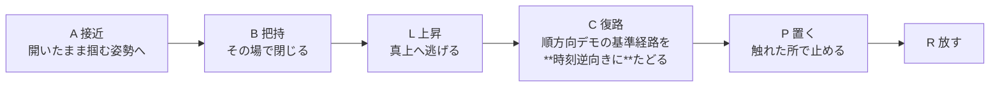
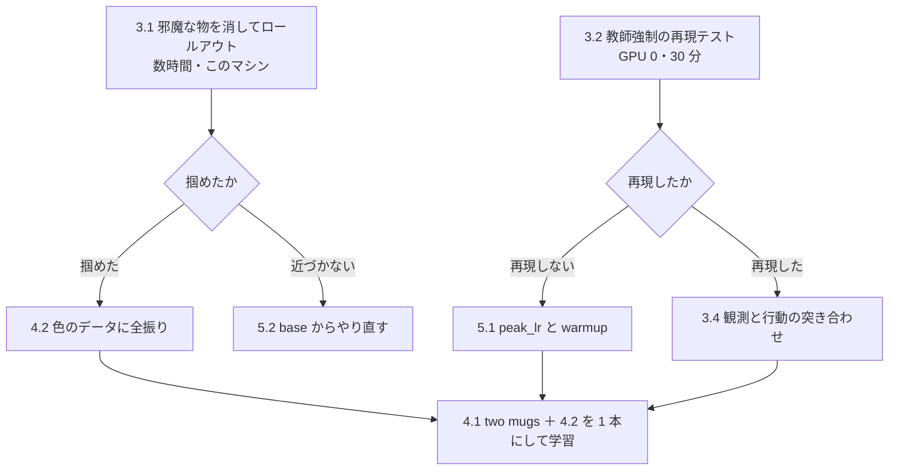

# 22. 把持が生まれない原因を切り分け、色で見分ける力を足す

**Track3 は 11 提出すべてで 0.000 である。**逆向きデータで**対象物の選択は直った**が、
**掴めていない。**この文書は、**掴めない原因を切り分ける手**と、
**色で見分ける力を足す手**を、費用と「何が決まるか」つきで並べる。

**2026-09-09 に作った。**元になった測定は
[knowledge/20](../knowledge/20_probe_object_choice_without_rollout.md) にある。

| 節 | 中身 |
|---|---|
| [1 なぜこの計画が要るのか](#1-なぜこの計画が要るのか) | **4 つの門のどこで落ちているか**（1.1）・**逆向きデータは逆再生ではない**（1.1.1）・**原因の候補 3 つのうち 2 つを消した**（1.2） |
| [2 手の一覧](#2-手の一覧) | 9 つの手を、費用と「何が決まるか」で並べた表 |
| [3 掴めない原因を切り分ける 6 手](#3-掴めない原因を切り分ける-6-手) | **3.1 邪魔な物を消す（A・終わった）**／**3.2 教師強制（B・終わった）**／3.3 実行歩数／3.4 突き合わせ／3.5 同じ形を足す／3.6 対象と支えを bddl から取る／**3.7 軌跡を並べて発散点（E・終わった）** |
| [4 データを足す 2 手](#4-データを足す-2-手) | 4.1 two mugs の逆向き 313 本／4.2 色で見分ける 406 本 |
| [5 学習の回し方を変える 2 手](#5-学習の回し方を変える-2-手) | 5.1 peak_lr と warmup／5.2 base からのやり直し |
| [6 順番と依存](#6-順番と依存) | どれが先か。並行できるのはどれか |
| [7 外した読み](#7-外した読み) | 追わないと決めた 3 つ。蒸し返さないために残す |

---

## 1. なぜこの計画が要るのか

**Track3 の失敗は 1 つではない。**採点は掛け算である——
**対象物を選ぶ × 掴む × 運ぶ × 衝突しない**（[reference/17](../reference/17_scoring_formula.md)）。
`success_rate` は積なので、**0.000 が出てもどの門で落ちたかは分からない。**
**だから門を 1 つずつ測る道具を作った。**

### 1.1 4 つの門のうち、どこで落ちているか（**2026-09-09 現在**）

| # | 門 | 状態 | 何で測ったか |
|---|---|---|---|
| 1 | **対象物を選ぶ** | **通っている**（黄本・缶）。**赤マグだけ落ちている** | ロールアウト無しの向きの測り（[knowledge/20](../knowledge/20_probe_object_choice_without_rollout.md)） |
| 2 | **1 歩ごとに正しい行動を出す** | **通っている** | 教師強制（[3.2](#32-教師強制の再現テスト)） |
| 3 | **自分の出力で状態を進めて対象へ届く** | **落ちている。ここが本命である。****学習データの経路の 1〜4% しか辿れない** | 競合を消したロールアウト（[3.1](#31-邪魔な物を消した場面でロールアウト)）・**軌跡の突き合わせ**（[3.7](#37-記録された軌跡と閉ループの軌跡を並べて発散点を出す手-e終わった)） |
| 4 | 掴む・運ぶ・衝突しない | **3 が通らないので測れていない** | — |

**言葉にするとこうである。**

> **モデルは「どれを取るか」を分かっていて、「次の 1 歩をどう動くか」も出せる。**
> **それでも自分で動き始めると、先頭 10〜20% で学習データの経路を外れ、
> 対象の 5〜30 cm 手前で止まってしまう。**

**だからこの計画の主題は「門 3（接近）」である。**
**色は従である**——色が手がかりになるのは 4 課題のうち赤マグと two mugs の 2 つだけで、
**どちらも同じ `LIVING_ROOM_SCENE5` である**（[reference/28](../reference/28_track3_contents.md)）。
**接近が届かないうちに色を足しても、点にはならない。**

### 1.1.1 前提の確認 —— **逆向きデータは「逆再生」ではない**

**混同の元になるので先に書く。**

**作っているのは、シムを前向きに動かして録った普通のエピソードである。**
段は 6 つで、**画・`action`・`state` はすべて時間の順に進む。**

**時刻反転を使うのは段 C の基準経路を作るところだけ**である
（[reference/30](../reference/30_reverse_grasp_pose.md) の `rollout_phased`）。
**「逆向きデータをもう 1 度反転すると順方向に戻る」という関係にはない。**
**逆になっているのは課題**（皿に置く ↔ 皿から取る）**であって、記録の向きではない。**

| 何が | 向き |
|---|---|
| 課題 | **逆**（`put … on` → `take … off`） |
| 動画・`action`・`observation.state` | **順**（普通に時間が進む） |
| 段 C がたどる基準経路 | 順方向デモを**時刻逆向き**に読む |

### 1.2 「掴めない」の候補を 3 つに分けて、2 つを消した

**手を打つ前に、原因の候補を**互いに排他な**形に並べた。**
**排他にしないと、1 つの実験で 1 つも消せない。**

| 候補 | 中身 | どう確かめたか | 結果 |
|---|---|---|---|
| **(a) 迷い** | 掴む力はあるが、**似た候補が複数あって決めきれない** | **競合を場面から消す。**1 つだけになれば掴めるはず（[3.1](#31-邪魔な物を消した場面でロールアウト)） | **消えた。**消しても掴めず、平均では**むしろ遠くなった** |
| **(b) 学習が入っていない** | 歩数・学習率・凍結範囲のせいで、**そもそも覚えていない** | **学習データの 1 コマを入れ直して、記録された行動を返せるか**（[3.2](#32-教師強制の再現テスト)） | **消えた。**43 課題のほぼ全部で返せる |
| **(c) 誤差の蓄積** | 1 歩ごとは合っているが、**自分の出力で状態が進むとずれていき、届かない** | **残った候補である** | — |

**(c) の中身をさらに 2 つに割れる。ここが次の分岐である。**

| (c) の内訳 | 中身 | 見分け方 |
|---|---|---|
| **(c-1) データがそう教えた** | **v1 の逆向きデータは、接近の区間で手首の回転指令が配布データの封筒を外れていた。**配布は ±0.375 に収まるのに v1 は ±1（クリップの上限）に張り付き、**外れたコマは先頭 10% に 52.6% が集中する**（[reference/30 の 8 節](../reference/30_reverse_grasp_pose.md)）。**落ちているのがまさに接近の区間である** | **v2 で 1 本回す。**v2 は 1 コマの回転を ±0.375 に制限してあり、\|z\|>10 のコマが 15.2% → **0.0%** になっている |
| **(c-2) ただ流されている** | 序盤から少しずつ外れ、対象の手前で力尽きる。**模倣学習で普通に起きる** | **記録された手先の軌跡と閉ループの軌跡を並べて、発散点を出す**（[3.7](#37-記録された軌跡と閉ループの軌跡を並べて発散点を出す手-e終わった)） |

> **【9/9 に測った】(c-2) が当たりだった**（[3.7](#37-記録された軌跡と閉ループの軌跡を並べて発散点を出す手-e終わった)）。
> **経路の 1〜4% しか辿れていない**（記録どうしのばらつきは 1〜20 mm、モデルは 37〜120 mm 外れる）。
> **外れ始めるのは先頭 10〜20%** で、「対象の近くまで行って止まる」ではない。
> **同時に (c-1) の筋も残った**——モデルの回転指令は記録より小さく（p95 0.08〜0.63 対 0.37〜1.00）、
> **手首の角度差が 15〜87°** ある。**v1 の回転目標はクリップに当たっていて学べない形だった。**
> **v2 は封筒内に収めてあるので、この 2 つは同じ 1 本（D）で試せる。**

> **【9/9 に訂正】ここに「v1 は置くときに物を 40 mm 空中で放していたので、
> その時間反転は『物の 40 mm 上で手を閉じる』」と書いたが、**これは誤りである。**
> **40 mm の欠陥は「置く」区間、つまり逆向きエピソードの終わりにある**
> （[reference/31 の 8.1](../reference/31_reverse_place_without_contact.md)）。
> **置き方の欠陥は、接近が届かないことの説明にならない。**
> **時間反転を 2 回かけているわけでもない**（下の囲み）。
> 正しい (c-1) は**接近区間の回転の外れ**である。

> **逆向きデータは「逆再生」ではない。**混同しやすいので明記する。
> **作っているのは、シムを前向きに動かして録った普通のエピソードである。**
> 段は **接近（開いたまま掴む姿勢へ）→ 把持（閉じる）→ 上昇 → 復路 → 置く → 放す**
> で、**画・`action`・`state` はすべて時間の順に進む。**
> **時刻反転を使うのは「復路」でたどる基準経路を順方向デモから作るところだけ**である
> （[reference/30](../reference/30_reverse_grasp_pose.md) の `rollout_phased`）。
> **だから「逆向きデータをもう 1 度反転すると順方向に戻る」という関係にはない**——
> 逆になっているのは**課題**（皿に置く ↔ 皿から取る）であって、記録の向きではない。

**(c-1) なら「対象の近くまでは正しく行き、そこで止まる」。**
**(c-2) なら「序盤から外れる」。**軌跡を並べれば 1 回で分かる。

---

## 2. 手の一覧

**「何が決まるか」が書けない手は載せていない。**費用の「GPU 0」は推論だけで学習しないという意味である。

**`A` / `B` / `C` は [reference/32](../reference/32_current_tasks.md) が着手中の 3 つに付けた呼び名である**
（会話でもこの文字で呼ぶ）。**節番号がこの文書での正の名前である。**

| # | 呼び名 | やること | 費用 | 何が決まるか |
|---|---|---|---|---|
| **3.1** | **A** | **邪魔な物を消した場面でロールアウト** | **終わった** | **迷いではなかった。**対象の 6〜20 cm 手前で止まる |
| **3.2** | **B** | **教師強制の再現テスト** | **終わった** | **学習は入っている。**43 課題のほぼ全部で再現する |
| 3.3 | **C** | 実行歩数を 10 から 50 へ上げて 1 本回す | このマシン・1 時間 | 計画の後半が切り捨てられていることが原因か |
| 3.4 | — | 観測と行動を、学習データと評価で突き合わせる | GPU 0・1〜2 時間 | 入力の通り道のどこがずれているか |
| **3.5** | — | **同じ形の邪魔物体を足して、選べなくなるかを見る** | このマシン・数時間 | **「同じ形が複数」が原因か**（3.1 の裏返し） |
| 3.6 | — | 対象・支え・目的地を bddl から 1 度だけ記録する | 系譜の再測定 1 時間 | **手書きの表 2 つが消え、4 件目の課題が報告に出る** |
| **4.1** | — | **two mugs の逆向きを作る**（順方向 313 本） | 生成 ＋ 学習 1 本 | **Track3 の 4 件目（25%）が埋まるか** |
| **4.2** | — | **色で見分けるデータを足す**（順方向 **406 本**） | 4.1 と同じ 1 本に同梱 | **赤マグと two mugs が色で解けるようになるか** |
| 5.1 | — | `peak_lr` を上げ `warmup` を縮める | 学習 1 本に相乗り | 短く回して挙動が動くか |
| 5.2 | — | `base` からのやり直し（Track3 専用の重み） | 学習 9〜10 時間 | 上の手が頭打ちになったときの逃げ道 |

**A と B が終わって、残った候補は「誤差の蓄積」だけである**（1.2 節）。
**その内訳を割る次の 2 手が、いま決めるべきものである。**

| # | 呼び名 | やること | 費用 | 何が決まるか |
|---|---|---|---|---|
| **5.1** | **D** | **v2（接近の回転を封筒内に収めた逆向きデータ）で 1 本学習する** | 学習 3〜4 時間 | **(c-1) データがそう教えたのか** |
| **3.7** | **E** | **記録された手先の軌跡と閉ループの軌跡を並べて発散点を出す** | **終わった** | **(c-2) が当たり。**経路の 1〜4% しか辿れていない |

---

## 3. 掴めない原因を切り分ける 6 手

### 3.1. 邪魔な物を消した場面でロールアウト

> **呼び名は手 A。2026-09-09 に終わった。**結果はこの節の末尾にある。

**切り分けたかったこと。**動画では「違う物の上で漂う」が 4 課題すべてで起きていた。
**これには互いに排他な 2 つの説明がある。**

| 説明 | もしこれなら |
|---|---|
| **(a) 迷い** | **掴む力はある。**似た候補が複数あって決めきれず、間で漂っている |
| **(b) 掴む力を失った** | 候補が 1 つでも掴めない |

**この 2 つは打つ手が正反対である。**(a) なら「どれを取るか」を教えるデータを足す。
(b) なら動き自体を直す。**だから先に分けなければならない。**

**分け方は 1 変数である。競合を場面から消す。**
場面・指示文・カメラ・乱数はそのままにして、**候補の数だけを変える。**
(a) なら候補が 1 つになった時点で掴めるようになる。(b) なら変わらない。

**やり方**（`grasp_rollout.py`。詳細と踏んだ穴 4 件は
[knowledge/21](../knowledge/21_track3_stops_short_of_the_object.md)）。

| 手順 | 理由 |
|---|---|
| `make_eval_env` で開く | **据え置き（棚・caddy・コンロ）の位置は `qpos` に入らず `reset()` の乱数で決まる。**キットと同じ `seed` で開かないと別の場面を測る |
| **配布 init を復元する** | **無作為サンプルは使えない**——缶がトレイに食い込んで吹き飛ぶ（`lift_mm` が嘘の 203.5 mm を出した） |
| **競合を水平に 3 m 以上動かす** | **bddl から消してはいけない。**物の数が変わると配布 init を復元できない |
| 空撃ち 10 歩 → **ここで初期位置を記録** | 物は浮いた位置に置かれるので落ちる。落ちたぶんを「動いた」と数えないため |

**判定は `success` ではしない。**目標は「机の決まった場所へ置く」なので、
掴めても置き場所を外すと 0 になる。**掴む段だけを切り出す**——
**`min_dist_mm`（手先が対象へいちばん近づいた距離）が本命である。**

#### 結果（2026-09-09）—— **(a) 迷い は消えた。そして門はもっと手前にあった**

`proto20` と `rp3000` で 4 課題 × 2 条件 × 2 本、計 40 本を 300 歩ずつ回した。

| 重み | 条件 | 最接近 中央値 | 最小 | **持ち上げた** | 他が動いた最大 |
|---|---|---|---|---|---|
| `proto20` | 配布のまま | 178.5 mm | 103.3 mm | 1 / 10 | 682.0 mm |
| | **競合を消す** | 203.6 mm | **69.1 mm** | **0 / 10** | **0.0 mm** |
| `rp3000` | 配布のまま | 117.4 mm | 80.4 mm | 2 / 10 | 664.9 mm |
| | **競合を消す** | 149.8 mm | **58.9 mm** | **0 / 10** | 21.9 mm |

**読み方を 3 つに分けて書く。**

1. **(a) 迷い は消えた。**候補を 1 つにしても掴めない。**平均ではむしろ遠くなった**
   （中央値 178 → 204・117 → 150）。**課題ごとに見ても、近づく課題と遠くなる課題が半分ずつである。**
   **「迷っていたから遠かった」なら 4 課題すべてで近づくはずである。**
2. **門はもっと手前にあった。**当初の分岐表は「掴める／掴まないが近づく／近づかない」の
   3 つだったが、**実際は「近づくが届かない」**である——
   **手先が対象へ 59 mm より近づいた回が 40 本で 1 度も無い。**
   **指を閉じて挟むには 20〜30 mm が要る。**59 mm は**握りこぶし 1 つぶん手前**で、
   動画の「高い位置でホバリング」がこの数字である。
3. **衝突率が測っていたのは「競合にぶつかったこと」だった。**
   競合を消すと 682 mm → **0.0 mm** になる。**対象へ向かう動きが衝突を起こしていたのではない。**

**この結果で、当初この節に書いていた「掴めたら 4.2 の色データへ全振り」は成り立たなくなった。**
**接近を直すのが先である。**原因の候補は 1.2 節の (c-1)（**v1 の接近区間で回転が
配布の封筒を外れていた**）と (c-2)（ただ流されている）に絞られている。

### 3.2. 教師強制の再現テスト

> **呼び名は手 B。2026-09-09 に終わった。**結果はこの節の末尾にある。

**切り分けたかったこと。**`t3rev` は逆向きデータを **35 周**見ている。
**それでも評価では再現しない。**ここにも互いに排他な 2 つの説明がある。

| 説明 | もしこれなら |
|---|---|
| **(b) 学習が入っていない** | 歩数・学習率・凍結範囲のせいで、**そもそも覚えていない** |
| **(d) 評価時の入力が違う** | 覚えてはいるが、**本番で見ている画や姿勢が学習時と違う**ので出力が別物になる |

**この 2 つも打つ手が正反対である。**(b) なら学習の回し方を変える。
(d) なら入力の通り道を直す（画の向き・正規化・カメラの並び）。

**分け方。学習データの 1 コマを、そのまま入れ直す。**
シムは回さない。**記録されている観測を 1 つ入れて、返ってきた 50 歩を、
記録されている 50 歩と比べるだけである。**
**学習が使ったのと同じ `LeRobotDataset` から引く**ので、
ここで合わなければ**学習時の入力そのもの**で合っていないことになる。

**「何もしないより良いか」の基準を必ず一緒に出す。**
flow matching の出力は分布の平均へ寄るので、**「平均を出しただけ」でも誤差はそれなりに小さく見える。**
だから**正規化空間の 0（＝データの平均）を出しただけの予測**の誤差を並べて出す。

#### 出す数の意味 —— **1 つずつ言葉にする**

**測り方をもう一度言葉にする。**

1. 学習データから **1 コマ**取る（画 2 枚・手先の姿勢・指示文）
2. そのコマから始まる **50 歩ぶんの行動**が、データに記録されている
3. 同じ観測をモデルへ入れ、**モデルの 50 歩**を出す
4. **2 と 3 を引き算する**

| 出す数 | 定義 | 読み方 |
|---|---|---|
| **`rel_l2`（相対誤差）** | **`‖モデルの 50 歩 − 記録の 50 歩‖ ÷ ‖記録の 50 歩‖`** | **0 なら完全一致。1 なら「誤差が記録そのものと同じ大きさ」**＝何も当たっていない |
| **基準** | **同じ式で、モデルの代わりに「データの平均」を入れた値** | **これが「何も学ばなかった場合」の点である。**`rel_l2` がこれを下回って初めて「覚えている」と言える |
| 並進の向きの一致 | 50 歩の並進を足した向きの cos | **+1 なら同じ方向へ動こうとしている** |
| 指の一致 | 指の指令の符号（開く／閉じる）が一致したコマの割合 | 1.0 なら 50 歩すべてで開閉の判断が同じ |

**基準を必ず一緒に出す理由。**flow matching の出力は分布の平均へ寄るので、
**「平均を出しただけ」でも `rel_l2` はそれなりに小さく見える。**
**基準が無いと「0.44 は良いのか悪いのか」が判断できない。**

#### 結果（2026-09-09）—— **(b) 学習が入っていない は消えた**

`t3rev` を**自分の学習データ**（`jaist_mix_75_x7`・43 課題）で測った。
**課題ごとに 1 本、その本の 0% / 25% / 50% / 75% の位置**から引いて、**計 172 コマ**である。

| | **`rel_l2` 中央値** | **基準** | 並進の向きの一致 | **基準を下回った割合** |
|---|---|---|---|---|
| 順方向 40 課題（160 コマ） | **0.437** | 0.996 | +0.960 | **94%** |
| 逆向き T3 3 課題（12 コマ） | **0.662** | 1.006 | +0.970 | **75%** |

**言葉にするとこうである。**

> **順方向の課題では、モデルの 50 歩は記録の 50 歩と 0.44 ぶんずれている。
> 何も学ばなければ 1.00 ずれる。だから半分以上は当てている。**
> **向きは +0.96 で、ほぼ同じ方向へ動こうとしている。**
> **これが 40 課題のうち 94% のコマで成り立つ。つまり覚えている。**

**(b) は消えた。**そして**逆向きの課題は順方向より一貫して当てはまりが悪い**
（**0.662 対 0.437**——どちらもその課題群のコマの中央値である）。
**逆向きはフレームの 48.6% を占め、7 倍にコピーして見せているのにである。**
**逆向きの軌道は順方向より当てはめにくい**——これは (c) の伏線である。

**残った候補は (d) 入力が違う と (c) 誤差の蓄積 の 2 つになった。**
**そして [3.1](#31-邪魔な物を消した場面でロールアウト) が「近づくが届かない」を出したので、
(d) は説明として弱い**——入力が壊れているなら、**対象の方向へ向かうこと自体ができないはずである。**
**だから本命は (c) である。**

### 3.3. 実行歩数を 10 から 50 へ上げて 1 本回す

**なぜ。**推論は 50 歩ぶん計画するが、**先頭 10 歩だけ実行して作り直す**（`n_action_steps=10`）。
`rp3000` は黄本で**44 歩目に初めて指を閉じる**計画を出している——**その閉じは一度も実行されない。**

**何を。**`PARC_N_ACTION_STEPS=50` を渡して 1 本回すだけである
（[reference/07](../reference/07_chunk_params.md)）。

**どうなるか。掴んだら原因はこれである。**
ただし**本命ではない。**`rp3000` の黄本は 50 歩で 1,082 mm 動く計画なので、
10 歩でも 216 mm 進む。**進んでいるので無限ループにはならないはずである。**
[3.1](#31-邪魔な物を消した場面でロールアウト) のついでに 1 本足す価値、という位置づけである。

### 3.4. 観測と行動を、学習データと評価で突き合わせる

**なぜ。**評価側は `LiberoProcessorStep` が観測を組み、こちらの書き出しは `obs_state8()` が組む。
**どちらも「同じ並び」と書いてあるが、端から端まで数値で突き合わせた記録が無い**
（[reference/10](../reference/10_observation_interface.md) 2 節）。
**外れていたら、それだけで全部の説明になる。**

**何を。突き合わせるのは 2 つある。**

| 突き合わせるもの | やり方 | 見つかるずれ |
|---|---|---|
| **観測** | 同じ場面・同じ姿勢で、評価が組む batch と学習データの 1 行を数値で diff | 並び・単位・画の 180 度回転・カメラの左右 |
| **行動** | **学習データの `action` 50 コマ**と、その場面で重みが返す 50 コマを diff | 正規化の当て方・`action` の符号・指の符号 |

**行動側も突き合わせる**のは、[3.2](#32-教師強制の再現テスト) が「再現しない」と出たときに
**「モデルが悪い」と「行動の読み方が違う」を分けるため**である。
`action` の規約と指の符号は [reference/25](../reference/25_dataset_inventory.md) 8.7 節にある。

---

### 3.5. 同じ指示文で配置だけを変えて確かめる

**なぜ。**T3 の場面は「候補が複数ある」ことと「対象が定位置にいない」ことの 2 つで
学習中の場面と違う（[reference/28 の 1.5](../reference/28_track3_contents.md#15-どの学習場面でも位置が物の同一性を決めているt3-の赤マグだけが例外2026-09-09)）。
**どちらが効いているのかを、配置だけを動かして分ける。**

**まず、その課題は既にあり、既に測ってある。**配布 `libero_plus` の摂動 4 カテゴリのうち
**`Objects Layout`** が「同じ指示文・配置だけ違う」である
（対象物のずらし `_levelN_sampleM` と邪魔物体の追加 `_add_N`）。

| カテゴリ | 歩数比 | 壊した | 二項検定 | 読み |
|---|---|---|---|---|
| Robot Initial States | +47.8% | 6/12 | p = 0.0005 | いちばん悪い |
| Camera Viewpoints | +16.6% | 2/12 | p = 0.039 | 2 番目 |
| Sensor Noise | +9.8% | 2/12 | p = 0.039 | 床のすぐ上 |
| **`Objects Layout`** | **+6.1%** | **1/12** | **p = 0.388** | **床（±6.5%）の内側。差があるとは言えない** |

出典は [reference/21 の 1 節](../reference/21_weakness_map.md)（16 タスク × 4 カテゴリ × 3 本＝240 ロールアウト）。

**そして「同じ色の物が別の場所に来る」課題は 1 件も無い**（9/9 に 203 変種すべてで確かめた）。
**物を動かす摂動は `_levelN_sampleM` だけで、ずれは level 5 でも 49.3 mm。**
**マグの初期領域は 180〜255 mm 離れているので、位置が入れ替わることはない**
（[reference/28 の 1.5](../reference/28_track3_contents.md#15-どの学習場面でも位置が物の同一性を決めているt3-の赤マグだけが例外2026-09-09)）。

**つまり「同じ指示文で配置だけが違う」は、いまの重みでほぼ解けている。**
**邪魔物体を足しても壊れていない**（`_add_N` も同じカテゴリに入っている）。
**だから T3 の失敗は配置のせいではない。**

**残る違いは 1 つである——邪魔物体が「同じ形」であること。**
`Objects Layout` が足す邪魔物体は物体プールから選ばれた**別の形**で、
見た目で見分けられる。**T3 のマグは 3 個とも同じ形で、色しか違わない。**

**何を。2 つ測る。**

| # | 測ること | やり方 | 何が決まるか |
|---|---|---|---|
| **a** | **配置を動かしても対象を選べるか** | 100% 通る課題の `_levelN_sampleM` 変種でプローブを打ち、対象が**正**のままかを見る | 上の表（ロールアウトの歩数）を**選択の側から**裏取りできる |
| **b** | **同じ形の邪魔物体を足すと選べなくなるか** | 100% 通る課題の bddl に**同じ形の物体をもう 1 個**足して、色だけを変える | **「同じ形が複数」が原因かを 1 変数で決める。**[3.1](#31-邪魔な物を消した場面でロールアウト) の裏返しである |

**b が本命である。**3.1 は「消すと掴めるか」を見るが、b は**「足すと選べなくなるか」**を見る。
**両方向から同じ 1 点を挟める。**

**どうなるか。**

| 結果 | 読み |
|---|---|
| b で選べなくなる | **同じ形が複数あることが原因。**[4.2](#42-色で見分けるデータを足す) が正しい手である |
| b でも選べる | **原因は「同じ形」ではない。**T3 固有の何か（対象が定位置にいない・逆向きの指示文）へ絞られる |

## 4. データを足す 2 手

### 4.1. two mugs の逆向きを作る

**なぜ。two mugs は逆向きデータに 1 本も入っていない。**
v2 混合（6,176 本・43 課題）の中身はこうなっている。

| 指示文 | 本数 | 向き |
|---|---|---|
| put the white mug on the left plate and put the yellow and white mug on the right plate | 75 | **順方向** |
| take the red mug off the left plate and put it back on the table behind the other two mugs | 1,176 | 逆向き（×8） |

**「皿に置く」ほうが 75 本入っていて、「皿から取る」ほうが 0 本である。**
T3 が要求するのは後者で、**学習データ 2,066 種の指示文のうち `take … off` / `out of` は 1 件しかない**
（[knowledge/17](../knowledge/17_track3_picks_the_wrong_object.md) 0 節）。
**モデルにとって「置く」と「取る」は別の技である**——黄本と缶で実証済みで、
逆向きを入れたときだけ正解が 1 位になった。

**何を。**順方向 **task_index 30（313 本・平均 260 コマ）**を時間反転する。
`_t3_container.sh` に `twomugs` の分岐が既にあり、016 が組んだ bddl も置いてある。

**どうなるか。Track3 の 4 課題のうち 1 つ、25% が埋まる。**

**先に測ることが 1 つある。**平均 260 コマは、いまの 3 課題の平均 152 コマの **1.7 倍**である。
**生成の所要を記録していない**ので、**まず数本流して 1 本あたりの時間を測る。**

### 4.2. 色で見分けるデータを足す

**なぜ。モデルは「データが弁別に要求した手がかり」だけを伸ばす**
（[knowledge/20](../knowledge/20_probe_object_choice_without_rollout.md) 4.1 節）。
黒椀の課題は椀が 2 つとも黒く、色は 1 ビットも寄与しない——だから学習は色を伸ばさず、
**位置だけを 8 倍に伸ばした。**

**そして、いまの逆向きデータは 1 場面につき指示文が 1 つしかない**
（黄本・缶・赤マグで場面が別）。**その場面では指示文が画像から完全に決まるので、
色語は捨ててよい信号である。**モデルは正しく捨てている。

**何を。同じ場面に色違いの課題を混ぜる。ただし場面を完全に同じにしてはいけない。**
**指示文と位置だけで対象物が決まってしまうと、色を読まずに解けてしまう。**
**必要なのは「色が変わると対象物も変わる」組と、「位置が変わっても色が同じなら対象物も同じ」組の両方である。**

**それを満たす順方向デモが 406 本ある**（逆向きの元データ `libero_combined`・111 課題）。
**内訳はこうである**——マグの課題は 5 場面 11 件・753 本あり、
そこから **two mugs の順方向 313 本（4.1 で使う）と、すでに逆向きにした赤マグ 34 本**を除くと
**9 件・406 本**が新しく足せる（赤マグも入れ直すなら 440 本）。
**11 課題・5 場面の棚卸しと、場面ごとに取れる対比は
[reference/28 の 1.3 節](../reference/28_track3_contents.md#13-同じ場面で色だけが違う課題はすでに手元にある2026-09-09-に数えた)にある。**

**ただし、この 406 本だけでは色は必須にならない**（9/9 に bddl で確かめた）。
**LIBERO はどの場面でも物ごとに専用の 5 cm 角の初期領域を持たせていて、互いに重ならない。**
**「赤いマグ」は学習中いつも机の中央奥（−0.2, 0.0）に居るので、位置を覚えれば色は読まなくてよい。**
領域の実測は
[reference/28 の 1.5](../reference/28_track3_contents.md#15-どの学習場面でも位置が物の同一性を決めているt3-の赤マグだけが例外2026-09-09)。

**それでも足す値打ちはある**——同じ色が**5 場面・複数の行き先**に出るので、
「1 つの絶対位置＝1 つの色」では覚えきれなくなる。
**ただし「場面 ＋ 位置」の 11 通りを覚えるだけで済む余地が残る。**

**そこで、位置と同一性の相関を自分で切る。**
**同じ場面で 2 つのマグの初期領域を入れ替えた bddl を作り、どちらの配置でも両方の指示文を生成する。**

| 生成する 4 通り | 白の場所 | 赤の場所 | 指示文の対象 |
|---|---|---|---|
| ① | 定位置 A | 定位置 B | **白** |
| ② | 定位置 A | 定位置 B | **赤** |
| ③ | **B（入れ替え）** | **A（入れ替え）** | **白** |
| ④ | **B（入れ替え）** | **A（入れ替え）** | **赤** |

**この 4 通りが揃うと、位置でも場面でも解けなくなる**——
① と ③ は**同じ指示文で対象の位置が違い**、① と ② は**同じ配置で対象が違う。**
**残る手がかりは見た目（色）だけである。**

**入れ替えた bddl でもデモは要らない。**逆向きの生成は**対象の姿勢から掴む姿勢を組み立てる**
方式なので（[reference/30](../reference/30_reverse_grasp_pose.md)）、
**名前で対象を指定すれば、どこに置いてあっても掴みに行く軌道が作れる。**
**これが「撮る」より安いところである。**

**範囲は `LIVING_ROOM_SCENE5` だけでよい**——T3 で色が効くのは赤マグと two mugs の 2 課題で、
どちらもこの場面である。黄本と缶の場面には色違いの候補が無い。

**どうなるか。**色への反応（指示文の色語を変えたときの行動列の変化）が上がる。
**上流には既に情報が来ている**ので、伸ばす先は行動側だけでよい——
`base` の赤マグで **prefix は色で 0.232 動くのに、行動列は 0.011 しか動かない**
（[knowledge/20](../knowledge/20_probe_object_choice_without_rollout.md) 4.2 節）。
**だから action expert だけの学習でも直る見込みがある。**

---

## 5. 学習の回し方を変える 2 手

### 5.1. `peak_lr` を上げ `warmup` を縮める

**なぜ。直近 2 本は `stage1` の 1/5 の学習率で回している。**

| 学習 | `peak_lr` | 範囲 | 歩数 |
|---|---|---|---|
| `stage1_24000` | **2.5e-5** | action expert だけ | 24,000 |
| `proto20` | **5e-6** | 全部 | 2,000 |
| `t3rev` | **5e-6** | action expert だけ | 8,700 |

**さらに `num_warmup_steps` が 1,000 で、実行ごとに引き直される**
（`--init-from` は学習の状態を読まない。[reference/19](../reference/19_weights_catalog.md) の
「歩数を足しても学習量は足し算にならない」）。
**2,000 歩の実行は半分が warmup である。**

**何を。**短く回すなら **`peak_lr` を上げ、`warmup` を 200〜300 歩に縮める。**
**1 本で 1 つだけ変える。**

**どうなるか。**同じ歩数で挙動が動くかが分かる。
**動かなければ、原因は歩数でも学習率でもない**——[3.2](#32-教師強制の再現テスト) の
「最適化が届いていない」を否定できる。

### 5.2. `base` からのやり直し（plan B）

**なぜ。提出はトラック別なので、Track3 専用の重みを出しても Track1/2 の点は 1 点も減らない**
（[howto/02](../howto/02_build_submission.md)）。**T3 の 4 課題に全振りした重みを作ってよい。**
汎化を守る必要が無くなるので、逆向きの比率も歩数も自由に振れる。

**分岐点は `stage1_24000` ではなく `base` である。**
**壊れたのは `stage1_24000` で**なので、その手前は `base` しかない
（缶の正解が `base` の 2 位 → `stage1` で 5 位）。
`stage1_24000` 自体が **expert だけ 24,000 歩**で、いちばん危ないやり方の見本になっている。

**ただし `base` の T3 は「強くない」のではなく「2 勝 1 敗」である**（9/9 に判定を直した）。

| `base` | 並進（50 歩） | 対象の cos | 判定 |
|---|---|---|---|
| 対照 黒椀（100% 成功） | 1,117 mm | +0.752 | 誤（`plate_1` に 0.038 差） |
| **T3 赤マグ** | **366 mm** | **+0.942** | **正**（差 +0.030） |
| **T3 缶** | 681 mm | **+0.934** | **正** |
| T3 黄本 | 742 mm | +0.545 | 誤（`yellow_book_1` +0.848） |

**`base` は赤マグと缶を正しく狙えていた。**私たちの最初の学習が両方を潰した
（[knowledge/20 の 3.1](../knowledge/20_probe_object_choice_without_rollout.md)）。
**だから `base` へ戻す値打ちは「損失を避ける」ではなく「2 課題ぶんの能力を取り戻す」である。**

**それでも赤マグの並進 366 mm は他の課題の半分で、動く気そのものが弱い。**
**戻しただけでは掴めるようにならない。**

**だから plan B に置く。**`base` からのやり直しは `stage1` の 9 時間 31 分の再走に近く、
**残り時間で 1 回しか試せない。**[3.1](#31-邪魔な物を消した場面でロールアウト) が
「近づかない」と出たときに引く札である。

---

## 6. 順番と依存

**先に来るのは、費用が小さくて分岐が大きい手である。**

**3.1 と 3.2 は GPU の取り合いにならないので同時に進められる**
（3.2 は推論 1 回ずつで、描画を使わない）。
**3.3 は 3.1 のついでに 1 本足す。**

**4.1 と 4.2 は同じ学習 1 本に同梱する。**別々に回すと、
どちらが効いたのか分からないうえに GPU 時間が 2 倍になる。
**先に生成の所要を数本で測る**（[4.1](#41-two-mugs-の逆向きを作る) の末尾）。

---

### 3.6. 対象・支え・目的地を bddl から 1 度だけ記録する（**まだやっていない**）

**なぜ。**「どの物へ手を伸ばしたか」の判定には、**どれが対象で、どれが支えで、
どれが目的地か**が要る。いまは 3 か所に手書きで散っている。

| 場所 | 形 |
|---|---|
| `summarize_lineage.py` の `TARGET` | 課題名 → 対象の名前（手書き） |
| 同 `SUPPORT` | 課題名 → 支えの名前（手書き。**9/9 に足した**） |
| `grasp_rollout.py`（**直した**） | `:goal` の述語から取る |

**bddl はこれを明示している。**`(:init (on red_coffee_mug_1 plate_1))`・
`(:goal (on porcelain_mug_1 …))`・領域の `target`。
**`grasp_rollout.py` は 9/9 にこちらへ移した**（LIBERO 自身のパーサを使う）が、
**プローブ側はまだ手書きの表である。**

**何を。**`dump_t3_obs.py` に、物の位置と一緒に
`<課題>/target`・`<課題>/support`・`<課題>/destination` を書かせる。
`lineage_probe.py` が json へ通し、`summarize_lineage.py` が読む。
**手書きの表 2 つが消える。**

**距離で決める案は使わない。**黒椀の課題では**近い物が目的地**で、
同型の椀は 130 mm 離れている。**「N mm 以内を除く」では目的地と本物の競合を分けられない。**
**述語なら分けられる。**

**どうなるか。**課題を足すたびの手書きが無くなり、
**`SHORT` に無い課題が黙って落ちる**問題も直る（**T3 の 4 件目 two mugs は
いまプローブの報告に 1 度も出てこない**）。

**まだやっていない理由。**`work/probe_color/*.json` を作り直すことになり、
**系譜 6 点の再測定（約 1 時間）と、すでに文書に載せた数値の突き合わせ**が要る。
**A（3.1）と B（3.2）の結果を見てから着手する。**

### 3.7. 記録された軌跡と閉ループの軌跡を並べて発散点を出す（**手 E・終わった**）

> **【9/9 に測った】(c-2) 序盤から外れる が当たりだった。**
> **経路の 1〜4% しか辿れていない。**道具は
> [`probe/divergence.py`](../../solution/tools/probe/divergence.py)、
> 生の値は `work/probe_diverge/proto20_v1c/`。

**なぜこれが測れるのか。**逆向きデータは **T3 の配布初期状態から作った**
（生成側は `t3_inits[i]` を復元して回している）。**評価が使う初期状態と同じものである。**
npz の名前に `_i<番号>` が入っているので、**その番号の初期状態からモデルを回せば、
1 歩目から同じ状況で並べられる。**空撃ち 10 歩の約束も両方で揃っている。

#### 出す数の意味

| 数 | 定義 | 何が読めるか |
|---|---|---|
| `off_mm` | **記録された経路のいちばん近い点**までの距離 | **経路を外れた量だけ**（遅れを除く） |
| **`spread_mm`** | **同じ初期状態の記録どうし**を同じ式で比べた値 | **物差し。**これと同じ桁なら「外れている」とは言えない |
| `tracked_30mm` | 先頭から続けて 30 mm 以内で辿れた**割合** | **経路の何割まで辿れたか** |
| `rot_deg` | 同じ歩数の手首姿勢の角度差 | **(c-1) の回転が本当にずれているか** |
| `frame0_absdiff` | 記録の 1 コマ目とここの 1 コマ目の画素差 | **場面が本当に同じか** |

**「いちばん近い点の番号」を進み具合として使ってはいけない**（9/9 に踏んだ）。
**逆向きの経路は掴んで戻ってくる往復**なので、腕が出発点の近くに居るだけで
「経路の終点に居る」と出る（黄本で 5 歩目に 1.00 と出た）。
**先頭から続けて辿れた長さで測る。**

#### 結果（2026-09-09）—— **経路の 1〜4% しか辿れていない**

`proto20/002000`・3 課題 × 初期状態 4 通り・計 12 本。

| 出す数 | 実測の幅 | 読み |
|---|---|---|
| **経路を外れた量 中央** | **36.9〜120.1 mm** | — |
| **記録どうし（物差し）** | **1.0〜20.4 mm** | **モデルは正しい経路の族の 3〜100 倍外に居る** |
| **50 mm 外れた歩数** | **6〜85**（全長 147〜248 コマ） | **先頭 10〜20% で外れる。序盤である** |
| **辿れた割合（30 mm）** | **0.01〜0.04** | **経路に乗っていない**（乗ってから止まるのではない） |
| 手首の角度差 中央 | **15〜87°** | **姿勢が合っていない** |
| 対象への最接近 | 49.6〜302.1 mm | 手 A の 59〜80 mm と整合 |
| **1 コマ目の画素差** | **0.80〜1.23 / 255** | **入力の画は学習データと同じ** |

**3 つ決まった。**

1. **(c-2) が当たり。**外れ始めるのは先頭 10〜20% で、**経路の 1〜4% しか辿れていない。**
   **「対象の近くまで正しく行って、そこで止まる」ではない**——最初から別の所へ行っている。
2. **物差しがあるので「外れている」と言える。**同じ課題の正しい経路どうしは
   **1〜20 mm しか違わない。**モデルの 37〜120 mm はその外である。
3. **入力の画は同じ。**同じ初期状態の 1 コマ目が **1/255 の差**で一致する。
   **候補 (d) 入力が違う は、少なくとも画については消えた。**

#### **回転指令だけは (c-1) の筋が残る**

| 回転指令（1 コマの \|z\| 最大）の 95 パーセンタイル | 値 |
|---|---|
| 配布データの封筒 | **±0.375** |
| **記録（v1 の逆向き）** | **0.367〜1.000**（クリップの上限に張り付く） |
| **モデルの出力** | **0.079〜0.627**（11 本中 10 本で記録より小さい） |

**モデルは回転を出し渋っている。**v1 が要求した回転はクリップに当たっていて、
**learnable な目標になっていない。**だからモデルは平均へ寄せて小さく出し、
**手首は掴む姿勢に届かない**（角度差 15〜87°）。
**動画の「マグの横まで来て掴まない」と符合する。**

> **これは (c-1) の言い直しである。**「モデルが悪い回転を真似した」ではなく、
> **「回転の目標が飽和していて学べず、平均に潰れた」**である。
> **v2 は ±0.375 に収めてあり、封筒外が 0.0% である**——目標が学べる形になる。
> **D の後に見る数は `rot_deg_median` と `off_mm_median` である。**

## 7. 外した読み

**同じ道を二度歩かないために残す。**

| 外した読み | なぜ外したか |
|---|---|
| **`grdn` が上限に当たり続けたことが原因** | **クリップは更新量を縮めるので、出発点（`rp3000`）の挙動を保つ方向に働く。**挙動が消えたことの説明にならない。`grdn` 2.5〜7.8 は**症状**であって原因ではない |
| **複数のタイミングを平均して指の指令が 0 に潰れ、閾値を越えない** | **予測値は飽和している。**`base` と `t3rev` は 50 歩すべて −1.0 付近（開く側に振り切れ）。中間値を出すのは `proto20` だけ |
| **逆向きデータは指を閉じる時間が短いから掴まない** | **逆である。**閉じているコマは**逆向き 63.2% / 先頭 50 コマ 20.4%** に対し、配布 `libero_plus` は **49.0% / 9.7%**。逆向きのほうが長く、早く閉じる |

| **画の 180 度回転が学習と評価で食い違っている**（左右が入れ替わる） | **実物で確かめて消えた**（9/9）。`reverse_lerobot_v2` と配布 `libero_plus` の 1 コマ目は**どちらも腕が上・机が下で同じ向き**である。書き出しは `dataset_image()` が、評価側は `LiberoProcessorStep` が同じ 180 度を当てている |
| **`base` は T3 で的外れだった** | **判定の誤りだった**（9/9）。対象を支えている物（トレイ・皿）を競合に数えていた。**`base` は缶と赤マグを正しく狙えていた** |

**測定の出典はすべて
[knowledge/20](../knowledge/20_probe_object_choice_without_rollout.md) の 3 節・3.4 節にある。**
