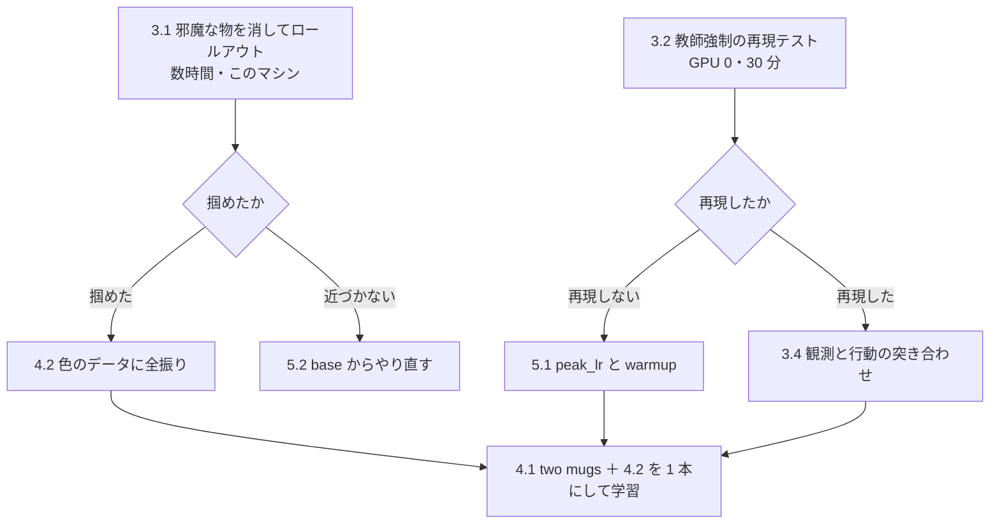

# 22. 把持が生まれない原因を切り分け、色で見分ける力を足す

**Track3 は 11 提出すべてで 0.000 である。**逆向きデータで**対象物の選択は直った**が、
**掴めていない。**この文書は、**掴めない原因を切り分ける手**と、
**色で見分ける力を足す手**を、費用と「何が決まるか」つきで並べる。

**2026-09-09 に作った。**元になった測定は
[knowledge/20](../knowledge/20_probe_object_choice_without_rollout.md) にある。

| 節 | 中身 |
|---|---|
| [1 なぜこの計画が要るのか](#1-なぜこの計画が要るのか) | 選択は直り、把持が残った。色が効くのは 4 課題のうち 2 つ |
| [2 手の一覧](#2-手の一覧) | 9 つの手を、費用と「何が決まるか」で並べた表 |
| [3 掴めない原因を切り分ける 6 手](#3-掴めない原因を切り分ける-6-手) | 3.1 邪魔な物を消す／3.2 教師強制／3.3 実行歩数／3.4 突き合わせ／**3.5 同じ形を足す**／3.6 対象と支えを bddl から取る |
| [4 データを足す 2 手](#4-データを足す-2-手) | 4.1 two mugs の逆向き 313 本／4.2 色で見分ける 406 本 |
| [5 学習の回し方を変える 2 手](#5-学習の回し方を変える-2-手) | 5.1 peak_lr と warmup／5.2 base からのやり直し |
| [6 順番と依存](#6-順番と依存) | どれが先か。並行できるのはどれか |
| [7 外した読み](#7-外した読み) | 追わないと決めた 3 つ。蒸し返さないために残す |

---

## 1. なぜこの計画が要るのか

**Track3 の失敗は 1 つではなく、掛け算の 4 つの門である**——
対象物を選ぶ × 掴む × 運ぶ × 衝突しない（[reference/17](../reference/17_scoring_formula.md)）。
`success_rate` は積なので、0.000 が出てもどの門で落ちたかは分からない。

**門を 1 つずつ測ったら、1 つ目は通っていた。**

| 門 | いまの状態 | 出典 |
|---|---|---|
| **対象物を選ぶ** | **黄本と缶は直った。赤マグは `base` にあった能力を失ったまま**（cos −0.76 で真逆） | [knowledge/20](../knowledge/20_probe_object_choice_without_rollout.md) 3 節 |
| **掴む** | **落ちている。**8 本すべて 300 歩で `done=False`・5/8 は何も触らない | [reference/19](../reference/19_weights_catalog.md) の `pi05_t3rev` の節 |
| 運ぶ・衝突 | **掴めていないので測れていない** | — |

**だからこの計画の主題は「掴む」である。**色は従である——
**色が手がかりになるのは 4 課題のうち赤マグと two mugs の 2 つだけ**で、
**どちらも同じ `LIVING_ROOM_SCENE5` である**（[reference/28](../reference/28_track3_contents.md)）。

**なお two mugs は逆向きデータに 1 本も入っていない。**
[4.1](#41-two-mugs-の逆向きを作る) がそれを埋める。

---

## 2. 手の一覧

**「何が決まるか」が書けない手は載せていない。**費用の「GPU 0」は推論だけで学習しないという意味である。

| # | やること | 費用 | 何が決まるか |
|---|---|---|---|
| **3.1** | **邪魔な物を消した場面でロールアウト** | このマシン・数時間 | **迷っているのか、把持そのものを失ったのか** |
| **3.2** | **教師強制の再現テスト** | **GPU 0**・30 分 | **モデル側が悪いのか、評価時の入力の通り道が悪いのか** |
| 3.3 | 実行歩数を 10 から 50 へ上げて 1 本回す | このマシン・1 時間 | 計画の後半が切り捨てられていることが原因か |
| 3.4 | 観測と行動を、学習データと評価で突き合わせる | GPU 0・1〜2 時間 | 入力の通り道のどこがずれているか |
| 3.6 | 対象・支え・目的地を bddl から 1 度だけ記録する | 系譜の再測定 1 時間 | **手書きの表 2 つが消え、4 件目の課題が報告に出る** |
| **3.5** | **同じ形の邪魔物体を足して、選べなくなるかを見る** | このマシン・数時間 | **「同じ形が複数」が原因か**（3.1 の裏返し） |
| **4.1** | **two mugs の逆向きを作る**（順方向 313 本） | 生成 ＋ 学習 1 本 | **Track3 の 4 件目（25%）が埋まるか** |
| **4.2** | **色で見分けるデータを足す**（順方向 **406 本**） | 4.1 と同じ 1 本に同梱 | **赤マグと two mugs が色で解けるようになるか** |
| 5.1 | `peak_lr` を上げ `warmup` を縮める | 学習 1 本に相乗り | 短く回して挙動が動くか |
| 5.2 | `base` からのやり直し（Track3 専用の重み） | 学習 9〜10 時間 | 上の手が頭打ちになったときの逃げ道 |

---

## 3. 掴めない原因を切り分ける 6 手

### 3.1. 邪魔な物を消した場面でロールアウト

**なぜ。**動画では「違う物の上で漂う」が 4 課題すべてで起きている。
**これが「2 つの候補の間で迷っている」なのか「掴む力を失った」なのかで、次の手が正反対になる。**

**何を。**T3 の bddl から**操作対象と土台だけを残し、候補になりうる物体を消した bddl** を書き、
同じ指示文・同じ初期姿勢で 300 歩回す。**変えるのは候補物体の数だけである。**

**打てる理由が 3 つある。**

| 前提 | 実測 |
|---|---|
| **init ファイルが要らない** | `make_render_env(bddl_file)` は bddl だけで env を作る（LIBERO が `:init` 領域からサンプルする） |
| **描画が速い** | このマシンは Quadro RTX 6000 で **EGL が通る唯一のマシン**である（箱 1 個で 9.7 ms → 0.6 ms） |
| **`docker run` が通る** | 直書きは拒否されるがスクリプト経由なら通る（[knowledge/12](../knowledge/12_workbench_accidents.md)） |

**どうなるか。**3 つに分かれ、それぞれ次の手が変わる。

| 結果 | 読み | 次 |
|---|---|---|
| 掴める | **迷っていた。**把持は残っている | [4.2](#42-色で見分けるデータを足す) に全振りする |
| 掴まないが近づく | **接近の最後か把持そのもの**が壊れている | 逆向きデータの掴み方を見直す |
| 近づかない | **場面の理解が届いていない** | [5.2](#52-base-からのやり直しplan-b) の値打ちが上がる |

**測る重みは `proto20` を第一にする。**T3 の 3 課題で正解が 1 位、かつ指を閉じる気がある
唯一の重みなので、**「あと一歩」がどこなのかがいちばんよく出る。**
`rp3000` も回せば、逆向きデータの寄与が同時に見える。

### 3.2. 教師強制の再現テスト

**なぜ。**`t3rev` は逆向き 397 本を **35 周**見ている。
**それでも評価では再現しない。**ここには 2 つしか可能性がない——
**学習が入っていない**か、**評価時の入力が学習時と違う**か。
**この 1 回の測定で、探索空間が半分になる。**

**学習はしない。**推論だけである。仕掛けは
[knowledge/20](../knowledge/20_probe_object_choice_without_rollout.md) のプローブをそのまま使う。

**何を。**手順は 4 行で終わる。

1. 逆向きデータセットから **1 行**取る（`observation.state`・画 2 枚・指示文・`action` の 50 コマ）
2. その観測を**評価と同じ前処理**に通して、学習済みの重みへ入れる
3. 返ってきた 50 歩と、**データに記録されている 50 歩**を並べて誤差を出す
4. 同じことを 20 行ぶん繰り返す（課題ごとに数行）

**「教師強制」とは、モデルに次の 1 手を自由に選ばせるのではなく、
正解が分かっている 1 コマを与えて「そこから何を出すか」だけを見る測り方である。**
シムを回さないので、失敗が積み上がらない。

**どうなるか。**

| 結果 | 読み | 次 |
|---|---|---|
| 記録どおりの行動を返す | **モデルは学習できている。**壊れているのは**評価時の入力の通り道** | [3.4](#34-観測と行動を学習データと評価で突き合わせる) へ進む |
| 返さない | **最適化が届いていない** | [5.1](#51-peak_lr-を上げ-warmup-を縮める) へ進む |

**先に `proto20` と `t3rev` の 2 点で測る。**`proto20` は 20%・2,000 歩、`t3rev` は 49%・8,700 歩なので、
**「見た回数が足りないのか」も同時に分かる。**

### 3.3. 実行歩数を 10 から 50 へ上げて 1 本回す

**なぜ。**推論は 50 歩ぶん計画するが、**先頭 10 歩だけ実行して作り直す**（`n_action_steps=10`）。
`rp3000` は黄本で**44 歩目に初めて指を閉じる**計画を出している——**その閉じは一度も実行されない。**

**何を。**`PARC_N_ACTION_STEPS=50` を渡して 1 本回すだけである
（[reference/07](../reference/07_chunk_params.md)）。

**どうなるか。掴んだら原因はこれである。**
ただし**本命ではない。**`rp3000` の黄本は 50 歩で 1,082 mm 動く計画なので、
10 歩でも 216 mm 進む。**進んでいるので無限ループにはならないはずである。**
[3.1](#31-邪魔な物を消した場面でロールアウト) のついでに 1 本足す価値、という位置づけである。

### 3.4. 観測と行動を、学習データと評価で突き合わせる

**なぜ。**評価側は `LiberoProcessorStep` が観測を組み、こちらの書き出しは `obs_state8()` が組む。
**どちらも「同じ並び」と書いてあるが、端から端まで数値で突き合わせた記録が無い**
（[reference/10](../reference/10_observation_interface.md) 2 節）。
**外れていたら、それだけで全部の説明になる。**

**何を。突き合わせるのは 2 つある。**

| 突き合わせるもの | やり方 | 見つかるずれ |
|---|---|---|
| **観測** | 同じ場面・同じ姿勢で、評価が組む batch と学習データの 1 行を数値で diff | 並び・単位・画の 180 度回転・カメラの左右 |
| **行動** | **学習データの `action` 50 コマ**と、その場面で重みが返す 50 コマを diff | 正規化の当て方・`action` の符号・指の符号 |

**行動側も突き合わせる**のは、[3.2](#32-教師強制の再現テスト) が「再現しない」と出たときに
**「モデルが悪い」と「行動の読み方が違う」を分けるため**である。
`action` の規約と指の符号は [reference/25](../reference/25_dataset_inventory.md) 8.7 節にある。

---

### 3.5. 同じ指示文で配置だけを変えて確かめる

**なぜ。**T3 の場面は「候補が複数ある」ことと「対象が定位置にいない」ことの 2 つで
学習中の場面と違う（[reference/28 の 1.5](../reference/28_track3_contents.md#15-どの学習場面でも位置が物の同一性を決めているt3-の赤マグだけが例外2026-09-09)）。
**どちらが効いているのかを、配置だけを動かして分ける。**

**まず、その課題は既にあり、既に測ってある。**配布 `libero_plus` の摂動 4 カテゴリのうち
**`Objects Layout`** が「同じ指示文・配置だけ違う」である
（対象物のずらし `_levelN_sampleM` と邪魔物体の追加 `_add_N`）。

| カテゴリ | 歩数比 | 壊した | 二項検定 | 読み |
|---|---|---|---|---|
| Robot Initial States | +47.8% | 6/12 | p = 0.0005 | いちばん悪い |
| Camera Viewpoints | +16.6% | 2/12 | p = 0.039 | 2 番目 |
| Sensor Noise | +9.8% | 2/12 | p = 0.039 | 床のすぐ上 |
| **`Objects Layout`** | **+6.1%** | **1/12** | **p = 0.388** | **床（±6.5%）の内側。差があるとは言えない** |

出典は [reference/21 の 1 節](../reference/21_weakness_map.md)（16 タスク × 4 カテゴリ × 3 本＝240 ロールアウト）。

**そして「同じ色の物が別の場所に来る」課題は 1 件も無い**（9/9 に 203 変種すべてで確かめた）。
**物を動かす摂動は `_levelN_sampleM` だけで、ずれは level 5 でも 49.3 mm。**
**マグの初期領域は 180〜255 mm 離れているので、位置が入れ替わることはない**
（[reference/28 の 1.5](../reference/28_track3_contents.md#15-どの学習場面でも位置が物の同一性を決めているt3-の赤マグだけが例外2026-09-09)）。

**つまり「同じ指示文で配置だけが違う」は、いまの重みでほぼ解けている。**
**邪魔物体を足しても壊れていない**（`_add_N` も同じカテゴリに入っている）。
**だから T3 の失敗は配置のせいではない。**

**残る違いは 1 つである——邪魔物体が「同じ形」であること。**
`Objects Layout` が足す邪魔物体は物体プールから選ばれた**別の形**で、
見た目で見分けられる。**T3 のマグは 3 個とも同じ形で、色しか違わない。**

**何を。2 つ測る。**

| # | 測ること | やり方 | 何が決まるか |
|---|---|---|---|
| **a** | **配置を動かしても対象を選べるか** | 100% 通る課題の `_levelN_sampleM` 変種でプローブを打ち、対象が**正**のままかを見る | 上の表（ロールアウトの歩数）を**選択の側から**裏取りできる |
| **b** | **同じ形の邪魔物体を足すと選べなくなるか** | 100% 通る課題の bddl に**同じ形の物体をもう 1 個**足して、色だけを変える | **「同じ形が複数」が原因かを 1 変数で決める。**[3.1](#31-邪魔な物を消した場面でロールアウト) の裏返しである |

**b が本命である。**3.1 は「消すと掴めるか」を見るが、b は**「足すと選べなくなるか」**を見る。
**両方向から同じ 1 点を挟める。**

**どうなるか。**

| 結果 | 読み |
|---|---|
| b で選べなくなる | **同じ形が複数あることが原因。**[4.2](#42-色で見分けるデータを足す) が正しい手である |
| b でも選べる | **原因は「同じ形」ではない。**T3 固有の何か（対象が定位置にいない・逆向きの指示文）へ絞られる |

## 4. データを足す 2 手

### 4.1. two mugs の逆向きを作る

**なぜ。two mugs は逆向きデータに 1 本も入っていない。**
v2 混合（6,176 本・43 課題）の中身はこうなっている。

| 指示文 | 本数 | 向き |
|---|---|---|
| put the white mug on the left plate and put the yellow and white mug on the right plate | 75 | **順方向** |
| take the red mug off the left plate and put it back on the table behind the other two mugs | 1,176 | 逆向き（×8） |

**「皿に置く」ほうが 75 本入っていて、「皿から取る」ほうが 0 本である。**
T3 が要求するのは後者で、**学習データ 2,066 種の指示文のうち `take … off` / `out of` は 1 件しかない**
（[knowledge/17](../knowledge/17_track3_picks_the_wrong_object.md) 0 節）。
**モデルにとって「置く」と「取る」は別の技である**——黄本と缶で実証済みで、
逆向きを入れたときだけ正解が 1 位になった。

**何を。**順方向 **task_index 30（313 本・平均 260 コマ）**を時間反転する。
`_t3_container.sh` に `twomugs` の分岐が既にあり、016 が組んだ bddl も置いてある。

**どうなるか。Track3 の 4 課題のうち 1 つ、25% が埋まる。**

**先に測ることが 1 つある。**平均 260 コマは、いまの 3 課題の平均 152 コマの **1.7 倍**である。
**生成の所要を記録していない**ので、**まず数本流して 1 本あたりの時間を測る。**

### 4.2. 色で見分けるデータを足す

**なぜ。モデルは「データが弁別に要求した手がかり」だけを伸ばす**
（[knowledge/20](../knowledge/20_probe_object_choice_without_rollout.md) 4.1 節）。
黒椀の課題は椀が 2 つとも黒く、色は 1 ビットも寄与しない——だから学習は色を伸ばさず、
**位置だけを 8 倍に伸ばした。**

**そして、いまの逆向きデータは 1 場面につき指示文が 1 つしかない**
（黄本・缶・赤マグで場面が別）。**その場面では指示文が画像から完全に決まるので、
色語は捨ててよい信号である。**モデルは正しく捨てている。

**何を。同じ場面に色違いの課題を混ぜる。ただし場面を完全に同じにしてはいけない。**
**指示文と位置だけで対象物が決まってしまうと、色を読まずに解けてしまう。**
**必要なのは「色が変わると対象物も変わる」組と、「位置が変わっても色が同じなら対象物も同じ」組の両方である。**

**それを満たす順方向デモが 406 本ある**（逆向きの元データ `libero_combined`・111 課題）。
**内訳はこうである**——マグの課題は 5 場面 11 件・753 本あり、
そこから **two mugs の順方向 313 本（4.1 で使う）と、すでに逆向きにした赤マグ 34 本**を除くと
**9 件・406 本**が新しく足せる（赤マグも入れ直すなら 440 本）。
**11 課題・5 場面の棚卸しと、場面ごとに取れる対比は
[reference/28 の 1.3 節](../reference/28_track3_contents.md#13-同じ場面で色だけが違う課題はすでに手元にある2026-09-09-に数えた)にある。**

**ただし、この 406 本だけでは色は必須にならない**（9/9 に bddl で確かめた）。
**LIBERO はどの場面でも物ごとに専用の 5 cm 角の初期領域を持たせていて、互いに重ならない。**
**「赤いマグ」は学習中いつも机の中央奥（−0.2, 0.0）に居るので、位置を覚えれば色は読まなくてよい。**
領域の実測は
[reference/28 の 1.5](../reference/28_track3_contents.md#15-どの学習場面でも位置が物の同一性を決めているt3-の赤マグだけが例外2026-09-09)。

**それでも足す値打ちはある**——同じ色が**5 場面・複数の行き先**に出るので、
「1 つの絶対位置＝1 つの色」では覚えきれなくなる。
**ただし「場面 ＋ 位置」の 11 通りを覚えるだけで済む余地が残る。**

**そこで、位置と同一性の相関を自分で切る。**
**同じ場面で 2 つのマグの初期領域を入れ替えた bddl を作り、どちらの配置でも両方の指示文を生成する。**

| 生成する 4 通り | 白の場所 | 赤の場所 | 指示文の対象 |
|---|---|---|---|
| ① | 定位置 A | 定位置 B | **白** |
| ② | 定位置 A | 定位置 B | **赤** |
| ③ | **B（入れ替え）** | **A（入れ替え）** | **白** |
| ④ | **B（入れ替え）** | **A（入れ替え）** | **赤** |

**この 4 通りが揃うと、位置でも場面でも解けなくなる**——
① と ③ は**同じ指示文で対象の位置が違い**、① と ② は**同じ配置で対象が違う。**
**残る手がかりは見た目（色）だけである。**

**入れ替えた bddl でもデモは要らない。**逆向きの生成は**対象の姿勢から掴む姿勢を組み立てる**
方式なので（[reference/30](../reference/30_reverse_grasp_pose.md)）、
**名前で対象を指定すれば、どこに置いてあっても掴みに行く軌道が作れる。**
**これが「撮る」より安いところである。**

**範囲は `LIVING_ROOM_SCENE5` だけでよい**——T3 で色が効くのは赤マグと two mugs の 2 課題で、
どちらもこの場面である。黄本と缶の場面には色違いの候補が無い。

**どうなるか。**色への反応（指示文の色語を変えたときの行動列の変化）が上がる。
**上流には既に情報が来ている**ので、伸ばす先は行動側だけでよい——
`base` の赤マグで **prefix は色で 0.232 動くのに、行動列は 0.011 しか動かない**
（[knowledge/20](../knowledge/20_probe_object_choice_without_rollout.md) 4.2 節）。
**だから action expert だけの学習でも直る見込みがある。**

---

## 5. 学習の回し方を変える 2 手

### 5.1. `peak_lr` を上げ `warmup` を縮める

**なぜ。直近 2 本は `stage1` の 1/5 の学習率で回している。**

| 学習 | `peak_lr` | 範囲 | 歩数 |
|---|---|---|---|
| `stage1_24000` | **2.5e-5** | action expert だけ | 24,000 |
| `proto20` | **5e-6** | 全部 | 2,000 |
| `t3rev` | **5e-6** | action expert だけ | 8,700 |

**さらに `num_warmup_steps` が 1,000 で、実行ごとに引き直される**
（`--init-from` は学習の状態を読まない。[reference/19](../reference/19_weights_catalog.md) の
「歩数を足しても学習量は足し算にならない」）。
**2,000 歩の実行は半分が warmup である。**

**何を。**短く回すなら **`peak_lr` を上げ、`warmup` を 200〜300 歩に縮める。**
**1 本で 1 つだけ変える。**

**どうなるか。**同じ歩数で挙動が動くかが分かる。
**動かなければ、原因は歩数でも学習率でもない**——[3.2](#32-教師強制の再現テスト) の
「最適化が届いていない」を否定できる。

### 5.2. `base` からのやり直し（plan B）

**なぜ。提出はトラック別なので、Track3 専用の重みを出しても Track1/2 の点は 1 点も減らない**
（[howto/02](../howto/02_build_submission.md)）。**T3 の 4 課題に全振りした重みを作ってよい。**
汎化を守る必要が無くなるので、逆向きの比率も歩数も自由に振れる。

**分岐点は `stage1_24000` ではなく `base` である。**
**壊れたのは `stage1_24000` で**なので、その手前は `base` しかない
（缶の正解が `base` の 2 位 → `stage1` で 5 位）。
`stage1_24000` 自体が **expert だけ 24,000 歩**で、いちばん危ないやり方の見本になっている。

**ただし `base` の T3 は「強くない」のではなく「2 勝 1 敗」である**（9/9 に判定を直した）。

| `base` | 並進（50 歩） | 対象の cos | 判定 |
|---|---|---|---|
| 対照 黒椀（100% 成功） | 1,117 mm | +0.752 | 誤（`plate_1` に 0.038 差） |
| **T3 赤マグ** | **366 mm** | **+0.942** | **正**（差 +0.030） |
| **T3 缶** | 681 mm | **+0.934** | **正** |
| T3 黄本 | 742 mm | +0.545 | 誤（`yellow_book_1` +0.848） |

**`base` は赤マグと缶を正しく狙えていた。**私たちの最初の学習が両方を潰した
（[knowledge/20 の 3.1](../knowledge/20_probe_object_choice_without_rollout.md)）。
**だから `base` へ戻す値打ちは「損失を避ける」ではなく「2 課題ぶんの能力を取り戻す」である。**

**それでも赤マグの並進 366 mm は他の課題の半分で、動く気そのものが弱い。**
**戻しただけでは掴めるようにならない。**

**だから plan B に置く。**`base` からのやり直しは `stage1` の 9 時間 31 分の再走に近く、
**残り時間で 1 回しか試せない。**[3.1](#31-邪魔な物を消した場面でロールアウト) が
「近づかない」と出たときに引く札である。

---

## 6. 順番と依存

**先に来るのは、費用が小さくて分岐が大きい手である。**

**3.1 と 3.2 は GPU の取り合いにならないので同時に進められる**
（3.2 は推論 1 回ずつで、描画を使わない）。
**3.3 は 3.1 のついでに 1 本足す。**

**4.1 と 4.2 は同じ学習 1 本に同梱する。**別々に回すと、
どちらが効いたのか分からないうえに GPU 時間が 2 倍になる。
**先に生成の所要を数本で測る**（[4.1](#41-two-mugs-の逆向きを作る) の末尾）。

---

### 3.6. 対象・支え・目的地を bddl から 1 度だけ記録する（**まだやっていない**）

**なぜ。**「どの物へ手を伸ばしたか」の判定には、**どれが対象で、どれが支えで、
どれが目的地か**が要る。いまは 3 か所に手書きで散っている。

| 場所 | 形 |
|---|---|
| `summarize_lineage.py` の `TARGET` | 課題名 → 対象の名前（手書き） |
| 同 `SUPPORT` | 課題名 → 支えの名前（手書き。**9/9 に足した**） |
| `grasp_rollout.py`（**直した**） | `:goal` の述語から取る |

**bddl はこれを明示している。**`(:init (on red_coffee_mug_1 plate_1))`・
`(:goal (on porcelain_mug_1 …))`・領域の `target`。
**`grasp_rollout.py` は 9/9 にこちらへ移した**（LIBERO 自身のパーサを使う）が、
**プローブ側はまだ手書きの表である。**

**何を。**`dump_t3_obs.py` に、物の位置と一緒に
`<課題>/target`・`<課題>/support`・`<課題>/destination` を書かせる。
`lineage_probe.py` が json へ通し、`summarize_lineage.py` が読む。
**手書きの表 2 つが消える。**

**距離で決める案は使わない。**黒椀の課題では**近い物が目的地**で、
同型の椀は 130 mm 離れている。**「N mm 以内を除く」では目的地と本物の競合を分けられない。**
**述語なら分けられる。**

**どうなるか。**課題を足すたびの手書きが無くなり、
**`SHORT` に無い課題が黙って落ちる**問題も直る（**T3 の 4 件目 two mugs は
いまプローブの報告に 1 度も出てこない**）。

**まだやっていない理由。**`work/probe_color/*.json` を作り直すことになり、
**系譜 6 点の再測定（約 1 時間）と、すでに文書に載せた数値の突き合わせ**が要る。
**手 A・手 B の結果を見てから着手する。**

## 7. 外した読み

**同じ道を二度歩かないために残す。**

| 外した読み | なぜ外したか |
|---|---|
| **`grdn` が上限に当たり続けたことが原因** | **クリップは更新量を縮めるので、出発点（`rp3000`）の挙動を保つ方向に働く。**挙動が消えたことの説明にならない。`grdn` 2.5〜7.8 は**症状**であって原因ではない |
| **複数のタイミングを平均して指の指令が 0 に潰れ、閾値を越えない** | **予測値は飽和している。**`base` と `t3rev` は 50 歩すべて −1.0 付近（開く側に振り切れ）。中間値を出すのは `proto20` だけ |
| **逆向きデータは指を閉じる時間が短いから掴まない** | **逆である。**閉じているコマは**逆向き 63.2% / 先頭 50 コマ 20.4%** に対し、配布 `libero_plus` は **49.0% / 9.7%**。逆向きのほうが長く、早く閉じる |

| **画の 180 度回転が学習と評価で食い違っている**（左右が入れ替わる） | **実物で確かめて消えた**（9/9）。`reverse_lerobot_v2` と配布 `libero_plus` の 1 コマ目は**どちらも腕が上・机が下で同じ向き**である。書き出しは `dataset_image()` が、評価側は `LiberoProcessorStep` が同じ 180 度を当てている |
| **`base` は T3 で的外れだった** | **判定の誤りだった**（9/9）。対象を支えている物（トレイ・皿）を競合に数えていた。**`base` は缶と赤マグを正しく狙えていた** |

**測定の出典はすべて
[knowledge/20](../knowledge/20_probe_object_choice_without_rollout.md) の 3 節・3.4 節にある。**
