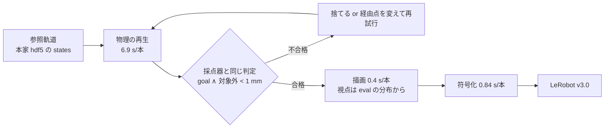

# 23. 接触の無い手本を「作る」——引き算が効かなかった機構と、作り直しの設計

> **更新: 2026-09-10** ／ **この文書が置き換えるもの: 無し。**
>
> **「接触が起きているデモを外す」（手 F・`pi05_clean24k`）が否定されたあとの次の手を設計する。**
> **否定された経緯と数字は [reference/19 の 【9/10】](../reference/19_weights_catalog.md)、
> 手の状態は [reference/32](../reference/32_current_tasks.md) にある。**
> **`on the ramekin` 1 課題ぶんの作り直しは別に立っている**——この文書はそれを 40 課題へ広げたものである。

- [1. なぜこの文書が要るか](#1-なぜこの文書が要るか)
- [2. 引き算が効かなかった機構](#2-引き算が効かなかった機構)
- [3. 作り直しの費用を実測した](#3-作り直しの費用を実測した)
- [4. 作り直しの 4 通りと、実測した歩留まり](#4-作り直しの-4-通りと実測した歩留まり)
- [5. 品質の門——足したデータが点を下げた 3 回から](#5-品質の門足したデータが点を下げた-3-回から)
- [6. 順番と、9/17 までの割り振り](#6-順番と917-までの割り振り)
- [7. 測り方の門——3 本では読めない](#7-測り方の門3-本では読めない)
- [8. 落とした案](#8-落とした案)
- [9. 出典](#9-出典)
- [10. S0 の結果（9/10 夜・実測）](#10-s0-の結果910-夜実測)

---

## 1. なぜこの文書が要るか

**「データ側の対策がいちばん効く」は運営と上位参加者が一致して言っている**（キックオフ・ユーザ）。
**ところがこちらがデータ側で打った手は、効いたものが 1 つも無い。**
いちばん新しい**手 F** は、**接触が起きているデモ 2,131 本（14.9%）を外して 24,000 歩を回し、
Track2 の衝突が 52 → 55 本と動かなかった**ことを 606 ロールアウトで確かめて閉じた
（[reference/19 の 【9/10】](../reference/19_weights_catalog.md)）。

**以下、この掃除の回を「手 F」と呼ぶ**——`reference/19` と `reference/32` の呼び名に合わせる。

**この文書を読み終えると 3 つが決まる。**

| # | 決まること | どの節 |
|---|---|---|
| 1 | **なぜ引き算が効かなかったのか**（次に同じ外し方を繰り返さないため） | [2](#2-引き算が効かなかった機構) |
| 2 | **手本を作り直すのに何時間かかるのか**（実測値。見積りではない） | [3](#3-作り直しの費用を実測した) |
| 3 | **どの作り方から着手するか** | [6](#6-順番と917-までの割り振り) |

**結論を先に 1 行で。**
**律速は計算ではなく「軌道を作る仕掛け」である**——16 並列で **1 時間に 8,383 本**の
エピソードを物理計算できるので、14,347 本ぶんを作り直しても半日で終わる。

---

## 2. 引き算が効かなかった機構

**「効かなかった」で止めると、次も同じ外し方をする。**手 F の結果は
**3 つの独立な証拠**と突き合わせると 1 つの機構に収束する。

### 2.1 衝突は「汚い手本の模倣」ではなく「摂動で崩れた制御」から出ている

| 証拠 | 中身 | 出典 |
|---|---|---|
| 手先が 2 cm ずれると**衝突率が 2.3 倍**になる | 成功率 0.833 → 0.535・**衝突率 0.139 → 0.319** | [plan/21 の 3 節](21_initiative_priority_second_opinion.md)・[reference/21 の 2 節](../reference/21_weakness_map.md) |
| **学習データは手先 1.0 cm までしか振れていない** | 中央値 1.00 cm・3 cm 超は 0.2% | [reference/06](../reference/06_training_data_composition.md) |
| 採点で出る摂動は **2.4〜6.5 cm** | `task_classification.json` の 90% が倍率 0.2 以上 | [reference/21 の 4 節](../reference/21_weakness_map.md) |
| **摂動を 1 つも掛けていない Base でも 16.7% が衝突** | 手本の汚れだけでは説明できない | [plan/16 の 3.1](16_finals_initiative_priority.md) |

**衝突は、手本を真似た結果ではなく、手本が 1 本も無い場所で暴れた結果である。**
だから汚い手本を外しても衝突は減らない。

### 2.2 汚い手本を外しても、清潔な手本が入らない

**`pick up the black bowl on the cookie box` で、手 F は「この課題は成功しようがない」と読んだ**
（人の手本 44 組すべてが `cookies_1` を 1 mm 超動かすため）。
**この読みは、方策自身のロールアウトが否定している。**

| 見たもの | 値 | 出典 |
|---|---|---|
| 人の手本のうち `cookies_1` を 1 mm 超動かした組 | **44 / 44（100%）** | 手 F の判定（`contact_scores.json`。[reference/25 の 8.9](../reference/25_dataset_inventory.md)） |
| **方策が `cookies_1` を 1 mm 未満に収めた回** | **18 本中 8 本** | [plan/16 の 3.2](16_finals_initiative_priority.md) |
| 掃除後の同じ課題の成功 | 6 / 18（掃除前と同じ） | [reference/19 の 【9/10】](../reference/19_weights_catalog.md) |

**つまりこの課題は物理としては解ける。汚れているのは手本だけである。**
手 F が残した 6 組は「たまたま 1 mm に届かなかった回」（0.12〜1.0 mm）であって、
**清潔な手本は 1 本も足されていない。**引き算は汚れを消すが、正解を教えない。

**`on the ramekin` は別で、こちらは本当に解けない見込みが高い**——掃除前も掃除後も
**0/3 成功・3/3 衝突**である（[reference/19 の 【9/10】](../reference/19_weights_catalog.md)）。
掴む相手の黒い椀が対象外のラメキンの上に載っているので、持ち上げれば必ず動く。
**2 つを混ぜて扱ってはいけない。**

### 2.3 当たった量が小さすぎて、そもそも読めない

**学習は 24,000 歩 × batch 16 ＝ 384,000 コマで、2,238,036 コマの 0.17 周しか回らない。**
そこへ掃除が与えた変化はこれである。

| 何 | 割合 |
|---|---|
| 消えたコマ | −13.3%（2,238,036 → 1,940,083） |
| **掃除がいちばん強く当たった 2 課題が、学習データ全体に占める割合** | **5.8%**（830 / 14,347 本） |
| 効きを測った評価行のうち、データが変わった行 | **12 / 72**（`TRACK2_VAL72.csv`） |

**5.8% を触って 216 本で測っている。**手 F の 3 本版と 5 本版で符号が逆転したこと
（p = 0.039 → p = 0.581）は、この分母から自然に出る。

### 2.4 だから区分は「(a) 的を外した」ではない

**「(a) 手そのものが的を外した／(b) 当たった量が足りない／(c) 測り方で見えなかった」の
3 区分**に当てると、こうなる。

| 区分 | 判定 |
|---|---|
| (a) 手そのものが的を外していた | **当たらない。**接触が起きている手本は実在し、採点はそれを失格にする |
| **(b) 手は正しいが、当たった量が足りなかった** | **当たる。**2.3 節。触ったのは 5.8% |
| **(c) 手は正しいが、測り方で見えなかった** | **当たる。**216 本では 12 行ぶんの改善が雑音に埋まる |
| **足りなかったもの** | **(a)(b)(c) のどれでもない——「外す」が手当てとして不完全だった**（2.2 節） |

**外すのではなく、作り直す。**これが次の手である。

---

## 3. 作り直しの費用を実測した

**28 の調査は「シミュレータの 1 歩は 16〜384 ms」を根拠に MPPI を不向きと判定した**が、
**その値はすべて描画込みである。**物理だけの速度は誰も測っていなかった
（[reference/28 の 2 節](../reference/28_mppi_data_regeneration_survey.md) の推定はすべて
描画込みの実測値から外挿している）。**9/10 に測った。**

### 3.1 実測値

**機械は `eng003sasaki01`（RTX6000・vCPU 16）、image は `parc2026-final`、`MUJOCO_GL=egl`。**
課題は `pick_up_the_black_bowl_on_the_cookie_box…`（`nq` 48・`nv` 43・`nbody` 38）。

| 測ったもの | 値 |
|---|---|
| `env.step`（**物理だけ**・カメラ無し） | **35.4 ms**（1 プロセス） |
| `env.step`（物理 ＋ カメラ 2 枚・EGL） | 40.8 ms |
| **描画が 1 歩に占める割合** | **6.2%** |
| **状態の復元**（`set_state_from_flattened` ＋ `sim.forward()`） | **0.12 ms** |
| `env.reset()`（model を作り直す） | 647 ms |
| `ControlEnv` の構築 | 1.1 s |
| **1 コマ 1 カメラの描画**（状態の復元込み） | **1.07 ms** |
| **動画の符号化 1 本**（169 コマ × 2 カメラ・AV1 `preset 12`・`g 2`） | **0.84 s** |

**打ち直す手順。**道具は `solution/tools/probe/` に置いた。
`run_regen_probe.sh` が `parc2026-final` の中で 1 本走らせる包みである。

```bash
cd solution/tools/probe
SCRIPT=sim_throughput.py          bash run_regen_probe.sh   # 上の表
SCRIPT=sim_throughput_parallel.py bash run_regen_probe.sh   # 下の表
SCRIPT=rerender_from_states.py    bash run_regen_probe.sh   # 描画 1.07 ms/コマ
python3 video_encode_cost.py                                # 符号化 0.84 s/本
```

**並列は 16 までほぼ線形に伸びる。**

| 並列数 | 1 歩あたり | 合計 | **1 時間に作れる本数**（1 本 169 歩） |
|---|---|---|---|
| 1 | 35.4 ms | 28.2 歩/秒 | 602 |
| 8 | 37.9 ms | 211 歩/秒 | 4,496 |
| **16** | **40.7 ms** | **393 歩/秒** | **8,383** |

### 3.2 だから何が作れるか

| 作業 | 本数 | **16 並列の所要** |
|---|---|---|
| 1,681 組を素の条件で 1 回ずつ再生し直す（＝ 019 の再現性検査も同時に済む） | 1,681 | **12 分** |
| 1,681 組 × ロボット初期姿勢 10 通りを撃つ | 16,810 | **2.0 時間** |
| 接触した 256 組に、経由点を 40 通り試す | 10,240 | **1.2 時間** |
| 合格した 8,400 本を描画して符号化する（物理は撃ち直さない） | 8,400 | **20〜30 分** |

**最終行だけは並列を測っていない。**1 本あたりは描画 0.36 s ＋ 符号化 0.84 s ＝ **1.2 s** で、
1 プロセスなら 2.8 時間・16 並列なら計算上 11 分になる。**GPU 1 枚に 16 プロセスが同時に描き、
AV1 の符号化も CPU を食うので、実測で確かめること。**物理だけの並列（表の上 3 行）は実測である。

**描画に物理を撃ち直す必要はない。**状態の復元が 0.12 ms なので、
**合格した回の MuJoCo の状態列を保存しておけば、あとから何通りの視点でも描き直せる。**
`_view_<方位角>_…` の env は素のタスクの保存状態をそのまま受け（bddl が存在しなくても通る）、
別の画を描く（実測の平均画素差 35〜38 / 255）。

### 3.3 律速は「軌道を作る仕掛け」である



**時間が要るのは B の繰り返しだけで、それが 1 時間 8,383 本である。**
**足りないのは計算ではなく「A から B を通す仕掛け」である。**

---

## 4. 作り直しの 4 通りと、実測した歩留まり

**参照軌道は既にある。**本家 hdf5 から 2,000 デモ・338,575 コマを抜き、
**1,681 組と 100% 対応づけた表が手元にある**
（`work/artifacts/libero_states/demo_map.json`。[reference/25 の 8.9](../reference/25_dataset_inventory.md)）。
問題は「その軌道を、別の初期条件でどう撃ち直すか」だけである。

### 4.1 (A) 記録した行動をそのまま摂動環境で撃つ

**いちばん安い。新しい制御器を書かない。**摂動した環境を作り、
記録された 7 次元の差分行動をそのまま流し、**合格したものだけ残す。**
MimicGen（arXiv:2310.17596）が 200 本の人のデモから 50,000 本を作った枠と同じ
「生成して選別する」型である。

**9/10 に `KITCHEN_SCENE8_put_both_moka_pots_on_the_stove` で測った**
（参照は scripted policy の 1 本・初期配置 3 通り・`env.seed(0)` で固定）。

| `initstate` | 手先のずれ | **使える本**（goal 到達 かつ 対象外すべて 1 mm 未満） |
|---|---|---|
| 0（摂動なし） | 0 cm | 3 / 3 |
| **150** | **2.63 cm** | **3 / 3** |
| 350 | 4.00 cm | 0 / 3 |
| 450 | 7.26 cm | 1 / 3 |

> **この 4/9 は scripted policy の軌道で測った下見である。**
> **本家の人のデモ 2,000 本で測り直した結果は [10 節](#10-s0-の結果910-夜実測)にある**
> ——摂動下の歩留まりは **52.5%** で、下見より良かった。

**摂動 4 / 9。**しかも**通るかどうかは大きさではなく向きで決まる**——4.00 cm が全滅し
7.26 cm が通る。[reference/21 の 2 節](../reference/21_weakness_map.md) が「2 cm より上では
大きさより向きが効く」と書いたとおりである。

**いちばん大事なのは、摂動が消えないことである。**「成功したのは腕が元の経路へ
戻ったからで、被覆は増えていない」という静かな失敗がありうるので測った。

| `initstate` | 0 コマ目 | 25% 地点 | 50% 地点 | 75% 地点 | 平均 | goal |
|---|---|---|---|---|---|---|
| **150** | **2.63 cm** | 1.84 cm | 1.86 cm | 1.88 cm | **1.85 cm** | **到達** |
| 350 | 4.00 cm | 3.83 cm | 4.05 cm | 4.04 cm | 3.95 cm | 未到達 |
| 450 | 7.26 cm | 3.27 cm | 3.14 cm | 2.94 cm | 3.52 cm | 未到達 |

**差分行動は誤差を積み上げも打ち消しもせず、ほぼ一定のずれとして運ぶ。**
**だから `initstate_150` で作った 1 本は「全区間 1.85 cm 外れたまま成功した手本」であり、
学習データに 0.2% しか無い帯そのものである。**

### 4.2 (B) 姿勢追従で作り直す —— 素朴な実装は (A) に負けた

**記録した絶対姿勢を目標にして追従させれば歩留まりが上がるはず**と考えて実装したが、
**測ったら (A) より悪かった。**

| 方法 | 歩数 | **行動ラベルの std**（6 次元） | 飽和率 |
|---|---|---|---|
| **(A) 記録した行動をそのまま撃つ** | 227 | **0.34** | 0.09 |
| (B) 姿勢追従 `gain` 0.5 | **420（打ち切り）** | **0.06〜0.08** | 0.00 |
| (B) 姿勢追従 `gain` 1.5 | **420（打ち切り）** | 0.08〜0.12 | 0.01 |

**行動ラベルが痩せる。**OSC は 1 指令で目標の 2 割しか進まないので（28 の 5.1）、
誤差に比例させた指令は小さすぎて這う。**これは [reference/33](../reference/33_gradient_norm_and_action_saturation.md)
の「回転指令の 28.8% が上限の 1 点に乗った」と同じ型の穴**——生成物の行動分布が
配布データと違うと、それ自体が学習を壊す。**(B) を採るなら、行動の std と飽和率を
配布データに合わせるところまで作り込む必要がある。素朴な P 制御では足りない。**

### 4.3 (C) 接触の窓だけを直す

**(A) で落ちた組と、接触が避けられない組に効く手である。**
参照軌道の**経由点を少しだけ編集して撃ち直し、合否は採点器と同じ規則で決める。**

| 族 | 該当する課題 | 編集する量 | 候補数 |
|---|---|---|---|
| **持ち上げ族** | `on the cookie box`・`on the ramekin` | 真上への逃げ高さ・持ち上げ前の静止歩数・閉じる速さ | 4 × 3 |
| **通り道族** | `push the plate` | 迂回する経由点の横方向の余裕・押す側 | 3 × 2 |

**256 組 × 40 候補 ＝ 1.2 時間**（3.2 節）。
**これは「軌道最適化」ではなく「数個のつまみの総当たり」である**——参照軌道が既に
成功しているので、探索の次元が低い。
**接触の多い区間だけをデモから採り、移動区間は clearance を保つ形に置き換える**のは
SkillMimicGen（arXiv:2410.18907・60 本の人のデモから 24,000 本・前手法比 +24%）の骨格そのもので、
**`push the plate` が青い箱（`cream_cheese_1`）を押す失敗はまさに移動区間の問題である**——
皿の進む先に箱があり、押した量は 39〜89 mm だが、**36 組のうち 5 組は 0.00 mm で終えている**
（手 F の判定。ずれの分布が二山になっている）。

### 4.4 (D) 方策自身のロールアウトから合格品だけを拾う

**制御器を 1 行も書かなくてよい。**いまの重みを評価と同じ条件で回し、
**`success ∧ 対象外 0 接触` の回だけを手本にする。**

| なぜ効くと考えるか | 出典 |
|---|---|
| **材料が実在する**——`cookie box` は 18 本中 8 本で `cookies_1` を 1 mm 未満に収めている | [plan/16 の 3.2](16_finals_initiative_priority.md) |
| 方策が実際に通る状態分布の上で学ぶので、ずれが入らない | — |
| 成功ロールアウトを手本に戻す形は LIBERO で少数手本の最高値を出している | SEIL（arXiv:2509.19460） |
| 方策のロールアウトの成否で手本を選ぶと成功率が絶対値で 15〜35 pt 上がった | Demo-SCORE（arXiv:2503.03707） |

**費用が (A)(C) と桁で違う。**1 本 30.6 秒（推論込み・EGL 実測）で、
**GPU を占有する。**2,000 本で約 12 時間・2 並列で 6 時間。

---

## 5. 品質の門——足したデータが点を下げた 3 回から

**このチームは、データを足して点を下げたことが 3 回ある。**門はそこから引く。

| いつ | 何を足した | 結果 | 原因の見立て |
|---|---|---|---|
| 9/5 | 配布 tar の 111 課題すべて | **3 トラックとも下がった**（Track1 −40.7%・Track2 −51.9%） | 1 課題あたりの学習量が薄まった |
| — | 逆向きデータを 2 割混ぜた（`proto20`） | Track2 が 0.9167 → 0.5833 | 正規化の尺度が動いた疑い |
| — | 逆向きデータを ×8 に複製 | **配布 40 課題の手首のひねりの学習信号が 0.50 倍に潰れた** | 混合比が行動の統計を書き換えた |

**だから生成物には門を 6 つ置く。**

| # | 門 | 落ちたらどうするか |
|---|---|---|
| 1 | **指示文を 40 種から増やさない** | 増やすなら 111 課題の件と同じ道になる。増やさない |
| 2 | **行動 7 次元の std と飽和率を、配布データと ±10% 以内に合わせる** | 外れたら生成器のつまみを直す（4.2 節の失敗がこれ） |
| 3 | 正規化統計の std の動きを ±8% 以内に収める | [reference/29 の 6.3](../reference/29_training_data_requirements.md) の実績値 |
| 4 | 同じ観測に違う正解を作らない（同じ初期配置で「合格」と「不合格」を両方入れない） | [12 の 3 節](12_tier2_recording_spec.md) |
| 5 | 学習に使う variant と検証に使う variant を排他にする | [08 の 2.8 節](08_training_data_creation_cautions.md) |
| 6 | **生成物の 0 コマ目の手先ずれが 2 cm 以上あることを確かめる** | 4.1 節の washout 検査。**通らなければ被覆は増えていない** |

**門 6 は今日新しく足したものである。**残りは既に文書化されている穴の再掲である。

---

## 6. 順番と、9/17 までの割り振り

**締切は 9/17 23:59。9/17〜9/27 の 10 日は借りている GPU が無く、できるのはデータ作りだけである**
（[14 の GPU の割り振り](14_finals1_gpu_and_submission_plan.md)）。
**データ作りは CPU の物理計算が主なので、その 10 日にちょうど収まる。**

| 順 | 手 | 何が決まるか | 費用 | 9/17 |
|---|---|---|---|---|
| ~~**1**~~ | **S0: 済（9/10 夜）。**[10 節](#10-s0-の結果910-夜実測)。**go** | **4 節すべての前提。**参照が scripted policy 1 本しか無いので、人のデモで歩留まりが変わるかは未知。**摂動なしの側は「再生しても再現しないデモが何本あるか」も同時に出す** | **CPU 1 時間・GPU 0** | **間に合う** |
| **2** | **(A) 摂動下の再生で被覆を足す**（40 課題・手先 2〜6 cm・合格品のみ） | **Track2 の衝突が「手本の無い場所で暴れている」ためかどうか。**LIBERO-plus 自身の mix-SFT は Robot だけ伸びていない（−1.6 pt）ので、公開データでは答えが出ていない問いである | 生成 3 時間 ＋ 学習 9.25 時間 ＋ 評価 2 時間 | **間に合う** |
| 3 | (C) 接触の窓を直して 256 組を作り直す | **2.2 節の「汚れているのは手本だけ」が正しいか** | 実装 1 日 ＋ 探索 1.2 時間 | 2 と同じデータセットに入れるなら間に合う |
| 4 | なめらかさで手本を選ぶ（jerk・SPARC・経路長・歩数の上位を残す） | **採点式は成功 ×（1 − 衝突）× なめらかさである**（[reference/17](../reference/17_scoring_formula.md)）。Track1 は 8 本すべて届いているので、残りはこの項にしかない | **シム不要・数時間** | 間に合う |
| 5 | (D) 方策の合格ロールアウトを拾う | 4.4 節 | GPU 6〜12 時間 | **10 日の窓向き** |
| 6 | フレーム単位に重みを付ける（接触の窓だけ落とす） | **「filtering より penalization」が +40.3%**（CIQL・arXiv:2312.11194）、状態行動対単位の選別が +15.4%（SCIZOR・arXiv:2505.22626） | シム不要。ただし lerobot に重みの口が無い | 実装が要る |

**残り 6 日で 1 つだけ選ぶなら 1 → 2 である。**理由は 3 つ。

1. **2 は「まだ 1 度も試していない軸」である。**効く大きさは 8/28 に測れているが、**足す側は未着手のまま**である（[reference/21 の 4 節](../reference/21_weakness_map.md) の投資順 1 位）。
2. **効き幅が測れている唯一の軸である**——手先 2 cm 超で成功率 0.833 → 0.535・衝突率 0.139 → 0.319。
3. **1 が 1 時間で終わり、no-go ならそこで止まる。**

**3 を同じデータセットに入れるかは、1 の歩留まりが出てから決める**——(A) の歩留まりが
低ければ、(C) の経由点編集がそのまま (A) の歩留まりを上げる仕掛けになる。

---

## 7. 測り方の門——3 本では読めない

**手 F は 3 本版で「Track1 が +8.0 pt・p = 0.039」を出し、5 本版の追試で符号が逆転した**
（68.3% → 64.8%・p = 0.581。[reference/19 の 【9/10】](../reference/19_weights_catalog.md)）。
**同じ穴を踏まないための門を先に置く。**

| # | 門 | 根拠 |
|---|---|---|
| 1 | **`TRACK_EPISODES` は 5 以上にする** | 同 |
| 2 | **3 本版と 5 本版を引き算しない** | **`/reset` に渡した seed はサーバーが捨てており、乱数は「サーバー内部のリセット何回目か」で決まる。**本数を変えると初期状態の列そのものが変わる |
| 3 | **合計だけを見ず、`compare_runs_by_task.py` でタスクごとに並べる** | データが変わっていない行は良くなりようがない |
| 4 | **データが変わった行の割合を先に数える** | 2.3 節。5.8% を触って合計で読もうとしたのが手 F の測り方の限界だった |

**門 4 が今回いちばん効く。**(A) は 40 課題すべてに当たるので、手 F と違って
**72 行のうち Robot 摂動の行すべてが動く見込みがある。**

---

## 8. 落とした案

| 案 | 落とす理由 |
|---|---|
| **素朴な MPPI（1 歩ごとに N × H を撃つ）** | **今日の実測で計算し直しても足りない。**N=2,000・H=20 なら 1 決定 40,000 歩 ÷ 393 歩/秒 = **102 秒**、1 本（30 決定）で **51 分**。[reference/28](../reference/28_mppi_data_regeneration_survey.md) の結論は生きている。**ただし 4.3 節の「数個のつまみの総当たり」は 1 組 16 秒で、これとは 3 桁違う** |
| **全部を再描画して見た目の被覆を増やすだけ** | **描画は 1 コマ 1.07 ms でほぼ無料だが、伸びる余地が薄い。**配布データは 1 組あたり 8.5 通りの見た目を既に持ち（[reference/25 の 8.9](../reference/25_dataset_inventory.md)）、LIBERO-plus 自身の mix-SFT は Camera を 92.8% まで上げている（reference/20 の 3 節）。**動きの種類は 1,681 通りしか無く、そちらが 1 倍の被覆である** |
| **(B) 姿勢追従を主に据える** | 4.2 節。素朴な実装は (A) に負け、行動ラベルが痩せる。**(A) が通らない組の受け皿としてだけ残す** |

---

## 9. 出典

| 事実 | 出典 |
|---|---|
| 掃除（引き算）が Track2・Track1 のどちらも動かさなかったこと | [reference/19 の 【9/10】](../reference/19_weights_catalog.md)・[reference/32](../reference/32_current_tasks.md) |
| 手先 2 cm 超で成功率 0.833 → 0.535・衝突率 0.139 → 0.319 | [plan/21 の 3 節](21_initiative_priority_second_opinion.md)・[reference/21 の 2 節](../reference/21_weakness_map.md) |
| 学習データの手先のずれが中央値 1.00 cm・3 cm 超 0.2% | [reference/06](../reference/06_training_data_composition.md) |
| Base でも 16.7% が衝突・取り戻せる 36 本の中央値 4.44 mm・`cookies_1` が 20 本・18 本中 8 本は 1 mm 未満 | [plan/16 の 3.1・3.2](16_finals_initiative_priority.md) |
| 採点の衝突判定（3 軸の絶対値の和・0.001 m・空撃ち 10 歩の後を基準） | `pipeline/rollout.py:150-241` |
| 採点式が 成功 ×（1 − 衝突）× なめらかさ であること | [reference/17](../reference/17_scoring_formula.md) |
| LIBERO-plus の mix-SFT が Robot だけ伸びない（−1.6 pt）・Camera は 92.8% | [reference/20 の 3 節](../reference/20_track2_perturbation_categories.md) |
| 1,681 組と本家 2,000 デモの 100% 対応・`demo_map.json` | [reference/25 の 8.9](../reference/25_dataset_inventory.md) |
| 111 課題で 3 トラックとも下がったこと | [reference/19](../reference/19_weights_catalog.md) の「9/5 の 13.0.0」 |
| 逆向き ×8 で手首のひねりが 0.50 倍に潰れたこと・回転指令の飽和 | [reference/33](../reference/33_gradient_norm_and_action_saturation.md) の 4・6 節 |
| 自分の環境でロールアウトを保存して学習に使ってよいこと | 運営 Q&A No.33（[reference/28 の 4 節](../reference/28_mppi_data_regeneration_survey.md)） |
| **物理だけの `env.step` 35.4 ms・16 並列 393 歩/秒・状態復元 0.12 ms・描画 1.07 ms/コマ・符号化 0.84 s/本** | **9/10 に `eng003sasaki01` で実測。**[`sim_throughput.py`](../../solution/tools/probe/sim_throughput.py)・[`sim_throughput_parallel.py`](../../solution/tools/probe/sim_throughput_parallel.py)・[`rerender_from_states.py`](../../solution/tools/probe/rerender_from_states.py)・[`video_encode_cost.py`](../../solution/tools/probe/video_encode_cost.py) |
| **摂動下の再生の歩留まり 4/9・姿勢追従が (A) に負けること** | **9/10 に実測。**[`perturbed_replay_yield.py`](../../solution/tools/probe/perturbed_replay_yield.py) |
| **摂動が全区間残ること（washout しないこと）** | **9/10 に実測。**[`perturbed_replay_offset.py`](../../solution/tools/probe/perturbed_replay_offset.py) |
| `_view_*` の env が素のタスクの保存状態をそのまま受け、別の画を描くこと（画素差 35〜38） | 同 [`rerender_from_states.py`](../../solution/tools/probe/rerender_from_states.py)。**bddl が存在しなくても通る**（[reference/20 の 2.3](../reference/20_track2_perturbation_categories.md)） |
| MimicGen（200 本 → 50,000 本・18 課題） | arXiv:2310.17596（CoRL 2023） |
| SkillMimicGen（60 本 → 24,000 本・18 課題・前手法比 +24%・移動区間を運動計画に置き換える） | arXiv:2410.18907（CoRL 2024） |
| 視点と配置の被覆が汎化を決めること | arXiv:2506.13536（MimicLabs） |
| 成功ロールアウトを手本に戻す形が LIBERO で最高値 | arXiv:2509.19460（SEIL） |
| 方策のロールアウトで手本を選ぶと +15〜35 pt | arXiv:2503.03707（Demo-SCORE） |
| 「filtering より penalization」が +40.3% | arXiv:2312.11194（CIQL） |
| 状態行動対単位の選別と重複除去で +15.4% | arXiv:2505.22626（SCIZOR） |


---

## 10. S0 の結果（9/10 夜・実測）

**本家の 2,000 デモを撃ち直して歩留まりを測った。判定は 4,000 ロールアウト、48 分。**
**判定は go である**——摂動下で **52.5%** が採点規則のもとで使える手本になる。

**打ったもの。**

```bash
python3 solution/tools/contact_clean/fetch_libero_states.py --out work/artifacts/libero_states
CHOWN_PATH="$PWD/work/regen" bash solution/tools/regen/run_in_container.sh \
    solution/tools/regen/replay_yield.py \
    --states work/artifacts/libero_states --out work/regen/s0_open_loop.jsonl \
    --demos-per-task 10 --initstates 0 150 250 350 450 --method open_loop --workers 14
# --method prealign でもう 1 本
```

### 10.1 摂動下の歩留まりは 52.5%。**2 つの撃ち方は互いを埋める**

**40 課題 × 10 デモ × 摂動 5 段 × 撃ち方 2 通り ＝ 4,000 ロールアウト。**
「使える」は**採点と同じ規則**——300 歩以内にゴールが立ち、かつその時点で
対象外の物体が 1 mm を超えて動いていない。

| `initstate` | 引き継ぎ時の手先ずれ（中央） | `open_loop` | `prealign` | **どちらか** |
|---|---|---|---|---|
| 0（摂動なし） | 0.43 cm | 72.2% | 72.2% | 75.2% |
| **150** | **2.84 cm** | **57.2%** | 46.8% | **65.5%** |
| **250** | **5.75 cm** | 23.8% | **42.8%** | **51.5%** |
| **350** | **4.31 cm** | 14.5% | **37.2%** | **41.8%** |
| **450** | **7.27 cm** | **42.5%** | 26.8% | **51.2%** |
| **摂動あり 合計** | — | 34.5% | 38.4% | **52.5%（840 / 1,600）** |

**どの段でも「どちらか」が片方単独を上回る。**両方撃って合格したほうを採るのが正しい。

**番号は摂動量の順に並ばない**——`250`（倍率 0.3）が 5.75 cm、`350`（倍率 0.4）が 4.31 cm である。
**大きさより向きが効く**という [reference/21 の 2 節](../reference/21_weakness_map.md) の性質が、
歩留まりの側にもそのまま出ている（`350` がいちばん低い）。

### 10.2 **2 つの撃ち方は役目が違う**——`open_loop` が被覆、`prealign` は歩留まり

**当初は `prealign` を「ずれた所から戻る手本を作る仕掛け」と考えていたが、実測すると
戻す区間は 3〜5 歩しかない**（全歩数の 2.0〜4.2%）。腕は 1 歩で 1.25 cm 進むので、
2.8〜7.3 cm は数歩で詰まる。**そのあとは元の経路に戻ってしまう。**

| 撃ち方 | エピソードの中身 | 役目 |
|---|---|---|
| **`open_loop`** | **ずれを最後まで抱えたまま進む**（使える回の引き継ぎ時のずれは中央 2.77〜7.27 cm で、**2 cm を割るのは 150 段の 19/229 だけ**） | **被覆そのもの。**方策が崩れるのは「ずれた所で操作し続ける」場面である |
| `prealign` | **先頭 3〜5 歩でずれを消し、残りは元の経路** | **歩留まりを埋める。**`open_loop` が通らない段（250・350）で 2〜3 倍になる |

**だから (A) のデータセットは `open_loop` を主にし、`prealign` は
`open_loop` が 1 本も出せない (課題, 段) の穴埋めに使う。**
**[5 節の門 6](#5-品質の門足したデータが点を下げた-3-回から)（0 コマ目のずれが 2 cm 以上）は
`open_loop` 側で通っている。**

### 10.3 **摂動なしの内訳が 019 と 026 の答えにもなっている**

| 内訳（摂動なし 400 本） | 割合 | 突き合わせ相手 |
|---|---|---|
| **再生してもゴールに届かない** | **16.0%** | **「再生しても再現しないデモを外す」を、40 課題で初めて数えた値** |
| 届くが対象外を 1 mm 超動かす | **11.8%** | **手 F が state を読んで出した 14.9% と近い**（別の測り方での裏取り） |
| そのまま使える | 72.2% | — |

**手本そのものが 4 本に 1 本以上は使えない。**「掃除」で外すべきものは
接触だけではなかったということである。

**ただし再生は記録より汚く出る。**`put_the_bowl_on_the_plate` は手 F の判定で
9/49 組（18%）が汚いが、再生では 10 本中 4 本（40%）が 1 mm を超えた。
**記録を読む判定に再生の誤差が乗るためで、`turn_on_the_stove` は
手 F の 0/50 と再生の 10/10 clean が一致している。**
**生成では避けようがないが、判定するのは出荷する成果物そのものなので問題にならない。**

### 10.4 摂動下で 1 本も作れない課題は 2 つだけ。**どちらも既知の理由である**

| 課題 | 40 本中 | 理由 |
|---|---|---|
| `KITCHEN_SCENE8_put_both_moka_pots_on_the_stove` | **0** | **手本が 146 本すべて 341 歩以上で、300 歩の打ち切りに入らない**（`scripted_demo.py` の冒頭） |
| `pick_up_the_black_bowl_on_the_ramekin_and_place_it_on_the_plate` | **0** | 掴む相手が対象外のラメキンに載っている。**手 F と同じ結論** |

**残る 38 課題は 4〜38 本が出る。**いちばん薄いのは
`LIVING_ROOM_SCENE2_put_both_the_alphabet_soup_and_the_tomato_sauce_in_the_basket`（4/40）と
`LIVING_ROOM_SCENE6_put_the_white_mug_…`（4/40）で、**どちらも 2 つ運ぶ長い課題である。**

### 10.5 作れる本数と費用

**使える回の歩数は中央 124 歩・90 パーセンタイル 224 歩・最大 300 歩**で、
評価の打ち切りに余裕がある（300 歩を超えてから届いた回は 4,000 本中 18 本）。

| | 値 |
|---|---|
| 実測の速さ | **2,000 ロールアウト / 24 分**（14 並列） |
| 40 課題 × 50 デモ × 摂動 6 段 × 2 通り | 24,000 ロールアウト ＝ **4.8 時間** |
| そこから採れる見込み | **52.5% で約 6,300 本** |
| 配布 14,347 本に対する割合 | **約 30%**（混ぜる割合の上限として使える） |

**npz を溜める道は採れない。**1 本 97 MB なので 6,300 本で 610 GB になり、空き 114 GB を超える。
**合格した回の MuJoCo の状態列だけを残し（1 本 150 KB 程度）、描画と符号化は別のパスで
流す**——状態の復元が 0.12 ms・描画が 1.07 ms/コマなので（3.1 節）、これで 60 分の 1 に収まる。

### 10.6 実測値の出どころ

| 何 | どこ |
|---|---|
| 生の結果 | `work/regen/s0_open_loop.jsonl`・`work/regen/s0_prealign.jsonl`（各 2,000 行） |
| 抜き出した本家の状態 | `work/artifacts/libero_states/`（**40 課題 / 2,000 デモ / 338,575 コマ**。手 F が JAIST で出した数と一致） |
| 測定器 | [`replay_yield.py`](../../solution/tools/regen/replay_yield.py)・包みは [`run_in_container.sh`](../../solution/tools/regen/run_in_container.sh) |
| 正しさの裏取り | `turn_on_the_stove` が 10/10 clean（手 F の 0/50 と一致）・ゴール到達は摂動なし 20/20 |
