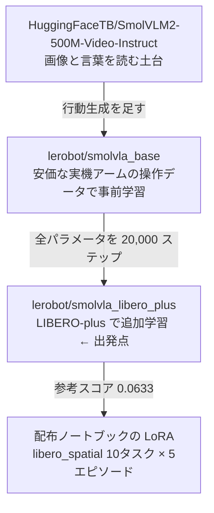

# 01. 出発点の学習済みモデルは何か

配布ノートブックで追加学習を始める前の重みが、**どこで決まっていて、何を見て育ったのか**をまとめる。

これを押さえると、次の 2 つが判断できる。

- **レポートに何を申告するか** — 予選ルール PDF p.14 は「ベースモデル名」「ベース重みの入手元」
  「使用した重みの revision」「学習データのライセンス」を必須項目にしている。未提出だと
  ランキング上位でも本選に行けない（PDF p.23）。
- **どこに学習の余地があるか** — 出発点がすでに何で学習済みかを知らないと、
  追加学習が「同じことをもう一度」になる。

> **この文書の書き方について。** 事実には必ず出典を付けた。
> 「PDF p.9」は予選ルール PDF、「Q&A No.20」は質問スプレッドシートの CSV、
> それ以外は web 上の一次資料か、重みに同梱されている設定ファイルである。
> リポジトリ内の他の `.md` は出典にしていない。

## 運営はモデルを指定していない

まず前提として、**予選ルール PDF にモデル名は一度も出てこない**。全 23 ページを確認した。

配布物として挙がっているのは次の 4 つだけである（PDF p.9）。

| 提供物 | 中身 |
|---|---|
| 提出用 Policy サーバー | 「現在実装しているのはランダムポリシー」と明記。**重みは入っていない** |
| 評価環境 | LIBERO Plus / ロボットは Franka Emika Panda |
| Track1 の Example シナリオシート | [compe/t1/T1_TASKS.csv](../../compe/t1/T1_TASKS.csv)（4 タスク） |
| Google Colab の学習例 | [examples/smolvla_libero_spatial_lora.ipynb](../../examples/smolvla_libero_spatial_lora.ipynb) |

モデルについての規定は PDF p.18 の一文だけで、**どれを使うかは参加者が決める**。

> 公開モデルは利用できますが，参加者による独自学習が必要です
> ／ 公開されているモデル構造，事前学習済み重み，tokenizer 等は利用できます

つまり「最初から使える学習済みモデル」とは、運営が指定したものではなく、
**配布ノートブックが出発点として選んでいる重み**を指す。

なお、リーダーボードに常時表示されている運営のスコアについて、Q&A No.20 で
「**本選に進んだ際に、運営が配布する予定のモデル**の性能」であり
「モデル・学習の詳細については現時点ではお答えできません」と回答されている。
本選用の配布モデルは別に存在するが、中身は非公開である。

## 出発点はノートブックの中で決まっている

具体的な指定は、配布ノートブックの中に直接書かれている。

```python
BASE_MODEL_REPO     = "lerobot/smolvla_libero_plus"
BASE_MODEL_REVISION = "7bb70aa5bc92b82c9239142775d3a173103567ff"
DATASET_REPO        = "lerobot/libero_plus"
DATASET_REVISION    = "f3f49f426d75030177b18778374005bc12ccd588"
```

この `lerobot/smolvla_libero_plus` が、追加学習を始める前のモデルである。

## その重みは 3 段重ねでできている



### 段① SmolVLM2-500M-Video-Instruct

画像と言葉を扱う土台で、画像側は SigLIP、言葉側は SmolLM2 でできている。
SmolVLA では推論を軽くするため、この層のうち**前半 16 層だけ**を使う
（採点ログにも `Reducing the number of VLM layers to 16` と出る）。

### 段② lerobot/smolvla_base — 何を見て育ったか

ここが一番知りたいところで、リポジトリ内には記載がない。SmolVLA 論文（arXiv:2506.01844）
の 3.2 節に書かれている。

| 項目 | 値 |
|---|---|
| データ量 | **481 データセット / 22,900 エピソード / 1,060 万フレーム** |
| 出所 | HuggingFace に**有志が投稿した実機データ**。研究室から個人宅まで |
| ロボット | 主に **SO-100 / SO-101**（3D プリントで作れる 6 自由度の安価なアーム） |
| 指示文の手当て | `task desc` や `Hold` のような雑な注釈を Qwen2.5-VL-3B-Instruct で書き直した |
| カメラの手当て | 名前の付け方がバラバラなので、手作業で top / wrist / side の順に並べ直した |

**押さえておくべきは、事前学習にシミュレータのデータが一切入っていないこと。**
論文では LIBERO や Meta-World は評価側で使われており、学習コーパスは実機のテレオペ操作だけである。

### 段③ lerobot/smolvla_libero_plus — 追加学習の中身

重みと一緒に配布される `train_config.json` に、学習時の設定がそのまま残っている。
以下は revision `7bb70aa5` の実物を確認した値である。

| 項目 | 値 |
|---|---|
| 元の重み | `lerobot/smolvla_base` |
| 学習データ | `pepijn223/libero_plus_lerobot`（= `lerobot/libero_plus`） |
| ステップ数 / バッチ | 20,000 / **32** |
| 学習対象 | `freeze_vision_encoder=false`, `train_expert_only=false`, `use_peft=false`<br/>→ **画像を読む側も含めて全パラメータ** |
| action chunk | 50 |
| 画像の水増し | 無効（`image_transforms.enable=false`） |
| ライセンス | Apache-2.0 |

学習に使われた `lerobot/libero_plus` の中身（HuggingFace の `meta/info.json`）。

| 項目 | 値 |
|---|---|
| エピソード数 | **14,347** |
| フレーム数 | 2,238,036 |
| タスク数 | 40 |
| フレームレート | 20 fps |
| ロボット | `panda`（＝評価環境と同じ Franka） |
| カメラ | `front` と `wrist` の 256 × 256 |

**variant** = 元のタスク 1 つに摂動を 1 つ当てたもの（`.bddl` 1 個）。初期配置は元タスクのものを共有するので、**1 つの variant から最大 50 エピソード作れる。**

このデータの素性は LIBERO-plus 論文（arXiv:2510.13626）にある。元の LIBERO を
**7 種類・21 項目の摂動**（見た目や配置を系統立てて振ること）で拡張して 10,030 個の
variant を作り、そこから **2 万本を超える成功軌道**を自動生成したものである。
7 種類とは、物体配置・カメラ視点・ロボット初期姿勢・言語指示・照明・背景テクスチャ・
センサノイズを指す。

## ここから言えること

**出発点の重みは、評価対象とほぼ同じ分布で、すでに全パラメータが学習済みである。**
安価な実機アームで事前学習したものを、Franka Panda の LIBERO-plus 摂動データ
1.4 万エピソードで丸ごと 2 万ステップ回した状態にある。
配布ノートブックはそこへ libero_spatial の 10 タスク × 5 エピソードで LoRA を足すだけなので、
参考スコアが 0.0633 に留まる（PDF p.8）のは筋が通っている。

**そのまま提出することはできない。** PDF p.18 は「公開重みを実質的に変更せず、
そのまま推論する構成」を独自学習として認めない例に挙げている。何らかの学習が必須である。

**伸びしろを探すときの注意点。** 出発点がすでに画像側まで含めて全部学習済みである以上、
「固定を外す」類の変更は効きにくいと見るべきである。むしろ次の 3 つのずれのほうが、
狙いどころとして具体的である。

| ずれ | 中身 |
|---|---|
| 事前学習にシミュレータが無い | 段②のコーパスは実機のみ。シミュレータ特有の見え方は段③で初めて触れている |
| 学習データは 20 fps・256×256・カメラ 2 台 | 評価側の解像度・カメラ構成と一致するとは限らない（[02_evaluation_data.md](02_evaluation_data.md) 参照） |
| 衝突を避ける学習をしていない | 評価は対象外の物体を 1mm 動かすと失敗になるが、学習データはその条件で選ばれていない |

## 出典と、確認しなおす手順

| 事実 | 出典 | 確認方法 |
|---|---|---|
| 配布物にモデルが含まれない / モデル指定が無い | 予選ルール PDF p.9, p.18 | PDF を読む |
| 本選用の配布モデルは別にあり非公開 | Q&A CSV No.20（西浦） | CSV を読む |
| 出発点の repo と revision | 配布ノートブック本体 | ノートブックの定数を見る |
| 段②の学習データ | SmolVLA 論文 arXiv:2506.01844 §3.2 | 論文 5 ページ目の Table 1 周辺 |
| 段③の学習設定 | `train_config.json`（重みに同梱） | 下のコマンド |
| `lerobot/libero_plus` の規模 | HuggingFace `meta/info.json` | 下のコマンド |
| 摂動 7 種類の定義 | LIBERO-plus 論文 arXiv:2510.13626 / [公式リポジトリ](https://github.com/sylvestf/LIBERO-plus) | 論文を読む |

```bash
# 段③の学習設定を revision 固定で取り直す
curl -s https://huggingface.co/lerobot/smolvla_libero_plus/raw/7bb70aa5bc92b82c9239142775d3a173103567ff/train_config.json \
  | python3 -c "import json,sys; c=json.load(sys.stdin); print(c['policy']['pretrained_path'], c['dataset']['repo_id'], c['steps'], c['batch_size'])"

# 学習データの規模
curl -s https://huggingface.co/datasets/lerobot/libero_plus/raw/main/meta/info.json \
  | python3 -c "import json,sys; c=json.load(sys.stdin); print({k:c[k] for k in ('total_episodes','total_frames','total_tasks','fps','robot_type')})"
```

## まだ確認していないこと

| 事柄 | 確かめ方 |
|---|---|
| `lerobot/smolvla_base` 自身の学習設定 | 同リポジトリに `train_config.json` があるか見る。段②の記述は論文と `config.json` に基づくもので、公開重みが論文どおりの設定で作られたかは未検証 |
| `pepijn223/libero_plus_lerobot` と `lerobot/libero_plus` が同一か | 両者の `meta/info.json` を突き合わせる |
| 学習データ側のカメラ名と、評価側の観測キーの対応 | `LeRobotDatasetMetadata(...).features` と評価パイプラインの観測を並べる |
