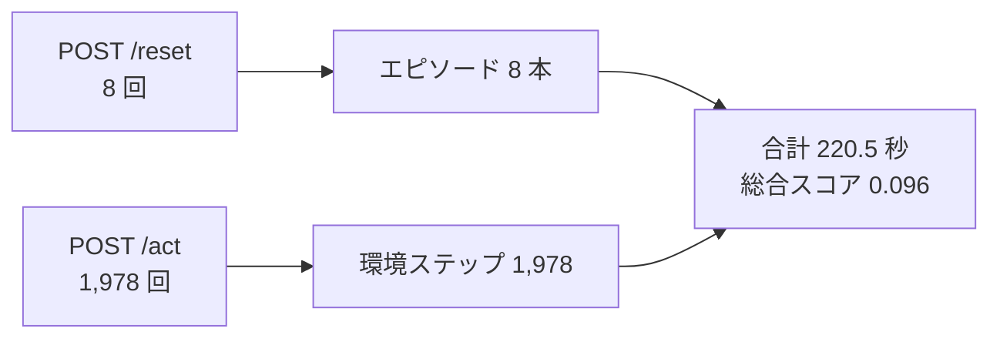
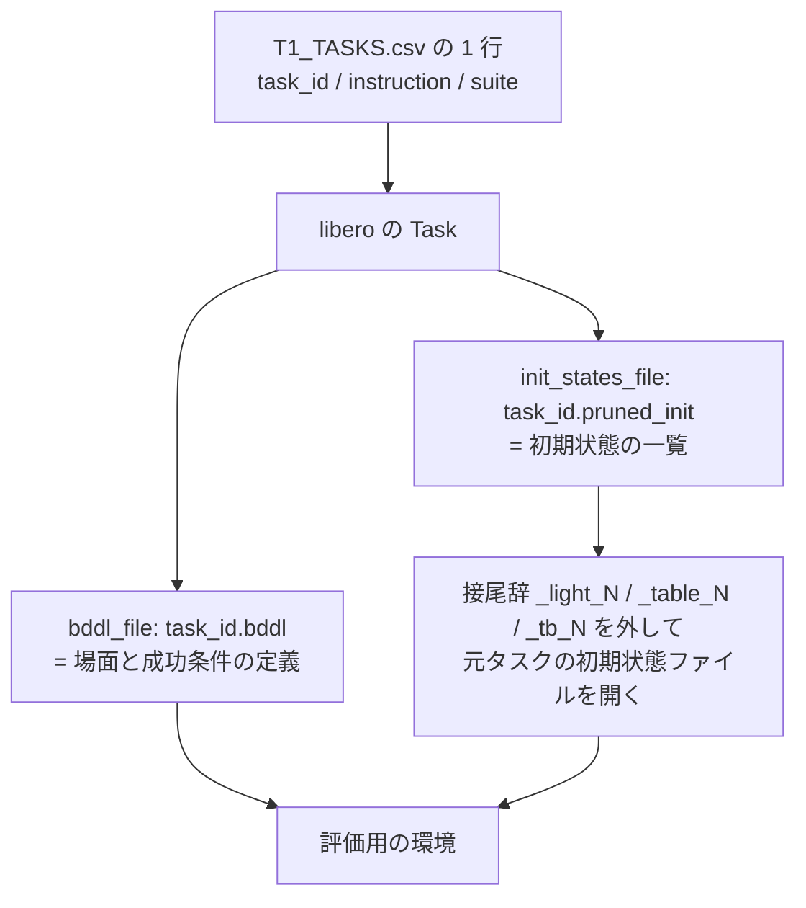

# 02. 本番の評価データは何か

採点で何が出題されるかは非公開である。それでも「どこまでが分かっていて、
どこからが分からないのか」を切り分けておくと、次の 2 つが決まる。

- **手元の検証セットをどう組むか** — 本番と条件がずれた自己評価は、提出物の良し悪しを判断できない。
- **1 日 1 回の提出枠をどう使うか** — 手元で差が出た変更だけを提出に回すための土台になる。

> **この文書の書き方について。** 事実には出典を付けた。「PDF p.11」は予選ルール PDF、
> 「Q&A No.21」は質問スプレッドシートの CSV、「実測」は採点環境から持ち帰った
> ログを数えた値である。リポジトリ内の他の `.md` は出典にしていない。

## 公開されているのは 4 タスクだけ

手元で見られる出題例は [compe/t1/T1_TASKS.csv](../../compe/t1/T1_TASKS.csv) の 4 行しかない。

| # | スイート | 摂動カテゴリ | 難易度 | LIBERO-plus ID |
|---|---|---|---|---|
| 1 | libero_spatial | Background Textures | L3 | 80 |
| 2 | libero_object | Background Textures | L5 | 241 |
| 3 | libero_object | Light Conditions | L2 | 2408 |
| 4 | libero_goal | Light Conditions | L4 | 2467 |

ここで**摂動**とは、元のタスクに対して見た目や配置を系統立てて振ったもののことで、
LIBERO-plus は 7 種類（物体配置・カメラ視点・ロボット初期姿勢・言語指示・照明・
背景テクスチャ・センサノイズ）を定義している。全部で 10,030 個のタスク変種がある。

4 行が触れているのはこのうち **2 カテゴリだけ**である。3 スイートにまたがり、
難易度は L2 から L5 まで散っている。

## 運営が答えた範囲と、答えなかった範囲

出題範囲については Q&A No.21 で正面から質問され、次のように切り分けられた。

| 問い | 回答 |
|---|---|
| 7 カテゴリすべてを含むか | **含まない。** 「同一タスク・同一ドメインにおける、テクスチャなどの摂動」に該当するものが含まれる |
| 難易度は全水準を含むか | 回答できない |
| 元タスクは `lerobot/libero_plus` の 40 タスクの範囲内か | 回答できない |
| 採点ログの `3_Omni` とは何か | 運営がリーダーボード用のタスク群を確認するために付けていたタグ。**結果には影響しない** |

関連して、次の 2 点も公式回答で確定している。

- **`_tb_N` 形式のタスクも出題される**（Q&A No.1）。配布版
  [compe/t1/register.py](../../compe/t1/register.py#L15) の接尾辞除去の正規表現には
  `_tb_<数字>` の分岐が抜けており、該当タスクは手元では初期状態ファイルを開けずに落ちる。
  **本番の実装は修正済み**で、Background Textures の出題が偏ることはない。
  手元で `_tb_N` を検証したい場合は、正規表現を `_light_[^.]*|_(?:table|tb)_\d+` に直す必要がある。
- **タスク数と 1 タスクあたりの試行数は非公開**（Q&A No.3）。
  PDF p.11 の「予選において N は 1 となります」は**運営が誤りと認めた記述**である。

## 採点ログから測れた実際の規模

出題内容は非公開でも、**規模はログから数えられる**。
採点環境から持ち帰った [260810_提出環境での評価結果.md](../prod_eval_results/260810_提出環境での評価結果.md) は
途中省略のない完全なログなので、`/reset` と `/act` の呼び出し回数がそのまま実行回数になる。



エピソードごとのステップ数は次のようになった。

| エピソード | 1 | 2 | 3 | 4 | 5 | 6 | 7 | 8 |
|---|---|---|---|---|---|---|---|---|
| ステップ数 | 300 | 300 | 300 | 300 | 128 | 164 | 300 | 186 |

ここから読み取れることが 3 つある。

**① 1 エピソードの上限は 300 ステップである（推定）。** 8 本のうち 5 本が
ぴったり 300 で止まっている。[pipeline/rollout.py](../../pipeline/rollout.py#L195) の
ループは `range(max_steps_per_episode)` なので、上限に達した本数がこれだけ揃うのは
**本番の `max_steps_per_episode` が 300** だからと考えるのが自然である。
配布キットの既定値は 600 なので、**手元の設定は本番の 2 倍長い**。

**② 1 回の採点で走るのは 8 ロールアウトである。**
[pipeline/rollout.py](../../pipeline/rollout.py#L113) は `n_eval_episodes` 回のループの中で
エピソードごとに `policy.reset()` を呼ぶので、`/reset` の回数がロールアウト数と一致する。
ただし**これがタスク数 × エピソード数のどちらに割れるかはログから分からない**。
8 タスク × 1 本、4 タスク × 2 本、2 タスク × 4 本のいずれもありうる。

**③ 時間には大きな余裕がある。** 220.5 秒 ÷ 1,978 ステップ ≒ **111 ms/step**
（サーバー起動の 38 秒が含まれるなら 92 ms/step）。Q&A No.3 で他の参加者が測った
シミュレータ側の実効値は EGL で 47.5 ms/step なので、推論に使えている時間は
1 ステップあたり 45〜64 ms 程度である。**Track 全体の 1 時間制限に対して 16 倍の余裕**があり、
1 推論あたり 10 秒の制限にも遠い。推論を重くする方向の工夫は、時間の面では取れる。

## 評価データの正体は「非公開の T1_TASKS.csv」

本番の出題は、別のデータ形式で与えられているわけではない。
[compe/t1/register.py](../../compe/t1/register.py) を読むと、
**CSV の各行から LIBERO のタスク定義を組み立てている**ことが分かる。



つまり**本番の評価データ = 非公開の T1_TASKS.csv + LIBERO-plus に同梱の bddl と初期状態ファイル**である。
追加のデータが配られているわけではないので、**同じ形式の CSV を自分で書けば、
手元でも本番と同じ仕組みで任意のタスクを評価できる**。

## エピソードの中身は決まっている

「エピソード」が何を指すかは、実装を見ると曖昧さがない。

| 要素 | 決まり方 |
|---|---|
| 初期状態 | `pruned_init` ファイルの **`ep_id` 番目**を読むだけ。ランダムではない |
| 開始前の処理 | ゼロ入力で 10 ステップ進めて場面を落ち着かせる |
| `seed` | `42 + ep_id` を `policy.reset()` に渡す。**方策側の乱数にしか効かない** |
| 成功判定 | LIBERO 側の成功に加え、**対象外の物体が 1mm を超えて動いていない**ことが条件 |

`--n-episodes` を変えると初期状態の母集団そのものが変わるため、
**本数を変えた結果どうしを直接比べることはできない**。

## 手元の設定を本番に寄せる

配布キットの既定値と、ここまでで分かった本番の条件を並べると次のようになる。

| 設定 | 配布キットの既定値 | 本番 | 出典 |
|---|---|---|---|
| 1 エピソードの上限ステップ | 600 | **300** | 実測（推定） |
| 描画方式 | `MUJOCO_GL=osmesa` | **EGL（GPU 描画）** | Q&A No.3、採点ログ |
| 並列実行 | `n_parallel_envs=20` と宣言 | **逐次実行**（この設定は参照されていない） | Q&A No.3 |
| GPU | — | NVIDIA L4（VRAM 24GB） | PDF p.12 |
| Python / torch | 3.10 / — | 3.10.12 / 2.11.0+cu130、CUDA 13.0 | Q&A No.4 |
| 制限時間 | `gpu_time_limit_sec=3600` | 1 時間（依存導入・サーバー起動・シミュレーション・推論すべて込みの実時間） | PDF p.12、Q&A No.4 |
| 出題タスク | 公開の 4 件 | 非公開。摂動 7 カテゴリの一部 | Q&A No.21 |

自己評価を本番に寄せるなら、**まず上限ステップを 300 に合わせる**のが効く。
600 のままだと、本番なら打ち切られている軌道の続きまで採点してしまう。

## 出典と、確認しなおす手順

| 事実 | 出典 |
|---|---|
| 評価指標と制限時間、GPU | 予選ルール PDF p.11, p.12 |
| 出題カテゴリは 7 種すべてではない / `3_Omni` は無意味 | Q&A CSV No.21（西浦） |
| `_tb_N` も出題される / 配布版の正規表現は不具合 | Q&A CSV No.1（村上） |
| 本番は EGL・逐次実行、タスク数と試行数は非公開、「N=1」は誤記 | Q&A CSV No.3（村上） |
| 1 時間は実時間、採点環境の構成 | Q&A CSV No.4（村上・西浦） |
| 8 ロールアウト / 1,978 ステップ / 上限 300 | [260810_提出環境での評価結果.md](../prod_eval_results/260810_提出環境での評価結果.md) を数えた実測 |
| エピソードと成功判定の決まり方 | [pipeline/rollout.py](../../pipeline/rollout.py) |
| タスクの組み立て方 | [compe/t1/register.py](../../compe/t1/register.py) |

ログから規模を数え直す手順は次のとおり。

```bash
# ロールアウト数とステップ数
grep -c 'POST /reset' docs/260810_提出環境での評価結果.md
grep -c 'POST /act'   docs/260810_提出環境での評価結果.md

# エピソードごとのステップ数（上限に達した本数を見る）
python3 - <<'PY'
counts, cur = [], None
for line in open('docs/260810_提出環境での評価結果.md'):
    if 'POST /reset' in line:
        if cur is not None:
            counts.append(cur)
        cur = 0
    elif 'POST /act' in line and cur is not None:
        cur += 1
counts.append(cur)
print(counts)
PY
```

## まだ確認していないこと

| 事柄 | 確かめ方 |
|---|---|
| 上限 300 ステップが本当に設定値か | 300 ステップで確実に終わらない方策を出し、全エピソードが 300 で止まるか見る |
| 8 ロールアウトの内訳（タスク数 × エピソード数） | ログには出ない。`/reset` に渡る指示文が何種類あるかを提出物側で数えれば分かる |
| 本番のカメラ解像度 | 配布キットの既定値は 128 × 128（`LIBERO_EVAL_CAMERA`）。本番が同じかは未確認。提出物側で受け取った画像の形を記録すれば分かる |
| 合計時間 220.5 秒にサーバー起動の 38 秒が含まれるか | 起動を意図的に遅らせて合計時間の変化を見る |
| スコアの重みと正規化式 | PDF p.11 で非公開と明記されている |
