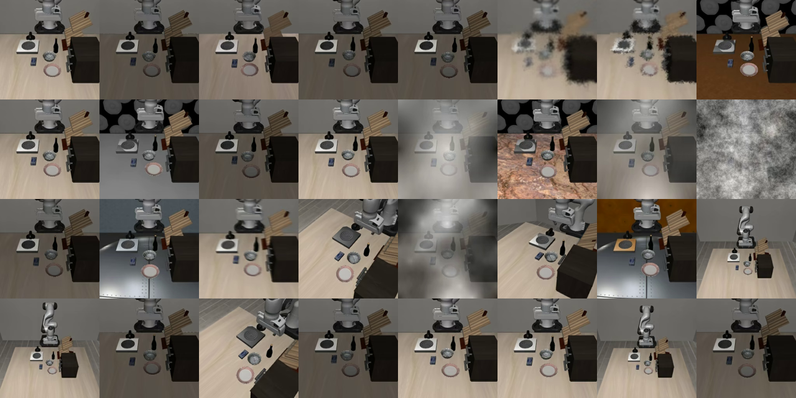
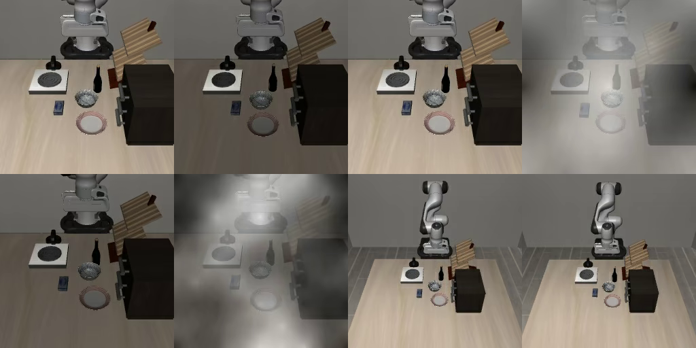

# 06. 学習データ（lerobot/libero_plus）の中身を数えた

**「見た目の摂動に絞って学習できないか」を判定するために、14,347 本の
メタデータを実物で数えた記録である**（2026-08-11）。

数字は引き写していない。**`meta/episodes/**/*.parquet` の写しを読んだ結果**で、
再現の道具は [outputs/tmp/inspect_episodes.py](../../outputs/tmp/inspect_episodes.py) と
[outputs/tmp/probe_ordering.py](../../outputs/tmp/probe_ordering.py) である。

---

## 結論だけ

| 分かったこと | 効くところ |
|---|---|
| **摂動カテゴリで絞る道は無い。** variant 名がどの列にも入っていない | 項目 28。**閉じた** |
| **並び順にも構造が無い。** 窓ごとの明るさの振れ幅が 0.028 | 同上。分類表と突き合わせられない |
| **`Language Instructions` の摂動は入っていない**（指示文が 40 種類しかない） | データは全 variant 10,030 件ではない |
| **見た目が動いている episode は 53.5%。** 分類表の比率（22.1%）の 2.4 倍 | **絞って得られる密度は 1.9 倍。4.5 倍ではない** |
| 明るさは 0.086〜0.723、**0.25〜0.30 と 0.45〜0.50 に山**がある | 明るさで `light` 寄りを選ぶ道は残る |
| **カメラ視点は入っている**（1 タスク 32 エピソード中 7 エピソードが別のカメラ位置） | 最後の節（8/28 追記）。**カメラの学習データをエピソードを足す価値は薄い** |
| **ロボット初期姿勢は、公式の倍率 0.1 相当までしか入っていない**（手先のずれの中央値 1.0 cm・3 cm 超は 0.2%） | 同上。**倍率 0.3 以上は学習データに無い。エピソードを足す余地がある** |

---

## variant 名はどの列にも無い

**62 列のうち 17 列が統計値以外である。** 異なる値の数まで数えた。

| 列 | 異なる値 | variant を特定できるか |
|---|---|---|
| `episode_index` | 14,347 | **× 通し番号** |
| `tasks` | **40** | **× 指示文だけ。`_light_49` と `_table_3` が同じ文字列になる** |
| `length` | 254 | × 長さ |
| `data/chunk_index` / `file_index` | 1 / 2 | × parquet の位置 |
| `videos/…front/file_index` | **40** | **× タスクごとに 1 ファイル。variant では分かれていない** |
| `videos/…wrist/file_index` | 36 | 同上 |
| `dataset_from_index` / `to_index` | 14,347 | × コマの範囲 |
| `stats/*`（45 列） | — | **△ 明るさなどの統計値。代理には使える** |

**`_light_N` / `_table_N` / `_tb_N` / `_noise_N` で選ぶ道は無い。**

## 並び順にも構造が無い

**`episode_index` を 1,000 本ずつの窓で切って、明るさの平均を並べた。**
固まっていれば「摂動が連続して入っている」ことになり、分類表と順番で
突き合わせられる。

| 窓 | 明るさの平均 | 0.35 未満の割合 |
|---|---|---|
| 0〜1,000 | 0.412 | 32.3% |
| 7,000〜8,000 | 0.413 | 33.3% |
| 13,000〜14,000 | 0.414 | 33.0% |
| **振れ幅** | **0.028** | — |

**完全に混ざっている。** タスクごとに見ても、`episode_index` が連続している
タスクは **40 件中 0 件**である（1 タスクの本数は 146〜500、中央 385）。

## 全 variant 10,030 件が入っているわけではない

**指示文が 40 種類しかない。** `Language Instructions` の摂動（1,537 件）は
**LLM で言い換えたもの**なので、入っていれば 40 より多くなるはずである。

**variant** = 元のタスク 1 つに摂動を 1 つ当てたもの（`.bddl` 1 個）。初期配置は元タスクのものを共有するので、**1 つの variant から最大 50 エピソード作れる。**

**つまり「14,347 本が variant 10,030 件に比例して散っている」という仮定は崩れた。**
密度の見積もりをこの仮定に乗せてはいけない。

## 見た目が動いている episode は 53.5%

**明るさ（`stats/observation.images.front/mean`）の分布に山が 2 つある。**

| 区間 | 本数 | 割合 | |
|---|---|---|---|
| 0.15〜0.25 | 1,128 | 7.9% | |
| **0.25〜0.30** | **2,870** | **20.0%** | **`light` の外部計測 0.287 と一致** |
| 0.30〜0.45 | 2,511 | 17.5% | `table`/`tb` の外部計測 0.405 の辺り |
| **0.45〜0.55** | **6,665** | **46.5%** | **いちばん大きい山。普通の見た目と見る** |
| 0.55〜0.72 | 1,111 | 7.7% | 明るい側 |

**「普通の見た目」を 0.45〜0.55 とみなすと、外れているのは 53.5% である。**

| | 見た目が動いている割合 |
|---|---|
| 分類表（10,030 件）での `light` ＋ `table`/`tb` | **22.1%** |
| **この学習データ（14,347 本）** | **53.5%** |

**2.4 倍多い。** データは分類表の比率どおりではなく、
**見た目の摂動を多めに含んでいる。**

### だから「絞る」の得は小さい

| | 見た目の摂動の割合 | エピソード | 20,000 ステップ × 32 での 1 コマ |
|---|---|---|---|
| 全部使う | **53.5%** | 14,347 | **0.29 回**（出発点と同じ） |
| 明るさで絞る | 100% | 約 7,700 | **0.53 回（2 倍の繰り返し）** |

**密度は 1.9 倍にしかならない**（4.5 倍にはならない）。
**しかもデータが半分になるので、1 コマを見る回数が 2 倍になる** ——
**4 回目の提出で 8.8 倍悪化した原因がこれである。**

> **絞るより拡張のほうが筋がよい。** 拡張は
> **同じコマを違う見た目で何度も見せる**ので、データを減らさずに
> 「見た目に左右されないこと」を学ばせられる。
> **出発点は拡張を使っていない**（`train_config.json` の
> `image_transforms.enable: false`）ので、**ここは本当に手つかずである。**

## 再現の手順

```bash
# GPU マシンから写す（統計値だけ。14 MB）
cp -L ~/.cache/huggingface/hub/datasets--lerobot--libero_plus/snapshots/*/meta/episodes/chunk-000/file-000.parquet \
      outputs/tmp/libero_plus_episodes.parquet

# pyarrow だけで足りる（pandas は要らない）
python3 outputs/tmp/inspect_episodes.py outputs/tmp/libero_plus_episodes.parquet
python3 outputs/tmp/probe_ordering.py  outputs/tmp/libero_plus_episodes.parquet
```

> **`find … -type f` では見つからない。** `meta/episodes/**/*.parquet` は
> HF のキャッシュの `blobs/` へのシンボリックリンクである。
> `find … \( -type f -o -type l \)` か `ls -R` を使う。

## 出典

| 事実 | 出典 |
|---|---|
| 列の一覧・異なる値の数・明るさの分布・並び順 | `meta/episodes/chunk-000/file-000.parquet`（revision `f3f49f42`）を数えた |
| 分類表の 7 カテゴリと件数 | [05_perturbation_categories.md](05_perturbation_categories.md) |
| `light` 0.287 / `table`・`tb` 0.405 の目安 | 外部で共有された EDA（[04_track1_population.md](04_track1_population.md)） |
| 出発点が拡張を使っていないこと | `work/artifacts/model_weights.bak/train_config.json` |

---

## 本選で配布された 6 つのデータセットを数えた（2026-08-25 追記）

**本選では `~/dataset/` に複数のデータセットが tar で配られている。** どれを使うかを
決めるために、公開されている同じものの `meta/info.json` を 1 つずつ読んで数えた。

| データセット | fps | エピソード | コマ | タスク | 1 本の平均コマ |
|---|---|---|---|---|---|
| `libero_spatial_no_noops` | 20 | 432 | 52,970 | 10 | 122.6 |
| `libero_object_no_noops` | 20 | 454 | 66,984 | 10 | 147.5 |
| `libero_goal_no_noops` | 20 | 428 | 52,042 | 10 | 121.6 |
| **`libero_10_no_noops`** | 20 | 379 | 101,469 | 10 | **267.7** |
| `libero_90_no_noops` | 20 | 3,921 | 569,249 | **73** | 145.2 |
| **`Sylvest/libero_plus`（いま使っているもの）** | 20 | **14,347** | **2,238,036** | **40** | 156.0 |

**読み方が 4 つある。**

**(1) 6 つとも fps は 20 である。** つまり **「20Hz で統合した」は変換の説明ではなく、
素材がもともと全部 20 Hz だという言明**と読める。1 コマ 0.05 秒で、
評価ハーネスの制御周期（`LIBERO_CONTROL_FREQ` の既定 20・`dt` は 0.05 固定）と一致する。
**学習と評価で時間の刻みがそろっているので、1 歩で進む距離の意味が同じである。**

**(2) `no_noops` は「動いていないコマを抜いた版」である。** 行動がほぼゼロのステップを
落としてある。落とさないと、方策が「止まっていること」まで覚える。

**(3) `libero_10` だけ 1 本が飛び抜けて長い（267.7 コマ）。** 他は 120〜150 コマである。
**300 歩の打ち切りに対して、この長さは余裕が無い。** Track3 の課題（置いてあるものを
取って机に置く、という 2 段構えのもの）も同じ長さの帯に入ると見込まれるので、
**長い課題を学ぶなら `libero_10` と `libero_90` に入っている。**

**(4) 標準スイート 4 つの 40 タスクは、`libero_plus` の 40 タスクと同じものである。**
`libero_plus` は spatial・object・goal・10 の 40 タスクに摂動を掛けて作られている
（variant は 10,030 個だが、指示文は 40 種しかない。この文書の上の節）。
**したがって「統合」してもタスクの種類は増えない。増えるのは `libero_90` を入れたときだけである。**

### `libero_combined_20hz` が何を含むかは、数を見れば判別できる

配布物の `libero_combined_20hz` の中身は現物を見ていない。**ただし取りうる組み合わせは
限られるので、`total_tasks` と `total_frames` を見れば判別できる。**

| 中身の仮説 | タスク | エピソード | コマ |
|---|---|---|---|
| `libero_plus` だけ | 40 | 14,347 | 2,238,036 |
| **`libero_plus` ＋ 標準スイート 4 つ** | **40**（増えない） | 16,040 | 2,511,465 |
| **`libero_plus` ＋ 標準スイート 4 つ ＋ `libero_90`** | **113** | 19,961 | 3,080,714 |

**確かめる手順（tar を全部展開しなくてよい）。**

```bash
# tar の中の info.json だけを取り出して読む
tar xf ~/dataset/lerobot/libero_combined_20hz.tar -O '*/meta/info.json' \
  | python3 -c "import sys,json; d=json.load(sys.stdin); \
    print({k: d[k] for k in ('fps','total_episodes','total_frames','total_tasks')})"

# 指示文の一覧を見る（v2.1 は jsonl・v3.0 は parquet）
tar tf ~/dataset/lerobot/libero_combined_20hz.tar | grep -E 'meta/tasks\.(jsonl|parquet)'
```

**tar の名前と中の階層は現物で違う可能性がある。** まず `tar tf … | head` で並びを見ること。

### `libero_90` のタスク数が 73 になっている

**課題の定義ファイルは 91 個ある**（手元の `work/LIBERO-plus/libero/libero/bddl_files/libero_90/`
を数えた）のに、データセットの `total_tasks` は **73** である。
**指示文が同じ課題が複数のシーンにあり、指示文で数えると重複が落ちるためだと考えられる**
（lerobot 形式は指示文を単位にタスクを数える）。**未確認である。**
Track3 対策で `libero_90` を混ぜるときは、**課題 91 個ぶんの多様さがあるが、
指示文としては 73 種類**という理解で使う。

---

## カメラ視点と初期姿勢が入っているかを、中身から測った（2026-08-28 追記）

**上の節で「variant 名はどの列にも無い」と結論している。**だから
「カメラ視点の摂動が何本入っているか」をメタデータから引くことはできない。
明るさで読めるのは照明と背景までで、**カメラの位置とロボットの初期姿勢は明るさに出ない。**

**そこで中身から測った。カメラは画像、初期姿勢はフレーム 0 の状態である。**

| 軸 | 何を見たか | 結果 |
|---|---|---|
| **カメラ視点** | エピソードの 1 枚目の front 画像を並べて目視 | **32 エピソード中 7 エピソードが別のカメラ位置。入っている** |
| **ロボット初期姿勢** | フレーム 0 の手先位置の、タスク内での散らばり | **中央値 1.0 cm・3 cm 超は 0.2%。公式の倍率 0.1 相当までしか入っていない** |

### カメラ視点は入っている

**`turn on the stove`（500 エピソード）から 32 エピソードを等間隔に抜き、
各エピソードの 1 枚目の front 画像を並べた。**



**32 エピソードのうち 7 エピソードが明らかに別のカメラ位置である**（数は目視）。
方位角が大きく振れているものも含む。残りは背景の張り替え・照明・雑音だった。
**この 1 タスクだけで、カメラを振ったエピソードが 500 × 7/32 ≒ 110 エピソードある。**

拡大した 8 エピソードぶんはこちら（左上から 2 番目が背景の張り替え、
4 番目と 6 番目が照明、右下 2 つが別のカメラ位置）。



### ロボット初期姿勢は、いちばん弱い段階しか入っていない

**フレーム 0 の `observation.state` の先頭 3 つが手先の位置である**
（[10_observation_interface.md](10_observation_interface.md) の
「state は LeRobot 側が 8 次元に組む」——位置 3 ＋ 軸角 3 ＋ グリッパ 2）。
**タスクが違えば場面も違うので、タスクの中央値からの距離で見る。**

| タスクごとの値 | 最小のタスク | 中央のタスク | 最大のタスク |
|---|---|---|---|
| 中央値 | 0.80 cm | **1.00 cm** | 1.29 cm |
| 90 パーセンタイル | 1.40 cm | **1.79 cm** | 2.33 cm |
| 最大 | 1.78 cm | **2.36 cm** | 3.66 cm |

**40 タスク平均で、1 cm を超えるのが 49.9%、3 cm を超えるのは 0.2% である。**

**比べる相手は、公式の摂動が手先を何 cm 動かすかである。**
`_view_0_0_100_0_0_initstate_<番号>` で環境を作り、`set_init_state` のあと
評価ハーネスと同じ空撃ち 10 ステップを踏んでから `robot0_eef_pos` を読み、
番号 0（摂動なし）との距離を取った。**各段階 20 姿勢・合計 100 姿勢、失敗 0 件。**

| 倍率 | 手先のずれの中央値 | 最小 | 最大 |
|---|---|---|---|
| **0.1** | **1.00 cm** | 0.39 cm | 2.08 cm |
| **0.2** | **2.51 cm** | 0.74 cm | 5.24 cm |
| 0.3 | 3.83 cm | 1.75 cm | 6.52 cm |
| 0.4 | 4.70 cm | 1.03 cm | 9.84 cm |
| 0.5 | 5.72 cm | 2.69 cm | 14.58 cm |

**学習データの中央値 1.00 cm は、倍率 0.1 の中央値 1.00 cm と一致する。**
学習データの最大 3.66 cm は倍率 0.2 の帯の中にあり、**倍率 0.3 以上（中央値 3.8 cm 以上）に
当たるエピソードは 0.2% しか無い。**

**つまり「初期姿勢もカメラと同じように入っている」は成り立たない。**
入っているのはいちばん弱い段階だけである。

### 倍率は難しさの目安にならない

**同じ倍率でも、向きによって手先のずれが 10 倍違う。** 倍率 0.4 は 1.03〜9.84 cm で、
**下端は倍率 0.1 の上端（2.08 cm）より小さい。** 帯は互いに大きく重なっている。

**向きそのものには偏りが無い。** 100 姿勢の手先のずれを単位ベクトルにして平均すると
長さ 0.077（0 なら偏り無し）で、奥／手前・左／右・上／下がそれぞれ 47〜53 件に割れる。
**足りないのは向きの多様さではなく、届く距離である**（いちばん強い倍率 0.5 でも中央値 5.7 cm）。

### 確認したい仮定

| 仮定 | 外れたら何が変わる |
|---|---|
| **学習データのフレーム 0 が、動き出す前の姿勢である** | `no_noops`（動いていないコマを抜いた版）なら、フレーム 0 は既に動き始めた後である。**その場合、上の 1.0 cm には「摂動」と「動き出した分」が混ざる**——混ざっているなら、摂動の実際の幅は 1.0 cm より小さい。結論の向きは変わらない |
| **32 エピソードの抜き取りが 14,347 エピソード全体を代表している** | 1 タスク・1 スイートしか見ていない。カメラを振ったエピソードが偏って入っているなら、抜けているタスクを狙ってエピソードを足す価値が戻る |
| **学習データのカメラの振れ幅が、評価で崩れる方位角 ±45〜60° を含んでいる** | 含んでいなければ、その角度だけを狙ってエピソードを足すことに意味がある。**variant 名が残っていないので、角度は画像からしか読めない** |

### 再現の手順

```bash
# ロボット初期姿勢（parquet だけで足りる。GPU もコンテナも要らない）
python3 solution/tools/analysis/measure_train_data_perturbation.py pose \
    --root ~/.cache/huggingface/lerobot/lerobot/libero_plus

# カメラ視点のタイル画像（動画を読むので av が要る。parc2026-train-pi05 の中にある）
python3 solution/tools/analysis/measure_train_data_perturbation.py camera \
    --root /hf_home/lerobot/lerobot/libero_plus --task "turn on the stove" \
    --count 32 --output docs/figures/libero_plus_camera_32ep.png
```

**公式の摂動が手先を何 cm 動かすかの実測は、シミュレータが要る**ので
`parc2026` イメージのコンテナの中で回す。**止まっているコンテナは `docker start` で起こせる**
（このマシンから通らないのは `docker run` だけである）。

## タスク・指示文・シーン・エピソード・コマの対応関係（2026-09-07 追記）

**自分で作ったデータを何本足すかを決めるための数字である。**数えたのは
`libero_combined_20hz`（**19,533 本 / 3,028,708 コマ / 指示文 111 種**）と、
`LIBERO-plus` の bddl ファイル。

### 5 つの層があり、**1 対 1 なのは 2 か所だけ**

```
タスク(task_index) ─1:1─ 指示文 ─1:N─ シーン(bddl) ─N:M─ エピソード ─1:N─ コマ
```

| 対応 | 実測 |
|---|---|
| `task_index` : 指示文 | **1 : 1**（どちらも 111。`meta/tasks.parquet` で確認） |
| エピソード : 指示文 | **N : 1**（1 本に指示文はちょうど 1 つ。例外 0 件） |
| **指示文 : シーン（bddl）** | **1 : N。N は 1 か 203 の二択**（次節） |
| 指示文 : エピソード | 1 : 34〜599（中央 **49**、平均 176） |
| エピソード : コマ | 1 : 58〜505（中央 **139**） |

### **「1 指示文あたり 34〜599 本」の二山は、シーン数の違いである**

**指示文が同じでもシーンは 1 つとは限らない。**`LIBERO-plus` の bddl を数えると:

| スイート | bddl ファイル | 1 指示文あたりのシーン |
|---|---|---|
| `libero_90` | 90 | **1**（摂動版が無い） |
| `libero_10` / `goal` / `object` / `spatial` | 各 2,030 | **203**（`_add_1`…`_add_N` などの摂動版） |
| `libero_mix` | 8,120 | 上記の混合 |

**これで二山が説明できる。**

| 由来 | 1 指示文あたりのシーン | 1 指示文あたりの本数 | 該当タスク数 |
|---|---|---|---|
| `libero_90` | **1** | **34〜99 本** | **68** |
| 標準スイート（摂動あり） | **203** | **400〜599 本** | **25** |

つまり **34〜599 本の 17.6 倍の振れは「同じ場面の反復回数の差」ではなく、
「いくつの場面に散っているかの差」である。**摂動側は 1 シーンあたり 2〜3 本しか
無く、`libero_90` 側は 1 シーンに 34〜99 本ある。

### 我々の逆向きデータの構造は `libero_90` 側と同じ

```
指示文 1 ── シーン 1 ── エピソード 100〜150 ── 1 本 171〜176 コマ
                 ↑
       順方向デモ 2〜3 本 × 配布 init 50 行
```

| | 指示文 | シーン | エピソード | 1 本のコマ | **元になった動きの種類** |
|---|---|---|---|---|---|
| 本（我々） | 1 | 1 | **150** | 176 | **3**（順方向デモ 3 本） |
| 缶（我々） | 1 | 1 | **100** | 171 | **2** |
| 赤マグ（我々） | 1 | 1 | **139** | 174 | **3** |
| `libero_90` の同じタスク | 1 | 1 | 34〜44 | 145 | **34〜44**（人のデモ 1 本ずつ） |

**本数では多すぎない。**`libero_90` 側（1 シーン 34〜99 本）と同じ枠で見て
100〜150 本なので、2〜3 倍でしかない。全体に対しては本数 2.0% / コマ数 2.2%。

**多すぎるのは本数ではなく「同じ動きの反復」である。**150 本の中に**元の動きは
3 通りしかない**（順方向デモ 3 本を 50 通りの初期配置に掛け直したもの）。
`libero_90` は 44 本が 44 通りの人のデモである。**運搬の軌道は 50 本で共有され、
違うのは接近と設置の区間だけになる。**

**だから打つ手は「間引く」ではなく「順方向デモを増やす」である。**手元にある
順方向デモの本数は次のとおりで、使っているのはごく一部にすぎない。

| 元タスク | 順方向デモ | 使った本数 |
|---|---|---|
| 本 | 44 | 3 |
| 缶 | 44 | 2 |
| 赤マグ | 34 | 3 |
| two mugs | **313** | 20 抜いて 8 |

デモを増やせば**エピソード数を増やさずに動きの種類だけ増やせる**（デモ 10 本 ×
init 5 行 = 50 本、など）。掴む姿勢の網羅の面でも増やす理由がある
（[reference/30 の 6 節](30_reverse_grasp_pose.md)）。

### two mugs だけ順方向が 203 シーンに散っている

two mugs の元タスクは **`libero_90` ではなく `libero_10`** にある
（`libero_10` と `libero_mix` に 203 個ずつ、計 406 個の bddl）。デモ 313 本が
**203 シーンに散っている**ので、1 シーンあたり 1〜2 本しかない。

**これが「20 本抜いて 10 本しか再生が再現しない」理由である。**こちらは全部を
**1 つの bddl**（016 が組み立てた素のシーン）で再生しているが、デモは別々の
摂動シーンで録られている。**歩留まりが半分なのは想定内で、デモを多く抜けば
そのぶん使える。**（どのエピソードがどの variant かを示す列は無い——
この文書の上の節）