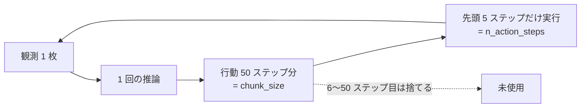

# 07. 学習後に変えてよい設定はどれか

`n_action_steps` を 50 から 5 へ縮めるとスコアが 0.058 → 0.1409 になった
（[../strategy/05_実測結果.md](../strategy/05_実測結果.md)）。**この設定値は重みを
学習し直さずに変えている。** そこで当然こう疑いたくなる。

> 学習時は 50 の想定だったのに、推論で 5 にして、重みと食い違わないのか。

答えは**食い違わない**。ただし隣にある `chunk_size` は**学習後に変えてはいけない**。
似た名前で、片方は自由、片方は禁止という分かれ方をしている。

これを押さえると次の 2 つが決まる。

- **重みを作り直さずに詰められる範囲** — `n_action_steps` を動かす分には再学習が要らない。
- **踏んではいけない一線** — `chunk_size` を触ると重みが黙って別物になる。

> **この文書の書き方について。** 根拠はすべて LeRobot v0.6.0 のソースの行番号で示した。
> 学習側も提出物側も同じ v0.6.0 を使っている（[../../solution/train/Dockerfile](../../solution/train/Dockerfile)
> の `LEROBOT_TAG=v0.6.0`、提出物は `vendor_lerobot.py` が同じタグから同梱する）。
> リポジトリ内の他の `.md` は根拠にしていない。再確認する手順は末尾にある。

## 2 つの値は何を決めているか

SmolVLA は 1 回の推論で**未来 50 ステップ分の行動列**をまとめて作る。この行動列を
**chunk**（かたまり）と呼ぶ。2 つの値は、この chunk の別々の側面を指している。



| | `chunk_size` | `n_action_steps` |
|---|---|---|
| 決めているもの | **1 回で何ステップ分作るか** | 作った分のうち**何ステップ実行してから作り直すか** |
| 既定値 | 50 | 50 |
| 学習後に変えて | **駄目** | **よい** |

## 変えてよい理由：`n_action_steps` はモデルの外側にある

`n_action_steps` が現れるのは**推論の 2 か所だけ**で、どちらもモデルが出した結果を
あとから切り取っているにすぎない。

| 場所 | やっていること |
|---|---|
| [modeling_smolvla.py:254](https://github.com/huggingface/lerobot/blob/v0.6.0/src/lerobot/policies/smolvla/modeling_smolvla.py#L254) | 行動を溜めるキューの長さ（`deque(maxlen=...)`） |
| [modeling_smolvla.py:348](https://github.com/huggingface/lerobot/blob/v0.6.0/src/lerobot/policies/smolvla/modeling_smolvla.py#L348) | 生成した行動列の**先頭から何本キューへ積むか** |

積む行を抜き出すとこうなっている。

```python
self._queues[ACTION].extend(actions.transpose(0, 1)[: self.config.n_action_steps])
```

`actions` は既に生成し終えた 50 ステップ分で、`[: n_action_steps]` はその**リストのスライス**である。
モデルはどちらの値でも同じ 50 ステップを計算しており、変わるのは**キューへ積む本数**だけである。
キューが空になったら次の推論が走る（`_check_get_actions_condition`）ので、
5 にすれば 5 ステップごとに観測を見直すことになる。

**学習の経路にはこの値が一度も出てこない。** 損失を計算する
[`SmolVLAPolicy.forward`](https://github.com/huggingface/lerobot/blob/v0.6.0/src/lerobot/policies/smolvla/modeling_smolvla.py#L358)
と [`VLAFlowMatching.forward`](https://github.com/huggingface/lerobot/blob/v0.6.0/src/lerobot/policies/smolvla/modeling_smolvla.py#L774)
を通しで読んで確認した。学習の入り口
（[scripts/lerobot_train.py](https://github.com/huggingface/lerobot/blob/v0.6.0/src/lerobot/scripts/lerobot_train.py)）
にも出てこない。

つまり **`n_action_steps` は重みの中身に何の痕跡も残していない。** 重みと食い違いようがない。

制約は 1 つだけで、`chunk_size` を超えられない
（[configuration_smolvla.py:113](https://github.com/huggingface/lerobot/blob/v0.6.0/src/lerobot/policies/smolvla/configuration_smolvla.py#L113)）。

```python
if self.n_action_steps > self.chunk_size:
    raise ValueError(...)
```

5 ≤ 50 なので通る。**作った以上のステップ数は実行できない**、という当たり前の話である。

## 変えてはいけない理由：`chunk_size` はモデルの形そのもの

こちらは学習にも推論にも、しかも**層の形とデータの読み方**に効く。

| 場所 | やっていること | いつ効くか |
|---|---|---|
| [configuration_smolvla.py:155](https://github.com/huggingface/lerobot/blob/v0.6.0/src/lerobot/policies/smolvla/configuration_smolvla.py#L155) | `action_delta_indices = range(chunk_size)` — **データセットから 1 サンプルで何ステップ分読むか** | 学習 |
| [modeling_smolvla.py:767](https://github.com/huggingface/lerobot/blob/v0.6.0/src/lerobot/policies/smolvla/modeling_smolvla.py#L767) | `att_masks += [1] * chunk_size` — 注意マスクの長さ | 学習・推論 |
| [modeling_smolvla.py:805](https://github.com/huggingface/lerobot/blob/v0.6.0/src/lerobot/policies/smolvla/modeling_smolvla.py#L805) | `suffix_out[:, -chunk_size:]` — **損失を取る範囲** | 学習 |
| [modeling_smolvla.py:827](https://github.com/huggingface/lerobot/blob/v0.6.0/src/lerobot/policies/smolvla/modeling_smolvla.py#L827) | `actions_shape = (bsize, chunk_size, max_action_dim)` — 生成するテンソルの形 | 推論 |

`action_delta_indices` は
[datasets/factory.py:59](https://github.com/huggingface/lerobot/blob/v0.6.0/src/lerobot/datasets/factory.py#L59)
で `delta_timestamps` に変換され、データセットが 1 サンプルにつき何時点分の行動を
返すかを決める。**`chunk_size` を変えると学習データの形自体が変わる。**

さらに厄介なのは、**変えても例外にならない**点である。行の長さが変わるだけなので
`from_pretrained()` は通り、生成も走る。50 ステップ分の教師で育った重みに 20 ステップ分の
入力を流す、という状態が**黙って**成立する。

## いま何をしているか

`merged_model/config.json` の `n_action_steps` は **50 のまま**で、これは正しい。
提出物側が重みを読んだ**あとに**上書きしているためである
（[../../solution/policy_server.py:159](../../solution/policy_server.py#L159)）。

```python
config = PreTrainedConfig.from_pretrained(weights)                        # ← 50 が入る
config.n_action_steps = int(os.environ.get("PARC_N_ACTION_STEPS", "5"))   # ← 5 で上書き
```

**重み側の値は読まれないので、書き換える必要はない。** 実際に効いた値は採点ログの
この行で確認できる。

```
[parc] policy_server 0.3.0  device=cuda  n_action_steps=5  ema_alpha=0.3  blend_steps=0  samples=1
```

学習側は `chunk_size = n_action_steps = 50` の既定のままである
（`checkpoints/020000/pretrained_model/train_config.json` で確認）。

## 残っている無駄：学習は 50 ステップ分すべてを等しく教えている

不整合ではないが、**割に合っていない**ところがある。損失は 50 ステップ分すべてに
等しくかかる（`suffix_out[:, -chunk_size:]` の全体を `F.mse_loss` に通す）のに、
本番で実行するのは先頭 5 ステップだけである。**6〜50 ステップ目を上手くする学習の労力は、
本番では使われない。**

詰めるなら選択肢は 2 つある。

| やり方 | 効きそうなところ | 副作用 |
|---|---|---|
| `chunk_size` を小さくして学習し直す | 先頭数歩に学習が集中する | 初期重み `lerobot/smolvla_libero_plus` は 50 で学習済み。そこから形を変える影響が読めない |
| 損失に先頭重みを付ける | 同上。`chunk_size` は保てる | LeRobot の `forward` に手を入れることになる |

**どちらも急ぎではない。** 実測で n=5 が最良（0.1409）で、いまの失敗の主因は
衝突（[../strategy/05_実測結果.md](../strategy/05_実測結果.md)）だからである。
先に潰すものが他にある。

## 再確認する手順

上の行番号は次のコマンドで引き直せる。

```bash
cd /tmp
for f in configuration_smolvla modeling_smolvla; do
    curl -sSL -O "https://raw.githubusercontent.com/huggingface/lerobot/v0.6.0/src/lerobot/policies/smolvla/$f.py"
done

grep -n "chunk_size\|n_action_steps" configuration_smolvla.py modeling_smolvla.py
```

出るのはこの 11 行である（2026-08-11 に確認）。

```
configuration_smolvla.py:29:    chunk_size: int = 50
configuration_smolvla.py:30:    n_action_steps: int = 50
configuration_smolvla.py:113:        if self.n_action_steps > self.chunk_size:
configuration_smolvla.py:116:                f"...n_action_steps...chunk_size..."
configuration_smolvla.py:155:        return list(range(self.chunk_size))
modeling_smolvla.py:254:            ACTION: deque(maxlen=self.config.n_action_steps),
modeling_smolvla.py:346:            # ...(コメント)
modeling_smolvla.py:348:            self._queues[ACTION].extend(actions.transpose(0, 1)[: self.config.n_action_steps])
modeling_smolvla.py:767:        att_masks += [1] * self.config.chunk_size
modeling_smolvla.py:805:        suffix_out = suffix_out[:, -self.config.chunk_size :]
modeling_smolvla.py:827:            actions_shape = (bsize, self.config.chunk_size, self.config.max_action_dim)
modeling_smolvla.py:913:        suffix_out = suffix_out[:, -self.config.chunk_size :]
```

**`n_action_steps` の 3 行（うち 1 行はコメント）がすべて推論側**であることが、
この文書の主張そのものである。手元の重みの値はこう見る。

```bash
python3 -c "
import json
d = json.load(open('work/train/smolvla_lora_all_suites/merged_model/config.json'))
print({k: d[k] for k in ('chunk_size', 'n_action_steps')})
"
```
