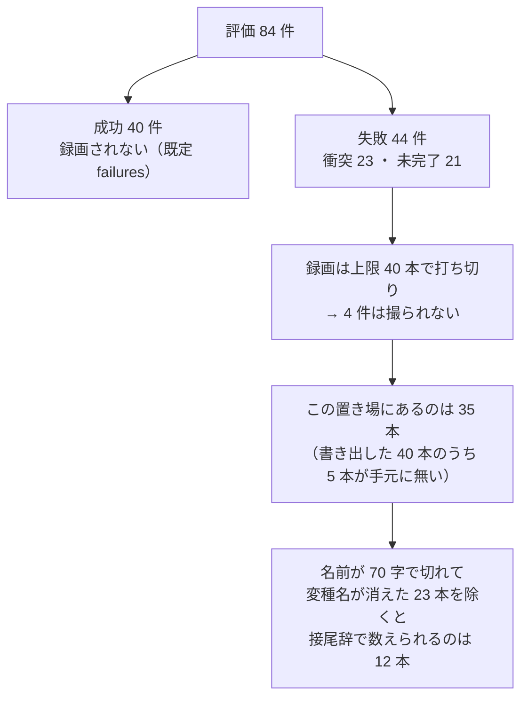

# 08. 評価側の見た目の振れ幅を、手元で測る

学習に混ぜる画像の水増し（明るさを ×0.8〜1.2 で振る、など。以下「画像拡張」）が、
評価で出てくる変種の見た目の幅を覆えているか。これを決めるのに、いままでは他人が
15 コマで作った集計に頼っていた。**手元では 1 度も数えていなかった**ので、
8/11 の 84 件の評価で撮れた録画から自分で測った記録である。

読めば分かること・分からないことを先に置く。

| | |
|---|---|
| **分かる** | 失敗した回・名前が残った回に限れば、変種ごとに明るさ・コントラストがどれくらいか |
| **分からない** | 変種の見た目の**母集団**の幅。**録画は失敗した回だけ**で、しかも数が少ない（下） |

---

## いちばん先に：この数字は母集団ではない

**録画は失敗した回だけ残る。** そのうえ本数に上限があり、名前も途中で切れる。
だから下の数字を「その変種の見た目はこうだ」と読んではいけない。偏りは 4 段重なっている。



| 段 | 何が落ちるか | 出典 |
|---|---|---|
| ① 成功は撮らない | 84 件中 **40 件（成功率 0.476）が録画されない** | `PARC_RECORD_WHICH` の既定は `failures`。成功のときは書き出さない（[rollout_recorder.py](../../solution/tools/eval/rollout_recorder.py) の `_write`） |
| ② 上限で打ち切り | 失敗 44 件でも、**書き出しは 40 本で止まる** | `PARC_RECORD_MAX` の既定は 40。ログに「上限 40 本に達した」（`outputs/0811_101824_base_n5_ep1_max300/eval.log`） |
| ③ 手元に来ていない | 書き出した 40 本のうち、**この置き場には 35 本**しか無い | `ls .../videos`（衝突 18・未完了 17） |
| ④ 名前が切れる | ファイル名は**タスク名を 70 字で切る**ので、末尾に付く変種名が消える | `task_name[:70]`（[rollout_recorder.py](../../solution/tools/eval/rollout_recorder.py) の `_write`） |

**結果、接尾辞で数えられるのは 35 本中 12 本だけ**である。しかも
**評価で本命の背景テクスチャ 2 種（`table`・`tb`）は、`table` が 1 本・`tb` が 0 本**。
**画像拡張の幅を決める根拠には、この 12 本では足りない。**

> 84 件の内訳は `outputs/0811_101824_base_n5_ep1_max300/summary.txt`（成功 40・衝突 23・未完了 21）。
> 母集団を出す道は[末尾](#母集団の幅を出すには先に撮り方を決める)にまとめた。

---

## 測れた数字（失敗 35 本のうち、変種が分かる 12 本）

明るさとコントラストは、次のように出した 0〜1 の値である。

| 数 | 意味 | 出し方 |
|---|---|---|
| 明るさ | 画面全体の明るさの平均 | 1 コマ目を灰色にした画素の**平均** ÷ 255 |
| コントラスト | 明暗の開き | 同じ画素の**標準偏差**（散らばりの大きさ） ÷ 255 |

録画は左が広い視野（front）、右が手先（wrist）の 2 枚を横に並べたものなので、
**明るさ・背景の摂動が出る front（広い視野）**を測った。焼かれた白い文字は
コントラストを最大 0.03 ほど水増しするので、上下の文字帯は切り落としている（後述）。

**接尾辞は変種名の末尾に付く目印**である（`_light_24` なら `light`）。
LIBERO-plus のカテゴリ 7 つのうち、名前で見分けが付くものだけを使う。
`view`/`initstate` は Camera Viewpoints・Robot Initial States・Language の
3 カテゴリで**同じ形になり、名前だけでは区別できない**ので、`initstate` という
1 つの束にまとめた（[make_validation_suite.py](../../solution/tools/eval/make_validation_suite.py) の
`_place_variant`、および `task_classification.json`）。

| 接尾辞 | カテゴリ | 本数 | 明るさ 平均 | 明るさ 最小〜最大 | コントラスト 平均 | コントラスト 最小〜最大 |
|---|---|---|---|---|---|---|
| `initstate` | 視点／初期姿勢／指示文（名前で不可分） | 4 | 0.444 | 0.435〜0.469 | 0.209 | 0.208〜0.211 |
| `add` | 物体の追加（Objects Layout） | 3 | 0.447 | 0.426〜0.478 | 0.230 | 0.209〜0.272 |
| `level` | 物体の追加（Objects Layout・newobj） | 2 | 0.522 | 0.521〜0.522 | 0.150 | 0.148〜0.151 |
| `light` | 照明（Light Conditions） | 2 | 0.373 | 0.237〜0.510 | 0.184 | 0.069〜0.299 |
| `table` | 机のテクスチャ（Background Textures） | 1 | 0.298 | — | 0.148 | — |
| `tb` | 床・壁のテクスチャ（Background Textures） | **0** | — | — | — | — |
| `noise` | 観測ノイズ（Sensor Noise） | **0** | — | — | — | — |

**数えられなかった 23 本は名前が 70 字で切れており**、変種名が消えている
（例：`..._place_it_on_the_plate_t` は `table` か `tb` か判別できない）。
平均には入れていない。

### この 12 本から言えること・言えないこと

| | |
|---|---|
| **言えない** | 変種ごとの見た目の代表値。`table` 1 本・`tb`／`noise` 0 本で、**本命の背景テクスチャがほぼ空** |
| **言えない** | 「照明の変種は暗い」等の傾向。`light` は 2 本で **0.237 と 0.510** と正反対に割れている |
| **ヒント** | 同じ 1 種類の摂動でも明るさが大きく振れる（`light` の 2 本で 0.27 差）。**幅は狭くなさそう**だが、n=2 では断定できない |

---

## 外部の 15 コマ集計とは、そのまま並べられない

[reference/04](04_track1_population.md) が引く外部集計は
`light` 0.287・`table`／`tb` 0.405 で、これが「画像拡張の幅（×0.8〜1.2）が
評価側（×0.71〜1.70）を覆えていない」という見立ての根拠になっている。
**今回の数字をこれと直接くらべてはいけない。** 測っている対象が違う。

| | 外部の 15 コマ集計 | 今回（35 本の録画） |
|---|---|---|
| 元画像 | 変種の初期状態から作った素の画面（推定） | **失敗した回の**録画の 1 コマ目 |
| 母集団 | 不明（15 コマ） | 失敗のみ・上限 40・手元 35・名前が残る 12 |
| 範囲・加工 | 不明 | front パネル・文字帯を除外・3 倍拡大後 |

**同じ物差しではない**ので、今回の `light` 0.373 と外部の 0.287 の差を
「食い違い」とは読めない。**画像拡張の幅が足りるかどうかは、今回の測定では
判断できない。** 判断するには、下の母集団の測定が要る。

---

## 母集団の幅を出すには、先に「撮り方」を決める

**この置き場の録画では母集団は出せない**（失敗だけ・少数）。母集団の明るさ・
コントラストの幅を出すには、次のどちらかを選ぶ。**どちらを採るかは先に決めてほしい**
（GPU 枠と、測る対象の正しさに関わる判断のため）。

| 案 | 中身 | 得 | 損 |
|---|---|---|---|
| **A. 全部録画して撮り直す** | `PARC_RECORD_WHICH=all` で 84 件を再評価し、成功も残す | 実際にモデルへ渡った画面そのもの。ステップ数の重みも本番どおり | **評価 1 本（2.3 時間）を使う。** GPU 枠が要る |
| **B. 変種の初期状態から画像を作る** | 方策を動かさず、変種の初期画面だけを描く | GPU 評価が要らない。母集団を広く取れる | 描画（osmesa）の配線が別に要る。1 コマ目だけで動きは見ない |

どちらでも、このスクリプト（`solution/tools/analysis/measure_appearance.py`）の測り方は
そのまま使える。**入力の mp4／画像を偏りの無いものに差し替えるだけ**である。

> 案 A は名前の 70 字切れ（偏り④）が残る。長いタスク名の変種を数えるなら、
> [rollout_recorder.py](../../solution/tools/eval/rollout_recorder.py) の `task_name[:70]`
> を広げるか、案 B で変種名をファイル名に使わない形にする。

---

## 測り方（再現の手順）

```bash
# 変種の接尾辞ごとの明るさ・コントラストと、1 本ごとの明細
python3 solution/tools/analysis/measure_appearance.py \
    outputs/0811_101824_base_n5_ep1_max300/videos

# ドキュメントへ貼る表だけ
python3 solution/tools/analysis/measure_appearance.py <dir> --markdown

# 焼かれた文字を切り落とさずに測る（既定は切り落とす）
python3 solution/tools/analysis/measure_appearance.py <dir> --include-text-band
```

**焼かれた文字を外している。** 録画にはステップ数やカメラ名が白い文字で焼かれている
（[rollout_recorder.py](../../solution/tools/eval/rollout_recorder.py) の `_annotate`。
上端 y=18、下端 y=高さ-30 と高さ-10）。この帯を残すと明るさが +0.008、
コントラストが最大 +0.027 水増しされるので、既定では上下の帯を切り落とす。
`--include-text-band` を付けても表の順位は変わらない（実測で確認）。

**動かした環境。** 本来は配布キットの Docker（cv2 4.11.0）で回すのが揃うが、
このセッションでは Docker が使えなかったため、手元に `opencv-python-headless` を
入れて測った。mp4 の復号は決まった手順なので、明るさ・コントラストの値は
版が違ってもこの桁では変わらない。

| 使ったもの | 版 |
|---|---|
| Python | 3.12.10 |
| opencv-python-headless（cv2） | 5.0.0 |
| numpy | 2.5.2 |

```bash
# キットの Docker で回すなら（環境を揃える場合）
docker run --rm -v "$PWD:/w" -w /w parc2026:latest \
    python solution/tools/analysis/measure_appearance.py \
    outputs/0811_101824_base_n5_ep1_max300/videos
```

---

## 出典

| 事実 | 出典 |
|---|---|
| 録画は既定で失敗のみ／本数上限 40／名前は 70 字で切る | [solution/tools/eval/rollout_recorder.py](../../solution/tools/eval/rollout_recorder.py)（`_write`・`_annotate`） |
| 上限 40 本に達して打ち切った | `outputs/0811_101824_base_n5_ep1_max300/eval.log`（「上限 40 本に達した」） |
| 84 件の内訳（成功 40・衝突 23・未完了 21） | `outputs/0811_101824_base_n5_ep1_max300/summary.txt` |
| この置き場の録画 35 本（衝突 18・未完了 17） | `ls outputs/0811_101824_base_n5_ep1_max300/videos` |
| 接尾辞とカテゴリの対応、名前で不可分な 3 カテゴリ | [make_validation_suite.py](../../solution/tools/eval/make_validation_suite.py)（`_place_variant`）、`work/LIBERO-plus/.../task_classification.json` |
| 明るさ・コントラストの各値 | `solution/tools/analysis/measure_appearance.py` を上の環境で実行 |
| 外部の 15 コマ集計（比較の相手） | 2026-08-11 に共有された LIBERO-plus の EDA 報告 |
