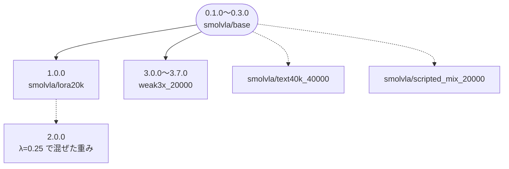
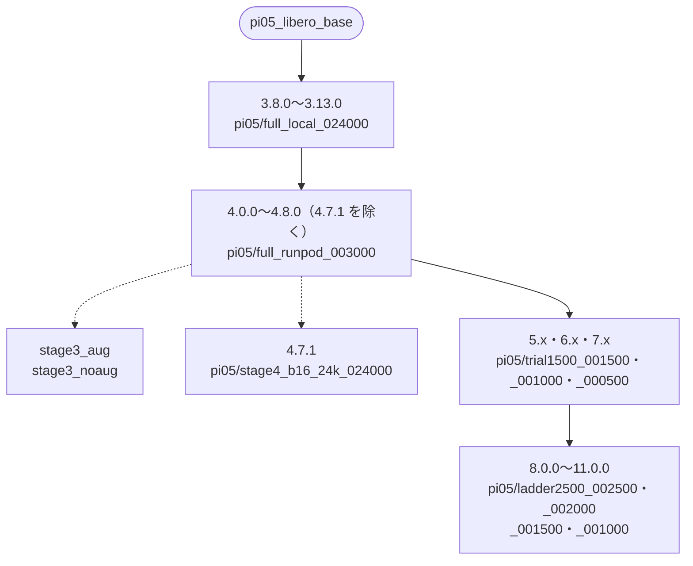
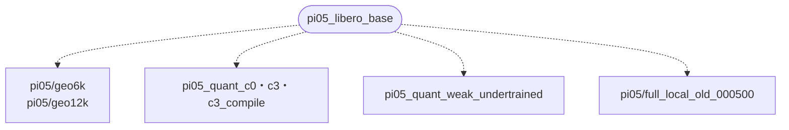

# 19. 実験台帳 —— 流した学習・重み・版・出した点

**この 1 ファイルで「何を流して、どの重みができて、どの設定で出して、何点だったか」が
引ける。**表だけを置き、「なぜそうしたか」は各節から張ったリンクの先にある。生のログは
git の外（`work/train/*.log`）にあり、消さない。

**「`pi05/full_local_024000` ってどれだっけ」を 1 か所で引けるようにした表である。**
重みの名前・その重みで出した提出物の版番号・実際にどういうモデルなのかを 1 行に
並べてある。

出典は 3 つ。**どれも一次資料である。**

| 何の出典か | どこ |
|---|---|
| 版番号と本番スコアと zip の sha256 | `../howto/02_build_submission.md` の版の表（もとは `outputs/` の採点ログ） |
| 学習の条件（固定した所・ステップ数・batch・学習率） | 各重みの隣の `train_config.json` |
| 推論の設定（n・infer・平滑化・samples） | 各重みの隣の `INFERENCE.md` |
| 重みの sha256 | 各重みの隣の `PROVENANCE.md`。HuggingFace 側は LFS の `sha256` |

**この文書が索引そのものである。**8/18 まで `siruku6/parc2026-archive` の
`index.json` が索引だったが、中身が空になったのでリポジトリごと消した。

> **提出結果の中身を書くのはここだけである**（2026-09-01 に決めた）。
> **1 つの提出について「点・エピソードごとの歩数・何が効いたか効かなかったか」を書く場所は、
> 下の「本選の提出と点」の行と、その版の節の 2 つだけにする。**
> **`plan/` や `talk/` や `open_items.md` には「悪化したので〜する」という決めごとと、
> ここへのリンクだけを書く。**
> 理由は、同じ数字が 8 か所にあると**必ずどこかが古くなり**、しかも
> **読む側はどれが正本か分からない**ためである（9/1 にユーザの指摘。まず 5.1.0 の分だけ直した）。

| 引きたいもの | 節 |
|---|---|
| どの学習をいつ流したか・ログはどこか | [学習の記録](#2-学習の記録1-行-1-実行) |
| **どの重みからどの重みが生まれたか** | **[学習の系譜](#3-学習の系譜どの重みからどの重みが生まれたか)** |
| 重みの名前 → 実際にどういうモデルか | [重みの一覧](#4-重みの一覧呼び名から実際のモデルを引く) |
| **ある版はどこから何を変えたのか** | **[本選で出した版の枝分かれ](#51-本選で出した版の枝分かれ420-から下へ)** |
| ある版の設定をそのままの値で | [版ごとの設定](#53-版ごとの設定差分ではなくそのままの値) |
| 本選のトラック別の点・エピソードごとの歩数 | [本選の提出と点](#6-本選の提出と点1-行-1-提出2026-08-24-から) |
| **版を上げずに測った設定と、その採否** | **[版を上げずに手元で測った設定](#54-版を上げずに手元で測った設定採否と理由)** |
| zip を組み直す | **この台帳には無い** → [howto/02_build_submission.md](../howto/02_build_submission.md) |

## 0. 目次

- [1. 名前についての注意（2 つとも読み違えやすい）](#1-名前についての注意2-つとも読み違えやすい)
- [2. 学習の記録（1 行 1 実行）](#2-学習の記録1-行-1-実行)
- [3. 学習の系譜（どの重みからどの重みが生まれたか）](#3-学習の系譜どの重みからどの重みが生まれたか)
- [4. 重みの一覧（呼び名から実際のモデルを引く）](#4-重みの一覧呼び名から実際のモデルを引く)
- [5. 版 —— 枝分かれ・設定・zip の組み方](#5-版--枝分かれ設定zip-の組み方)
- [6. 本選の提出と点（1 行 1 提出・2026-08-24 から）](#6-本選の提出と点1-行-1-提出2026-08-24-から)
- [7. 提出していない走りの測り（手元だけで測った重み）](#7-提出していない走りの測り手元だけで測った重み)
- [8. 読み方の決着（点・歩数・系譜をどう読むか）](#8-読み方の決着点歩数系譜をどう読むか)
- [9. 何がどこにあるか](#9-何がどこにあるか)

## 1. 名前についての注意（2 つとも読み違えやすい）

**`pi05_full_local` は全パラメータ学習ではない。**「full」は π0.5 の実行の名前として
付いただけで、この実行は**行動側（action expert）だけを動かし、カメラ画像を扱う部分
と VLM は固定していた**（`train_expert_only=true`・`freeze_vision_encoder=true`）。
全部を動かしたのは RunPod の 3,000 ステップの方だけである。

**`pi05_stage1_24000`（HuggingFace のリポジトリ名）と `pi05/full_local_024000`
（この文書での呼び名）は同じ重みである。**sha256 `d46bffcf…` で一致を確認済み。

## 2. 学習の記録（1 行 1 実行）

**1 本流すたびに 1 行足す。空欄は測っていないことを表す（推測で埋めない）。**
出典は各実行の `train_config.json` と `work/train/<実行名>.log` である。

| 実行名 | 日 | 機械 | 出発点の重み | 歩数 | batch | 学習率 | 動かした範囲 | 所要 | ログ | 出た重み |
|---|---|---|---|---|---|---|---|---|---|---|
| `smolvla/lora20k` | 8/11 | Colab | `smolvla_libero_plus` | 20,000 | — | 3e-4 → 3e-5 | action expert（LoRA） | — | 残っていない | 消した |
| `smolvla/weak3x_20000` | 8/12 | JAIST | `smolvla_libero_plus` | 20,000 | — | 1e-4 → — | action expert（LoRA） | — | — | HF `smolvla-libero-plus-finetunes` |
| `smolvla/text40k_40000` | 8/13 | JAIST | `smolvla_libero_plus` | 40,000 | — | 1e-4 → — | expert ＋ 言語側 | — | — | 消した |
| `smolvla/scripted_mix_20000` | 8/13 | JAIST | `smolvla_libero_plus` | 20,000 | — | — | expert（LoRA） | — | — | 消した |
| **`pi05_full_local`** | 8/14 | JAIST H100-20C | `pi05_libero_base` rev `a217bfd3` | **24,000** | 16 | 2.5e-5 → 2.5e-6 | **action expert だけ**（693M / 4.14B） | **9 時間 31 分** | `pi05_full_local.log` | `work/artifacts/model_weights_pi05_024000`・HF `pi05_stage1_24000` |
| **`pi05_full_runpod`** | 8/17 | RunPod A100 80GB | 上の 24,000 歩 | **3,000** | **64** | 5e-6 → 2.5e-6 | **全部**（4.14B） | **8 時間 33 分** | `pi05_full_runpod.log` | `work/artifacts/pi05_rp3000`・HF `pi05_full_runpod` |
| `pi05_quant_c0` / `c3` / `c3_compile` | 8/21〜8/23 | JAIST H100-20C | `pi05_libero_base` | 16,000 | 16 | 2.5e-5 | action expert だけ | — | `pi05_quant_c*.log` | **測っていない。**速さを計るための副産物 |
| `pi05_quant_weak_undertrained` | 8/23 | JAIST H100-20C | `pi05_libero_base` | 500 | 16 | 2.5e-5 | action expert だけ | — | 同名の `.log` | 測っていない |
| **`stage3_aug`** | 8/26 | JAIST H100-20C | `work/artifacts/pi05_rp3000` | **6,000** | **8** | 5e-6 | action expert だけ | **1 時間 19 分** | `stage3_aug.log` | `work/train/stage3_aug/checkpoints/006000` |
| **`stage3_noaug`** | 8/26 | JAIST H100-20C | `work/artifacts/pi05_rp3000` | **6,000** | **8** | 5e-6 | action expert だけ | **1 時間 18 分** | `stage3_noaug.log` | `work/train/stage3_noaug/checkpoints/006000` |
| **`pi05_trial1500`** | **8/28** | RunPod A100 80GB | `work/artifacts/pi05_rp3000` | **1,500** | **64** | 5e-6 → 2.5e-6 | **全部**（4.14B。`num_learnable_params=4143404816` を開始 2 分後のログで確認） | **4 時間 16 分 05 秒** | **手元に無い。**HF `pi05_trial1500` の `pi05_trial1500.log` | HF `pi05_trial1500` の `000500` / `001000` / `001500`（**`vlm/` 同梱**） |
| **`geo_vggt_v2`** | **8/28** | JAIST H100-20C | `pi05_libero_base` rev `a217bfd3` | **12,000** | **8** | 2.5e-5 → 2.5e-6 | action expert ＋ **VGGT の幾何の特徴を足し込む層**（`geometry_graft.py`・重みの `geometry_fuser.*`） | **3 時間 11 分 24 秒**（08:24:02 → 11:35:26・終了コード 0） | `geo_vggt_v2.log`（**その前に `geo_vggt_12k` を 6,167 歩で落としている**・終了コード -15） | `work/train/geo_vggt_v2/checkpoints/006000` / `012000`（＝ `work/artifacts/pi05_geo6k` / `pi05_geo12k`。**同じ実体**） |
| **`pi05_ladder2500`** | **8/31** | **Blackwell**（RTX PRO 6000 Blackwell Server Edition・95.0 GB） | **HF `pi05_trial1500` の `001500`** | **2,500** | **64** | 5e-6（**warmup 1,000 歩から引き直し**。下の「歩数を足しても学習量は足し算にならない」） | **全部**（4.14B。`freeze_vision_encoder=false`・`train_expert_only=false`・`grad_ckpt=true`） | **4 時間 48 分 23 秒**（11:46:52 → 16:35:15・終了コード 0）。**6.85 秒/step** | `work/train/pi05_ladder2500.log`（HF `pi05_trial1500` の `ladder2500/pi05_ladder2500.log` にも上げた） | HF `pi05_trial1500` の `ladder2500/001000` / `001500` / `002000` / `002500`（**`vlm/` 同梱**） |
| **`pi05_all111`** | **9/5** | **Blackwell**（RTX PRO 6000 Blackwell Server Edition・95.0 GB） | **HF `pi05_full_runpod`**（＝`rp3000`） | **2,000** | **64** | 5e-6 → 2.5e-6 | **全部**（4.14B） | **3 時間 48 分 59 秒**（6.81〜6.87 秒/step・`mem_gb` 49.40） | HF `pi05_all111` の `logs/pi05_all111.log` | **HF `siruku6/pi05_all111` の `000500`・`001000`・`001500`・`002000` の 4 個**（各 9,354,050,752 B）。**データだけが違う 1 本**——`libero_combined_20hz`（111 課題・19,533 本・3,028,708 コマ） |
| **`pi05_proto20`** | **9/7〜9/8** | **Blackwell**（RTX PRO 6000・95.0 GB） | **HF `pi05_full_runpod`**（＝`rp3000`） | **2,000** | **64** | 5e-6 → 2.5e-6 | **全部**（4.14B） | **3 時間 49 分**（6.85 秒/step・`mem_gb` 48.8〜49.4） | `work/train/pi05_proto20/pi05_proto20.log` | **HF `siruku6/pi05_proto20` の `000500`〜`002000` の 4 個。****`all111` との 1 変数**——配布 `libero_combined_20hz` に**逆向き 389 本を 11 本コピーして 19.75% 混ぜた**（23,812 本・3,774,233 コマ・114 課題）。**正規化統計は配布データの値に据え置いた**（[29 の 6 節](29_training_data_requirements.md)） |
| `pi05_proto21` | 9/8 | Blackwell | `rp3000` | **120 で止めた**（予定 20,000） | 64 | 5e-6 | **action expert だけ**（693M） | 11 分 | 同上のディレクトリ | **重みを取っていない。**`proto20` から**動かす範囲だけ**を変えた確認用。止めた理由は下の「9/7 の `pi05_proto20`」 |
| **`pi05_t3rev`** | **9/8** | **JAIST H100-20C**（20 GB） | **`rp3000`** | **8,700** | **16** | 5e-6 → 2.5e-6 | **action expert だけ**（693M） | **3 時間 21 分**（1.36 秒/step・`mem_gb` **16.27**） | HF `siruku6/pi05_t3rev` の `logs/` | **`008700`。**データは **`libero_plus` を 1 課題 75 本へ間引いた 3,000 本 ＋ 逆向き 389 本 × 7**（5,723 本・975,828 コマ・43 課題・逆向き 48.6%）。**正規化は `rp3000` 同梱の normalizer へ据え置き（差 0.000e+00）** |
| **`pi05_v2_base24k`** | **9/10** | **JAIST H100-20C**（20 GB） | **`pi05_libero_base` rev `a217bfd3`** | **24,000** | **16** | 2.5e-5 → 2.5e-6 | **action expert だけ**（693M） | **9 時間 14 分 41 秒**（1.39 秒/step） | `work/train/pi05_v2_base24k.log` | **手 D-2。**`checkpoints/{008000,016000,024000}`。**`024000` だけ HF `siruku6/pi05_v2_base24k`（非公開）へ上げた**（sha256 `734bac4b…` で JAIST 側と一致を確認）。**`pi05_full_local`・`pi05_clean24k` と 1 変数**——データが **v2 混合 6,176 本・992,843 コマ・43 課題**（逆向き 49.5%）。**カメラ拡張なし・正規化は v2 自身の統計。**最後の loss **0.153**（`grdn` 中央 1.22）。**1 本目は `--shm-size` 無しで shm 不足により 1 歩も進まず落ちた**（成果物なし） |
| **`pi05_clean24k`** | **9/9〜9/10** | **JAIST H100-20C**（20 GB） | **`pi05_libero_base` rev `a217bfd3`** | **24,000** | **16** | 2.5e-5 → 2.5e-6 | **action expert だけ**（693M） | **9 時間 14 分** | `work/train/pi05_clean24k.log` | **手 F。**`work/train/pi05_clean24k/checkpoints/{008000,016000,024000}`。**`024000` だけ HF `siruku6/pi05_clean24k`（非公開）へ上げた。****8/14 の `pi05_full_local` と 1 変数**——**接触が起きているデモを外した 12,396 本**（掃除前は 14,347 本）。**カメラ拡張なし・`seed 42` も揃えてある。**最後の loss **0.225**（`grdn` 0.887） |
| **`pi05_t3rev_v2`** | **9/9** | **JAIST H100-20C**（20 GB） | **`rp3000`** | **10,000** | **16** | 5e-6 → 2.5e-6 | **action expert だけ**（693M） | **3 時間 52 分**（1.39 秒/step・`mem_gb` **16.27**） | HF `siruku6/pi05_t3rev_v2` の `pi05_t3rev_v2.log` | **手 D-1。**データは **v2**（`jaist_mix_v2_x8`・6,176 本・992,843 コマ・43 課題。**逆向きの回転目標を封筒内に収め直したもの**）。**カメラ拡張あり。****重みは手元に無く HF だけにある**（`checkpoints/{002000,004000,006000,008000,010000}`・57.75 GB・非公開） |

データは **`pi05_all111`・`pi05_proto20`・`pi05_proto21` を除いて**どの π0.5 の実行も
`lerobot/libero_plus` rev `f3f49f42`（14,347 本）である。
**`pi05_all111`（9/5）が配布 tar の `libero_combined_20hz`**（111 課題・19,533 本）、
**`proto20` / `proto21`（9/7〜9/8）はそれに逆向き 389 本を 19.75% 混ぜたもの**で、
**loss の水準はこの 1 本だけ他と比べられない**（学習の終わりで 0.309。40 課題の走りは 0.23〜0.25）。
SmolVLA 期は本数を絞った回がある（`lora20k` は 200 本、`weak3x_20000` は 4,609 本）。

**8/26 の 2 本は、カメラ視点の拡張を入れるかどうかだけが違う。**他は 1 つも変えていない。

| | 最初の 500 歩の loss | 5,000〜6,000 歩の loss | 下がった分 |
|---|---|---|---|
| `stage3_aug`（拡張あり） | 0.2719 | 0.2630 | **-3.3%** |
| `stage3_noaug`（拡張なし） | 0.2090 | 0.2021 | **-3.3%** |

**どちらも loss がほとんど動いていない。**batch 8・学習率 5e-6 の 6,000 歩では、
重みはあまり変わっていないと読むのが素直である。**評価で差が出ない可能性がある。**
拡張ありの loss が一貫して高いのは、拡張で問題が難しくなっているためで、
2 本の loss を直接比べることはできない。

**8/26 の `stage3_aug` と 8/28 の `pi05_trial1500` は、同じ重みから始めて同じ拡張を
入れた 2 本である。**だから loss の水準を比べられる。**ただし歩数では揃わない**
——batch が 8 対 64 なので、1 歩で見るサンプル数が 8 倍違う。**サンプル数で揃える。**

| | 動かした範囲 | batch | **48,000 サンプル時点の loss** |
|---|---|---|---|
| `stage3_aug` | action expert だけ | 8 | **0.2630**（6,000 歩） |
| `pi05_trial1500` | **全部** | 64 | **約 0.250**（750 歩相当。500 歩 0.2532 と 1,000 歩 0.2463 の間） |

**同じサンプル数で、全部を動かした側が低い。**ただし**動かした範囲と batch を同時に
変えているので、どちらが効いたかは分けられない。**そして**これは loss であって点ではない。**
点は `open_items.md` の F37（採点側）と F38（手元の 72 行）で決まる。

### 2.1. 8/31 の `pi05_ladder2500` —— 梯子の上側が 4 点そろった

**`001500` から続けて 2,500 歩を Blackwell で回した**（`open_items.md` の `F44`）。
**`train_config.json` を突き合わせると `trial1500` と違うのは 5 か所で、
学習の中身に効くのは 1 つ（歩数 1,500 → 2,500）だけである。**

| 変わったところ | `trial1500` | `ladder2500` |
|---|---|---|
| **歩数** | **1,500** | **2,500** |
| 出発点の重み | `/workspace/rp3000` | **`/opt/dlami/nvme/weights/trial1500/001500`** |
| 実行名・出力先 | `pi05_trial1500` | `pi05_ladder2500` |
| 読み込みの並列数 | 16 | 8 |
| 評価の batch | 50 | 11 |

**batch 64・学習率 5e-6・種 42・`save_freq` 500・カメラ拡張あり
（`dataset.image_transforms.enable = true`。変換 8 種から最大 4 つ）・
`compile_model = false`・`dtype = bfloat16`・データ `lerobot/libero_plus` は 1 つも動いていない。**
**だから梯子として読める。**

#### 2.1.1. 歩数を足しても学習量は足し算にならない —— warmup が毎回引き直される

**`scheduler` は両方とも `cosine_decay_with_warmup`・`num_warmup_steps` 1,000・
`num_decay_steps` 30,000・`peak_lr` 5e-6・`decay_lr` 2.5e-6 である。**
**`--init-from` は学習の状態を読まない**（`training_state/` を読むのは `--resume` だけ）ので、
**新しい実行は毎回 0 歩目から始まり、最初の 1,000 歩は学習率が 0 から 5e-6 へ上がる途中である。**
`decay` のほうは 30,000 歩に対して 2,500 歩なので、ここでは無視できる。

**だから「全速で回した歩数」に直すと、warmup の 1,000 歩は約 500 歩ぶんにしかならない**
（学習率の面積 ÷ 峰。学習量が 学習率 × 歩数 に比例するという粗い目安である）。

| 重み | 出した版 | `rp3000` からの累計 | **全速に直した歩数** |
|---|---|---|---|
| `trial1500/001000` | **6.1.0** | 1,000 | **約 500** |
| `trial1500/001500` | **5.0.1** | 1,500 | **約 1,000** |
| `ladder2500/001000` | — | 2,500 | **約 1,500** |
| `ladder2500/001500` | — | 3,000 | **約 2,000** |
| `ladder2500/002000` | — | 3,500 | **約 2,500** |
| `ladder2500/002500` | — | 4,000 | **約 3,000** |

**warmup が引き直されること自体は一次資料で確かである**——`train_config.json` の
`num_warmup_steps` が両方 1,000 で、`train_pi05.py` の `--init-from` は
`--policy.pretrained_path` を渡すだけで学習の状態を読まない（`--resume` だけが前回の
`train_config.json` を読む。`_resolve_init_from` の説明と `_build_resume_command`）。

**ただし「全速に直した歩数」の欄は学習率からの計算にすぎず、loss では裏づかなかった**
（下の「loss は寝た」）。**だからこの欄を「点の予想」に使わない。**

**それでも梯子の点として `ladder2500/001000` を選ぶ理由は無い。**
**同じ実行の `001500`・`002000`・`002500` はどれも歩数が多く、`001000` はその 3 つに
含まれる途中の点だからである**——**上に伸ばすかを見たいのだから、上の点から出す。**

#### 2.1.2. 【9/1】loss は寝た —— 「歩数を伸ばす」道はここで終わりに近い

**9/1 に学習ログを回収した**（`work/train/pi05_ladder2500.log`。HF にも上げた）。
**`trial1500` と同じ数え方（直近 10 点の平均）で並べると、下がり方が止まっている。**

| 実行 | 歩数 | **loss（直近 10 点の平均）** | その 1,000 歩で |
|---|---|---|---|
| `trial1500` | 500 | 0.2532 | — |
| `trial1500` | 1,000 | 0.2463 | **−2.7%** |
| `trial1500` | **1,500** | **0.2407** | **−2.3%**（500 → 1,500 で **−4.9%**） |
| `ladder2500` | 500 | 0.2383 | — |
| `ladder2500` | 1,000 | 0.2353 | −1.3% |
| `ladder2500` | **1,500** | **0.2311**（**全体の最小**） | −1.8% |
| `ladder2500` | 2,000 | 0.2367 | **+2.4%**（上がった） |
| `ladder2500` | 2,500 | 0.2331 | −1.5% |

**読み。**`trial1500` は 1,000 歩で **−4.9%** と単調に下がった。
**`ladder2500` は 2,000 歩かけて −2.2% で、しかも単調でない**
（最小は 1,500 歩の 0.2311 で、2,000 歩は 0.2367 に戻っている）。
**1 点のばらつきは 0.224〜0.248 なので、この 0.005 前後の上下は雑音とほぼ同じ幅である。**

**帰結が 2 つある。**

| 帰結 | 中身 |
|---|---|
| **「まだ登り始めたところ」は成り立たなくなった** | `trial1500` の傾きで読んだ話である（[../plan/21_initiative_priority_second_opinion.md](../plan/21_initiative_priority_second_opinion.md) 2 節）。**同じ設定で 2,500 歩足しても loss はほぼ動かない。****60 時間の残りを「同じものをもっと長く」に注ぐ根拠は、これで弱くなった** |
| **loss で梯子の点を選べない** | 最小は `ladder2500/001500`（版 10.0.0）だが、**差が雑音の幅なので「そこが良い」とは言えない。****採点で読むしかない**——ただし採点も 8 エピソードなので、**平らなら「歩数の道は終わり」と読む**（`open_items.md` の判断 9） |

**warmup の読みは裏づかなかった。**「最初の 1,000 歩は全速の半分」なら
`ladder2500` の 0 → 1,000 歩でいちばん下がるはずだが、下がり方は 1,000 → 1,500 歩と同じである。
**上の「全速に直した歩数」は学習率からの計算のままで、loss では確かめられていない。**

### 2.2. 8/27 の 24,000 歩は、重みは動いたのに結果が動かなかった

**`stage4_b16_24k`（batch 16・学習率 1e-5・行動側だけ）の loss は 18,000 歩で 1.0% しか
下がらなかった。**6,000 歩の回（3.3%）よりさらに小さい。

| 区間 | 平均 loss |
|---|---|
| 0〜500 歩 | 0.2067 |
| 5,000〜6,000 歩 | 0.2020 |
| **17,000〜18,000 歩** | **0.2047** |

**「重みが動いていないから loss が動かない」のではない。**18,000 歩の
チェックポイントと `rp3000` の同じテンソルを直接比べると、次のようになる
（`model.safetensors` を numpy で読んで相対的な大きさの変化を出した）。

| 区分 | テンソル | 相対変化 |
|---|---|---|
| 行動側（学習対象） | `gemma_expert...layers.0.input_layernorm.dense.weight` | **3.4%** |
| 行動側（学習対象） | `gemma_expert...layers.0.input_layernorm.dense.bias` | 1.0% |
| 行動側（学習対象） | `model.action_in_proj.bias` | 1.1% |
| 行動側（学習対象） | `model.action_in_proj.weight` | 0.4% |
| **凍結側** | `vision_tower...patch_embedding.weight` | **0.000000** |
| **凍結側** | `language_model.embed_tokens.weight` | **0.000000** |

**読めること 2 つ。**

1. **凍結は正しく効いている。**画像側と言語側は 1 ビットも動いていない。
   `--train-expert-only true` が意図どおり働いている。
2. **行動側は数%動いたのに、loss も手元の 8 行の結果も変わらない。**
   `rp3000` は同じデータで全パラメータを学習した結果なので、**画像側を凍結したまま
   行動側だけを動かす余地が、このデータでは残っていない。**平らな谷の底を横に
   移動しているだけである。

**これが「画像側も学習する」を RunPod でやる理由の実測の裏付けである**
（[../howto/06_runpod_pi05.md](../howto/06_runpod_pi05.md)）。

### 2.3. 手元の 8 行は、並進の倍率については採点の向きを再現した（8/27）

**会社の RTX6000 の疎通 1 本が、たまたま倍率 1.15 の版（4.5.0）で回った。**

| | 手元の 8 行 | 採点（Track2） |
|---|---|---|
| 倍率 1.0 | **0.750**（6/8） | **0.154** |
| 倍率 1.15 | **0.375**（3/8） | **0.035** |

**両方とも同じ向きに大きく崩れた。**手元で落ちたのは
`orange_juice`・`cream_cheese`・`salad_dressing` の 3 本で、いずれも倍率 1.0 では
成功していた。**ただしマシンと描画方式（osmesa → EGL）も同時に変わっているので、
1 変数ではない。**同じマシンで倍率 1.0 を測るまでは確定ではない。

**EGL の効果も同時に測れた。1 本 60.6 秒（JAIST・osmesa）→ 30.6 秒（RTX6000・EGL）。
評価まるごとで 2 倍である**（箱 1 個の描画だけなら 16 倍だが、物理計算と推論が
含まれるので実際はここまで）。

### 2.4. その学習で出た点（SmolVLA 期・元 `plan/04_training_targets.md` から移した）

**列の意味。** 「1 コマ」は 1 ステップの推論にかかる秒数、「84 件」は検証用データ
84 件での成功率、「36 件」は絞り込んだ 36 件での成功率、「本番」は予選の採点スコア。
**空欄は測っていないことを表す（推測で埋めない）。**

| ラベル | データ | ステップ数 | 当て先 | lr / warmup | 1 コマ | 84 件 成功率 | 空回り | ジャーク | **36 件 成功率** | **本番** |
|---|---|---|---|---|---|---|---|---|---|---|
| **素**（`a67a056a`） | 14,347 全部 | 20,000 | **全パラメータ** | 1e-4 / 1000 | 0.29 | 0.476 | 0.13 | 4.223 | **0.583** | **0.1409** |
| lora20k（`2cd9faab`） | **200 本** | 20,000 | expert のみ | **3e-4 / 100** | **5.1** | 0.500 | 0.274 | 4.795 | （検定に使う） | **0.016** |
| λ=0.25（`952171f9`） | 素と lora20k を混ぜた | — | — | — | — | — | — | — | | 0.09507 |
| **weak3x**（`a8cb8aee`） | **4,609 本**（苦手 3 倍・手本 300 ステップ超を落とす） | 20,000 | expert のみ | 1e-4 / 1000 | 0.88 | 0.500 | **0.131** | 4.280 | | **0.144**（`n=2` で **0.166**） |
| text40k | 14,347 全部 | 40,000 | expert ＋ 言語 | 1e-4 / — | 0.57 | 0.512 | 0.143 | 4.305 | 測れない（注） | 見送り |

（注）text40k は `episodes.json` が `"all"` なので、**36 件が未使用にならない**。
あの集合は weak3x の 4,609 本を基準に選んでいる。

**π0.5 期の点は下の「本選の提出と点」と版の表にある。**`pi05_full_local`（24,000 歩）は
版 3.9.0 で予選 **0.264**、`pi05_full_runpod`（3,000 歩）は版 4.2.0 で予選 **0.485**・
本選 Track1 **0.370** である。

### 2.5. 8/26 の 2 本を手元の Track2 8 行で測った（8/27・3 通りとも版 4.5.1）

**設定は 3 通りとも同一**（`num_inference_steps=10`・`n_action_steps=16`・`samples=1`・
`ema_alpha=0.3`・倍率 1.0・種 0）。**違うのは重みだけである。**

| 指標 | **rp3000（元）** | **拡張なし 6,000 歩** | **拡張あり 6,000 歩** |
|---|---|---|---|
| 成功率 | **0.750**（6/8） | **0.750**（6/8） | 0.625（5/8） |
| 衝突率 | **0.250** | **0.250** | 0.375 |
| 成功までの歩数 | 122.7 | **120.5** | 150.6 |
| 軌道の総距離 | **1.063** | 1.106 | 1.266 |
| 手先の回転の総量 | 1.232 | **1.098** | 1.446 |
| 関節のジャーク（RMS） | 35.3 | 36.4 | **29.6** |
| 1 本の所要（秒） | 60.6 | **60.2** | 74.2 |

**6,000 歩の追加学習は、何も変えなかった。**元の重みと拡張なしは、成功率も衝突率も
落ちたタスクの中身（`black bowl on the cookie box` と `black bowl on the ramekin`）も
完全に一致する。**loss が 3.3% しか動かなかったこととつじつまが合う。**

**原因は歩数ではなく、見たデータの量である。**

| 学習 | 歩数 × batch | 見たコマ数 |
|---|---|---|
| `pi05_full_local`（1 回目） | 24,000 × 16 | 384,000 |
| `pi05_full_runpod`（2 回目） | 3,000 × 64 | 192,000 |
| **`stage3_*`（8/26）** | **6,000 × 8** | **48,000** |

**48,000 コマは 2 回目の 4 分の 1 でしかない。**データ全体（14,347 本）が
約 200 万コマなので、**1 周の 2.4% しか見ていない。**

**拡張ありが負けたことを「拡張が悪い」と読んではいけない。**拡張は問題を難しくするので、
同じ予算では余計に未学習になる。**言えるのは「この予算では payoff しなかった」までである。**

**なぜ 2 回に分けたか・1 回目が頭打ちだった話**は
[../knowledge/09_two_stage_training.md](../knowledge/09_two_stage_training.md)、
**次にどこを直すか**は
[11_training_schedule.md](11_training_schedule.md) にある。

## 3. 学習の系譜（どの重みからどの重みが生まれたか）

**上の「学習の記録」を、時間の表ではなく親子の形で並べ直した図である。**
矢印の出どころが出発点の重み（各実行の `train_config.json` の `pretrained_path`）で、
矢印の先がその学習で出た重みである。**下へ行くほど追加学習を重ねている。**
**実線は提出に使った重みへ続く道、破線はそこから提出に至っていない枝である。**
**箱の中は「版番号 ＋ 重みの名前」だけである**（版を振っていない重みは名前だけ）。
歩数・batch・動かした範囲は上の[学習の記録](#2-学習の記録1-行-1-実行)、
点は下の[本選の提出と点](#6-本選の提出と点1-行-1-提出2026-08-24-から)で引く。

**角が丸い箱は上流が配っている重みで、私たちは 1 歩も学習させていない。**
`lerobot/smolvla_libero_plus` rev `7bb70aa5` と `lerobot/pi05_libero_base`
rev `a217bfd3` の 2 つだけである。**四角い箱はどれも私たちが学習させた重みである。**

### 3.1. SmolVLA 期（8/11〜8/13）



**ここで系譜が切れる。**π0.5 に乗り換えたのは重みを引き継いだからではなく、
**別の上流の重みから学習をやり直したからである**（版は 3.7.0 → 3.8.0 と続くが、
中のモデルは別物である）。

### 3.2. π0.5 期・提出に使った重みへ続く道（8/14〜8/31）



### 3.3. π0.5 期・提出に使わなかった枝（素の重みから直接始めた実行）

**どれも `pi05_libero_base` から直接始めた別の実行で、上の道には合流していない。**

#### 3.3.1. `geo6k` / `geo12k` は `full_local_024000` でも `rp3000` でもなく、上流の重みの子である（9/1 に測り直した）

**3 つの資料が一致する。**

| 資料 | 何が言えるか |
|---|---|
| `train_config.json` の `pretrained_path` | `006000` と `012000` の両方が `/hf_home/hub/models--lerobot--pi05_libero_base/snapshots/a217bfd3…` を指している |
| 起動ログ `geo_vggt_v2_launch.log` の 5 行目 | `初期重みを取得: lerobot/pi05_libero_base@a217bfd3`。**上流から取り直して始めている** |
| **重みそのもの** | **上流の `model.safetensors`（HF の rev `a217bfd3`・sha256 `1f806a27…`）を範囲指定で読み、同じテンソルを突き合わせた**（下の表） |

| 突き合わせたテンソル | `geo6k` | `geo12k` | `full_local_024000` | `rp3000` |
|---|---|---|---|---|
| **画像側 `patch_embedding.weight`**（上流からの相対差） | **0.000000** | **0.000000** | **0.000000** | **0.009095** |
| 行動側 `action_in_proj.weight`（同） | 0.006454 | 0.007222 | 0.012228 | 0.012587 |
| 行動側 `layers.0.input_layernorm`（同） | 0.077627 | 0.081363 | 0.118462 | 0.119876 |

**読み方が 2 つある。**

| | 中身 |
|---|---|
| **`rp3000` の子ではない** | `rp3000` は全部を動かしたので**画像側が上流から 0.9% ずれている。**`geo6k` / `geo12k` の画像側は上流と 1 ビットも違わない（画像側を固定して学習したから）。**もし `rp3000` から始めていれば、固定したまま 0.9% ずれた値が残る** |
| **`full_local_024000` の子でもない** | もし 24,000 歩の重みから続けたなら、**6,000 歩の時点で `full_local_024000` の近くにいるはずである。**実際は**上流からの距離が 6,000 歩 0.0065 → 12,000 歩 0.0072 と、上流から離れていく形になっている**（`full_local_024000` は 0.0122） |

**測り方。**`model.safetensors` のヘッダ（先頭の JSON）を読んで目的のテンソルの位置を出し、
手元のファイルは `seek` で、上流は HTTP の `Range` で、その 1 本だけを取って
相対差 `‖a − b‖ / ‖b‖` を出した。**14 GB を落とさずに済む。**1 回だけの確認なので
`solution/tools/` には置いていない。



**`geo_vggt_v2` だけは「点が出なかった枝」ではなく「まだ判定していない枝」である。**
**12,000 歩の loss は 0.235 だが（学習ログの最終行）、比べる相手が 1 つも無い。**
**足し込む層を外した同じ 12,000 歩が無いので、幾何の特徴が効いたのか、
ただ追加学習しただけなのかを分けられない**（`open_items.md` の `F39`。
8/31 に「打ち切らず保留」と決めた）。**上の道に並ぶ loss とも比べられない**
——`stage3_noaug` の 0.2021 は出発点が `rp3000` で、こちらは素の重みから始めている。
**足し込む層のうち、1.0 で始めた `model.geometry_fuser.norm_query.weight` は
12,000 歩たっても全要素が 1.0 のままである**（`pi05_geo12k/model.safetensors` を
直接読んで最小・最大とも 1.0 を確認した。0 で始めた `norm_query.bias` や
`cross_attention.out_proj.weight` は ±0.004 まで動いている）。**bf16 は 1.0 の近くで
0.0078 刻みなので、学習率 2.5e-5 の更新が丸めで消えたという読みが `open_items.md` の
`F41` にある。**

**zip は 1 つ組んである。**`work/submission_geo12k.zip`（12 GB）で、中の重みは
`geo12k`（`model_weights/model.safetensors` が 11.9 GB）だが、
**`policy_server.py` の `__version__` は `4.6.0` のままである。**
**つまりこの重みには版番号が振られていない。**ディスクの残りを見るときは、
この 1 本が 12 GB を占めていることに注意する（[../resources/infra_and_docker.md](../resources/infra_and_docker.md)）。

### 3.4. 系譜から読めること

| | 中身 |
|---|---|
| **点が上がったのは、固定を外した 2 回だけである** | `full_local` → `rp3000`（全部を動かす）と `rp3000` → `trial1500`（全部 ＋ カメラ拡張）。**本選 Track1 は 0.370 → 0.492 になった** |
| **`rp3000` の上に行動側だけを足した 3 本は、手元では差が出なかった** | `stage3_aug`・`stage3_noaug`・`stage4_b16_24k`。**凍結は効いていて行動側は 0.4〜3.4% 動いたのに、loss も手元の 8 行も変わらない**（上の[8/27 の 24,000 歩](#22-827-の-24000-歩は重みは動いたのに結果が動かなかった)）。**採点で読めたのは 1 本も無い**——`stage4_b16_24k` の版 4.7.1 は採点ログが残っていない |
| **同じ設定で歩数だけ伸ばす道は、`ladder2500` で寝た** | 2,500 歩足して loss は −2.2%・単調でもない（上の「【9/1】loss は寝た」の節）。**梯子の 4 点を採点で読むまでは、上に伸ばす根拠が無い** |
| **提出に使った重みは 4 段しかない** | `full_local_024000` → `rp3000` → `trial1500_001500` → `ladder2500_*`。**残りの実行は素の重みか `rp3000` から出て、そこで止まっている。**版番号が `11.x` まで伸びているのに学習の系譜は 4 段しかないのは、**版のほとんどが重みではなく推論の設定を変えたものだから**である |

## 4. 重みの一覧（呼び名から実際のモデルを引く）

**`pi05/full_local_024000` のような呼び名から、実際にどういうモデルかを引く表である。**
**点はここには書かない**——**本選の点は 6 章の表に、予選の点は 5.2 の表にある。**

| この文書での呼び名 | 出した版 | 実際にどういうモデルか | 重みの sha256 |
|---|---|---|---|
| `smolvla/base` | **0.1.0・0.2.0・0.3.0** | **追加学習していない素の重み。**`lerobot/smolvla_libero_plus` rev `7bb70aa5`。表示される 20,000 ステップは上流がこれを作るのに回した分。**上流から取り直せるので、どこにも上げていない** | `a67a056a…` |
| `smolvla/lora20k` | **1.0.0** | Colab で LoRA を 20,000 ステップ。**設定の一次資料が残っていないので作り直せない。**どこにも上げていない | `2cd9faab…` |
| （重みは残っていない） | **2.0.0** | 素 75% ＋ `lora20k` が学習で動いた分 25%（λ=0.25）。`solution/tools/weights/blend_weights.py` で作り直せる | — |
| **`weak3x_20000`**（＝ HF `smolvla-libero-plus-finetunes`。**ここだけ公開**） | **3.0.0〜3.7.0** | SmolVLA に LoRA を 20,000 ステップ。**苦手なタスクの手本を 3 倍に増やし、300 ステップを超える手本を落とした**（`weak3x` はこの 2 つを指す） | `a8cb8aee…` |
| `smolvla/text40k_40000` | **なし（見送り）** | LoRA を当てる先を言語を扱う側まで広げて 40,000 ステップ。**weak3x の 2 条件を外しており、`train_config.json` も残っていない。**どこにも上げていない | `ed9b6372…` |
| `smolvla/scripted_mix_20000` | **なし** | scripted policy で自分で作った手本（`solution/tools/scripted_demo/scripted_demo.py`）を混ぜて 20,000 ステップ。**測ったのは moka の 8 件だけで 0.000。**`train_config.json` も残っていない。どこにも上げていない | `0793c54e…` |
| **`pi05_libero_base`**（＝ `lerobot/pi05_libero_base` rev `a217bfd3`） | **なし** | **上流が配っている π0.5 の重みそのままで、私たちは 1 歩も学習させていない。**π0.5 のすべての学習の出発点である。**上流から取り直せるので、どこにも上げていない** | 上流の `model.safetensors`（14.4 GB）が `1f806a27…`（HF の `ETag`） |
| `pi05/full_local_old_000500` | **なし** | π0.5 に切り替えた最初の 500 ステップ。**成功率を測った記録が無い。**この実行の `optimizer_state` は 8/14 の容量整理で消したので、ここから学習を再開する道は無い | `deaaed6b…` |
| **`pi05/full_local_024000`**（＝ HF `pi05_stage1_24000`・**1 回目の学習**） | **3.8.0〜3.13.0** | π0.5 を `lerobot/pi05_libero_base` rev `a217bfd3` から **行動側だけ** 24,000 ステップ。更新したのは **693M** パラメータ。batch 16・学習率 2.5e-5 → 2.5e-6・ローカル H100-20C で 9 時間 31 分 | `d46bffcf…` |
| **`pi05/full_runpod_003000`**（＝ HF `pi05_full_runpod`・**2 回目の学習**） | **4.0.0〜4.8.0**（4.7.1 を除く） | **1 回目の学習の 24,000 ステップから出発**し、固定を全部外して 3,000 ステップ。更新したのは **4.14B** パラメータ（全部）。batch 64・学習率 5e-6 → 2.5e-6・RunPod A100 80GB で 8 時間 33 分 | `0c5d542e…` |
| **`pi05/trial1500_*`**（＝ HF `pi05_trial1500` の直下。**`001000` だけ 9/8 に公開の側へ移した**——下の「何がどこにあるか」。**4 回目の学習**） | **5.x**（`001500`）・**6.x**（`001000`）・**7.x**（`000500`） | **2 回目の重み（`rp3000`）から出発**し、固定を全部外して **1,500 ステップ ＋ カメラ拡張**。batch 64・学習率 5e-6・RunPod A100 80GB で 4 時間 16 分 | `001500` が `52d3d0c7…`・`001000` が `ea017f29…` |
| **`pi05/ladder2500_*`**（＝ HF `pi05_trial1500` の `ladder2500/`。**`001500` だけ 9/8 に公開の側へ移した**——下の「何がどこにあるか」。**5 回目の学習**） | **8.0.0・8.1.0・8.2.0**（`002500`。**9.0.0〜11.0.0 は未提出**） | **4 回目の `001500` から出発**し、**設定を 1 つも変えずに 2,500 ステップ**（`rp3000` から数えて累計 4,000）。**Blackwell。**500 ステップごとに 4 点 | `002500` が `cea403c9…`・`002000` が `a32ed63f…`・`001500` が `87d89a05…`・`001000` が `f2951f1c…`（**4 つとも別物である**——HF の LFS のダイジェストで確かめた） |
| **`pi05/stage4_b16_24k_024000`**（**3 回目の学習**・HF には上げていない） | **4.7.1** | **2 回目の重みから出発**し、**行動側だけ** 24,000 ステップ。batch 16・学習率 1e-5 → 減衰・JAIST H100-20C で 9 時間 20 分。**loss は 18,000 歩で -1.0%、手元の Track2 8 行は `rp3000` と成功率・衝突率・落ちたタスクまで一致した。**重みは行動側が 0.4〜3.4%、凍結側が 0.000000 動いた | — |
| **`pi05/proto20_002000`**（＝ HF `siruku6/pi05_proto20`・**6 回目の学習**） | **なし**（**出さない**） | **`rp3000` から出発**し、固定を全部外して 2,000 ステップ。**データは配布 111 課題 ＋ 逆向き 389 本を 19.75%。**正規化統計は配布データの値に据え置き。Blackwell で 3 時間 49 分 | 測っていない |
| **`pi05/geo6k` / `pi05/geo12k`**（`work/artifacts/pi05_geo6k` / `pi05_geo12k`・HF には上げていない） | **なし**（組んだ zip も `__version__` が `4.6.0` のまま） | **素の重み `pi05_libero_base` rev `a217bfd3` から出発**し、**行動側 ＋ VGGT の幾何の特徴を足し込む層**を 12,000 ステップ（6,000 ステップの点も残してある）。batch 8・学習率 2.5e-5 → 2.5e-6・JAIST H100-20C で 3 時間 11 分。**成功率は測っていない。**読みは上の[学習の系譜](#3-学習の系譜どの重みからどの重みが生まれたか) | **測っていない**（`PROVENANCE.md` を作っていない） |

**上の 3 本は親子である。**`full_runpod_003000` の `train_config.json` の
`pretrained_path` が `/workspace/stage1` を指し、`stage4_b16_24k` は
`/artifacts/pi05_rp3000` を指している。狙いと loss の推移は
[../knowledge/09_two_stage_training.md](../knowledge/09_two_stage_training.md) と、
上の「学習の記録」にある。

## 5. 版 —— 枝分かれ・設定・zip の組み方

**版を 1 つ決めれば、重み・推論の設定・zip の sha256 の 3 つが決まる。**
**この章はその 3 つを引くための場所である。**点は引けない——**点は 6 章にだけ書く。**

### 5.1. 本選で出した版の枝分かれ（4.2.0 から下へ）

**「どことの差分か」を 1 枚で見る図である。**矢印の横に書いてあるのが、すぐ上の版から
変えた 1 か所である。**点は本選のリーダーボードの値**（トラックごと）。

```
4.2.0  rp3000・infer 10・n 16・samples 1・EMA 0.3・blend 0・しきい値 0.50・種 off
       → Track1 0.370 / Track2 0.154 / Track3 0.000        ★ 予選の最終提出そのまま
  │
  ├─ 4.3.0   infer 10 → 20                → Track1 0.305 / Track2 0.207
  │
  ├─ 4.5.0   並進の倍率 1.0 → 1.15（＋種 0）→ Track1 0.136 / Track2 0.035   ✗ 撤回
  │
  └─ 4.5.1   倍率を 1.0 に戻す（＝ 4.2.0 ＋ 種 0）          手元の評価に使った
       │
       └─ 4.6.0   しきい値 0.50 → 0.65                → 8/27 Track3
            │
            ├─ 4.7.0   infer 10 → 5                   → 8/27 Track1
            │    │
            │    └─ 4.7.1   重みを 24,000 歩の版に替える → 8/28 Track1
            │
            └─ 4.8.0   EMA 0.3 → 0.5                  → 8/27 Track2
```

**枝分かれの読み方が 3 つある。**

| | 中身 |
|---|---|
| **4.6.0 は 3 つの親である** | しきい値の修正はバグ直しなので、以後の全部に入れた。**Track1 の 4 文と Track2 の 8 文は、しきい値 0.65 でも寄せ方が 1 件も変わらない**ので、それらのトラックでは実質何もしない（[knowledge/15](../knowledge/15_instruction_normalizer_inverted_a_task.md)） |
| **4.7.0 と 4.8.0 は兄弟で、出したトラックが違う** | **どちらも 4.2.0 と比べる**——4.7.0 は Track1 の 4.2.0 と（`infer` だけが違う）、4.8.0 は Track2 の 4.2.0 と（`ema_alpha` だけが違う）。**しきい値の差はどちらのトラックでも効かないので、実質 1 変数である**（結果は下の「8/27 の 4.7.0」「8/27 の 4.8.0」） |
| **4.7.1 だけが重みを替えた版である** | 設定は 4.7.0 と 1 バイト同じ。**手元の評価は成功率しか見ていないので**（配布キットの `total_score_config` は `weights` が空で `use_total_score_as_overall` が false）、ジャークや軌道の長さが動いていても手元では見えない。**採点側の 7 指標の重み付けでだけ差が出るかを見る** |

**4.7.0 と 4.8.0 の zip は、`policy_server.py` の既定値を 1 か所だけ書き換えて組んだ。**
リポジトリに残っているのは 4.6.0 の既定値である（組み方は下の「zip を組み直す手順」）。

### 5.2. 版番号だけから引きたいとき

**設定だけを変えた版は、重みが同じでも別の版番号を持っている。**1 版 1 行で並べる。
「変えたもの」は**すぐ上の版から何を動かしたか**である。

| 版 | 重み | すぐ上の版から変えたもの | **予選の点／本選は提出先だけ（本選の点は 6 章）** |
|---|---|---|---|
| **0.1.0** | `smolvla/base` | （最初の版）後処理なし・n=50 | 0.05832 |
| **0.2.0** | `smolvla/base` | n=50 → 10 | 0.096 |
| **0.3.0** | `smolvla/base` | n=10 → 5 ＋ EMA 0.3 | **0.1409**（素の最高） |
| **1.0.0** | `smolvla/lora20k` | **重みだけ**（設定は 0.3.0 と同じ） | 0.016 |
| **2.0.0** | λ=0.25 で混ぜたもの | **重みだけ** | 0.09507 |
| **3.0.0** | `smolvla/weak3x_20000` | **重みだけ**（n=5） | 0.144 |
| **3.1.0** | `smolvla/weak3x_20000` | n=5 → 2 | 0.166 |
| **3.2.0** | `smolvla/weak3x_20000` | n=5 のまま ＋ samples 1 → 3 | 未提出 |
| **3.3.0** | `smolvla/weak3x_20000` | n=2 → 1 | 0.080（**本物の悪化**） |
| **3.4.0** | `smolvla/weak3x_20000` | n=2 ＋ samples 1 → 3 | 0.168（3.1.0 と同じ・時間 2.7 倍） |
| **3.5.0** | `smolvla/weak3x_20000` | **指示文の正規化を入れる**（n=2・samples 1） | 0.181 |
| **3.6.0** | `smolvla/weak3x_20000` | n=2 → 5 | **0.184（SmolVLA 系の最高）** |
| **3.6.1** | `smolvla/weak3x_20000` | `reset` の印字を落とす（**挙動は 3.6.0 と同じ**） | 0.184 相当。**SmolVLA 期の最後の提出** |
| **3.7.0** | `smolvla/weak3x_20000` | n=5 → 8 | 未提出（**落ちたとき用に用意**） |
| **3.8.0** | `pi05/full_local_024000` | **重みを π0.5 に替える**（n=10・infer 10） | 0.177 |
| **3.9.0** | `pi05/full_local_024000` | n=10 → 16 | **0.264** |
| **3.10.0** | `pi05/full_local_024000` | chunk の継ぎ目の平滑化 0 → 4 | 0.169（**手元 36 件では最高だったのに本番は負けた**） |
| **3.11.0** | `pi05/full_local_024000` | 平滑化を外し RTC（horizon 4）を入れる | 未提出（**平滑化より強く悪化**） |
| **3.12.0** | `pi05/full_local_024000` | ノイズ除去の回数 infer 10 → 20 | 未提出（単独では未測定） |
| **3.13.0** | `pi05/full_local_024000` | infer 20 ＋ samples 1 → 3 | 未提出（**手元 36 件でゴール到達 34/36**） |
| **4.0.0** | `pi05/full_runpod_003000` | **重みを RunPod 3,000 歩に替える**（平滑化 4 のまま） | 未提出（**平滑化が本番で負けたので破棄**） |
| **4.1.0** | `pi05/full_runpod_003000` | samples を π0.5 でも使えるようにした（既定 1 ＝ 4.0.0 と同じ挙動） | **zip 自体を作っていない** |
| **4.2.0** | `pi05/full_runpod_003000` | 平滑化 4 → 0（**3.9.0 と同一の設定＝重みだけの 1 変数**） | **0.485。予選の最終提出・42 位** |
| **4.3.0** | `pi05/full_runpod_003000` | infer 10 → 20 | 未提出 |
| **4.4.0** | `pi05/full_runpod_003000` | infer 20 ＋ samples 1 → 3 | 未提出 |
| **4.5.0** | `pi05/full_runpod_003000` | **並進の倍率 1.0 → 1.15** ＋ 乱数の種を 0 に固定（他は 4.2.0 と同一） | **8/26 に Track1・Track2 へ。大きく下がった**（点は下の「8/26 の 4.5.0」） |
| **4.5.1** | `pi05/full_runpod_003000` | 倍率を 1.15 → **1.0 に戻す**（＝ 4.2.0 ＋ 種 0） | 未提出。手元の評価に使った |
| **4.6.0** | `pi05/full_runpod_003000` | **指示文を寄せるしきい値 0.50 → 0.65。**Track3 の 1 文が逆の意味に書き換わっていたのを止めた（[knowledge/15](../knowledge/15_instruction_normalizer_inverted_a_task.md)） | **8/27 に Track3 へ。**`policy_server.py` の現在の既定値そのまま |
| **4.7.0** | `pi05/full_runpod_003000` | 4.6.0 から **infer 10 → 5**。Track1 は 20 で 0.305・10 で 0.370 だったので、**下げる向きの続きを見る** | **8/27 に Track1 へ** |
| **4.8.0** | `pi05/full_runpod_003000` | 4.6.0 から **EMA 0.3 → 0.5**。倍率 1.15 の失敗で「行き過ぎて戻る動きが増える」と分かったので、**平滑化を強めて行き過ぎを減らす** | **8/27 に Track2 へ** |
| **4.7.1** | **`pi05/stage4_b16_24k_024000`** | **設定は 4.7.0 と 1 バイト同じ。替えたのは重みだけ**（行動側だけ 24,000 歩） | **8/28 に Track1 へ。**loss と点が連動するかを測る |
| **5.0.0** | **`pi05/trial1500_001500`** | **重みだけ**（設定は 4.6.0 の既定値そのまま）。**画像側を開けた 1,500 歩 ＋ カメラ拡張** | **8/28 に Track2 へ** |
| **6.0.0** | **`pi05/trial1500_001000`** | **重みだけ。**同じ実行の 1,000 歩 | 未提出（**2 日目の枠**） |
| **~~6.0.1~~ → 7.0.0** | **`pi05/trial1500_000500`** | **重みだけ。**同じ実行の 500 歩 | 未提出。**8/29 に版番号を振り直した**——`5.x` が 1,500 歩・`6.x` が 1,000 歩なので、**500 歩は `7.x` にする。**古い `submission_6.0.1_500steps.zip`（sha256 `9d30e639…`・しきい値 0.65）は HF から削除済みで、**あの名前は使わない**。**そして 8/30 に「出さない」と決めた**（`001000` が `001500` に負けた） |
| **5.1.0** | `pi05/trial1500_001500`（5.0.1 と同一） | **`infer` だけ**——`num_inference_steps` 10 → **20** | **8/31 に Track1・Track2 の両方へ**（点は下の「8/31 の 5.1.0」） |
| **5.2.0** | `pi05/trial1500_001500`（5.0.1 と同一） | **指示文を寄せるしきい値だけ**——0.50 → **0.99**（＝どの文にも当たらなくなる）。**Track3 専用。**5.0.1 では 4 課題のうち 1 文が 0.607 で誤って寄り、逆向きの課題を順方向に書き換えていた | **9/1 21 時台に Mac で組んだ**（`submission_5.0.1.zip` の 12 バイトを書き換えた。zip の sha256 `0b8bc3d0…`・582 エントリ＝541 ＋ `vendor/vggt` の 41）。**9/1 の 22:40 までに Track3 へ提出した**（点は下の「9/1 の 5.2.0」） |
| **8.0.0** | **`pi05/ladder2500_002500`** | **重みだけ**（設定は 5.0.1 と同じ）。**累計 4,000 歩＝全速に直して 5.0.1 の約 3 倍** | **9/1 21 時台に Mac で組んだ**（zip の sha256 `e92ac985…`・541 エントリ・9,378 MB＝5.0.1 と同じ本数と大きさ）。**9/1 の 22:40 までに Track1・Track2 の両方へ提出した**（点は下の「9/1 の 8.0.0」） |
| **8.1.0** | **`pi05/ladder2500_002500`**（8.0.0 と同一の重み） | **重みは 8.0.0 と 1 バイトも変えていない。`samples` 1 → 3**（K=3 で medoid を選ぶだけで、歩数の切り替えは入れていない——[reference/32](32_adaptive_replanning.md) の「前半だけ」） | **9/8 に Track1・Track2 へ提出した**（点と 8.0.0 との差は下の「9/8 の 8.1.0」） |
| **8.2.0** | **`pi05/ladder2500_002500`**（**8.0.0・8.1.0 と同一の重み**。zip の中の `model_weights/config.json` のハッシュが 8.1.0 と一致し、`train_config.json` の `pretrained_path` は `trial1500/001500`・`steps` は `2500`） | **重みは 8.1.0 と 1 バイトも変えていない。歩数の切り替え（adaptive cadence）を入れた**——ばらつきが大きい場面だけ 16 → 8 歩にする（[reference/32](32_adaptive_replanning.md)）。**8.1.0 からの 1 変数**（`samples` は 3 のまま・しきい値も 0.50 のまま） | **未提出。9/12 に Mac で組んだ**（zip の sha256 `68200192…`・541 エントリ・9,378 MB） |
| **9.0.0** | **`pi05/ladder2500_002000`** | **重みだけ。**同じ実行の 2,000 歩（累計 3,500） | 未提出 |
| **10.0.0** | **`pi05/ladder2500_001500`** | **重みだけ。**同じ実行の 1,500 歩（累計 3,000） | **9/2 に Track1・Track2 へ提出した**（Track3 には 8.0.0 の zip をそのまま出した。点は下の「9/2 の 10.0.0」） |
| **11.0.0** | **`pi05/ladder2500_001000`** | **重みだけ。**同じ実行の 1,000 歩（累計 2,500） | 未提出。**warmup の途中なので梯子の点には向かない**（上の「歩数を足しても学習量は足し算にならない」） |
| **12.0.0** | **`pi05/camdrop2500_002500`** | **重みだけ。**場面カメラを確率 0.5 で潰して学習した 2,500 歩（累計 4,000 歩＝8.0.0 と同じ歩数・同じ出発点・同じ設定で、違うのは潰したことだけ） | **9/4 に Track1・Track2・Track3 へ提出した**（点は下の「9/4 の 12.0.0」） |
| **13.0.0** | `pi05/all111_002000` | **データだけ**——配布の 111 課題 | **9/5 に 3 トラックすべてへ提出した**（点は下の「9/5 の 13.0.0」） |
| **14.0.0** | **`pi05/v2_base24k_024000`** | **重み ＋ しきい値。**逆向きデータを 49.5% 混ぜた v2 を `base` から 24,000 歩（[knowledge/22](../knowledge/22_reverse_data_interferes_with_same_objects.md)）。**`_MIN_LEXICAL` を 0.65 → 0.99 にした**——Track3 の two mugs の 1 文が 0.50〜0.60 で逆の意味へ寄るため、**寄せる経路そのものを閉じた**（`check_track3_instructions.py` が関門） | **9/11 に Track3 へ提出した**（点と 8 本すべて 300 歩の中身は下の「9/11 の 14.0.0 の採点」） |

**`8.x` 〜 `11.x` の割り当ては 5・6・7 と同じ向きである**——**歩数の多い順に若い番号を振り、
その順に出す。**`5.x` が 1,500 歩・`6.x` が 1,000 歩・`7.x` が 500 歩だったのと揃えた。

**未提出の版もこの表に入っている。**

### 5.3. 版ごとの設定（差分ではなく、そのままの値）

**上の表は「すぐ上の版から何を変えたか」なので、ある版の設定を知るには遡る必要が
ある。この表は遡らなくて済むように、全部の値をそのまま並べたものである。**zip を
消しても、ここと重みがあれば組み直せる。

**出典の「採点ログ」は一次資料である。**`policy_server.py` は起動時に設定を 1 行
印字するので（[policy_server.py:777](../../solution/policy_server.py#L777)）、
**提出した版は本番の採点ログにそのままの値が残っている。**`outputs/` は git で
追跡している。

| 版 | 重み | n | infer | blend | EMA | samples | RTC | 正規化 | 出典 |
|---|---|---|---|---|---|---|---|---|---|
| 0.1.0 | base | 50 | — | 0 | なし | 1 | — | なし | 文書 |
| 0.2.0 | base | 10 | — | 0 | なし | 1 | — | なし | 文書 |
| **0.3.0** | base | **5** | — | 0 | **0.3** | 1 | — | なし | **採点ログ** |
| 1.0.0 | lora20k | 5 | — | 0 | 0.3 | 1 | — | なし | 文書 |
| **2.0.0** | λ=0.25 | **5** | — | 0 | **0.3** | 1 | — | なし | **採点ログ** |
| **3.0.0** | weak3x | **5** | — | 0 | **0.3** | 1 | — | なし | **採点ログ** |
| **3.1.0** | weak3x | **2** | — | 0 | **0.3** | 1 | — | なし | **採点ログ** |
| 3.2.0 | weak3x | 5 | — | 0 | 0.3 | 3 | — | なし | 文書（未提出） |
| **3.3.0** | weak3x | **1** | — | 0 | **0.3** | 1 | — | なし | **採点ログ** |
| **3.4.0** | weak3x | **2** | — | 0 | **0.3** | **3** | — | なし | **採点ログ** |
| **3.5.0** | weak3x | **2** | — | 0 | **0.3** | 1 | — | **入り** | **採点ログ** |
| **3.6.0** | weak3x | **5** | — | 0 | **0.3** | 1 | — | **入り** | **採点ログ** |
| 3.6.1 | weak3x | 5 | — | 0 | 0.3 | 1 | — | 入り | 3.6.0 と同一の挙動 |
| **3.7.0** | weak3x | **8** | — | 0 | **0.3** | 1 | — | **入り** | **採点ログ**（未提出だが手元で起動した） |
| **3.8.0** | **24000** | **10** | **10** | **0** | **0.3** | **1** | off | **入り** | **採点ログ** |
| **3.9.0** | **24000** | **16** | **10** | **0** | **0.3** | **1** | off | **入り** | **採点ログ** |
| **3.10.0** | 24000 | **16** | **10** | **4** | **0.3** | **1** | off | **入り** | **採点ログ** |
| 3.11.0 | 24000 | 16 | 10 | 0 | 0.3 | 1 | **on(horizon 4)** | 入り | 文書（未提出） |
| 3.12.0 | 24000 | 16 | **20** | 0 | 0.3 | 1 | off | 入り | 文書（未提出） |
| 3.13.0 | 24000 | 16 | **20** | 0 | 0.3 | **3** | off | 入り | 文書（未提出） |
| 4.0.0 | rp3000 | 16 | 10 | **4** | 0.3 | 1 | off | 入り | 文書（未提出） |
| 4.1.0 | rp3000 | 16 | 10 | 4 | 0.3 | 1 | off | 入り | 4.0.0 と同一の挙動・zip なし |
| **4.2.0** | **rp3000** | **16** | **10** | **0** | **0.3** | **1** | **off** | **入り** | **採点ログ。予選の最終提出** |
| 4.3.0 | rp3000 | 16 | **20** | 0 | 0.3 | 1 | off | 入り | 文書（未提出） |
| 4.4.0 | rp3000 | 16 | **20** | 0 | 0.3 | **3** | off | 入り | 文書（未提出。手元評価で使った） |
| **4.5.0** | **rp3000** | **16** | **10** | **0** | **0.3** | **1** | **off** | **入り** | **採点ログ。並進の倍率 1.15・種 0** |
| 4.5.1 | rp3000 | 16 | 10 | 0 | 0.3 | 1 | off | 入り | 文書（未提出。倍率 1.0・種 0） |
| **4.6.0** | rp3000 | 16 | 10 | 0 | 0.3 | 1 | off | **入り（0.65）** | **`policy_server.py` の現在の既定値そのまま**（`__version__ = "4.6.0"`） |
| **4.7.0** | rp3000 | 16 | **5** | 0 | 0.3 | 1 | off | 入り（0.65） | zip を組むときに既定値を 1 か所だけ書き換えた |
| **4.8.0** | rp3000 | 16 | 10 | 0 | **0.5** | 1 | off | 入り（0.65） | 同上 |
| **4.7.1** | **24000** | 16 | **5** | 0 | 0.3 | 1 | off | 入り（0.65） | **4.7.0 と同じ設定。重みだけ違う** |
| **5.0.0** | **trial1500 の 001500** | 16 | 10 | 0 | 0.3 | 1 | off | 入り（0.65） | **`policy_server.py` を 1 バイトも書き換えずに組んだ**（＝ 4.6.0 の既定値） |
| **6.0.0** | **trial1500 の 001000** | 16 | 10 | 0 | 0.3 | 1 | off | 入り（0.65） | 同上 |
| **~~6.0.1~~ → 7.0.0** | **trial1500 の 000500** | 16 | 10 | 0 | 0.3 | 1 | off | **入り（0.50）に直して組み直す** | 同上 |
| **5.1.0** | **trial1500 の 001500**（5.0.1 と同一） | 16 | **20** | 0 | 0.3 | 1 | off | 入り（0.50） | **採点ログ。**`submission_5.0.1.zip` の 12 バイトを書き換えて組んだ |
| **5.2.0** | **trial1500 の 001500**（5.0.1 と同一） | 16 | 10 | 0 | 0.3 | 1 | off | **入り（0.99）＝実質切ってある** | **Track3 専用。**5.0.1 から 1 変数（しきい値だけ）。同じく 5.0.1 の zip の 12 バイトを書き換えて組んだ |
| **8.0.0** | **ladder2500 の 002500** | 16 | 10 | 0 | 0.3 | 1 | off | 入り（0.50） | **採点ログ。**5.0.1 と 1 変数（重みだけ）にした値である。**9/1 に Track1・Track2 へ提出した（0.475／0.261）** |
| **8.1.0** | **ladder2500 の 002500**（8.0.0 と同一） | 16 | 10 | 0 | 0.3 | **3** | off | 入り（0.50） | **採点ログ。**`samples` が 1 でない唯一の提出である（9/8 に Track1・Track2 へ）。しきい値は上の sha256 の表（`work/submission_8.1.0.zip` の `policy_server.py` で確認済み） |
| **8.2.0** | **ladder2500 の 002500**（8.0.0・8.1.0 と同一） | **16→8** | 10 | 0 | 0.3 | **3** | off | 入り（0.50） | **未提出**（9/12 に組んだ）。**この表に列が無い値が 1 つある**——`adaptive=on(16->8)`（歩数の切り替え）。**`n` の欄が「16→8」なのはこの版だけで、他の版はすべて固定である。**起動行に `adaptive=` の欄が出るのはこの版から |
| **9.0.0** | **ladder2500 の 002000** | 16 | 10 | 0 | 0.3 | 1 | off | 入り（0.50） | 文書（未提出）。8.0.0 と同じ理由で書いた値 |
| **10.0.0** | **ladder2500 の 001500** | 16 | 10 | 0 | 0.3 | 1 | off | 入り（0.50） | **採点ログ。9/2 に Track1・Track2 へ提出した（0.478／0.192）** |
| **11.0.0** | **ladder2500 の 001000** | 16 | 10 | 0 | 0.3 | 1 | off | 入り（0.50） | 文書（未提出）。8.0.0 と同じ理由で書いた値 |

- **n** ＝ `PARC_N_ACTION_STEPS`。1 回の推論で作った行動列のうち実際に実行する本数
- **infer** ＝ `PARC_NUM_INFERENCE_STEPS`。flow matching のノイズ除去の回数（π0.5 だけ）
- **blend** ＝ `PARC_BLEND_STEPS`。行動列の継ぎ目を直前の行動へ寄せる本数。**0 ＝ 寄せない**
- **EMA** ＝ `PARC_EMA_ALPHA`。出した行動を前の行動と混ぜる係数
- **samples** ＝ `PARC_SAMPLES`。1 手ごとに何本サンプルして medoid を選ぶか
- **RTC** ＝ `PARC_RTC`。実時間で継ぎ目を埋める仕組み。**入れると悪化した**
- **正規化** ＝ `PARC_NORMALIZE_INSTRUCTION`。タスク文の表記を寄せる処理
- **倍率** ＝ `PARC_GAIN_TRANSLATION` / `PARC_GAIN_ROTATION`。手先の並進の差分と向きの差分に
  掛ける係数。**4.5.0 で並進を 1.15 にしたら両トラックで下がったので、既定は 1.0 に戻した**
- **種** ＝ `PARC_SEED`。方策が行動を作るときの乱数の種。**固定すると同じ設定なら同じ行動になる**

### 5.4. 版を上げずに手元で測った設定（採否と理由）

**採点へ出さなかったので版番号が無いが、測った事実は残す。**
**「一度確かめたことを二度確かめない」ためであり、後から
「なぜその設定を使っていないのか」を引くためである。**

| 設定 | いつ | 測った集合 | 結果 | 採否 |
|---|---|---|---|---|
| **`blend_steps` 4** | **8/28** | **クッキー箱 12 行 × 3 = 36 本**（`COOKIE12.csv`） | **悪化。**成功率 0.389 → **0.250**、衝突率 0.611 → **0.750**、変位の中央値（L2）4.15 → **4.83 mm** | **不採用** |
| **`ema_alpha` 0.5** | **8/28** | **同じ 12 行 × 3 = 36 本** | **横ばい。**成功率も衝突率も基準と一致（0.389・0.611）だが、**36 本のうち 16 本は衝突の有無が入れ替わっている。**両方で衝突した 14 対では 10 対が深くなった | **不採用**（採点側も 0.161 で基準と区別できない） |
| **`ema_alpha` 0**（ならしを切る） | **8/28** | **同じ 12 行 × 3 = 36 本** | **悪化。**成功率 0.389 → **0.278**、衝突率 0.611 → **0.694**、**jerk の項 0.478 → 0.437**（4 通りで最低）。**接触の深さは変わらない**（対で 8/14 が深く、偶然と区別できない） | **不採用** |
| `blend_steps` 4 | 8/14 | 36 行 × 1（重み `pi05_24k`） | 合計点 0.3571 → **0.3972**、衝突率 0.167 → 0.139、jerk の項 0.516 → 0.542 | （良く見えた） |
| `blend_steps` 4 | 8/23 | 48 行 × 1（カメラ方位角・重み `pi05_24k`） | 合計点 0.3207 → 0.3210（横ばい）、衝突率 0.146 → **0.125**、jerk の項 0.495 → 0.522 | （良く見えた） |
| `blend_steps` 8 | 8/14 | **12 行しか回っていない** | 合計点 0.3075 | 比べられない |
| `samples` 3 | 予選期 | — | 0.04 本ぶんしか動かなかった | 不採用 |
| `RTC` | 8/14 | 12 行 | 合計点 0.3075 相当まで落ちた | 不採用 |

#### 5.4.1. `blend_steps` 4 —— 3 回測って、効かせたい集合だけ逆だった

**8/14 と 8/23 の 2 組では、衝突率が −17%／−14%・jerk の項が +5%／+5% と再現していた。**
**それを見て 8/28 に「有力な候補」として測り直したら、逆に出た。**

**基準の側は、同じ 12 行を同じ設定で回した `0828_134500_track2_collision_probe`
の 216 本から、`COOKIE12.csv` の 12 個のタスク名に一致する 36 本を抜いて数えた。**
72 行全体の値（衝突 49 本・L2 の中央値 4.44 mm）とは別物なので、混ぜないこと。

**中央値は `summarize_object_disp.py` と同じ規則で取ってある**（偶数本のときは真ん中 2 つの
上側。真ん中 2 つの平均を使うと同じ実行に 2 つの中央値が付いて追えなくなる）。
**8/28 の同じ 12 行で測った `EMA 0.5` も並べる。**

| | **基準（EMA 0.3・blend 0）** | blend 4 | EMA 0.5 | **EMA 0（切る）** |
|---|---|---|---|---|
| **合計点** | **0.2055** | 0.1288 | 0.2011 | 0.1436 |
| 成功率 | **0.389** | 0.250 | **0.389**（同じ） | 0.278 |
| **衝突率** | **0.611** | 0.750 | **0.611**（同じ） | 0.694 |
| 衝突した本数 | 22 / 36 | 27 / 36 | 22 / 36 | 25 / 36 |
| なめらかさ | **0.504** | 0.481 | 0.494 | 0.489 |
| **jerk の項** | 0.478 | 0.492 | **0.508** | **0.437** |
| 変位の中央値（L2・衝突した全本） | 4.15 mm | 4.83 mm | 5.65 mm | 4.24 mm |
| 変位の中央値（L2・着いた本だけ） | 3.70 mm | 4.83 mm | 4.75 mm | 4.24 mm |
| 変位の中央値（L1・1 mm の門に使う値） | 5.46 mm | 6.96 mm | 7.90 mm | 5.85 mm |
| L2 の最小値 | 0.69 mm（1 mm 未満 2 本） | 1.77 mm（0 本） | 0.95 mm（1 本） | 0.86 mm（1 本） |
| L2 の最大値 | 34.60 mm | 52.02 mm | 22.60 mm | 22.54 mm |
| 着いたのに衝突で落ちた | 20 / 36 | 24 / 36 | 18 / 36 | 25 / 36 |
| **対で深くなった** | — | **11 / 15** | **10 / 14** | 8 / 14（偶然と同じ） |

**基準の 12 行ぶんの合計点は、72 行の結果 JSON からクッキー箱の 12 タスクだけを残した
ものを `score_composite.py` に食わせて出した**（同じ道具は実行ディレクトリ単位でしか
読まないので、JSON を絞ってから渡す）。**そのとき「配布キットの総合スコア」の行だけは
72 行のままの値が出る**——絞り込みが効くのは `tasks` の配列で、上の要約は別に入っている。
**引くのは「合計点」以下だけにすること。**

**決め手は変位である。**衝突率と成功率は 36 本なので標準誤差が 0.072〜0.081 あり、
差（±0.139）は 1.9 倍でしかない。**一方、変位は 22〜27 個の連続値の中央値で、
`blend 4` はどの数え方（L2 の全本・L2 の着いた本だけ・L1）でも 16〜31% 悪い方へ動いた。**

#### 5.4.2. 率が同じでも中身は入れ替わっている（8/28 に分かった）

**`EMA 0.5` は成功率も衝突率も基準と小数点以下まで一致した。**
**それでも同じ番号のロールアウトを突き合わせると、36 本のうち 16 本で衝突の有無が
入れ替わっていた**（基準だけで衝突 8 本・EMA 0.5 だけで衝突 8 本）。
**打ち消し合って率が動かなかっただけである。**

**同じ `(タスク, エピソード番号)` は同じ初期状態なので、対にして引き算できる。**
その道具が `solution/tools/eval/compare_object_disp.py` である。

| 比べたもの | 入れ替わった本数 | 両方で衝突した対 | **深くなった対** | 差の中央値 |
|---|---:|---:|---:|---:|
| 基準 → **blend 4** | 19 / 36 | 15 | **11 / 15** | +0.89 mm |
| 基準 → **EMA 0.5** | 16 / 36 | 14 | **10 / 14** | +1.57 mm |

**取り出せるのは 2 つ。**

1. **36 本の成功率・衝突率は、動いていなくても「変わらなかった」ことの証拠にならない。**
   **設定を比べるときは率ではなく、対にした差の符号を数える。**
2. **`blend` も `EMA` も、同じ初期状態から始めた回の接触を深くする側に倒れた**
   （11/15 と 10/14）。**「ならす」系は、かすりを浅くする方向には効いていない。**

#### 5.4.3. ならしの強さは jerk の項だけを素直に動かす（8/28 に 3 点そろった）

**`EMA` を 0 にして切る側も測った。**「強めると接触が深くなるなら、切れば浅くなるかも
しれない」という読みからである。**浅くならなかった。**

| `ema_alpha` | ならし | **jerk の項** | 成功率 | 衝突率 | 対で深くなった |
|---|---|---|---|---|---|
| **0**（切る） | 無し | **0.437** | 0.278 | 0.694 | 8 / 14（偶然と同じ） |
| **0.3**（既定） | — | **0.478** | **0.389** | **0.611** | — |
| **0.5** | 強い | **0.508** | 0.389 | 0.611 | 10 / 14 |

**jerk の項は `ema_alpha` に対して単調である**（0.437 → 0.478 → 0.508）。
`blend 4` の 0.492 も 0.3 と 0.5 の間に入る。**つまりこの摘みは看板どおりに効いている。**

**それでも接触の深さは動かない。**切っても変位の中央値は 4.15 → 4.24 mm で、
対で見ても 14 対中 8 対（偶然の 7 対と区別できない）。**強めれば深くなり、
切っても浅くならない。**

**帰結。既定の 0.3 が、測った 4 通りで合計点が最も高い**（0.2055 対 0.2011・0.1436・0.1288）。
**ならしの摘みは両方向とも尽きた。かすりを浅くしたいなら、行動列をならす後処理では
ないところを触る必要がある。**

**最小値がいちばん分かりやすい。**基準は 22 本のうち 2 本を 1 mm 未満に収めていた——
**あと一歩で門を通る回があった。**blend 4 ではそれが 0 本になり、最も浅い回でも 1.77 mm ある
（EMA 0.5 は 1 本・0.95 mm）。
**継ぎ目を直前の行動へ寄せる操作は、いちばん惜しい回をむしろ門から遠ざけた。**
**「良くなっている」方向の証拠が 1 つも無い。**

**なぜ前の 2 組と食い違ったのか。** あの 2 組は
**重みが `pi05_24k`（いまの `rp3000` ではない）で、行も違う**
（36 行・48 行の摂動集合で、衝突が集まっているクッキー箱の 2 タスクに絞っていない）。
**継ぎ目をならす効き目は、どのタスクで測るかで向きが変わる。**

**この一件から取り出せる決めごと。**
**「ある集合で良かった設定は、効かせたい集合で測り直す。」**
過去のログを付け直して候補を掘り当てるのは有効だったが、
**掘り当てたものをそのまま出すのは早すぎた。**

**比べる相手の数値も同じである。書いてある文書から引いてはいけない。**
8/28 に blend 4 を 12 行で測ったとき、比較の相手を依頼文にあった 4.44 mm から
取ってきて 3 か所の文書に書いた。**あれは 72 行の「着いたのに衝突した本だけ」の値で、
集合（72 行と 12 行）と対象（着いた本だけと衝突した全本）の 2 軸が同時にずれていた。**
そのうえ取り直しに使ったその場の計算が `statistics.median`（真ん中 2 つの平均）で、
**道具（`values[len // 2]` ＝ 上側）と食い違って 3 つ目のずれが乗った**——
12 行・衝突した全本の正しい値は **4.15 mm** である。

**手順にする。基準は `object_disp.jsonl` から、比べたい行だけを、同じ道具で測り直す。**
`compare_object_disp.py` に 2 つの実行を渡せば、この 3 つのずれは構造的に起きない。

出典: `work/final_eval/0828_170024_track2_cookie_blend4`（8/28）、
`work/gpu_eval/0814_113657_pi05_24k_n16_ep1_max300` と
`0814_172608_pi05_24k_blend4_n16_ep1_max300_blend4`（8/14）、
`0823_141340_camera_azimuth_n16_ep1_max300_ema03_blend0_s1` と
`0823_190621_camera_azimuth_blend4_n16_ep1_max300_ema03_blend4_s1`（8/23）。

### 5.5. 8/28 の RunPod 1,500 歩と、その 3 つの zip

**8/17 以来はじめて画像側を開けた学習である**（`num_learnable_params=4143404816` を
ログで確認済み）。**`rp3000` から続けて 1,500 歩・batch 64・lr 5e-6・カメラ拡張あり。**

| | 値 |
|---|---|
| 実行 | RunPod・**4 時間 16 分 05 秒**・**10.24 秒/step**（＝ 6.25 samples/s。見積り 6.2 と一致） |
| GPU | 49.37 GB |
| 見たデータ | 96,000 サンプル＝**0.04 エポック** |
| 重み | HF `siruku6/pi05_trial1500` に `000500` / `001000` / `001500`（**`vlm/` 同梱**）＋ 学習ログ |

**loss は単調に下がった。**

| 歩数 | loss（直近 10 点の平均） |
|---|---|
| 約 500 | 0.2532 |
| 約 1,000 | 0.2463 |
| **1,500** | **0.2407** |

**500 → 1,500 で −4.9%。**行動側だけの学習は 24,000 歩で −1.0〜−3.3% だったので、
**1 歩あたりの下がり方が桁違いに大きい。**
（**別の実行の loss と直接は比べられない**——カメラ拡張が入ると画像が歪むので
loss の水準そのものが上がる。**同じ実行の中の傾きだけを読む。**）

#### 5.5.1. どの zip がどのチェックポイントかを確かめた

**3 本とも同じ 9,378,153,188 バイトで、名前からは 500 歩の 1 本しか分からなかった。**
**zip の中央ディレクトリだけを範囲指定で読み、`model.safetensors` の更新時刻を
学習ログの「Checkpoint policy after step N」の時刻と突き合わせて決めた**
（9.4 GB を落とさずに済む）。

| zip | 中の `model.safetensors` の時刻 | **中身** | sha256 |
|---|---|---|---|
| `submission_5.0.0.zip` | **12:12:24** | **001500**（ログの完了は 12:11:58） | `64838a13449e3350eb1a386ec5367aa1ab211f6a5fff0acddf70a99d572c1a70` |
| `submission_6.0.0.zip` | **10:47:16** | **001000** | `9a47d314df4725d00b5d390a934955ef2917a8eb824ae732051874f10dde5d63` |
| `submission_6.0.1_500steps.zip` | **09:21:56** | **000500** | `9d30e6396ad62b6476d9f347b976ea0e22f6c39da89afb4d3092e566c5e18be4` |

#### 5.5.2. 5.0.1 —— 4.2.0 と同じしきい値に直した版（8/28 夜・Track1 へ提出）

**ここは「どう組んだか」だけを書く。点とエピソードごとの歩数は下の「8/29 の 5.0.1」にある。**

**旧 5.0.0 はしきい値が 0.65 で、比べたい 4.2.0（0.50）と揃っていなかった。**
**組み直さずに、Mac にあった zip の中の 12 バイトだけを書き換えて作った。**

| | 値 |
|---|---|
| 重み | **001500**（旧 5.0.0 と同じ） |
| `_MIN_LEXICAL` | **0.50**（4.2.0 と同じ） |
| `__version__` | **5.0.1**（採点ログで旧 5.0.0 と見分けるため） |
| sha256 | `59c27a696c48065f59d22f7bb7bd06b72defdc1d3a42a7bd1188c55dcf69f013` |
| 置き場所 | **Mac のみ。HF には未アップロード**（9.4 GB・20 分ほどかかるので後回しにした） |

**作り方。**`policy_server.py` は zip に**無圧縮**で入っており、
`0.65` → `0.50` と `"4.6.0"` → `"5.0.1"` はどちらも桁数が同じなので、
**本体 4 バイト ＋ CRC を 2 か所（ローカルヘッダと中央ディレクトリ）** 書き換えるだけで済む。
道具は `solution/tools/build/patch_zip_policy_server.py`
（Mac では同じ処理を貼り付けて実行した）。**書いたあと `zipfile` で読み直して
`testzip()` まで通した。**

**なぜしきい値を揃えたか。** 当初「Track1 の 4 文と Track2 の 8 文で出力が一致するので
実質何もしない」と書いたが、**それは配布された example しか見ていない結論だった。**
LIBERO-plus の全 bddl から集めた指示文 **2,124 種のうち 503 種（24%）で
0.50 と 0.65 の出力が違い、0.50 の方が正しく寄る。**
カテゴリ別では Background Textures（2,152）・Light Conditions（2,284）・
Objects Layout（3,050）で **0 件**、違うのは**言い換え（Language Instructions）だけ**である。
**採点される集合は非公開なので、「example に無い」を根拠にできない。**

**これで 4.2.0 との差は重みだけになった**（種は 4.2.0 が off・5.0.1 が 0 だが、
種は分布を変えず期待値を動かさない）。

**旧 5.0.0 は HF に残す。**sha256 `64838a13…` で、しきい値 0.65 のまま。

**3 本の `policy_server.py` は同一である**（CRC `cef8f7e2`・同じ時刻 11:28:04）。
`train_config.json` も同一（CRC `d86820a6`）。**つまり違うのは重みだけで、
推論の設定は 3 本で揃っている。**——**1 変数の比較として使える。**

**版番号の付き方が歩数の順と逆なので注意する。**5.0.0 が 1,500 歩、
6.0.0 が 1,000 歩、**500 歩は 7.0.0 に振り直した**（8/29。`6.x` は 1,000 歩に限る）。
**歩数で引くときは上の表を見る。**

**そして採点ログでは 3 本を見分けられない。**`policy_server.py` の
`__version__` は `4.6.0` のままで、**組むときに書き換えていない**
（[policy_server.py:176](../../solution/policy_server.py#L176)）。
起動時に印字されるのは設定と版で、重みの中身は出ない
（[policy_server.py:879](../../solution/policy_server.py#L879)）ので、
**3 本とも `[parc] policy_server 4.6.0 ... infer=10 n_action=16 ema=0.3` と同じ 1 行を出す。**

| 引きたいもの | 何で引くか |
|---|---|
| 設定 | **採点ログの `[parc]` 行で足りる**（3 本とも同じ設定なので） |
| **どの重みだったか** | **採点ログでは引けない。**zip の `sha256`（上の表）と**提出した日**で引く |

**この表の「出典は採点ログ」という決まりが、ここだけ成り立たない。**
設定を変えない提出を続けるときは、**`__version__` だけでも上げて組み直すほうが後で楽である。**

#### 5.5.3. 1,500 歩を 72 行で測った —— カメラ条件は戻らなかった（8/28 深夜・F38）

**出典は `work/final_eval/0828_224224_track2_trial1500_s1500`**（`policy_server 4.6.0`・
`infer 10`・`EMA 0.3`・`blend 0`・`samples 1`・倍率 1.0/1.0・`seed 0`。
**基準の `rp3000` と設定は一致していて、変数は重みだけである**）。

| | `rp3000`（基準） | **1,500 歩** |
|---|---|---|
| 合計点 | 0.3674 | **0.3351** |
| 成功率 | 0.7222 | **0.6667** |
| 衝突率 | 0.2269 | 0.2315 |
| Base | 0.376 相当 | 0.376 |
| **Camera az+45** | **0.295** | **0.319** |
| **Camera az-60** | **0.309** | **0.293** |

**率で読んではいけない。**成功率 0.7222 → 0.6667 は、**同じ重みを 2 回測っただけで動く幅と
同じ大きさである**（8/28 に実測。0.667 と 0.722 の両方が出た）。
**だからタスクを対にして符号を数えた**——`solution/tools/eval/compare_runs_by_task.py`。

| 条件 | 成功が上がった | 下がった | 符号検定の p | 歩数の中位の変化 |
|---|---|---|---|---|
| Base | 0 | 2 | 0.500 | −0.0% |
| **Camera az+45** | **3** | **2** | **1.000** | +1.1% |
| **Camera az-60** | **3** | **3** | **1.000** | +2.7% |
| Robot mag0.1 | 2 | 5 | 0.453 | −0.2% |
| Robot mag0.2 | 1 | 3 | 0.625 | 0.0% |
| **Robot mag0.4** | **0** | **5** | **0.062** | +4.3% |
| **合計** | **9** | **20** | **0.061** | — |

**読めることは 2 つある。**

1. **カメラ拡張は、カメラ条件を戻していない。**狙って入れた 2 条件は 3 対 2 と 3 対 3 で、
   **引き分けである。**歩数も動かない。**これが今回の実験の答えである。**
2. **下がる方向はロボットの初期姿勢に集まっている**（mag0.4 が 0 対 5）。
   全体でも 9 対 20 で p = 0.061 なので、**「悪化した」と言い切るには足りないが、
   良くなった証拠は 1 つも無い。**

**loss は当てにならなかった。**同じ学習の loss は 500 → 1,500 歩で **−4.9%** 下がっている
（10 点平均で 0.2532 → 0.2463 → 0.2407。一次資料は HF `siruku6/pi05_trial1500` の
`pi05_trial1500.log`）。
**手元の 72 行では、その下がりぶんが 1 つの条件にも現れていない。**

### 5.6. 出した zip の sha256

**組み直したものが同じバイトかを確かめる相手である。**
**予選期（0.1.0〜4.4.0）は [archive/16_qualifier_submission_zips.md](archive/16_qualifier_submission_zips.md) にある**（2026-09-04 に `howto/02` から退避した）。

| 版 | 重み | `_MIN_LEXICAL` | `PARC_EMA_ALPHA` | 組んだ日と sha256 |
|---|---|---|---|---|
| **6.1.0** | `trial1500` の `001000` | **0.50** | 0.3 | 8/30 に提出済み（点は [../reference/19_weights_catalog.md](../reference/19_weights_catalog.md) の「8/30 の 6.1.0」） |
| **8.0.0** | **`ladder2500` の `002500`** | **0.50** | 0.3 | **9/1 に Mac で組み、22:40 までに Track1・Track2 の両方へ提出した。**sha256 **`e92ac985be8fe7857ede38342d89fa6ddf523d1cad9a597140f8de20737f618e`**（541 エントリ・9,378 MB。書き換える前は `276b52d0…`） |
| **8.1.0** | **`ladder2500` の `002500`**（8.0.0 と同一の重み） | **0.50** | 0.3 | **9/8 に組み、Track1・Track2 の両方へ提出した。**sha256 **`0c2f093dd16e0dffd698e715471f26b2de163ae3522ccea3e750d2140f9abc0f`**（541 エントリ・9,378 MB＝8.0.0 と同じ重み・同じ数・同じ大きさ）。**8.0.0 との違いは `samples` を 1 → 3 にしただけ**（`work/submission_8.1.0.zip` から取り出した `policy_server.py` と `train_config.json` で確認済み） |
| **8.2.0** | **`ladder2500` の `002500`**（**8.0.0・8.1.0 と同一の重み**） | **0.50** | 0.3 | **9/12 に Mac で組んだ。未提出。**sha256 **`68200192901b80c9d89b70f27cf432475533cc44e797c8df4ff123f52734e6cd`**（541 エントリ・9,378 MB＝8.0.0・8.1.0 と同じ重み・同じ数・同じ大きさ）。**8.1.0 との違いは歩数の切り替えを入れたことだけ。**重みが同一であることは、zip の中の `model_weights/config.json` の sha256 が 8.1.0 と一致し、`train_config.json` の `pretrained_path`（`/opt/dlami/nvme/weights/trial1500/001500`）と `steps`（`2500`）が 8.1.0 と同じことで確かめた |
| **10.0.0** | **`ladder2500` の `001500`** | **0.50** | 0.3 | **9/2 に Mac で組み、Track1 へ提出した**（`F66`）。sha256 **`96400422438acd0defc642b0aa6941b36e2bc7f6cf2ec19326ac8becbbb710a4`**（**541 エントリ・9,378 MB。8.0.0 と同じ数・同じ大きさである**）。**組む前に `solution/policy_server.py` の 2 行を直したので、`build_submission.py` が書いた sha256 がそのまま最終の値である**——**8.0.0 のように取り直す必要が無い** |
| **12.0.0** | **`camdrop2500` の `002500`**（場面カメラを 0.5 で潰した走り） | **0.50** | 0.3 | **9/4 に Mac で組んだ。**sha256 **`fe4f449c934ef71d2b0b66a747f2cb35d65ba11ed1425c9f3add2720a3354147`**（**541 エントリ・9,378 MB。8.0.0・10.0.0 と同じ数・同じ大きさ**）。**組む前に `policy_server.py` の 2 行を直したので、`build_submission.py` が書いた sha256 がそのまま最終の値である**——`shasum` で取り直しても同じだった。**Track1・Track2 へ提出済み**（0.389・0.143。下の「9/4 の 12.0.0」） |
| **13.0.0** | **`all111` の `002000`**（配布の 111 課題で学習した走り） | **0.50** | 0.3 | **9/5 に Mac で組んだ。**sha256 **`90805499e85620aa028324cbe9c1ac32f781da1e24c06c9a488d203867781edb`**（**541 エントリ・9,378 MB。8.0.0・10.0.0・12.0.0 と同じ数・同じ大きさ**）。**道 A で組んだので、`build_submission.py` が書いた sha256 がそのまま最終の値である。****3 トラックすべてへ提出済み**（0.292・0.112・0.000。下の「9/5 の 13.0.0」） |
| **14.0.0** | **`v2_base24k` の `024000`** | **0.99** | 0.3 | **9/11 に RTX6000 で組んだ**（重みが此処にあるため）。sha256 **`05518404cd8e36a674e2dcb2845c75c32b4368c66aa12f13cb1ee0f1f124b128`**（**542 エントリ・9,378 MB。`vendor/vggt` は入っていない**——この重みは幾何の接ぎ木を含まないので 41 個ぶん少ない）。**道 A で組んだ**ので `build_submission.py` の sha256 がそのまま最終の値である。**Track3 のみへ提出済み（9/11）。****Mac 側の sha256 も一致を確認した。**組んだ zip と重みは提出後に消してある（重みは HF `siruku6/pi05_v2_base24k` に残る）。**採点は 0.000**（8 本すべて 300 歩で打ち切り。下の「本選の提出と点」） |

> **`work/submission_14.0.0.zip` を後から見るときの注意（`../PARC2026_final/outputs` の採点ログで見つけた）。**
> ディスクに残っている同名のファイル（`work/submission_14.0.0.zip`・`work/build_14.0.0/`）は
> **9/7 23:33 に組んだ、提出していない別物である**——中の重みは `ladder2500/002500`（8.0.0 と同じ）、
> sha256 は `541aa6f4e287de6ac50cd0e1e516cb300657b37cac5ca450ade4e359d11da710`、
> `policy_server.py` には adaptive replanning のコードが**既に入っている**。
> **実際に Track3 へ出したのはこれではない。**上の行の `05518404…`（`v2_base24k`・
> adaptive replanning のコード無し）が本物で、9/11 の提出ログの起動行
> （`samples=1`・`adaptive=` の欄そのものが無い）と一致する。**版番号「14.0.0」は
> 9/7 と 9/11 で 2 回、別の中身に使われている。**`work/` の同名ファイルで検証すると
> 別物を確かめることになるので注意（[reference/32](32_adaptive_replanning.md) の訂正）。


### 5.7. zip を組み直す手順

**手順は [../howto/02_build_submission.md](../howto/02_build_submission.md) にある**
——組む道具・既定値の書き換え・検査まで 1 本にまとまっている。**この台帳には書かない。**

## 6. 本選の提出と点（1 行 1 提出・2026-08-24 から）

**本選はトラックごとに別のモデル・別の設定を出せて、3 つの点の合計が本選スコアになる。**
だから 1 提出につきトラック 3 列で並べる。出典は
`b_PARC2026_final/outputs/submission_logs/<トラック>/<日付>_<版>.txt` で、
**設定は各ログの `[parc]` 行、点は末尾の「総合スコア」、歩数は `POST /reset` で
区切った `POST /act` の数である。**

> **版はファイル名ではなくログの中の `[parc] policy_server` 行で判定する。**
> **9/1 の Track2 のログはファイル名が `260901_pi0.5_5.2.0.txt` だが、
> 中の刻印は `8.0.0` である**（1 行目も `TRACK=track2`）。**中身のほうが正しい**
> ——5.2.0 を出したのは Track3 で、そちらの sha256 は別物である（`0b8bc3d0…` 対 `e92ac985…`）。
> **ファイル名は `260901_pi0.5_8.0.0.txt` が正しい。**

| 版 | 日 | すぐ前から変えたもの | Track1 | Track2 | Track3 |
|---|---|---|---|---|---|
| **4.2.0** | 8/24 | 予選最終提出をそのまま（infer 10・n 16・samples 1） | **0.370** | 0.154 | 0.000 |
| 4.3.0 | 8/25 | infer 10 → **20** | 0.305 | **0.207** | 未提出 |
| 4.5.0 | 8/26 | **並進の倍率 1.0 → 1.15**（＋種 0） | 0.136 | 0.035 | 未提出 |
| **8/27 の 3 本** | 8/27 | **トラックごとに別の版を出した**——Track1 は 4.7.0（infer 10 → **5**）、Track2 は 4.8.0（EMA 0.3 → **0.5**）、Track3 は 4.6.0（**指示文のしきい値 0.50 → 0.65**） | **0.354**（4.7.0） | 0.161（4.8.0） | 0.000（4.6.0） |
| **5.0.0** / 4.7.1 | 8/28 | **重みだけ**——Track2 に 5.0.0（画像側を開けた 1,500 歩）、Track1 に 4.7.1（行動側だけ 24,000 歩） | **採点ログが無い**（提出されていない可能性） | **採点ログが無い** | 未提出 |
| **5.0.1** | **8/28〜29** | **重みだけ**——**画像側を開けた 1,500 歩**（`001500`）。設定は 4.2.0 と揃えてある（`infer 10`・`n 16`・`EMA 0.3`・`blend 0`・`samples 1`・倍率 1.0/1.0・しきい値 0.50） | **0.492** | **0.233** | 0.000 |
| **6.1.0** | **8/30** | **重みだけ**——**同じ学習の 1,000 歩**（`001000`）。設定は 5.0.1 と 1 文字も違わない（両方の `[parc]` 行を突き合わせた） | **0.397** | 0.223 | 未提出 |
| **5.1.0** | **8/31** | **`infer` だけ**——`num_inference_steps` 10 → **20**（重みは 5.0.1 と同一の `001500`）。読みは下の「8/31 の 5.1.0」 | **0.332** | **0.208** | 未提出 |
| **8.0.0** / 5.2.0 | **9/1** | **トラックで 2 つに分けた。**Track1・Track2 は **8.0.0＝重みだけ**（`ladder2500/002500`。累計 4,000 歩＝5.0.1 の 2.7 倍。設定は 5.0.1 と同一）。Track3 は **5.2.0＝しきい値だけ**（重みは 5.0.1 と同一で、指示文の寄せを 0.50 → **0.99** にして効かなくした） | **0.475**（8.0.0） | **0.261**（8.0.0）**← Track2 の最高** | **0.000**（5.2.0。下の「9/1 の 5.2.0」） |
| **10.0.0** | **9/2** | **重みだけ**——`ladder2500/001500`（**累計 3,000 歩。1,500 歩の 5.0.1 と 4,000 歩の 8.0.0 の真ん中**）。設定は 5.0.1・8.0.0 と同一。zip の sha256 `96400422…`（541 エントリ・9,378 MB）。**Track3 には 8.0.0 をそのまま出した** | **0.478**（10.0.0） | 0.192（10.0.0）**← 8 本すべて届いたのに Track2 最低の質** | **0.000**（8.0.0。下の「9/2 の 8.0.0（Track3）」） |
| **12.0.0** | **9/4** | **重みだけ**——`camdrop2500/002500`（**累計 4,000 歩。8.0.0 と同じ歩数・同じ出発点・同じ設定で、違うのは学習中に場面カメラを確率 0.5 で真っ黒にしたことだけ**）。設定は 5.0.1・8.0.0・10.0.0 と同一。zip の sha256 `fe4f449c…`（**541 エントリ・9,378 MB。8.0.0 と 10.0.0 と同じ数・同じ大きさである**）。**Track3 へも出した**（9/4・8 本すべて 300 歩） | **0.389** | **0.143** | **0.000** |
| **13.0.0** | **9/5** | **データだけ**——`all111/002000`（**配布の `libero_combined_20hz`・111 課題で `rp3000` から 2,000 歩。設定は 5.0.1 と同一で、違うのは学習データだけである**）。**濃さ（行動の被覆 2.11 倍）を 5.0.1 の 2.14 倍に揃えた点を選んだ。**zip の sha256 `90805499…`（541 エントリ・9,378 MB）。**3 トラックすべてへ出した** | **0.292** | **0.112** | **0.000** |
| **8.1.0** | **9/8** | **設定だけ**——重みは 8.0.0 と同一の `ladder2500/002500`。**`samples` を 1 → 3 にした**（K=3 で medoid を選ぶ。歩数の切り替え〔adaptive cadence〕は入れていない——下の「9/8 の 8.1.0」）。zip の sha256 `0c2f093d…`（541 エントリ・9,378 MB） | **0.410** | **0.258** | 出していない |
| **8.2.0** | **未提出**（9/12 に組んだ） | **設定だけ**——重みは 8.0.0・8.1.0 と同一の `ladder2500/002500`。**8.1.0 から歩数の切り替え（adaptive cadence）を足した 1 変数**（ばらつきが中央値より大きい場面だけ 16 → 8 歩。`samples` は 3 のまま）。zip の sha256 `68200192…`（541 エントリ・9,378 MB）。**出すなら Track2 を推す**——8.1.0 では Track2 だけ届いた本数が 5 → 7 に増えており、Track1 は本数が動かず失点がまるごとなめらかさ側だった（[reference/32](32_adaptive_replanning.md)） | — | — | — |
| **14.0.0** | **9/11** | **Track3 のみ。**重みを **`v2_base24k/024000`**（逆向き 49.5% の v2 を `base` から 24,000 歩）に替え、**`_MIN_LEXICAL` を 0.65 → 0.99** にした（Track3 の 1 文が逆の意味へ寄るのを止めるため。0.65 でも 4 文は無事だが、**未知の言い換えに対して寄せる経路を閉じる**方を採った）。zip の sha256 `05518404…`（542 エントリ・9,378 MB）。**Track1/2 には出していない**——[knowledge/22](../knowledge/22_reverse_data_interferes_with_same_objects.md) の −24 ポイントを払わないため。**adaptive replanning は入っていない**（下の「9/11 の 14.0.0」） | 出していない | 出していない | **0.000。**8 本すべて 300 歩で打ち切り（0/8 到達） |
| （配布ベースライン） | — | π0.5 に LoRA を 5,000 歩 | 0.286 | 0.165 | 0.000 |

### 6.1. 8/24 の 4.2.0（予選の最終提出をそのまま本選へ）—— **他の全部の基準がこれである**

**予選で 0.485 を出した zip をそのまま 3 トラックへ出した**
（`rp3000`・`infer 10`・`n 16`・`EMA 0.3`・`blend 0`・`samples 1`・倍率 1.0/1.0）。
**以後の版はすべてこの 1 点から 1 変数ずつ動かしてあるので、下の各節の基準列はこの版である。**

```bash
python3 solution/tools/analysis/parse_grading_log.py \
    ../b_PARC2026_final/outputs/submission_logs/track1/260824_pi0.5_4.2.0.txt
```

| ep | Track1 | Track2 | Track3 |
|---|---|---|---|
| 1 | 78 | **300** | **300** |
| 2 | 93 | 187 | **300** |
| 3 | 190 | 178 | **300** |
| 4 | 183 | 137 | **300** |
| 5 | 147 | 143 | **300** |
| 6 | 138 | 178 | **300** |
| 7 | 95 | **300** | **300** |
| 8 | 115 | **300** | **300** |
| **到達** | **8** | 5 | **0** |
| **点** | **0.370** | 0.154 | **0.000** |

**読み。3 トラックの性質がこの 1 提出で出そろっている。**

| トラック | 何が見えたか |
|---|---|
| **Track1** | **8 本すべてが目標に届いている。**上へ伸ばす余地は成功の側に無く、なめらかさの側にしかない |
| **Track2** | **3 本が 300 歩の打ち切り。**ep1 は以後の 6 提出すべてで打ち切りのままである |
| **Track3** | **8 本すべてが 300 歩**（`/act` が 2,400 ＝ 8 × 300 でちょうど割り切れる）。**逆向きの課題を 1 本も終えていない** |

**採否。**配布ベースライン（Track1 0.286・Track2 0.165）に対し、
**Track1 は上回り、Track2 は下回っている。**
**だから本選 1 の初動は「Track2 の打ち切りを減らす」に置いた**
（[../plan/14_finals1_gpu_and_submission_plan.md](../plan/14_finals1_gpu_and_submission_plan.md)）。
**予選の 0.485 との関係と 2 段の学習の中身は
[../knowledge/09_two_stage_training.md](../knowledge/09_two_stage_training.md) にある。**

### 6.2. 8/25 の 4.3.0（`infer` 10 → 20）—— Track2 の上がりは「届いた本数が 1 本増えた」ぶんだった

**基準は 4.2.0 で、重みはどちらも `rp3000` である。**動かしたのは
`num_inference_steps` 1 つだけで、両トラックへ出ている。

```bash
python3 solution/tools/analysis/parse_grading_log.py \
    ../b_PARC2026_final/outputs/submission_logs/track1/260824_pi0.5_4.2.0.txt \
    ../b_PARC2026_final/outputs/submission_logs/track1/260825_pi0.5_4.3.0.txt
```

| ep | Track1 `infer 10` | Track1 `infer 20` | Track2 `infer 10` | Track2 `infer 20` |
|---|---|---|---|---|
| 1 | 78 | 80 | **300** | **300** |
| 2 | 93 | 93 | 187 | **300**（落とした） |
| 3 | 190 | **300**（落とした） | 178 | 129 |
| 4 | 183 | **300**（落とした） | 137 | 164 |
| 5 | 147 | 122 | 143 | 137 |
| 6 | 138 | 128 | 178 | 158 |
| 7 | 95 | 93 | **300** | **98**（拾った） |
| 8 | 115 | **300**（落とした） | **300** | **82**（拾った） |
| **到達** | **8** | **5** | 5 | **6** |
| **点** | **0.370** | **0.305** | 0.154 | **0.207** |

**読み。Track1 は 3 本落として −0.065、Track2 は 1 本拾って +0.053 である。**
**Track2 の 1 本あたりは 0.246 → 0.276 でほとんど動いていないので、
+0.053 は丸ごと「届いた本数が 5 → 6 本になったぶん」である**——**設定の効きではない。**
**Track1 の落ち方も同じ形で、落とした 3 本はどれも歩数が伸びて 300 歩の門に当たった。**

**採否。この 0.207 を「`infer` 20 は Track2 に効く」と読んだのが 9/1 まで残った誤りである。**
**新しい重み（`001500`）で同じことをすると届いた本数は動かず、点だけ下がった**
（下の「8/31 の 5.1.0」）。**`infer` は 10 で据え置き、推論の設定はもう振らない。**

### 6.3. 8/26 の 4.5.0（並進の倍率 1.0 → 1.15）—— 唯一「読める大きさ」で壊れた版

**基準は 4.2.0 で、重みはどちらも `rp3000` である。**動かしたのは並進の倍率だけ
（`gain=(1.15,1.0)`。種が off → 0 になっているが、種は分布を変えず期待値を動かさない）。

```bash
python3 solution/tools/analysis/parse_grading_log.py \
    ../b_PARC2026_final/outputs/submission_logs/track1/260824_pi0.5_4.2.0.txt \
    ../b_PARC2026_final/outputs/submission_logs/track1/260826_pi0.5_4.5.0.txt
```

| ep | Track1 倍率 1.0 | Track1 倍率 1.15 | Track2 倍率 1.0 | Track2 倍率 1.15 |
|---|---|---|---|---|
| 1 | 78 | 97 | **300** | **300** |
| 2 | 93 | **300**（落とした） | 187 | **300**（落とした） |
| 3 | 190 | 182 | 178 | 297（+66.9%） |
| 4 | 183 | 220（+20.2%） | 137 | 121 |
| 5 | 147 | 165 | 143 | 167 |
| 6 | 138 | 229（+65.9%） | 178 | 178 |
| 7 | 95 | 100 | **300** | **139**（拾った） |
| 8 | 115 | 105 | **300** | **175**（拾った） |
| **到達** | **8** | **7** | 5 | 6 |
| **点** | **0.370** | **0.136** | 0.154 | **0.035** |

**読み。届いた本数はほとんど動いていないのに、点は −63%／−77% 落ちた。**
**Track1 は 1 本減っただけ（説明できるのは −0.046）なのに −0.234、
Track2 は 1 本増えたのに −0.119 である。**
**つまり落ちたぶんは丸ごと「届いた 1 本あたりの中身」であり**
（Track1 0.370 → 0.155・Track2 0.246 → 0.047）、**これは衝突でしか説明が付かない**
——`smooth` は 0〜1 なので、Track2 の 0.047 は成功と数えられた本が 0〜1 本しか無いことを意味する
（下の「300 未満は『目標に届いた』であり、Track2 は届いた本を衝突で落としている」）。

**歩数も逆を向いた。**狙いは「1 歩を大きくして歩数を減らす」だったが、
**Track1 の合計は 1,039 → 1,398 歩に増えた**（[../knowledge/06_step_count_drives_score.md](../knowledge/06_step_count_drives_score.md)）。

**採否。**

| 決めたこと | 根拠 |
|---|---|
| **倍率を上げる向きは打ち切る** | 両トラックで読める大きさで壊れた。**行き過ぎて物をかすめる確率が上がる** |
| **この 1 件だけが「手元と採点を突き合わせる」のに使える** | **採点側で 8 本の雑音を超えて動いたのはこの版だけである。**手元の評価がこの崩れを再現できるかが、そのまま手元の評価の試験になる |

### 6.4. 8/27 の 4.7.0（`infer` 10 → 5）—— 減らす向きでも門に当たる本が出る

**基準は Track1 の 4.2.0 で、重みはどちらも `rp3000` である。**両方の `[parc]` 行は
`num_inference_steps` 以外が同じである（4.2.0 のログには `gain`・`seed`・`quant_serve` が
印字されていないが、どれも既定のままで、4.7.0 は `gain=(1.0,1.0)  seed=0  quant_serve=off`
＝その既定と一致している）。

```bash
python3 solution/tools/analysis/parse_grading_log.py \
    ../b_PARC2026_final/outputs/submission_logs/track1/260824_pi0.5_4.2.0.txt \
    ../b_PARC2026_final/outputs/submission_logs/track1/260827_pi0.5_4.7.0.txt
```

| ep | Track1 `infer 10`（4.2.0） | Track1 `infer 5`（4.7.0） |
|---|---|---|
| 1 | 78 | 86 |
| 2 | 93 | 105 |
| 3 | 190 | 184 |
| 4 | 183 | **300**（落とした） |
| 5 | 147 | 122 |
| 6 | 138 | **208**（+50.7%） |
| 7 | 95 | 92 |
| 8 | 115 | 100 |
| **到達** | **8** | **7** |
| **点** | **0.370** | **0.354** |

**読み。落ち方（−0.016）は 1 本ぶん（0.046）より小さい。届いた 1 本あたりは
0.370 → 0.405 に上がっている**——**届いた本は少しなめらかになったが、
4 本目が 183 → 300 歩で門に当たった。**

**採否。`infer` は 10 で据え置く。**上げても（4.3.0・5.1.0）下げても（4.7.0）下がり、
**どちらの向きでも「歩数が伸びた本が 300 歩の門に当たる」という同じ壊れ方をした。**

### 6.5. 8/27 の 4.8.0（EMA 0.3 → 0.5）—— 8 本すべて届いたのに点は動かなかった

**基準は Track2 の 4.2.0 で、重みはどちらも `rp3000` である。**動かしたのは `ema_alpha`
1 つだけで、他は 4.7.0 と同じ理由で揃っている。

```bash
python3 solution/tools/analysis/parse_grading_log.py \
    ../b_PARC2026_final/outputs/submission_logs/track2/260824_pi0.5_4.2.0.txt \
    ../b_PARC2026_final/outputs/submission_logs/track2/260827_pi0.5_4.8.0.txt
```

| ep | Track2 `EMA 0.3`（4.2.0） | Track2 `EMA 0.5`（4.8.0） |
|---|---|---|
| 1 | **300** | 233（拾った） |
| 2 | 187 | 215 |
| 3 | 178 | 145 |
| 4 | 137 | 119 |
| 5 | 143 | 155 |
| 6 | 178 | 152 |
| 7 | **300** | 99（拾った） |
| 8 | **300** | 95（拾った） |
| **到達** | 5 | **8** |
| **点** | 0.154 | 0.161 |

**読み。到達が 5 → 8 本に増えたのに、点は +0.007 しか動かなかった。**
**到達本数だけで説明が付くなら 0.246 になるところで、差の −0.085 は
1 本あたりの中身（衝突かなめらかさ）が落ちたぶんである。**
**拾った 3 本はほとんど点になっていない**——これが「目標に届いたのに点にならない」
最初の実例で、8/31 に採点コードを読んで衝突だと確定した（下の
「300 未満は『目標に届いた』であり、Track2 は届いた本を衝突で落としている」）。

**採否。**

| 決めたこと | 根拠 |
|---|---|
| **`EMA` を強める向きは打ち切る** | 歩数は大きく縮んだのに点が動かない。**平滑化では衝突は取れない** |
| **Track2 の的は「打ち切りを減らす」ではない** | 打ち切りを 3 本 → 0 本にしても +0.007 だった |

### 6.6. 8/29 の 5.0.1（`rp3000` → `001500`）—— **採点側で上がった唯一の手はこれである**

**この zip をどう組んだか（12 バイトの書き換え）は上の「5.0.1 —— 4.2.0 と同じしきい値に直した版」にある。**

**8/29 にトラックごとの最良が入れ替わり、9/2 の時点でもここが最良である**
（Track1・Track2・Track3 の 3 つとも 5.0.1。点は上の「本選の提出と点」の行）。

**基準は 4.2.0 で、違うのは重みだけである**——**`rp3000`（3,000 歩）から
`001500`（＋1,500 歩・画像側も開けてカメラ拡張あり）へ替えた**
（種は 4.2.0 が off・5.0.1 が 0 だが、種は分布を変えず期待値を動かさない）。

```bash
python3 solution/tools/analysis/parse_grading_log.py \
    ../b_PARC2026_final/outputs/submission_logs/track1/260824_pi0.5_4.2.0.txt \
    ../b_PARC2026_final/outputs/submission_logs/track1/260829_pi0.5_5.0.1.txt
```

| ep | Track1 `rp3000` | Track1 `001500` | Track2 `rp3000` | Track2 `001500` |
|---|---|---|---|---|
| 1 | 78 | 83 | **300** | **300** |
| 2 | 93 | 102 | 187 | **300**（落とした） |
| 3 | 190 | 188 | 178 | 192 |
| 4 | 183 | 215（+17.5%） | 137 | 121 |
| 5 | 147 | 126 | 143 | 143 |
| 6 | 138 | 140 | 178 | 151 |
| 7 | 95 | 95 | **300** | **272**（拾った） |
| 8 | 115 | 104 | **300** | **91**（拾った） |
| **到達** | **8** | **8** | 5 | **6** |
| **点** | **0.370** | **0.492** | 0.154 | **0.233** |

**読み。Track1 は届いた本数が 8 本のまま動かず、それでも +0.122 上がった**
——**この +0.122 は丸ごと衝突かなめらかさ 5 項の動きである。**
**歩数では説明が付かない**（合計は 1,039 → 1,053 歩でむしろ増えている）。
**Track2 は 5 → 6 本になって +0.079 で、うち +0.048 が 1 本あたりの中身のぶんである。**

**1 本ひっくり返ると 0.125 動くので、Track1 の +0.122 だけなら「引きが良かった」と
区別できない。2 つのトラックが同じ向きに動いたことが、この読みの根拠である。**

**天井が見えている。**手元の目盛りでは「8 本すべて成功」の上限が 0.489〜0.499 なので、
**Track1 はほぼその線に乗っている**——**ここから先（他の参加者の最高 0.65）は
なめらかさの項でしか取れない。**

**採否。**

| 決めたこと | 根拠 |
|---|---|
| **枠は重みが変わったときに使う** | **採点側で上がったのはこの 1 件だけで、設定を振った 5 版はどれも上がらなかった**（下の「8/31 の 5.1.0」） |
| **フルパラメータ学習を伸ばす向きに賭ける** | +1,500 歩でこれだけ動いた。**ただし梯子の上側（`ladder2500`）では loss が寝た**（上の「【9/1】loss は寝た」） |
| **手元の 72 行は重みの採否に使わない** | 同じ `001500` を 72 行で測って「効いた証拠なし」だった（下の「手元の 72 行は、この上がりを 1 つも捉えていなかった」） |

### 6.7. 8/30 の 6.1.0（`001000`）—— **短いほうが良い、は消えた**

**5.0.1（`001500`）との差は重みだけである。**両方の採点ログの `[parc] policy_server` 行が
`num_inference_steps=10  n_action_steps=16  ema_alpha=0.3  blend_steps=0  samples=1
gain=(1.0,1.0)  seed=0  rtc=off  normalize=on  quant_serve=off` で一致している
（`_MIN_LEXICAL` はこの行に出ないので、0.50 に揃えたことはログでは確かめられない。
組んだ手順は [../howto/02_build_submission.md](../howto/02_build_submission.md) の「同じ学習の別チェックポイントを 1 変数で出す」）。

```bash
python3 solution/tools/analysis/parse_grading_log.py \
    ../b_PARC2026_final/outputs/submission_logs/track1/260829_pi0.5_5.0.1.txt \
    ../b_PARC2026_final/outputs/submission_logs/track1/260830_pi0.5_6.1.0.txt
```

| ep | Track1 `001500` | Track1 `001000` | Track2 `001500` | Track2 `001000` |
|---|---|---|---|---|
| 1 | 83 | **300**（落とした） | **300** | **300** |
| 2 | 102 | 101 | **300** | **300** |
| 3 | 188 | 187 | 192 | 192 |
| 4 | 215 | **257**（+19.5%） | 121 | 113 |
| 5 | 126 | 124 | 143 | 147 |
| 6 | 140 | 139 | 151 | 151 |
| 7 | 95 | 97 | **272** | **126**（−53.7%） |
| 8 | 104 | 109 | 91 | **172**（+89.0%） |
| **到達** | **8** | **7** | 6 | 6 |
| **点** | **0.492** | **0.397** | **0.233** | **0.223** |

**Track1 の −0.095 は、成功 1 本ぶん（0.061）を超えている。**
**到達が 8 → 7 本になったぶんで説明できるのは −0.062 で、残り −0.033 は
4 本目が 215 → 257 歩に伸びたぶんである。**

**Track2 は読めない**（−0.010）。**到達が 6 本のまま動かず、7 本目が −54%、
8 本目が +89% と逆を向いて相殺した。**8/28 に `EMA 0.5` で見たのと同じ形である
（「率が同じでも中身は入れ替わっている」）。

**採否。**

| 決めたこと | 根拠 |
|---|---|
| **`000500` は出さない**（`open_items.md` の `F37` の 3 点目を取り下げる） | **`001000` が `001500` に負けたので、「短いほうが過学習していなくて良いかもしれない」という読みが消えた。**梯子は上（+3,000・+6,000）だけに伸ばす |
| **「Track2 だけが重みの差を映す」という設計を取り下げる** | **8/30 に差を映したのは Track1 である**（−0.095 対 −0.010）。**同じ実物を両方へ出す**（[../plan/20_submission_strategy_to_0917.md](../plan/20_submission_strategy_to_0917.md) 2.1 節） |

### 6.8. 【9/1】8/31 の 5.1.0（`infer` 20）—— 推論の設定はこれで打ち止め

**重みは 5.0.1 と同一の `001500` で、動かしたのは `num_inference_steps` 10 → 20 の 1 つだけである**
（両方の `[parc]` 行は他が 1 文字も違わない）。**Track1・Track2 の両方に出て、両方下がった。**

```bash
python3 solution/tools/analysis/parse_grading_log.py \
    ../b_PARC2026_final/outputs/submission_logs/track2/260829_pi0.5_5.0.1.txt \
    ../b_PARC2026_final/outputs/submission_logs/track2/260831_pi0.5_5.1.0.txt
```

| ep | Track1 `infer 10` | Track1 `infer 20` | Track2 `infer 10` | Track2 `infer 20` |
|---|---|---|---|---|
| 1 | 83 | 83 | **300** | **300** |
| 2 | 102 | 102 | **300** | **300** |
| 3 | 188 | 187 | 192 | 190 |
| 4 | 215 | **300**（落とした） | 121 | 112 |
| 5 | 126 | 117 | 143 | 154 |
| 6 | 140 | **202**（+44.3%） | 151 | 151 |
| 7 | 95 | 101 | **272** | **117**（−57.0%） |
| 8 | 104 | 108 | 91 | 91 |
| **到達** | **8** | **7** | 6 | 6 |
| **点** | **0.492** | **0.332** | **0.233** | **0.208** |

**Track1 は 2 度目の確認である。**古い重み（`rp3000`）でも `infer` 20 は 0.370 → 0.305 に落ちていた
（4.2.0 → 4.3.0）。**新しい重みでも 0.492 → 0.332 で、落ち方はむしろ大きい。**
**壊れ方も見えている**——4 本目が 215 → 300 歩で打ち切りに変わり、6 本目が +44% 伸びた。
**`infer` を増やすと歩数が伸びて、300 歩の門に当たる本が出る。**

**Track2 のほうが読み物として価値がある。届いた本数が 6 本のまま動いていないので、
この −0.025 は丸ごと `(1−衝突) × なめらかさ` の動きである。**
**そして 7 本目は 272 → 117 歩（−57%）になっているのに、点は下がった。**

| 読み | 中身 |
|---|---|
| **①7 本目は衝突している** | 衝突した本は速くなっても 0 点なので、−57% は点に出ない |
| **②`infer` 20 が 5 項の他を全体的に悪くした** | ジャークや軌道の長さは歩数とは別に動く |
| **どちらでも動かないこと** | **歩数を縮めても Track2 の点は上がらない。**Track2 に残っているのは速さではない |

**「`infer` 20 は Track2 に効く」という読みは消えた。**根拠だった 4.3.0 の 0.154 → 0.207 は、
**届いた本数が 5 → 6 に増えたぶんである**（下の表）。**新しい重みで同じことをすると
届いた本数は動かず、点は下がった。**

**採点へ出して設定だけを振った版は 5 つになった**——`infer` 20（4.3.0・5.1.0）・`infer` 5（4.7.0）・
`EMA` 0.5（4.8.0）・並進の倍率 1.15（4.5.0）。**届いた本数の増減で説明が付かない上がりは、
1 つも出ていない。****上がったのは重みを替えた提出だけである**（4.2.0 → 5.0.1）。
`open_items.md` の `F49` はこれで閉じた。

### 6.9. 【9/2】9/1 の 8.0.0（累計 4,000 歩）—— 点はトラックで逆を向き、内訳は両方とも同じ向きを向いた

**1 変数である。**重みが `trial1500/001500`（累計 1,500 歩）から
`ladder2500/002500`（累計 4,000 歩）へ変わっただけで、`[parc]` 行は 5.0.1 と 1 文字も違わない
（`infer 10`・`n 16`・`EMA 0.3`・`blend 0`・`samples 1`・倍率 1.0/1.0・しきい値 0.50）。

| ep | Track1 5.0.1 | Track1 8.0.0 | Track2 5.0.1 | Track2 8.0.0 |
|---|---|---|---|---|
| 1 | 83 | 80 | 300* | 300* |
| 2 | 102 | 103 | 300* | 300* |
| 3 | 188 | 187 | 192 | **224** |
| 4 | 215 | **300\*** | 121 | 112 |
| 5 | 126 | 121 | 143 | 149 |
| 6 | 140 | 140 | 151 | 139 |
| 7 | 95 | 97 | **272** | **90** |
| 8 | 104 | 107 | 91 | **300\*** |
| **届いた本数** | **8 / 8** | **7 / 8** | **6 / 8** | **5 / 8** |
| **点** | **0.492** | **0.475** | 0.233 | **0.261** |
| **届いた 1 本あたり** | 0.4920 | **0.5429** | 0.3107 | **0.4176** |

`*` は 300 歩で打ち切られた本＝目標に届かなかった本である。

#### 6.9.1. 点そのものは信じない —— 出す前に決めた条件を満たしていない

**`F65` を立てたときに「Track1 と Track2 が同じ向きに動いたときだけ信じる」と先に決めた。**
**動いた向きは逆である**（Track1 −0.017・Track2 +0.028）。**しかもどちらの動きも
「1 本ぶん」より小さい**（Track1 で 1 本 = 0.061・Track2 で 1 本 = 0.039）。
**だから「8.0.0 は 5.0.1 より強い／弱い」は、この 2 本からは言えない。**

#### 6.9.2. 内訳は 2 つとも両トラックで同じ向きに動いた —— こちらは読める

**届いた本数は両方とも 1 本減り、届いた 1 本あたりの点は両方とも上がった。**

| 動いたもの | Track1 | Track2 | 読み |
|---|---|---|---|
| **届いた本数** | 8 → **7** | 6 → **5** | **両方 −1 本。**長く学習した側が、届いていた本を 1 つ落とす |
| **届いた 1 本あたり** | 0.4920 → **0.5429**（+10.3%） | 0.3107 → **0.4176**（+34.4%） | **両方とも上がった。**届いた本の軌道の質が上がっている |

**Track1 の +10.3% は仕掛けで説明が付いてしまう。**落としたのは ep4 で、
**5.0.1 で届いた 8 本のうちいちばん遅い本（215 歩）である。**遅い本を平均から抜けば、
残りの平均は自動的に上がる。**Track1 の他の 7 本は ±4% の中に収まっていて、動いていない。**

**Track2 の +34.4% は仕掛けでは説明できない。**落としたのは ep8 で、
**5.0.1 で届いた 6 本のうちいちばん速い本（91 歩）である。**速い本を抜けば平均は下がるはずなのに、
上がっている。**上げているのは ep7 で、272 → 90 歩（−67%）になった。**
**これはこのプロジェクトで重みの入れ替えが 1 本に与えた変化のうち、いちばん大きい。**

#### 6.9.3. だから狙いは「落とした 1 本を拾うこと」に移る

**落とした 1 本を、届いた本の平均の質で拾えたとしたら**——
**Track1 は 0.475 + 0.5429/8 = 0.543、Track2 は 0.261 + 0.4176/8 = 0.313 である。**
**どちらも 5.0.1 を大きく超える**（0.492・0.233）。
**これは仮定を置いた見積もりであって、測った値ではない**——拾った本が平均の質になる保証は無い。
それでも**向きは決まる。長く学習した重みで足りないのは軌道の質ではなく、届くことである。**

#### 6.9.4. 採否

| 決めたこと | 理由 |
|---|---|
| **Track2 の正本は 8.0.0 に替える**（0.261） | **Track2 の最高点である。**Track1 の正本は 5.0.1 のまま（0.492）。**9/1 から、2 つのトラックで別の重みが最高になった** |
| **梯子はもう 1 点だけ出す。出すのは 10.0.0（`ladder2500/001500`＝累計 3,000 歩）** | **測れているのは 1,500 歩と 4,000 歩の 2 点だけで、その真ん中が空いている。**9.0.0（3,500 歩）は 4,000 歩に近すぎて、1 本ぶんの幅（0.039〜0.061）から分けられない。**loss では順番を付けられない**——3 点は 0.2311 / 0.2367 / 0.2331 で、1 点の中のばらつき（0.224〜0.248）より狭い（上の「loss は寝た」） |
| **同じ設定でさらに長く回すのはやめる** | **伸びているのは軌道の質の側で、そこは 5 項のうちの一部にしか効かない。****届く本数はむしろ減っている。**Blackwell の残り時間は `F50`（学習側の工夫 3 つ）へ回す |

### 6.10. 【9/2】9/1 の 5.2.0（Track3・寄せを切った）—— 4 回出して、8 本 × 4 回すべてが 300 歩で打ち切られた

**1 変数である。**重みは 5.0.1 と同一で、**指示文を学習データの言い方へ寄せるしきい値
（`_MIN_LEXICAL`）を 0.50 → 0.99 にして、寄せが当たらないようにしただけである。**

**Track3 に出した 4 本を並べると、動いた数字が 1 つも無い。**

| 版 | 日 | 重み | しきい値 | 点 | 届いた本数 | 歩数 |
|---|---|---|---|---|---|---|
| 4.2.0 | 8/24 | `rp3000` | 0.50 | **0.000** | **0 / 8** | 8 本すべて 300 |
| 4.6.0 | 8/27 | `rp3000` | 0.65 | **0.000** | **0 / 8** | 8 本すべて 300 |
| 5.0.1 | 8/28 | `trial1500/001500` | 0.50 | **0.000** | **0 / 8** | 8 本すべて 300 |
| **5.2.0** | **9/1** | `trial1500/001500` | **0.99** | **0.000** | **0 / 8** | 8 本すべて 300 |

**5.0.1 と 5.2.0 のログは、ポート番号以外が 1 行も違わない**
（`diff` で確かめた。版の刻印・起動待ちの秒数・`venv` の名前だけが違う）。

#### 6.10.1. しきい値の変更が効いていたことは、ログからは確かめられない

**採点ログは方策へ渡った指示文を出さない。**だから「0.99 が効いて寄せが止まった」は
**ログの中には無い。**確かめられるのは 2 つで、どちらも間接である。

| 根拠 | 何が言えるか |
|---|---|
| 刻印が `policy_server 5.2.0` である | **書き換えた zip が動いた**（別の zip を出したのではない） |
| `patch_zip_policy_server.py` は置き換え先が 1 箇所に無いと止まる（`が N 箇所ある`） | **`0.50` → `0.99` は当たった**（当たらなければ zip は作られていない） |

**それでも結論は変わらない。**しきい値は **0.50・0.65・0.99 の 3 通り**を出して、
**3 回とも 0 / 8・8 本すべて 300 歩である。**

#### 6.10.2. 採否 —— 言葉の側で残っているのは「言い換え」だけになった

**`open_items.md` の `F59`（段 1a）はこれで閉じた。**

| 決めたこと | 理由 |
|---|---|
| **しきい値はもう振らない** | **3 通り出して 1 本も届いていない。**以後の Track3 の zip は 0.99 で固定してよい（下がりようが無いので）が、**それを測るために枠を使わない** |
| **`_MIN_LEXICAL` を Track1・Track2 側で動かす理由も無い** | 寄せが当たるのは Track3 の 1 文だけで、そこが 0 点のままなら差が出ない |
| **段 1b（逆向きの課題文を「掴んで置く」の形に言い換える）は、まだ試していない** | **言葉の側に残っている最後の 1 手である。**学習が要らず半日で済む（[../plan/20_submission_strategy_to_0917.md](../plan/20_submission_strategy_to_0917.md) 4.3.1 節） |
| **ただし言い換えでも届かない見込みが強い** | 診断は**「似た物が複数ある中から言葉で 1 つを選べていない」**である（[../knowledge/17_track3_picks_the_wrong_object.md](../knowledge/17_track3_picks_the_wrong_object.md) 3 節。黄色い本が 2 冊・マグが 3 つ）。**言い換えは `take ... off` という形を学習済みの形に直すだけで、2 冊のうちどちらかを選べるようにはしない** |

### 6.11. 【9/2】9/2 の 10.0.0（累計 3,000 歩）—— 8 本すべて届いたのに、点は下がった

出典は `submission_logs/track1/260901_pi0.5_10.0.0.txt` と
`submission_logs/track2/260902_pi0.5_10.0.0.txt`。
**Track1 のログのファイル名は `260901_…` だが、中身は 9/2 に出した 10.0.0 である**
（1 行目 `TRACK=track1`・刻印 `10.0.0`。ログの中に時刻は入っていないので、
日付はファイル名しか無い）。

| | Track1 | Track2 |
|---|---|---|
| **10.0.0**（`ladder2500/001500`・累計 3,000 歩） | **0.478**・**8/8 届いた** | **0.192**・**8/8 届いた** |
| 8.0.0（`ladder2500/002500`・累計 4,000 歩） | 0.475・7/8 | **0.261**・5/8 |
| 5.0.1（`trial1500/001500`・累計 1,500 歩） | **0.492**・8/8 | 0.233・6/8 |

設定は 3 つとも 1 文字も違わない（`infer 10`・`n 16`・`EMA 0.3`・`blend 0`・
`samples 1`・倍率 1.0/1.0・しきい値 0.50）。**違うのは重みだけである。**

#### 6.11.1. 遅く届いた 1 本は、ほとんど点にならない

**Track1 は、届いた本数が 1 本増えて合計が 0.6% しか動かなかった。**
8.0.0 は 4 本目を 300 歩で落として 0.475、10.0.0 は同じ 4 本目を 220 歩で届かせて 0.478 である。
歩数はほかの 7 本はほぼ同じ（80/103/187/121/140/97/107 対 83/103/187/115/137/95/108）。

ほかの 7 本の質が変わっていないと仮定すれば、**この 4 本目が稼いだのは 0.024 である**
——1 本の満点が 1.0 なので、**届いたのに満点の 2.4% しか取れていない。**
（仮定を外すとこの 0.024 は上限でも下限でもなくなるので、値としては断定しない。
断定できるのは「1 本増えて 0.6%」のほうである。）

これで **「届く本数を増やす」は、それ自体では点にならない** ことが採点側で 2 回出た
（8/27 の 4.8.0 も 8 本すべて届いて点が動かなかった）。**遅く届くなら 0 と大差ない。**

#### 6.11.2. Track2 は、同じ 5 本の上で質が 26% 以上落ちた（生き残りの偏りでは説明できない）

8.0.0 が届かせたのは 3〜7 本目の 5 本だけで、10.0.0 は 8 本すべて届かせた。
**8.0.0 の 0.4176／本という高さは「難しい 3 本を落とした残り」なので偏っている**
——これは 9/1 の節で自分が付けた注意である。**今回はその偏りを外しても結論が残る。**

合計は「8 本ぶんの和 ÷ 8」なので、和は 8.0.0 が 2.088、10.0.0 が 1.536 である。
10.0.0 の和のうち 3〜7 本目ぶんは、残りの 3 本が 0 以上である限り **1.536 以下**である。
よって**両方が届かせた同じ 5 本の上で**、

- 8.0.0 …… 2.088 ÷ 5 ＝ **0.4176／本**
- 10.0.0 …… **0.3072／本以下**（＝ 1.536 ÷ 5）

**少なくとも −26.4% である。**どの episode を拾ったかに依らない上限なので、
生き残りの偏りでは説明できない。**歩数を 4,000 から 3,000 に戻すと、同じ episode の
上でも質が落ちる。**

#### 6.11.3. 梯子は打ち止め —— 累計歩数と点は単調につながっていない

| 累計歩数 | 版 | Track1 | Track2 |
|---|---|---|---|
| 1,500 | 5.0.1 | **0.492** | 0.233 |
| 3,000 | 10.0.0 | 0.478 | **0.192**（最低） |
| 4,000 | 8.0.0 | 0.475 | **0.261**（最高） |

**Track1 は増やすほど下がり、Track2 は真ん中が最低である。**
向きが揃っていないので、**歩数そのものは点を決めていない。**
梯子（`ladder2500` の 4 点）のうち上から 2 点を採点側で使い切って、
上がったものは 1 つも無かった。**「もっと長く学習する」枝はここで閉じる。**
残る `ladder2500/001000`（版 11）と `002000`（版 9）を出す価値も、これで消えた。

**採否。**Track1 の最終提出は **5.0.1（0.492）** が最良で、10.0.0（0.478）でも
8.0.0（0.475）でもない。Track2 は **8.0.0（0.261）** のままが最良である。

### 6.12. 【9/2】9/2 の 8.0.0（Track3）—— 重みを最良のものに替えても 8 本すべて 300 歩で打ち切り

出典は `submission_logs/track3/260902_pi0.5_8.0.0.txt`。
**歩数は 8 本すべて 300 で、届いた本数は 0/8 である。**

これで Track3 は**重みと設定の組み合わせを 5 通り試して、8 × 5 ＝ 40 本すべてが
300 歩で打ち切り**になった。

| 版 | 日 | 変えたもの | 届いた本数 |
|---|---|---|---|
| 4.2.0 | 8/24 | `rp3000`・しきい値 0.50 | 0/8 |
| 4.6.0 | 8/27 | しきい値 0.65 | 0/8 |
| 5.0.1 | 8/28 | 重み `trial1500/001500` | 0/8 |
| 5.2.0 | 9/1 | しきい値 0.99（寄せを効かなくした） | 0/8 |
| **8.0.0** | **9/2** | **重み `ladder2500/002500`（Track2 最高の重み）** | **0/8** |

**言語の寄せでも、重みの歩数でも、1 本も届かない。**
Track3 で動かせるものとして残っているのは、**学習に入れるデータの側**だけである
（逆向きのデモ・場面カメラの落とし込み）。読みは
[knowledge/17](../knowledge/17_track3_picks_the_wrong_object.md) にある。

### 6.13. 【9/4】9/4 の 12.0.0（場面カメラを潰した重み）—— 届く本数は同じで、質だけが落ちた

**出典は `submission_logs/track1/260904_pi0.5_12.0.0.txt` と
`submission_logs/track2/260904_pi0.5_12.0.0.txt`。**
**相手は 8.0.0 で、同じ出発点・同じ 2,500 歩・同じ設定である**——
**違うのは「学習中に場面カメラを確率 0.5 で真っ黒にしたこと」だけの 1 変数である。**

| | Track1 8.0.0 | **Track1 12.0.0** | Track2 8.0.0 | **Track2 12.0.0** |
|---|---|---|---|---|
| 総合スコア | 0.475 | **0.389（−18.1%）** | 0.261 | **0.143（−45.2%）** |
| **目標に届いた本数** | 7 / 8 | **7 / 8（同じ）** | 5 / 8 | **5 / 8（同じ）** |
| **届いた 1 本あたりの質** | 0.5429 | **0.4446（−18.1%）** | 0.4176 | **0.2288（−45.2%）** |
| 届いた本の歩数の合計 | 835 | **1,018（+21.9%）** | 714 | **779（+9.1%）** |

**読みは 1 つに決まる。****届く力は 1 本も変わらず、落ちたのは全部「届いた本の質」である。**
**そして歩数が増えている**ので、質の内訳のうち少なくとも歩数の項は確実に損している。

**狙いは外れた。**この工夫は Track2 の `Camera Viewpoints`（場面カメラの視点がずれる摂動）に
効かせるためのものだったが、**Track2 のほうが Track1 より 2.5 倍大きく落ちた。**
**効かせたかったところで、いちばん損している。**

**推論側は 1 か所も触っていない**（9/4 に確かめた）。
採点ログの `[parc] policy_server 12.0.0 …` の行に**カメラを塞ぐ項目は 1 つも無い**。
潰す処理は `DatasetReader.get_item` を差し替えるものなので**学習データの読み込みにしか掛からず**、
`solution/` のうち `train/` の外に `camera_dropout` を触るファイルは 1 つも無い。

**だから場面カメラを潰す道は打ち切る。**確率を 0.3 や 0.7 に振り直す 1 本も回さない
——**0.5 で「届く力は変わらず質だけが 18〜45% 落ちる」と出た以上、
振り直しても落ち幅が変わるだけである。**

**loss からは読めなかった。**この走りの loss は潰さない側より 8% 高く、
**その差を「場面カメラのぶんが埋まっていない」と読んだ**（下の「【9/3】場面カメラを潰す走り」）。
**その読み自体は当たっていたが、点の向きは読めていない**——
**loss は「届く力」と「質」を分けないからである。**

### 6.14. 【9/6】9/5 の 13.0.0（配布の 111 課題で学習した重み）—— 3 トラックすべてで下がり、Track3 は 1 本も動かなかった

**出典は `submission_logs/{track1,track2,track3}/260905_pi0.5_13.0.0.txt` の 3 本。**
**相手は 5.0.1 である**——**どちらも `rp3000` から続きを学習し、推論の設定は
`[parc]` 行が 1 文字も違わない**（`infer 10`・`n 16`・`EMA 0.3`・`blend 0`・`samples 1`・
倍率 1.0/1.0・種 0）。**違うのは学習データと歩数だけで、歩数は「行動の被覆」を
5.0.1 の 2.14 倍に合わせるために 2,000 歩にしてある**（`all111` は 1 歩あたりの被覆が薄い）。

| | Track1 5.0.1 | **Track1 13.0.0** | Track2 5.0.1 | **Track2 13.0.0** | Track3 |
|---|---|---|---|---|---|
| 総合スコア | **0.492** | **0.292（−40.7%）** | **0.233** | **0.112（−51.9%）** | 0.000 → **0.000** |
| **目標に届いた本数** | **8 / 8** | **7 / 8** | 6 / 8 | **5 / 8** | 0 / 8 → **0 / 8** |
| **届いた 1 本あたりの質** | 0.4920 | **0.3337（−32.2%）** | 0.3107 | **0.1792（−42.3%）** | — |

**採否は決まる。この道は打ち切る。**Track1 0.292 は**配布ベースライン（0.286）とほぼ同じ**まで戻っており、
**5.0.1 から 2 番目に大きく落ちた版である**（いちばんは倍率を上げた 4.5.0）。

**狙いは「Track3 に何か残るか」だった**（`F48`。Track3 の場面は 40 課題の学習データに無い）。
**残らなかった。8 本すべてが 300 歩の打ち切りで、`/act` の数まで 4.2.0 以降の全提出と同じである。**
**111 課題に広げて Track3 の場面と物を見せても、逆向きの課題は 1 本も終わらない**
——**足りないのは「見たことのある場面」ではなく「逆向きに動く行動」である、という読みが強まった。**

**Track1 と Track2 が下がったのは、事前に書いてあった向きどおりである**
（`F48` の欄「1 課題あたりの学習量は 40 → 111 に薄まるので Track1・Track2 は下がりうる」）。
**歩数で被覆を揃えても足りなかった**——被覆は同じでも、**Track1・Track2 の課題 1 つに当たる回数は
40/111 に薄まる**からである。

**ただし「一様に弱くなった」のではない。Track2 では解ける本の集合が入れ替わっている。**

| | ep1 | ep2 | ep3 | ep4 | ep5 | ep6 | ep7 | ep8 |
|---|---|---|---|---|---|---|---|---|
| Track2 5.0.1 | **300** | **300** | 192 | 121 | 143 | 151 | 272 | 91 |
| **Track2 13.0.0** | **295** | **265** | 178 | **300** | 220 | 151 | **300** | **300** |

**5.0.1 が落としていた ep1・ep2 に届き、代わりに ep4・ep7・ep8 を落としている**
（**ep1 は本選 11 提出のうち 7 提出で打ち切りのままだった本で、届いたのは
4.8.0・10.0.0・12.0.0 と、この 13.0.0 だけである**）。
**2 本拾って 3 本落としたので差し引きは −1 本だが、両方に届いた ep3・ep5・ep6 だけを見ると
歩数は 486 → 549 で +13.0% 増えている**——**拾った 2 本も 295・265 とぎりぎりである。**
**Track1 も、両方に届いた 7 本の歩数が 970 → 1,203（+24.0%）で、同じ向きに遅くなっている。**

**だから読みは「速さを失って、そのぶん別の本に手が届いた」である。**
**この入れ替わりは 8 本の分解能では追えない**——どの ep がどの摂動かは公開されていないので
（[20_track2_perturbation_categories.md](20_track2_perturbation_categories.md) 冒頭）、
**「111 課題は Track2 のどの摂動に効いたか」は本選のログからは決められない。**

**`F82`（`all111/002000` と `ladder2500/002500` の平均・model soup）の受け皿としては、
まだ生きている。**理由は上の入れ替わりである——**平均が「両方に届く」側に寄るなら、
Track2 で 8/8 に近い本数が出る余地がある。**ただし**平均の相手（8.0.0）自身が
Track1 0.475・Track2 0.261 なので、上振れの余地は Track2 の側にしかない。**

### 6.15. 【9/8】9/8 の 8.1.0（`samples` 1 → 3・K=3 で medoid を選ぶ）—— **重みは 8.0.0 と同一。効果はトラックで逆を向いた**

**出典は `../PARC2026_final/outputs/submission_logs/{track1,track2}/260908_pi0.5_8.1.0.txt`
の 2 本。**Track3 へは出していない。**相手は 8.0.0 である**——`work/submission_8.1.0.zip`
から取り出した `model_weights/train_config.json` の `pretrained_path` が
`/opt/dlami/nvme/weights/trial1500/001500`・`output_dir` が `pi05_ladder2500`・
`steps` が `2500` で、**8.0.0（`ladder2500/002500`）と同じ重みだと確認済み。**
`[parc]` 行を突き合わせると **違うのは `samples` だけ**（1 → 3。他は `infer 10`・`n 16`・
`EMA 0.3`・`blend 0`・倍率 1.0/1.0・種 0 のまま）——**[reference/32](32_adaptive_replanning.md)
の「前半だけ」**（K=3 で medoid を選ぶが、歩数を切り替える adaptive cadence は入れていない）。

| | Track1 8.0.0 | **Track1 8.1.0** | Track2 8.0.0 | **Track2 8.1.0** |
|---|---|---|---|---|
| 総合スコア | **0.475** | **0.410（−13.7%）** | **0.261** | **0.258（−1.1%）** |
| **目標に届いた本数** | 7 / 8 | **7 / 8（変わらず）** | 5 / 8 | **7 / 8（+2）** |
| **届いた 1 本あたりの質** | 0.5429 | **0.4686（−13.7%）** | 0.4176 | **0.2949（−29.4%）** |

**Track1 は届いた本数が 1 本も変わらず、点の下がり分がまるごとなめらかさ側である。**
ep6 だけ 140 → 119 歩と速くなった一方、他の 7 本は歩数がほぼ同じかわずかに増えている
（`parse_grading_log.py` の対で見る出力）。**K=3 で medoid を選ぶと、1 回の推論で
出る行動が「3 本の真ん中」に寄るぶん、経路が微妙に変わって `smooth` 項が動く**
——**成功・衝突のゲートは動かさずに、質だけが振れた形である。**

**Track2 は逆に、届いた本数が 5 → 7 に増えた。**ep1・ep2・ep8 が 300 歩の打ち切りから
抜け、代わりに ep7 が 90 歩から 300 歩の打ち切りへ落ちた（差し引き +2 本）。
**本数の増加だけなら点は 0.365 まで上がる計算だが、実際は 0.258 で、
残りの −0.107 はなめらかさ側が沈んだ分である**——**「拾った本」が浅く届いただけで、
なめらかさは 8.0.0 の方が高かった。**

**読み。**medoid（K=3）は**トラックで効きの向きが逆になり、しかも「成功・衝突」より
「なめらかさ」の方を動かしている。**8.0.0 と比べて 2 トラック合計では
ほぼ横ばい（0.475+0.261=0.736 → 0.410+0.258=0.668）で、**この 1 変数だけでは
上がったと言えない。**adaptive cadence（歩数の切り替え）を足した版は、
この文書を書いている時点でまだ 1 つも提出していない（下の「14.0.0」の注意）。

**そもそも板 `F80` の前提だった「予選の 2 倍差」は、1 変数の比較ではなかった。**

| 版 | n | samples | 点 |
|---|---|---|---|
| `3.3.0` | **1** | 1 | 0.080 |
| `3.1.0` | **2** | 1 | 0.166 |
| `3.4.0` | **2** | **3** | 0.168 |

**2 倍差を作っていたのは `n`（1 → 2）であって `samples` ではない。**
**`samples` だけを動かした組は `3.1.0` と `3.4.0` で、差は 0.002 である**（上の「版番号だけから引きたいとき」）。
**予選（SmolVLA・n 2）でも本選（π0.5・n 16）でも、`samples` は点を上げていない。**

### 6.16. 9/11 の 14.0.0 の採点 —— 0.000。手元の 16 本とは別本数の 8 本で、1 本も届かなかった

**この重み（`v2_base24k`）を手元の 319 本で測った結果は、下の「`pi05_v2_base24k`（v2 を 24,000 歩・手 D-2）」にある。**

**出典は `../PARC2026_final/outputs/submission_logs/track3/260911_pi0.5_14.0.0.txt`。**
`[parc]` 行は `samples=1`（**手元の測り直しは K=1・medoid 無しで揃えてある**ので、
これ自体は想定どおり）。

```
歩数 300* 300* 300* 300* 300* 300* 300* 300*   （* は打ち切り＝目標未達）
目標に届いた本数 0 / 8
総合スコア 0.0
```

**採点は Track3 を 8 本（4 課題 × 2）で回しており、手元で測った 16 本（4 課題 × 4）とは
別の抽出である。**手元の 1/16 成功（缶の課題・143 歩・`done`/`success` 双方 True）が、
採点側に回ってきた 8 本の中に入っていたかどうかは、公開されていない摂動の割り当てからは
決められない。**「手元の 1/16」と「採点の 0/8」は矛盾ではない**——同じ重み・同じ設定でも
本数と抽出が違えば結果は変わりうる。**手元の 6.3%（1/16）がそのまま採点側に当てはまるとしても、
8 本で 1 本も出ない確率は 0.937^8 ＝ 59% である**——**0 / 8 は「効いていない」の証拠にならない。**
**提出枠 1 つでは、この大きさの効きを見分けられない**ので、**決着は手元の本数を増やす側
（板 `F88` の 4 課題の関門）で付けるしかない。****Track3 はこれで 8 提出連続で 0.000 のままである**
（4.2.0・4.6.0・5.0.1・5.2.0・8.0.0・12.0.0・13.0.0・14.0.0。**9/2 の Track3 は 10.0.0 ではなく 8.0.0 の zip をそのまま出している**——`submission_logs/track3/260902_pi0.5_8.0.0.txt` の `[parc]` 行。上の「本選の提出と点」の
Track3 列で「出していない」以外はすべて 0.000）。

> **`work/submission_14.0.0.zip` を見て確かめ直すときの注意。**ディスクにいま残っている
> 同名ファイルは、この 9/11 の提出物ではない。**9/7 23:33 に組んだ別の中身**
> （重み `ladder2500/002500`＝8.0.0 と同じ、sha256 `541aa6f4…`、adaptive replanning の
> コード入り）で、**一度も提出されていない。**実際に Track3 へ出したのは
> `05518404…`（`v2_base24k`・adaptive replanning 無し）で、9/11 の採点ログの起動行
> （`samples=1`・`adaptive=` の欄が無い）と一致する。**[reference/32](32_adaptive_replanning.md)
> の「Track3 へ出した 14.0.0 が両方（medoid ＋ adaptive cadence）」という記述は誤りで、
> 実際に出した 14.0.0 にはどちらも入っていない。**——おそらくこの `work/` の同名ファイルを
> 見て書かれたもので、9/11 07:23 に組んで 07:37 に提出したあと、8:25 になって初めて
> adaptive replanning のコードが `solution/policy_server.py` へ入った（コミット `89a472b`）。
> **版番号「14.0.0」を 2 回、別の中身に使い回したのが原因である。**次に版を上げるときは、
> 一度提出に使った版番号を後から別の変更に使い回さないこと。

## 7. 提出していない走りの測り（手元だけで測った重み）

**提出枠は 1 日 3 つしかないので、学習した重みの多くは手元でしか測っていない。**
**この章はその測りを 1 節 1 走りで並べる。**
**採点側の点が付いているものは 6 章にあり、この章には無い。**

### 7.1. 【9/3】場面カメラを潰す走り（`camdrop2500`）—— 走り出しの 140 歩で分かったこと

**出典は 9/3 のセッションのログ**（`pi05_camdrop2500.log`）と、
**同じ出発点・同じ 2,500 歩で潰していない走り**（`work/train/pi05_ladder2500.log`＝8.0.0 を作った学習）。
**変えたのは `--scene-camera-dropout 0.5` の 1 つだけである。**

**潰す処理は、時間もメモリも 1 つも食っていない。**

| 見たもの | 8.0.0 の走り（潰さない） | **camdrop（潰す）** |
|---|---|---|
| `updt_s` | 6.832〜6.834 | **6.833〜6.835** |
| `data_s` | 0.007 | **0.007** |
| `mem_gb` | 49.42 | **49.42** |

**`get_item` の中で 1 コマずつ乱数を引いて 0 埋めしているが、読み込みは元から
`updt_s` の 1/1000 なので、増えた分は表示の桁に出ない。**

**loss は同じ歩数で 11% 高い。**これが**潰す処理が実際に効いていることの唯一の証拠**である。

| 歩数 | 20 | 40 | 60 | 80 | 100 | 120 | 140 | **平均** |
|---|---|---|---|---|---|---|---|---|
| 潰さない（8.0.0） | 0.243 | 0.248 | 0.230 | 0.240 | 0.230 | 0.246 | 0.232 | **0.2384** |
| **潰す** | 0.272 | 0.278 | 0.261 | 0.264 | 0.256 | 0.270 | 0.255 | **0.2651** |

**差は +0.0267 ＝ +11.2% である。****場面カメラが担っていた分が実際に消えている。**

**【9/3 に 2,500 歩まで走り切った】差は 900 歩で縮むのをやめ、8% 前後で寝た。**

| 歩数 | 1〜100 | 401〜500 | 801〜900 | 1401〜1500 | 2001〜2100 | **2401〜2500** |
|---|---|---|---|---|---|---|
| 潰す | 0.2662 | 0.2566 | 0.2558 | 0.2506 | 0.2500 | **0.2532** |
| 潰さない | 0.2382 | 0.2354 | 0.2362 | 0.2304 | 0.2304 | **0.2354** |
| **差** | **+11.8%** | +9.0% | +8.3% | +8.8% | +8.5% | **+7.6%** |

**縮んだのは最初の 900 歩だけである**（+11.8% → +8.3%）。
**そこから 1,600 歩で動いたのは +8.3% → +7.6% しかない。**

| 私の主張（9/3 22:38・900 歩まで見て書いた） | 実際（2,500 歩） | なぜ間違えたか |
|---|---|---|
| **縮む速さは 100 歩あたり −0.00066 で、2,500 歩では差が 0.009（+3.8%）まで縮む** | **差は 0.0178（+7.6%）で止まった。**予想の 2 倍残った | **9 区間に直線を当てはめた。**実際の形は直線ではなく、**900 歩で寝る曲線だった。**最初の 900 歩は「潰して上がった水準が戻る」ぶんで、そこが終わると止まる |

**読み方。** **場面カメラが担っていた分の 8% は、2,500 歩では埋まらなかった。**
**「手首のカメラだけで進む」癖は付き切っていない。**
**それが Track2 の `Camera Viewpoints` で得になるかは、採点側の点でしか読めない。**

**走り切ったことの確認**（`work/train/pi05_camdrop2500/logs/pi05_camdrop2500.log`・339 行）。

| 見たもの | 値 |
|---|---|
| 完走 | **2,500 / 2,500 歩・4 時間 46 分 37 秒・6.84 秒/step。**`終了（終了コード 0）` |
| **潰した実測の割合** | **0.500・0.502・0.502・0.505**（20,000 コマごと・指定 0.5）。**狙いどおり効いている** |
| 走りの中での loss の下がり | 最初の 500 歩 0.2617 → 2,000 歩より後 0.2512 で **−4.0%**（1 点のばらつきは σ 0.0063） |
| HF に上がった重み | **`000500`・`001000`・`001500`・`002000`・`002500` の 5 個**（`siruku6/pi05_camdrop2500`・各 9,354,050,752 B）。`002500` の sha256 は `9f00546774a7e6a9…` |

**下がり方そのものは、潰す側が 2 倍速い**（最初の 200 歩と 701〜900 歩の平均で
**−3.4% 対 −1.7%**）。**ただしこれは「良くなっている」ではない**——
**潰して上がった水準が戻っているだけ**で、その証拠が上の「差が縮む」である。

**壊れていないことの確認**（潰す走り・step 20〜900 の 45 点）。
`grdn` が 1.0 を超えたのは 1 点だけ（`step 520` の 1.018。打ち切りの上限が 1.0 なので
45 回に 1 回削られた）。**WARNING・ERROR・Traceback は 0 件。**
`mem_gb` は `step 20`（48.80）以外すべて 49.42。
学習率は `step 20` の 6.8e-07 → `step 100` で頂点 5e-06 → `step 900` で 4.3e-06。

> **だから loss で 8.0.0 と比べてはいけない。**水準そのものが上がっているので、
> **良し悪しは採点側の点でしか読めない。**
> **loss に 1 つだけ使い道があった**——**この 11% の差が 2,500 歩で縮むかどうか**である。
> **答えは「900 歩で寝て、8% 残った」。**縮み切っていれば「手首のカメラだけで進む」側が
> 育った目印になったが、そうはならなかった。**それでも点の代わりにはならない。**

### 7.2. 【9/8】9/7 の `pi05_proto20`（逆向きデータを 2 割混ぜた走り）—— **Track3 は動かず、手元の Track2 が 22 ポイント落ちた**

**提出はしていない。**手元の Track2（[compe/val](../../compe/val/) の 12 行と 72 行）と、
`compe/t3` の 4 タスク × 2 本で測った。

| | track3（4 × 2） | **track2 BASE12**（12 行） | **track2 VAL72**（72 行） |
|---|---|---|---|
| **`rp3000`**（出発点） | 0.000 | **0.9167** | **0.8056**（合計点 0.4133・衝突率 0.125） |
| `all111/002000`（**逆向きなし**で同じ 2,000 歩） | — | **0.7500** | — |
| **`proto20/002000`**（逆向き 19.75%） | **0.000** | **0.5833**（合計点 0.3012） | **0.5833**（合計点 0.2878・衝突率 **0.208**） |
| `trial1500/001500`（本選最良の重み） | — | — | 0.7500（合計点 0.3816） |

**12 行と 72 行で同じ 0.5833 が出た。**標本の少なさによる見かけではない。

#### 7.2.1. 落ちた分は 2 つに割れ、**半分は逆向きデータと無関係だった**

| 区間 | 落ちた分（BASE12） | 何のせいか |
|---|---|---|
| `rp3000` → `all111` | **2 タスク** | **逆向きデータとは無関係。**「`rp3000` から 2,000 歩 追加学習すること自体」 |
| `all111` → `proto20` | **2 タスク** | **逆向きデータ** |

**落ちるタスクは重ならない。**`all111` は `open_the_middle_drawer` と `tomato_sauce` を、
`proto20` は `turn_on_the_stove`・`black_bowl_between`・`chocolate_pudding`・`tomato_sauce` を落とす。
**物の取り違えというより、全パラメータ学習による全般的なドリフトである。**
**`all111` は歩数も激増していた**——`put_the_bowl_on_the_plate` が 79 → **295 歩**（打ち切り 300 の寸前）。
**`proto20` の歩数は `rp3000` と同程度である。**

**だから `all111`（9/5 の版・本選 13.0.0）は、手元の指標では `rp3000` に劣る。**
採点側でも 3 トラックすべてで下がっている（上の「9/5 の 13.0.0」）。**提出候補としては
`F82` の model soup の材料以外には残らない。**

#### 7.2.2. 学習中は**全 2,000 歩が毎歩クリップされていた**

| | `all111`（逆向きなし） | **`proto20`（逆向き 2 割）** |
|---|---|---|
| loss 最初 → 最後 | 0.382 → 0.301 | 0.973 → 0.427 |
| **`grdn` 平均** | **0.891** | **1.971** |
| `grdn` 最大 | 1.552 | 3.093 |
| **clip 1.0 を超えた歩** | **4%** | **100%** |

**原因は学習前に測ってあったとおりである**——こちらのデータの回転指令が配布の 3.8〜4.9 倍広く、
配布の統計で正規化すると **\|z\|>10 のコマが 15.1%**（最大 24.8）になる
（[30 の 8 節](30_reverse_grasp_pose.md)）。

**`proto21` で「動かす範囲を絞れば収まるか」を確かめ、収まらないことが分かった。**

| 20 歩目 | loss | `grdn` | 1 歩の秒数 |
|---|---|---|---|
| `proto20`（全パラメータ 4.14B） | 1.102 | **3.093** | 6.85 秒 |
| **`proto21`（action expert だけ 693M）** | 1.113 | **2.558** | **5.768 秒** |

**2 つ分かった。**（1）**勾配を暴れさせているのは「学習する範囲」ではなくデータである**
——693M に絞っても clip の 2.5 倍。（2）**action expert 限定は 16% しか速くない**
——VLM の順伝播が支配的で、「軽いから速い」は成り立たない。**20,000 歩 ＝ 32 時間**だった。
**だから 120 歩で止めた。**

#### 7.2.3. 効いてもいる —— **物を突き飛ばさなくなった**

`compe/t3` で、操作対象でない物が動いた量（`object_disp.jsonl`）。

| タスク | `rp3000` | **`proto20`** |
|---|---|---|
| 缶 ep0 | cream_cheese **466 mm**・butter 270 mm | tomato_sauce **13 mm** |
| 本 ep0 | yellow_book **391 mm** | yellow_book **4 mm** |
| 赤マグ ep0 | white_yellow_mug 190・porcelain 128 mm | porcelain **18 mm** |
| two mugs ep1 | red_coffee_mug **273 mm** | red_coffee_mug **12 mm** |

**動画でも確かめた。**`rp3000` は棚やマグに突っ込んで薙ぎ倒す。`proto20` は高い位置で
ホバリングしてほとんど触らない。**どちらも掴みに行けていない。**
**「そっと動く」ことは学んだので、データの向きは間違っていない。量と質の問題である。**

### 7.3. 【9/8】JAIST の `pi05_t3rev`（逆向き 48.6%・action expert だけ 8,700 歩）—— **衝突は半分になり、成功は 0 のまま**

**逆向きデータを「1 コマ 1 回」見せる設計で初めて回した 1 本である**
（設計は [29 の 7 節](29_training_data_requirements.md)）。

| track3（4 課題 × 2 本） | `rp3000` | `proto20` | **`t3rev/008700`** |
|---|---|---|---|
| 成功率 | 0.000 | 0.000 | **0.000** |
| **衝突率** | 0.750 | 0.875 | **0.375** |
| 触った物の最大変位 | **739.5 mm** | 268.0 mm | **73.6 mm** |
| 何も触らなかった本数 | 2 / 8 | 1 / 8 | **5 / 8** |
| **goal 到達（`done`）** | **0 / 8** | **0 / 8** | **0 / 8** |

**全 8 本が 300 歩まで走り切って `done=False` である。**
**落ちている原因は衝突ではなく、課題を完了しないことである。**

#### 7.3.1. 動画で見えたのは「違う物の上で漂う」——4 課題すべて

| 課題 | 正しい対象 | 実際に向かった先 |
|---|---|---|
| 缶 | **トレイの中の**アルファベットスープ | **机の中央の別の缶**（tomato_sauce を 73 mm 押した） |
| 赤マグ | **左の皿の上の**赤いマグ | **中央の白いマグ** |
| 本 | 棚の上の黄色い本 | 棚の近くで漂うだけ・**掴まない** |
| two mugs | 白と黄白のマグ | 何も触らない |

**`rp3000` は違う物を掴んで 30〜70 cm 運んでいた**（[knowledge/17](../knowledge/17_track3_picks_the_wrong_object.md)）。
**いまは違う物へ行って、掴まずに漂う。**「乱暴に間違える」から「おとなしく間違える」へ変わった。

#### 7.3.2. 指示文と初期配置は一致していた —— **言い換えの問題ではない**

配布キットの bddl から取り出した 3 文は、**こちらの学習データの指示文と完全に同一**である
（初期配置も配布 T3 の init そのもの）。**モデルはこの (指示文, 初期画面) の組を
100〜150 回見ていて、それでも違う物へ行っている。**

| 課題 | 評価が渡す指示文 |
|---|---|
| 缶 | `take the alphabet soup out of the tray and place it on the table in front of the ketchup` |
| 赤マグ | `take the red mug off the left plate and put it back on the table behind the other two mugs` |
| 本 | `take the yellow book off the top of the shelf and put it back on the table on the left` |
| two mugs | `take the white mug off the left plate and the yellow and white mug off the right plate, then …`（**こちらのデータに無い**） |

#### 7.3.3. 学習の側の数

| | 値 | 読み |
|---|---|---|
| 学習したパラメータ | **693M / 4.14B（17%）** | **VLM 約 3.4B と視覚エンコーダは凍結。**物体の同定を担う側を動かしていない |
| `grdn` | **2.5〜7.8** | クリップ上限 1.0 に**最後まで当たり続けた**。実効の更新量が 1/5 前後に減衰 |
| 最終 loss | **0.41〜0.44** | `all111` の 0.301 に比べて下がり切っていない |
| `mem_gb` | **16.27** | 20 GB に収まる。**全パラメータは JAIST では原理的に載らない** |

**`grdn` が落ちなかったのは予測どおりである**——この 1 本は
**回転の外れ値が入ったままの版**（\|z\|>10 が 15.2%）で回した。
**外れ値を消した版は 0.0% になっている**（[30 の 8 節](30_reverse_grasp_pose.md)）。

### 7.4. 【9/8】系譜 6 点を推論だけで測った —— **どの学習で何を得て何を失ったか**

**ロールアウトを回さずに「どの物へ手を伸ばすか」を測った。**
やり方と気をつける点は [knowledge/20](../knowledge/20_probe_object_choice_without_rollout.md)、
生の値は `work/probe_color/lin_*.json`。

**測りの妥当性は先に確かめてある**——手元 Track2 で 100% 通っている 2 課題では、
学習後のどの重みも**正解に cos +0.99 で 1 位**になる。

> **【9/9 に直した】判定を「順位」から「勝ち負け」へ変えた。**
> **対象を支えている物（トレイ・皿）を競合に数えていたのが誤りだった**——
> 対象がその上（中）に載っているので方向がほぼ同じになる（距離の差は缶とトレイで
> 37.7 mm・赤マグと皿で **7.2 mm**）。**下の表は直したあとの値である。**
> 測り方の直しは [../knowledge/20](../knowledge/20_probe_object_choice_without_rollout.md) の 3 節と 5 節。

| 学習 | **得たもの** | **失ったもの** |
|---|---|---|
| **`stage1_24000`**（base +24,000 歩・expert だけ） | **位置で見分ける**（対照 黒椀 誤 → **正・+0.998**）。名前の鋭さ（+0.862 → +0.977） | **T3 缶**（正 +0.934 → **誤**・`butter_1` に負ける）・**T3 赤マグ**（正 +0.942 → **誤**・白マグに負ける） |
| `rp3000`（+3,000 歩・全部） | 維持 | — |
| `trial1500/001500`（+1,500 歩・拡張） | — | — |
| **`proto20/002000`**（逆向き 20%・全部） | **T3 黄本が正**（`base` でも取れていなかった）・**T3 缶が正に戻った**・対照は 2 つとも正を維持 | **T3 赤マグが真逆へ**（+0.768 → **−0.761**） |
| **`t3rev/008700`**（逆向き 49%・expert だけ） | T3 黄本・缶の正を維持 | **掴む挙動**（黒椀課題で閉じる 1/50。他は 41〜50/50）・**対照の黒椀が誤**（0.003 差で `plate_1` に負ける）・対照缶の並進 1,091 → **146 mm** |

**T3 の対象物選択（対象の cos と、勝ち負け）。**

| T3 課題 | `base` | `stage1` | `rp3000` | `trial1500` | **`proto20`** | **`t3rev`** |
|---|---|---|---|---|---|---|
| 黄本（`yellow_book_2`） | 誤 +0.545 | 誤 | 誤 | 誤 | **正 +0.968** | **正 +0.972** |
| 缶（`alphabet_soup_1`） | **正 +0.934** | 誤 | 誤 | 誤 | **正 +0.759** | **正 +0.639** |
| 赤マグ（`red_coffee_mug_1`） | **正 +0.942** | 誤 | 誤 | 誤 | **誤 −0.761** | **誤 −0.829** |

**3 つ読める。**

1. **`base` は缶と赤マグを正しく狙えていた。**私たちの最初の学習
   （`stage1_24000`・順方向 24,000 歩・expert だけ）が両方を潰した。
   **`base` から弱かったのではない。**
2. **逆向きデータは缶を戻し、黄本を新しく取れるようにした。**
   黄本は `base` からずっと「机の上の黄色い本」へ向かっていたのが、
   逆向きを混ぜた 2 本だけ「棚の上の正解」へ切り替わる。
   **`success_rate` では 0.000 と 0.000 で、この獲得は見えない。**
3. **赤マグだけは `base` の能力を取り戻せていない。**
   `proto20`・`t3rev` は**真逆**（cos −0.76・−0.83）を向いていて、悪化している。
   **理由の候補は [28 の 1.5 節](28_track3_contents.md)**——
   **T3 の赤マグは、学習中のどの場面とも違う場所（左の皿）に置かれている。**

**採否への効き。**`t3rev/008700` は出さない（対照課題を壊している）。
**逆向きデータの向きは正しいので、次は「全パラメータで短く」に寄せる。**

### 7.5. 【9/9】競合を場外へ移して 40 本回した —— **掴めないのは迷いではない**

**道具は `solution/tools/probe/grasp_rollout.py`。**判定は `success` ではなく
**持ち上げ量 30 mm と最接近距離**である（置き場所を外すと成功率は 0 になるため）。
測り方と踏んだ穴は [../knowledge/21](../knowledge/21_track3_stops_short_of_the_object.md)。

| 重み | 条件 | 最接近 中央値 | 最接近 最小 | **持ち上げた** | 他が動いた最大 |
|---|---|---|---|---|---|
| **`proto20/002000`** | 配布のまま | 178.5 mm | 103.3 mm | 1 / 10 | 682.0 mm |
| | **競合を場外へ** | 203.6 mm | **69.1 mm** | **0 / 10** | **0.0 mm** |
| **`rp3000`** | 配布のまま | 117.4 mm | 80.4 mm | 2 / 10 | 664.9 mm |
| | **競合を場外へ** | 149.8 mm | **58.9 mm** | **0 / 10** | 21.9 mm |

**3 つ読める。**

1. **競合を消しても掴めない。**40 本のうち持ち上げたのは 3 本で、**どれも「配布のまま」**。
   **中央値は消したほうが遠い。**「迷っていたから遠かった」なら 4 課題すべてで近づくはずである。
2. **手先が対象へ 59 mm より近づいた回が 1 度も無い**（掴むには 20〜30 mm が要る）。
3. **衝突は競合を消すと消える**（682 → 0 mm）。**衝突率が測っていたのは
   「競合にぶつかったこと」である。**

**あわせて教師強制で測った**（`teacher_forcing.py`・`t3rev` を自分の学習データで 172 コマ）。

| | 相対誤差 中央値 | 基準（平均を出しただけ） | **基準を下回った割合** |
|---|---|---|---|
| 順方向 40 課題 | **0.437** | 0.996 | **94%** |
| 逆向き T3 3 課題 | **0.662** | 1.006 | **75%** |

**「最適化が届いていない」は否定された。**
**1 歩ごとは合っているのに、自分の出力で状態が進むと届かない**——誤差の蓄積である。

**次に打つ手。**判定に使った 2 つの重みはどちらも **v1** で学習していて、
**v1 は接近の区間で手首の回転指令が配布データの封筒（±0.375）を外れ、
クリップの上限 ±1 に張り付いていた**（外れたコマは**先頭 10% に 52.6% が集中**。
[30 の 8 節](30_reverse_grasp_pose.md)）。**落ちているのがまさにその区間である。**
**v2 は ±0.375 に制限してあり \|z\|>10 が 15.2% → 0.0% になっている。
v2 で 1 本回すのが本命である**
（下の注意 ① と Track3 の逆向きデータで学習する手（当時の呼び名は D））。

### 7.6. 【9/9 に測った】`proto20/002000` を学習データと同じ初期状態から回した（手 E）

**逆向きデータは T3 の配布初期状態から作ってある**ので、npz の名前の `_i<番号>` から
その初期状態を引けば、**記録された軌跡とモデルの閉ループ軌跡を 1 歩目から並べられる。**
道具は `probe/divergence.py`、生の値は `work/probe_diverge/proto20_v1c/`。
3 課題 × 初期状態 4 通り・12 本。

| 出す数 | 実測の幅 | 読み |
|---|---|---|
| 経路を外れた量 中央 | **36.9〜120.1 mm** | — |
| **同じ初期状態の記録どうし（物差し）** | **1.0〜20.4 mm** | **モデルは正しい経路の族の 3〜100 倍外** |
| 50 mm 外れた歩数 | **6〜85**（全長 147〜248 コマ） | **先頭 10〜20% で外れる** |
| **先頭から 30 mm 以内で辿れた割合** | **0.01〜0.04** | **経路に乗っていない** |
| 手首の角度差 中央 | **15〜87°** | 姿勢が合っていない |
| **モデルの回転指令 p95** | **0.079〜0.627**（記録は 0.367〜1.000） | **11 本中 10 本で記録より小さい。出し渋っている** |
| **1 コマ目の画素差** | **0.80〜1.23 / 255** | **入力の画は学習データと同じ** |

**「近くまで行って止まる」ではなく「最初から別の所へ行っている」である。**
**回転については (c-1) が生きている**——v1 の回転目標はクリップの上限に張り付いていて
**学べる形になっていない**ので、モデルは平均へ潰して小さく出し、手首が掴む姿勢に届かない。
**v2 は封筒内（封筒外 0.0%）なので目標が学べる形になる。**
**D の後に見る数は `off_mm_median` と `rot_deg_median` である。**

### 7.7. 【9/10】`pi05_clean24k`（接触デモを外した 24,000 歩・手 F）—— **Track2 も Track1 も動かなかった**

> **【9/10 夕・追試で結論が変わった】**下の表の「Track1 +8.0 ポイント」は**再現しなかった。**
> **同じ 29 行を 5 本ずつ回すと 68.3%（掃除前）対 64.8%（掃除後）で向きが逆になり、
> 符号検定は p = 0.581 でどちらの向きも検出できない**（良化 5 行・悪化 8 行・変わらず 16 行）。
> **3 本版の p = 0.039 は、境界にいた行が揃って同じ側へ転んだだけだった。**
> **3 本版と 5 本版を引き算してはいけない**——`/reset` の seed はサーバーが捨てるので、
> **本数を変えると初期状態の列そのものが変わる。**
> 生の結果は `work/final_eval/0910_162003_track1_clean24k_ep5/` と
> `0910_171657_track1_full_local_ep5/`、全数値は
> [talk/inter_sessions/026 の 16 節](../talk/inter_sessions/026_contact_demo_cleanup.md)。
>
> **採否。**`pi05_clean24k` は**提出に使わない。**接触デモを外す掃除は
> **Track2 の衝突にも Track1 にも効かない。**

**8/14 の `pi05_full_local` と 1 変数**（データだけ・12,396 本 対 14,347 本）。
RTX6000 で 606 ロールアウト・3 時間 28 分。設計と全数値は
[talk/inter_sessions/026 の 15 節](../talk/inter_sessions/026_contact_demo_cleanup.md)。

| | 行 × 本 | **成功** | **衝突** | 合計点 |
|---|---|---|---|---|
| **Track2 掃除後** | 72 × 3 = 216 | **150（69.4%）** | **55（25.5%）** | **0.3499** |
| Track2 掃除前 | 216 | 152（70.4%） | 52（24.1%） | 0.3543 |
| Track2 `rp3000`（8/28） | 216 | 156（72.2%） | 49（22.7%） | 0.3674 |
| **Track1 掃除後** | 29 × 3 = 87 | **64（73.6%）** | **17（19.5%）** | — |
| Track1 掃除前 | 87 | 57（65.5%） | 20（23.0%） | — |

**狙いは否定された。**掃除がいちばん強く当たった 2 タスク
（学習データの 60% と 86% を外した・衝突率 83% と 67%）が
**成功も衝突も 1 本も動かない**（6→6・3→3 本／12→12・15→14 本）。
`cookies_1` に当たった回も **27 → 26 本**である。
**学習データが 1 本も変わっていないタスクが ±3 本動いているので、これは雑音より小さい。**

**Track1 は 57 → 64 本（+8.0 ポイント）で、向きは符号検定で p = 0.039。**
ただし**転んだ 8 行のうち 7 行が `2/3 → 3/3`** で、境目の 1 本ずつである。
**消えた課題（`on the ramekin`）は掃除前も後も 0/3 成功・3/3 衝突**で、
代償になっていなかった（[027](../talk/inter_sessions/027_ramekin_task_unwinnable.md)）。

> **8/28 の対照を引くときの注意。**同じ VAL72 の `rp3000` が 2 つあり、
> **9/2 の `0902_225533_track2_val72_rp3000` は 72 本（`TRACK_EPISODES=1`）**で
> 衝突率 0.125、**8/28 の `0828_002049_track2_val72base` は 216 本**で 0.227 である。
> **216 本のほうを使う。**また **8/28 に書いた「合計点 0.6523」は今の
> `score_composite.py` の数と混ぜられない**（同じ結果を打ち直すと **0.3674**）。

### 7.8. 【9/11】`pi05_v2_base24k`（v2 を 24,000 歩・手 D-2）—— **Track3 が 11 提出ぶりに動き、代償は同じ物体の課題に集中した**

**この重みは版 14.0.0 として Track3 へ出してある。採点の結果は上の「9/11 の 14.0.0 の採点」にある**
——**この節は手元で測った側だけを書く。**

**`pi05_full_local`（8/14）と 1 変数**（データだけ）。RTX6000 で **319 本**測った。
発見の中身と検定は [knowledge/22](../knowledge/22_reverse_data_interferes_with_same_objects.md)。

| | 本数 | 成功 | 衝突 | 合計点 |
|---|---|---|---|---|
| **Track3** `v2_base24k` | 4 課題 × 4 = **16** | **1（6.3%）** | 6（37.5%） | **0.0235** |
| Track3 `t3rev_v2/010000`（9/8） | 8 | 0（0.0%） | 3（37.5%） | 0.0000 |
| Track3 `proto20/002000`（9/8） | 8 | 0（0.0%） | 7（87.5%） | 0.0000 |
| **Track2** `v2_base24k` | 72 × 3 = 216 | **136（63.0%）** | 57（26.4%） | **0.3087** |
| Track2 対照 `full_local` | 216 | 152（70.4%） | 52（24.1%） | 0.3543 |
| **Track1** `v2_base24k` | 29 × 3 = 87 | **53（60.9%）** | 21（24.1%） | — |
| Track1 対照 `full_local` | 87 | 57（65.5%） | 20（23.0%） | — |

**Track3 の 1 本は完全な成功である**——缶の課題（`take the alphabet soup out of the tray …`）で
**143 歩**、`object_disp.jsonl` が `done: True`・`success: True`・`collided: False`・
**目標外の物の変位が全部 0.0 m**。**掴む・運ぶ・置く・触らないの 4 つすべてを通った。**

**代償は「逆向きで教えた 3 物体（黄本・缶・マグ）を使う行」に集中している。**

| | 対照 → D-2 | 差 |
|---|---|---|
| **Track1 共有 6 行** | 10/18 → **6/18** | **−22.2 ポイント** |
| Track1 残り 23 行 | 47/69 → **47/69** | **±0.0 ポイント** |
| **Track2 共有 2 課題** | 26/36 → **17/36** | **−25.0 ポイント** |
| Track2 残り 10 課題 | 126/180 → 119/180 | −3.9 ポイント |

**Track1 の分け方は、Track1 を回す前に予測して書いた**（Track2 で気づいた形）。
**事前予測の検定で p = 0.025**（対照で成功していた回のうち失われた割合が 40% 対 8.5%）。
**行の向きだけで数えると p = 0.24 なので、決着はしていない。**

> **「順方向を 79% 削ったから下がった」ではない。**それなら一様に落ちるはずで、
> **Track1 の残り 23 行は 1 本も動いていない。**

**なめらかさは落ちた**（Track2 の jerk 4.183 → **4.933**・なめらかさの項 0.493 → 0.467）。

**提出物そのものでも測り直した。**組んだ zip から `policy_server.py` を取り出して
同じ 16 本を回すと（`SERVER_PY` の口・9/11 に足した）、**課題ごとまで完全に一致した**
——成功 1・衝突 6、缶 0.25/0.25・赤マグ 0.00/0.75・two mugs 0.00/0.00・黄本 0.00/0.50。
サーバの起動行が **`policy_server 14.0.0`** で、`_MIN_LEXICAL = 0.99` でも
**Track3 の 4 文は 1 つも書き換わらない**（`check_track3_instructions.py`）。

## 8. 読み方の決着（点・歩数・系譜をどう読むか）

**同じログを見ても、読み方を決めておかないと毎回違う結論が出る。**
**この章は、何度も戻ってきて決着した読み方だけを置く。**
**個々の提出の読みは 6 章、個々の走りの読みは 7 章にある。**

### 8.1. 【8/31 に決着】300 未満は「目標に届いた」であり、Track2 は届いた本を衝突で落としている

**8/28 にここへ「どちらなのか決められない」と書いた。8/31 に採点コードを読んで片方が消えた。**

**ロールアウトの繰り返しを抜けるのは `done` のときだけである**
（`b_PARC2026_final/pipeline/rollout.py` 227〜229 行 `if done: break`）。
**衝突ではエピソードは終わらない**——衝突は最後にまとめて判定される
（同 232〜233 行 `collided = any(d > collision_threshold ...)`、
`success = bool(done) and not collided`）。**しきい値は 1 mm である**
（`threshold_m` の既定 0.001。対象は「目当ての物以外で、位置を持つすべて」）。

**だから 300 未満は「目標に届いた（`done`）」で確定する。**
**そして「届いたのに点にならない」唯一の道が衝突である。**

**この目で 6 本の Track2 を並べると、衝突が主犯だと分かる。**

| 版 | **届いた本数** | 点 | **届いた 1 本あたり** |
|---|---|---|---|
| 4.2.0 | 5 / 8 | 0.154 | 0.246 |
| 4.3.0 | 6 / 8 | 0.207 | 0.276 |
| **4.5.0**（倍率 1.15） | 6 / 8 | **0.035** | **0.047** |
| 4.8.0（EMA 0.5） | **8 / 8** | 0.161 | 0.161 |
| **5.0.1** | 6 / 8 | **0.233** | **0.311** |
| 6.1.0 | 6 / 8 | 0.223 | 0.297 |
| 5.1.0（`infer` 20） | 6 / 8 | 0.208 | 0.277 |

**4.5.0 が決め手である。6 本が目標に届いたのに 0.035 しかない**
（**9/2 に `parse_grading_log.py` で数え直した。ここに「8 / 8」と書いてあったのは誤りで、
Track2 の 8 本のうち 2 本は 300 歩の打ち切りである**）。
`smooth` は 0〜1 なので、届いた 6 本が全部成功なら 1 本あたり 0.047 —— そんな `smooth` はありえない
（同じ 4.5.0 の Track1 でも 0.155 である）。**つまり届いた 6 本のうち、
成功と数えられたのは 0〜1 本で、残りは衝突している。**
**並進の倍率を上げて −77% になったのは「行き過ぎて物に当たった」ためで、遅くなったためではない。**

**5.0.1 の Track2 を見積もる。**Track1 の 1 本あたり **0.492** を `smooth` の目安に使うと、
**成功は 8 本中およそ 3.8 本**である。**届いているのは 6 本なので、
2 本前後が「目標に届いたのに衝突で 0 点」になっている**——**Track2 で 0.12 点、公開点で +0.04。**

**留保。**Track1 自身に衝突が 1 本あれば `smooth` の目安は 0.562 になり、
成功は 3.3 本に下がる（＝衝突で落ちているのは 2.7 本）。**Track2 は視点と姿勢が振られるので、
なめらかさ 4 項が本当に低い分も混ざっている。**だから **2〜3 本という幅で読む。**

**帰結。8/29 に「衝突対策は採点では見えない」と落としたのは Track1 を見た判断だった**
（[../plan/17_after_track3_disclosure.md](../plan/17_after_track3_disclosure.md) 3 節。
**Track1 は 8 本すべて届いていて、伸ばす先が無い**）。
**Track2 では 2〜3 本ぶんの的があり、8 本の分解能を超える。**
**ただし後処理（`EMA`・`blend`）は両方向とも尽きているので**（上の「版を上げずに手元で測った設定」）、
**狙うのは学習側である。**

**読めたこと 3 つ。**

| 見えたこと | 中身 |
|---|---|
| ~~**`infer` の効きはトラックで逆を向く**~~ | **【9/1 に取り消した】**新しい重みで測り直すと両方下がった。**トラックごとに `infer` を変える理由は無くなった**（上の「8/31 の 5.1.0」） |
| **並進の倍率を上げると歩数が増える** | Track1 の合計が 1,039 → 1,398。8 本のうち 6 本が長くなり、93 歩で終わっていた 1 本が打ち切りになった。**行き過ぎて戻る動きが増えたと読める。上げる向きは打ち切った** |
| **点は 1 本の失敗にとても敏感である** | Track1 は打ち切りが 0 本 → 1 本になっただけで 0.370 → 0.136。**成功と衝突がゲートなので、失敗した本では速さも滑らかさも点にならない** |

### 8.2. 手元の 72 行は、この上がりを 1 つも捉えていなかった

**同じ `001500` を 72 行 216 本で測ると「効いた証拠なし」だった**（上の「1,500 歩を 72 行で
測った」）。**採点側では 2 トラックとも上がった。**
**だから手元の 72 行を重みの可否の判定に使うのをやめる**——
理由と使いどころは [../knowledge/18_local_eval_missed_the_gain.md](../knowledge/18_local_eval_missed_the_gain.md)。

**エピソードごとの歩数は、版ごとの節に置いた**（「8/25 の 4.3.0」「8/26 の 4.5.0」
「8/27 の 4.7.0」「8/27 の 4.8.0」「8/29 の 5.0.1」「8/30 の 6.1.0」「8/31 の 5.1.0」）。
**どれも `parse_grading_log.py` に基準のログとこの版のログを渡した出力そのままである。**

Track3 は 8 本すべてが 300 歩だった（4.2.0 も 4.6.0 も）。

### 8.3. 【9/4】出発点そのもの（`rp3000`）を 0 歩として並べ直した —— Track1 は +1,500 歩が頂点である

**きっかけはユーザの指摘である**——「Track1 が悪化していく学習を土台にしてよいのか。
**破滅的忘却**（前に覚えたことが、続きの学習で失われること）を起こしていないか」。

**`rp3000` 自身の点を 0 歩の行として足すと、形が変わる。**
`rp3000` は版 4.2.0 として出してあり、**設定は 5.0.1 以降と揃えてある**
（`infer` 10・`n_action_steps` 16・`samples` 1・EMA 0.3・平滑化 0）。

| `rp3000` からの追加の歩数 | 版 | **Track1** | Track2 |
|---|---|---|---|
| **+0**（`rp3000` そのもの） | 4.2.0 | **0.370** | 0.154 |
| **+1,500** | **5.0.1** | **0.492 ← 最高** | 0.233 |
| +3,000 | 10.0.0 | 0.478 | 0.192 |
| +4,000 | 8.0.0 | 0.475 | **0.261 ← 最高** |

**「土台の学習が知識を壊している」という読みは、この表では支持されない。**
**続きの学習こそが Track1 を 0.370 → 0.492 に持ち上げている**（+33%）。

**支持されるのは、もう半分のほうである。****Track1 は +1,500 歩で頂点を打ち、そこから下る**
（0.492 → 0.478 → 0.475）。**下り幅は 2,500 歩で −3.5% と小さく、しかも減速している**
（−0.014 → −0.003）。**忘却というより、Track1 にとっての最適点を通り過ぎている形である。**

**Track2 は違う形をしている。**+4,000 が最高で、**+1,500 と +4,000 の間で行き来している**
（0.233 → 0.192 → 0.261）。**2 つのトラックで最適な歩数が違う。**

**だから続きの学習の出発点は `trial1500/001500` ではなく `rp3000` にする。**
**理由は 2 つ。**

1. **比べる相手が最高点（5.0.1・Track1 0.492）になる。**`trial1500/001500` から足すと、
   **Track1 が下り続けている区間の上に積むことになり、データを替えた効果と混ざる。**
2. **`--init-from` は学習率の刻みを引き継がない**ので、続きを足すたびに
   **頂点 5e-6 からの立ち上がりをもう一度踏む。**`rp3000` から始めれば、その山が 1 つ減る。

**費用も下がる。**5.0.1 と同じ 1,500 歩なら **2 時間 51 分**で、
`trial1500/001500` から 2,500 歩足す案（4 時間 48 分）より**約 2 時間短い。**

### 8.4. 【9/9 に足した】系譜を読むときの 3 つの注意

**この節の数値を次の学習の設計に使う前に、3 つを頭に入れる。**

**① 判定に使った 2 つの重みは、どちらも欠陥のあるデータで学習している。**

| 重み | 逆向きデータ | 置くときの落下量 | 回転の外れ値 |
|---|---|---|---|
| `proto20` | 389 本（**v1**） | 本 **40 mm**・缶 37 mm | \|z\| 最大 26.1・\|z\|>10 が 15.2% |
| `t3rev` | 389 本 × 7（**v1**） | 同上 | 同上 |
| **v2**（`jaist_mix_v2_x8`・**未学習**） | 397 本 | **本 1.00 mm**・缶 2.90 mm | \|z\| 最大 **9.8**・\|z\|>10 が **0.0%** |

**欠陥は 2 つあり、エピソードの別の区間にある。混同しないこと**（**9/9 に直した**）。

| 欠陥 | どの区間 | 何に効くか |
|---|---|---|
| **回転が配布の封筒を外れる** | **接近**（外れたコマの 52.6% が先頭 10% に集中） | **対象へ届かないこと。**いま落ちているのはここである |
| 置くときに空中で放す | **置く**（エピソードの終わり） | 置き方の質。**届かないことの説明にはならない** |

**当初ここに「置く側の 40 mm を時間反転すると『物体の 40 mm 上で手を閉じる』」と
書いたが、これは誤りである。**時間反転を 2 回かけているわけではない——
**逆向きデータはシムを前向きに動かして録った普通のエピソードで、
時刻反転を使うのは復路の基準経路を作るところだけである。**

**把持について結論を出す前に v2 を 1 本回すこと。**修正の実測は
[30 の 8 節](30_reverse_grasp_pose.md)・[31 の 8.1 節](31_reverse_place_without_contact.md)。

**② 最近の 2 本は最初の学習の 1/5 の学習率で、しかも半分が warmup である。**

| 学習 | `peak_lr` | 範囲 | 歩数 | **warmup が占める割合** |
|---|---|---|---|---|
| `stage1_24000` | **2.5e-5** | expert だけ | 24,000 | 4% |
| `proto20` | 5e-6 | 全部 | 2,000 | **50%** |
| `t3rev` | 5e-6 | expert だけ | 8,700 | 11% |

`num_warmup_steps` は 1,000 で、**`--init-from` は学習の状態を読まないので毎回引き直される**
（この節の「歩数を足しても学習量は足し算にならない」）。
**短く回すなら `peak_lr` を上げ、warmup を 200〜300 歩へ縮める。**

**③ `pi05_libero_base` が何歩学習されたかは、手元の重みからは分からない。**
`work/artifacts/pi05_libero_base/` の `README.md` にも `config.json` にも
学習ステップ数が入っていない（Physical Intelligence の π0.5 を LeRobot が移植した、という説明だけ）。
**だから「base から何歩で掴めるようになるか」を見積もる根拠が無い。**
見積もりではなく実測で決めること（[plan/22](../plan/22_grasp_and_color_next_moves.md) の手 A・手 B）。

## 9. 何がどこにあるか

**HF にある重みの sha256・公開/非公開・使用量・学習の種類・推論の設定を引き直すコマンドは
[../howto/18_inspect_weights.md](../howto/18_inspect_weights.md) にある**
（2026-09-12 に、この台帳の「引き直すコマンド」の節をそのまま移した）。

**HuggingFace 側は 2026-08-18 に、このマシンの側は 2026-09-08 に片づけた。**
**下は 9/8 の片づけが終わったあとの姿である**（`work/train` は 111 → 31 GB）。

**8/18 の時点で公開していたのは `weak3x_20000` だけだった。**最終提出（4.2.0）とその 1 段目
（24,000 歩）は当時は非公開にしていた。**いま何が公開で何が非公開かは、この文書ではなく
[../resources/huggingface.md](../resources/huggingface.md) の 1 節が正本である**
——非公開の枠を空けるために、点が返って線を打ち切った重みは公開へ移している。

| 重み | HuggingFace | このマシン |
|---|---|---|
| `pi05/full_runpod_003000` | **公開** `pi05_full_runpod`（`vlm/` と `INFERENCE.md` 込み） | `work/artifacts/pi05_rp3000`（`work/train/pi05_full_runpod/003000` と同じ実体）。**毎日の評価と学習の出発点なので残してある** |
| `pi05/full_local_024000` | **公開** `pi05_stage1_24000`（同上） | **9/8 に消した。**HF 側と `sha256 d46bffcf8345…9b12` で一致したので、要るときは 9.4 GB を落とし直す |
| `pi05/trial1500_001000`（6.1.0 の重み） | **公開** `pi05-libero-plus-finetunes` の `trial1500/001000`（**9/8 に非公開の `pi05_trial1500` から移した**） | 無い |
| `pi05/ladder2500_001500`（10.0.0 の重み） | **公開** `pi05-libero-plus-finetunes` の `ladder2500/001500`（同上） | 無い |
| `weak3x_20000` | **公開** [`smolvla-libero-plus-finetunes`](https://huggingface.co/siruku6/smolvla-libero-plus-finetunes) | **消す** |
| `smolvla/base` | 無い。上流 `lerobot/smolvla_libero_plus` rev `7bb70aa5` | **消す**（上流から取り直せる） |
| `smolvla/text40k_40000`・`scripted_mix_20000`・`lora20k` | **無い** | **消す。消したら作り直せない** |
| `pi05/full_local_old_000500` | **無い** | **消す**（成功率を測った記録が無く、使い道がない） |

**zip は 3 本だけ残した。**残す基準は「バイト列そのものに意味があるか」である。
組み直せる版は、重みと上の設定表があれば作れるので置いていない。

| 提出物の zip | HuggingFace **非公開** `parc2026-submission` | このマシン |
|---|---|---|
| **4.2.0**（最終提出・0.485・`5cf6b983…`） | `submission_rp3000_blend0.zip` | 手元には無い（8/14 に消した） |
| **3.9.0**（0.264・`5a9eead5…`） | `submission_pi05_n16.zip` | 手元には無い |
| **3.6.1**（SmolVLA 期の最後・`e5fdfd3b…`） | `submission_361.zip` | 消す |
| 3.8.0・3.12.0・3.13.0・4.3.0・4.4.0 | **8/18 に削除** | 消す |

**消した 5 本は、重みと `solution/` から組み直せる。**重みは 3.x が
`pi05/full_local_024000`、4.x が `pi05/full_runpod_003000` で、どちらもこのマシンと
HuggingFace の両方にある。違うのは `policy_server.py` の既定値だけで、その値は
上の「版ごとの設定」に全部書いてある。

**ただし 3.8.0 は提出済みである。**組み直した zip の sha256 は元と一致しないので、
**「本番に出したのはこのバイト列だ」と後から示す道は無くなった。**残るのは
`../howto/02_build_submission.md` の版の表に記録した `ea951d5d…` という値だけである。
提出済みの 3 本のうち 3.9.0 と 4.2.0 は現物を残したので、そちらは示せる。

片づけの段取りと、消した理由は `../plan/archive/05_postqualifier_cleanup.md` にある。
