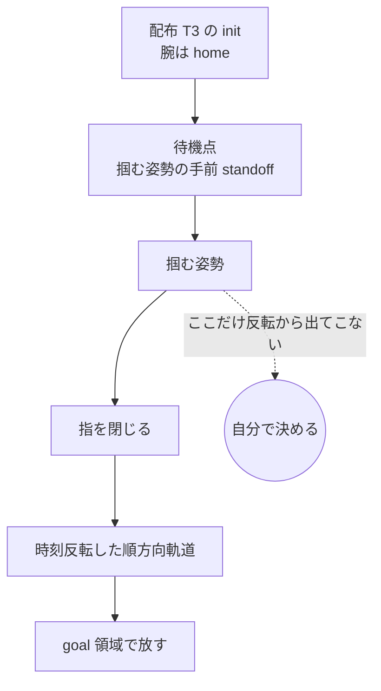

# 30. 逆向きエピソードの掴む姿勢をどう決めるか

**逆向きの軌道は順方向デモの時刻反転で作れるが、「どう掴むか」だけは反転から
出てこない。**配布 T3 の初期状態は順方向デモの終端とは別物（腕は home、物は
配布 T3 が置いた場所）なので、**掴みに行く区間は自分で作る**しかない。この
判断を 1 か所に置く。データの中身の規約は
[29_training_data_requirements.md](29_training_data_requirements.md)、配布 T3
そのものの中身は [28_track3_contents.md](28_track3_contents.md) にある。

| 節 | 中身 |
|---|---|
| [1](#1-なぜ掴む姿勢だけ別に決めるのか) | なぜ掴む姿勢だけ別に決めるのか |
| [2](#2-既定は-transfer順方向の相対姿勢を掛け直す) | **既定は `transfer`**——順方向の相対姿勢を掛け直す |
| [3](#3-移せるかは立つ軸を測れば分かる) | **移せるかは「立つ軸」を測れば分かる** |
| [4](#4-移せないときは真上からの握りを作る) | 移せないときは真上からの握りを作る |
| [5](#5-順方向デモは再現するものだけ使う) | **順方向デモは再現するものだけ使う** |
| [6](#6-掴む姿勢-1-つで全部は掴めない順方向デモを複数使う) | **掴む姿勢 1 つで全部は掴めない**——順方向デモを複数使う |
| [7](#7-1-本のデモが何度も掴むときサイクルに切り分ける) | **1 本のデモが何度も掴むとき**——サイクルに切り分ける |
| [8](#8-使い方と実績) | 使い方と実績 |

## 1. なぜ掴む姿勢だけ別に決めるのか

時刻反転で得られるのは**物を掴んだ後**の軌道である。逆向きエピソードは配布 T3
の init から始まり、そこでは腕が home にあって物に触れてもいない。**init から
掴む位置まで腕を運ぶ区間が、反転した軌道には存在しない。**

そこで「掴む姿勢」を 1 つ決め、そこへ向かう接近区間を作ってから、反転した軌道へ
繋ぐ。この節以降はその「掴む姿勢」の決め方である。



## 2. 既定は `transfer`——順方向の相対姿勢を掛け直す

順方向デモが掴んだ瞬間の**手を、物の座標系で測る**。それを今の物の姿勢に掛け
直せば、物がどこにどの向きで置かれていても同じ掴み方が再現できる。

```
R_grasp = R_obj_now · (R_obj_thenᵀ · R_eef_then)
p_grasp = p_obj_now + R_obj_now · R_obj_thenᵀ · (p_eef_then − p_obj_then)
```

実装は `replay_video_probe.grasp_pose_from_forward`。本タスクはこれで
**150/150** 通っている。

**成り立つ条件は 1 つだけである。今の物の向きが、順方向デモが実際に掴んだ
向きと同じであること。**物の向きが違えば手の向きも同じだけ回るので、順方向で
上から掴んでいたものが横から掴む形に化ける。次節がその見分け方である。

## 3. 移せるかは「立つ軸」を測れば分かる

**物が置かれているとき鉛直を向くローカル軸**を、順方向 reset と配布 T3 init の
両方で測って比べる。回転体の対称軸でもあるこの軸が食い違っていれば、物は倒れ方
そのものが違う。実装は `replay_video_probe.standing_axis`。

| T3 タスク | 順方向の立つ軸 | T3 の立つ軸 | 判定 |
|---|---|---|---|
| yellow book | z | z | 一致 → `transfer` |
| red mug | z | z | 一致 → `transfer` |
| **alphabet soup** | **y** | **z** | **不一致 → `transfer` は使えない** |

缶が食い違う理由は見れば分かる。**順方向では机の上に立っているが、配布 T3 では
トレイの中で横倒しになっている。**順方向デモはエピソードの最初から最後まで缶を
立てたままなので、**倒れた缶を掴んでいるコマが 1 つも無い。**

そして順方向の進入方向は**缶の軸に沿った向き**（立っている缶の天面へ真上から）
なので、これを横倒しの缶へ移すと「円い端面へ真横から突っ込む」形になり、トレイの
壁に阻まれる。**缶の対称軸まわりに回しても軸の向きは変わらない**ので、
対称性の折り返し（`--object-symmetry`）でも直らない。

実測: 掴む先まで 319 mm の地点から接近を始めて、**240 コマかけて誤差が
451 mm へ開いた**（縮まらずに発散した）。

## 4. 移せないときは真上からの握りを作る

トレイの中の横倒しの缶は、横から掴もうとしても壁に阻まれる。**真上から掴むしか
ない。**その姿勢を物の形から組み立てる。実装は
`replay_video_probe.top_down_grasp`。

| 決めるもの | 何にするか |
|---|---|
| 進入方向（グリッパのローカル z） | 世界の真下 `[0, 0, -1]` |
| 指の閉じ軸（ローカル y） | 物の対称軸に直交する水平方向。180 度回しても同じ握りなので、手首を回す量が少ないほうを採る |
| 手の位置 | 物の中心の真上。高さは**順方向デモが掴む点から手を引いていた距離**（`grasp_backoff`） |

**握り自体は順方向と変わらない。**缶は直径 62.4 mm の真円柱（外形 62.4 × 76.2
× 62.4 mm、軸はローカル y）で、指の最大開き幅は 80 mm、順方向デモが実際に挟んだ
幅は 62.9〜63.6 mm ≒ 直径である。横倒しでも真上から軸に直交して挟めば、**挟む幅も
触る面（円筒側面）も順方向と同一**なので、滑る理由がない。違うのは軸のどちら向き
から寄るかだけである。

缶タスクでの実測:

| | `transfer` | `top-down` |
|---|---|---|
| 接近コマ数 | 240（上限に張り付き） | **33〜134** |
| 接近後の残り誤差 | 451〜625 mm | **3.6〜8.5 mm** |
| 逆向き goal | 0/4 | **4/4** |

## 5. 順方向デモは再現するものだけ使う

掴む姿勢は順方向デモの**再生結果**から測る（`transfer` は相対姿勢、`top-down`
は手を引く距離）。**再生が再現しなければ、測った値は物理的な意味を持たない。**
掴んでいないときの手と物の位置関係を「掴む姿勢」として使ってしまう。

**判定は「順再生で物が動いたか」で行う。**順方向 goal の述語は使えない——goal の
相手が region site とは限らないためである（マグの順方向 goal は `plate_1` という
**物**が相手で、site を引くと落ちる）。

実測（マグの順方向デモ 20 本、配布 T3 の init 2 行ずつで逆向きを試した結果）:

| 順再生で物が動いたか | 本数 | 逆向き goal |
|---|---|---|
| 動いた | 14 | **全部 2/2** |
| 動かなかった（1 mm 未満） | 6 | 0/2 が 5 本・1/2 が 1 本 |

**動いたかどうかで完全に分かれる。**順方向デモを増やすときは、まず余分に抜いて
このふるいに掛ければよい。

## 6. 掴む姿勢 1 つで全部は掴めない——順方向デモを複数使う

**掴む姿勢は順方向デモ 1 本につき 1 つしか出てこない。**配布 T3 の init は物の
向きを大きく振るので、その 1 つで 50 通り全部を掴めるとは限らない。

実測（赤マグ、順方向デモ 3 本 × init 50 行）:

| 順方向デモ | 成功 | 落ちた init のヨー |
|---|---|---|
| ep2206 | 39/50 | **+99°〜+151° の帯にすべて収まる**（11 本） |
| ep2199 | 50/50 | — |
| ep2202 | 50/50 | — |

落ちた回は接近そのものは 4.6 mm まで寄れていて、**掴んだあとマグが 47 mm しか
動かず皿の上に残る**（成功時は 366〜403 mm 動く）。取っ手の向きで指が滑っている。

**順方向デモを複数使えば埋まる。**上の 3 本で全 50 init が最低 2 回カバーされた
（39 個は 3 回、11 個は 2 回）。1 本だけで回すと、物の向きに穴が空いたまま
気づかない。

### デモを増やすと何が増えるのか——**掴み方だけである**（2026-09-07 に測った）

**順方向デモは、どれも物がほぼ同じ場所・まったく同じ向きで始まる。**順方向
bddl の初期領域を読むと、対象物の置き場所は **20〜50 mm 角**しかなく、
**`:yaw_rotation` は 4 タスクすべて `0.0 0.0`（振れ幅ゼロ）**である。

| | 対象物の初期領域 | yaw |
|---|---|---|
| 順方向（`libero_90`） | **20 mm 角**（本）／**50 mm 角**（缶・マグ） | **0°（固定）** |
| 配布 T3 | 150 mm 角（本）〜230 mm 角（two mugs） | **約 270° 振れる** |

**つまり物の置き方・向きの網羅は、順方向デモからは 1 mm も出てこない。**
それは配布 init の 50 行が持っている（すでに全部使っている）。

**デモを増やして増えるのは「同じ物を人がどう掴んだか」の違いだけである。**
`compare_forward_demos.py` で全デモを突き合わせた実測:

| タスク | デモ | コマ数 中央 | **掴む位置**の散らばり | **掴む向き**の散らばり（全ペア） | 経路同士の距離 |
|---|---|---|---|---|---|
| 本 | 44 | 166 | 重心から中央 **25.3 mm** | 中央 **16.5°** / 最大 48.8° | 全長の **4.3%** |
| 缶 | 44 | 117 | 中央 20.8 mm | 中央 **7.8°** / 最大 23.7° | 4.2% |
| 赤マグ | 34 | 136 | 中央 22.1 mm | 中央 **7.3°** / 最大 35.4° | 4.9% |

**腕の初期姿勢は事実上振れていない**（重心からの距離 中央 7.5〜10.6 mm）。
`libero_90` にはロボット初期姿勢の摂動版が無いためである
（[reference/06](06_training_data_composition.md)）。

**読み方。**デモを増やすと、掴む向きが中央 7〜17°（最大 49°）・掴む位置が
20〜25 mm・経路の形が全長の 4% ぶん散る。**これは上の表の「ヨーの帯」を埋めるには
十分だった**（3 本で 39/50 → 50/50）。**一方で、物がどこにどの向きで置かれても
掴めるようにする役には立たない**——そこは `transfer` / `top-down` の掴む姿勢の
作り直し（2〜4 節）が担っている。

**使える上限は手元のデモ本数 × 再現率である。**本 44・缶 44・赤マグ 34・
two mugs 313 本あり、再現率は赤マグの実測で 70%（20 本中 14 本）。
**いま使っているのは 2〜3 本なので、8〜10 倍まで増やせる。**

## 7. 1 本のデモが何度も掴むとき——サイクルに切り分ける

**1 本のデモが 2 つの物を別々の場所へ置くことがある**（two mugs。
[reference/28 の 1.1 節](28_track3_contents.md)）。このとき、いままでの
「1 回掴んで、あとは反転した軌道を最後まで辿る」は**成り立たない。**

実測: 1 個目のマグを掴んだまま 2 サイクルぶん引きずり、皿と赤マグを 13〜34 mm
動かして **0/1** で終わった。

### 切り分けは指の開閉で行い、相手は**動いた量で決める**

順方向デモの `action[6]` が閉じている区間を 1 サイクルとする。**その回の相手は、
閉じているあいだにいちばん動いた物**である。**物の名前は書かない**——測って
決めるので、隠しタスクにも同じ規則が効く。実装は
`gripper_shift_sweep.grasp_cycles`。

捨てるものが 2 つある。**指が一瞬しか閉じない区間**（4 コマ未満）と、
**何も動かしていない区間**（20 mm 未満）。どちらも掴み損ねで、そこから掴む
姿勢を測ると値が壊れる（5 節）。

実測（two mugs の順方向デモ 20 本、**指令の列だけを見た数**）: **19 本がちょうど
2 回**、1 本が 3 回（掴み直し）。**ここから「動いたか」でさらに落ちる**——
指令の上では 2 回掴んでいても、再生すると物が動かない回があるためである
（下の表）。

### 逆向きは**サイクルごとに掴み直す**

逆向きは順方向の**最後のサイクルから**辿る。1 サイクルぶんの中身は、単体タスクで
やってきたことと同じである。

| 段 | 中身 |
|---|---|
| 接近・把持 | **その物のいまの姿勢**へ掴む姿勢を引き直して掴む（2〜4 節） |
| 復路 | そのサイクルの区間だけを反転して辿る |
| 設置 | 触れた所で放す（[reference/31](31_reverse_place_without_contact.md)） |

コマ番号の対応は「逆向き `i` ↔ 順方向 `T-1-i`」だけで決まる。

```
復路の入口 = T - 1 - （順方向がそのサイクルで放したコマ）
放す位置   = T - 1 - （順方向がそのサイクルで実際に挟み終えたコマ）
```

**サイクルが 1 つのときは、いままでと 1 ビットも変わらない**（本・缶・マグで
確認済み）。単体タスクは N=1 の場合として同じ経路に畳まれている。

### ふるいは「**goal の物を全部動かしたか**」になる

5 節のふるい（順再生で物が動いたか）は、そのまま**物ごと**に効く。goal が求める
物を 1 つでも動かせていないデモは使えない。

実測（two mugs、順方向デモ 20 本 × 配布 init #0）:

| | 本数 |
|---|---|
| 2 つとも動いた | **10**（うち逆向き goal が **8**） |
| 片方だけ、または 1 つも動かなかった | 10（飛ばす） |

## 8. 使い方と実績

`run_gripper_shift_sweep.sh` の環境変数で選ぶ。既定は `transfer`。

置き方（`LIFT` / `RELEASE` / `LEVEL` / `MAX_TAIL`）は
[reference/31 の 8 節](31_reverse_place_without_contact.md)。**作り直しの手順は
[020](../talk/inter_sessions/020_reverse_dataset_regeneration.md) に全部展開して
ある。**

```bash
# 本・マグ（立つ軸が一致する）
TASK=mug EP_NPZ=ep_mug20.npz MODE=phased INIT_SOURCE=t3 \
  GRASP_FRAME=clamped STANDOFF=0.06 T3_INIT=all MAX_APPROACH=120 \
  LIFT=0.08 RELEASE=contact LEVEL=1 MAX_TAIL=5 WRITE_NPZ=reverse_npz_mug \
  bash solution/tools/track3_reversal/run_gripper_shift_sweep.sh "0" "2206,2199,2202"

# 缶（立つ軸が食い違うので真上からの握りを作る）
TASK=soup EP_NPZ=ep_soup.npz MODE=phased INIT_SOURCE=t3 \
  GRASP_FRAME=clamped STANDOFF=0.06 T3_INIT=all MAX_APPROACH=120 \
  GRASP_STYLE=top-down LIFT=0.08 RELEASE=contact MAX_TAIL=5 \
  WRITE_NPZ=reverse_npz_soup \
  bash solution/tools/track3_reversal/run_gripper_shift_sweep.sh "0" "3696,3697"

# two mugs（1 本のデモが 2 回掴む。7 節）
TASK=twomugs EP_NPZ=ep_twomugs20.npz MODE=phased INIT_SOURCE=t3 \
  GRASP_FRAME=clamped STANDOFF=0.06 T3_INIT=all MAX_APPROACH=120 \
  LIFT=0.08 RELEASE=contact LEVEL=1 MAX_TAIL=5 WRITE_NPZ=reverse_npz_twomugs \
  bash solution/tools/track3_reversal/run_gripper_shift_sweep.sh "0" ""
```

`MAX_APPROACH` は接近の各段に許すコマ数である。既定の 60 は本タスクの距離
（約 200 mm）に合わせた値で、缶・マグは 300 mm 以上あるため足りない。

この設定で作った実績:

| タスク | 掴み方 | 順方向デモ | 出来た本数 | コマ数 |
|---|---|---|---|---|
| 本 | `transfer` | 3 | **150/150** | 26,443 |
| 缶 | `top-down` | 2 | **100/100** | 17,141 |
| 赤マグ | `transfer` | 3 | **139/150** | 24,191 |
| 合計（`merge` 後） | | | **389** | 67,775 |

**この 389 本は、置き方（[reference/31](31_reverse_place_without_contact.md)）を
直す前のものである。**作り直しは
[020](../talk/inter_sessions/020_reverse_dataset_regeneration.md)。

two mugs は配布 init #0 で試したところ（9/7）、順方向デモ 20 本のうち
**10 本が使え、8 本で逆向き goal が立った**（1 本あたり 247〜300 コマ）。
init 50 行への展開はこれから。

動く様子は [work/shares](../../work/shares/README.md) に動画で置いてある。
