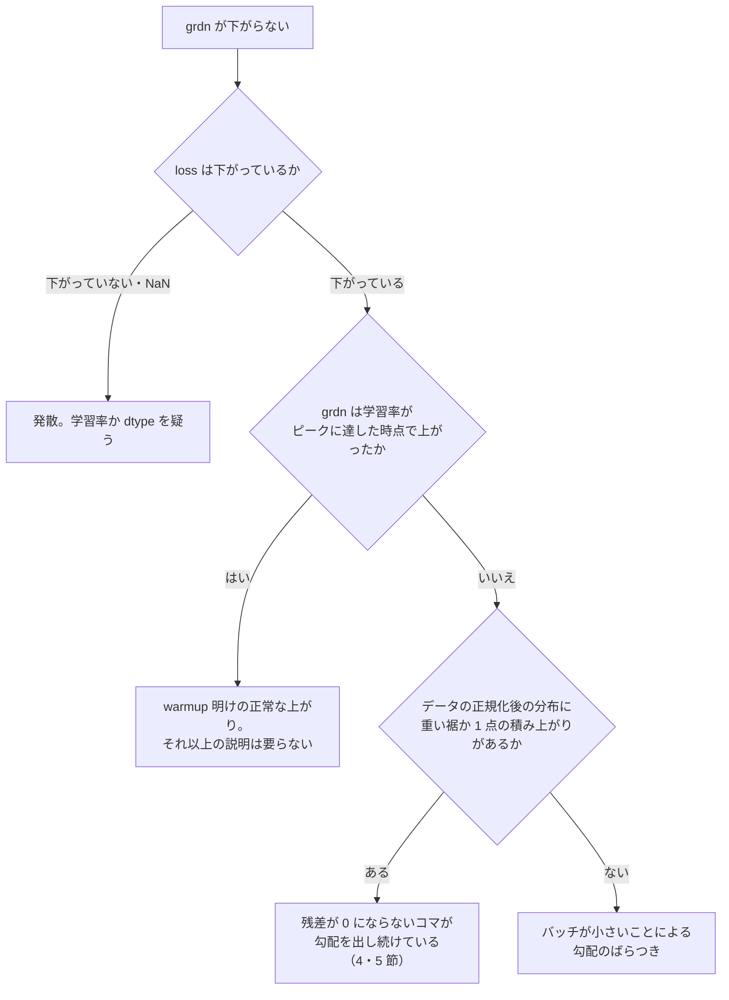

# 33. 勾配（`grdn`）の読み方と、指令が上限ちょうどに積み上がると何が起きるか

**学習ログの `grdn` が下がらないとき、何を疑い、何を疑わなくてよいかを 1 か所に置く。**
2026-09-10 に `pi05_v2_base24k` の `grdn` が配布データだけの学習の 1.6〜1.7 倍から
下がらない理由を調べて分かったことを、一般の事実と、この案件の実測に分けて書く。

**扱う範囲。**ここは「勾配をどう読むか」と「行動指令の分布が勾配に効く仕組み」である。
**掴む姿勢の作り方**は [30](30_reverse_grasp_pose.md)、**混ぜたときに正規化統計が
どう動くか**は [29 の 6・7 節](29_training_data_requirements.md)、
**流した学習と点**は [19](19_weights_catalog.md) にある。

| 節 | 中身 |
|---|---|
| [1 `grdn` が何の数値か](#1-grdn-が何の数値か) | lerobot が出しているのは**切る前**の値である |
| [2 毎歩切られているとき、最適化器が受け取る勾配はむしろ大きい](#2-毎歩切られているとき最適化器が受け取る勾配はむしろ大きい) | **「クリップされている＝実効の学習率が下がる」は成り立たない** |
| [3 `grdn` が下がらないときに疑う順番](#3-grdn-が下がらないときに疑う順番) | 発散・裾の重さ・上限ちょうどの積み上がりの見分け方 |
| [4 実測: v2 のデータは上限ちょうどの値が 1 点に積み上がっている](#4-実測-v2-のデータは上限ちょうどの値が-1-点に積み上がっている) | 2026-09-10・993 万コマ全部 |
| [5 なぜ 1 点への積み上がりだと勾配が下がりきらないか](#5-なぜ-1-点への積み上がりだと勾配が下がりきらないか) | flow matching は 1 点に集中した分布を出せない |
| [6 複製の倍率が、配布データの尺度を決めてしまう](#6-複製の倍率が配布データの尺度を決めてしまう) | ×8 で配布の回転が半分に潰れる |
| [7 測って外した候補](#7-測って外した候補) | 同じ道を二度歩かないために |
| [8 一般に言われていること](#8-一般に言われていること) | 分位点による正規化・混ぜる割合 |

---

## 1. `grdn` が何の数値か

**ログを読み違えないために、まず定義を押さえる。**

lerobot の学習ログは 1 行にこう出る。

```
step:2K smpl:31K ep:195 epch:0.03 loss:0.286 grdn:1.551 lr:2.5e-05 ...
```

`grdn` は `clip_grad_norm_` の返り値で、**切る前の勾配ノルム全体**である
（`lerobot_train.py` の `update_policy` が `accelerator.clip_grad_norm_` の返り値を
`train_metrics.grad_norm` に入れている）。設定の上限は `optimizer.grad_clip_norm` で、
**π0.5 の既定は 1.0** である。

| ログの値 | 意味 |
|---|---|
| `grdn` < 1.0 | 切られていない。勾配そのものの大きさ |
| `grdn` ≥ 1.0 | **切られた。**最適化器が受け取る勾配のノルムは**ちょうど 1.0 になる** |

**ログの値は 1 ステップの値ではない。**`grdn` は `AverageMeter` で、
**`log_freq` ステップ（この案件では 20）の平均**が出て、そのあと reset される。
**だから 1 ステップごとの振れはログからは見えない。**

---

## 2. 毎歩切られているとき、最適化器が受け取る勾配は**むしろ大きい**

**「クリップされている＝実効の学習率が 1/3 になっている」は成り立たない。**
2026-09-10 に 9/10 まで着手中タスクの板に書いてあった読みを、この節で訂正した。

**理由は 2 つある。1 つ目のほうが決定的である。**

### 2.1 クリップは勾配を「縮める」のではなく「ノルムを 1.0 に揃える」

`clip_grad_norm_(params, 1.0)` は、ノルムが 1.0 を超えていたら**ちょうど 1.0 に正規化する。**
**だから毎歩切られている学習では、最適化器が受け取る勾配のノルムは毎歩 1.0 で一定である。**

| 学習 | ログの `grdn`（中央） | **最適化器が受け取るノルム** |
|---|---|---|
| `pi05_full_local`（配布のみ・24,000 ステップ） | 0.84 | **0.84**（切られていない） |
| `pi05_clean24k`（掃除後・24,000 ステップ） | 0.81 | **0.81**（切られていない） |
| **`pi05_v2_base24k`**（v2 混合・2,200 ステップ時点） | **1.36** | **1.00** |

**v2 のほうが 2 割ほど大きい勾配を受け取っている。**縮んでいない。

### 2.2 AdamW は勾配の大きさを打ち消す

AdamW の 1 歩の更新量は、勾配 `g` に対して次の形をしている。

```
更新量 = lr × m / (√v + eps)      m: g の指数移動平均      v: g² の指数移動平均
```

**勾配を一律 `c` 倍すると `m` は `c` 倍・`√v` も `c` 倍になり、割り算で `c` が消える。**
`eps`（π0.5 の既定 1e-8）ぶんだけずれるが、無視できる大きさである。
**`v` の指数移動平均は `beta2 = 0.95`** なので、**およそ 20 ステップの窓で均される**
——1 ステップごとの振れも、この窓のなかで打ち消される。

**帰結。`grdn` が 1.4 で張り付いていても、それだけでは学習は止まらない。**
`grdn` は**症状であって病名ではない。**病名を知るには、下の 3 節へ進む。

**ただし `grdn` が読めなくなるのは事実である。**切られているあいだは
「本当の勾配がいくつか」がログから消える。**切り分けのあいだだけ
`--optimizer.grad_clip_norm` を 3.0 に上げると、値が読めるようになる**（更新量は上の理由でほぼ変わらない）。

---

## 3. `grdn` が下がらないときに疑う順番

**`grdn` が高いままでも、それが「壊れている」のか「そういうデータなのか」は分かれる。**
見分けは loss の下がり方と組み合わせて行う。



**`pi05_v2_base24k` は E と G の両方だった。**

| ステップ | 20 | 200 | 600 | 800 | 1,000 | 1,500 | 2,200 |
|---|---|---|---|---|---|---|---|
| loss | 2.091 | 1.280 | 0.448 | — | 0.373 | 0.303 | **0.270** |
| `grdn` | 4.694 | 2.100 | **1.074** | warmup 終了 | 1.380 | 1.302 | 1.358 |

**600 ステップの 1.074 から 1.4 前後へ戻ったのは、学習率を 0 から上げていく区間（warmup）が
800 ステップで終わって 2.5e-5 に達した時点と一致する。**ここまでは正常である。
**残りの「配布データだけなら 0.84 まで下がるところが 1.36 で止まる」ぶんが 4 節の話である。**

**loss の値そのものは学習どうしで比べられない。**データが違えば正規化の尺度が変わり、
loss の尺度も変わる（[29 の 6.3 節](29_training_data_requirements.md)）。
**比べられるのは下がり方の形だけである。**

---

## 4. 実測: v2 のデータは上限ちょうどの値が 1 点に積み上がっている

**2026-09-10 に `~/data/jaist_mix_v2_x8_base` の parquet を全部読んで測った**
（992,843 コマ・配布 501,403 コマ／逆向き 491,440 コマ）。

### 4.1 上限ちょうどの値を持つコマの割合

**配布データの `action` は並進が ±0.9375（＝60/64）、回転が ±0.375 で頭打ちになっている。**
こちらのデータは、その値**ちょうど**を大量に持っている。

| `action` の次元 | 配布データ | **逆向きデータ** | 全体に対する割合 |
|---|---|---|---|
| `dx` | 1.60% | 3.06% | 2.32% |
| `dy` | 0.25% | **14.95%** | 7.53% |
| `dz` | 4.59% | 9.10% | 6.82% |
| `rx` | 0.00% | 2.99% | 1.48% |
| `ry` | 0.01% | 0.59% | 0.29% |
| **`rz`（手首のひねり）** | **0.53%** | **28.81%** | **14.53%** |

**さらに、逆向きの並進は配布データに存在しない ±1.000 ちょうどに達している**
（配布の最大は 0.9375）。`dy` で 14.59%・どれか 1 軸でも見ると **20.24%**。

### 4.2 積み上がりはエピソードの先頭に集中している

| 逆向きエピソード内の区間 | 並進が ±1.000 ちょうど | 回転が ±0.375 ちょうど |
|---|---|---|
| **先頭 0〜10%** | **100.0%** | 71.8% |
| 10〜25% | 18.9% | 47.0% |
| 25〜50% | 22.4% | 33.0% |
| 50〜75% | 5.6% | 38.7% |
| 75〜100% | 1.1% | 1.0% |
| （対照）配布データの先頭 0〜10% | 5.3%（±0.9375） | 0.0% |

**先頭で上限ちょうどが連続する長さは中央 19 コマ**（最短 15・最長 24）。
**3,176 本すべてで 1 コマ以上あり、0 コマの本は無い。**
この区間だけで逆向きの 12.2%・全体の 6.0% を占める。

### 4.3 出どころは接近区間の比例制御である

原因は [replay_video_probe.py](../../solution/tools/track3_reversal/replay_video_probe.py) の
`osc_command` である。**目標姿勢との差を `OUT_MAX` で割って ±1 で切る比例制御**なので、
init（腕は home）から掴む姿勢まで 300 mm 離れている接近区間では、**差が大きすぎて
出力が上限のまま並ぶ。**

**2026-09-08 の `ROT_LIMIT=0.375` は、[30 の 8 節](30_reverse_grasp_pose.md) が狙ったとおり
`|z|>10` の外れ値を消した**（v2 自身の統計で測った最大 `|z|` は配布 5.01・逆向き 5.40）。
**しかし外れ値を消しただけで、上限ちょうどという 1 点への積み上がりは残った**——
むしろ切る位置が揃ったぶん、1 点に集まった。

### 4.4 分布の形

正規化したあとの 1 コマぶんのエネルギー（7 次元の `z` の二乗和。7 が基準）で見ると、
**中央値の差より裾の差のほうが大きい。**

| | 中央 | p99 | 裾の重さ（尖度。正規分布なら 3） |
|---|---|---|---|
| 配布データ | 4.42 | 14.9 | 5.8 |
| **逆向きデータ** | 6.73 | **54.4** | **11.5** |

**正規化すると全体の分散は必ず 1 になるので、平均では差が出ない。差は裾にしか出ない。**

---

## 5. なぜ 1 点への積み上がりだと勾配が下がりきらないか

**π0.5 は、なめらかな速度場を学習する型（flow matching）である。**
なめらかな速度場は、**1 点に集中した分布（分布の端に立った針）を表現できない。**


**規模。**`rz` だけで全体の 14.5% のコマが針に当たる。バッチ 16 なら毎歩 2〜3 個入る。

**学習側で消せない。**正規化の尺度を変えても、切る位置が動くだけで針は残る。
**針を消せるのはデータを作り直すときだけである。**

**モデル側に出る形。**上限に張り付いた目標に対して、モデルは中間の値へ潰れる。
実測でも `pi05_t3rev`（v1）の回転指令は p95 0.08〜0.63 に対し記録は 0.37〜1.00 だった
（[knowledge/21](../knowledge/21_track3_stops_short_of_the_object.md)）。

---

## 6. 複製の倍率が、配布データの尺度を決めてしまう

**混ぜると配布側の正規化まで変わることは [29 の 6 節](29_training_data_requirements.md) にある。
ここに足すのは「倍率をいくつにすると、配布側がどれだけ潰れるか」の実測の表である。**

**まず前提として、`jaist_mix_v2_x8` の逆向き 3,176 本は 397 本を 8 回ずつ複製したものである**
（`action` 列・`observation.state` 列とも md5 が完全一致するグループがちょうど 397 個・各 8 本）。
**複製に新しい情報は 1 ビットも入っていない。**複製しない場合の割合は 10.9% である。

| 逆向きの倍率 | 逆向きの割合 | 混合の `rz` std | **配布データの `rz` が正規化後に持つ大きさ**（配布のみを 1.00 とする） |
|---|---|---|---|
| 混ぜない | 0% | 0.0792 | 1.00 |
| ×1 | 10.9% | 0.1023 | 0.77 |
| ×2 | 19.7% | 0.1176 | 0.67 |
| ×3 | 26.9% | 0.1288 | 0.61 |
| ×4 | 32.9% | 0.1375 | 0.58 |
| **×8（`jaist_mix_v2_x8`）** | **49.5%** | **0.1590** | **0.50** |

**読み方。**×8 では**配布 40 課題の手首のひねりの学習信号が半分に潰れている。**
[29 の 6.3 節](29_training_data_requirements.md) が「割合 20% で 0.43 倍に縮む」と
書いているのと同じ現象で、こちらは倍率ごとの値である。

**`proto20` が Track2 を 0.9167 → 0.5833 に落としたこと**
（[025 の 1.1 節](../talk/inter_sessions/025_reverse_data_state_and_next.md)）は、
「全般的なドリフト」よりこちらで説明したほうが具体的である。**ただしまだ実証していない**
——倍率を下げた学習を 1 本回すまでは仮説である。

---

## 7. 測って外した候補

**同じ道を二度歩かないために、否定した読みも残す。**

| 候補 | 測ったこと | 結果 |
|---|---|---|
| 軸角ベクトルが ±π を跨いで符号が飛んでいる | 1 ステップの軸角ベクトルの飛びの最大 | **違う。**配布 0.11・逆向き 0.12。跨いだコマは無い |
| `\|z\|>10` の外れ値がまだ残っている | v2 自身の統計での最大 `\|z\|` | **違う。**配布 5.01・逆向き 5.40（v1 は 24.8） |
| 正規化後の平均エネルギーが配布より大きい | 倍率を変えて期待エネルギーを計算 | **違う。**正規化すると全体の分散は 1 になるので、倍率をどう変えても平均は動かない。**差は裾にしか出ない**（4.4 節） |
| 学習する範囲（action expert だけ）が悪い | `proto21` で 120 ステップ | **違う。**[025 の 1.5 節](../talk/inter_sessions/025_reverse_data_state_and_next.md) |
| バッチを大きくすれば収まる | lerobot v0.6.0 の `TrainPipelineConfig` | **手が無い。**勾配の累積の設定が無く、GPU も 20 GB のうち 16.3 GB を使っている |

---

## 8. 一般に言われていること

**手元の実測ではなく、外部の一次資料から取った事実である。**判断の材料にはなるが、
**この案件で試したわけではない。**

### 8.1 π0 系の既定は、mean/std ではなく分位点による正規化である

[openpi](https://github.com/Physical-Intelligence/openpi) の π0 系は、
**行動の 1%・99% 分位点を ±1 に写す**正規化を使う。理由は**外れ値に強くするため**と
明記されている。[openpi の issue #763](https://github.com/Physical-Intelligence/openpi/issues/763)
には「ほとんど使われない次元は std が小さくなり、正規化後に巨大な値になる」という指摘がある。
[LeRobot の π0.5 のドキュメント](https://huggingface.co/docs/lerobot/pi05) も
**STATE・ACTION を分位点で正規化するのが既定**だと書いている。

**この案件では採れない。**出発点の `lerobot/pi05_libero_base` は
`policy_preprocessor.json` に `{"VISUAL": "IDENTITY", "STATE": "MEAN_STD", "ACTION": "MEAN_STD"}`
を持っており、**学習済み action expert の尺度が mean/std に合わせて決まっている。**
切り替えると尺度がずれるうえ、24,000 ステップの 2 本とも 1 変数の比較でなくなる。
**lerobot v0.6.0 の `NormalizationMode` には `QUANTILES`・`QUANTILE10` があるので、
出発点から通し直すときには選べる。**

### 8.2 混ぜる割合の相場

[π0 / π0-FAST の解説](https://huggingface.co/blog/pi0) によると、π0 は追加学習を
**1 タスク 50〜200 本**のデモで行い、**混ぜる割合は 1:1** を使っている。
一方 Mobile ALOHA は **10% の追加データでも効いた**と報告している。
**つまり「効く割合」に定説は無く、実測で決めるものである。**

### 8.3 上限で切った指令を学習データに入れることの扱い

**この点について「やってはいけない」と明言した一次資料は見つからなかった。**
分かるのは、π0 系が外れ値を**切るのではなく分位点で写す**設計を選んでいることだけである
（8.1 節）。**5 節の説明は、flow matching の性質からの推論であって、
論文が主張していることではない。**
