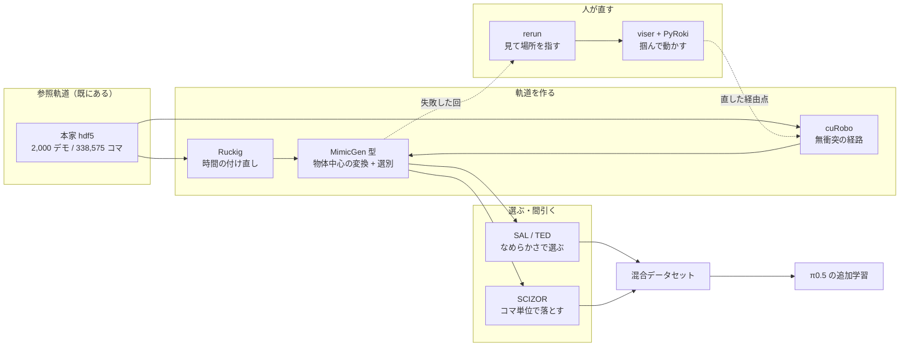

# 34. 軌道とデータを作り直す道具の調査 —— **手作りしている 5 つは、既に外に道具がある**

> **状態: 調査のみ（2026-09-11）** ／ 実測は 1 件も含まない ／ 更新: 2026-09-11
>
> **この文書は「外の世界が何を使っているか」だけを書く。**
> **手の設計は [plan/23](../plan/23_data_regeneration_design.md) が持っている。**重複させない。
> **MPPI 単体の可否は [reference/28](28_mppi_data_regeneration_survey.md) で結論が出ている**（採らない）。
> **Ruckig を実際に入れた実装と実測は [35](35_command_profile_and_ruckig.md) が持っている**（この文書の 4.1 節を 1 点訂正している）。

**読み終えたときに分かること。**
[026](../talk/inter_sessions/026_contact_demo_cleanup.md)・[028](../talk/inter_sessions/028_reverse_approach_velocity_profile.md)・[030](../talk/inter_sessions/030_data_side_levers_review.md)
で手作りしている仕掛けのうち、**どれが既製の道具に置き換わり、どれが置き換わらないか。**
そして**「動画を見て、悪い場所を人が直す」ための道具が実在するか。**

| 節 | 中身 |
|---|---|
| [1 なぜこの調査が要るか](#1-なぜこの調査が要るか--手作りしている-5-つの対応表) | **手作り ↔ 既製の道具**の対応表。ここだけで全体が分かる |
| [2 順位づけ](#2-順位づけ--917-に間に合う順) | 9/17 に間に合う 4 件・本選 2 の 3 件・採らない 3 件 |
| [3 人が動画を見て直す道具](#3-人が動画を見て直す道具) | ユーザが名指しした系統。**viser + PyRoki が制約に合う** |
| [4 軌道の作り方を道具に置き換える](#4-軌道の作り方を道具に置き換える--028-の直接の代わり) | **028 が手で書く最小ジャークは Ruckig が MIT で持っている** |
| [5 作り直しを自動でやる](#5-作り直しを自動でやる--plan23-の-ac-の一般形) | **(A) に足りないのは「物体中心の変換」である** |
| [6 選び方・間引き方を変える](#6-選び方間引き方を変える--026-が外した軸のやり直し) | **採点式の SPARC がそのまま選別の指標になっている** |
| [7 Track3 に固有の研究](#7-track3-に固有の研究--時間反転は対称な課題でしか成り立たない) | 時間反転の対称性・早期逸脱の正体 |
| [8 本選 2 向けの大型](#8-本選-2-向けの大型--6-日には入らないもの) | DreamGen・MJX・データエンジン |
| [9 ライセンスと規則](#9-ライセンスと規則--提出前に確かめる-3-件) | **レポート必須欄に影響する** |
| [10 出典](#10-出典) | URL はここにだけ置く |

---

## 1. なぜこの調査が要るか —— 手作りしている 5 つの対応表

**いま詰まっているのは着想ではなく、作りの粗さである。**
028 は 5 次多項式の速度の形を自分で書き、歩数 `N` を `1.875*L/(上限*11.25mm)` と手で当て、
`np.clip` が発動したら設計が間違っている合図にする——と決めている。
**この 3 つはどれも、既製の道具が保証つきで持っている性質である。**

**下の表が、この文書の全体である。**

| # | 手作りしているもの | どこ | 既製の道具 | **道具にすると何が変わるか** |
|---|---|---|---|---|
| 1 | **最小ジャークの通過点列と歩数 `N` の見積り** | [028 の 5.1](../talk/inter_sessions/028_reverse_approach_velocity_profile.md) | **Ruckig**（MIT・`pip install ruckig`） | **1 コマの指令が上限を超えないことが構成上保証される。**歩数は見積らず、道具が返す |
| 2 | **接触を避ける経由点の総当たり**（(C) の 4×3・3×2） | [plan/23 の 4.3](../plan/23_data_regeneration_design.md) | **cuRobo**（Apache 2.0） | **総当たりが要らない。**衝突なしを制約として解く。**LIBERO で 19.7K 本の無衝突デモを作った実績がある**（[4.2 節](#42-キーポーズ--動作計画--libero-で-197k-本の無衝突デモを作った形)） |
| 3 | **摂動下の再生と合否判定**（(A)） | [plan/23 の 4.1](../plan/23_data_regeneration_design.md) | **MimicGen / Isaac Lab Mimic** | **歩留まり 52.5% が上がる見込みがある。**(A) は MimicGen から**物体中心の変換を抜いた形**である（[5.1 節](#51-mimicgen-系--a-に足りないのは物体中心の変換である)） |
| 4 | **エピソード単位の掃除と統計の再計算**（`rebuild_dataset.py`） | [026 の 12](../talk/inter_sessions/026_contact_demo_cleanup.md) | **`lerobot-dataset-editor`** | `remove-episode` / `trim-frames` が統計の再計算と原子的な書き戻しつき |
| 5 | **mp4 を焼いて目で見る**（`render_contact_videos.py`） | [026 の 11](../talk/inter_sessions/026_contact_demo_cleanup.md) | **rerun**（LeRobot loader 内蔵） | **動画と行動 7 次元の折れ線が 1 本のタイムラインで同期する。**「どのコマで壊れたか」を数えずに指せる |

**そして、まだ道具を 1 つも当てていない場所が 1 つある。**
**「人が動画を見て、悪い場所を掴んで動かす」**——ユーザが名指しした系統である。
**[3 節](#3-人が動画を見て直す道具)がその答えで、viser + PyRoki が制約に合う。**

### 1.1 いまのパイプラインのどこに何が入るか

**破線が新しい経路である。**いまは失敗した回を捨てているが、
**そこを人が直して生成側へ戻す環が無い。**

---

## 2. 順位づけ —— 9/17 に間に合う順

**判断の基準は 3 つである。**(a) GPU を使わないか、(b) [plan/23 の 6 つの門](../plan/23_data_regeneration_design.md#5-品質の門足したデータが点を下げた-3-回から)を通るか、
(c) **[plan/23 の 7 節の門 4](../plan/23_data_regeneration_design.md#7-測り方の門3-本では読めない)（データが変わる行の割合）を満たすか。**

**門 4 が効く。**026 が外れた最大の理由は「5.8% を触って合計で読もうとした」ことである。
**40 課題すべてに当たる手だけが、6 日で読める。**

| 順 | 手 | 道具 | 費用 | **40 課題に当たるか** | 9/17 |
|:--:|---|---|---|:--:|:--:|
| **1** | **なめらかさで手本を選ぶ** | SAL（= SPARC）・TED。実装のみ | **シム 0・GPU 0・数時間** | **○ 全課題** | **間に合う** |
| **2** | **028 の速度の形を Ruckig に置き換える** | `pip install ruckig` | 実装 2〜3 時間 | ×（Track3 の 3 課題） | **間に合う** |
| **3** | **(A) に物体中心の変換を足す** | MimicGen の骨格を自前実装 | 実装 1 日 ＋ 生成 3 時間 | **○ 全課題** | 間に合う |
| **4** | **rerun で失敗の場所を見る** | `pip install rerun-sdk` | 30 分 | — | **間に合う** |
| 5 | **viser + PyRoki で人が経由点を直す** | `pip install viser pyroki` | 実装 1 日 | ×（直した課題だけ） | **10 日の窓向き** |
| 6 | **ISR で間引き方を変える** | GitHub 公開 | 実装 半日 | **○ 全課題** | **門 2 に当たる**（[6.2](#62-isr--間引き方を変えるだけで-π05-が-24-ptただし門-2-に当たる)） |
| 7 | **cuRobo で無衝突の経路を作る** | Apache 2.0 | 環境構築が重い | ○ | **本選 2** |
| 8 | **SCIZOR のコマ単位の選別** | GitHub 公開 | 実装 1 日 ＋ 学習 | ○ | **本選 2**（[6.3](#63-コマ単位で落とす--026-の外れ方をそのまま説明する)） |
| 9 | DreamGen（世界モデル） | NVIDIA 公開 | GPU が桁で足りない | ○ | **切る**（[8.1](#81-dreamgen--未見の振る舞いを-0--432-にした本命だが-gpu-が桁で足りない)） |

**残り 6 日で 1 つだけ選ぶなら 1 である。**理由は 3 つ。

1. **採点式の中に指標そのものが入っている。**`smooth = w1*time + w2*jerk + w3*SPARC + w4*trajectory + w5*rotation`
   （[reference/17 の 0 節](17_scoring_formula.md)）。**SAL は SPARC と同じ量である。**
   選別の指標と採点の指標が一致している手は、これ以外に 1 つも無い。
2. **データの量を変えない。**点を下げた 3 回（111 課題・`proto20`・×8 複製）は
   **すべて量か混合比を動かしている。**選別は 40 課題の中で入れ替えるだけなので、その型を踏まない。
3. **GPU も シムも要らない。**Track3 の学習を止めずに、今日から動かせる。

**そして 030 の 10.3 が既にこれを指している**——「手本をなめらかさで選んだことは一度も無い」。
**[plan/23 の 6 節](../plan/23_data_regeneration_design.md#6-順番と917-までの割り振り)では 4 位に置かれているが、外の実績を見た結果、1 位に上げるべきである。**
根拠は [6.1 節](#61-なめらかさで選ぶ--50--300-本で成功率-16)。

---

## 3. 人が動画を見て直す道具

**ユーザが名指しした系統である。**「動画を見て問題箇所を特定した時に、
人の操作によって効率的に動作を書き換えられる物」。

### 3.1 いま欠けているのは「見る」ではなく「見た場所を掴んで動かす」ことである

**見る側は既にある。**026 の 11 節は `render_contact_videos.py` で mp4 を焼き、
画面の下に「いちばん動く対象外の物体の名前」と「ずれ (mm)」を焼き込んでいる。
**これで `push the plate` が青い箱を押すことも、`on the cookie box` が
2〜8 mm しか動かさないことも見えた。**

**欠けているのは次の一手である。**「この 120 コマ目で皿が箱に当たっている」と分かったあと、
**その 1 点を掴んで 3 cm 横へずらし、そこから先を作り直す**口が無い。
いま plan/23 の (C) が用意しているのは**つまみの総当たり（4×3・3×2）**で、
**人の目が見つけた場所を直接使えない。**

| 段 | 何をするか | いまの道具 | **足りているか** |
|---|---|---|---|
| 見る | 失敗の回を再生して壊れたコマを探す | `render_contact_videos.py`（mp4） | **△ 動画だけで、数値の折れ線と同期していない** |
| 指す | そのコマの姿勢・行動の値を読む | 無い（別に npz を開く） | **× 無い** |
| 直す | 経由点を動かして、そこから先を作り直す | 無い（つまみの総当たりのみ） | **× 無い** |
| 確かめる | 直した軌道をシムで撃って合否を見る | `replay_yield.py`・`score_contact.py` | ○ ある |

### 3.2 viser + PyRoki —— **ブラウザが Mac にしかない制約に合う**

**viser は Python から 3D の場面を作り、Web クライアントで見せる道具である。**
論文（arXiv:2507.22885）が明記している性質が、この案件の制約にちょうど合う。

| 性質 | なぜこの案件に効くか |
|---|---|
| **完全に Web クライアントで、SSH 越しに使える** | **ブラウザはユーザの Mac にしかない**（030 の 7 節）。**計算機側で立てて port forward すれば Mac で開ける** |
| **transform gizmo（掴んで動かす矢印）がある** | 「見た場所を掴んで動かす」がそのまま実現する |
| クリック・選択のイベントを Python 側で受け取れる | 直した経由点をそのまま生成器へ渡せる |
| `pip install viser` | 環境が増えない |

**PyRoki（arXiv:2505.03728）は viser の上に載る運動学の最適化キットである。**
**この案件に効くのは 2 つ。**

1. **対話的な IK。**手先の gizmo を引くと逆運動学が解けて腕の姿勢が決まる。
   **「手先をここへ」と指すだけで、関節角を人が触らなくてよい。**
2. **経由点のあいだを衝突なしで計画する。**
   **これは plan/23 の (C)「通り道族」（皿が青い箱を押す）の答えそのものである。**

**さらに Stanford-TML の `robot_keyframe_kit` に `ViserKeyframeEditor` がある**——
**キーフレームを編集してロボットの動作を作る器で、URDF を読み、
`.npz` の関節位置列を読み込み、タイムラインを擦って 3D で即座に確かめられる。**
**028 と plan/23 は経由点（キーポーズ）を単位にしているので、単位が一致している。**

### 3.3 rerun —— **見る段を 30 分で埋める**

**rerun は多様な時系列を 1 本のタイムラインに載せて擦る可視化器で、
LeRobot 形式の loader を内蔵している。**HuggingFace の `visualize_dataset` が中で使っている道具でもある。

| いまとの違い | 効き |
|---|---|
| **動画と `action` 7 次元・`observation.state` 8 次元の折れ線が同期する** | **「飽和している 20.24% のコマ」が、動画のどの瞬間かを目で見て指せる**（[reference/33](33_gradient_norm_and_action_saturation.md) の数字が絵になる） |
| タイムラインの拡大・擦り・エンティティでの絞り込み | 「序盤 1〜4% で経路を外れる」（[knowledge/21 の 3.5](../knowledge/21_track3_stops_short_of_the_object.md)）を、外れ始めたコマで止めて見られる |
| データフレーム / SQL 問い合わせ・後処理の列の追加 | 焼き込み（`OVER 1mm` の赤字）を mp4 に焼かず、列として足せる |

**これは順位 4 に置いたが、実質は順位 1〜3 を回すための足場である。**
**費用が 30 分なので、順位に関係なく先に入れてよい。**

### 3.4 `lerobot-dataset-editor` —— 掃除の手作りを置き換える

**`remove-episode`（エピソードを丸ごと消す）と `trim-frames`（1 エピソードのコマ範囲を消す）を持ち、
エピソードごと・全体の統計を再計算して parquet と JSON を原子的に書き戻す。**

**026 は同じことを `rebuild_dataset.py` で手作りし、[12.4 節](../talk/inter_sessions/026_contact_demo_cleanup.md)で穴を 3 つ踏んでいる。**
**正規化統計の扱い（[028 の 5.4](../talk/inter_sessions/028_reverse_approach_velocity_profile.md)の `stats.json.bak` の罠）は
この道具でも自分で決める必要があるので、置き換えても消えない。**

### 3.5 Genie Centurion の rewind-and-refine —— **直す単位を「失敗の瞬間から」にする**

**arXiv:2505.18793。****失敗した軌道を捨てず、人が失敗の瞬間を見つけ、
その直前の状態まで巻き戻し、そこから先だけ人が正しい動作を与える。**

| なぜこの案件に効くか |
|---|
| **plan/23 の (A) は歩留まり 52.5% で、落ちた 47.5% を捨てている。**巻き戻して直せば、捨てる量が減る |
| **成功している前半を撮り直さないので、人の手間が失敗箇所に集中する。**人手が 1 日 1 zip しか動かない制約に合う |
| **`states` を全コマ持っているので、巻き戻しは 0.12 ms でできる**（[026 の 17.3](../talk/inter_sessions/026_contact_demo_cleanup.md) の実測）。**この案件は巻き戻しの費用が実質ゼロである** |

**DemoBridge（arXiv:2607.09519）は同じ骨格を自動化している**——
**物理シムを生成の輪の中に置き、区間ごとに合否を判定して、
落ちた区間だけ計画し直す。「そのままでは再現できないデモを、捨てずに作り直す」。**
**(A) の歩留まりを上げる仕掛けとして、区間単位の後戻りは人手より先に試す価値がある。**

### 3.6 採らない道具

| 道具 | なぜ採らないか |
|---|---|
| **Isaac Lab の teleop（XR・SpaceMouse）** | 物理エンジンが違う（PhysX）。LIBERO は MuJoCo。**移植が 6 日に入らない** |
| **robosuite の `collect_human_demonstrations.py`（keyboard / SpaceMouse）** | **人が全区間を操縦する形なので、1 本ずつしか作れない。**14,347 本の一部を直す用途に対して桁が合わない |
| Foxglove | ROS 前提の作りで、LeRobot 形式の loader が無い。rerun のほうが近い |
| DIMRobotics/TrajectoryEditor | Windows 専用・MCU 向けの C コード出力。用途が違う |

---

## 4. 軌道の作り方を道具に置き換える —— 028 の直接の代わり

### 4.1 028 が手で書く最小ジャークは、**Ruckig が MIT で持っている**

**028 の 4.3 節の判断は正しい。**「台形（加速→一定→減速）を使うと、
一定速度の区間がそのまま別の 1 点への積み上がりになる」——だから
**一定速度の区間を持たない形（ジャークを制限した 3 次のプロファイル）を使う。**
**これは Ruckig がまさに解いている問題である**（arXiv:2105.04830・RSS 2021）。

| 028 が手で決めていること | Ruckig が返すもの |
|---|---|
| 5 次多項式 `10s³−15s⁴+6s⁵` を自分で書く | **速度・加速度・ジャークの上限を渡すと、時間最適な軌道を返す** |
| 歩数 `N = ceil(1.875*L/(上限*11.25mm))` を手で当てる | **N を見積らない。**道具が所要時間を返す |
| `1.875` という係数（最小ジャークの速度の山 / 平均速度） | 内部で扱う。**係数を人が持たない** |
| `11.25 mm/単位` を最小二乗で当て、「実際に回して測り直せ」と注記 | **ここは道具では消えない。**[4.3 節](#43-道具では消えない-1-つ--単位あたりの実移動量) |

**使い方は 028 の構造をそのまま保てる。**
`approach_waypoints(現在の姿勢, 目標の姿勢, 上限)` の中身を Ruckig の
1 回の `calculate()` に差し替え、返ってきた軌道を 1 コマ 20 Hz で刻んで
`osc_command` の `target` に渡す。**呼び出し元（`move_to`・把持・上昇・復路・設置）の
構造は変えなくてよい。**

**Community 版（MIT）で足りるか——足りる。ただし 1 点だけ注意がある。**

| 機能 | Community（MIT） | この案件で要るか |
|---|:--:|---|
| 速度・加速度・**ジャーク**の上限 | ○ | **要る。これが目的** |
| 多自由度・軸間の同期 | ○ | 要る（並進 3・回転 3 を同時に） |
| 任意の初期状態（位置・速度・加速度）から | ○ | 要る（区間の継ぎ目で速度を 0 にしなくてよい） |
| **オフラインでの一括生成 `calculate()`** | ○ | **要る** |
| 軌道を 1 歩ずつ進める `update()` | **○ Community でも動く**（README は Pro と書くが、0.19.4 の実測で動く・[35 の 5 節](35_command_profile_and_ruckig.md#5-34-の記述で当たらなかった-1-点--update-は-community-でも使える)） | 要らない（自分で刻む） |
| **中間経由点を 1 回の呼び出しで渡す** | **× Community は「クラウド API」に切り替わる** | **使ってはいけない。**外部通信が入る |

**中間経由点は使わず、区間ごとの state-to-state を数珠つなぎにすること。**
**028 の構造（現在の姿勢 → 目標の姿勢を 1 区間として扱う）はもともとその形なので、
制約にならない。**

**028 の 5.1 節の 3（`np.clip` と `rot_limit` を残して、発動したら設計が間違っている合図にする）は
そのまま残すべきである。**Ruckig にしても、上限を**行動の単位**に正しく換算できていなければ
飽和する。**合図は消さない。**

### 4.2 キーポーズ + 動作計画 —— **LIBERO で 19.7K 本の無衝突デモを作った形**

**LIBERO-Safety（arXiv:2606.23686）が、この案件と同じ土台で同じことをしている。**

| 見たこと | 値 |
|---|---|
| 作り方 | **人が疎なキーポーズだけを与え、cuRobo の動作計画がそのあいだを埋める** |
| 作った本数 | **19.7K 本・「厳密に無衝突」** |
| 検証 | **無衝突は構成上の保証**（計画器が制約として持つ）。cuRobo 自身を「特権的な上限」として扱っている |
| 形式 | **LeRobot 形式**で HuggingFace に公開 |
| 課題 | **安全性向けの新規 5 スイート（5 課題 × 3 段）。配布 40 課題ではない** |
| 生成パイプライン | **「近日公開」。まだ出ていない** |

**帰結が 2 つある。**

1. **データそのものは流用できない。**課題が配布 40 種と違うので、
   [plan/23 の門 1](../plan/23_data_regeneration_design.md#5-品質の門足したデータが点を下げた-3-回から)（指示文を 40 種から増やさない）に当たる。
   **111 課題で 3 トラックとも下がったのと同じ道になる。**
2. **作り方は流用できる。**「疎なキーポーズ → 動作計画 → 無衝突を構成上保証」は、
   **plan/23 の (C)（接触の窓だけ直す）を総当たりから制約解きに変える形である。**
   **`push the plate` の「皿の進む先に箱がある」は、まさに計画器が扱う問題である。**

**cuRobo の性質（Apache 2.0）。**

| 見たもの | 値 |
|---|---|
| 最小ジャークを目的関数に持つ | **ジャークと加速度を罰する。**なめらかさの項に直接効く |
| 実測のなめらかさ | データセットの 98 パーセンタイルで**最大ジャーク 136 rad/s³**（Tesseract は 501 = 7 倍） |
| 速さとの引き換え | Tesseract-TG の **0.9 倍の所要時間で、ジャークは 1/9** |
| 計画の時間 | **約 45 ms**（MoveIt は約 1,200 ms） |
| 時間の付け直し | **内部で Ruckig を使っている** |

**ただし 6 日には入らない。**PyTorch + CUDA + Warp を要求し、
**Blackwell 環境の相性は [reference/27](27_blackwell_environment.md) の話に直結する。**
さらに **v2 で公開 API が壊れている（v1 に依存するなら `v0.7.8` を固定せよ、と README にある）。**
**本選 2 の 10 日の窓向けである。**

### 4.3 道具では消えない 1 つ —— **単位あたりの実移動量**

**028 の 5.1 節の 4 は、道具を入れても残る。**
「1 単位あたりの実移動量は当て直すこと。配布データから最小二乗で当てると 11.25 mm/単位だが、
上限を出し続けた区間ではこれより速く動くので、実際に回して測った値で合わせ直す」。

**そしてここに、(B) が (A) に負けた理由がある。**
plan/23 の 4.2 節は「姿勢追従の素朴な P 制御では行動ラベルが痩せる（std 0.34 → 0.06〜0.08）」と測っている。
**原因は制御則ではなく、ラベルに何を書いたかである。**

| ラベルに何を書くか | 何が起きるか | 判定 |
|---|---|---|
| **その場の誤差に比例させた指令** | OSC は 1 指令で目標の 2 割しか進まないので、誤差が小さいと指令も小さい。**std が潰れて這う** | **× (B) の失敗** |
| **実際に動いた量 ÷ 換算係数**（達成差分での付け直し） | **推論時に同じ値を出すと、その 2 割しか動かない。**さらに這う | **× 踏んではいけない罠** |
| **同じ制御器に同じ状態から与えて、記録の動きを再現する指令** | 定義上、配布データと同じ意味のラベルになる | **○ これだけが正しい** |

**だから Ruckig に渡す上限は「行動の単位」で置く必要がある。**
**距離の上限（mm/コマ）を先に決めて、それを換算係数で行動の単位に直すのではなく、
行動の単位（並進 0.85・回転 0.30）を先に固定し、それが実測で何 mm/コマ になるかを測って
Ruckig の `max_velocity` に入れる。**順番を逆にすると、換算係数の誤差がそのまま飽和になる。

---

## 5. 作り直しを自動でやる —— plan/23 の (A)(C) の一般形

### 5.1 MimicGen 系 —— **(A) に足りないのは「物体中心の変換」である**

**plan/23 は MimicGen（arXiv:2310.17596）を「生成して選別する型」として引いているが、
MimicGen の中身のうち肝心の一段が (A) に入っていない。**

| 段 | MimicGen | **(A)（いまの実装）** |
|---|---|---|
| 1 | デモを**物体中心の部分課題**に分割する | **無い** |
| 2 | 部分課題ごとに、**新しい場面の物体の姿勢へ剛体変換する** | **無い（記録した差分行動をそのまま流す）** |
| 3 | 自由空間の移動でつなぐ | 無い |
| 4 | 撃って、成功したものだけ残す | **ある** |
| 実績 | 200 本 → **50,000 本** | 397 本 → 歩留まり **52.5%** |

**この差が、(A) の実測にそのまま出ている。**
plan/23 の 4.1 節の washout の表——`initstate_150`（初期のずれ 2.63 cm）は
**全区間で 1.85 cm 外れたまま成功している。**
**差分行動は誤差を積み上げも打ち消しもせず、ほぼ一定のずれとして運ぶ。**

**plan/23 はこれを「被覆が増えた証拠」として肯定的に読んでいる。それは正しい。
だが同時に、これが歩留まりが 52.5% で止まる理由でもある。**
**ずれが最後まで残るので、掴む瞬間に 1.85 cm 外れていて、
外れの向きが悪ければ落ちる**（4.00 cm が全滅し 7.26 cm が通る、という「大きさではなく向き」の実測がこれである）。

**MimicGen の直し方は明快である。**
**最初の区間（対象物への接近）だけを、新しい場面の物体姿勢から作り直す。**
そうすると初期のずれが接近区間で吸収され、掴む瞬間には合っている。
**そして被覆は消えない**——腕は途中で新しい関節配置を通るので、
**観測の側の摂動は残る**（plan/23 の門 6 は 0 コマ目のずれで判定しているので、この形でも通る）。

**SkillMimicGen（arXiv:2410.18907）はさらに移動区間を動作計画で作る。**
**60 本 → 24,000 本・MimicGen 比 +24%。**
**plan/23 の 4.3 節が既にこれを「(C) の骨格そのもの」と書いている。**
**足りていないのは、その骨格を (A) 側にも入れることである。**

| 手 | 変える量 | 期待 |
|---|---|---|
| **(A) + 接近区間の再生成** | 実装 1 日 | **歩留まり 52.5% → 上げる。かつ被覆は保つ** |
| (A) + 区間単位の後戻り（DemoBridge 型） | 実装 半日 | 落ちた回を捨てずに、落ちた区間だけ作り直す |

### 5.2 Isaac Lab Mimic / SkillGen —— **製品化されているが、この案件には移せない**

**NVIDIA が MimicGen と SkillGen を Isaac Lab に取り込んでいる。**
`annotate_demos.py` でキーボードの `S` を押して部分課題の境目を打ち、
生成した各候補を**真偽値の成功判定**で選別する——**026〜028 が手作りしている流れと同じである。**

**移せない理由は 1 つ。物理エンジンが PhysX で、LIBERO は MuJoCo である。**
**採点は LIBERO の物理で行われるので、移植すると採点との対応が切れる。**
**参照する価値は「境目の打ち方と選別の作りが、外でどう固まっているか」だけである。**

### 5.3 DemoGen / Tether —— **シムを回さずに軌道を warp する（1 本 0.01 秒）**

**いちばん安い系統である。撃たない。軌道そのものを変形する。**

| 手法 | 何をするか | 費用 | 実績 |
|---|---|---|---|
| **DemoGen**（arXiv:2502.16932・RSS 2025） | 1 課題 1 本のデモを、**移動区間（自由空間）と技能区間（物体との接触）に分け、
物体の新しい配置に合わせて移動区間を付け替える。**観測は 3D 点群の編集で作る | **1 本 0.01 秒** | 実機の多様な課題で改善 |
| **Tether**（ICLR 2026・arXiv:2603.03278） | **10 本以下の元デモの行動を、対象場面の意味的なキーポイントの対応に固定して warp する。**開ループ | 撃たない | 実世界で自律の play を何時間も回し、**expert 級の軌道を数百本作った** |

**この案件に効くか——観測の作り方が合わない。**
DemoGen は点群を編集して観測を作るが、**この案件の観測は RGB 画像である。**
**画像を作るには結局 MuJoCo の描画が要る**（1 コマ 1 カメラ 1.07 ms・[026 の 17.3](../talk/inter_sessions/026_contact_demo_cleanup.md)）。

**だが「行動の側だけ warp して、画像は描画で作る」形にすると、両方の利点が取れる。**

| 段 | 費用 | 出どころ |
|---|---|---|
| 行動列を warp する（撃たない） | **1 本 0.01 秒** | DemoGen |
| **その行動列が物理で成り立つか撃って確かめる** | 1 本 169 歩 × 35.4 ms = **6 秒**（16 並列で 393 歩/秒） | [026 の 17.3](../talk/inter_sessions/026_contact_demo_cleanup.md) の実測 |
| 画像を描画する | 1 コマ 1 カメラ **1.07 ms** | 同 |

**律速は撃つところで、warp は無料である。**
**つまり「経由点を数個振る」（plan/23 が採った形）を、
「物体の姿勢に合わせて幾何で決める」に置き換えると、
振る回数が減って歩留まりが上がる。**総当たりの候補数（4×3・3×2）が要らなくなる。

---

## 6. 選び方・間引き方を変える —— 026 が外した軸のやり直し

### 6.1 なめらかさで選ぶ —— **50 / 300 本で成功率 +16%**

**arXiv:2604.23000「Learning from the Best: Smoothness-Driven Metrics for Data Quality in Imitation Learning」。**
**この文書で見つけた中で、この案件にいちばん近い一次資料である。**

**指標は 2 つ。**

| 指標 | 中身 | この案件との関係 |
|---|---|---|
| **SAL**（Spectral Arc Length） | **周波数領域の指標。**log スペクトルの曲線を辿る弧長を、隣り合う周波数点のユークリッド距離の和で数える。**低い（より負）ほどなめらか。**計算量 `O(T log T)` | **採点式の `SPARC` と同じ量である**（[reference/17 の 0 節](17_scoring_formula.md)） |
| **TED**（Trajectory-Envelope Distance） | **空間の指標で、接触を意識する。**接触の境目で軌道を区切り、区間ごとに低次の Bézier 曲線を当て、生の経路と平滑化した経路の間の**正規化した DTW 距離**を取る。低いほどなめらか | **接触の境目で切る**ので、「持ち上げ族」と「通り道族」（plan/23 の 4.3）を別に扱える |

**性質が、この案件の制約とほぼ完全に噛み合う。**

| 論文が書いている性質 | この案件で何を意味するか |
|---|---|
| **参照が要らない（reference-free）** | 成功フラグが無い（配布 14,347 本）ことが問題にならない |
| **方策の学習が要らない** | **GPU 0。**Track3 の学習を止めない |
| **1 本あたり 1 秒未満** | 14,347 本で 4 時間未満。既存の列（`action`・`observation.state`）から計算できる |

**報告されている効き。**

| ベンチマーク | 手 | 結果 |
|---|---|---|
| robomimic **Transport** | SAL で選別 | **300 本のうち 50 本だけで、成功率 +16%** |
| robomimic **Tool Hang** | SAL で選別 | **半分のデータで +8%** |
| 実機 Push Block | TED で選別 | **半分のデータで +20%** |
| **LIBERO-10 の検索（STRAP 枠）** | TED で再順位づけ | **平均成功率 +5.6%** |
| Re-Mix の領域重み | SAL / TED と比較 | 学習で求めた配分と**Spearman ρ ≥ 0.89** で一致 |

**「半分のデータで上がる」が、026 の失敗の裏返しになっている。**
026 は 14,347 → 12,396 本（**13.6% 減**）で何も動かなかった。
**この論文が効かせているのは 83% 減・50% 減という桁である。**
**[026 の 17.1 節の 3](../talk/inter_sessions/026_contact_demo_cleanup.md)（当たった量が読める大きさに達していない）が、
外の実績の側からも裏付けられる。**

**やることは 3 つで、どれも既存の列だけで済む。**

1. **14,347 本（実質 1,681 組）の SAL と TED を計算する。**
2. **`score_composite.py` が使っている `jerk`・`SPARC`・`trajectory`・`rotation` と突き合わせる**
   ——採点の道具は既にこれらを計算している（[reference/17](17_scoring_formula.md)）。**新しく書くのは選別の口だけである。**
3. **課題ごとに上位を残す。**課題を丸ごと痩せさせないこと（026 の 12.1 で 2 課題が痩せて読めなくなった型を避ける）。

### 6.2 ISR —— **間引き方を変えるだけで π0.5 が +24 pt。ただし門 2 に当たる**

**arXiv:2606.22907「Improving Robotic Imitation Learning via Trajectory Standardization」。**
**π0.5 で測っているので、この案件と方策が一致している唯一の論文である。**

**中身。**人が操縦したデモには速度のばらつき・止まり・行動密度のむらがある。
**一定の時間間隔で間引くのをやめ、「隣り合う点がほぼ同じだけの運動学的・動力学的な情報を持つ」ように取り直す。**

| 段 | 中身 |
|---|---|
| 情報の強さの場 | **速度の項**（止まりと遅い移動を低く見る）＋ **加速度の項**（曲がりと接触前の減速を高く見る） |
| 取り直し | その場を共形因子として Riemann 多様体に写し、**測地線の弧長が等間隔になる点を動的計画法で選ぶ**（prefix sum で高速化） |
| つまみ | **加速度の重み `λ_acc` は課題ごとに人が選ぶ**（論文が限界として明記） |

**報告されている効き（3 倍の一定間引きに対して）。**

| 方策 | 前 | 後 |
|---|---|---|
| **π0.5** | 47.8% | **71.8%** |
| VO-DP | 62.7% | 80.2% |
| 残す点の割合 | 一定 33.3% | 28〜40% |

**そして混ぜた操縦者のデータでは性能がほぼ 2 倍になった。**
**配布 14,347 本は 1,681 個の物理の焼き直しで、元は人の操縦である**（[026 の 前提 1](../talk/inter_sessions/026_contact_demo_cleanup.md)）。
**操縦者のばらつきという前提が当てはまる。**

**ただし採らない理由がある——[plan/23 の門 2](../plan/23_data_regeneration_design.md#5-品質の門足したデータが点を下げた-3-回から) に正面から当たる。**
**門 2 は「行動 7 次元の std と飽和率を、配布データと ±10% 以内に合わせる」である。**
**ISR は取り直しによって行動の分布を変えることが目的なので、
遅い区間を間引けば 1 コマの差分が大きくなり、飽和率が上がる。**
**[reference/33](33_gradient_norm_and_action_saturation.md) が測った「上限の 1 点への積み上がり」を、
別の経路で作りかねない。**

**引き換えの両面を並べる。**

| 面 | 中身 |
|---|---|
| **得** | **歩数が減るので、採点式の `time` の項が上がる。**Track1 は 8 本すべて届いているので、残る点はなめらかさの項にしかない（030 の 10.3） |
| **損** | **速く動く方策になるので、ジャークと衝突が増える方向でもある。**「デモより速く実行する」ことの引き換えは SAIL（arXiv:2506.11948）が扱っている問題そのものである |

**判断。**順位 6（本選 2 送り）。
**先に 6.1 の選別（軌道を 1 本も書き換えない）を通し、
門 2 の測り方が固まってから ISR に触ること。**

### 6.3 コマ単位で落とす —— **026 の外れ方をそのまま説明する**

**026 はエピソード単位で外した。刻みは平均 8.5 本で、粗い**（1 組を外すと 8.5 本消える）。
**外の実績は、単位をコマまで下げると効きが出ることを示している。**

| 手法 | 単位 | 効き |
|---|---|---|
| **SCIZOR**（arXiv:2505.22626） | **状態行動対** | **複数ベンチマークの平均 +15.4%** |
| **CIQL**（arXiv:2312.11194） | 状態行動対の重み | **「filtering より penalization」で +40.3%** |
| **Demo-SCORE**（arXiv:2503.03707） | エピソード（**方策のロールアウトの成否で選ぶ**） | **成功率が絶対値で +15〜35 pt** |
| Re-Mix（arXiv:2408.14037） | 領域（データの混合比） | 混合比の最適化 |
| SIEVE（arXiv:2607.06442） | **VLA 向けの構造を意識した選別** | — |

**SCIZOR の中身は 2 つで、どちらもこの案件の症状に当たる。**

| 仕掛け | 何を落とすか | この案件の該当 |
|---|---|---|
| **課題の進捗を予測する自己教示のモデル** | **進捗が無いコマ**（止まり・迷い） | **配布データは人の操縦なので止まりが入る。**ISR が扱うのと同じ材料 |
| **状態行動の同時表現での重複除去** | **繰り返しのパターン** | **14,347 本が 1,681 個の物理の焼き直しである**（026 の前提 1）。**重複はこの案件の中心的な性質である** |

**ただし実装の壁が 2 つある。**

1. **plan/23 の 6 番が既に指している**——「lerobot に重みの口が無い」。
   **重み付けは実装が要る。**
2. **落とすだけなら口は要らないが、行動チャンクが壊れる。**
   **π0.5 は行動をチャンクで予測するので、エピソードの途中のコマを抜くと、
   その穴を跨ぐチャンクが不連続になる。**
   **安全な形は「抜く」ではなく「そのチャンクを標本に選ばない」ことで、
   これは標本抽出側の変更になる。**

**判断。順位 8（本選 2 送り）。**
**ただし「重複除去」だけは今日から測れる**——026 が既に
「行動列が 1 ビットも違わない組が 1,681」を数えているので、
**同じ物差しを緩めた（1 ビットではなく近い）重複の数え方を [012](../talk/inter_sessions/012_dataset_overlap_inventory.md) に足せばよい。**

---

## 7. Track3 に固有の研究 —— **時間反転は対称な課題でしか成り立たない**

**Track3 は「既存タスクの逆順」で、いま 0.000 点である。**
**時間反転そのものを扱った研究が 4 本ある。**

| 論文 | 何を言っているか | この案件への効き |
|---|---|---|
| **Time Reversal Symmetry for Efficient Robotic Manipulations in DRL**（arXiv:2505.13925） | **時間反転の対称性を持つ課題の対を 5 組挙げている**——ドアの開閉（内・外）・ペグの挿抜・ナットの組立分解・ブロックの積み崩し | **挙がっている 5 組はすべて「対称な対」である。pick-and-place は入っていない**（[7.1 節](#71-pick-and-place-の反転は対称ではない)） |
| **Learning Forward & Reverse Skills from a Single Unfinished Demonstration**（arXiv:2607.13882） | **1 本の（未完でもよい）デモから順方向と逆方向の両方の技能を学ぶ。**追加の学習データなしで逆向きを実行する | **参照が 1 本でよい。**Track3 の 3 課題という規模に合う |
| **Inverse Manipulation through Symbolic Planning and Residual Operator Learning**（arXiv:2606.05248） | 多段の操作の**逆転**を扱い、**完全には逆転できない部分を残差の演算子として学ぶ** | 「逆転しきらない部分」を明示的に扱う枠。7.1 節の欠けを埋める形 |
| **Task Parameter Extrapolation via Learning Inverse Tasks from Forward Demonstrations**（arXiv:2603.05576） | **順方向のデモから逆課題を学び、未見の課題パラメータへ外挿する** | Track3 の定義（未見の課題 = 既存の逆順）とそのまま一致する |
| TRASS（arXiv:1810.01128） | ゴールから外向きに探索した軌道を反転し、それを予測するモデルを学ぶ | 古い（2018）が、逆向き生成の原型 |

### 7.1 pick-and-place の反転は対称ではない

**arXiv:2505.13925 が挙げる 5 組（ドア・ペグ・ナット・ブロック）に共通するのは、
掴んだ状態が区間の両端で保たれることである。**
**pick-and-place は違う。**

| 順方向 | 時間反転すると |
|---|---|
| 対象へ**精密に位置合わせして接近**する | 対象から**離れる**（粗い） |
| 指を閉じる | 指を開く（**易しい**） |
| 持ち上げて運ぶ | 運んで下ろす |
| 置いて指を開く | **指を閉じる（難しい）** |
| 引く（粗い） | **接近する（精密であるべきだが、元の記録は粗い）** |

**つまり、順方向の記録を時間反転すると、
「掴む直前の精密な位置合わせ」に対応する区間が、
元は「放したあと腕を引く」区間になる。**
**引く動きは真上や後方へ抜ける粗い動きなので、精密な接近の情報を持っていない。**

**これが観測と噛み合う。**
[knowledge/21 の 3.5](../knowledge/21_track3_stops_short_of_the_object.md) は
**「学習データと同じ初期状態から回しても、記録の経路の 1〜4% しか辿れない」**
「先頭から 30 mm 以内で辿れた割合 0.01〜0.04」と測っている。
**先頭で外れる。**そして逆向きエピソードの先頭は、順方向の末尾（引く区間）である。

**ただしこれは仮説であって、この案件では実装が違う。**
**028 は行動を負にして流しているのではなく、段階を持つ scripted な制御器
（`GRASP_FRAME`・`STANDOFF`・`LIFT`・`RELEASE`）を書いている**ので、
接近は台本で作られている。**仮説が当たるかは、逆向きデータの先頭区間が
配布データの接近区間とどれだけ似ているかを測れば分かる。**

### 7.2 早期に外れることへの当て方は、Track2 と同じ 1 つである

**Track3 の症状（先頭で外れる）と Track2 の症状（手先が 2 cm ずれると崩れる）は、
同じ形の欠けである——手本が 1 本も無い場所に入ると暴れる。**

| 証拠 | 出どころ |
|---|---|
| 逆向きデータの**腕の初期姿勢は 50 行すべて同一である** | [021](../talk/inter_sessions/021_reverse_init_diversity.md) |
| 配布データの手先は **1.0 cm までしか振れていない** | [reference/06](06_training_data_composition.md) |
| 手先 2 cm 超で成功率 0.833 → 0.535・衝突率 0.139 → 0.319 | [002](../talk/inter_sessions/002_robot_init_pose_coverage.md) |
| **摂動なしの Base ですら 16.7% が衝突している** | [plan/16 の 3.1](../plan/16_finals_initiative_priority.md) |

**そして復帰の情報を足す手は、外で確立している。**

| 手 | 中身 | 費用 |
|---|---|---|
| **雑音を混ぜた再生**（DART 型・Grasping with Chopsticks・arXiv:2011.06719） | **記録した状態に雑音を注入し、そのときの行動をそのまま使う。**専門家もモデルも要らない | **撃つだけ。制御器を 1 行も書かない** |
| **RaC**（arXiv:2509.07953） | **復帰と修正を意識してデータを増やす** | 実装が要る |
| **AWE**（arXiv:2307.14326） | **Douglas–Peucker で経由点を抜き、次の経由点を予測する形に変える。判断の地平を最大 1/10 にする** | **シム 0。**シムで +25%・実機で +4〜28% |

**AWE がこの案件に噛み合う理由が 2 つある。**
**1 つは、028 と plan/23 が既に経由点（キーポーズ）を単位にしていることである。**
**もう 1 つは、先頭で外れるのが積み上がる誤差の症状であり、
AWE が狙っているのがまさにその積み上がりだからである。**
**ただし行動の意味が変わる（1 歩の差分 → 次の経由点）ので、
`pi05_libero_base` の行動の規約と噛み合わない。[017](../talk/inter_sessions/017_action_convention_reconciliation.md) の話に直結する。**
**本選 2 の候補にとどめる。**

---

## 8. 本選 2 向けの大型 —— 6 日には入らないもの

### 8.1 DreamGen —— **未見の振る舞いを 0% → 43.2% にした。本命だが GPU が桁で足りない**

**arXiv:2505.12705・NVIDIA GR00T-Dreams。**
**Track3 の定義（未見の課題）に、公開されている中でいちばん近い結果である。**

| 段 | 中身 |
|---|---|
| 1 | **対象のロボットで動画の世界モデルを追加学習する**（Cosmos-Predict2） |
| 2 | **初期フレームと言葉の指示の対で、大量のロボット動画を生成させる** |
| 3 | **逆動力学モデルか潜在行動モデルで擬似の行動を取り出す** |
| 4 | 得られた「神経軌道」で方策を学習する |

**効き。GR00T N1 は pick-and-place だけで学習すると、新しい振る舞いでほぼ 0% である。
DreamGen を入れると、既知の環境で 43.2%・未見の環境で 28.5%。**
**1 つの環境の 1 課題の操縦データだけから、22 の新しい振る舞いを実現している。**

**採らない理由。段 1 の「動画の世界モデルの追加学習」が、
本選 2 の 75 GPU 時間に対して桁で足りない。**
**9/17〜9/27 の 10 日は GPU が無い**（030 の 3 節）。**切る。**

**ただし「言葉で言えば未見の課題のデータが出てくる」という筋は、
Track3 に構造として当たっているので、記録に残す。**

### 8.2 MJX / Madrona —— **生成の律速が物理になったときだけ**

**MuJoCo XLA（MJX）は JAX で MuJoCo を動かし、TPU / GPU で毎秒数百万歩を出す。**
**単体の humanoid で 65 万〜270 万歩/秒。**Madrona-MJX が一括描画を足す。

**いま採らない理由は 1 つ。律速がそこではない。**
**この案件の実測は 16 並列で 393 歩/秒・1 時間に 8,383 本で、
14,347 本を全部作り直しても半日で終わる**（[026 の 17.3](../talk/inter_sessions/026_contact_demo_cleanup.md)）。
**そして plan/23 の 3.3 節が「律速は軌道を作る仕掛けである」と既に書いている。**
**物理を 1,000 倍速くしても、作る仕掛けが変わらなければ何も変わらない。**

**さらに LIBERO を MJX へ移すと採点環境の物理と一致しなくなる。**
**本選 3 以降の話である。**

### 8.3 データエンジンの調査は、既に整理されたものがある

**arXiv:2604.23001「Vision-Language-Action in Robotics: A Survey of Datasets, Benchmarks, and Data Engines」。**
**生成の自動化を 4 系統に分けている。**

| 系統 | 代表 | この案件との距離 |
|---|---|---|
| **軌道の再利用** | **MimicGen 系** | **いちばん近い。(A)(C) がこれである** |
| LLM で場面と課題を作る | GenSim・RoboGen・**RoboTwin** | **門 1（指示文を 40 種から増やさない）に当たる。採らない** |
| 見た目の増強 | ROSIE・RoboEngine・EMMA | **Track1（背景と照明）に当たる。配布データが既にこれをやっている**（1,681 組 × 8.5 本の焼き直し） |
| 予測の世界モデル | IRASim・3D-VLA・Genie・**DreamGen** | 8.1 節 |

**RoboTwin 2.0（ICML 2026）は 731 個の物体・147 分類の資産庫を持ち、
5 軸（雑然さ・照明・背景・机の高さ・言葉）で領域をランダム化する。**
**ただし bimanual 前提で、資産も課題も配布 40 種の外である。参照のみ。**

---

## 9. ライセンスと規則 —— 提出前に確かめる 3 件

**[knowledge/04](../knowledge/04_licenses.md) に「レポートの記載と提出物に差があれば失格」という条項がある。**
**この文書で挙げた道具のうち、提出物に入る可能性があるものを先に洗う。**

| # | 対象 | ライセンス | **確かめること** |
|---|---|---|---|
| 1 | **Ruckig**（Community） | **MIT** | **中間経由点を渡すと「クラウド API」に切り替わる。**外部通信が入るので**使ってはいけない。**state-to-state だけを使う |
| 2 | **cuRobo** | **Apache 2.0**（同梱のロボット資産は別ライセンス・`LICENSE_ASSETS`） | **資産を使うなら資産側を別に確認する。**Panda の設定を同梱物から取る場合に効く |
| 3 | **LIBERO-Safety のデータ** | リポジトリは Apache 2.0（データカードは未整備） | **そもそも門 1 で採らないが、外部データの追加が規則で許されるかを先に確かめる。**`docs/materials/PARC2026開発コンペティション_本選_v1.1.pdf` を見ること |
| — | viser・PyRoki・rerun・`lerobot-dataset-editor` | — | **提出物に入らない**（データを作る側の道具）。ただし**レポートの第三者コード欄に書くべきかは未確認** |

**この 4 行目が判断を要する。**
**「データを作るのに使った道具」を第三者コード欄に書く義務があるかは、
運営の Q&A（`docs/materials/PARC2026  テクニカル関連質問  - テクニカル質問.csv`）を見ないと決まらない。**
**この文書では確かめていない。**

---

## 10. 出典

**URL はここにだけ置く。**本文は名前と arXiv 番号で引いている。

### 10.1 軌道の生成と時間の付け直し

| 名前 | URL |
|---|---|
| Ruckig（実装・MIT） | https://github.com/pantor/ruckig |
| Ruckig（論文・RSS 2021） | https://arxiv.org/pdf/2105.04830 |
| cuRobo（実装・Apache 2.0） | https://github.com/NVlabs/curobo |
| cuRobo（技術報告・ジャークの実測） | https://curobo.org/reports/curobo_report.pdf |
| LIBERO-Safety（キーポーズ + cuRobo で 19.7K 本） | https://libero-safety.github.io/ |
| Neural MP | https://arxiv.org/pdf/2409.05864 |

### 10.2 デモの自動生成

| 名前 | URL |
|---|---|
| MimicGen | https://arxiv.org/pdf/2310.17596 ／ https://mimicgen.github.io/ |
| SkillMimicGen | https://arxiv.org/abs/2410.18907 |
| MoMaGen | https://arxiv.org/pdf/2510.18316 |
| Isaac Lab Mimic（注釈と生成の手順） | https://isaac-sim.github.io/IsaacLab/main/source/overview/imitation-learning/teleop_imitation.html |
| Isaac Lab SkillGen | https://isaac-sim.github.io/IsaacLab/main/source/overview/imitation-learning/skillgen.html |
| DemoGen（1 本 0.01 秒） | https://arxiv.org/pdf/2502.16932 ／ https://github.com/TEA-Lab/DemoGen |
| Tether（ICLR 2026・軌道の warp） | https://tether-research.github.io/ ／ https://github.com/tether-research/tether |
| DemoBridge（区間ごとに検証して後戻り） | https://arxiv.org/abs/2607.09519 |
| SART（1 本から安全に自己増強） | https://www.tandfonline.com/doi/full/10.1080/01691864.2026.2631642 |

### 10.3 選別・間引き・重み付け

| 名前 | URL |
|---|---|
| **なめらかさの指標（SAL / TED）** | https://arxiv.org/html/2604.23000 |
| **ISR（軌道の標準化・π0.5 で +24 pt）** | https://arxiv.org/pdf/2606.22907 ／ https://github.com/D-Robotics-AI-Lab/ISR |
| SCIZOR | https://arxiv.org/abs/2505.22626 ／ https://github.com/UT-Austin-RPL/SCIZOR |
| Re-Mix | https://arxiv.org/pdf/2408.14037 |
| SIEVE（VLA 向けの選別） | https://arxiv.org/pdf/2607.06442 |
| AWE（経由点で地平を縮める） | https://arxiv.org/abs/2307.14326 ／ https://lucys0.github.io/awe/ |
| SAIL（デモより速く実行する引き換え） | https://arxiv.org/pdf/2506.11948 |
| 幾何エントロピー（多様性が助ける時と壊す時） | https://arxiv.org/pdf/2606.20871 |

### 10.4 人が直す道具

| 名前 | URL |
|---|---|
| **viser**（Web・SSH 越し・gizmo） | https://viser.studio/main/ ／ https://arxiv.org/pdf/2507.22885 |
| **PyRoki**（対話的 IK・経由点間の計画） | https://arxiv.org/pdf/2505.03728 |
| **robot_keyframe_kit**（ViserKeyframeEditor） | https://github.com/Stanford-TML/robot_keyframe_kit |
| **rerun**（LeRobot loader） | https://rerun.io/examples/integrations/lerobot_loader |
| **lerobot-dataset-editor** | https://github.com/krohling/lerobot-dataset-editor |
| LeRobot Dataset Visualizer | https://github.com/huggingface/lerobot-dataset-visualizer |
| Genie Centurion（rewind-and-refine） | https://arxiv.org/pdf/2505.18793 |
| RoboCopilot（HG-DAgger） | https://arxiv.org/pdf/2503.07771 |
| 対話的模倣学習の概説 | https://www.frontiersin.org/journals/robotics-and-ai/articles/10.3389/frobt.2025.1682437/full |
| 軌道の修復（時間的振る舞い木） | https://arxiv.org/html/2604.04225 |

### 10.5 Track3（時間反転）と復帰

| 名前 | URL |
|---|---|
| 時間反転の対称性（対称な課題 5 組） | https://arxiv.org/pdf/2505.13925 |
| 1 本の未完デモから順逆両方 | https://arxiv.org/abs/2607.13882 |
| 逆操作（記号計画 + 残差演算子） | https://arxiv.org/pdf/2606.05248 |
| 順方向デモから逆課題を学ぶ | https://arxiv.org/html/2603.05576 |
| TRASS | https://arxiv.org/pdf/1810.01128 |
| 雑音を注入して修正ラベルを作る | https://arxiv.org/pdf/2011.06719 |
| RaC（復帰と修正） | https://arxiv.org/html/2509.07953v1 |

### 10.6 大型・地形

| 名前 | URL |
|---|---|
| DreamGen | https://arxiv.org/html/2505.12705v1 ／ https://github.com/nvidia/gr00t-dreams |
| MuJoCo MJX | https://mujoco.readthedocs.io/en/3.1.1/mjx.html |
| Madrona-MJX | https://github.com/shacklettbp/madrona_mjx |
| VLA のデータ・ベンチマーク・データエンジンの概説 | https://arxiv.org/pdf/2604.23001 |
| RoboTwin 2.0 | https://robotwin-platform.github.io/ |
| LIBERO-Plus（配布データの原典） | https://arxiv.org/abs/2510.13626 |
| openvla の LIBERO 再生成スクリプト | https://github.com/openvla/openvla/blob/main/experiments/robot/libero/regenerate_libero_dataset.py |

---

## 11. 調べなかったこと

**範囲を明示する。**

| 調べなかったこと | 理由 |
|---|---|
| **LIBERO-Plus 論文の「直し方」の節の数値** | PDF の該当表が取れなかった。**mix-SFT で Robot が −1.6 pt という値は [plan/23 の 6 節](../plan/23_data_regeneration_design.md)が既に持っている** |
| **cuRobo の Blackwell（sm_120）対応** | README に記載が無い。**[reference/27](27_blackwell_environment.md) と合わせて実機で確かめる必要がある** |
| **各道具を実際に入れて動かすこと** | この文書は調査のみ。**1 件も実測していない** |
| 推論側・学習の回し方の手 | 030 の枠の外。`talk/open_items.md` の B 群が持っている |
