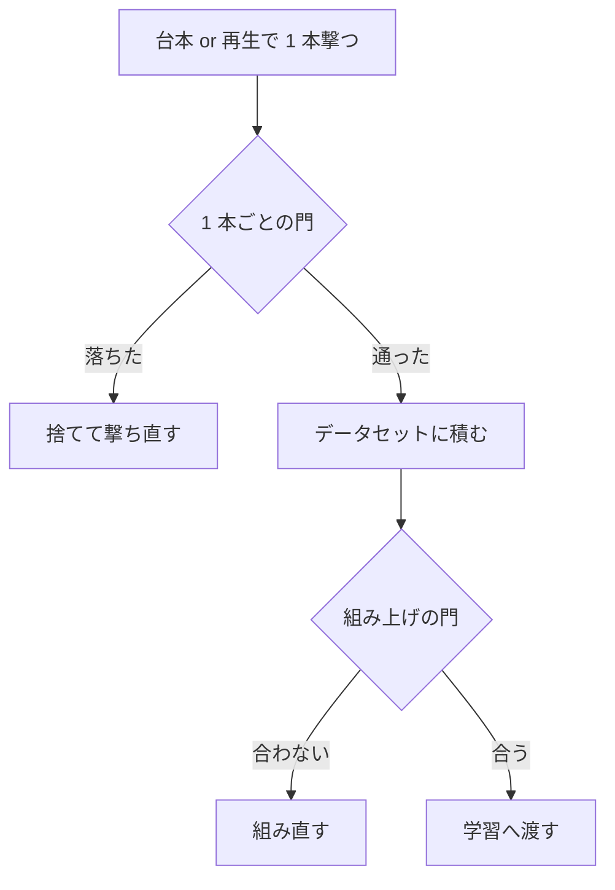

# 39. 点が動くエピソードデータの条件

**学習データを直す手は 2026 年 8〜9 月に 4 回打って、効いたのは 1 回だけだった。**
このファイルは、その 1 回と残り 3 回の違いを「エピソード 1 本の作り方」に落として置く。

> **これが分かると何が決まるか。**次にエピソードを作るとき、**何を作るか（引き算か作り直しか）・
> どの本を採るか（門）・1 本に何を入れるか（中身）・何本まで足せるか（薄め）**の 4 つが決まる。

**エピソード**とは、1 回のロールアウト（開始から終了まで）を 1 本ぶん記録したものを指す。
LeRobot 形式では `action`・`observation.state`・俯瞰と手首の 2 本の動画・指示文が 1 組になっている。
**このファイルは「中身をどう選ぶか」だけを持つ。形式（列・次元・ファイル構成）は
[29_training_data_requirements.md](29_training_data_requirements.md) にある。**
**実際に使った工夫 1 つずつの実測**（Ruckig・300 コマ超の縮め方・掴む向きの選び方など）は
**[40_regeneration_techniques_and_effects.md](40_regeneration_techniques_and_effects.md)** にある。

## 目次

- [1. なぜ要るか —— 4 回打って当たったのは作り直しの 1 回だけ](#1-なぜ要るか--4-回打って当たったのは作り直しの-1-回だけ)
- [2. 作る前に答える 3 つの問い](#2-作る前に答える-3-つの問い)
- [3. 作った本を採るかどうかを決める門](#3-作った本を採るかどうかを決める門)
- [4. 1 本の中身で守ること](#4-1-本の中身で守ること)
- [5. 何を振るか —— 崩れる帯だけを厚くする](#5-何を振るか--崩れる帯だけを厚くする)
- [6. 足すときに既存の課題を薄めない](#6-足すときに既存の課題を薄めない)
- [7. まだ分かっていないこと](#7-まだ分かっていないこと)
- [8. 確かめ直すコマンド](#8-確かめ直すコマンド)

---

## 1. なぜ要るか —— 4 回打って当たったのは作り直しの 1 回だけ

**同じ「データを直す」でも、引き算と作り直しで結果が正反対になった。**

| いつ | 打った手 | 結果 | 出典 |
|---|---|---|---|
| 9/9〜9/10 | **引き算**——対象外の物に触る手本 1,951 本を外す | **動かない**（Track2 合計点 0.3543 → 0.3499） | [knowledge/25](../knowledge/25_removing_bad_demos_teaches_nothing.md) |
| 9/5 | **足し算**——課題を 40 → 111 に増やす | **下がる**（Track1 0.492 → 0.292） | [knowledge/26 の 2 節](../knowledge/26_adding_data_lowered_the_score.md) |
| 9/10 | **足し算**——逆向きの手本を 49.5% 混ぜる | **同じ物体を使う行だけ −24.1 ポイント** | [knowledge/26 の 4 節](../knowledge/26_adding_data_lowered_the_score.md) |
| 9/12〜13 | **作り直し**——丼 5 課題の手本を台本に入れ替える | **当たった**（下表） | この節 |

**当たった 1 回の大きさ。**同じ `compe/val/TRACK2_VAL72.csv` の同じ 72 行を同じ 5 本ずつ回し、
**丼 5 課題の行だけを抜いて**「目標に届いたのに衝突で 0 点になった割合」を数えた。

| 重み | 丼 5 課題の手本 | **届いたのに衝突で 0 点** | その他 67 行の成功率 |
|---|---|---|---|
| `pi05_full_local` | 配布のまま | **0.522** | 0.837 |
| `pi05_ladder2500` | 配布のまま | **0.500** | 0.822 |
| `pi05_bowl5_full` | **台本に入れ替え** | **0.289** | 0.885 |
| `pi05_l90clean_008000` | **台本に入れ替え** | **0.111** | 0.826 |

**5 分の 1 まで落ちている。**しかも**その他 67 行は落ちていない**ので、
丼の手本を替えたことが他の課題を壊してはいない。

> **1 変数の対照ではない。**4 本は出発点・歩数・学習の範囲が違う
> （[19_weights_catalog.md](19_weights_catalog.md)）。**ここで言えるのは
> 「入れ替えた側 2 本がどちらも、入れ替えていない側 2 本より低い」までである。**

**この差がどれだけ大きいか。**採点に近い母集団 4,091 本
（判定セット 2,100・VAL72 1,440・TRACK1_VAL29 551）で失点を分けると、
**丼 5 課題は本数で 22.6% しかないのに、衝突による失点の 68% を出している。**

| 課題の群 | 本数 | 成功率 | 届いた率 | **衝突による失点（全体比）** |
|---|---|---|---|---|
| **丼 5 課題**（クッキー箱・ラメキンの上／隣の黒い丼） | 923 | **0.477** | 0.802 | **7.3 ポイント** |
| カゴに入れる | 1,389 | 0.865 | 0.922 | 1.3 ポイント |
| その他の黒い丼 | 742 | 0.815 | 0.871 | 1.0 ポイント |
| 引き出し・電子レンジ・棚など | 980 | 0.769 | 0.808 | 0.9 ポイント |
| 皿・トレイに置く | 57 | 0.439 | 0.649 | 0.3 ポイント |

**幾何が同じ課題は 1 つの作り直しでまとめて動く**、というのがこの表の読みである。
なぜ丼の幾何だけが当たるのかは
[knowledge/24 の 5 節](../knowledge/24_reached_but_zero_is_collision_at_grasp.md)（指の開き 4.81 cm 対 丼の張り出し 5.65 cm）にある。

## 2. 作る前に答える 3 つの問い

**1 節の 4 回は、次の 3 つのどれかを答えずに打っていた。**

| # | 問い | 答えられないと何が起きるか | 確かめ方 |
|---|---|---|---|
| 1 | **その失点は「届いていない」のか「届いたのに落とした」のか** | 届いていない失点に衝突対策を当てても動かない | `results/object_disp.jsonl` の `done` と `success` を分けて数える（8 節） |
| 2 | **外すだけで正解が入るのか** | 外すと汚れは消えるが、**正しい動きの手本は 1 本も増えない** | 外す本数と同じだけ、埋め戻せる手本が作れるかを先に見る |
| 3 | **足したぶん、既存の課題が何回に薄まるのか** | 課題数が増えると 1 課題あたりの出現が減り、遅くなって点が下がる | 6 節 |

**問い 1 の答えが「届いたのに落とした」なら、手は作り直しである。**
**「届いていない」なら、作り直しても届くようにはならない**——
届かない失点は課題ごとに散っており（最大でも 1 課題 2.3 ポイント）、
幾何を 1 つ直してまとめて動く形になっていない。

## 3. 作った本を採るかどうかを決める門

**作った本を全部入れてはいけない。**採点と同じ規則で落ちる本が混ざると、
その本は「落ちる動き」を教える。

**門は 2 段ある。**



### 3.1 1 本ごとの門

| 門 | 値 | なぜ |
|---|---|---|
| **300 コマ以内にゴールが立つ** | 300 | 採点は 300 歩で打ち切る。超える手本は「間に合わない動き」を教える |
| **対象外の物体が 1 mm 以内** | 1 mm | 採点の衝突判定そのもの（[knowledge/24 の 1 節](../knowledge/24_reached_but_zero_is_collision_at_grasp.md)） |
| **引き継ぎ時の手先のずれが 2 cm 以上**（初期姿勢を振る本だけ） | 2 cm | 2 cm 未満は方策が崩れない帯なので、集めても覆いが増えない（5 節） |

**台本を作る側には、もう 1 段きつい門を置いた。**
「結果が 1 mm 未満」だけでは、学習した方策の再現誤差を吸えない——
**台本を採る門は「掴む瞬間に隣の物まで 2 cm 以上」**である
（[knowledge/24 の 6 節](../knowledge/24_reached_but_zero_is_collision_at_grasp.md)）。

### 3.2 組み上げの門

| 門 | 何を見るか |
|---|---|
| 本数・コマ数・課題数 | 足し算と一致するか |
| 指の値 | 全コマが ±1 だけか（4 節） |
| 正規化の尺度 | 土台から 2 倍以上動いていないか（[knowledge/26 の 3 節](../knowledge/26_adding_data_lowered_the_score.md)） |
| 繋いだ境目 | 画・`state`・腕の指令・指示文が元と一致するか |

## 4. 1 本の中身で守ること

**形式が合っていても、中身の作りで学習に載らなかったり、逆を教えたりする。**
**実際に踏んだものだけを挙げる。**

| 守ること | 値・やり方 | 守らないと何が起きるか |
|---|---|---|
| **指示文を、評価でモデルが見る文に寄せる** | `npz_to_lerobot.py build --normalize-instructions` ＋ `check_dataset_instructions.py` で不一致 0 | **評価で 1 度も引かれない。**摂動下再生 1,009 本のうち 626 本（62%）がこれを踏んだ。学習は通り損失も下がるので**沈黙して失敗する**（[knowledge/23](../knowledge/23_self_made_demos_need_the_instruction_the_model_sees.md)・対応表は [36](36_instruction_rewriting_table.md)） |
| **指の値は ±1 で書く**（−1 が開く） | 変換後に `fix_gripper_encoding.py` | 配布の一部は {0,1}（1 が開く）で、**混ぜると「開く」に逆の正解が付く。**再生で確かめると 3 場面とも掴めない |
| **ゴールが立った 10 コマ後で切る** | `replay_yield.POST_GOAL_STEPS = 10` | 切らないと「置いた物をいじる」コマが 1 割入る。配布の人の手本も同じ切り方 |
| **撃ち切ってゴールが立たなければ、手を離して待つ** | 腕を止めて指を開き（5 コマ）、手先を上げ（15 コマ・z 指令 0.4 → 0）、開いたまま待つ | **握ったままだとゴールが立たない**ことがある。7 次元すべて 0 で止めた 39 本は撃ち直した |
| **センサ雑音は重ねない** | — | 雑音は環境の外側の後処理でしか掛からず、**記録するコマには乗らない**（[20 の 2.1 節](20_track2_perturbation_categories.md)） |
| **同じ手本から採るのは 3 本まで** | 本数の多い課題は `ceil(1.5 × 本数 ÷ 50)` まで | 同じ動きの重複でコマ数だけ増える |
| **指令のなめらかさを配布データに合わせる** | Ruckig で出発点へ寄せる（[35](35_command_profile_and_ruckig.md)） | 台本の指令は立ち上がりが急で、停止の塊が入る |

**外観（照明・机と背景・カメラ）は重ねてよく、物理は 1 ビットも変わらない。**
6 課題 × 4 通りで確かめてある。**素の見た目だけを 2 割以上足すと Track1（背景と照明）の
分布が薄まる**ので、素・照明・背景・カメラを 25% ずつ当てている。

## 5. 何を振るか —— 崩れる帯だけを厚くする

**摂動は「振れば振るほど良い」ではない。崩れない帯を厚くしても覆いは増えない。**
帯ごとの崩れ方は [21_weakness_map.md](21_weakness_map.md) にあり、ここは**作る側の結論だけ**を持つ。

| 軸 | **集める帯** | 集めない帯 | 作る費用 |
|---|---|---|---|
| **ロボット初期姿勢** | **手先のずれ 2 cm 以上** | 2 cm 未満（崩れない） | **高い。**物理が変わるので行動列を作り直す |
| **カメラ視点** | **方位角 \|45°\|〜\|75°\| の左右両方** | 15° 未満（崩れない）・拡大率・レンズの向き | **安い。**描画だけなので同じ行動列を描き直せる |
| センサ雑音 | 集めない（記録に乗らない・4 節） | — | — |
| 物体配置 | 集めない（崩れない） | — | — |

**強さの軸を取り違えないこと。**

- **初期姿勢の `_initstate_N` の番号は強さの順に並ばない。**倍率 0.4 の手先のずれは
  1.03〜9.84 cm で、倍率 0.1 の上端 2.08 cm と重なる。**手先のずれ（cm）で選ぶ**
  （[20 の 2.4 節](20_track2_perturbation_categories.md)）。
- **`difficulty_level` 列も強さの段ではない。**カメラの方位角の中央値は難易度 1〜5 で
  9.0 / 12.5 / 23.0 / **11.5** / 41.0 と、4 が 3 より小さい。

**初期姿勢を振れない課題がある。**モカポット 2 課題は振って撃つと 62 回中 1 本しか
300 コマに入らず（寄せる距離のぶん超える）、振らなければ 50/50 通る。
**この 2 課題には初期姿勢の手本が入っていない。**

**幾何が厳しい課題は、振れる向きが偏る。**「ラメキンの上の丼」は
**失敗 575 回のうち 572 回が「縁をまたいで掴むとき腕がラメキンに当たる」**で、
作れた 61 本は通った向きに寄る。**これは 1 節の衝突と同じ原因なので、
掴み方を直すと初期姿勢の作れる範囲も同時に広がる。**

## 6. 足すときに既存の課題を薄めない

**課題を増やすと 1 課題あたりの出現が減る。**40 課題から 111 課題へ替えた 9/5 の版は、
1 歩あたりに見る行動の量を揃えても **Track1 0.492 → 0.292** に下がった
（[knowledge/26 の 2 節](../knowledge/26_adding_data_lowered_the_score.md)）。

**足す前に次を数える。**

| 数えるもの | 見方 |
|---|---|
| **採点に出る課題 1 つあたりの本数** | 足した後も減らないか。減るなら歩数を増やすだけでは戻らない |
| **正規化の尺度** | 足したデータの分布が広いと尺度が伸び、既存の行動が相対的に潰れる |
| **同じ物体を使う課題があるか** | 逆向きの動きを足すと、**同じ物体を使う順方向の行だけが −24.1 ポイント**動いた（[knowledge/22](../knowledge/22_reverse_data_interferes_with_same_objects.md)） |

**割合を上げたいときは、間引かずにコピーで上げる**（[29 の 7 節](29_training_data_requirements.md)）。

## 7. まだ分かっていないこと

| 分かっていないこと | なぜ残っているか |
|---|---|
| **台本の入れ替えの、どの要素が効いたのか** | 縁をまたぐ掴み方・降りる勢いの上限・掴む向きの選択を**同時に**入れたので分離していない |
| **丼 5 課題以外の 1,023 本を作り直すと効くか** | 配布 14,347 本のうち 1〜50 mm 触る手本は 1,958 本で、丼 5 課題の 935 本を除く **1,023 本・19 課題**が `libero_plus_bowl5` に残る。**この 19 課題は 1 課題あたり 19 本しか評価しておらず、効くかどうかを読める本数が無い** |
| **初期姿勢を振ったデータ単独の効き目** | `libero_plus_bowl5_initpose`（掃除 ＋ 初期姿勢）は、`libero_90` を足した `libero_combined_bowl5_initpose` の形でしか学習されていない。**P 単独で素の重みから学習した対照が無い**（[resources/datasets.md の 3 節](../resources/datasets.md)） |
| **学習データにカメラ方位角 45° 以上が何本あるか** | `appearance.py` は角度を公式一覧から引くが、その一覧は**方位角 0° が 38%・15° 未満が合わせて 44.6%** の二山である。**引き継いだ 12,553 本には視点の振れが入っていない**（[06 の「確認したい仮定」](06_training_data_composition.md)） |

## 8. 確かめ直すコマンド

```bash
cd ~/src/PARC2026_pre

# 1 節: 丼 5 課題だけを抜いて「届いたのに衝突で 0 点」を数える
python3 - <<'PY'
import json, csv, pathlib
BOWL5 = {"pick_up_the_black_bowl_next_to_the_cookie_box_and_place_it_on_the_plate",
         "pick_up_the_black_bowl_next_to_the_ramekin_and_place_it_on_the_plate",
         "pick_up_the_black_bowl_between_the_plate_and_the_ramekin_and_place_it_on_the_plate",
         "pick_up_the_black_bowl_on_the_cookie_box_and_place_it_on_the_plate",
         "pick_up_the_black_bowl_on_the_ramekin_and_place_it_on_the_plate"}
# task_id -> 素タスク名は CSV の init_states_file 列から引く
base = {r["task_id"]: r["init_states_file"].replace(".pruned_init", "")
        for r in csv.DictReader(open("compe/val/TRACK2_VAL72.csv"))}
for name, d in [("full_local", "0912_171732_track2_full_local_ep5"),
                ("ladder2500", "0913_225434_track2_ladder2500_val72"),
                ("bowl5_full", "0913_083702_track2_bowl5_full"),
                ("l90clean",   "0917_044905_track2_pi05_l90clean_008000_val72")]:
    rows = [json.loads(l) for l in
            pathlib.Path("work/final_eval", d, "results/object_disp.jsonl").read_text().splitlines() if l.strip()]
    b = [r for r in rows if base.get(r["task"]) in BOWL5]
    lost = sum(1 for r in b if r["done"] and not r["success"])
    print(f"{name:12s} 丼 {len(b):3d} 本  届いたのに 0 点 {lost / len(b):.3f}")
PY

# 7 節: 配布 14,347 本のうち、対象外の物を 1〜50 mm 動かしている手本を課題別に数える
python3 - <<'PY'
import json, collections
scores = json.load(open("work/regen/contact_v2/contact_scores.json"))
dirty = collections.Counter()
for e in scores:
    d = e["score"]["displacement_l1_m"].get("10", {})
    if d and 1 < max(d.values()) * 1000 < 50:
        dirty[e["instruction"]] += len(e["episodes"])
print("合計", sum(dirty.values()), "本")
for ins, n in dirty.most_common(8):
    print(f"  {n:4d}  {ins[:62]}")
PY
```

**`displacement_l1_m` の `"10"` は「10 コマ目を基準にした変位」で、採点ハーネスが
基準を取る位置と同じである**（`pipeline/rollout.py` が空の行動を 10 歩送ってから初期位置を記録する）。
**この基準の取り方自体が一部の行を必ず 0 点にする**——
[knowledge/37](../knowledge/37_unsettled_scenes_score_zero_forever.md) を見ること。
