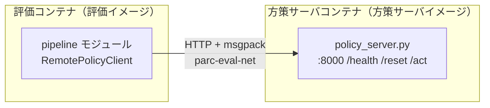

# インフラ・Docker 一覧（現在地）

**このファイルは「今何が使えるか」を映す場所であり、`reference/` とは違って過去の版を残さず、
状態が変わったら上書きする。** GPU マシンを借りた／返した、docker image を再ビルドして
新しいことができるようになった、といった変化があったら、その都度このファイルを直す。

読む目的: 「できること・できないこと」「どのタスクを優先すべきか」を検討するとき、
今使える計算資源とコンテナの実態を確認する。

**書くのは「今どれだけの資源が、どこに、どういう状態であるか」だけである。** 学習・評価・
ディスクの空け方のような手順や Tips はここに書かない（[README.md](README.md) の線引き）。
手順は [../howto/](../howto/)、踏んだ事故と回避策は [../knowledge/](../knowledge/) にある。

最終更新: Blackwell サーバの欄は 2026-08-26 公開の
[本選の配布資料 v1.1](../materials/PARC2026開発コンペティション_本選_v1.1.pdf)を読んで書いた
（v1.0 から Docker の扱いと停止の条件が変わっている）。
JAIST サーバと Docker の欄は 2026-08-26 に `lscpu` / `free` / `df` / `nvidia-smi` / `docker ps -a` で確認した。
会社の RTX6000 の欄は 2026-08-26 に実機で確認した。

| # | 節 | 結論 |
|---|---|---|
| 1 | [使える計算資源](#1-使える計算資源jaist-サーバ会社の-rtx6000blackwell-サーバrunpodmac-マシン) | **Blackwell サーバは本選 1 で 60 時間しか使えない。**時間の上限が無いのは JAIST サーバと会社の RTX6000 の 2 台 |
| 2 | [Docker イメージとコンテナ](#2-docker-イメージとコンテナ) | イメージ 3 つ＋方策サーバイメージ。どれも `cu128` で、Blackwell サーバの `cu130` とは版が違う |
| 3 | [提出評価のフロー](#3-提出評価は-http--msgpack-の-2-プロセス構成) | 2 プロセス構成。採点側は L4 24GB・zip は 20 GB まで |
| — | [確認したい仮定](#確認したい仮定) | **4 つのマシンについて、確認をお願いしたいことをコマンド付きで並べた** |

## 1. 使える計算資源（JAIST サーバ／会社の RTX6000／Blackwell サーバ／RunPod／Mac マシン）

**時間の上限が無いのは、JAIST サーバと会社の RTX6000 の 2 台である。**Blackwell サーバは
本選 1 の期間全体で 60 時間しか使えず（本選 1 は 8/24〜9/17 の 24 日間なので 1 日平均 2.5 時間）、
RunPod は借りた分だけ課金される。**会社の RTX6000 は GPU が Pass-Through の実機なので、
JAIST サーバでは選べない EGL（GPU 描画）が効く。**撮影は Mac マシンの
Docker だけでできて GPU を使わないため、他の作業と同時並行できる。

| 資源 | 呼称 | 学習 | 評価 | 撮影 | GPU | 使える量の上限 |
|---|---|---|---|---|---|---|
| `gpu-422591` | **JAIST サーバ** |  ○（縮小版のみ） | ○ | — | H100-20C 1 枚 | **無し**（ただし 1 枚を学習と評価で取り合う） |
| `eng003sasaki01` | **会社の RTX6000** | ○ | ○ | — | Quadro RTX 6000 1 枚（24 GB） | 無し（借りている間） |
| 運営の配布 GPU 環境 | **Blackwell サーバ** | ○ | ○ | — | RTX PRO 6000 Blackwell 1 台 | **本選 1 は 60 時間**（本選 2 は 75・本選 3 は 120。繰越なし） |
| RunPod | **RunPod** | ○（フルパラメータ） | — | — | A100/H100 80GB | 無し（秒単位の従量課金） |
| ローカル Mac（colima） | **Mac マシン** | — | — | ○ | 不要 | 無し |

※ 会社の RTX6000 は GPU を Docker から使えるところまで済んでいるが、**イメージも重みもまだ
置いていない**ので、実際に流すには持ち込みが要る。

※ ユーザとの会話の中では、認識を一致させるために「呼称」列の名称でインフラを呼ぶこととする。

### JAIST サーバ（`gpu-422591`）は学習と評価の両方を兼ねる

**1 枚の GPU を学習と評価が取り合っている。新しい学習を流す前に、評価が動いていないか確認する。**

| 項目 | 実測値 |
|---|---|
| hostname | `gpu-422591` |
| OS | Ubuntu 22.04.3 LTS |
| GPU | NVIDIA H100-20C（H100 を 20GB に切り出した vGPU）1 枚、compute capability 9.0、ドライバ 570.133.20 |
| vCPU | **16**（Xeon Gold 6338） |
| RAM | 114 GiB |
| ストレージ | 298 GB（残り 75 GB） |

**vCPU は以前 2 だった。**`knowledge/14_quantization_and_eval_bottleneck.md` の
「評価の 71〜82% は 2 コアでの CPU 描画」という実測は、2 コアだった頃のものである。
**16 コアになった今、その割合は測り直さないと分からない。**

vGPU は OpenGL/EGL 描画に対応しない。EGL 指定だと評価が 50〜99 ステップ目で `read_pixels` が
落ちる実績があるため、評価コンテナは常に `MUJOCO_GL=osmesa`（CPU 描画）を強制している
（[3 節](#3-提出評価は-http--msgpack-の-2-プロセス構成)参照）。

### 会社の RTX6000 では EGL（GPU 描画）が効く

**GPU は `Quadro RTX`・`Pass-Through` の実機で、`docker run --gpus all` が通り、
JAIST サーバでは選べない EGL が実際に効くことを確認した。**（2026-08-26 実測）

| 項目 | 会社の RTX6000 | JAIST サーバ |
|---|---|---|
| hostname | `eng003sasaki01` | `gpu-422591` |
| vCPU | 16 | 16（同じ） |
| RAM | 47 GiB | **114 GiB** |
| GPU | Quadro RTX 6000 1 枚・VRAM **24 GB**・cc **7.5**・ドライバ 595.84 | **H100-20C**（vGPU）・VRAM 20 GB・cc 9.0・ドライバ 570.133.20 |
| GPU の種別 | **`Quadro RTX` / `Pass-Through`**（描画もできる実機） | `NVIDIA Virtual Compute Server` / `VGPU`（計算専用） |
| ストレージ | **489 GB（残り 455 GB）** | 298 GB（残り 75 GB） |
| OS | Ubuntu 24.04.4 LTS | Ubuntu 22.04.3 LTS |
| `docker run` | **通る**（ただし `sudo` が要る） | **拒否される**（org の制約。`docker exec` のみ） |
| `docker run --gpus all` | **通る**（NVIDIA Container Toolkit 1.20.0-1 を 08-26 に導入） | 通る |

**勝っているのは 3 点である。** (a) **EGL が効く**、(b) ディスクが 455 GB 空いている
（JAIST サーバは 75 GB）、(c) **JAIST サーバと並行して回せる 2 台目である**。
GPU の計算力（cc 9.0 対 7.5）と RAM では JAIST サーバが上。

**EGL が効くことが一番大きい。**JAIST サーバの vGPU は OpenGL に対応しないため
`MUJOCO_GL=osmesa`（CPU 描画）しか選べない。同じ描画スクリプト（240×320 を 50 枚）で測ると
次の差がある。

| マシン | イメージ | 描画方式 | 1 枚あたり |
|---|---|---|---|
| 会社の RTX6000 | 本選 | **EGL** | **0.6 ms** |
| 会社の RTX6000 | 本選 | osmesa | 9.7 ms |
| JAIST サーバ | 予選 | osmesa | 12.1 ms |

**同じマシン・同じイメージで比べて 16 倍速い**（0.6 ms 対 9.7 ms）ので、差は EGL によるもので
機械差ではない。osmesa どうしなら 2 台に大きな違いは無い（9.7 ms 対 12.1 ms）。

**ただしこれは箱 1 個の軽い場面での値である。**評価全体でどれだけ縮むかは評価を 1 本流して
測る（JAIST サーバでの実測では、評価の待ち時間の 71〜82% が CPU 描画だった
── [knowledge/14_quantization_and_eval_bottleneck.md](../knowledge/14_quantization_and_eval_bottleneck.md)）。

**EGL のときだけ、Python の終了時に `EGLError` が出る。描画そのものには影響しない**
（後片付けの `__del__` の中で起きた例外で、`Exception ignored` として捨てられる。
osmesa では出ない）。3 通りとも平均輝度は 106.7 で、絵は一致している。

VRAM 24 GB は π0.5 の読み込みに要る約 18 GB を上回るので、評価は載る。
cc 7.5 なので fp8（cc 8.9 以上が要件）は使えず、bf16 もネイティブには効かない。

**本選の評価イメージ `parc2026-final` はビルド済みである**（配布リポジトリを clone して
`docker build` で作った。本選の `setup.sh` は LIBERO-plus・LIBERO・アセットのコミットを
固定しているので、どこでビルドしても採点環境と同じ版になる）。**重みはまだ置いていない。**

### Blackwell サーバは本選 1 で 60 時間、ディスクはほとんどが一時領域

**GPU は RTX PRO 6000 Blackwell 1 台だが、使える時間が本選 1 の期間全体で 60 時間に限られる。
本選のステージが進むたびに上限はリセットされ、余りは繰り越されない。** 出典はいずれも
[本選の配布資料](../materials/PARC2026開発コンペティション_本選.pdf) p.9・p.14・p.15。

| ステージ | 使える GPU 時間 |
|---|---|
| **本選 1**（8/24〜9/17） | **60 時間** |
| 本選 2（9/28〜10/22 予定） | 75 時間 |
| 本選 3（10/28〜11/24 予定） | 120 時間 |

**時間は「起動してから自分で止めるまで」ずっと減る。**資料 v1.1 が
「起動からシャットダウンの間，配布時間は消費され続けます」と明言した。GPU が計算して
いるかどうかは関係ない。**ブラウザのタブを閉じても止まらない。**

| 止まり方 | 条件 |
|---|---|
| 自分で止める | `File > Hub Control Panel > Stop Server`。**押した瞬間に時間の消費が止まる** |
| 完全な待機による自動停止 | セルの実行が何も無い状態が **1 時間**続いたとき |
| 起動時間による自動停止 | 起動から **12 時間** |

**本選 1 では「延長」ボタンが使えない設定になっている**（v1.1 で明記された。v1.0 には
「押した時点から 12 時間に伸びる」と書かれていたが、これは本選 1 には当てはまらない）。
**つまり 1 回のセッションで連続して回せるのは最大 12 時間である。**

画面に出る残り時間は 2 つある。**緑枠が今回のセッションの 12 時間に対する残り、
青枠が配布された 60 時間に対する残り**で、青枠は起動時点の値のまま更新されない。

入り方は `https://parc-playground.omnicamp.us/hub/login` から `Sign in with Auth0` を押し、
Omnicampus のアカウントで入る。GPU の割り当てを待つ間はページが変わらない。
割り当てられるリージョンは複数あり、`us-east-1` とは限らない。

ディスクは 4 つに分かれており、**容量が大きい領域はインスタンスを終了すると消える。**

| 場所 | 容量 | インスタンス終了後 |
|---|---|---|
| `$HOME`（`/home/<アカウント名>`） | 40 GiB | **残る。**10 分ごととインスタンス終了時に自動保存され、次回起動時に復元される |
| `~/data` | 100 GiB | **手動で保存しないと消える**（`parc-home-sync data-push` で保存、`data-pull` で復元） |
| `~/dataset` | — | 読み出し専用。配布データセットとベースラインモデルが置かれている |
| `/opt/dlami/nvme` | 約 1.7 TB | **消える一時領域**（AWS のインスタンスストア。v1.0 では `/` と書かれていた場所） |

`~/dataset` に置かれているもの:

| 中身 | 何か |
|---|---|
| `IPEC-COMMUNITY/` | LIBERO 標準スイート（spatial / object / goal / 10 / 90 の no_noops 版） |
| `Sylvest/` | LIBERO-plus（カメラ視点・照明・テクスチャなどの摂動を加えた拡張データ） |
| `lerobot/` | 統合 20Hz データセット `libero_combined_20hz`（配布ベースラインの学習に使ったもの） |
| `v2.1/`・`v2.0/` | 上記の v2.1 形式版・LIBERO image 版 |
| `pi05_step005000_submission_py310.zip` | **配布ベースラインモデル**（π0.5 を LoRA で 5,000 ステップ）。重み・ポリシーサーバー・`requirements.txt` 入り。リーダーボード参考スコアは Track1 0.286 / Track2 **0.165** / Track3 0.000 |

データセットは tar で置かれており、`~/data` へ展開してから使う。`~/dataset` は書き込めない。

### Blackwell サーバでは自分の Docker イメージを使えない（v1.1 で変わった）

**2026-08-26 の資料 v1.1 で、Docker の扱いが「使用可能」から「配布された事前チェック用の
イメージだけ」に変わった。**

| | v1.0（8/24） | **v1.1（8/26）** |
|---|---|---|
| 自分のイメージ | 「Docker は使用可能。イメージの保存先は一時領域なので毎回 pull し直す」 | **サポート外。**「使用不可であることを想定しており、もし使用しても運営では対応しかねます」 |
| 使えるもの | — | **Omnicampus 提出の事前チェック用 Docker の `docker run` のみ** |
| 理由 | — | 参加者が独自のイメージを持ち込む前提のストレージ構造・容量になっていない |

**これで「自分の学習イメージをレジストリへ push して Blackwell サーバで pull する」道は
消えた。**Blackwell サーバで学習を回すなら、Notebook の Python 環境へ直に pip で入れる
ことになる。**何が最初から入っているかは起動して数えるまで分からない。**

採点環境と同じ構成（CUDA 13.0・PyTorch 2.11.0+cu130）のイメージがビルド済みで配置されて
いる、という記述自体は v1.1 にも残っている。**ただしそれは提出前の事前チェック用である。**

### RunPod は π0.5 のフルパラメータ学習専用

**ローカルの H100-20C には縮小版（`train_expert_only`）しか載らないため、80GB 級 GPU で
公式レシピどおりのフルパラメータ学習を試す用途に限って RunPod を借りる。評価はここでは行わない。**

| 項目 | 内容 |
|---|---|
| GPU | A100 80GB（$1.4〜2.2/時間）または H100 80GB（$2.9〜3.0/時間）目安。実際に借りたのは A100 80GB PCIe（2026-08-14、3,000 ステップ） |
| 課金 | 秒単位の従量課金のみ。期間契約は 3 か月／6 か月の Savings Plan のみで短期利用には使えない |
| 起動方法 | (A 推奨) `Dockerfile.pi05` をローカルでビルドして Docker Hub へ push し、RunPod 側はそのイメージを実行するだけ。(B) 公式 PyTorch テンプレート + [`solution/train/runpod_setup.sh`](../../solution/train/runpod_setup.sh) で torch/torchcodec/torchvision/lerobot を個別インストール |
| SSH 接続 | [`solution/train/runpod_ssh_start.sh`](../../solution/train/runpod_ssh_start.sh) が Pod 起動時に sshd を立てる（`PUBLIC_KEY` 環境変数から `authorized_keys` を書き込む） |
| ストレージ | Volume Disk は 150GB 必須（60GB では 25GB のチェックポイント 2 個で溢れる）。Network Volume を付けていないと残高 $0 で Pod が Terminate され復旧不可、付けていれば停止のみでデータは残る |
| 持ち帰り | scp（1.7MB/s）よりも Hugging Face の非公開リポジトリ経由が速い（8.8GB で 1 時間超 → 9.4GB で 16 分） |

現在進行中の Pod があるかどうかは、このマシンからは確認できない（RunPod の管理画面を見る必要がある）。

### Mac マシンはデモ撮影専用（GPU 不要）

**手本デモの撮影（`record`）だけをローカル Mac 上の Docker（colima）で回す。物理シミュレーションと
CPU 描画（osmesa）だけなので GPU が要らず、GPU マシン側の学習と同時並行できる。**

撮影には `parc2026` イメージをそのまま使う。学習（`build`/`merge`）は Python 3.12 + lerobot が
必要な `parc2026-train` イメージで GPU マシン側にて行う。データセットは 1 本 1.4MB と小さいため
`rsync` で GPU マシンへ転送する。このマシンからは Mac 側 Docker の現状（動いているか）は確認できない。

## 2. Docker イメージとコンテナ

**イメージは「評価イメージ」「SmolVLA 学習イメージ」「π0.5 学習イメージ」の 3 つに加え、
評価のたびに作られる「方策サーバイメージ」がある。ただし 2026-08-25 10:59 の再起動で
学習コンテナと検証コンテナが両方落ちており、いま動いているコンテナは 1 つも無い。**

**この 2 つを立て直す `docker run` の完全な形は
[../howto/10_rebuild_machine.md](../howto/10_rebuild_machine.md) にある**（作り替えたマシンで
同じ状態に戻す手順としてまとめてある）。

### イメージは依存が競合するため 1 つに混ぜていない

| イメージ名 | **呼称** | Dockerfile | base | GPU | 用途 |
|---|---|---|---|---|---|
| `parc2026` | **評価イメージ** | [`Dockerfile`](../../Dockerfile) | `ubuntu:22.04` | 不要 | 配布キット。本番採点環境と同じ構成で、Python 3.10 + LIBERO。評価側プロセスを動かす |
| `parc2026-train` | **SmolVLA 学習イメージ** | [`solution/train/Dockerfile`](../../solution/train/Dockerfile) | `python:3.12-slim` | 要（`--gpus all`） | lerobot v0.6.0 を `[training,smolvla,peft]` extra で editable install |
| `parc2026-train-pi05` | **π0.5 学習イメージ** | [`solution/train/Dockerfile.pi05`](../../solution/train/Dockerfile.pi05) | `python:3.12-slim` | 要 | extra は `pi`。bitsandbytes/torchao 同梱（量子化スイープ用）。RunPod 用に sshd/tmux も追加 |
| `<学習イメージ名>-server-<image_id>` | **方策サーバイメージ** | （`run_docker_eval.sh` が自動生成） | 学習イメージ | 要 | 学習イメージに `fastapi`/`uvicorn`/`msgpack` を足したもの。評価のたびに作られる |

### Docker Hub に置いてあるのは 1 つ（RunPod 用）

**`sirukufarios/parc2026-train-pi05`。**2026-08-14 に π0.5 学習イメージを push した
もので、RunPod の Pod をこのイメージで作る。**タグを記録していなかったので
2026-08-27 に書き足した。**

**作り直す必要は無い。**8/14 以降に `Dockerfile.pi05` へ入った変更は量子化の配線だけ
（`bitsandbytes==0.49.2`・`torchao==0.17.0` の追加と `experiments/` の COPY）であり、
**量子化の 5 候補はすべて廃止した。**現在の `train_pi05.py` は
`from experiments import quantization` を実行するが、**その `__init__.py` は
`argparse`・`os`・`pathlib` しか import せず、重い候補モジュールは量子化の
オプションを渡したときだけ遅延して読まれる。**

**古いのは焼き込まれた `train_pi05.py` と `train.py` だけである。**RunPod では
現在のコードを `/workspace` へ展開してそこから起動するので、焼き込まれた版は使わない
（[../plan/15_runpod_fullparam_with_augment.md](../plan/15_runpod_fullparam_with_augment.md)）。
**作り直すと 1 時間のビルドと 9.7 GB の上りを払って、得るものが無い。**

**イメージが見つからない・動かないときの逃げ道**は、RunPod の公式テンプレート ＋
[`solution/train/runpod_setup.sh`](../../solution/train/runpod_setup.sh)（35 分）。
版を固定して同じ環境を作る。

※ ユーザとの会話の中では、認識を一致させるために「呼称」列の名称でイメージを呼ぶこととする。

### 本選の評価イメージは JAIST サーバでは GPU で動かせない

**本選の配布リポジトリの Dockerfile は `nvidia/cuda:13.0.3-...` を土台にしており、
README が「NVIDIA ドライバ R580 系以降（CUDA 13 対応）」を要求している。**
JAIST サーバのドライバは 570.133.20 で、これを満たさない。

| | ドライバ | 本選イメージを GPU で動かせるか |
|---|---|---|
| JAIST サーバ | 570.133.20 | **× R580 未満** |
| 会社の RTX6000 | 595.84 | **○** |

イメージ自体は JAIST サーバにもある（`parc2026-final`・40.8 GB・ビルドは通る）が、
`--gpus all` で動かす段で CUDA が初期化できない。**本選の自己評価は会社の RTX6000 で
回すことになる**（そちらでも同じイメージをビルド済みで、EGL で描画できることを確認した）。

本選イメージは `ENV MUJOCO_GL=egl`・`NVIDIA_DRIVER_CAPABILITIES=compute,utility,graphics`
を既定にしており、**運営は EGL（GPU 描画）前提で組んでいる。**

**この 3 つはどれも CUDA 12.8（`cu128`）で組んである。**Blackwell サーバに置かれている運営の
イメージは採点環境と同じ CUDA 13.0・PyTorch 2.11.0+cu130 なので、**版が違う。**Blackwell サーバで
自分のイメージを使うなら、一時領域に置かれる関係で毎回 pull し直すことになるため、
どこかのレジストリへ push しておく必要がある。

このほか `/home/ubuntu/src/tampura/`・`/home/ubuntu/src/bayes3d/` にも Dockerfile があるが、
**この 2 つは別プロジェクトで PARC2026 のタスクとは無関係**（tampura: Jupyter 開発環境、
bayes3d: `nvcr.io/nvidia/pytorch` ベースの GPU 開発環境）。`work/lerobot-src/docker/` の
Dockerfile 群も HuggingFace LeRobot 本家の配布用であり、参考にしただけで学習・評価には
使っていない。

### 方策サーバイメージは、評価のたびにその場でビルドされる

学習イメージには HTTP サーバー依存（`fastapi`/`uvicorn`/`msgpack`）が無いため、評価を
回すたびに `<学習イメージ名>-server-<image_id 12桁>` という名前でビルドされる（詳細は
[3 節](#3-提出評価は-http--msgpack-の-2-プロセス構成)）。**タグに image ID を含めるのは、
元の学習イメージを更新したら確実に作り直されるようにするためである。**

### 常駐コンテナは 2 つとも止まっている（2026-08-26 実測）

**2026-08-25 10:59 の再起動で両方 `Exited (137)` になった。**再起動で殺されただけで、
中身は残っている。動かすには起動し直す必要がある。

| コンテナ名 | **呼称** | 使っているイメージ | 状態 | 何をするものか |
|---|---|---|---|---|
| `quant_train` | **学習コンテナ** | π0.5 学習イメージ | **停止中**（08-25 10:59 に落ちた） | π0.5 学習・量子化の常駐コンテナ。`docker exec` で `train_pi05.py` を都度実行する運用。`--gpus all`・`--user 1000:1000`、`work/train` を `/out` に、`~/.cache/huggingface` を `/hf_home` に bind mount |
| `parc2026_verify` | **検証コンテナ** | 評価イメージ | **停止中**（08-25 10:59 に落ちた） | 対話確認・`docker exec` 用に寝かせてある検証シェル。`--network none`・GPU なし |

評価を回している間だけ、次の 2 つが増える（終わると消える）。

| コンテナ名 | **呼称** | 使っているイメージ | 何をしているか |
|---|---|---|---|
| （毎回変わる） | **評価コンテナ** | 評価イメージ | `pipeline` を動かし、方策サーバへ HTTP で問い合わせる |
| `parc-policy` | **方策サーバコンテナ** | 方策サーバイメージ | 重みを読んで `/act` に答える |

※ ユーザとの会話の中では、認識を一致させるために「呼称」列の名称でコンテナを呼ぶこととする。

**`quant_train` が古い image を掴んでいた問題は解消済みである。** 2026-08-22 の時点では
タグを失った旧世代の image のまま動いていたが、08-23 22:57 に現在の π0.5 学習イメージから
作り直された。

**タグに残っている派生 image 3 つ（`parc2026-train-pi05-server-b2e89d2a2735`・
`parc2026-train-pi05-server-d1befbd37eb2`・`parc2026-train-server`）は、いま何も
使っていない。** 評価のたびに作られるもので、必要になればまた作られる。

## 3. 提出評価は HTTP + msgpack の 2 プロセス構成

**本番採点環境と自己評価キットは同じ構成で、学習イメージと配布キットイメージを HTTP + msgpack で
繋ぐ 2 プロセスに分かれている。1 イメージに混ぜないのは依存が衝突するため。**

- 通信は gRPC ではなく **HTTP + msgpack**。`pipeline/remote_policy.py` の
  `RemotePolicyClient(server_url="http://localhost:8000", ...)` がクライアント、
  `solution/policy_server.py` が fastapi + uvicorn でサーバーを実装する
  （`/health`・`/reset`・`/act` の 3 エンドポイント、`/act` は 10 秒のタイムアウト）。
- ポートは 8000 固定。Docker network `parc-eval-net` を作り、方策側コンテナ名 `parc-policy` で
  評価側から名前解決させる。
- 派生 image の image ID をタグに含めるのは、ベースイメージを更新したら確実に再ビルドされるように
  する設計（[2 節](#2-docker-イメージとコンテナ)の `quant_train` の世代ズレはこの設計の反面教師）。
- 評価側コンテナは `--gpus all --network parc-eval-net --ulimit core=0` で起動し、
  描画は `MUJOCO_GL=osmesa`（CPU）を渡す。

### 採点側で守らなければいけない上限

**採点は L4（VRAM 24GB）1 枚で回るため、手元の H100-20C で載っても採点側で載らないことがありうる。**
採点環境の構成（GPU・Python・torch・制限時間・描画方式）は
[reference/02_evaluation_data.md](../reference/02_evaluation_data.md) が正本で、本選の配布資料
（p.13）も同じ値だった。本選で新しく決まった上限は次の 1 つ。

| 上限 | 値 | 出典 |
|---|---|---|
| アップロードできる zip の大きさ | **20 GB** | 本選の配布資料 p.21 |

いま HF に置いてある提出 zip は 1 本 9.38 GB なので収まっている
（[huggingface.md](huggingface.md)）。

## 確認したい仮定

**JAIST サーバの分は私が確認できるので、ここには残していない。**残りは、私からそのマシンへ
到達する手段が無い（ssh の設定が無く、RunPod と Omnicampus は画面を見るしかない）ため
確認をお願いしたい。

**会社の RTX6000 の分は 2026-08-26 に片付いた。**残っているのは配布 GPU 環境・RunPod・
Mac マシンの 3 つである。

### Blackwell サーバ（実行場所: Omnicampus の Notebook・所要 2 分）

**ここが分かると、60 時間をどう割り振るかが決まる。**

| # | 確認すること | コマンド |
|---|---|---|
| 1 | **GPU の VRAM・compute capability**（資料に記載が無い） | `nvidia-smi --query-gpu=name,memory.total,compute_cap,driver_version --format=csv` |
| 2 | ディスクの実際の空き | `df -h $HOME ~/data ~/dataset /` |
| 3 | 置かれている運営のイメージ | `docker images` |
| 4 | vCPU と RAM | `nproc; free -g \| head -2` |

**コマンドでは分からないので、画面か問い合わせで確認したいこと。**

| 確認すること | どこで | 外れると何が変わるか |
|---|---|---|
| Notebook 以外に ssh で入れるか | 配布リポジトリの README | 入れないなら、長時間の学習は Notebook のセルに縛られる |
| 残り時間をどこで見られるか | Omnicampus の画面 | 見えないと使い切りに気付けない |

**「60 時間が何を数えた時間か」は片付いた。**資料 v1.1 が「起動からシャットダウンの間，
配布時間は消費され続けます」と書いたので、**インスタンスが起きている時間**である。
私の読みが当たっていた。

### RunPod（実行場所: RunPod の管理画面・所要 1 分）

| 確認すること | どこで | 外れると何が変わるか |
|---|---|---|
| 進行中の Pod が残っていないか | 管理画面の Pods 一覧 | 残っていると課金が続く。止めるかどうかの判断が要る |

### Mac マシン（実行場所: Mac のターミナル・所要 1 分）

| # | 確認すること | コマンド |
|---|---|---|
| 1 | Docker が動いているか | `colima status` |
| 2 | 評価イメージがあるか | `docker images parc2026` |

**分かること。** 撮影タスクを今すぐ流せるかどうか。1 が止まっていれば `colima start` が要る。

### 確認できたら

いただいた出力を、この文書の各節の表へ書き写して「未確認」を消す。**「確認したい仮定」の節は
空になったら節ごと消す。**
