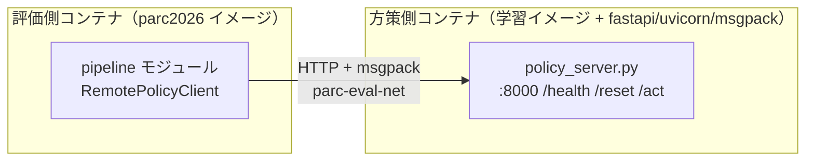

# インフラ・Docker 一覧（現在地）

**このファイルは「今何が使えるか」を映す場所であり、`reference/` とは違って過去の版を残さず、
状態が変わったら上書きする。** GPU マシンを借りた／返した、docker image を再ビルドして
新しいことができるようになった、といった変化があったら、その都度このファイルを直す。

読む目的: 「できること・できないこと」「どのタスクを優先すべきか」を検討するとき、
今使える計算資源とコンテナの実態を確認する。

**書くのは「今どれだけの資源が、どこに、どういう状態であるか」だけである。** 学習・評価・
ディスクの空け方のような手順や Tips はここに書かない（[README.md](README.md) の線引き）。
手順は [../howto/](../howto/)、踏んだ事故と回避策は [../knowledge/](../knowledge/) にある。

最終更新: 2026-08-22 08:07 UTC（`docker ps -a` / `docker inspect` / `nvidia-smi` を実行して確認した時刻）

| # | 節 | 結論 |
|---|---|---|
| 1 | [使える計算資源](#1-使える計算資源このマシンrunpodmaccolab) | π0.5 を今すぐ回せるのはこのマシンと RunPod だけ |
| 2 | [Docker イメージとコンテナ](#2-docker-イメージとコンテナ) | image は 3 系統＋派生。動いている 5 コンテナのうち 1 つは世代の古い image のまま |
| 3 | [提出評価のフロー](#3-提出評価は-http--msgpack-の-2-プロセス構成) | 学習イメージと配布キットイメージを HTTP で繋ぐ 2 プロセス構成 |

## 1. 使える計算資源（このマシン／RunPod／Mac／Colab）

**Track2 の π0.5 を今すぐ回せるのは、このマシンと RunPod だけである。**Colab の手順は SmolVLA
前提で π0.5 に乗らず、運営配布 GPU はまだ来ていない。撮影は Mac 上の Docker だけでできて GPU を
使わないため、他の作業と同時並行できる。

| 資源 | 学習 | 評価 | 撮影 | GPU |
|---|---|---|---|---|
| このマシン（gpu-422591） | ○（縮小版のみ） | ○ | — | H100-20C 1 枚 |
| 運営配布 GPU マシン | ○（予定） | ○（予定） | — | NVIDIA RTX Pro 6000 Blackwell 1 台 |
| RunPod | ○（フルパラメータ） | — | — | A100/H100 80GB（借りた分だけ） |
| ローカル Mac（colima） | — | — | ○ | 不要 |
| Colab | △（SmolVLA 用） | △（SmolVLA 用） | — | 無料枠の GPU ランタイム |

### このマシン（gpu-422591）は学習と評価の両方を兼ねる

**1 枚の GPU を学習と評価が取り合っている。新しい学習を流す前に、評価が動いていないか確認する。**

| 項目 | 実測値 |
|---|---|
| hostname | `gpu-422591` |
| OS | Ubuntu 22.04.3 LTS |
| GPU | NVIDIA H100-20C（H100 を 20GB に切り出した vGPU）1 枚、ドライバ 570.133.20、CUDA 12.8 |
| CPU | 2 コア |

vGPU は OpenGL/EGL 描画に対応しない。EGL 指定だと評価が 50〜99 ステップ目で `read_pixels` が
落ちる実績があるため、評価コンテナは常に `MUJOCO_GL=osmesa`（CPU 描画）を強制している
（[3 節](#3-提出評価は-http--msgpack-の-2-プロセス構成)参照）。

### 運営配布 GPU マシンは 2026-08-24 から NVIDIA RTX Pro 6000 Blackwell が提供される予定

**本戦（Track2）で運営から GPU マシンが配布される予定で、NVIDIA RTX Pro 6000 Blackwell 1 台と
分かった。VRAM 容量・アクセス方法はまだ不明。学習・評価の両方に使う想定であることだけ分かって
いる。** 配布されたら、このマシンや RunPod との役割分担（どちらで何を回すか）を見直す必要がある。

### RunPod は π0.5 のフルパラメータ学習専用

**ローカルの H100-20C には縮小版（`train_expert_only`）しか載らないため、80GB 級 GPU で
公式レシピどおりのフルパラメータ学習を試す用途に限って RunPod を借りる。評価はここでは行わない。**

| 項目 | 内容 |
|---|---|
| GPU | A100 80GB（$1.4〜2.2/時間）または H100 80GB（$2.9〜3.0/時間）目安。実際に借りたのは A100 80GB PCIe（2026-08-14、3,000 ステップ） |
| 課金 | 秒単位の従量課金のみ。期間契約は 3 か月／6 か月の Savings Plan のみで短期利用には使えない |
| 起動方法 | (A 推奨) `Dockerfile.pi05` をローカルでビルドして Docker Hub へ push し、RunPod 側はそのイメージを実行するだけ。(B) 公式 PyTorch テンプレート + [`solution/train/runpod_setup.sh`](../../solution/train/runpod_setup.sh) で torch/torchcodec/torchvision/lerobot を個別インストール |
| SSH 接続 | [`solution/train/runpod_ssh_start.sh`](../../solution/train/runpod_ssh_start.sh) が Pod 起動時に sshd を立てる（`PUBLIC_KEY` 環境変数から `authorized_keys` を書き込む） |
| ストレージ | Volume Disk は 150GB 必須（60GB では 25GB のチェックポイント 2 個で溢れる）。Network Volume を付けていないと残高 $0 で Pod が Terminate され復旧不可、付けていれば停止のみでデータは残る |
| 持ち帰り | scp（1.7MB/s）よりも Hugging Face の非公開リポジトリ経由が速い（8.8GB で 1 時間超 → 9.4GB で 16 分） |

現在進行中の Pod があるかどうかは、このマシンからは確認できない（RunPod の管理画面を見る必要がある）。

### ローカル Mac の Docker はデモ撮影専用（GPU 不要）

**手本デモの撮影（`record`）だけをローカル Mac 上の Docker（colima）で回す。物理シミュレーションと
CPU 描画（osmesa）だけなので GPU が要らず、GPU マシン側の学習と同時並行できる。**

撮影には `parc2026` イメージをそのまま使う。学習（`build`/`merge`）は Python 3.12 + lerobot が
必要な `parc2026-train` イメージで GPU マシン側にて行う。データセットは 1 本 1.4MB と小さいため
`rsync` で GPU マシンへ転送する。このマシンからは Mac 側 Docker の現状（動いているか）は確認できない。

### Colab は SmolVLA 用に組んであり、Track2 の π0.5 には今のところ乗らない

**学習・評価のどちらの手順も SmolVLA（912 MB の重み）を前提にしている。Track2 で使っている
π0.5 は読み込むだけで約 18 GB 必要なので、そのままでは流せない。** Track2 で Colab を使うなら
手順を作り直す作業が先に必要になる。

| 用途 | ノートブック／スクリプト | Track2 で足りないもの |
|---|---|---|
| 学習 | `examples/smolvla_libero_spatial_lora.ipynb`（SmolVLA の LoRA 用） | π0.5 向けのノートブックは無い |
| 評価 | `solution/tools/colab/colab_eval.py`（[howto/11_colab_eval.md](../howto/11_colab_eval.md) が手順） | **π0.5 対応済み（`POLICY_KIND`）。重みは HF から直接落ちるので Drive を経由しない。**残る未確認は T4（cc 7.5）で bf16 の π0.5 が動くかだけ。詳細は手順書の「未確認: T4 で π0.5 が動くかどうか」節 |

## 2. Docker イメージとコンテナ

**image は「配布キット」「SmolVLA 学習」「π0.5 学習」の 3 系統に加え、そこから都度ビルドされる
派生 image がある。いま動いているのは常駐の 2 コンテナだけで、どちらも 3 系統の image を
そのまま使っている。**

**作り替えたマシンで同じ状態に戻す手順は
[../howto/10_rebuild_machine.md](../howto/10_rebuild_machine.md) にある**（この 2 コンテナの
`docker run` の完全な形もそこに書いた）。

### 3 系統の image は依存が競合するため 1 image に混ぜていない

| 系統 | Dockerfile | イメージ名 | base | GPU | 用途 |
|---|---|---|---|---|---|
| 配布キット（自己評価） | [`Dockerfile`](../../Dockerfile) | `parc2026` | `ubuntu:22.04` | 不要 | 本番採点環境と同じ構成。Python 3.10 + LIBERO。評価側プロセスを動かす |
| SmolVLA 学習 | [`solution/train/Dockerfile`](../../solution/train/Dockerfile) | `parc2026-train` | `python:3.12-slim` | 要（`--gpus all`） | lerobot v0.6.0 を `[training,smolvla,peft]` extra で editable install |
| π0.5 学習 | [`solution/train/Dockerfile.pi05`](../../solution/train/Dockerfile.pi05) | `parc2026-train-pi05` | `python:3.12-slim` | 要 | extra は `pi`。bitsandbytes/torchao 同梱（量子化スイープ用）。RunPod 用に sshd/tmux も追加 |

このほか `/home/ubuntu/src/tampura/`・`/home/ubuntu/src/bayes3d/` にも Dockerfile があるが、
**この 2 つは別プロジェクトで PARC2026 のタスクとは無関係**（tampura: Jupyter 開発環境、
bayes3d: `nvcr.io/nvidia/pytorch` ベースの GPU 開発環境）。`work/lerobot-src/docker/` の
Dockerfile 群も HuggingFace LeRobot 本家の配布用であり、参考にしただけで学習・評価には
使っていない。

### 評価用の方策サーバーは、学習イメージから派生 image をその場でビルドして使う

学習イメージ（`parc2026-train` または `parc2026-train-pi05`）には HTTP サーバー依存
（`fastapi`/`uvicorn`/`msgpack`）が無いため、評価を回すたびに
`<学習イメージ名>-server-<image_id 12桁>` という派生 image がビルドされる（詳細は
[3 節](#3-提出評価は-http--msgpack-の-2-プロセス構成)）。つまり「動いているコンテナが使う
image」は、上の 3 系統そのものとは限らない。

### いま動いている 2 コンテナ（2026-08-24 実測）

| コンテナ名 | 使っている image | 3 系統との関係 | 実行コマンド | 起動 | 何をしているか |
|---|---|---|---|---|---|
| `quant_train` | `parc2026-train-pi05`（`06cedf98971f`） | 3 系統そのもの | `sleep infinity` | 08-23 22:57 JST | π0.5 学習・量子化の常駐コンテナ。`docker exec` で `train_pi05.py` を都度実行する運用。`--gpus all`・`--user 1000:1000`、`work/train` を `/out` に、`~/.cache/huggingface` を `/hf_home` に bind mount |
| `parc2026_verify` | `parc2026`（`15297a9921af`） | 3 系統そのもの | `sleep infinity` | 08-21 22:48 JST | 対話確認・`docker exec` 用に寝かせてある検証シェル。`--network none`・GPU なし |

**`quant_train` が古い image を掴んでいた問題は解消している。** 2026-08-22 の時点では
タグを失った旧世代の image（`d1befbd37eb2`）のまま動いていたが、08-23 22:57 に
現在の `parc2026-train-pi05`（`06cedf98971f`）から作り直された。`docker inspect` の
`.Image` が `docker inspect parc2026-train-pi05 --format '{{.Id}}'` と一致する。

**タグに残っている派生 image 3 つ（`parc2026-train-pi05-server-b2e89d2a2735`・
`parc2026-train-pi05-server-d1befbd37eb2`・`parc2026-train-server`）は、いま何も
使っていない。** 評価のたびに作られるもので、必要になればまた作られる。

## 3. 提出評価は HTTP + msgpack の 2 プロセス構成

**本番採点環境と自己評価キットは同じ構成で、学習イメージと配布キットイメージを HTTP + msgpack で
繋ぐ 2 プロセスに分かれている。1 イメージに混ぜないのは依存が衝突するため。**

- 通信は gRPC ではなく **HTTP + msgpack**。`pipeline/remote_policy.py` の
  `RemotePolicyClient(server_url="http://localhost:8000", ...)` がクライアント、
  `solution/policy_server.py` が fastapi + uvicorn でサーバーを実装する
  （`/health`・`/reset`・`/act` の 3 エンドポイント、`/act` は 10 秒のタイムアウト）。
- ポートは 8000 固定。Docker network `parc-eval-net` を作り、方策側コンテナ名 `parc-policy` で
  評価側から名前解決させる。
- 派生 image の image ID をタグに含めるのは、ベースイメージを更新したら確実に再ビルドされるように
  する設計（[2 節](#2-docker-イメージとコンテナ)の `quant_train` の世代ズレはこの設計の反面教師）。
- 評価側コンテナは `--gpus all --network parc-eval-net --ulimit core=0` で起動し、
  描画は `MUJOCO_GL=osmesa`（CPU）を渡す。

## 確認したい仮定

- 運営配布 GPU マシン（NVIDIA RTX Pro 6000 Blackwell 1 台、2026-08-24 開始予定）の VRAM 容量・
  アクセス方法は未確認です。分かった時点でこの節と「使える計算資源」の表・詳細を更新してください。
- ~~`quant_train` コンテナの中に bitsandbytes/torchao の新しい版が入っているかは確認していません。~~
  **2026-08-24 に確認して解消しました。** `docker exec quant_train` で測った実測値は
  bitsandbytes 0.49.2・torchao 0.17.0+cu128・torch 2.11.0+cu128・lerobot 0.6.0・
  torchvision 0.26.0+cu128・torchcodec 0.11.1+cu128 で、`Dockerfile.pi05` のピン留めと
  一致します。コンテナの作り直しは要りません。
- RunPod で現在進行中の Pod があるかどうかは未確認です（管理画面を見ないと分からない）。
  進行中の Pod がある場合、課金が発生し続けている点を踏まえて優先度を検討する必要があります。
- ローカル Mac の Docker（colima）が今動いているかは未確認です。撮影タスクを今すぐ動かせるかは
  この点に依存します。
