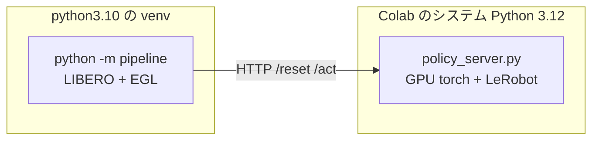

# Colab GPU で評価を回す

手元の CPU コンテナでは **12 エピソードに 2.5 時間**かかる。成功率 10% と 20% を
統計的に区別するには 50〜100 エピソード必要で、それでは何も判断できない。

Colab の GPU（EGL 描画）に移すと桁が変わる。

| | CPU コンテナ（osmesa） | Colab GPU（EGL） |
|---|---|---|
| `env.step` | 300 ms | **39 ms** |
| 重い推論（chunk 1 回） | 23 秒 | **0.85 秒** |
| 1 エピソード（600 ステップ） | 約 12 分 | **約 34 秒** |
| 80 エピソード | 16 時間 | **約 45 分** |

`env.step` の実測値は運営 Q&A No.3 で参加者が L4 上で計測したもの、
推論はこちらで Colab T4 上で実測したものである。

**学習セッションとは別のアカウントで開くこと。** 学習は止めない。

## 実行順序

**上から順に 1 度ずつ実行する。** 後のセルは前のセルが定義した変数を使うため、
飛ばすと `NameError` になる。どのセルが何を定義するかは次のとおり。

| 順 | セル | 定義するもの | 所要 |
|---|---|---|---|
| 1 | **A** GPU と EGL の確認 | （EGL のベンダ設定を作る） | 10 秒 |
| 2 | **B** キットのセットアップ ＋ ログのパッチ | `KIT_DIR` `KIT_PYTHON` `run()` `LOG_DIR` | 5〜10 分 |
| 3 | **C** 重みの用意 | `WEIGHTS_DIR` `USE_FINETUNED` | 2 分 |
| 4 | **D-1** 方策側の依存 | `LEROBOT_DIR` `LEROBOT_SRC` | 3 分 |
| 5 | **D-2** `policy_server.py` の配置 | **`SUBMISSION_DIR`** **`SERVER`** | 5 秒 |
| 6 | **E-1** 設定 | `PORT` `N_EPISODES` `POLICY_ENV` `server_env` `eval_env` | 1 秒 |
| 7 | **E-2** 遅さの切り分け（初回のみ） | — | 3 分 |
| 8 | **E-3** 評価の実行（**回すだけ**） | — | 45 分 |
| 9 | **F** 読み取り・集計・Drive への退避（**出力はすべてここ**） | — | 5 秒 |

**セルは 9 つ。役割は 1 つずつに分けてある。**
特に **E-3 は回すだけ、F は出力だけ**である。以前は退避処理が E-3 と
手書きのセルに散っており、どれを実行したのか分からなくなって
**評価ログを失った**（35 分の再実行になった）。

**2 回目以降、設定を変えて比べるときは `E-1` → `E-3` → `F` だけでよい。** `E-1` の `POLICY_ENV` を
書き換えて流し直す。

> `SUBMISSION_DIR` が未定義というエラーは、**D-2 を実行していない**（または
> 古い版のままになっている）ことを意味する。`E-1` の末尾に `assert` を入れて
> あるので、そこで気づける。

## なぜ 2 プロセスに分けるのか

評価側と方策側は**依存が正面衝突する**。

| | 必要なもの | 衝突 |
|---|---|---|
| 評価パイプライン | `numpy==1.26.4` / `gym==0.25.2` / `robosuite==1.4.0` / CPU torch | 古い固定版 |
| 方策 | LeRobot v0.6.0 / GPU torch / transformers | 新しい版 |

1 つの環境に押し込むと片方が壊れる。配布キットが HTTP サーバー方式を採っているのは
まさにこのためで、**本番採点も 2 プロセス構成**である。同じ形をそのまま使う。



**提出物の zip は使わない。** `policy_server.py` は `vendor/` が無ければ
インストール済みの LeRobot を使うため、Colab ではそのまま動く。
測りたいのは推論の中身であって Python 3.10 互換ではない
（3.10 の確認は Docker 側で済んでいる）。

---

## A. GPU と EGL を確認する

新しいノートブックを作り、**ランタイムのタイプを GPU に変更**してから最初のセルに貼る。

```python
# === GPU と EGL の確認 ===
# MuJoCo は EGL を使うと GPU で描画する。ここがソフトウェア実装に落ちると
# シミュレーションが 11 倍遅くなり、この手順の意味が無くなる。
import ctypes, subprocess, sys
from pathlib import Path

print(subprocess.run(["nvidia-smi", "--query-gpu=name,memory.total",
                      "--format=csv,noheader"], capture_output=True, text=True).stdout.strip())
print("python:", sys.version.split()[0])

try:
    ctypes.CDLL("libEGL.so.1")
    print("libEGL: あり")
except OSError:
    print("libEGL: 無し → 次のセルの apt で入る")

# **ここが Colab の最大の罠。** libglvnd は「ローダ」でしかなく、
# どのベンダ実装を使うかは egl_vendor.d の JSON が決める。NVIDIA の登録が
# 無いと Mesa のソフトウェア実装を掴み、**例外も警告も出さずに 11 倍遅くなる。**
icd = Path("/usr/share/glvnd/egl_vendor.d/10_nvidia.json")
if not icd.is_file():
    icd.parent.mkdir(parents=True, exist_ok=True)
    icd.write_text(
        '{\n'
        '    "file_format_version" : "1.0.0",\n'
        '    "ICD" : {\n'
        '        "library_path" : "libEGL_nvidia.so.0"\n'
        '    }\n'
        '}\n'
    )
    print(f"{icd} を作成した（NVIDIA の EGL を使わせる）")
else:
    print(f"{icd} は既にある")
```

GPU 名が出なければ**ランタイムのタイプが GPU になっていない**。先に直すこと。

---

## B. 配布キットを取得してセットアップする

**5〜10 分かかる。** `setup.sh` をそのまま使う（本番と同じ手順）。
キットは公開リポジトリなので clone できる。

```python
# === 配布キットのセットアップ ===
# setup.sh は python3.10 を前提にしている。Colab は 3.12 なので apt で 3.10 を足す。
# 評価パイプライン側は 3.10 の venv に閉じ込め、方策側は Colab の 3.12 を使う。
#
# 失敗したときに原因が分かるよう、出力は多めに残す。
import os, subprocess, shutil
from pathlib import Path

KIT_DIR = Path("/content/PARC2026_pre")
LOG_DIR = Path("/content/setup_logs"); LOG_DIR.mkdir(exist_ok=True)

def run(command: str, check: bool = True, tail: int = 30, log: str | None = None) -> int:
    """シェルコマンドを実行し、出力の末尾を表示する。全文はログに残す。"""
    print(f"$ {command}")
    result = subprocess.run(command, shell=True, capture_output=True, text=True)
    output = result.stdout + result.stderr

    if log:
        (LOG_DIR / log).write_text(output, encoding="utf-8")

    lines = output.strip().splitlines()
    if result.returncode != 0:
        print(f"--- 失敗 (returncode={result.returncode}) 末尾 {tail} 行 ---")
        print("\n".join(lines[-tail:]))
        if log:
            print(f"--- 全文: {LOG_DIR / log} ---")
        if check:
            raise RuntimeError(f"失敗 ({result.returncode}): {command}")
    else:
        print("\n".join(lines[-4:]) if lines else "(出力なし)")
    return result.returncode

run("apt-get -qq update", log="apt_update.log")
run("apt-get -qq install -y libosmesa6 libegl1 libglfw3 libglew-dev "
    "libmagickwand-dev unzip build-essential", log="apt_system.log")

# python3.10 が入るなら使う。入らなければ Colab の Python（3.12）で作る。
# ここは採点環境への忠実性の話ではない（それは Docker 側で済んでいる）。
# キットが gym==0.25.2 / robosuite==1.4.0 という古い版を固定しているため、
# 素性の分かっている 3.10 の方が安全というだけである。
import sys
run("apt-get -qq install -y python3.10 python3.10-venv python3.10-dev",
    check=False, log="apt_python310.log")

KIT_PYTHON = shutil.which("python3.10") or sys.executable
print(f"\nキット側の Python: {KIT_PYTHON}")
if "3.10" not in KIT_PYTHON:
    print("  python3.10 が使えないため Colab の Python を使う。"
          "gym / robosuite が古いため、後段で落ちたらログを見ること。")

if not KIT_DIR.exists():
    run(f"git clone --depth 1 https://github.com/matsuolab/PARC2026_pre {KIT_DIR}")

os.chdir(KIT_DIR)

# Colab は MPLBACKEND に matplotlib_inline を設定している。キットの venv には
# そのパッケージが無いため、libero が matplotlib を import した瞬間に
# 「'module://matplotlib_inline.backend_inline' is not a valid value for backend」
# で落ちる。評価は画面表示をしないので、以降ずっと Agg にしておく。
os.environ["MPLBACKEND"] = "Agg"

run(f"PYTHON={KIT_PYTHON} bash setup.sh", tail=40, log="setup.log")

# torch 2.11.0 は setuptools<82 を要求するが、Colab の venv には新しいものが入る。
# 警告のまま放置すると import で落ちることがあるため揃えておく。
run(f"{KIT_DIR}/venv/bin/pip install -q 'setuptools<82'", check=False)

# --- エピソードごとの結果をログに出す ---
# 配布キットはタスク単位の集計しか出さず、45 分間まったく出力が変わらない。
# さらに衝突判定に使った object_max_disp（**どの物体がどれだけ動いたか**）を
# 判定した直後に捨てるため、何にぶつかったのかが分からない。
# 判定式には触らず、その直後に logger.info を 1 つ足す。
target = KIT_DIR / "pipeline" / "rollout.py"
source = target.read_text()
anchor = "        collided = any(d > collision_threshold for d in object_max_disp.values())\n"
addition = '''        _offenders = {k: v for k, v in object_max_disp.items() if v > collision_threshold}
        logger.info(
            "  [結果] %s ep%d: %s %d steps%s",
            task_info.name, episode_id,
            "成功" if (bool(done) and not _offenders) else ("衝突" if _offenders else "未完了"),
            total_steps,
            ("  ぶつけた物体: " + ", ".join(
                f"{k}={v * 1000:.1f}mm"
                for k, v in sorted(_offenders.items(), key=lambda kv: -kv[1]))) if _offenders else "",
        )
'''
if "ぶつけた物体" in source:
    print("ログのパッチ: 適用済み")
elif anchor not in source:
    raise RuntimeError("パッチのアンカーが見つかりません。キットの版を確認してください")
else:
    target.write_text(source.replace(anchor, anchor + addition, 1))
    print("ログのパッチ: 適用した")

# 動作確認。setup.sh 自身の確認は MPLBACKEND のせいで落ちるため、ここでやり直す。
verify = (
    f'MPLBACKEND=Agg PYTHONPATH="{KIT_DIR}/LIBERO-plus:{KIT_DIR}:{KIT_DIR}/compe" '
    f'{KIT_DIR}/venv/bin/python -c '
    '"import torch, libero.libero.benchmark; '
    'from compe.t1 import register_t1; register_t1(); '
    'print(\'suite 登録 OK / torch\', torch.__version__)"'
)
run(verify, tail=20, log="verify.log")
print("キットのセットアップ完了")
```

> **`setup.sh` の最後の「動作確認（suite 登録）」は Colab では必ず失敗する。**
> `MPLBACKEND` が原因であり、セットアップ自体（`1/5`〜`5/5`）が完了していれば問題ない。
> 上のセルは `setup.sh` を通したあとに、環境変数を直して確認をやり直している。
> `setup.sh` は再実行しても venv・clone・アセットを作り直さないため、
> 失敗後にこのセルをもう一度流すだけでよい。

> **どちらの Python でも `setup.sh` は `venv` を作る。** 方策側（Colab の 3.12 本体）とは
> 別の環境になるため、`numpy==1.26.4` が方策側へ漏れることはない。
> **2 プロセス構成は Python の版に関係なく必要である。**

### `setup.sh` が失敗したとき

失敗すると末尾 40 行が表示され、全文が `/content/setup_logs/setup.log` に残る。
**`[setup] N/5` のどこまで進んだかで切り分ける。**

| 止まった段階 | 何が起きているか | 対処 |
|---|---|---|
| `1/5 venv + 依存` | `python3.10` が無い、または pip が失敗 | 下記「python3.10 が入らないとき」 |
| `2/5 LIBERO-plus / LIBERO の取得` | git clone の失敗 | 再実行する（一時的な失敗が多い） |
| `3/5 パッチ` | ほぼ起きない | ログを見る |
| `4/5 アセット` | `assets.zip`（HF）の取得や `unzip` の失敗 | `unzip` が入っているか確認して再実行 |
| `5/5 libero 設定` | ほぼ起きない | ログを見る |

止まった段階が分からないときは次で確認する。

```python
print((LOG_DIR / "setup.log").read_text()[-4000:])
```

#### 依存のインストールで落ちるとき（`1/5` で止まる）

`gym==0.25.2` や `robosuite==1.4.0` は 2022 年前後の版で、
**新しい Python では wheel が無い / ビルドに失敗する**ことがある。
どのパッケージで落ちたかはログの末尾に出る。

```python
print((LOG_DIR / "setup.log").read_text()[-4000:])
```

`python3.10` が使えていればまず起きない。Colab の Python（3.12）で落ちた場合は、
`python3.10` を入れられないか先に確認する価値がある。

```python
run("apt-cache policy python3.10", check=False)
```

`Candidate: (none)` なら apt に無い。その場合は deadsnakes を足す手もあるが、
**そこまでするより先に、落ちたパッケージ 1 つだけを新しい版で入れて
`setup.sh` を再実行する**方が速いことが多い。

> **`setup.sh` は `~/.libero/config.yaml` を書き換える。** Colab は使い捨てなので問題ないが、
> ローカルで同じことをすると既存の LIBERO 設定が `.bak` に退避される。

### ログのパッチについて

上のセルの最後で `pipeline/rollout.py` にログ行を 1 つ足している。
**判定にも採点にも触らない。** 得られるのはこれである。

```
  [結果] put_the_bowl_on_the_stove_light_11 ep3: 衝突 214 steps  ぶつけた物体: wooden_cabinet=3.7mm
  [結果] put_the_bowl_on_the_stove_light_11 ep4: 成功 96 steps
```

| 無いと困ること | |
|---|---|
| **何にぶつかったのか分からない** | 衝突は失敗の大半を占める。対象物が分からないと次の手が決まらない |
| **45 分間まったく出力が変わらない** | 進んでいるのか止まったのか区別できない |

> **キットは `git clone` で取ってくるため、リポジトリ側の修正は反映されない。**
> このセルで当てる必要がある。B を再実行してもパッチは消えない
> （`git clone` は `KIT_DIR` が無いときだけ走る)。2 回目以降は
> `適用済み` と出るだけで、二重には当たらない。

---

## C. 重みを用意する

**素の重み**と**追加学習した重み**のどちらを測るかで分岐する。まず素の重みで
基準を取り、そのあと学習後と比べるのが順序である。

素の重みは **`0.05832` を出した提出物とまったく同じもの**なので、
ここで出る数字は本番スコアと直接比べられる。

```python
# === 評価する重みを用意する ===
# USE_FINETUNED = False なら HF から素の重みを取る（Drive 不要）。
# True なら Drive のマージ済みモデルを使う。
#
# DRIVE_MERGED_DIR は COLAB.md のセル E が書き出す先である。
#   merged_on_drive = DRIVE_RUN_DIR / "merged_model"
# つまり  /content/drive/MyDrive/parc2026/<RUN_NAME>/merged_model  になる。
# <RUN_NAME> は学習セルの同期ログに出ている名前をそのまま使う。
# **マージセルを実行するまで存在しない。** 学習中は False のままにすること。
USE_FINETUNED = False
DRIVE_MERGED_DIR = "/content/drive/MyDrive/parc2026/<RUN_NAME>/merged_model"

from pathlib import Path
from huggingface_hub import snapshot_download

WEIGHTS_DIR = Path("/content/model_weights")

if USE_FINETUNED:
    from google.colab import drive
    drive.mount("/content/drive")
    source = Path(DRIVE_MERGED_DIR)
    assert source.is_dir(), (
        f"{source} がありません。COLAB.md のセル E（マージ済みモデルを Drive へ）"
        "まで実行されているか確認してください"
    )
    run(f"rm -rf {WEIGHTS_DIR} && cp -r '{source}' {WEIGHTS_DIR}")
else:
    # このリポジトリには eval/（評価動画 402 ファイル・25.6 MB）が入っている。
    # 推論には不要なので除外する。落とすのはルート直下の 7 ファイルだけでよい。
    snapshot_download(
        "lerobot/smolvla_libero_plus",
        revision="7bb70aa5bc92b82c9239142775d3a173103567ff",
        local_dir=str(WEIGHTS_DIR),
        ignore_patterns=["eval/*", "eval/**"],
    )

# policy_server.py は model_weights/vlm/ からトークナイザを読む。
# VLM 本体の重みはポリシー側のチェックポイントに含まれるので、
# 設定とトークナイザだけで足りる（*.safetensors は落とさない）。
snapshot_download(
    "HuggingFaceTB/SmolVLM2-500M-Video-Instruct",
    local_dir=str(WEIGHTS_DIR / "vlm"),
    allow_patterns=["*.json", "*.txt", "*.model", "tokenizer*"],
)

# 推論に必須のファイル。train_config.json は学習スクリプトが書くもので、
# マージ済みモデル（save_pretrained の出力）には無いため必須にしない。
required = {
    "config.json", "model.safetensors",
    "policy_preprocessor.json", "policy_postprocessor.json",
    "policy_preprocessor_step_5_normalizer_processor.safetensors",
    "policy_postprocessor_step_0_unnormalizer_processor.safetensors",
}
present = {p.name for p in WEIGHTS_DIR.iterdir() if p.is_file()}
missing = required - present
assert not missing, f"重みが足りません: {missing}"
assert (WEIGHTS_DIR / "vlm" / "tokenizer_config.json").is_file(), "vlm のトークナイザがありません"

import json
config = json.loads((WEIGHTS_DIR / "config.json").read_text())
assert not config.get("use_peft"), "use_peft が真です。LoRA がマージされていません"

total = sum(p.stat().st_size for p in WEIGHTS_DIR.rglob("*") if p.is_file())
print(f"重みの準備完了: {total / 1e6:.0f} MB  （追加学習: {'あり' if USE_FINETUNED else 'なし'}）")
print(sorted(present))
```

> 提出物の `model_weights/` はこのセルと**同じ中身**である
> （ルート直下の 6 ファイル ＋ `train_config.json` ＋ `vlm/`）。
> 素の重みでは `README.md` と `.gitattributes` が余分に落ちるが、
> 読み込みには影響しない。

---

## D. 方策サーバー側の依存を入れる

Colab のシステム Python（3.12）に、`policy_server.py` が要るものだけ足す。
LeRobot は学習用ノートブックと同じ手順で入れる。

```python
# === 方策サーバー側の依存 ===
# 学習用ノートブックと同じ手順で LeRobot v0.6.0 を入れる。手順を変えると
# 学習時と推論時でモデルの挙動が変わり、比較の意味が無くなる。
import shutil, sys
from pathlib import Path

import torch

LEROBOT_TAG = "v0.6.0"
LEROBOT_DIR = Path("/content/lerobot")

# av が要る理由は非自明なので記録しておく。
# lerobot/policies/factory.py は groot の設定を import し、その連鎖で
# groot/processor_groot.py に到達する。そこは
#     if TYPE_CHECKING or _datasets_available:
#         from lerobot.datasets.lerobot_dataset import LeRobotDataset
# という分岐になっており、`datasets` が入っていると通る。すると
# lerobot/datasets/__init__.py が require_package("av") を呼ぶ。
# **Colab には datasets が既定で入っているため、av も必要になる。**
# 提出物の環境には datasets が無いので分岐がスキップされ、av は要らない。
#
# バージョンを固定するのは、LeRobot v0.6.0 が av>=15,<16 を宣言しているため。
# 素で入れると 17 系になり、lerobot/datasets/pyav_utils.py が使う
# av.option が無くなっていて AttributeError になる。
run("pip install -q fastapi uvicorn msgpack 'av>=15.0.0,<16.0.0'")

if not LEROBOT_DIR.exists():
    run(f"pip uninstall -y -q lerobot torchao", check=False)
    run(f"git clone --quiet --depth 1 --branch {LEROBOT_TAG} "
        f"https://github.com/huggingface/lerobot.git {LEROBOT_DIR}")

    # bf16 非対応の GPU（T4 など）では fp16 に書き換える。
    # 学習用ノートブックが同じ置換をしており、揃えないと挙動が変わる。
    if not torch.cuda.is_bf16_supported():
        smolvlm = LEROBOT_DIR / "src/lerobot/policies/smolvla/smolvlm_with_expert.py"
        source = smolvlm.read_text(encoding="utf-8")
        smolvlm.write_text(
            source.replace('torch_dtype="bfloat16",', 'torch_dtype="float16",', 1),
            encoding="utf-8",
        )
        print("bf16 非対応の GPU のため fp16 へ書き換えました")

    run(f"pip install -q --upgrade -e '{LEROBOT_DIR}[smolvla]'")
    run("pip uninstall -y -q torchao", check=False)

# clone 先 /content/lerobot には __init__.py が無いため、`import lerobot` が
# これを名前空間パッケージとして掴んでしまい lerobot.__file__ が None になる。
# 学習用ノートブックと同じく、実体のある src/ を sys.path の先頭へ置く。
LEROBOT_SRC = LEROBOT_DIR / "src"

for name in [m for m in sys.modules if m == "lerobot" or m.startswith("lerobot.")]:
    del sys.modules[name]

sys.path = [p for p in sys.path if p not in {str(LEROBOT_DIR), str(LEROBOT_SRC)}]
sys.path.insert(0, str(LEROBOT_SRC))

import importlib
importlib.invalidate_caches()

import lerobot
assert lerobot.__file__ is not None, "lerobot が名前空間パッケージとして読まれています"
assert LEROBOT_SRC.resolve() in Path(lerobot.__file__).resolve().parents, \
    f"LeRobot の読込先が正しくありません: {lerobot.__file__}"

print("lerobot:", Path(lerobot.__file__).parent)
print("bf16 対応:", torch.cuda.is_bf16_supported())
```

> **`torch.cuda.is_bf16_supported()` が False なら、必ず上の書き換えを通すこと。**
> T4 は bf16 非対応である。L4（本番と同じ）や A100 なら不要。
> 学習を T4 で回して評価を L4 で回すと、この一点だけ条件が変わる。

> **`lerobot.__file__` が `None` になるのは、clone 先の `/content/lerobot` が
> `__init__.py` を持たないためである。** `/content` が `sys.path` に入っていると
> そこが名前空間パッケージとして拾われ、実体の `src/lerobot` に届かない。
> 上の 3 行（`sys.modules` の掃除・`sys.path` の差し替え・`invalidate_caches`）が
> それを避けている。**この対処は別プロセスには効かない**ので、
> サーバー起動時にも同じ手当てが要る（セル E で `PYTHONPATH` に入れている）。

### それでも `av` 関連で落ちるとき

`lerobot.datasets` の中で別の不整合が出る場合は、**`datasets` を消して分岐そのものを
通らなくする**方が確実である。提出物の環境と同じ状態になり、起動も速くなる。

```python
run("pip uninstall -y -q datasets", check=False)

# 分岐が閉じたことを確認する
check = (
    f"PYTHONPATH={LEROBOT_SRC} python -c "
    "\"from lerobot.utils.import_utils import _datasets_available; "
    "print('datasets available:', _datasets_available); "
    "from lerobot.policies.factory import make_pre_post_processors; "
    "print('factory の import: 成功')\""
)
run(check, tail=20)
```

`datasets available: False` と出れば、`lerobot.datasets` は読まれない。
この評価では `datasets` を使わないので消して問題ない。

### どの `policy_server.py` を使うか

**リポジトリの [policy_server.py](../../solution/policy_server.py) をそのまま使う。**
提出した zip の中身と同一のファイルであり、書き換えは要らない。

| | |
|---|---|
| 場所 | `solution/policy_server.py` |
| 提出物との関係 | **完全に同一**。zip はこのファイルをルート直下に入れているだけ |
| Colab での違い | `vendor/` が無いので、同梱版ではなくインストール済みの LeRobot を使う |
| つまみ | `PARC_*` の 4 つ。**`PARC_N_ACTION_STEPS` と `PARC_EMA_ALPHA` は既定で有効**（下表） |

### `PARC_*` の 4 つのつまみ

`policy_server.py` が読む環境変数はこれで全部である
（`HF_HUB_OFFLINE` などのキャッシュ関連を除く）。**`POLICY_ENV` に書かなければ
既定値が使われる。** 4 つは独立で、組み合わせても構わない。

| 変数 | 既定 | 何をするか | いつ効くか |
|---|---|---|---|
| **`PARC_N_ACTION_STEPS`** | **`5`** | 1 回の推論で作る 50 ステップ分の chunk のうち、**何ステップ実行してから作り直すか**。小さいほど観測を見直す頻度が上がり、開ループ中の誤差の蓄積が打ち切られる。代償は推論回数（1 ステップあたり `38.6 ms + 850 ms / n`） | **常時。既定で有効** |
| **`PARC_EMA_ALPHA`** | **`0.3`** | 出力した行動に**直前の行動をこの割合だけ混ぜる**。`0.3` なら「3 割は前の行動」。動きの行き過ぎが減り、軌道が滑らかになる。**並進と回転の 6 次元だけ**で、グリッパは触らない（中間値になると掴めなくなるため） | **常時。既定で有効** |
| `PARC_BLEND_STEPS` | `0`（無効） | **chunk の継ぎ目の直後だけ**、直前の行動へ寄せて段差を消す。`3` なら継ぎ目から 3 ステップ、重みを 3/4 → 2/4 → 1/4 と減らしながら混ぜる。EMA と違い**常時はかからない**。こちらも 6 次元のみ | 再計画の頻度を上げて jerk が悪化したとき |
| `PARC_SAMPLES` | `1`（無効） | chunk を**この本数だけ引き直し、互いに最も近いもの（medoid）を採用**する。平均ではなく実在の 1 本を選ぶので、グリッパが中間値にならない。外れた chunk を捨てられる代わりに**推論コストがこの倍数になる** | 上の 3 つを詰めたあと |

**`PARC_EMA_ALPHA` と `PARC_SAMPLES` は別物である。** 前者は出力した行動を
時間方向にならす処理、後者は同じ観測から chunk を複数引いて 1 本選ぶ処理で、
効く場所も計算コストも違う。

> 運営 Q&A No.10 で「VLA が生成した Action を、全タスク共通のルールで整える処理」は
> 禁止事項に含まれないと明言されている。4 つとも**モデル出力と過去の行動しか
> 参照しない**（タスク名・seed・シミュレータの内部状態は見ない）。

**アップロードするファイルは 1 つのフォルダに集められる。** 手元でこれを走らせる。

```bash
python3 solution/tools/collect_colab_files.py
open work/colab_upload
```

`policy_server.py` と `make_validation_suite.py`（セル H 用）が入るので、
**中身をまとめて左のファイルペインへドラッグ**する。置き場所は `/content/` の直下
（下のセルが `policy_server.py` を専用ディレクトリへ移す）。

毎回コピーを作り直すので、**リポジトリを直したのに古いものを上げてしまう取り違えが起きない。**

```python
# === policy_server.py を専用ディレクトリへ配置する ===
# /content 直下のままだと、サーバーの別プロセスで `import lerobot` が
# clone 先の /content/lerobot（__init__.py 無し）を掴んでしまう。
# スクリプトの置き場所は sys.path の先頭に入るため、隣に lerobot/ が
# 無いディレクトリへ移しておく。
from pathlib import Path
import shutil

SUBMISSION_DIR = Path("/content/submission")
SUBMISSION_DIR.mkdir(exist_ok=True)
SERVER = SUBMISSION_DIR / "policy_server.py"

uploaded = Path("/content/policy_server.py")
if uploaded.is_file():
    shutil.copy2(uploaded, SERVER)
assert SERVER.is_file(), "policy_server.py を /content/ に置いてください"

# model_weights は policy_server.py と同じ階層に無ければならない。
weights_link = SUBMISSION_DIR / "model_weights"
if not weights_link.exists():
    weights_link.symlink_to(WEIGHTS_DIR)

assert not (SUBMISSION_DIR / "lerobot").exists(), \
    "この階層に lerobot/ があると import が壊れます"
print("配置 OK:", SERVER)
print("  重み:", sorted(p.name for p in weights_link.iterdir())[:4], "…")
```

---

## E. 評価を回す

### E-1. 設定（先にこれを実行する）

**以降のセルはすべてここで定義した変数を使う。** 診断も本番も、まずこれを流す。

```python
# === 評価の設定 ===
# ここだけを書き換えて、下のセルは触らずに設定を変えて比べる。
# **1 タスクあたり**の本数である。総数は「タスク数 × この値」。
# H で検証スイートへ差し替えるとタスクが 4 → 84 に増えるため、
# **20 のままだと 1,680 エピソード（27 時間）になって終わらない。**
# 検証スイートを使うときは 1 にすること。
N_EPISODES = 20
# **本番の打ち切りは 300 歩である。** 採点ログの /reset と /act の並びから
# 1 本ずつのステップ数を数えたところ、8 本中 4〜5 本がちょうど 300 で
# 止まっていた。配布既定の 600 で測ると**倍の時間を与えてしまい、
# 成功率を実際より高く見積もる。**
MAX_STEPS = 300
PORT = 8000

# 推論時のつまみ。**空でも素の挙動にはならない**（n_action_steps の既定は 10）。
# 4 つあり、書かなかったものは policy_server.py の既定値になる。
# 意味と既定値は下の表を参照。比べるときはここだけを書き換える。
POLICY_ENV = {
    # "PARC_N_ACTION_STEPS": "10",   # 既定 10。1 回の推論で実行するステップ数
    # "PARC_EMA_ALPHA": "0.3",       # 既定 0（無効）。直前の行動を混ぜる割合
    # "PARC_BLEND_STEPS": "3",       # 既定 0（無効）。継ぎ目を均すステップ数
    # "PARC_SAMPLES": "3",           # 既定 1（無効）。chunk を引く本数
}

import os, subprocess, sys, time, urllib.request, json
from pathlib import Path

# --- 方策サーバー側の環境 ---
server_env = dict(os.environ)
server_env.update({k: v for k, v in POLICY_ENV.items() if v})
# policy_server.py は setdefault で offline を立てる。Colab は通信できるので
# 明示的に解除する。**採点環境は遮断されるため、オフラインの確認は Docker 側で行う。**
server_env["HF_HUB_OFFLINE"] = "0"
server_env["TRANSFORMERS_OFFLINE"] = "0"
server_env["CUDA_VISIBLE_DEVICES"] = "0"
# 別プロセスなので、ノートブック側の sys.path 操作は効かない。
server_env["PYTHONPATH"] = str(LEROBOT_SRC)

# --- 評価パイプライン側の環境 ---
eval_env = dict(os.environ)
eval_env.update({
    "MUJOCO_GL": "egl",          # GPU 描画。セル A のベンダ設定と対で効く
    "MPLBACKEND": "Agg",         # Colab の既定値だと libero の import が落ちる
    "PYTHONUNBUFFERED": "1",     # 無いと出力がバッファされ、止まったように見える
    "PYTHONPATH": f"{KIT_DIR}/LIBERO-plus:{KIT_DIR}:{KIT_DIR}/compe",
    "LIBERO_ROOT": f"{KIT_DIR}/LIBERO-plus",
})

for name in ("KIT_DIR", "LEROBOT_SRC", "SUBMISSION_DIR", "SERVER", "WEIGHTS_DIR"):
    assert name in globals(), f"{name} が未定義です。セル A〜D を順に実行してください"

print(f"設定: {N_EPISODES} エピソード/タスク, 後処理 {POLICY_ENV or '既定'}")
print(f"  サーバー: {SERVER}")
print(f"  キット  : {KIT_DIR}")
```

### E-2. 先に遅さの原因を切り分ける（3 分・初回のみ）

1 エピソードの所要時間は **シミュレーション ＋ 推論**で決まる。

```
1 エピソード ≈ 600 × (env.step の秒数) + 12 × (重い /act の秒数)
```

| 構成 | 内訳 | 1 エピソード | 80 エピソード |
|---|---|---|---|
| **EGL ＋ GPU 推論**（狙い） | 600×0.04 + 12×0.85 | **34 秒** | **45 分** |
| osmesa ＋ GPU 推論 | 600×0.30 + 12×0.85 | 190 秒 | 4.2 時間 |
| EGL ＋ CPU 推論 | 600×0.04 + 12×15 | 204 秒 | 4.5 時間 |

**遅いときは、どちらの項が大きいかで原因が決まる。** 両方まとめて測る。

```python
# === 遅さの原因を切り分ける（描画 vs 推論）===
# E-1 を実行済みであること（eval_env / server_env / PORT を使う）。
import msgpack
import numpy as np

# --- 1. 描画: env.step の速度 ---
benchmark = '''
import contextlib, io, time
import numpy as np
from pipeline.config import EvalConfig
from pipeline.environment import EnvironmentManager

with contextlib.redirect_stdout(io.StringIO()):
    manager = EnvironmentManager(EvalConfig())
    tasks = manager.get_task_infos("libero_t1")
    env = manager.create_env(tasks[0])
    env.reset()
    env.set_init_state(tasks[0].init_states[0])
    for _ in range(10):
        env.step(np.zeros(7, dtype=np.float32))
    started = time.time()
    for _ in range(50):
        env.step(np.zeros(7, dtype=np.float32))
    elapsed = time.time() - started
print(f"env.step: {elapsed / 50 * 1000:.1f} ms/step")
'''
result = subprocess.run(
    [f"{KIT_DIR}/venv/bin/python", "-u", "-c", benchmark],
    cwd=str(KIT_DIR), env=eval_env, capture_output=True, text=True, timeout=900,
)
render_line = result.stdout.strip() or result.stderr.strip()[-800:]
print("[描画] " + render_line)

# --- 2. 推論: /act の速度 ---
# 配布キットと同じ形式で送る。obs は {key: {data, dtype, shape}} の msgpack、
# 応答は {"data": bytes} である（policy_server.py の serialize/deserialize に対応）。
def post(path: str, body: bytes, content_type: str) -> bytes:
    request = urllib.request.Request(
        f"http://localhost:{PORT}{path}", data=body,
        headers={"Content-Type": content_type},
    )
    with urllib.request.urlopen(request, timeout=300) as response:
        return response.read()

def serialize_obs(observation: dict) -> bytes:
    return msgpack.packb({
        key: {"data": value.tobytes(), "dtype": str(value.dtype), "shape": list(value.shape)}
        for key, value in observation.items()
    }, use_bin_type=True)

log = open("/content/server_probe.log", "w")
server = subprocess.Popen([sys.executable, str(SERVER), "--port", str(PORT)],
                          cwd=str(SUBMISSION_DIR), env=server_env,
                          stdout=log, stderr=subprocess.STDOUT)
try:
    started = time.time()
    for _ in range(300):
        try:
            urllib.request.urlopen(f"http://localhost:{PORT}/health", timeout=2)
            break
        except Exception:
            if server.poll() is not None:
                raise RuntimeError(open("/content/server_probe.log").read()[-2000:])
            time.sleep(1)
    print(f"[推論] 起動 {time.time() - started:.0f} 秒")

    # /reset は JSON、/act は msgpack。配布キットの remote_policy.py と同じ。
    post("/reset", b'{"instruction": "Put the bowl on the stove"}', "application/json")

    observation = {
        "agentview_image": np.random.randint(0, 255, (128, 128, 3), dtype=np.uint8),
        "robot0_eye_in_hand_image": np.random.randint(0, 255, (128, 128, 3), dtype=np.uint8),
        "robot0_eef_pos": np.zeros(3, dtype=np.float32),
        "robot0_eef_quat": np.array([0, 0, 0, 1], dtype=np.float32),
        "robot0_gripper_qpos": np.zeros(2, dtype=np.float32),
    }
    payload = serialize_obs(observation)
    timings = []
    for index in range(3):
        begin = time.time()
        post("/act", payload, "application/x-msgpack")
        timings.append(time.time() - begin)
        print(f"[推論] act[{index}] {timings[-1]:6.3f} 秒")
finally:
    server.terminate()

# --- 3. 判定 ---
render_ms = float(render_line.split(":")[-1].replace("ms/step", "").strip()) if "ms/step" in render_line else None
if render_ms is not None:
    episode = 600 * render_ms / 1000 + 12 * timings[0]
    print()
    print(f"1 エピソードの見込み: {episode:.0f} 秒  → 80 エピソードで {episode * 80 / 3600:.1f} 時間")
    print(f"  うちシミュレーション {600 * render_ms / 1000:.0f} 秒 / 推論 {12 * timings[0]:.0f} 秒")
```

| 測定 | 正常 | 異常 | 異常時の意味 |
|---|---|---|---|
| **`env.step`** | 40〜60 ms | 250〜350 ms | **osmesa に落ちている。GPU 描画になっていない** |
| **`act[0]`** | 0.5〜1.5 秒 | 5 秒以上 | **CPU で推論している** |
| `act[1]` `act[2]` | ほぼ 0 秒 | 大きい | chunk のキャッシュが効いていない |

#### `env.step` が遅いとき（400 ms 前後）

**Colab で最初に疑うのはここである。** EGL は「初期化に成功したが
ソフトウェア実装に落ちた」という壊れ方をする。**例外は出ない。**

原因は **NVIDIA の EGL ベンダ設定ファイルが無い**ことである。
`apt-get install libegl1` が入れるのは**ローダ**（libglvnd）だけで、
どのベンダ実装を使うかは `/usr/share/glvnd/egl_vendor.d/` の JSON が決める。
ここに NVIDIA の登録が無いと、ローダは Mesa のソフトウェア EGL を掴む。

**2026-08-09 の Colab で実際にこうなっていた。**

```
ベンダ設定: ['50_mesa.json']          ← NVIDIA の登録が無い
MUJOCO_GL = egl                        ← 環境変数は届いている
GLContext = robosuite.renderers.context.egl_context   ← robosuite は EGL を選んでいる
env.step: 431.8 ms/step                ← それでもソフトウェア描画
```

`10_nvidia.json` は `50_mesa.json` より優先される（数字が小さい方が先）。
**この 1 ファイルを置くだけで直った。**

```
env.step: 431.8 ms/step  →  38.6 ms/step   （11.2 倍）
1 エピソードのシミュレーション: 259 秒  →  23 秒
```

38.6 ms/step は、運営 Q&A No.3 で参加者が L4 上で計測した 39.1 ms/step と
ほぼ一致する。**本番と同じ描画性能が出ている。**

```python
# === EGL が NVIDIA の実装を掴んでいるか確認して、必要なら直す ===
import os, subprocess
from pathlib import Path

icd = Path("/usr/share/glvnd/egl_vendor.d/10_nvidia.json")
print("ベンダ設定:", sorted(p.name for p in Path("/usr/share/glvnd/egl_vendor.d").glob("*.json"))
      if Path("/usr/share/glvnd/egl_vendor.d").is_dir() else "(ディレクトリが無い)")

if not icd.is_file():
    icd.parent.mkdir(parents=True, exist_ok=True)
    icd.write_text(
        '{\n'
        '    "file_format_version" : "1.0.0",\n'
        '    "ICD" : {\n'
        '        "library_path" : "libEGL_nvidia.so.0"\n'
        '    }\n'
        '}\n'
    )
    print(f"{icd} を作成した")
else:
    print(f"{icd} は既にある")

# robosuite がどの実装を選んだかを確かめる
probe = '''
import os
print("MUJOCO_GL =", os.environ.get("MUJOCO_GL"))
import robosuite.utils.binding_utils as binding
print("GLContext =", binding.GLContext.__module__)
'''
result = subprocess.run([f"{KIT_DIR}/venv/bin/python", "-c", probe],
                        cwd=str(KIT_DIR), env=eval_env, capture_output=True, text=True)
print(result.stdout or result.stderr[-1500:])
```

`GLContext = robosuite.renderers.context.egl_context` になっていれば、
robosuite としては EGL を選んでいる。**それでも遅いならベンダ設定の問題**である。
上のセルで JSON を作ったあと、`env.step` の計測をやり直す。

| 直したあとの `env.step` | 判断 |
|---|---|
| 40〜60 ms | **解決。** 80 エピソードが 45 分になる |
| 400 ms 前後のまま | ソフトウェア実装のまま。下の妥協案へ |

#### どうしても EGL が効かないとき

`N_EPISODES` を下げて測る。**測れないよりはるかによい。**

| `N_EPISODES` | 総エピソード | 所要（431 ms/step のとき） | 成功率 10% の 95%CI |
|---|---|---|---|
| 20 | 80 | 5.8 時間 | [0.05, 0.19] |
| **5** | **20** | **1.4 時間** | [0.03, 0.30] |
| 3 | 12 | 52 分 | [0.02, 0.40] |

信頼区間は広がるが、**素の重みと追加学習後で大きな差があれば 20 エピソードでも見える**。
細かい比較（`n_action_steps` の 25 と 10 など）は EGL が直ってからにする。

#### `act[0]` が遅いとき（CPU で推論している）

`/content/server_probe.log` の先頭に出る読み込みログと、`nvidia-smi` を見る。
`policy_server.py` は `torch.cuda.is_available()` で自動判定するため、
サーバーのプロセスから GPU が見えていない可能性が高い。

### E-3. 評価を実行する

**E-1 を実行済みであること。** サーバーを起動し、キットのパイプラインを当てる。

> **画面には出さない。ログファイルへ書く。**
> 以前は評価の出力をそのままセルへ流していたが、**ブラウザが固まる**。
> Colab の出力はブラウザ側にすべて保持されるため、数万行を出すと Chrome が
> 応答しなくなり、貼り付けることすらできなくなる。ノートブックのカーネル側にも
> 出力が積み上がるので、メモリ不足で評価ごと落ちうる。
>
> **`--verbose` も外した。** これは root logger を DEBUG にする指定で、
> `urllib3` が `/act` 1 回ごとに 1 行出す原因だった（数万行の正体）。
> B-2 のパッチがエピソードごとの結果を `logger.info` で出すようになったため、
> **DEBUG に落とす理由がもう無い。**
>
> 画面に出るのは**エピソードの結果行と、60 秒ごとの心拍だけ**である。
> 全文は `LOG_DIR/eval_*.log` に残るので、あとから grep できる。

```python
# === 評価の実行 ===
# 設定は E-1 で決めている。条件を変えて比べるときは E-1 の POLICY_ENV だけを変えて、
# E-1 → E-3 の順に流し直す。
log = open("/content/server.log", "w")
server = subprocess.Popen(
    [sys.executable, str(SERVER), "--port", str(PORT)],
    cwd=str(SUBMISSION_DIR), env=server_env, stdout=log, stderr=subprocess.STDOUT,
)
print(f"サーバー起動 (pid={server.pid})  設定: {POLICY_ENV or '既定'}")
# **サーバーの出力はファイルへ流している。** 版と実効設定はそこにしか出ない。
# 起動待ちのあとに読み出して、意図した構成で立っているかを画面で確かめる。

for elapsed in range(300):
    try:
        urllib.request.urlopen(f"http://localhost:{PORT}/health", timeout=2)
        print(f"/health 応答（{elapsed} 秒）")
        break
    except Exception:
        if server.poll() is not None:
            print(open("/content/server.log").read()[-3000:])
            raise RuntimeError("サーバーが起動に失敗しました")
        time.sleep(1)

# 版と実効設定を画面へ出す。**古い policy_server.py のままだとこの行が出ない**ので、
# 差し替え忘れにその場で気づける。
for line in open("/content/server.log"):
    if line.startswith("[parc]"):
        print(line.rstrip())

EVAL_LOG = Path(LOG_DIR) / f"eval_{time.strftime('%H%M%S')}.log"
HEARTBEAT_SEC = 60          # 画面に心拍を出す間隔

started = time.time()
done = collided = succeeded = 0
last_beat = started

try:
    process = subprocess.Popen(
        [f"{KIT_DIR}/venv/bin/python", "-m", "pipeline",
         "--server-url", f"http://localhost:{PORT}",
         "--track", "track1",
         "--n-episodes", str(N_EPISODES),
         "--max-steps", str(MAX_STEPS),
         "--output-dir", "/content/results"],
        # --verbose は付けない。root logger が DEBUG になり、urllib3 が
        # /act 1 回ごとに 1 行出すため数万行になる。エピソードごとの結果は
        # B-2 のパッチが logger.info で出すので、DEBUG に落とす必要が無い。
        cwd=str(KIT_DIR), env=eval_env,
        stdout=subprocess.PIPE, stderr=subprocess.STDOUT, text=True, bufsize=1,
    )

    # **全文はファイルへ、画面へは要点だけ。**
    # Colab の出力はブラウザ側に全部保持される。数万行流すと Chrome が固まり、
    # カーネル側にも積み上がってメモリ不足で落ちる。
    with EVAL_LOG.open("w", encoding="utf-8") as sink:
        for line in process.stdout:
            sink.write(line)

            if "[結果]" in line:
                done += 1
                collided += "衝突" in line
                succeeded += "成功" in line
                print(f"[{time.time() - started:5.0f}s] {line.rstrip()[-110:]}")
                last_beat = time.time()
            elif time.time() - last_beat >= HEARTBEAT_SEC:
                print(f"[{time.time() - started:5.0f}s] 実行中… "
                      f"{done} エピソード完了（成功 {succeeded} / 衝突 {collided}）")
                last_beat = time.time()

    process.wait()
finally:
    server.terminate()

print(f"\n所要 {time.time() - started:.0f} 秒  終了コード {process.returncode}")

# **[結果] 行だけを小さいファイルへ抜き出す。**
# 全文ログは数 MB あり、手元へ持ち帰るのが億劫になる。エピソードごとの
# 結果と、ぶつけた物体だけなら数十 KB で済む。
RESULTS_TXT = EVAL_LOG.with_suffix(".results.txt")
RESULTS_TXT.write_text(
    "\n".join(l for l in EVAL_LOG.read_text(encoding="utf-8").splitlines()
              if "[結果]" in l),
    encoding="utf-8",
)

if process.returncode != 0:
    print("--- ログの末尾 ---")
    print(EVAL_LOG.read_text(encoding="utf-8")[-3000:])

print(f"全文: {EVAL_LOG}（{EVAL_LOG.stat().st_size / 1e6:.1f} MB）")
print("**結果の読み取り・集計・退避は F で行う。続けて F を実行すること。**")
```

**このセルは評価を回すだけである。** 読み取りも集計も Drive への退避も
[F](#f-結果を読む集計する退避する) に集約してある。役割が混ざると、
どのセルを実行したのか分からなくなる。

> **セルを消してしまったら、このページから貼り直す。**
> ノートブックは使い捨てだが、セルの内容はこのリポジトリが正である。

> **B-2 のパッチを当てていないと `[結果]` が 1 行も出ない。**
> その場合、画面には 60 秒ごとの心拍だけが出て `0 エピソード完了` のままになる。
> 進んではいるので、`EVAL_LOG` を見れば分かる。
>
> `--verbose` を外しても `logger.info` は出る。`pipeline/cli.py` は
> `log_level = logging.DEBUG if args.verbose else logging.INFO` なので、
> **既定が INFO** である。`--verbose` は DEBUG に下げるための指定でしかない。

**設定を変えて何度も回す前に、メニューの「編集 → すべての出力を消去」を実行すること。**
Colab の出力は**セッションを通じて積み上がる**。1 回分が収まっていても、
3 回 4 回と回すうちにブラウザが重くなる。

#### 途中で落ちたとき

**終了コードとログの末尾が自動で出る。** それを見て切り分ける。

| 症状 | 見当 |
|---|---|
| 終了コードが `-9`（SIGKILL） | **メモリ不足。** Colab がプロセスを殺した。`N_EPISODES` を下げる |
| 終了コードが `1` で末尾に traceback | その例外が原因。ログをそのまま読む |
| セル自体が消える・ブラウザが固まる | 出力の量。**このセルが古い版のままでないか確認する** |

途中まででも `[結果]` 行は残っているので、**そこまでの成功率と衝突は集計できる。**
次の「結果を読む」の集計セルは、`eval_result` の JSON が無くてもログだけで動く。

### 進んでいるか確かめる

ノートブックのカーネルは評価セルで占有されているため、**別のセルを実行できない**。
判断材料は 3 つある。

**① 心拍が出ているか。** 60 秒ごとに `実行中… N エピソード完了` が出る。
これが増えていれば進んでいる。

**② `PYTHONUNBUFFERED=1` を入れ忘れていないか。**
入れないと子プロセスの出力がブロックバッファリングされ、数 KB 溜まるまで
一行も表示されない。**動いているのに止まって見える。**

**③ 中断してサーバーログを見る。**
評価セルを止めても、`finally` でサーバーが終了し、ログは残る。

```python
log = open("/content/server.log").read()
print("POST /act の回数:", log.count("POST /act"))
print("POST /reset の回数:", log.count("POST /reset"))
print(log[-1500:])
```

`POST /act` が数百〜数千回あれば**確実に進んでいた**。回数からどこまで進んだかも分かる。

| `/act` の回数 | 意味 |
|---|---|
| 0 | 評価が始まっていない。環境構築か EGL の問題 |
| 数十 | 1 エピソードの途中。遅いだけの可能性が高い → EGL を測る |
| 数百以上 | 正常に進んでいた。`PYTHONUNBUFFERED` を入れて回し直せばよい |

**中断せずに待てるなら待つ方がよい。** 結果の JSON は最後にまとめて
書かれるため、途中で止めるとその回は捨てることになる。
80 エピソードで 45〜60 分が目安である。

> **`--timeout` は指定しない。** 既定の 10 秒が本番と同じであり、GPU なら
> 推論 0.85 秒で余裕がある。ここで落ちるなら本番でも落ちる。

---

## F. 結果を読む・集計する・退避する

**出力に関わる処理はすべてこのセルにある。** E-3 は評価を回すだけで、
読み取りも集計も Drive への退避もここでやる。

**単体で何度でも実行してよい。** 直近の評価ログを自動で探すため、
E-3 のあとならいつでも走る。**評価が途中で落ちて JSON が無くても、
ログだけで集計できる。**

```python
# === F. 結果を読む・集計する・退避する ===
# 版 3。**この行が出ないなら古いセルを実行している。**
# 貼り替えたつもりで古いままだと、直したはずのエラーがそのまま再現し、
# 原因を別の場所に探しに行くことになる（実際に起きた）。
print("[F] 版 3")

import json, math, re, shutil, time
from collections import Counter
from pathlib import Path

RESULT_JSON = Path("/content/results/server_8000.json")
SERVER_LOG = Path("/content/server.log")
logs = sorted(Path(LOG_DIR).glob("eval_*.log"), key=lambda p: p.stat().st_mtime)
EVAL_LOG = logs[-1] if logs else None

print(f"評価ログ  {EVAL_LOG or '（無い。E-3 を実行していない）'}")
print(f"JSON      {RESULT_JSON if RESULT_JSON.exists() else '（無い。評価が完走していない）'}")
# JSON は完走時にしか書かれない。落ちた回では**前回の結果が残っている**ため、
# 気づかずに古い数字を読むことがある。時刻で検出する。
if RESULT_JSON.exists() and EVAL_LOG and RESULT_JSON.stat().st_mtime < EVAL_LOG.stat().st_mtime - 60:
    print("  **注意: JSON が評価ログより古い。前の回の結果を読んでいる。**")


def wilson(rate: float, n: int) -> tuple[float, float]:
    """二項分布の 95% 信頼区間。20 本と 80 本では判定できる差が違う。"""
    z = 1.96
    d = 1 + z**2 / n
    center = (rate + z**2 / (2 * n)) / d
    margin = z * math.sqrt(rate * (1 - rate) / n + z**2 / (4 * n**2)) / d
    return center - margin, center + margin


# --- 1. 集計値（JSON があるときだけ） ---------------------------------
# **JSON があっても中身が結果とは限らない。** トラックが例外で落ちると
# pipeline.py の _errored_track_score が {"error": 1.0, "n_tasks": 0.0} だけを
# 書き出す。ここで鍵の有無を見ずに読むと KeyError になり、**本当の原因である
# 例外の行を探しに行けない。**
if RESULT_JSON.exists():
    track = json.loads(RESULT_JSON.read_text())["tracks"][0]
    overall = track["overall_metrics"]

    if "n_total_episodes" not in overall:
        print("\n**評価が例外で落ちている。** JSON はエラー記録だけを持つ。")
        print(f"  overall_metrics = {overall}")
        if EVAL_LOG:
            log_text = EVAL_LOG.read_text(encoding="utf-8")
            marks = [
                line for line in log_text.splitlines()
                if "Traceback" in line or "Error" in line or "失敗" in line
                or "例外" in line
            ]
            print(f"\n  ログ中のエラー行（末尾 15 行）: 全 {len(marks)} 件")
            for line in marks[-15:]:
                print(f"    {line[:160]}")
            print(f"\n  全文: {EVAL_LOG}")
    else:
        n, rate = overall["n_total_episodes"], overall["mean_success_rate"]
        low, high = wilson(rate, n)

        print(f"\n成功率   {rate:.3f}   95%CI [{low:.3f}, {high:.3f}]  n={n}")
        print(f"衝突率   {overall['mean_collision_rate']:.3f}\n")
        for task in track["tasks"]:
            print(f"  成功 {task['success_rate']:.2f}  衝突 "
                  f"{task['metrics']['collision_rate']:.2f}  {task['task_name'][:50]}")
        print()
        for key in ("mean_avg_cartesian_jerk", "mean_rms_cartesian_jerk",
                    "mean_sparc", "mean_cartesian_path_length"):
            print(f"  {key:32s} {overall[key]:9.4f}")

# --- 2. エピソード単位の集計（ログから） ------------------------------
# JSON には「衝突したか」しか入らない。**何にぶつかったのか**は
# B のパッチが出すログ行にしかない。
RESULTS_TXT = None
if EVAL_LOG:
    lines = [l for l in EVAL_LOG.read_text(encoding="utf-8").splitlines() if "[結果]" in l]
    # 全文は数 MB あって持ち帰るのが億劫になる。結果行だけなら数十 KB。
    RESULTS_TXT = EVAL_LOG.with_suffix(".results.txt")
    RESULTS_TXT.write_text("\n".join(lines), encoding="utf-8")

    if not lines:
        print("\n**[結果] 行が 0 件。B のパッチを当てずに回している。**")
    else:
        outcomes, objects, by_task = Counter(), Counter(), {}
        for line in lines:
            found = re.search(r"\[結果\] (\S+) ep(\d+): (\S+)", line)
            if not found:
                continue
            name, _, outcome = found.groups()
            outcomes[outcome] += 1
            by_task.setdefault(name, Counter())[outcome] += 1
            for obj, _mm in re.findall(r"(\w+)=([\d.]+)mm", line):
                objects[obj] += 1

        total = sum(outcomes.values())
        print(f"\n=== ログから {total} エピソード分 ===")
        for outcome, count in outcomes.most_common():
            print(f"  {outcome:6s} {count:3d}  ({count / total:.1%})")

        if objects:
            print("\nぶつけた物体（衝突したエピソード数）")
            for obj, count in objects.most_common():
                print(f"  {count:3d}  {obj}")

        # --- 摂動カテゴリ別 ---
        # **H の検証用スイートで測ったときに効く。** どのカテゴリが弱いかが
        # 分かれば、学習で何を厚くすべきかが決まる。
        # 使っている CSV に category 列があるときだけ集計する。
        import csv as _csv
        definition = KIT_DIR / "compe/t1/T1_TASKS.csv"
        category_of = {}
        # **CSV が無くてもここで止まらない。** 集計とログの退避のほうが大事で、
        # カテゴリ別は「あれば嬉しい」情報である。
        if definition.is_file():
            with definition.open(newline="") as stream:
                for row in _csv.DictReader(stream):
                    if row.get("category"):
                        category_of[row["task_id"]] = row["category"]
        else:
            print(f"\n（{definition} が無いのでカテゴリ別は省略）")

        if category_of:
            per_category: dict[str, Counter] = {}
            for name, slot in by_task.items():
                key = category_of.get(name, "（不明）")
                per_category.setdefault(key, Counter()).update(slot)
            print("\n摂動カテゴリ別")
            for key in sorted(per_category):
                slot = per_category[key]
                total_here = sum(slot.values())
                rate = slot.get("成功", 0) / total_here
                print(f"  {key:24s} 成功 {rate:.2f}  ({total_here} 本)  "
                      + " ".join(f"{k} {v}" for k, v in slot.most_common()))

        print("\nタスク別")
        for name, slot in sorted(by_task.items()):
            print(f"  {name[:46]:46s} "
                  + " ".join(f"{k} {v}" for k, v in slot.most_common()))

# --- 3. Drive へ退避 ---------------------------------------------------
# **/content はランタイムが切れると消える。** 実際に一度失っている。
# 退避に失敗しても集計はもう出ているので、例外で止めない。
def run_label() -> str:
    """設定から、取り違えようのないディレクトリ名を作る。"""
    parts = [f"n{POLICY_ENV.get('PARC_N_ACTION_STEPS', '10')}", f"ep{N_EPISODES}"]
    for key, value in sorted(POLICY_ENV.items()):
        if key != "PARC_N_ACTION_STEPS":
            parts.append(f"{key.replace('PARC_', '').lower()}{value}".replace(".", ""))
    return "_".join(parts)


try:
    if not Path("/content/drive/MyDrive").is_dir():
        from google.colab import drive
        drive.mount("/content/drive")          # 初回は認証を求められる

    destination = (Path("/content/drive/MyDrive/parc2026/eval")
                   / f"{time.strftime('%m%d_%H%M%S')}_{run_label()}")
    destination.mkdir(parents=True, exist_ok=True)
    for path in (RESULT_JSON, RESULTS_TXT, EVAL_LOG, SERVER_LOG):
        if path and path.exists():
            shutil.copy(path, destination / path.name)

    print(f"\n=== Drive へ退避した ===\n  {destination}")
    for path in sorted(destination.iterdir()):
        print(f"  {path.stat().st_size / 1e3:8.0f} KB  {path.name}")
except Exception as error:
    print(f"\n**Drive への退避に失敗した: {error}**")
    print("左のファイルペインから手動でダウンロードすること:")
    for path in (RESULT_JSON, RESULTS_TXT, EVAL_LOG):
        if path and path.exists():
            print(f"  {path}")
```

### 退避先は設定から自動で決まる

```
/content/drive/MyDrive/parc2026/eval/
├── 0810_091203_n10_ep20/                    … つまみ無し
├── 0810_101500_n10_ep20_ema_alpha03/        … EMA 0.3
└── 0810_113000_n10_ep20_blend_steps3/       … 境界ブレンド 3
```

**何を測った回なのかが後から分かる。** 手で名前を付けていると、
付け忘れと取り違えが必ず起きる。

### 読む順序

**信頼区間を必ず見ること。** 20 エピソードで成功率 0.10 なら 95%CI は
おおよそ [0.03, 0.30] で、0.20 との差は判定できない。
**条件を比べるなら 1 条件あたり 80 エピソード以上**が要る。

| 優先 | 見るもの | なぜ |
|---|---|---|
| 1 | 成功率と衝突率 | **ゲート**。ここが下がったら他が良くても採用しない |
| 2 | ぶつけた物体 | 同じ物体が繰り返し出るなら、そこが本丸 |
| 3 | jerk / SPARC / 軌道長 | ゲートを通ったエピソードの中での配点 |

`wooden_cabinet` ばかりなら引き出しへ手を入れる動作の問題で、平滑化では
直らない。`basket` ばかりなら置く瞬間に縁へ触れており、`PARC_EMA_ALPHA` が
効く見込みがある。

---

## G. 設定を変えて比べる

セル E の `POLICY_ENV` を変えて回し直す。**変えるのは 1 度に 1 つ**。

**済んだもの**（20 エピソード/タスク、初期状態 0〜19）。

| 設定 | 成功率 | 衝突率 |
|---|---|---|
| `PARC_N_ACTION_STEPS=50`（チェックポイントの値） | 0.0625 | 0.3375 |
| **`PARC_N_ACTION_STEPS=10`（現在の既定）** | **0.875** | **0.087** |

**残る損失の 7 割は衝突である**（失敗 10 本のうち 7 本）。以降はここを削る。

| 順番 | 設定 | 狙い | 注意 |
|---|---|---|---|
| 1 | `PARC_EMA_ALPHA=0.3` | 行き過ぎを抑えて接触を減らす | **本命**。効かなければ 0.15 と 0.5 も見る |
| 2 | `PARC_BLEND_STEPS=3` | 継ぎ目の段差を消す | `avg_cartesian_jerk` が 4.00 → 4.52 と唯一悪化している |
| 3 | `PARC_N_ACTION_STEPS=5` | さらに閉ループ寄りに | 総時間 1.7 倍 |
| 4 | `PARC_N_ACTION_STEPS=2` | 端まで見る | 総時間 3.8 倍。エピソードを半分に減らす |
| 5 | `PARC_SAMPLES=3` | 外れた chunk を捨てる | コストが 3 倍。最後 |

**見る順序を間違えないこと。** スコアは「ゲートを通ったエピソードだけが
滑らかさで採点される」構造なので、

1. `mean_success_rate` と `mean_collision_rate` が下がっていないか
2. そのうえで jerk / SPARC / 軌道長が改善しているか

**成功率を下げる設定は、滑らかさがどれだけ良くても採用してはいけない。**

### 1 時間制限の確認

本番はトラック全体で 1 時間である。評価タスク数と試行数は非公開なので、
**1 エピソードあたりの所要秒数**を測って余裕を見積もる。

```python
# === 1 エピソードあたりの実測時間 ===
elapsed = result["total_elapsed_sec"]
episodes = result["tracks"][0]["overall_metrics"]["n_total_episodes"]
print(f"1 エピソード {elapsed / episodes:.1f} 秒")
print(f"1 時間で回せるエピソード数の目安: {3600 / (elapsed / episodes):.0f}")
```

配布既定の `n_eval_episodes=20` がそのまま使われるなら、
4 タスクでも 80 エピソードになる。**1 エピソード 45 秒を超えると危ない。**

---

## H. 未知タスクで測る（検証用スイート）

**example 4 件での成功率は本番を予測できない。** 0.875 を出しても本番は 0.096
だった。原因は `compe/t1/README.md` にそのまま書いてある。

> 本番評価は非公開タスクを含む別のタスクセットで実施される。

そこで **LIBERO-plus の 10,030 変種から example 以外を選び、`libero_t1` の
中身を差し替える。** `register.py` は CSV を読んでスイートを作るだけなので、
CSV を替えれば評価パイプラインは何も変えずに動く。

**摂動カテゴリは 7 つとも入れる。** example 4 件は Background Textures と
Light Conditions しか含まないが、それは 4 サンプルにすぎない。運営 Q&A No.21 の
「7 カテゴリすべてではない」も、どれが出るかは言っていない。

絞ると、当たっていれば無駄がなく、**外れていれば何も見えない**。全部入れて
カテゴリ別に集計すれば、当たっていてもその行を読めばよく、外れていれば気づける。
**どこが弱いかが分かれば学習の的も決まる。** スイートも 4 つとも混ぜる。

**B のあと、E-1 の前に 1 度だけ実行する。** 元へ戻すには B から流し直す。

まず [make_validation_suite.py](../../solution/tools/make_validation_suite.py) を
`/content/` へアップロードしておく。セル D-2 で `collect_colab_files.py` の出した
フォルダをまとめて上げていれば、**もう置かれている。**

### 変種の大半は自分の bddl を持たない（8/10 に判明）

**LIBERO-plus の 10,030 変種のうち 6,287 件は `<変種名>.bddl` が存在しない。**
手元に clone して数えた実測である。カメラ視点・ロボット初期姿勢・観測ノイズの摂動は
**変種名そのものに数値として埋め込まれている。**

```
..._place_it_on_the_plate_view_0_0_100_2_352_initstate_0_noise_3
                          └ 水平・垂直・倍率%・端点回転・端点垂直
                                              └ ロボット初期姿勢   └ ノイズ
```

`libero/libero/envs/env_wrapper.py` が環境を作るときに `_view_` で切って解釈するので、
**bddl は元タスクの分だけあればよい。**

ここを踏み外すと、どちらも**黙って**間違う。

| やってしまうこと | どうなるか |
|---|---|
| 「bddl が無い」として飛ばす | **7 カテゴリのうち 4 つが丸ごと消える。** 84 件のはずが 36 件になった |
| `task_id` を実体のある名前へ書き換える | ファイルは開けるが**摂動が全部無効**になり、素のタスクを測ってしまう |

`make_validation_suite.py` は `task_id` を**一切書き換えず**、解決したパスは
存在確認と指示文の読み取りにだけ使う。

#### ただし配布キット側も `_view_` を知らない

**`env_wrapper.py` が切ってくれるのは、環境を作るときだけである。**
配布キットの [pipeline/environment.py](../../pipeline/environment.py) は
衝突判定のために bddl を**自分で開く**。

```python
bddl_path = suite.get_task_bddl_file_path(task_id)   # 変種名そのまま
...
def parse_obj_of_interest(bddl_file):
    txt = Path(bddl_file).read_text()                # ← ここで FileNotFoundError
```

`get_task_bddl_file_path` は `_view_` を切らないため、**変種名の bddl が
実体でないと、タスクを読み込む時点で落ちる。** 例外はトラック全体を止めるので、
`_view_` を含む行に当たった瞬間に評価が終わる。

**2026-08-10 に実際にこうなった。** 84 タスクのうち 1〜3 行目
（`_table_` / `_tb_`）だけが走り、4 行目（`_view_`）で落ちて 173 秒で終了した。
終了コードは 0 で、**画面上は正常に見えた。**

下のセルが `parse_obj_of_interest` にも同じ規則を入れる。

### 初期状態ファイルの決め方（8/10 に作り直した）

**正規表現で接尾辞を剥がす方式は捨てた。** 摂動の付け方はカテゴリごとに違う。

| カテゴリ | 変種名の末尾 |
|---|---|
| Background Textures | `_table_7` / **`_tb_3`** |
| Light Conditions | `_light_15` |
| Sensor Noise | `_noise_2` |
| Language Instructions | `_language_25` |
| Objects Layout | `_add_13` |
| Camera Viewpoints | `_view_0_0_100_0_0` |
| Robot Initial States | `view_0_0_100_0_0_initstate_1` |

正規表現に分岐を足していく形では**必ず取りこぼす。**

**一方、初期状態ファイルは元タスク分しか存在しない**（`init_files/libero_spatial/` は
10 件のみ）。**実在するファイル名との最長前方一致で決めれば取りこぼしようがない。**

`make_validation_suite.py` がこの方式で決めた結果を CSV の `init_states_file` 列へ
書き出し、下のセルが `register.py` にその列を読ませる。
**example の 4 件（列が無い CSV）でも従来どおり動く。**

```python
# === H. 検証用スイートへ差し替える ===
import shutil

# --- 1. 初期状態ファイルの決め方を、CSV 指定へ切り替える ---
# register.py は変種名から正規表現で接尾辞を剥がして初期状態ファイルを探すが、
# **摂動の付け方はカテゴリごとに違う**（`_table_7`・`_tb_3`・`_light_15`・
# `_noise_2`・`_language_25`・`_add_13`・`view_0_0_100_0_0_initstate_1`）。
# 正規表現を足していく形では必ず取りこぼす。
#
# **make_validation_suite.py が実在ファイルとの最長前方一致で決めた結果を
# CSV の init_states_file 列に書いてある**ので、register.py はそれを使う。
# 列が無い CSV（example の 4 件）でも従来どおり動くようにしておく。
target = KIT_DIR / "compe" / "t1" / "register.py"
source = target.read_text()
old = '            init_states_file=f"{r[\'task_id\']}.pruned_init",'
new = ('            init_states_file=r.get("init_states_file")\n'
       '            or f"{r[\'task_id\']}.pruned_init",')
if new in source:
    print("初期状態ファイルの指定: 適用済み")
else:
    assert old in source, "アンカーが見つかりません。キットの版を確認してください"
    target.write_text(source.replace(old, new, 1))
    print("初期状態ファイルの指定: 適用した")

# --- 1-2. 衝突判定が bddl を開くところにも `_view_` の規則を入れる ---
# environment.py の parse_obj_of_interest は変種名の bddl を直接開く。
# **`_view_` を含む変種は実体が無いので FileNotFoundError で落ち、
# 例外はトラック全体を止める。** 摂動は名前に埋まっているため、
# 実体は `_view_` より前にある。
target = KIT_DIR / "pipeline" / "environment.py"
source = target.read_text()
old = """def parse_obj_of_interest(bddl_file: str | Path) -> set[str]:
    txt = Path(bddl_file).read_text()"""
new = '''def parse_obj_of_interest(bddl_file: str | Path) -> set[str]:
    # LIBERO-plus の 6,287 変種は自分の名前の bddl を持たない。摂動は
    # 変種名に数値として埋め込まれており、実体は `_view_` より前にある
    # （envs/env_wrapper.py が環境生成時に同じ切り方をしている）。
    path = Path(bddl_file)
    if not path.is_file() and "_view_" in path.name:
        path = path.with_name(path.name.split("_view_")[0] + ".bddl")
    txt = path.read_text()'''
if new in source:
    print("衝突判定の bddl 解決: 適用済み")
else:
    assert old in source, "アンカーが見つかりません。キットの版を確認してください"
    target.write_text(source.replace(old, new, 1))
    print("衝突判定の bddl 解決: 適用した")

# --- 2. CSV を作る ---
run(f'PYTHONPATH="{KIT_DIR}/LIBERO-plus:{KIT_DIR}:{KIT_DIR}/compe" '
    f'{KIT_DIR}/venv/bin/python /content/make_validation_suite.py '
    f'--libero-plus {KIT_DIR}/LIBERO-plus '
    f'--exclude {KIT_DIR}/compe/t1/T1_TASKS.csv '
    f'--output /content/VAL_TASKS.csv --per-cell 3',
    tail=60, log="val_suite.log")

# --- 3. example と差し替える ---
# **元の CSV は退避する。** 比較のために example へ戻すことがある。
original = KIT_DIR / "compe/t1/T1_TASKS.csv"
backup = KIT_DIR / "compe/t1/T1_TASKS.csv.example"
if not backup.exists():
    shutil.copy(original, backup)
shutil.copy("/content/VAL_TASKS.csv", original)

import csv as _csv
rows = list(_csv.DictReader(original.open()))
print(f"\n差し替えた: {len(rows)} タスク（example は {backup.name} に退避）")
for row in rows[:7]:
    print(f"  {row['suite']:16s} {row['category']:22s} {row['task_id'][:44]}")
print(f"  ... 計 {len(rows)} 件")

# --- 4. 評価を回す前に、全部開けるか確かめる ---
# **82 分回してから「4 行目で落ちていた」と分かるのは高すぎる。**
# 配布キットと LIBERO-plus の実際のコードと同じ手順でパスを組み立てて、
# 開けない行をここで名指しする。落ちたらこのセルで止まるので、
# E-3 へ進む前に気づける。
run(f'{KIT_DIR}/venv/bin/python /content/check_validation_suite.py '
    f'--csv /content/VAL_TASKS.csv --libero-plus {KIT_DIR}/LIBERO-plus --patched',
    tail=30, log="val_check.log")
```

**先頭 7 件が 7 カテゴリになるように並べてある。** `--max-tasks 5` で
5 件だけ回すと 5 カテゴリを踏むので、**疎通確認が 1 カテゴリに偏らない。**

### まず 5 件だけ回して、最後まで行くか見る（5 分）

**84 件を 82 分かけて回す前に、これをやる。** 8/10 は 3 タスクで止まったのに
終了コード 0 で終わり、**画面上は正常に見えた。**

E-1 → E-3 の前に、E-3 のセルの `subprocess.Popen` の引数へ
`"--max-tasks", "5"` を 1 行足して流す。

```
         "--max-steps", str(MAX_STEPS),
         "--max-tasks", "5",          # ← 疎通確認のときだけ足す
         "--output-dir", "/content/results"],
```

**見るのはスコアではなく次の 3 点である。**

| 見るところ | 通っている | 失敗している |
|---|---|---|
| `[結果]` 行の数 | **5 本**そろう | 途中で止まる |
| 所要時間 | 4〜6 分 | **極端に短い**（3 分未満）|
| F の出力 | 成功率と 95%CI が出る | 「評価が例外で落ちている」 |

**5 本そろったら `--max-tasks` の行を消して 84 件を回す。**

### エピソード数の決め方

`N_EPISODES` は**タスクあたり**の本数である。タスク数が増えるので、
example のときと同じ感覚で設定すると時間が跳ねる。

タスク数は `4 スイート × 7 カテゴリ × --per-cell` になる。

**`N_EPISODES` は 1 にする。** タスクが 4 件から 84 件へ増えるので、
example のときの 20 をそのまま使うと 1,680 エピソードになって終わらない。

所要は 1 歩あたり `38.6 ms + 850 ms / n` で見積もれる。
`MAX_STEPS=300` かつ多くが打ち切りまで走る前提（1 本あたり約 280 歩）。

| `--per-cell` | タスク数 | `N_EPISODES` | n=10 | n=5 |
|---|---|---|---|---|
| **2** | **56** | **1** | 32 分 | **55 分** |
| 3 | 84 | 1 | 48 分 | 82 分 |
| 3 | 84 | **20** | — | **27 時間（事故）** |

**タスク数を増やすほうがエピソード数を増やすより価値が高い。**
測りたいのは「見たことのない摂動に耐えるか」であって、同じタスクを
何度も回しても分からない。カテゴリごとに 12 本（4 スイート × 3）あれば、
「このカテゴリが弱い」は読める。

### 例に戻すとき

```python
shutil.copy(KIT_DIR / "compe/t1/T1_TASKS.csv.example",
            KIT_DIR / "compe/t1/T1_TASKS.csv")
```

---

## 注意点

| 項目 | 内容 |
|---|---|
| **本番との違い** | Colab は通信できる。採点環境は遮断される。**オフライン検証は Docker 側で行うこと** |
| **Python の版** | Colab は 3.12。採点環境は 3.10。ここでの成功は 3.10 の保証にならない |
| **CUDA の版** | Colab は CUDA 12 系。採点環境は 13。`torchvision` の互換はここでは確認できない |
| **セッション切断** | 評価は 45 分程度なので学習ほど深刻ではないが、結果 JSON は Drive に退避しておくと安全 |
| **学習との同居** | **別アカウントで開くこと。** 同一アカウントで 2 つ GPU を使うと片方が止められる |
