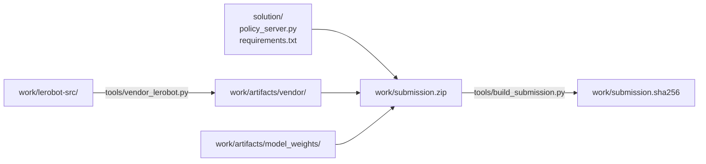
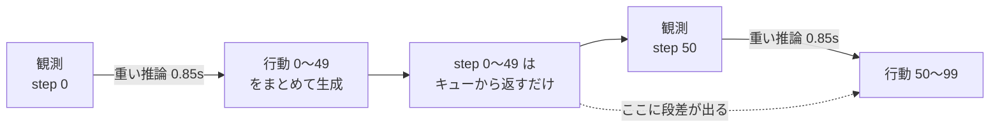

# solution/ — 提出物の実装

[../strategy/02_環境戦略.md](../strategy/02_環境戦略.md) の**方式 A**（LeRobot の
ソースを提出物へ同梱し、採点環境の Python 3.10 で動かす）を実際に組んだものである。

> **説明とコードは置き場所を分けている。**
> このファイルを含む説明は `docs/solution/`、動かすファイルは `../../solution/` にある。

**追跡するのは `solution/` だけ**である。重み・同梱ソース・venv・zip はすべて
`work/` 以下に出力され、git 管理外になる。下の手順で丸ごと再生成できる。

## 中身

| パス | 内容 |
|---|---|
| `policy_server.py` | `MyPolicy` を実装したポリシーサーバー（変更不可領域は未改変） |
| `requirements.txt` | 提出物の依存（確定版） |
| `requirements-dev.txt` | ローカル検証用の依存。**提出物には使わない** |
| `tools/vendor_lerobot.py` | LeRobot のソースを Python 3.10 で動く形へ書き換えて同梱する |
| `tools/install_weights.py` | Colab で追加学習したマージ済みモデルを取り込む |
| `tools/build_submission.py` | 提出用 zip を組み立て、検証し、sha256 を記録する |
| `tools/digest_submission.py` | 提出物の内容ダイジェスト。環境間の同期確認に使う |
| `tools/run_local_eval.sh` | 配布キットの評価パイプラインを提出物に対して回す（コンテナ内） |
| `tools/make_validation_suite.py` | example 以外のタスクで測るための一覧を作る（Colab へ上げる） |
| `tools/collect_colab_files.py` | Colab へ上げるファイルを `work/colab_upload/` に集める |

`tools/` の Python スクリプトは**どのディレクトリから実行してもよい**。入出力は
スクリプト自身の位置から求めたリポジトリルート基準で解決する。

## 生成物の置き場（`work/`、git 管理外）

| パス | 内容 |
|---|---|
| `work/lerobot-src/` | LeRobot v0.6.0 の展開元 |
| `work/artifacts/vendor/lerobot/` | 同梱用に書き換えた LeRobot（12MB） |
| `work/artifacts/model_weights/` | 学習済み重み + VLM の設定/トークナイザ（878MB） |
| `work/venv310/` | 検証用の Python 3.10.12 venv |
| `work/submission.zip` | 提出物（918MB） |
| `work/submission.sha256` | 上の zip のハッシュ |



**コードは `solution/` が正**である。`work/` へコピーして同期させる運用にすると
必ずどちらかが古くなるため、`build_submission.py` は zip 化のときに両方から直接束ねる。

## 再生成の手順

**→ [../howto/02_build_submission.md](../howto/02_build_submission.md)**

venv の作成・LeRobot の同梱・重みの配置・zip の組み立てと検証・既知のハッシュは、
すべてそちらに集約している。ケース 0（土台を作る）から順に読む。

いちばん多いのは「`policy_server.py` を変えたので作り直す」場合で、これは 1 行である。

```bash
work/venv310/bin/python solution/tools/build_submission.py
```

### 推論時の後処理（既定はすべて無効）

運営 Q&A No.10 で「VLA が生成した Action を、全タスク共通のルールで整える処理」は
禁止事項に含まれないと明言されている。A/B 用の入口を環境変数で用意している。

> **採点環境では環境変数を設定できない。** これらはローカルで比較するための
> 入口であり、**A/B で勝った設定は提出前に `policy_server.py` の既定値へ
> 書き込む必要がある。** 環境変数のまま提出しても本番では無効のままである。

#### 前提: SmolVLA は 50 ステップ分をまとめて出す

`select_action()` は 1 回の推論で `chunk_size=50` ステップ分の行動列を作り、
内部キューに貯める。以降 49 回はキューから返すだけで推論は走らない。
これが「重い推論は 50 ステップに 1 回」の正体である。



**step 0〜49 の間、ロボットは 2.5 秒間フィードバックなしで動く**（20 fps）。
そして step 50 で新しい観測から作り直すため、step 49 と step 50 の間に
**行動の不連続（段差）**が生じうる。これがスコアの jerk / SPARC を悪化させる。

---

#### `PARC_N_ACTION_STEPS` — 何ステップ分を実行するか

**既定は `10`。これだけは無効ではなく、常に効いている。**
チェックポイントの値は 50 だが、`policy_server.py` が起動時に上書きする。

**縮めると閉ループ制御に寄る。** 50 なら 50 ステップに 1 回しか観測を見ないが、
10 にすれば 10 ステップごとに観測を取り直して計画し直す。開ループの間に
積み上がる誤差が、5 倍の頻度で打ち切られる。

**これがこれまでで最大の改善だった。** 追加学習なしで次のとおりである
（20 エピソード/タスク、初期状態 0〜19。[../strategy/05_実測結果.md](../strategy/05_実測結果.md)）。

| 設定 | 成功率 | 衝突率 |
|---|---|---|
| `50`（チェックポイントの値） | 0.0625 | 0.3375 |
| **`10`（現在の既定）** | **0.875** | **0.087** |

代償は推論回数が `50 / n` 倍になることだが、**時間制限には当たらない**。
1 ステップの所要は `env.step 38.6 ms + 推論 850 ms / n` で説明でき、
実測（n=50 で 55.2 ms、n=10 で 122.5 ms）と一致する。

| 設定 | 80 エピソードの実測・外挿 | 上限 3,600 秒に対して |
|---|---|---|
| `50` | 2,460 秒 | 68% |
| **`10`** | **約 1,650 秒** | **46%** |

本番はローカルよりはるかに少ないエピソード数しか回さない（n=50 で 147.6 秒＝
総ステップ約 2,500）ため、実際の余裕はさらに大きい。**成功すると 600 ステップの
時間切れを待たずに終わる**ぶんも縮む。

なお**スコアの `time` 指標は壁時計ではなくステップ数**なので（運営 Q&A No.23）、
推論回数を増やしても `time` の配点は悪化しない。

**次に試すのは `5` と `2` である。** 最適値が 10 とは限らない。

---

#### `PARC_SAMPLES` — chunk を複数回引いて典型的な 1 本を選ぶ

既定 `1`（無効）。`3` などにすると、**同じ観測から chunk を 3 回引き**、
その中で最も典型的なものを選ぶ。

SmolVLA は flow matching なので出力が確率的である。**同じ初期状態でも
成功する回と失敗する回がある**（実際、同じ初期状態のエピソードで、
配布パイプラインは失敗し、こちらの単発ロールアウトは `done=True` になった）。
複数引いて中心的なものを採れば、外れを引く確率を下げられる。

**平均ではなく medoid（他との距離の総和が最小の実サンプル）を使う。**
平均には 2 つの問題がある。

| 問題 | 内容 |
|---|---|
| モード間の平均 | 右へ避ける軌道と左へ避ける軌道を混ぜると、まっすぐ障害物へ向かう「どちらでもない」行動になりうる |
| グリッパの中間値 | 6 次元目は ±1 のバンバン制御。混ぜると中間値になり掴めない |

medoid は必ず実際に引いた 1 本を返すため、どちらも起きない。
距離は姿勢 6 次元だけで測る（グリッパを含めるとそこだけで距離が決まってしまう）。

代償は推論時間が `PARC_SAMPLES` 倍になることである。

| 設定 | 重い推論 1 回（L4 想定） | 10 秒制限 | トラック 1 時間 |
|---|---|---|---|
| `1`（既定） | 約 0.85 秒 | 余裕あり | 余裕あり |
| `3` | 約 2.6 秒 | 余裕あり | **推論時間が 3 倍** |
| `5` | 約 4.3 秒 | 余裕あり | **推論時間が 5 倍** |

`PARC_N_ACTION_STEPS` との併用は**時間が掛け算になる**ため注意する。
`n_action_steps=25` かつ `samples=3` なら、推論の総時間は既定の 6 倍になる。

#### `PARC_BLEND_STEPS` — chunk 境界の段差を消す

既定 `0`（無効）。`3` などを設定すると、**chunk 境界の直後の数ステップだけ**
前の行動を混ぜて段差をなだらかにする。

```
出力 = weight × 前ステップの行動 + (1 - weight) × 新しい行動

weight = (BLEND_STEPS - 境界からの経過) / (BLEND_STEPS + 1)
```

`PARC_BLEND_STEPS=3` のとき、各ステップの混ぜ具合はこうなる。

| 境界からの経過 | weight（前の行動の比率） | 状態 |
|---|---|---|
| 0（境界そのもの） | 0.75 | 前の行動を強く残す |
| 1 | 0.50 | 半々 |
| 2 | 0.25 | ほぼ新しい行動 |
| 3 以降 | 0 | **何もしない** |

**境界以外では一切働かない**のが利点である。常時かける平滑化と違い、
通常の動作を鈍らせずに段差だけを狙える。実測では、境界の段差 1.000 が
`PARC_BLEND_STEPS=2` で 0.333 まで下がった（67% 低減）。

代償は、**新しい観測を反映した行動の適用が数ステップ遅れる**ことである。
段差が出るのは「新しい観測で計画が変わった」ときなので、遅らせることは
補正を遅らせることでもある。**成功率とのトレードオフになるため要計測。**

推奨は `2` か `3`。大きくすると常時平滑化に近づき、利点が薄れる。

---

#### `PARC_EMA_ALPHA` — 行動列全体を指数平滑する

既定 `0`（無効）。**全ステップに常時**かかる一次フィルタである。

```
出力 = ALPHA × 前ステップの行動 + (1 - ALPHA) × 新しい行動
```

`0.3` なら常に 30% だけ前の行動を引きずる。chunk 内部のばらつき
（SmolVLA は flow matching で出力が確率的）にも効くため、jerk と SPARC には
`PARC_BLEND_STEPS` より強く効く見込みがある。

ただし**常時ラグが乗る**ため、成功率への影響は `PARC_BLEND_STEPS` より大きい。
**成功率が実用域に乗ってから触るもの**であり、最初に試す対象ではない。

`PARC_BLEND_STEPS` と併用でき、その場合は EMA → 境界ブレンドの順に適用される。

---

#### グリッパ（7 次元目）は触らない

**後処理が触るのは行動 7 次元のうち 0〜5 だけである。**
`model_weights` の逆正規化統計を読むと、次元ごとの性質が違う。

| 次元 | 中身 | min / max | std | 後処理 |
|---|---|---|---|---|
| 0-2 | EEF 並進の差分 | ±0.9375 | 0.34〜0.45 | 対象 |
| 3-5 | EEF 回転の差分 | ±0.36 | 0.04〜0.08 | 対象 |
| **6** | **グリッパ** | **ちょうど ±1.0** | **0.999** | **素通し** |

6 次元目は min/max がちょうど ±1、std がほぼ 1 である。これは値が常に
±1 に張り付いている、つまり**開閉の 2 値（バンバン制御）**を意味する。
均すと中間値になり、**掴めなくなる**。

また 0-2（並進）と 3-5（回転）でスケールが 5〜10 倍違うため、
「1 ステップの変化量を絶対値で制限する」類の後処理は次元ごとの
較正が必要になる。ここで採用した凸結合（重み付き平均）はスケール不変なので、
その問題が起きない。

---

#### A/B の回し方

設定を変えながら同じ評価を回して比較する。**手元の CPU コンテナでは
12 エピソードに 2.5 時間かかり、成功率 10% と 20% すら区別できない。**
比較は [COLAB_EVAL.md](COLAB_EVAL.md) の GPU 評価で行うこと。

```bash
# 既定（何もしない）
bash solution/tools/run_local_eval.sh

# 閉ループ寄りにする
PARC_N_ACTION_STEPS=25 bash solution/tools/run_local_eval.sh

# chunk を 3 回引いて典型的な 1 本を選ぶ
PARC_SAMPLES=3 bash solution/tools/run_local_eval.sh

# 境界の段差を消す
PARC_BLEND_STEPS=3 bash solution/tools/run_local_eval.sh
```

見るべき指標は 2 段階である。

| 優先 | 指標 | 意味 |
|---|---|---|
| 1 | `mean_success_rate`, `mean_collision_rate` | **ゲート**。ここが下がったら他が良くても採用しない |
| 2 | `mean_avg_cartesian_jerk`, `mean_sparc`, `mean_cartesian_path_length` | 成功したエピソードの中での配点 |

スコアは「ゲートを通ったエピソードだけが滑らかさで採点される」構造なので、
**成功率を下げる設定は、滑らかさがどれだけ改善しても採用してはいけない。**

## 追加学習した重みへの差し替え・検証

**→ [../howto/02_build_submission.md](../howto/02_build_submission.md)**

`install_weights.py` の使い方、取り込み前の 4 つの検査、素の重みへの戻し方、
Docker コンテナでの採点環境に近い検証は、すべてそちらにある。

学習そのものは [../howto/01_retrain.md](../howto/01_retrain.md)。

## 現在の状態

| 項目 | 結果 |
|---|---|
| Python 3.10.12 での import・重みロード | OK（クリーンキャッシュ・完全オフラインで 17 秒） |
| `requirements.txt` のみのクリーン venv で起動 | OK（`pip check` クリーン、torch/numpy 不変） |
| `/health` → `/reset` → `/act` | OK（`(7,) float32`、NaN なし） |
| action chunk のキャッシュ | OK（重い推論 1 回 → 以降 50 ステップはキャッシュ） |
| `validate_submission.py`（静的） | PASS（errors=0, warnings=0） |
| 評価パイプラインが実タスクで回るか | OK（`compe.t1` の 4 タスクを認識、最後まで完走） |
| 観測変換の正しさ | OK（`lerobot/envs/libero.py` と配布キットの突き合わせで確認） |
| **推論 10 秒以内** | **OK**。Colab T4 で 0.85 秒（CPU 2 コアでは 23.4 秒） |
| **起動 120 秒以内** | **OK**。Colab T4 で重みロード 41.5 秒 |
| **CUDA 13 の torchvision が import できるか** | **未検証**。Colab の CUDA は 13 ではない。CUDA 12 では動作を確認 |
