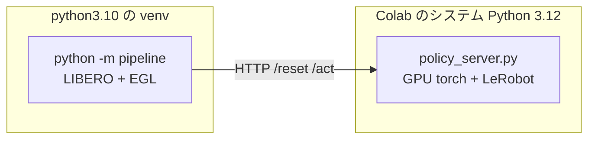

# Colab GPU で評価を回す

**84 件の検証用データで重みを評価する手順である。** 上から順に 1 つずつ実行する。

手元の CPU コンテナでは **12 エピソードに 2.5 時間**かかる。成功率 10% と 20% を
統計的に区別するには 50〜100 エピソード必要で、それでは何も判断できない。

Colab の GPU（EGL 描画）に移すと桁が変わる。

| | CPU コンテナ（osmesa） | Colab GPU（EGL） |
|---|---|---|
| `env.step` | 300 ms | **39 ms** |
| 重い推論（chunk 1 回） | 23 秒 | **0.85 秒** |
| 1 エピソード（600 ステップ） | 約 12 分 | **約 34 秒** |
| 84 件（`MAX_STEPS=300`） | 16 時間 | **約 45 分** |

`env.step` の実測値は運営 Q&A No.3 で参加者が L4 上で計測したもの、
推論はこちらで Colab T4 上で実測したものである。

**学習セッションとは別のアカウントで開くこと。** 学習は止めない。

## 順番

**上から順に 1 度ずつ実行する。** 後の手順は前の手順が定義した変数を使うため、
飛ばすと `NameError` になる。

| 手順 | 何をするか | 所要 | 定義するもの |
|---|---|---|---|
| **[1](01_gpu_and_egl.md)** | GPU と EGL を確認する | 10 秒 | （EGL のベンダ設定を作る） |
| **[2](02_kit.md)** | 配布キットをセットアップし、パッチを当てる | 5〜10 分 | `KIT_DIR` `KIT_PYTHON` `run()` `LOG_DIR` |
| **[3](03_weights.md)** | 評価する重みを用意する | 2 分 | `WEIGHTS_DIR` `USE_FINETUNED` |
| **[4](04_policy_server.md)** | 方策サーバーの依存を入れ、配置する | 3 分 | `LEROBOT_SRC` `SUBMISSION_DIR` `SERVER` |
| **[5](05_suite.md)** | 検証用スイートへ差し替え、84 件を 3 つに割る | 2 分 | `/content/chunks/VAL_1〜3.csv` |
| **[6](06_settings.md)** | 評価の設定 | 1 秒 | `CHUNK` `RESULTS_DIR` `POLICY_ENV` `server_env` `eval_env` |
| **[7](07_speed_check.md)** | 遅さの原因を切り分ける（**初回のみ**） | 3 分 | — |
| **[8](08_run.md)** | 評価を実行する（**回すだけ**） | **15 分 × 3** | — |
| **[9](09_read.md)** | 結果を読む・集計する・退避する（**出力はすべてここ**） | 5 秒 | — |
| [10](10_notes.md) | 参考（過去の測定と注意点） | — | — |

**28 件ずつ 3 回に分けて回す。** 手順 6 の `CHUNK` を **1 → 2 → 3** と変えて、
**毎回 手順 6 → 8 → 9 を通す**（手順 7 は初回だけでよい）。

> **45 分の 1 本にしないこと。** 8/11 に 84 件を一度に回して
> **56 件目でランタイムが落ち、40 分ぶんを失った。** 画面を触っていても切れる。
> **`[結果]` 行は 1 本ごとに Drive へ書いている**（手順 8）ので、
> 落ちても直前のエピソードまでは `MyDrive/parc2026/eval/live/` に残る。

## ランタイムが落ちたら

**`/content` は消える。** 手順 1〜5 をすべてやり直す（20 分）。
**Drive に残っているのは、それまでに退避したものだけである。**

| 残るもの | 置き場 |
|---|---|
| **`[結果]` 行（1 本ごと）** | `MyDrive/parc2026/eval/live/` |
| 集計・全文ログ・動画（塊ごと） | `MyDrive/parc2026/eval/<日時>_<設定>/` |
| ジャークと SPARC | **完走した塊のぶんだけ**（`server_8000.json` は完走時にしか書かれない） |

## なぜ 2 プロセスに分けるのか

評価側と方策側は**依存が正面衝突する**。

| | 必要なもの | 衝突 |
|---|---|---|
| 評価パイプライン | `numpy==1.26.4` / `gym==0.25.2` / `robosuite==1.4.0` / CPU torch | 古い固定版 |
| 方策 | LeRobot v0.6.0 / GPU torch / transformers | 新しい版 |

1 つの環境に押し込むと片方が壊れる。配布キットが HTTP サーバー方式を採っているのは
まさにこのためで、**本番採点も 2 プロセス構成**である。同じ形をそのまま使う。

**提出物の zip は使わない。** `policy_server.py` は `vendor/` が無ければ
インストール済みの LeRobot を使うため、Colab ではそのまま動く。
測りたいのは推論の中身であって Python 3.10 互換ではない
（3.10 の確認は Docker 側で済んでいる）。

## 本番との違い

| 項目 | 内容 |
|---|---|
| **通信** | Colab は通信できる。採点環境は遮断される。**オフラインの確認は Docker 側で行う** |
| **Python の版** | Colab は 3.12。採点環境は 3.10。ここでの成功は 3.10 の保証にならない |
| **CUDA の版** | Colab は CUDA 12 系。採点環境は 13。`torchvision` の互換はここでは確認できない |
| **学習との同居** | **別アカウントで開く。** 同一アカウントで 2 つ GPU を使うと片方が止められる |

---

**次は [1. GPU と EGL を確認する](01_gpu_and_egl.md) へ。**
