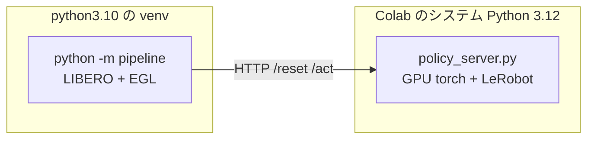

# Colab GPU で評価を回す

**84 件の検証用データで重みを評価する手順である。**
**貼るのは 4 行 ＋ 呼び出し 8 行だけ。** 中身は
[solution/tools/colab_eval.py](../../../solution/tools/colab_eval.py) にある。

> **セルを 10 個貼る形はやめた。** 1,400 行を貼り替えていると、どれが新しいのか
> 分からなくなる。8/11 に 3 度その事故が起きた（修正版が `work/colab_upload/` に
> しか無かった／`N_EPISODES` の既定が 20 のままだった／確かめたい行が警告で
> 押し出された）。**このページの 01〜10 は、いま何が起きているかを読むためにある。**

## 最短の道順

### 1. 先に手元とブラウザで済ませる（Colab の時間を使わない）

```bash
# ① 上げるファイルを集める（8 個・小さい）
python3 solution/tools/collect_colab_files.py \
    --val-tasks outputs/0811_101824_base_n5_ep1_max300/VAL_TASKS.csv
open work/colab_upload

# ② 評価する重みの場所を開く（912 MB）
open work/artifacts/model_weights_lam025
```

**① は中身をまとめて Colab の左のファイルペインへ、`/content/` の直下へドラッグする。**
**② は Drive のブラウザ画面へフォルダごとドラッグする。** 置き場は
**`MyDrive/parc2026/FOR_COLAB_EVAL/model_weights_lam025`** —— この名前なら
設定を書き換えなくてよい。

> **Drive への上げ下ろしは Colab の実行時間を消費しない。**

### 2. Colab に貼るのはこれだけ

**ランタイムのタイプを GPU に変更**してから、セルを 2 つ作る。

```python
# セル 1 —— 読み込む（上げ直したときも、これを流し直すだけでよい）
import importlib, sys
sys.path.insert(0, "/content")
import colab_eval as ce
importlib.reload(ce)
```

```python
# セル 2 —— 準備（上から順に。合わせて 15 分ほど）
ce.prepare()          # Drive をつなぐ・8 ファイルが上がっているか・GPU と EGL
ce.setup_kit()        # clone・setup.sh・パッチ（5〜10 分）
ce.prepare_weights()  # 重みを用意し、**ハッシュで名指しする**
ce.setup_policy()     # 方策サーバーの依存と配置
ce.build_suite()      # 検証用スイートへ差し替え、84 件を 3 つに割る
```

```python
# セル 3 —— 評価（1 つ 28 件・約 51 分。1 つずつ実行する）
ce.run(chunk=1)
```

**`ce.run(chunk=2)` `ce.run(chunk=3)` と続ける。触るのはこの数字だけである。**
1 回の呼び出しで、**設定 → 評価 → 集計 → Drive への退避**まで通る。

| したいこと | 書くこと |
|---|---|
| **疎通確認**（5 タスク・5 分） | `ce.run(chunk=1, max_tasks=5)` **設定を戻す必要が無い** |
| **どの塊が終わったか** | `ce.status()` |
| **84 件を一度に**（切断が無い環境） | `ce.run()` |
| 前のサーバーが居残ったとき | `ce.stop_server()` |

### 3. 値を変えるときは設定ファイルだけを書き換える

編集するのは
[colab_eval_config.py](../../../solution/tools/colab_eval_config.py) **だけ**である。
書き換えたらそのファイルだけを `/content/` へ上げ直し、**セル 1 から流し直す**。

| 設定 | 既定 | 変えるとき |
|---|---|---|
| `USE_FINETUNED` / `DRIVE_WEIGHTS_DIR` | `True` / `…/model_weights_lam025` | 評価する重みを替える |
| **`EXPECT_DIGEST`** | `952171f9` | **意図した重みかを読み込む前に照合する。違えば止まる** |
| `N_EPISODES` | `1` | 1 タスクあたりの本数。**84 件では 1 のまま** |
| `MAX_STEPS` | `300` | 本番の打ち切りと同じ値 |
| `CHUNKS` | `3` | 51 分でも落ちるなら 6（1 塊 14 件・26 分） |
| `POLICY_ENV` | 空 | 推論の設定値。**重みを比べるときは空** |
| `RECORD_DIR` / `RECORD_WHICH` | `/content/videos` / `failures` | 録画。`None` で撮らない |

**`ce.run()` は使う値を全部画面に出す。** 意図と違えばそこで止められる。

## 出力はどこに出るか

| 出るもの | 置き場 | いつ |
|---|---|---|
| `[結果]` 行 | 画面 ＋ **Drive `parc2026/eval/live/<日時>_<設定>.results.txt`** | **1 本ごと**（落ちても直前まで残る） |
| 60 秒ごとの心拍 | 画面 | 結果行が出ない間 |
| 成功率・95%CI・衝突率・jerk / SPARC | 画面 | 完走時（JSON から） |
| ぶつけた物体・摂動カテゴリ別・タスク別 | 画面 | 毎回（**ログから作るので、落ちた回でも出る**） |
| 全文ログ・結果行の控え・動画・一式 | **Drive `parc2026/eval/<日時>_<設定>/`** | 塊ごと |

**名前は条件から作る。** `0812_042900_n5_ep1_chunk1` なら「n=5・1 本ずつ・塊 1」で、
疎通確認なら `smoke5` が付く。**付け忘れも取り違えも起きない。**

> **時刻は Colab の既定の UTC で付く。** 日本時間より 9 時間前に見える。

## 順番と、どの関数が何をするか

**上から順に 1 度ずつ。** 前の関数が作ったものが無ければ、**どの関数を先に
通すべきかを名指しで**止める（`NameError` にはならない）。

| 関数 | 何をするか | 所要 | 説明のページ |
|---|---|---|---|
| `prepare()` | Drive・上がっているかの確認・GPU と **EGL** | 3 分 | [1](01_gpu_and_egl.md) |
| `setup_kit()` | 配布キットの取得、`setup.sh`、パッチ | 5〜10 分 | [2](02_kit.md) |
| `prepare_weights()` | 重みを用意し、**ハッシュで名指しする** | 2 分 | [3](03_weights.md) |
| `setup_policy()` | 方策サーバーの依存と配置 | 3 分 | [4](04_policy_server.md) |
| `build_suite()` | 検証用スイートへ差し替え、塊に割る | 2 分 | [5](05_suite.md) |
| — | （設定は `run()` が引数と設定ファイルから決める） | — | [6](06_settings.md) |
| — | （遅さの切り分け。**飛ばしてよい**） | 3 分 | [7](07_speed_check.md) |
| **`run(chunk=N)`** | **評価 → 集計 → Drive へ退避** | **51 分 × 3** | [8](08_run.md) [9](09_read.md) |
| `status()` | どの塊が終わっているか | 1 秒 | — |

> **手順 7（遅さの切り分け）は飛ばしてよい。** 3 分と 1 回の失敗の機会を節約できる。
> **代わりに `run()` の最初の `[結果]` 行の時刻を見る** ——
> **1 本目が 200 秒を超えていたら止めて手順 7 を実行する**（EGL が効いていない）。
> 100〜130 秒なら想定どおりなので、そのまま最後まで回す。

### 関数に畳んで消えた事故

| セルでやっていたとき | なぜ起きなくなったか |
|---|---|
| `CHUNK` を書き換えて手順 6 を流し忘れ、**同じ 28 件を 51 分かけて回す** | `run(chunk=2)` が CSV と出力先を同時に決める |
| 手順 8 を飛ばして手順 9 を実行し、**前の塊の結果を新しい名前で退避** | 1 回の呼び出しで評価と集計を通す |
| `MAX_TASKS = 5` の戻し忘れで、**84 件のはずが 5 件** | 疎通確認は `run(chunk=1, max_tasks=5)`。設定に残らない |
| **前のサーバーが居残り、古い重みで測る** | 起動前にポートを見て止まる（`stop_server()` で消す） |
| 退避先の名前が `n10` なのに実際は n=5 | 名前を作るのも中身を書くのも同じ関数 |

## どれだけかかるか — **実測（8/11）**

| | 1 エピソード | 84 件 | 28 件（1 塊） |
|---|---|---|---|
| **Colab GPU（EGL・n=5）** | **110 秒** | **2.6 時間** | **51 分** |
| GPU マシン（osmesa・n=5） | 98.6 秒 | 2.3 時間 | — |

**Colab は速くない。** 8/11 に **56 エピソードで 6,185 秒**かかった（110 秒／本）。
GPU マシンの実測（84 件 2 時間 19 分）とほぼ同じである。

> **「1 エピソード 34 秒・84 件 45 分」と書いていたのは誤りだった。**
> あれは **`n_action_steps=50`** で測った値である。**いまの既定は 5 で、
> 推論の回数が 10 倍になっている。**
>
> | | 描画 | 推論 | 合計 |
> |---|---|---|---|
> | n=50・600 ステップ | 600 × 38.6 ms = 23 秒 | **12 回** × 0.85 秒 = 10 秒 | **33 秒** |
> | n=5・300 ステップ | 300 × 38.6 ms = 12 秒 | **60 回** × 0.85 秒 = 51 秒 | **63 秒** |
>
> **描画では Colab が 11 倍速いが、n=5 では推論が支配的なので差が消える。**
> 実測 110 秒は上の見積もりよりさらに 1.8 倍遅く、**GPU の割り当てか EGL の
> 状態も効いている可能性がある**（手順 7 で切り分けられる）。

**だから「評価は Colab、学習は GPU マシン」という分け方は、速さを理由には選べない。**
**Colab を使う理由は「GPU マシンが学習で埋まっているあいだも評価できる」ことだけである。**

| 使い分け | |
|---|---|
| **GPU マシンが空いている** | **そちらで回す。** 切断が無く、`--detach` で放っておける |
| **GPU マシンが学習中** | **Colab で回す。** ただし 28 件ずつ 3 回に割る |

**学習セッションとは別のアカウントで開くこと。** 学習は止めない。

## ランタイムが落ちたら

**`/content` は消える。** セル 1 → セル 2 をやり直す（20 分）。
**Drive に残っているのは、それまでに退避したものだけである。**

| 残るもの | 置き場 |
|---|---|
| **`[結果]` 行（1 本ごと）** | `MyDrive/parc2026/eval/live/` |
| 集計・全文ログ・動画（塊ごと） | `MyDrive/parc2026/eval/<日時>_<設定>/` |
| ジャークと SPARC | **完走した塊のぶんだけ**（JSON は完走時にしか書かれない） |

**やり直すのは落ちた塊だけでよい。** `ce.status()` がどこまで進んだかを出す。
`build_suite()` は `/content/VAL_TASKS.csv` が上がっていれば**同じ 84 件を
作り直さない**ので、前の回と 1 件ずつ対にして比べられる。

> **2.6 時間の 1 本にしないこと。** 8/11 に 84 件を一度に回して
> **56 件目（1 時間 43 分）でランタイムが落ち、そのぶんを失った。**
> 画面を触っていても切れる。**28 件でも 51 分あるので、まだ長い** ——
> 落ちるようなら設定の `CHUNKS` を 6 に増やす（1 塊 14 件・26 分）。

## なぜ 2 プロセスに分けるのか

評価側と方策側は**依存が正面衝突する**。

| | 必要なもの | 衝突 |
|---|---|---|
| 評価パイプライン | `numpy==1.26.4` / `gym==0.25.2` / `robosuite==1.4.0` / CPU torch | 古い固定版 |
| 方策 | LeRobot v0.6.0 / GPU torch / transformers | 新しい版 |

1 つの環境に押し込むと片方が壊れる。配布キットが HTTP サーバー方式を採っているのは
まさにこのためで、**本番採点も 2 プロセス構成**である。同じ形をそのまま使う。



**提出物の zip は使わない。** `policy_server.py` は `vendor/` が無ければ
インストール済みの LeRobot を使うため、Colab ではそのまま動く。
測りたいのは推論の中身であって Python 3.10 互換ではない
（3.10 の確認は Docker 側で済んでいる）。

## 本番との違い

| 項目 | 内容 |
|---|---|
| **通信** | Colab は通信できる。採点環境は遮断される。**オフラインの確認は Docker 側で行う** |
| **Python の版** | Colab は 3.12。採点環境は 3.10。ここでの成功は 3.10 の保証にならない |
| **CUDA の版** | Colab は CUDA 12 系。採点環境は 13。`torchvision` の互換はここでは確認できない |
| **学習との同居** | **別アカウントで開く。** 同一アカウントで 2 つ GPU を使うと片方が止められる |

---

**中身を読むなら [1. 準備](01_gpu_and_egl.md) から。**
過去の測定と注意点は [10. 参考](10_notes.md)。
