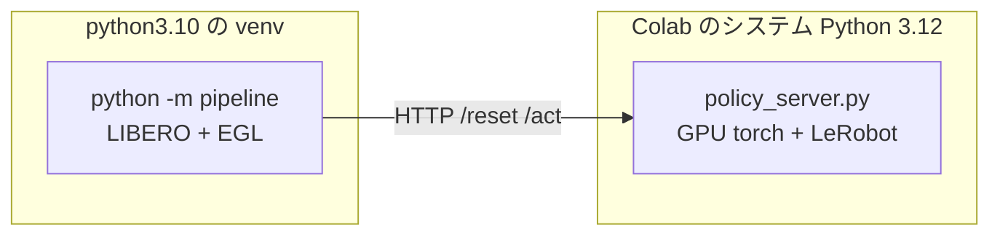

# Colab GPU で評価を回す

**84 件の検証用データで重みを評価する手順である。** 上から順に 1 つずつ実行する。

## 最短の道順 — **編集するのは 1 か所だけ**

**Colab は一度落ちるとその日は使えない。** 別アカウントでやり直すことになるので、
**あちらで触る回数を最小にする。** 手順の既定値は、いま測りたい構成に合わせてある。

### 先に手元とブラウザで済ませる（Colab の時間を使わない）

```bash
# ① 上げるファイルを集める（7 個・小さい）
python3 solution/tools/collect_colab_files.py \
    --val-tasks outputs/0811_101824_base_n5_ep1_max300/VAL_TASKS.csv
open work/colab_upload

# ② 評価する重みの場所を開く（912 MB）
open work/artifacts/model_weights_lam025
```

**② は Drive のブラウザ画面へフォルダごとドラッグする。**
置き場は **`MyDrive/parc2026/FOR_COLAB_EVAL/model_weights_lam025`** にする ——
**この名前にしておけば手順 3 を編集しなくてよい。**

> **Drive への上げ下ろしは Colab の実行時間を消費しない。**
> **重みを小さくして Colab 側で組み立てる道もあるが、採らない** ——
> Colab の手順が 1 つ増え、そこで間違える危険のほうが高い。

### Colab で触るのはここだけ

| 手順 | 触るか | 値 |
|---|---|---|
| 1-1 | **7 ファイルをドラッグ** | — |
| 1-2 | そのまま実行 | Drive をつなぐ |
| 1-3 | そのまま実行 | — |
| 2 | そのまま実行 | 5〜10 分かかる |
| **3** | **`DRIVE_MERGED_DIR` を確かめる** | 上の名前どおりなら**編集不要** |
| 4 | そのまま実行 | — |
| 5 | そのまま実行 | `CHUNKS = 3` |
| **6** | **`CHUNK` だけ変える** | **1 → 2 → 3** |
| 7 | **飛ばしてよい**（下） | — |
| 8 | そのまま実行 | 51 分 |
| 9 | そのまま実行 | Drive へ退避される |

**手順 3 でハッシュが `952171f9…` と出れば、正しい重みである。**
`a67a056a…` なら素の重み（既に評価済み）なので、そのまま流すと 2.6 時間を捨てる。

> **手順 7（遅さの切り分け）は飛ばしてよい。** 3 分と 1 回の失敗の機会を節約できる。
> **代わりに手順 8 の最初の `[結果]` 行の時刻を見る** ——
> **1 本目が 200 秒を超えていたら止めて手順 7 を実行する**（EGL が効いていない）。
> 100〜130 秒なら想定どおりなので、そのまま最後まで回す。

**手順 6 → 8 → 9 を 3 回。** `CHUNK` 以外は触らない。

## どれだけかかるか — **実測（8/11）**

| | 1 エピソード | 84 件 | 28 件（1 塊） |
|---|---|---|---|
| **Colab GPU（EGL・n=5）** | **110 秒** | **2.6 時間** | **51 分** |
| GPU マシン（osmesa・n=5） | 98.6 秒 | 2.3 時間 | — |

**Colab は速くない。** 8/11 に **56 エピソードで 6,185 秒**かかった（110 秒／本）。
GPU マシンの実測（84 件 2 時間 19 分）とほぼ同じである。

> **「1 エピソード 34 秒・84 件 45 分」と書いていたのは誤りだった。**
> あれは **`n_action_steps=50`** で測った値である。**いまの既定は 5 で、
> 推論の回数が 10 倍になっている。**
>
> | | 描画 | 推論 | 合計 |
> |---|---|---|---|
> | n=50・600 歩 | 600 × 38.6 ms = 23 秒 | **12 回** × 0.85 秒 = 10 秒 | **33 秒** |
> | n=5・300 歩 | 300 × 38.6 ms = 12 秒 | **60 回** × 0.85 秒 = 51 秒 | **63 秒** |
>
> **描画では Colab が 11 倍速いが、n=5 では推論が支配的なので差が消える。**
> 実測 110 秒は上の見積もりよりさらに 1.8 倍遅く、**GPU の割り当てか EGL の
> 状態も効いている可能性がある**（手順 7 で切り分けられる）。

**だから「評価は Colab、学習は GPU マシン」という分け方は、速さを理由には選べない。**
**Colab を使う理由は「GPU マシンが学習で埋まっているあいだも評価できる」ことだけである。**

| 使い分け | |
|---|---|
| **GPU マシンが空いている** | **そちらで回す。** 切断が無く、`--detach` で放っておける |
| **GPU マシンが学習中** | **Colab で回す。** ただし 28 件ずつ 3 回に割る（下） |

**学習セッションとは別のアカウントで開くこと。** 学習は止めない。

## 順番

**上から順に 1 度ずつ実行する。** 後の手順は前の手順が定義した変数を使うため、
飛ばすと `NameError` になる。

| 手順 | 何をするか | 所要 | 定義するもの |
|---|---|---|---|
| **[1](01_gpu_and_egl.md)** | **準備** — Drive をつなぎ、**7 ファイルを上げ**、GPU と EGL を確認する | 3 分 | `/content/*.py` `/content/drive` |
| **[2](02_kit.md)** | 配布キットをセットアップし、パッチを当てる | 5〜10 分 | `KIT_DIR` `KIT_PYTHON` `run()` `LOG_DIR` |
| **[3](03_weights.md)** | 評価する重みを用意する | 2 分 | `WEIGHTS_DIR` `USE_FINETUNED` |
| **[4](04_policy_server.md)** | 方策サーバーの依存を入れ、配置する | 3 分 | `LEROBOT_SRC` `SUBMISSION_DIR` `SERVER` |
| **[5](05_suite.md)** | 検証用スイートへ差し替え、84 件を 3 つに割る | 2 分 | `/content/chunks/VAL_1〜3.csv` |
| **[6](06_settings.md)** | 評価の設定 | 1 秒 | `CHUNK` `RESULTS_DIR` `POLICY_ENV` `server_env` `eval_env` |
| **[7](07_speed_check.md)** | 遅さの原因を切り分ける（**初回のみ**） | 3 分 | — |
| **[8](08_run.md)** | 評価を実行する（**回すだけ**） | **51 分 × 3** | — |

> **手順 1 を飛ばすと手順 2 で落ちる。** 手順 2 は `/content/patch_kit_for_variants.py`
> を呼ぶので、**先に手元から上げておく必要がある**（手順 1-1）。
> **Drive も先につなぐ**（手順 1-2）—— 後回しにすると手順 8 の途中で
> 認証を求められて評価が止まる。
| **[9](09_read.md)** | 結果を読む・集計する・退避する（**出力はすべてここ**） | 5 秒 | — |
| [10](10_notes.md) | 参考（過去の測定と注意点） | — | — |

**28 件ずつ 3 回に分けて回す。** 手順 6 の `CHUNK` を **1 → 2 → 3** と変えて、
**毎回 手順 6 → 8 → 9 を通す**（手順 7 は初回だけでよい）。

> **2.6 時間の 1 本にしないこと。** 8/11 に 84 件を一度に回して
> **56 件目（1 時間 43 分）でランタイムが落ち、そのぶんを失った。**
> 画面を触っていても切れる。**28 件でも 51 分あるので、まだ長い** ——
> 落ちるようなら手順 5-2 の `CHUNKS` を 6 に増やす（1 塊 14 件・26 分）。
> **`[結果]` 行は 1 本ごとに Drive へ書いている**（手順 8）ので、
> 落ちても直前のエピソードまでは `MyDrive/parc2026/eval/live/` に残る。

## ランタイムが落ちたら

**`/content` は消える。** 手順 1〜5 をすべてやり直す（20 分）。
**Drive に残っているのは、それまでに退避したものだけである。**

| 残るもの | 置き場 |
|---|---|
| **`[結果]` 行（1 本ごと）** | `MyDrive/parc2026/eval/live/` |
| 集計・全文ログ・動画（塊ごと） | `MyDrive/parc2026/eval/<日時>_<設定>/` |
| ジャークと SPARC | **完走した塊のぶんだけ**（`server_8000.json` は完走時にしか書かれない） |

## なぜ 2 プロセスに分けるのか

評価側と方策側は**依存が正面衝突する**。

| | 必要なもの | 衝突 |
|---|---|---|
| 評価パイプライン | `numpy==1.26.4` / `gym==0.25.2` / `robosuite==1.4.0` / CPU torch | 古い固定版 |
| 方策 | LeRobot v0.6.0 / GPU torch / transformers | 新しい版 |

1 つの環境に押し込むと片方が壊れる。配布キットが HTTP サーバー方式を採っているのは
まさにこのためで、**本番採点も 2 プロセス構成**である。同じ形をそのまま使う。



**提出物の zip は使わない。** `policy_server.py` は `vendor/` が無ければ
インストール済みの LeRobot を使うため、Colab ではそのまま動く。
測りたいのは推論の中身であって Python 3.10 互換ではない
（3.10 の確認は Docker 側で済んでいる）。

## 本番との違い

| 項目 | 内容 |
|---|---|
| **通信** | Colab は通信できる。採点環境は遮断される。**オフラインの確認は Docker 側で行う** |
| **Python の版** | Colab は 3.12。採点環境は 3.10。ここでの成功は 3.10 の保証にならない |
| **CUDA の版** | Colab は CUDA 12 系。採点環境は 13。`torchvision` の互換はここでは確認できない |
| **学習との同居** | **別アカウントで開く。** 同一アカウントで 2 つ GPU を使うと片方が止められる |

---

**次は [1. 準備](01_gpu_and_egl.md) へ。**
