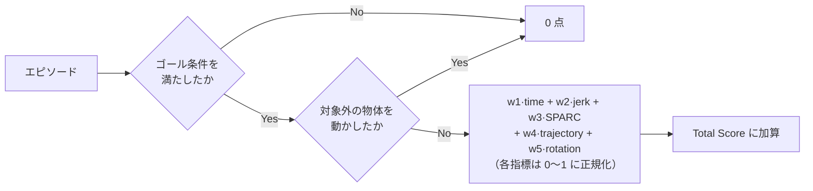

# 01. 勝ち筋と評価の読み解き

学習条件を決める前に、**何を上げるとスコアが上がるのか**を確定させる。
ここを曖昧にしたまま学習すると、ノートブック上の成功率は上がったのに
リーダーボードが動かない、という結果になる。実際そうなる理由がこのコンペにはある。

## スコアは成功率にほぼ支配される

参加者ガイド（PDF p.11）が示すスコアの構造は次のとおりである。

> 成功/衝突判定をゲートとして，重みと正規化した指標の積を計算する



重み `w1..w5` と正規化式は非公開だが、`w1 + … + w5 = 1` とされている。
構造上、**失敗したエピソードは滑らかさや効率がどれだけ良くても 0** である。

| 優先度 | 何を上げるか | 効き方 |
|---|---|---|
| 1 | 成功率 | ゲート。ここが 0 なら他は全部無意味 |
| 2 | 衝突を起こさないこと | 同じくゲート。成功しても衝突で 0 になる |
| 3 | 滑らかさ・効率（jerk / SPARC / ステップ数 / 軌道長 / EEF 回転量） | 成功したエピソードの中での配点 |

配布学習例のリーダーボード参考スコアは **0.0633**（PDF p.8）である。
成功率が低い段階では、滑らかさの最適化に時間を使う意味はほとんどない。

## 成功判定は「ゴール達成」だけではない

配布リポジトリの [pipeline/rollout.py](../../pipeline/rollout.py) が実際の判定である。

```python
collided = any(d > collision_threshold for d in object_max_disp.values())
success = bool(done) and not collided
```

### 衝突判定の実際

| 項目 | 内容 |
|---|---|
| 判定対象 | BDDL の `(:obj_of_interest ...)` に**含まれない**全物体 |
| 変位の定義 | 初期位置からの xyz 各軸の絶対値の**和**（マンハッタン距離） |
| しきい値 | **1 mm**（`threshold_m: 0.001`） |
| 判定タイミング | 全ステップの**最大値**。元に戻しても失敗のまま |
| 基準位置 | エピソード開始直前（後述の 10 ステップ静定後）の位置 |

1 mm は「隣の物体をかすめた」程度で超える。アームの肘が背後の物体に当たる、
把持物を置いた反動で隣が揺れる、といった挙動が全部失敗になる。

### ゴール条件も配布リポジトリで強化されている

[compe/t1/register.py](../../compe/t1/register.py) は `SiteObjectState.check_ontop` に
パッチを当て、「対象物体が静的なシーン（テーブルや皿）に接触していること」を追加条件にしている。

```python
def check_ontop(self, other):
    base = original_check_ontop(self, other)
    if not base or self.env.get_object(self.parent_name) is not None:
        return base
    return _resting_on_static_scene(self.env, other.object_name)
```

つまり **「皿の上空で掴んだまま」では成功しない。手を離して置く必要がある。**
VLA が「置く」動作を最後まで完了せずエピソードが切れるケースは失敗になる。

## 配布ノートブックの成功率は当てにならない

[examples/smolvla_libero_spatial_lora.ipynb](../../examples/smolvla_libero_spatial_lora.ipynb)
の評価は LeRobot の `lerobot-eval` を使っており、**衝突判定を行わない**。
さらに条件そのものが本番と違う。

| 項目 | ノートブックの評価 | 本番の採点 |
|---|---|---|
| 実行 | `lerobot-eval` | `python -m pipeline` + 提出物サーバー |
| 衝突判定 | **なし** | あり（1mm） |
| `check_ontop` の強化 | なし | あり |
| 観測解像度 | 256×256 | 128×128 |
| 評価タスク | LIBERO-plus Spatial の 10 タスク | Track 1 のタスクセット（非公開分を含む） |
| 試行数 | 既定 3 / タスク | 非公開（配布キットの既定は 20） |

**ノートブックで成功率が上がった、を判断材料にしてはいけない。**
必ず配布キット側の評価パイプラインを回し、`collision_rate` を含む数字で判断する。

```bash
source env.sh
python submission_template/policy_server.py --port 8000 &
python -m pipeline --server-url http://localhost:8000 --track track1 \
    --n-episodes 20 --max-steps 600
```

結果は `results/<submission_id>.json` に出る。見るべきキーは次の 3 つである。

| キー | 意味 |
|---|---|
| `overall_metrics.mean_success_rate` | 成功率（衝突による失敗を含む） |
| `overall_metrics.mean_collision_rate` | 衝突が起きたエピソードの割合 |
| `tasks[].metrics.sparc` / `avg_cartesian_jerk` | 滑らかさ。SPARC は 0 に近いほど滑らか |

> `--max-steps` を省略すると CLI の既定 300 が使われる。
> 配布 README の例および `EvalConfig` の既定は 600 なので、**明示的に 600 を渡す**こと。
> 300 のまま測ると、単に時間切れで失敗しているものを「性能不足」と誤読する。

## 汎化の方向は example タスクの構成から読む

[compe/t1/T1_TASKS.csv](../../compe/t1/T1_TASKS.csv) には example タスクが 4 件しかないが、
その内訳が本番タスクセットの性質を示している。

| # | 元 suite | 摂動カテゴリ | 難易度 |
|---|---|---|---|
| 1 | libero_spatial | Background Textures | L3 |
| 2 | libero_object | Background Textures | L5 |
| 3 | libero_object | Light Conditions | L2 |
| 4 | libero_goal | Light Conditions | L4 |

ここから読めることが 2 つある。

1. **単一 suite ではない。** spatial / object / goal が混在している。
   配布ノートブックは libero_spatial の 10 タスクだけで学習しているので、
   そのままでは object / goal 系のタスクに対して追加学習の効果が乗らない。
2. **問われているのは見た目の摂動に対する頑健性である。**
   Background Textures と Light Conditions はどちらも視覚的摂動であり、
   タスクの手順そのものは元の LIBERO タスクと同じである。

したがって学習データは、**LIBERO-plus の摂動込みデータを suite 横断で集める**方向が素直である。
具体的な絞り込み方は [03_学習とデータの方針.md](03_学習とデータの方針.md) に書く。

## 設計を縛る制約

スコアと直接関係しないが、違反すると 0 点になる制約がある。設計段階で織り込む。

| 制約 | 値 | 出典 | 設計上の意味 |
|---|---|---|---|
| 推論 1 リクエスト | **10 秒** | PDF p.12 / 配布 README | 1 回でも超過するとトラック全体が 0 点。平均ではない |
| サーバー起動（モデルロード込み） | 既定 **120 秒** | 配布 README | 重い初期化やコンパイルは間に合わない |
| Track 評価全体 | **1 時間** | PDF p.12 | 1 ステップあたりの推論時間 × 総ステップ数が効く |
| GPU | NVIDIA L4 **VRAM 24GB** 1 枚 | PDF p.12 | 24GB に収まらないモデルは不可 |
| 評価中の外部通信 | **禁止** | PDF p.21 | 重みの動的ダウンロード不可。全部 zip に入れる |
| zip サイズ | 20GB | PDF p.13 | 実質的に制約にならない |

10 秒制限は action chunking と相性がよい。配布 README が明示的に認めている。

> アクションチャンクをサーバー内にキャッシュするモデルの場合、推論が実行される「重い」
> リクエストのみが上限の対象となる（実質的な制約は「チャンク 1 回分の推論 ≤ 10 秒」である）。

つまり chunk 長 50 なら 50 ステップに 1 回だけ重い推論が走り、残り 49 回はキャッシュを返す。
**Track 評価 1 時間の制約に対しても、chunk 化は素直に効く。**

## 禁止事項との境界

PDF p.20–21 の禁止事項は「タスクを識別して決め打ちする」系を潰している。
一方で、**推論時の一般的な後処理は禁止されていない**。

| 手法 | 判断 |
|---|---|
| action chunk のキャッシュ / temporal ensembling | 一般的な推論手法であり、タスク固有の情報を使わない。禁止事項に該当しないと読める |
| action の平滑化・クリッピング | 同上 |
| タスク名や seed で分岐する処理 | **禁止**（「scene ID，task ID，評価seed等をキーとした行動テーブル」） |
| 学習済みモデルを使わない fallback | **禁止** |
| 言語指示の文字列マッチによる分岐 | 実質的に task ID による分岐であり、危険。避ける |

グレーだと感じたものは、PDF p.21 の指示どおり質問スプレッドシートで確認する。
レポート記載内容と提出モデルに差があると本選途中でも失格になりうる（PDF p.23）ため、
使った手法は全部レポートに書ける形にしておく。

## まとめ：何から手をつけるか

1. **成功率を上げる。** そのために学習データを Track 1 の性質（suite 横断・視覚摂動）に合わせる。
2. **衝突率を下げる。** ローカル評価で `collision_rate` を必ず見る。ここを見ていない参加者との差になる。
3. **滑らかさは後回し。** 成功率が実用域に乗ってから、chunk の繋ぎ目の平滑化などで詰める。
