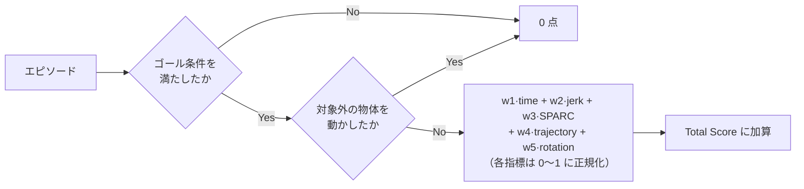

# 01. 勝ち筋と評価の読み解き

学習条件を決める前に、**何を上げるとスコアが上がるのか**を確定させる。
ここを曖昧にしたまま学習すると、ノートブック上の成功率は上がったのに
リーダーボードが動かない、という結果になる。実際そうなる理由がこのコンペにはある。

## スコアは成功率にほぼ支配される

参加者ガイド（PDF p.11）が示すスコアの構造は次のとおりである。

> 成功/衝突判定をゲートとして，重みと正規化した指標の積を計算する



重み `w1..w5` と正規化式は非公開だが、`w1 + … + w5 = 1` とされている。
構造上、**失敗したエピソードは滑らかさや効率がどれだけ良くても 0** である。

| 優先度 | 何を上げるか | 効き方 |
|---|---|---|
| 1 | 成功率 | ゲート。ここが 0 なら他は全部無意味 |
| 2 | 衝突を起こさないこと | 同じくゲート。成功しても衝突で 0 になる |
| 3 | 滑らかさ・効率（jerk / SPARC / ステップ数 / 軌道長 / EEF 回転量） | 成功したエピソードの中での配点 |

配布学習例のリーダーボード参考スコアは **0.0633**（PDF p.8）である。
成功率が低い段階では、滑らかさの最適化に時間を使う意味はほとんどない。

## 運営 Q&A で確定した事実（8/10 追記分）

| No. | 確定したこと | 効き方 |
|---|---|---|
| **36** | **独自の学習が必須。形式変換・名称変更・推論パラメータ変更のみの提出は不可** | **資格の問題。** 学習は必ず行う |
| **24** | リーダーボード提出と**予選最終提出は別枠**。最終評価は**別の評価タスク**で実施される | リーダーボードは計測器であって成績ではない。実験に使い切ってよい |
| 25 | 8/14 23:59 は**アップロード完了**の期限。最終提出は締切後にまとめて採点される | レポートのハッシュは**最終提出の zip** と一致させる |
| **29 / 31** | **指示文の正規化は許可**。学習データの指示文集合への**埋め込み最近傍**も可 | 摂動の 1 カテゴリが「指示文の言い換え」。学習時の言い回しへ戻せる |
| **30** | **停滞（STALL / WANDERING）を検知して再推論させるガードは許可** | 本番は 8 本中 4〜5 本が打ち切りまで走って失敗している |
| **33** | **自前でロールアウトを作って学習データにしてよい。** 自己評価の結果で学習対象を選ぶのも可 | 弱いカテゴリを評価して重点的に学習できる |
| 35 | 本番のカメラ解像度は **128×128**（既定値） | 学習側もこれに揃える |
| 27 | 衝突判定は「タスク達成に関わる物体とロボット」以外の全物体。ただし**物理の安定化を待った後**の位置が基準で、微小な変位は許容 | 把持に伴う程度の接触では失格にならない |
| 36 | **LeRobot の同梱は規約上問題なし** | 懸案だったリスクが消えた |

**提出先は参加者ガイドに書いてある**（p.13・p.16）。Omnicampus の
**「宿題」一覧から課題を選んで zip をアップロードする**。予選最終提出は
リーダーボードとは別枠なので、**一覧に別の課題として並ぶはず**である。
一覧を開けば枠の有無は今すぐ確認できる（No.40 は「いつできるか」が未回答）。

**ガイド p.12 に重要な記述がある。**

> 予選最終評価にて行われる評価プロセスとリーダーボード評価プロセスの
> **差分は実施される評価タスクのみ**なので、予選最終提出をする前に十分に
> チェックを行うこと。基本的に、**予選最終提出時に生じたエラーに関しての
> 救済措置はありません**

**打ち切り 300 ステップも採点の仕組みもリーダーボードと同じ**である。違うのは
採点に使われるタスクだけなので、ログから読み取った本番の構造は最終評価にも当てはまる。
そして**最終提出でエラーが出ても救済されない**ため、出す構成は必ず事前に
リーダーボードで一度通しておく。

## 運営 Q&A で確定した事実（2026-08-09 時点）

[docs/materials/PARC2026  テクニカル関連質問  - テクニカル質問.csv](../materials/PARC2026%20%20%E3%83%86%E3%82%AF%E3%83%8B%E3%82%AB%E3%83%AB%E9%96%A2%E9%80%A3%E8%B3%AA%E5%95%8F%20%20-%20%E3%83%86%E3%82%AF%E3%83%8B%E3%82%AB%E3%83%AB%E8%B3%AA%E5%95%8F.csv) の
回答から、設計判断を変えるものを抜き出す。**推測ではなく運営の回答**である。

| No. | 何が確定したか | 設計への影響 |
|---|---|---|
| **23** | スコアの `time` は **(a) シミュレーションステップ数ベース**。実際にかかった時間ではない | 推論回数を増やしても**スコアの time は悪化しない**。閉ループ化の判断が変わる |
| **3** | 本番採点は **EGL（GPU 描画）**。osmesa ではない。L4 で `env.step` 39.1 ms、パイプライン込み 47.5 ms/step | 1 時間の予算を実数で見積もれる |
| **3** | 1 時間制限は**サーバー起動から全タスク完了までの wall-clock**。評価は**逐次実行**（`n_parallel_envs` は未使用） | 総ステップ数 × (シム + 推論) が 1 時間に収まる必要がある |
| **3** | 評価タスク数・試行数は**非公開**。資料の「N は 1」は**運営の誤り** | 総ステップ数を確定できない。保守的に見積もるしかない |
| **21** | 摂動 7 カテゴリの**すべてが含まれるわけではない**。「同一タスク・同一ドメインにおける、テクスチャなどの摂動」に該当するものが含まれる | 画像拡張は輝度・色調に絞るのが理にかなう。カメラ位置やセンサノイズ対策の優先度は低い |
| **21** | difficulty_level の範囲、`lerobot/libero_plus` の 40 タスク内かは**回答不可** | 40 タスクの外に出る可能性を否定できない。汎化側に倒す |
| **10** | **「VLA が生成した Action を、全タスク共通のルールで整える処理」は禁止事項に含まれない**（運営が明言） | 平滑化・クリッピング・レート制限を安心して入れられる |
| **11** | 「評価結果を利用した追加学習」の禁止に、**配布ローカル評価環境は含まれない** | 自前でロールアウトを回してデータを作ることは可能 |
| **36** | LeRobot ソースを zip に同梱する方式の可否は **未回答**（2026-08-09 12:55 時点で「未対応」） | 方式 A のまま進めるが、回答を待つ。**要監視** |

### No.23 の重み

`time` がステップ数ベースであることは、**閉ループ化の判断を裏返す**。

[pipeline/rollout.py](../../pipeline/rollout.py) は `elapsed_time_sec`（かかった時間）と
`avg_steps_to_success`（ステップ数）の両方を記録しているため、配布物からは
どちらが使われるか判別できなかった。運営の回答で **(a) ステップ数**と確定した。

したがって `n_action_steps` を縮めて推論回数を増やしても、**スコアの time 項は
悪化しない**。むしろ閉ループ化でタスクを早く終えられれば **time 項は良くなる**。
残る制約は 1 時間の wall-clock だけである。

### 1 時間予算の実数（2026-08-09、本番ログで確定）

**推測は不要になった。** 実際の採点ログ
（[docs/260809_提出環境での評価結果.md](../../outputs/submission_logs/260809_initial_submission.md)）に
合計時間が出ている。

```
提出ID: server_8000
合計時間: 147.6秒
  track1: 総合スコア 0.058
```

| 項目 | 実測 | 上限 | 使用率 |
|---|---|---|---|
| **トラック評価の合計** | **147.6 秒** | 3,600 秒 | **4.1%** |
| サーバー起動（実 L4） | 38 秒 | 120 秒 | 32% |

**1 時間制限はまったく効いていない。** 24 倍の余裕がある。

### 本番の総ステップ数はごく少ない

合計時間から逆算すると、こうなる（L4・EGL でパイプライン込み 47.5 ms/step、
推論 0.45〜0.85 秒/chunk として）。

| 推論 1 回 | 総ステップ数 | 600 ステップ換算 |
|---|---|---|
| 0.85 秒 | 約 2,290 | 3.8 エピソード |
| 0.60 秒 | 約 2,480 | 4.1 エピソード |
| 0.45 秒 | 約 2,610 | 4.4 エピソード |

**本番の評価は 4 エピソード程度**と見てよい。配布既定の `n_eval_episodes=20` は
使われていない。これは 2 つのことを意味する。

1. **推論時間を大幅に増やせる。** 下表のとおり、`n_action_steps=10` でも
   予算の 7.5% しか使わない
2. **リーダーボードのスコアは統計的に極めて不安定である。**
   4 エピソードなら、1 回の成否でスコアが 0.25 単位で動く。
   スコア 0.058 は「1 本だけ成功し、その滑らかさが 0.23 だった」で説明がつく

### 推論時間を増やしたときの予算（総 2,500 ステップ、推論 0.6 秒として）

| 設定 | 推論回数 | 合計時間 | 上限に対して |
|---|---|---|---|
| `n_action_steps=50`（現状） | 50 | 149 秒 | 4.1% |
| `n_action_steps=25` | 100 | 179 秒 | 5.0% |
| `n_action_steps=10` | 250 | 269 秒 | 7.5% |
| `n_action_steps=25` ＋ `samples=3` | 300 | 299 秒 | 8.3% |
| `n_action_steps=25` ＋ `samples=5` | 500 | 419 秒 | 11.6% |

**推論側の計算量は、遠慮なく使ってよい。** 効くかどうかは別問題なので実測で決めるが、
「時間制限があるから控える」という判断は不要である。

> **訂正。** 以前この文書は「`n_eval_episodes` の既定 20 を当てると 48,000 ステップに
> なり `n_action_steps=10` では 1 時間を超える」と書いていた。本番ログで
> 総ステップ数が 2 桁少ないことが判明したため、この見積もりは誤りだった。

## 成功判定は「ゴール達成」だけではない

配布リポジトリの [pipeline/rollout.py](../../pipeline/rollout.py) が実際の判定である。

```python
collided = any(d > collision_threshold for d in object_max_disp.values())
success = bool(done) and not collided
```

### 衝突判定の実際

| 項目 | 内容 |
|---|---|
| 判定対象 | BDDL の `(:obj_of_interest ...)` に**含まれない**全物体 |
| 変位の定義 | 初期位置からの xyz 各軸の絶対値の**和**（マンハッタン距離） |
| しきい値 | **1 mm**（`threshold_m: 0.001`） |
| 判定タイミング | 全ステップの**最大値**。元に戻しても失敗のまま |
| 基準位置 | エピソード開始直前（後述の 10 ステップ静定後）の位置 |

1 mm は「隣の物体をかすめた」程度で超える。アームの肘が背後の物体に当たる、
把持物を置いた反動で隣が揺れる、といった挙動が全部失敗になる。

### ゴール条件も配布リポジトリで強化されている

[compe/t1/register.py](../../compe/t1/register.py) は `SiteObjectState.check_ontop` に
パッチを当て、「対象物体が静的なシーン（テーブルや皿）に接触していること」を追加条件にしている。

```python
def check_ontop(self, other):
    base = original_check_ontop(self, other)
    if not base or self.env.get_object(self.parent_name) is not None:
        return base
    return _resting_on_static_scene(self.env, other.object_name)
```

つまり **「皿の上空で掴んだまま」では成功しない。手を離して置く必要がある。**
VLA が「置く」動作を最後まで完了せずエピソードが切れるケースは失敗になる。

## 配布ノートブックの成功率は当てにならない

[examples/smolvla_libero_spatial_lora.ipynb](../../examples/smolvla_libero_spatial_lora.ipynb)
の評価は LeRobot の `lerobot-eval` を使っており、**衝突判定を行わない**。
さらに条件そのものが本番と違う。

| 項目 | ノートブックの評価 | 本番の採点 |
|---|---|---|
| 実行 | `lerobot-eval` | `python -m pipeline` + 提出物サーバー |
| 衝突判定 | **なし** | あり（1mm） |
| `check_ontop` の強化 | なし | あり |
| 観測解像度 | 256×256 | 128×128 |
| 評価タスク | LIBERO-plus Spatial の 10 タスク | Track 1 のタスクセット（非公開分を含む） |
| 試行数 | 既定 3 / タスク | 非公開（配布キットの既定は 20） |

**ノートブックで成功率が上がった、を判断材料にしてはいけない。**
必ず配布キット側の評価パイプラインを回し、`collision_rate` を含む数字で判断する。

```bash
source env.sh
python submission_template/policy_server.py --port 8000 &
python -m pipeline --server-url http://localhost:8000 --track track1 \
    --n-episodes 20 --max-steps 600
```

結果は `results/<submission_id>.json` に出る。見るべきキーは次の 3 つである。

| キー | 意味 |
|---|---|
| `overall_metrics.mean_success_rate` | 成功率（衝突による失敗を含む） |
| `overall_metrics.mean_collision_rate` | 衝突が起きたエピソードの割合 |
| `tasks[].metrics.sparc` / `avg_cartesian_jerk` | 滑らかさ。SPARC は 0 に近いほど滑らか |

> `--max-steps` を省略すると CLI の既定 300 が使われる。
> 配布 README の例および `EvalConfig` の既定は 600 なので、**明示的に 600 を渡す**こと。
> 300 のまま測ると、単に時間切れで失敗しているものを「性能不足」と誤読する。

## 汎化の方向は example タスクの構成から読む

[compe/t1/T1_TASKS.csv](../../compe/t1/T1_TASKS.csv) には example タスクが 4 件しかないが、
その内訳が本番タスクセットの性質を示している。

| # | 元 suite | 摂動カテゴリ | 難易度 |
|---|---|---|---|
| 1 | libero_spatial | Background Textures | L3 |
| 2 | libero_object | Background Textures | L5 |
| 3 | libero_object | Light Conditions | L2 |
| 4 | libero_goal | Light Conditions | L4 |

**variant** = 元のタスク 1 つに摂動を 1 つ当てたもの（`.bddl` 1 個）。初期配置は元タスクのものを共有するので、**1 つの variant から最大 50 エピソード作れる。**

この 4 件は、LIBERO-plus の
`libero/libero/benchmark/task_classification.json` の `id` と**完全に一致する**
（配布キットに同梱されている。`setup.sh` が clone する `LIBERO-plus/` 配下）。
同ファイルは LIBERO-plus の 10,030 variant を 4 スイート × 7 摂動カテゴリに分類している。

| category | libero_spatial | libero_object | libero_goal | libero_10 | 計 |
|---|---|---|---|---|---|
| Background Textures | 258 | 248 | 281 | 289 | 1,076 |
| Camera Viewpoints | 376 | 396 | 408 | 419 | 1,599 |
| Language Instructions | 390 | 354 | 410 | 383 | 1,537 |
| Light Conditions | 292 | 297 | 279 | 274 | 1,142 |
| Objects Layout | 385 | 403 | 425 | 312 | 1,525 |
| Robot Initial States | 350 | 398 | 409 | 393 | 1,550 |
| Sensor Noise | 351 | 422 | 379 | 449 | 1,601 |
| **計** | 2,402 | 2,518 | 2,591 | 2,519 | **10,030** |

example の 4 件はすべて **Background Textures または Light Conditions** に属する。
運営回答 No.21 の「7 カテゴリすべてではない」と合わせると、
**視覚摂動の 2 カテゴリ（計 2,218 件、全体の 22%）が本命**と読める。

ここから読めることが 2 つある。

1. **単一 suite ではない。** spatial / object / goal が混在している。
   配布ノートブックは libero_spatial の 10 タスクだけで学習しているので、
   そのままでは object / goal 系のタスクに対して追加学習の効果が乗らない。
   なお学習データ `lerobot/libero_plus` の 40 指示は
   **4 スイート × 10 タスク**にちょうど対応しており、
   ノートブックが使っているのは**そのうち 1 スイートだけ**である。
2. **問われているのは見た目の摂動に対する頑健性である。**
   Background Textures と Light Conditions はどちらも視覚的摂動であり、
   タスクの手順そのものは元の LIBERO タスクと同じである。

したがって学習データは、**LIBERO-plus の摂動込みデータを suite 横断で集める**方向が素直である。
具体的な絞り込み方は [03_学習とデータの方針.md](03_学習とデータの方針.md) に書く。

## 設計を縛る制約

スコアと直接関係しないが、違反すると 0 点になる制約がある。設計段階で織り込む。

| 制約 | 値 | 出典 | 設計上の意味 |
|---|---|---|---|
| 推論 1 リクエスト | **10 秒** | PDF p.12 / 配布 README | 1 回でも超過するとトラック全体が 0 点。平均ではない |
| サーバー起動（モデルロード込み） | 既定 **120 秒** | 配布 README | 重い初期化やコンパイルは間に合わない |
| Track 評価全体 | **1 時間** | PDF p.12 | 1 ステップあたりの推論時間 × 総ステップ数が効く |
| GPU | NVIDIA L4 **VRAM 24GB** 1 枚 | PDF p.12 | 24GB に収まらないモデルは不可 |
| 評価中の外部通信 | **禁止** | PDF p.21 | 重みの動的ダウンロード不可。全部 zip に入れる |
| zip サイズ | 20GB | PDF p.13 | 実質的に制約にならない |

10 秒制限は action chunking と相性がよい。配布 README が明示的に認めている。

> アクションチャンクをサーバー内にキャッシュするモデルの場合、推論が実行される「重い」
> リクエストのみが上限の対象となる（実質的な制約は「チャンク 1 回分の推論 ≤ 10 秒」である）。

つまり chunk 長 50 なら 50 ステップに 1 回だけ重い推論が走り、残り 49 回はキャッシュを返す。
**Track 評価 1 時間の制約に対しても、chunk 化は素直に効く。**

## 禁止事項との境界

PDF p.20–21 の禁止事項は「タスクを識別して決め打ちする」系を潰している。
一方で、**推論時の一般的な後処理は禁止されていない**。

| 手法 | 判断 |
|---|---|
| action chunk のキャッシュ / temporal ensembling | 一般的な推論手法であり、タスク固有の情報を使わない。禁止事項に該当しないと読める |
| action の平滑化・クリッピング | **運営が明示的に「禁止事項に含まれない」と回答済み**（Q&A No.10） |
| タスク名や seed で分岐する処理 | **禁止**（「scene ID，task ID，評価seed等をキーとした行動テーブル」） |
| 学習済みモデルを使わない fallback | **禁止** |
| 言語指示の文字列マッチによる分岐 | 実質的に task ID による分岐であり、危険。避ける |

グレーだと感じたものは、PDF p.21 の指示どおり質問スプレッドシートで確認する。
レポート記載内容と提出モデルに差があると本選途中でも失格になりうる（PDF p.23）ため、
使った手法は全部レポートに書ける形にしておく。

## まとめ：何から手をつけるか

1. **成功率を上げる。** そのために学習データを Track 1 の性質（suite 横断・視覚摂動）に合わせる。
2. **衝突率を下げる。** ローカル評価で `collision_rate` を必ず見る。ここを見ていない参加者との差になる。
3. **滑らかさは後回し。** 成功率が実用域に乗ってから、chunk の繋ぎ目の平滑化などで詰める。
