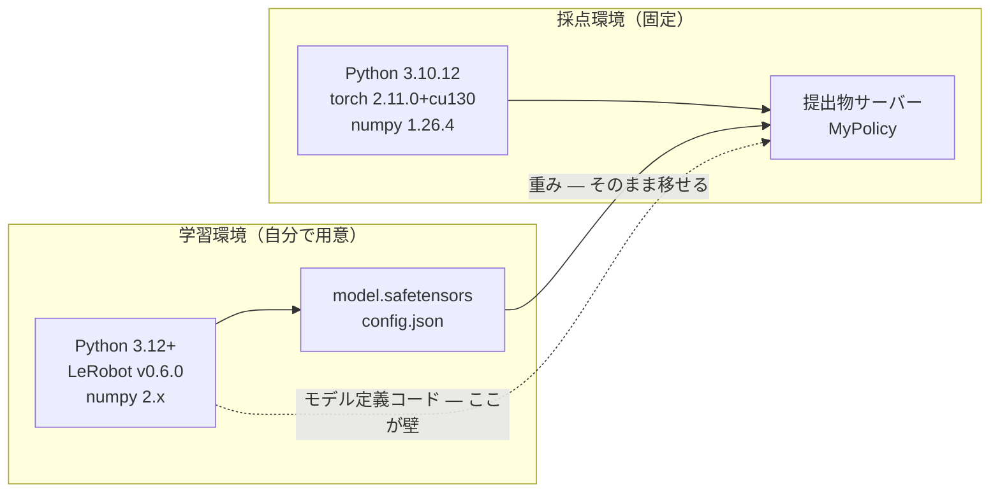

# 02. 環境戦略 — Python 3.10 と 3.12 をどう跨ぐか

このコンペで最初に、そして最も大きく詰まるのがここである。
**学習環境と採点環境で要求される Python のバージョンが違い、配布物のとおりに進めると提出物が起動しない。**

先に結論を書く。

- 採点環境は **Python 3.10.12 固定**であり、ここは動かせない。
- 配布ノートブックが使う **LeRobot v0.6.0 は Python 3.12 以上を要求**する。`pip install` は Python 3.10 では**メタデータの時点で失敗する**。
- ただしこれは **pip のメタデータ検査**であり、ソースを提出物に同梱すれば回避できる。実際に 3.10 で動くかは別途検証が要る。
- **推奨は「学習は 3.12 のまま、推論側は lerobot のソースを同梱して 3.10 で動かす」**（後述の方式 A）。

## なぜ 2 つのバージョンが要るのか

境界を越えるのは「学習済みの重み」だけではない。**その重みを読むモデル定義コードも一緒に越える**。
Python 版の壁はここに立つ。



## 事実の確認

判断はこの表の上で行う。値はすべて配布物または公式メタデータで確認済みである。

| 項目 | 学習側（配布ノートブック） | 採点側（提出物が動く場所） |
|---|---|---|
| Python | **3.12 以上**（ノートブック cell 2 が `sys.version_info < (3, 12)` で明示的に `raise`） | **3.10.12**（システム Python `/usr/bin/python3.10`） |
| LeRobot | v0.6.0（`requires-python = ">=3.12"`） | 導入手段が課題 |
| torch | Colab 既定 | **2.11.0+cu130** |
| numpy | LeRobot v0.6.0 が `>=2.0.0,<2.3.0` を要求 | **1.26.4** |
| CUDA | Colab の GPU に依存 | **13.0**（`libnvJitLink.so.13` のみ存在） |
| レンダリング | `MUJOCO_GL=egl` | `MUJOCO_GL=EGL` |

出典: 学習側は [examples/smolvla_libero_spatial_lora.ipynb](../../examples/smolvla_libero_spatial_lora.ipynb) と
LeRobot の `pyproject.toml`、採点側は [配布 README の「採点環境」](../../README.md#採点環境)。

### LeRobot のバージョンと Python 要求（PyPI メタデータ）

| LeRobot | requires-python | torch 制約 |
|---|---|---|
| 0.1.0 – 0.4.4 | `>=3.10` | 0.4.4 は `>=2.2.1,<2.11.0` |
| **0.5.0 以降（0.6.0 含む）** | **`>=3.12`** | 0.6.0 は `>=2.7,<2.12.0` |

`transformers` は 5.x でも `requires_python >= 3.10.0` であり、**Python 3.10 の障害にはならない**。
壁は LeRobot 自身のメタデータだけである。

## 何が具体的に失敗するか

提出物の依存は、`--system-site-packages` 付きで作られた提出物専用 venv に対して
`pip install -r requirements.txt` される。ここで `lerobot==0.6.0` と書くと次で止まる。

```
ERROR: Package 'lerobot' requires a different Python: 3.10.12 not in '>=3.12'
```

これは依存解決以前の、**配布メタデータによる拒否**である。
`--index-url` などで別ソースを指すことはできない（[提出物チェック](../../validate_submission.py) が
`--index-url` / `--extra-index-url` / `git+` 等を ERROR として弾く。評価中は外部通信も禁止）。

## 3 つの方式と判断材料

| | 方式 A: ソース同梱 | 方式 B: LeRobot 0.4.4 に揃える | 方式 C: 最小推論コードを自作 |
|---|---|---|---|
| 学習側 | 配布ノートブックのまま（3.12 / v0.6.0） | 3.10 / v0.4.4 で学習をやり直す | 配布ノートブックのまま |
| 推論側 | `lerobot/` のソースを zip に同梱し `sys.path` に載せる | `requirements.txt` に `lerobot==0.4.4` | 必要なモジュールだけ移植 |
| pip の 3.12 ゲート | 回避できる（pip を通さないため） | かからない | かからない |
| torch | **イメージの 2.11.0+cu130 をそのまま使える**（v0.6.0 の `>=2.7,<2.12` を満たす） | **衝突する**。`<2.11.0` のため venv に torch 2.10 系が入り、CUDA 12 の wheel 一式が必要になる | 自分で決められる |
| 重みの互換性 | 学習時と同一コードなので確実 | v0.6.0 で保存した checkpoint（`policy_preprocessor.json` 等の新 processor pipeline）が読めない可能性が高い | 移植の正しさに依存 |
| 残るリスク | LeRobot v0.6.0 のソースが 3.10 構文で動くか。`torchvision` 等の間接依存 | 学習のやり直しコスト、CUDA 12 の罠 | 実装量が最大 |
| 作業量 | 小 | 大 | 中〜大 |

### 推奨: まず方式 A、余力があれば C へ

**方式 A を第一候補とする理由**は、torch を触らずに済むことである。
LeRobot v0.6.0 の torch 制約 `>=2.7,<2.12.0` は採点イメージの **2.11.0+cu130 を満たす**。
`requirements.txt` に `torch` を書かなければイメージの版がそのまま使われ、
CUDA 13 のライブラリと整合した状態で GPU が使える。
配布 README が警告している `libnvJitLink.so.12` の問題にも触れずに済む。

**方式 B を避ける理由**は逆で、`torch<2.11.0` が採点イメージと正面衝突するためである。
venv 側に CUDA 12 ビルドの torch が入り、`nvidia-*-cu12` の wheel を
`requirements.txt` で自力で揃える必要が出る。学習もやり直しになる。

**方式 C は方式 A の後**に検討する。起動 120 秒・推論 10 秒の制約に対して
依存が軽いほど有利であり、`torchvision` のような不要な間接依存も切れる。
ただし A で一度動かしてからでないと、移植の正しさを検証する基準がない。

### 追記: 方式 B は pip の 3.12 ゲート以前に成立しない（2026-08-09）

他の参加者から、次の報告が共有された。

> 提出物について、配布環境の `validate_submission.py` では PASS 判定だったのですが、
> Omnicampus の提出フォームでは採点エラーが出ています。
>
> → 恐らく、lerobot の pip install が失敗しています。評価環境はなぜか lerobot の
> pip install は出来ません。lerobot に含まれる「evdev」のインストール処理が
> 失敗するからです。zip ファイルに添付する等の対応が必要です。

**`requirements.txt` に `lerobot` を書く方式は、バージョンを問わず採点環境で失敗する。**
`evdev` は Linux の入力デバイス用パッケージで、ビルドに `linux/input.h` を要求する。
テレオペ用の依存であり推論には不要だが、`lerobot` を pip 経由で入れる限り必ず引かれる。

これは判断を 2 つ変える。

| | 変更前 | 変更後 |
|---|---|---|
| 方式 B の位置づけ | 「torch が衝突するので避ける」 | **そもそも成立しない**。torch 以前に pip install が通らない |
| 方式 A の位置づけ | 「pip の 3.12 ゲートを回避する手段」 | **同梱以外に選択肢がない**ことが裏づけられた |

**`validate_submission.py` は依存解決まで見ないため、ローカルで PASS したまま
本番で採点エラーになる。** この経路を潰すため、
[solution/tools/build/build_submission.py](../../solution/tools/build/build_submission.py) は
`requirements.txt` に `lerobot` / `evdev` が宣言されていれば zip を作らない。

なお運営 Q&A No.36（LeRobot ソースの同梱が規約上問題ないか）は未回答のままだが、
**運営の採点環境自体が pip install を通せない**以上、同梱を否定するのは
筋が通らない。とはいえ回答は引き続き確認すること。

## 方式 A の具体手順

### 1. 学習側で LeRobot のソースを取り出す

配布ノートブックは `/content/lerobot` に v0.6.0 を clone している。
その `src/lerobot` を、マージ済みモデルと一緒に持ち帰る。

```python
# ノートブック末尾（zip 作成セル）に追加する
import shutil
shutil.copytree(LEROBOT_SRC / "lerobot", "/content/vendor/lerobot")
```

### 2. 提出物の構成に置く

```
submission.zip
├── policy_server.py
├── requirements.txt
├── model_weights/          # マージ済みモデル一式
└── vendor/
    └── lerobot/            # LeRobot v0.6.0 のソース
```

`policy_server.py` の `MyPolicy.__init__` で `sys.path` に足す。

```python
import sys
from pathlib import Path

sys.path.insert(0, str(Path(__file__).parent / "vendor"))
```

### 3. requirements.txt は torch を書かない

```
# サーバー本体（テンプレートの既定。削除しない）
fastapi>=0.68
uvicorn>=0.15
msgpack>=1.0

# LeRobot v0.6.0 のソースを動かすための依存
# torch は書かない → イメージの 2.11.0+cu130 が使われ CUDA 13 と整合する
numpy>=2.0.0,<2.3.0
transformers>=5.4.0,<5.6.0
num2words>=0.5.14
accelerate>=1.7.0
safetensors>=0.4.3
```

> `numpy` を 2.x にすると venv 側が優先され、**提出物サーバーのプロセスにのみ**効く。
> 評価パイプライン側（numpy 1.26.4）には影響しない。配布 README が明記している挙動である。

### 4. 3.10 で本当に動くかを検証する

ここが方式 A で唯一残る不確実性である。順に潰す。

```bash
# (a) 構文レベル: 3.12 専用構文が入っていないか
python3.10 -m compileall -q vendor/lerobot

# (b) import レベル: 実際に読み込めるか
python3.10 -c "from lerobot.policies.smolvla.modeling_smolvla import SmolVLAPolicy; print('ok')"

# (c) 推論レベル: 重みを読んで action が出るか
python3.10 policy_server.py --port 8000
```

## 実測結果（2026-08-08、LeRobot v0.6.0）

上記の手順を実際に通した結果を記録する。**方式 A は成立する。**

### 3.12 専用の記述は 6 ファイル 13 箇所だけだった

`compileall` と、全 487 ファイルの `from typing import` 等を AST で走査して
3.10 に存在しない名前を洗い出した結果である。

| 種別 | 箇所 | 3.10 での書き換え |
|---|---|---|
| PEP 695 型引数構文 | `processor/pipeline.py` / `utils/io_utils.py` / `motors/motors_bus.py` / `datasets/streaming_dataset.py` | `Generic[...]` / `TypeVar` |
| `typing.Self`（3.11+） | `configs/video.py` | try/except で `TypeVar` にフォールバック |
| `datetime.UTC`（3.11+） | `jobs/hf.py` 2 箇所 | `datetime.timezone.utc` |
| `typing.Unpack`（3.11+） | 7 ファイル | `typing_extensions`（採点イメージに 4.16.0 が同梱） |

書き換えを適用した 487 ファイルは Python 3.10.12 で全て `compileall` を通り、
`SmolVLAPolicy` の import と `from_pretrained` が成功した。同梱サイズは 12MB である。

### torchvision は必須で、PyPI の既定 wheel が採点環境と整合する

`lerobot.transforms` が `torchvision.transforms.v2` を import するため、
**`torchvision` は避けられない**（採点イメージには入っていない）。

PyPI の `torchvision` wheel（x86_64 / aarch64 とも）を展開して確認したところ、
**CUDA 13 ビルド**であり `libcudart.so.13` / `libc10_cuda.so` / `libtorch_cuda.so` に
リンクしている。これは採点イメージの `torch 2.11.0+cu130` と
`nvidia-cuda-runtime 13.0.96` に一致する。したがって `requirements.txt` には
`torchvision>=0.22.0,<0.27.0` と書けばよい。

> **ローカルが CPU torch の場合はここで必ず失敗する。**
> `operator torchvision::nms does not exist` が出るが、これは CUDA ビルドの
> torchvision を `+cpu` の torch に載せたことによるもので、本番では起きない。
> ローカル検証時だけ `--index-url https://download.pytorch.org/whl/cpu` から
> 入れ直すこと（提出物の `requirements.txt` では `--index-url` は禁止）。

### sys.path には vendor/ を入れる（vendor/lerobot ではない）

パッケージ自身を `sys.path` に載せると、`lerobot/types.py` が標準ライブラリの
`types` を隠して循環 import になる。**必ず親ディレクトリを入れる。**

## 検証は本番相当の GPU コンテナで行う

配布 Docker は **CPU 構成**（`ubuntu:22.04` + `torch 2.11.0+cpu`、`MUJOCO_GL=osmesa`）であり、
ここで動いても CUDA まわりの失敗は検出できない。本番相当を手元に作る。

### Dockerfile の変更点

```diff
-FROM ubuntu:22.04
+FROM nvidia/cuda:13.0.3-cudnn-devel-ubuntu22.04

-ENV MUJOCO_GL=osmesa
+ENV MUJOCO_GL=egl
```

### setup.sh の変更点

```diff
 pip install -q --timeout 120 --retries 10 \
-    "torch==2.11.0+cpu" --index-url https://download.pytorch.org/whl/cpu \
-    --extra-index-url https://pypi.org/simple
+    "torch==2.11.0" --index-url https://download.pytorch.org/whl/cu130 \
+    --extra-index-url https://pypi.org/simple
```

### 検証コマンド

```bash
docker build -t parc2026-gpu .
docker run --gpus all -it --rm -v $PWD/submission:/sub parc2026-gpu

# コンテナ内: 採点環境と同じ手順で提出物 venv を作る
python3.10 -m venv --system-site-packages /tmp/subvenv
/tmp/subvenv/bin/pip install -r /sub/requirements.txt
/tmp/subvenv/bin/python -c "import torch; print(torch.__version__, torch.cuda.is_available())"
```

期待する出力は `2.11.0+cu130 True` である。
**`pip install` の出力に `... requires X, but you have Y` という警告を残さないこと。**
この警告が出ている状態は、pip の解決結果が本番で変わりうることを意味する。

### 確定した依存

イメージに無いのは次の 7 行だけで、これが 21 パッケージを引く。`pip check` はクリーンで、
**`torch` も `numpy` も置き換わらない**（LeRobot が宣言する `numpy>=2.0` は
SmolVLA の推論経路では不要で、`numpy 1.26.4` のまま動作する）。

```
safetensors>=0.4.3,<1.0.0
draccus==0.10.0
transformers>=5.4.0,<5.6.0
num2words>=0.5.14,<0.6.0
accelerate>=1.7.0,<2.0.0
gymnasium>=1.1.1,<2.0.0
torchvision>=0.22.0,<0.27.0
```

実物は [solution/requirements.txt](../../solution/requirements.txt)、
同梱手順は [solution/tools/build/vendor_lerobot.py](../../solution/tools/build/vendor_lerobot.py) にある。

## GPU 実測（2026-08-09、Colab Tesla T4）

CPU コンテナでは確かめられなかった項目を、Colab の GPU で実測した。
**測り方を書いた `docs/solution/COLAB.md` は 8/23 に削除した**（Colab では学習が
完走しないため、Colab 学習の手順ごと廃止した）。同じ値を測り直すなら GPU マシンで
[solution/tools/infer_pi05_once.py](../../solution/tools/infer_pi05_once.py) を使う。

| 項目 | 実測（T4） | 本番上限 | 余裕 |
|---|---|---|---|
| 重みロード | 41.5 秒 | 120 秒 | 2.9 倍 |
| 重い推論（チャンク再計算） | 0.85 秒 | 10 秒 | 11.8 倍 |
| キャッシュ時（chunk 内の 2 回目以降） | 0.0033 秒 | — | — |

CPU 2 コアの 23.4 秒に対して 0.85 秒。**方式 A は本番環境で成立する。**
本番の L4 は T4 より速いため、さらに余裕が出る。

この実測は、`torchvision` が CUDA 環境で import できることも同時に示している
（`SmolVLAPolicy` の import 経路が `torchvision` を通るため、失敗していれば
重みロードに到達しない）。ただし Colab の CUDA は 13 ではないため、
**CUDA 13 での import は依然として未検証**である。

### この余裕をどう使うか

推論に 11.8 倍の余裕があることは、単に「安全」という話ではない。
`n_action_steps` を縮めて**閉ループ制御に寄せる**原資になる。

現在の設定は `chunk_size = n_action_steps = 50` で、1 回の観測から生成した
50 ステップ分の行動を**開ループで実行しきる**。これを 10 に縮めれば
再計画の頻度が 5 倍になり、誤差の蓄積に強くなる。学習を一切せずに効く。

ただし**トラック全体で 1 時間**の制限があるため、総推論回数の増加が
そのまま時間を食う。効果と時間の両方を測ってから決めること。
