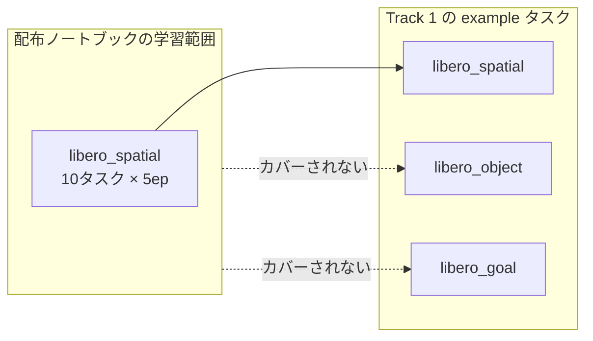
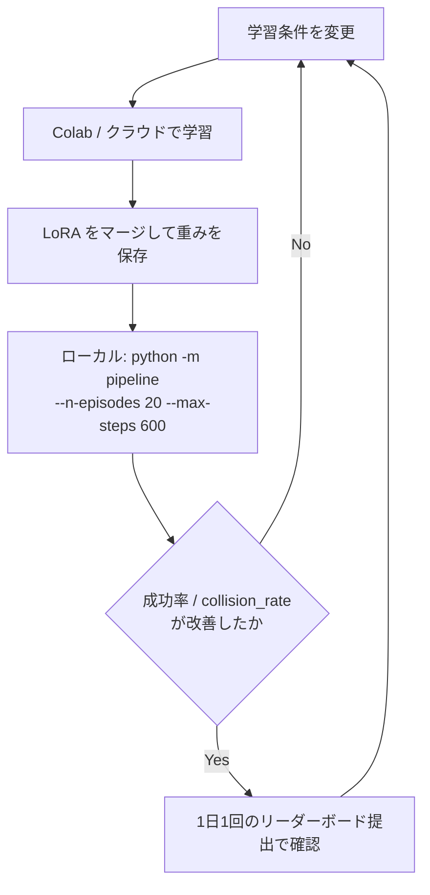

# 03. 学習とデータの方針

配布ノートブックはそのまま完走することを優先した最小構成であり、
**そのまま回してもスコアはほぼ伸びない**。参考スコアが 0.0633（PDF p.8）に留まるのはそのためである。
どこを変えると効くのかを、配布ノートブックの設定と Track 1 の性質から詰める。

用語（スイート・タスク・摂動カテゴリなど）は [README.md](README.md#用語) に定義した。

> **この文書は「なぜ変えるか」を書く。「どう変えるか」は
> [../../solution/COLAB.md](../../solution/COLAB.md) の H に、そのまま貼れる形で置いた。**
>
> | | 変更 | 効き方 |
> |---|---|---|
> | (a) | libero_spatial の 10 タスク → **全 40 タスク**（4 スイート） | 他スイートの劣化を防ぐ |
> | (b) | 1 タスク内の 5 本を、番号順ではなく**明るさで散らして**選ぶ | 視覚摂動の幅を張る |
> | (c) | **画像拡張を有効化**（`--dataset.image_transforms.enable=true`） | 元データに無い視覚変動を足す |
>
> **(a) と (b) は既存エピソードの選び直しにすぎず、(c) だけが
> 「ベースモデルが見たことのない入力」を作る。** ベース重みは同じ
> `lerobot/libero_plus` の 40 タスク全部を batch 64 × 20,000 ステップで
> 学習済みであるため、この区別が重要になる。

## 配布ノートブックの設定と、その限界

[examples/smolvla_libero_spatial_lora.ipynb](../../examples/smolvla_libero_spatial_lora.ipynb) の既定値は次のとおりである。

| 項目 | 既定値 | 限界 |
|---|---|---|
| ベース重み | `lerobot/smolvla_libero_plus`（rev `7bb70aa5…`） | **すでに LIBERO-plus で学習済み**。同じ分布で少量 LoRA を足しても差分が出にくい |
| データ | `lerobot/libero_plus` から libero_spatial の 10 タスク × 5 エピソード = **50 エピソード** | Track 1 は spatial 以外も含む（後述） |
| 学習ステップ | 3,000 | batch 1 なので**実質 3,000 サンプル**しか見ていない |
| バッチサイズ | 1 | Colab の T4 に合わせた値。GPU を上げれば真っ先に上げる対象 |
| 学習対象 | `freeze_vision_encoder=true` かつ `train_expert_only=true` | **VLM 側は完全に凍結**され、action expert の LoRA だけが動く |
| LoRA | r=16, alpha=16 | 探索余地あり |
| 学習率 | 3e-4 → 3e-5（warmup 100） | |

つまりこのノートブックは「LoRA 学習の配線が通ることを示すサンプル」であり、
**性能を出す構成ではない**。ノートブック自身も「十分な学習を保証するものではない」と断っている（PDF p.9）。

## 効く順に変える

### 1. データのカバレッジ（最優先）

Track 1 の example タスク（[compe/t1/T1_TASKS.csv](../../compe/t1/T1_TASKS.csv)）は
libero_spatial / libero_object / libero_goal の **3 suite にまたがっている**。
配布ノートブックの学習データは libero_spatial のみなので、
**残り 2 suite に対しては追加学習の効果がゼロ**である。



`lerobot/libero_plus` は LIBERO-plus の摂動込みデータセットである。
ここから **suite を横断して**エピソードを選ぶよう、ノートブックの
`SPATIAL_TASK_NAMES` / `TRAIN_EPISODES_PER_TASK` の選択ロジックを組み直す。

タスク一覧とエピソード数は次で確認できる。

```python
from collections import defaultdict
from lerobot.datasets.dataset_metadata import LeRobotDatasetMetadata

md = LeRobotDatasetMetadata(
    "lerobot/libero_plus",
    revision="f3f49f426d75030177b18778374005bc12ccd588",
)
print(md.features)          # 観測 / action の名前・shape・dtype
print(md.total_episodes)

per_task = defaultdict(int)
for task in md.episodes["tasks"]:
    per_task[str(task[0]) if not isinstance(task, str) else task] += 1
print(len(per_task))        # タスク数
```

摂動カテゴリ（Background Textures / Light Conditions など）は
[compe/t1/T1_TASKS.csv](../../compe/t1/T1_TASKS.csv) の `category` 列と
`libero_plus_id` 列で対応が取れる。example の 4 件が視覚摂動に偏っている以上、
**摂動バリアントを厚めに入れる**のが素直である。

### 2. 学習量（GPU を用意できるなら）

予選では学習用の計算資源は提供されない（PDF p.9, p.23）。Colab 無料枠では
batch 1 / 3,000 steps 程度が上限になる。外部の有料クラウドを使うことは明示的に認められている。

GPU を確保できたら、上げる順序は次のとおりである。

| 順 | 変更 | 理由 |
|---|---|---|
| 1 | バッチサイズを上げる | batch 1 は勾配ノイズが大きい。最も安価に効く |
| 2 | ステップ数を増やす | データを増やしたなら必然的に必要 |
| 3 | `train_expert_only=false` にして VLM 側にも LoRA を当てる | 視覚摂動への頑健性は VLM 側の表現に依存する。Track 1 が問うているのはここ |
| 4 | LoRA の r / alpha を上げる | 3 まで試した後 |

`freeze_vision_encoder=true` を外すかどうかは、**視覚摂動が課題である**という
Track 1 の性質から見て検討価値が高い。ただし VRAM とステップ時間が増える。

### 3. 衝突を減らす方向の学習

[01_勝ち筋と評価の読み解き.md](01_勝ち筋と評価の読み解き.md) のとおり、
成功判定には **対象外の物体を 1mm 動かしたら失敗**という条件が入る。
ベース重みはこの条件で学習されていないため、ここに素直な伸びしろがある。

| 手段 | 内容 |
|---|---|
| データの選別 | 学習エピソードのうち、周囲の物体を動かしていない軌道だけを残す |
| 独自データの生成 | LIBERO-plus 上で衝突なく成功する軌道を集めて追加する（シミュレータによるデータ生成は PDF p.19 で明示的に許可） |
| 推論時の抑制 | action のスケールを抑える、chunk の繋ぎ目を平滑化する（[04](04_提出物の実装と検証.md) 参照） |

> **データ生成の可否について。** PDF p.19 は「シミュレータ，teleoperation，scripted policy，
> データ拡張，生成モデル等を用いたデータ生成」を認める一方、
> 「評価結果を利用した追加学習や，評価観測を保存して後続の学習に利用すること」を禁止している。
> 手元の LIBERO-plus で軌道を作るのは前者に読めるが、
> example タスク上で生成したデータを使う場合は境界が微妙である。
> 判断に迷ったら PDF p.21 の指示どおり質問スプレッドシートで確認する。

## 学習と評価のループ

**学習側の評価（`lerobot-eval`）をスコアの指標にしてはいけない。**
衝突判定が入らず、解像度も評価タスクも違う。判断は必ず配布キット側で行う。



リーダーボード提出は 1 日 1 回、採点完了時点で 1 回消費される（PDF p.12, p.15）。
**ローカルで差が出た変更だけを提出に回す。** ローカル評価の 1 回（20 エピソード × タスク数）は
CPU 環境でも回せるが時間がかかるため、探索中は `--n-episodes` を落とし、
候補が絞れてから 20 に戻す運用にする。

## 記録しておくもの

レポート（PDF 2 ページ以内、提出必須）で申告する項目が細かい。
**学習を回した時点で記録しないと後から復元できない**ものが多いので、
実験ごとに次を残す。未提出だとランキング上位でも本選に行けない（PDF p.23）。

| 分類 | 記録する項目 |
|---|---|
| モデル情報 | モデル名・バージョン / ベースモデル名 / ベース重みの入手元 / 使用した重みの revision・commit hash / **提出チェックポイントのハッシュ値** / モデル構成と推論方式 / **action chunk の有無と chunk 長** |
| 学習情報 | 使用データ（独自収集・生成ならその概要） / データ件数・タスク数・エピソード数 / 学習方法 / ステップ数または epoch 数 / 学習対象パラメータ / Full FT・LoRA・adapter の区分 / 主要ハイパーパラメータ |
| 権利関係 | ベースモデルのライセンス / 学習データのライセンス / **提出物に含まれる第三者コードのライセンス** |

「提出物に含まれる第三者コードのライセンス」は、
[02_環境戦略.md](02_環境戦略.md) の方式 A（LeRobot のソース同梱）を採る場合に必ず該当する。
同梱したソースのライセンス表記を提出物に含め、レポートにも記載する。

チェックポイントのハッシュは zip を作った時点で取る。

```bash
sha256sum model_weights/model.safetensors submission.zip | tee submission_hashes.txt
```
