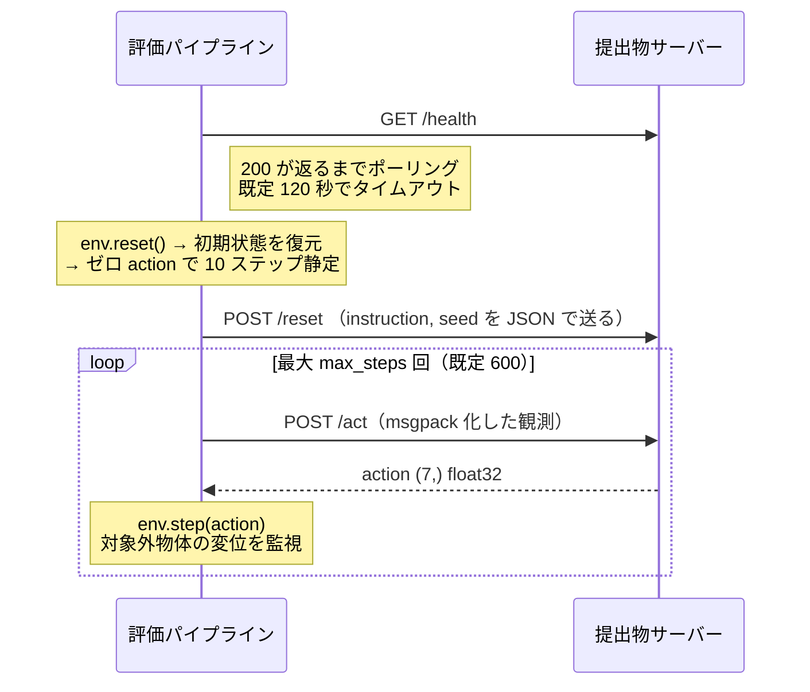
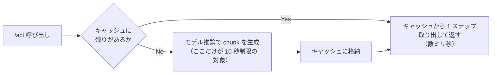

# 04. 提出物の実装と検証

学習した重みを `model_weights/` に置いても、それだけでは何も起きない。
**`MyPolicy` を書き換えるところまでが課題に含まれる**（PDF p.9）。
配布テンプレートは編集前ではランダム action を返す実装であり、そのまま提出しても 0 点になる。

ここでは「まず経路を通す」→「モデルを組み込む」→「検証する」→「提出する」の順で書く。

## STEP 0: 先に経路を通す

提出は 1 日 1 回、採点に 15〜20 分かかる（PDF p.12, p.17）。
モデルが完成してから初めて提出する運用は、提出形式のミスひとつで 1 日を失う。
**テンプレートを未編集のまま一度提出し、採点完了まで到達することを確認する。**
PDF p.15 も同じことを勧めている。

```bash
cd submission_template
zip -r ../submission.zip policy_server.py requirements.txt
```

> zip 化するときは**フォルダごと固めない**。`policy_server.py` が zip のルート直下に来る形にする。
> フォルダに包まれた zip は [validate_submission.py](../../validate_submission.py) が自動で 1 階層降りるが、
> 「採点環境によっては即エラーになる」と警告される。

## 評価パイプラインとのやり取り

実装する前に、サーバーが何を受け取り何を返すのかを確定させる。
実際の挙動は [pipeline/rollout.py](../../pipeline/rollout.py) と
[pipeline/remote_policy.py](../../pipeline/remote_policy.py) にある。



### 受け取る観測

| キー | shape | dtype |
|---|---|---|
| `agentview_image` | (128, 128, 3) | uint8 |
| `robot0_eye_in_hand_image` | (128, 128, 3) | uint8 |
| `robot0_joint_pos` | (7,) | float |
| `robot0_eef_pos` | (3,) | float |
| `robot0_eef_quat` | (4,) | float |
| `robot0_gripper_qpos` | (2,) | float |

解像度は `EvalConfig.camera_height/width` の既定 128 である（環境変数 `LIBERO_EVAL_CAMERA` で変わりうる）。
**shape をハードコードせず、受け取った配列から取る**実装にしておく。

### 返す action

`(7,)` の float32 で `[dx, dy, dz, droll, dpitch, dyaw, gripper]`。
shape が違うと [pipeline/remote_policy.py](../../pipeline/remote_policy.py) が例外を投げてトラックが失敗する。

```python
if action.shape != (7,):
    raise ValueError(f"action の shape が不正です: 期待 (7,), 実際 {action.shape}")
```

### 学習側と揃える必要があるもの

配布ノートブックの学習・評価設定と、採点時に渡ってくる観測は一致しない。
**ここの変換を書くのが `MyPolicy` の実装の中身である。**

| 項目 | 採点時に来るもの | 学習側 | やること |
|---|---|---|---|
| 画像解像度 | 128×128 | ノートブックの評価は 256×256 を指定 | 学習データの解像度に合わせてリサイズする |
| カメラ名 | `agentview_image` / `robot0_eye_in_hand_image` | ノートブックの `EVAL_CAMERA_MAPPING` は `front` / `wrist` | 学習データの feature 名に写す |
| 状態ベクトル | eef_pos / eef_quat / joint_pos / gripper_qpos が個別に来る | データセットの `observation.state` は結合済みの 1 本 | 学習データと同じ順序・次元で組む |
| action の正規化 | 環境はそのまま `env.step()` に渡す | モデルは正規化された action を出す | 逆正規化して環境の規約に戻す |

学習データ側の正解は、データセットのメタデータとマージ済みモデルの config から取る。

```python
# 学習環境（Python 3.12 側）で確認する
from lerobot.datasets.dataset_metadata import LeRobotDatasetMetadata

md = LeRobotDatasetMetadata(
    "lerobot/libero_plus",
    revision="f3f49f426d75030177b18778374005bc12ccd588",
)
print(md.features)   # observation.images.* の shape、observation.state の次元、action の次元
print(md.stats)      # 正規化に使う統計量
```

```bash
# マージ済みモデル側
python -c "import json; c=json.load(open('model_weights/config.json')); \
           print(c['input_features']); print(c['output_features']); print(c.get('chunk_size'))"
```

> **gripper の符号規約に注意する。** LIBERO/robosuite の規約と学習データの action が
> 一致しているかは、データセットの action 分布（`md.stats["action"]`）で確認する。
> ここが反転していると「掴まない」「離さない」で全滅する。ローカル評価を 1 回回せばすぐ分かる。

### SmolVLA を使う場合の実測仕様（2026-08-08 確認）

`lerobot/smolvla_libero_plus` を使う場合、上の変換の中身は LeRobot 自身の
`LiberoProcessorStep`（[processor/env_processor.py](https://github.com/huggingface/lerobot/blob/v0.6.0/src/lerobot/processor/env_processor.py)）に書かれている。
推測ではなくこれに合わせること。

| 項目 | 実際の仕様 |
|---|---|
| 画像キー | `observation.images.front` ← `agentview_image` / `observation.images.wrist` ← `robot0_eye_in_hand_image` |
| 画像の形式 | uint8 HWC → float32 CHW `[0, 1]`、バッチ次元あり |
| **画像の向き** | **180 度回転（H と W を反転）する。** LIBERO のカメラ向きとデータセットの規約が違うため |
| state | `concat(eef_pos(3), quat2axisangle(eef_quat)(3), gripper_qpos(2))` の **8 次元**。`eef_quat` は xyzw 順 |
| action | postprocessor（逆正規化）の出力をそのまま返す。LIBERO 用の追加変換は無い |
| chunk | `chunk_size = n_action_steps = 50`。`select_action()` が内部キューを管理するので、重い推論は 50 ステップに 1 回 |

> `config.json` の `input_features`（`camera1/2/3`、state 6 次元）は**使われない古い定義**である。
> 実際の入力仕様は `policy_preprocessor.json` と normalizer の safetensors のキーが持っている。
> こちらを正とすること。

### 通信が遮断された環境でだけ落ちる罠

採点環境は外部通信が禁止される。ところが SmolVLA の初期化は既定で 2 回 Hub を叩く。
**ローカルは HuggingFace のキャッシュが温まっているため素通りし、本番でだけ失敗する。**

| 何が取りに行くか | 対処 |
|---|---|
| `config.load_vlm_weights = True` が VLM の重みを Hub から取得する | `False` にする。VLM の重みはチェックポイントに含まれている |
| `policy_preprocessor.json` の `tokenizer_processor` に `tokenizer_name: "HuggingFaceTB/..."` が焼き込まれている | `make_pre_post_processors(..., preprocessor_overrides={"tokenizer_processor": {"tokenizer_name": <同梱パス>}})` で上書きする |

VLM の設定・トークナイザ一式（`model.safetensors` を除く）は **4.7MB** なので zip に同梱できる。
検証は必ず **`HF_HOME` を空ディレクトリに向け、`HF_HUB_OFFLINE=1` を立てて**行うこと。
そうしないとこの 2 つは検出できない。

## action chunk と 10 秒制限

`/act` の 1 リクエストが 10 秒を超えると、**そのトラック全体が 0 点**になる。
平均でも累積でもなく、1 回でも超えたら失敗である。

SmolVLA のような chunk を出すモデルでは、**重い推論を chunk の先頭でだけ走らせる**設計にする。
配布 README がこの設計を明示的に許容している。



`/reset` はエピソードごとに呼ばれる。**ここでキャッシュを必ずクリアする。**
クリアし忘れると前エピソードの action を出し続け、全エピソードが失敗する。

## 変更不可領域と、その帰結

`policy_server.py` のうち、FastAPI のエンドポイントとシリアライゼーションは
**変更不可**である（PDF p.13、テンプレートのコメント）。ここから 2 つ帰結する。

### 1. `seed` は `MyPolicy` に渡ってこない

評価パイプラインは `/reset` に `seed` を送るが、テンプレートの `/reset` ハンドラは
`instruction` しか転送しない。

```python
# submission_template/policy_server.py（変更不可領域）
data = json.loads(body)
instruction = data.get("instruction", "")
_policy.reset(instruction=instruction)   # seed は捨てられる
```

**seed に基づく再現性制御はできない**前提で設計する。
決定的な推論が必要なら、`MyPolicy` 側で固定 seed を使うか、サンプリングを使わない。

### 2. モデルのロードは `__init__` で、起動 120 秒の中に収める

`set_policy(MyPolicy())` は `__main__` で呼ばれ、その後に uvicorn が起動する。
つまり **`MyPolicy.__init__` が終わるまで `/health` は 200 を返さない**。
重みのロード・GPU への転送・warm-up がすべてこの 120 秒に入る。

初回推論は CUDA カーネルの初期化で遅くなる。
`__init__` の中でダミー入力を 1 回流して warm-up しておくと、
最初の `/act` が 10 秒に触れるリスクを消せる。ただし 120 秒の枠を食うのでバランスを見る。

## 実装スケルトン

```python
class MyPolicy(BasePolicy):
    def __init__(self):
        import sys
        from pathlib import Path

        # 同梱した LeRobot ソースを import 可能にする（02_環境戦略.md 方式 A）
        here = Path(__file__).resolve().parent
        sys.path.insert(0, str(here / "vendor"))

        import torch
        from lerobot.policies.smolvla.modeling_smolvla import SmolVLAPolicy

        self.device = "cuda" if torch.cuda.is_available() else "cpu"
        self.model = SmolVLAPolicy.from_pretrained(here / "model_weights")
        self.model.to(self.device).eval()

        self._chunk: list = []
        self._instruction = ""

        self._warmup()          # 初回 /act が 10 秒に触れないようにする

    def reset(self, instruction: str = "") -> None:
        self._instruction = instruction
        self._chunk = []        # ここを忘れると全エピソード失敗する

    def get_action(self, obs: dict[str, np.ndarray]) -> np.ndarray:
        if not self._chunk:
            self._chunk = list(self._infer_chunk(obs))   # 重い推論はここだけ
        return np.asarray(self._chunk.pop(0), dtype=np.float32)

    def _infer_chunk(self, obs):
        # 1. 画像を学習時の解像度・レイアウトへ変換
        # 2. state を学習データと同じ順序・次元で組む
        # 3. instruction をトークナイズ
        # 4. モデル推論 → 逆正規化 → (chunk_len, 7)
        ...
```

## 検証

提出前に 3 段階で潰す。**1 段目と 2 段目は必ず通す。**

### 1. 提出物チェックスクリプト

```bash
python validate_submission.py submission.zip            # 静的検査 + 起動スモークテスト
python validate_submission.py submission.zip --static   # 静的検査のみ（高速）
```

検査内容は次のとおりで、採点環境でも unzip 直後に同じ検査が走る。

| 分類 | 内容 |
|---|---|
| zip | 健全性 / Zip Slip / symlink / zip bomb / サイズ上限（20GB） |
| 構成 | `policy_server.py` と `requirements.txt` の存在、ルート直下配置 |
| `policy_server.py` | 構文 / 3 エンドポイントの存在 / `get_action`・`reset` の定義 / `--port` 引数の処理 |
| `requirements.txt` | 構文 / **`--index-url`・`-e`・`git+`・ローカルパス等の外部ソース指定は ERROR** |
| 起動 | `/health` → `/reset` → `/act` が応答し、action が float32 (7,)、NaN/Inf を含まず、レイテンシが 10 秒以内 |

`PASS` かつ ERROR 0 件で提出可能である。WARN は推奨事項に留まる。

### 2. ローカル評価パイプライン

```bash
source env.sh
python submission_template/policy_server.py --port 8000 &
python -m pipeline --server-url http://localhost:8000 --track track1 \
    --n-episodes 20 --max-steps 600
```

`results/<submission_id>.json` の `mean_success_rate` と `mean_collision_rate` を見る。
`--max-steps` を省略すると CLI 既定の 300 になるので、必ず明示する。

### 3. 本番相当の GPU コンテナ

CUDA まわりの失敗は配布 Docker（CPU 構成）では検出できない。
手順は [02_環境戦略.md](02_環境戦略.md#検証は本番相当の-gpu-コンテナで行う) に書いた。

> **`evaluate.py` は Docker コンテナの中でだけ動く。**
> `/workspace/...` を絶対パスで参照しているため、ホストで直接実行すると失敗する。
> さらに配布リポジトリには `sandbox.py` が含まれていないため、
> ホストで無理に動かすと `requirements.txt` が**評価キット自身の venv にインストールされ**、
> 評価パイプライン側の依存（numpy 1.26.4 等）を壊す。
> 提出物の zip を試すときは `docker run` を使うか、
> `python -m pipeline --server-url` でサーバーを別プロセスとして繋ぐ。

## 提出の運用

| ルール | 内容 |
|---|---|
| 提出回数 | 1 日 1 回。**採点が完了した時点**でカウントされる |
| 日付の境界 | 23:59 に提出して 0:30 に採点完了すると、翌日分を消費する |
| 回数を消費しない場合 | 推論のタイムアウトやエラー落ち |
| 採点時間 | 10〜20 分 |
| zip 上限 | 20GB。アップロードに時間がかかるため締切直前は避ける |
| 救済措置 | 予選最終提出時のエラーに対しては**基本的にない** |

**予選最終評価とリーダーボードの違いは評価タスクだけ**である（PDF p.12）。
リーダーボードで正常に採点されている構成なら、最終提出でも同じ経路が通る。
逆に言えば、**最終提出の前にリーダーボードで一度は成功させておくこと**が事実上の必須条件になる。

## 提出前チェックリスト

- [ ] `python validate_submission.py submission.zip` が PASS（ERROR 0 件）
- [ ] `python -m pipeline --max-steps 600` で成功率と `collision_rate` を実測した
- [ ] 本番相当 GPU コンテナで `torch.cuda.is_available()` が True
- [ ] `pip install -r requirements.txt` に `requires ..., but you have ...` の警告が出ない
- [ ] `requirements.txt` に `--index-url` / `git+` / ローカルパスが無い
- [ ] zip のルート直下に `policy_server.py` がある（フォルダで包んでいない）
- [ ] `/reset` でキャッシュがクリアされることを 2 エピソード以上で確認した
- [ ] `__pycache__` / `.git` / `venv` を zip に含めていない
- [ ] `sha256sum` を取ってレポート用に控えた
- [ ] レポートの必須項目（[03_学習とデータの方針.md](03_学習とデータの方針.md#記録しておくもの)）が全部埋まる
