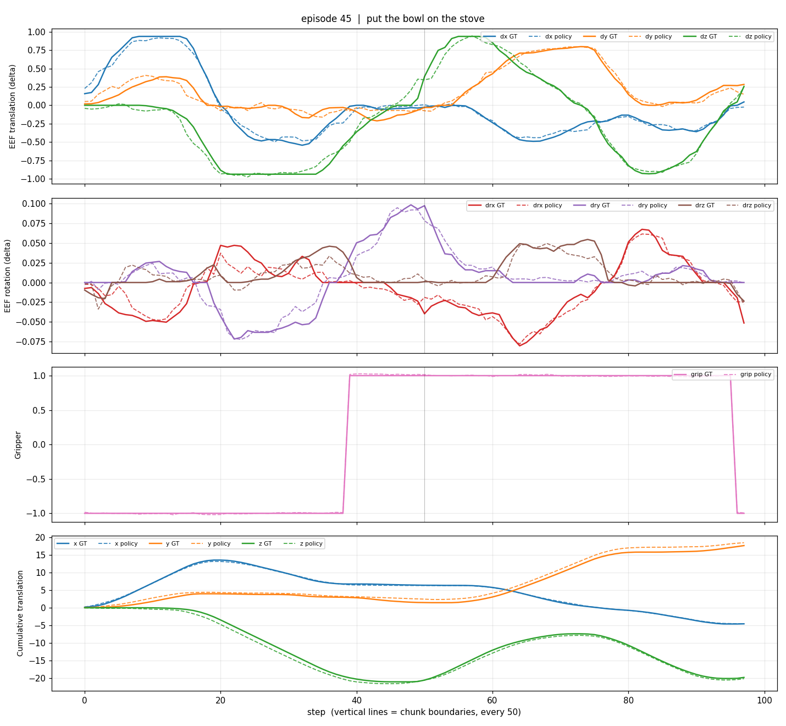
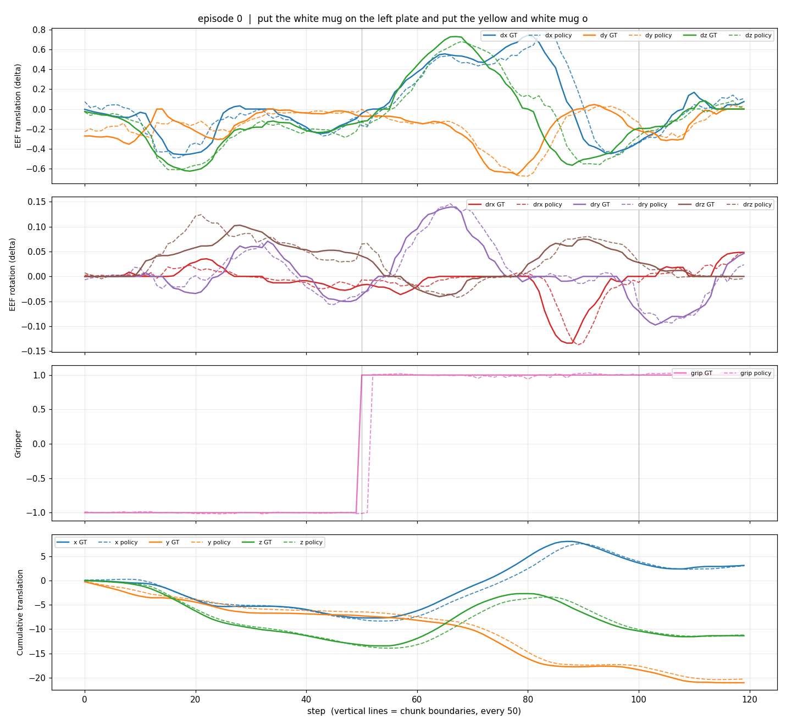
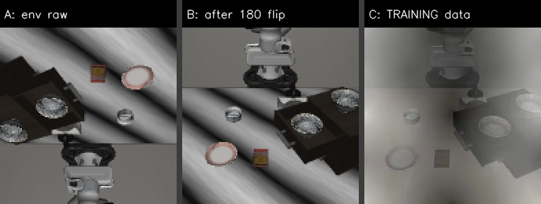

# 05. 実測結果（2026-08-11 時点）

推測と実測を混ぜないために、**測った数字だけ**をここに集める。
判断の根拠は [01_勝ち筋と評価の読み解き.md](01_勝ち筋と評価の読み解き.md) にある。

> **最重要**：**ローカル評価は本番スコアの代理にならない。**
> ローカルで 0.875 まで上げても、本番は 0.096 だった。
> ローカルで評価している 4 タスクは配布された **example** であり、
> **本番は非公開タスクで採点される**（`compe/t1/README.md`）。
> → [ローカルは本番の代理にならない](#ローカルは本番の代理にならない)
>
> **8/11 追記：追加学習で本番スコアが 0.1409 → 0.016 に落ちた。**
> 推論の設定は変えていないので原因は重みである。**素の重みへ戻す道は
> `work/artifacts/model_weights.bak/` にある。**
>
> **8/11 夜：手元の 84 件では成功率に差が出なかった**（0.476 対 0.500、
> 1 件ずつ対にして 9 拾い 7 失い、符号検定 p=0.80）。
> **差が出たのはグリッパの開閉（13% → 27%）とジャーク（+13.5%）だけである。**
> → [学習後を 84 件の検証用データで評価した](#学習後lora20kを-84-件の検証用データで評価した811-0811_142300_lora20k_n5_ep1_max300)
> → [追加学習は本番スコアを 8.8 倍悪化させた](#追加学習は本番スコアを-88-倍悪化させた4-回目-811)

## 本番採点

| | 1 回目 | 2 回目 | 3 回目 | **4 回目** |
|---|---|---|---|---|
| 版 | 0.1.0 | 0.2.0 | 0.3.0 | **0.3.0**（版を上げる前に出した） |
| **スコア** | 0.05832 | 0.096 | **0.1409** | **0.016** |
| `n_action_steps` | 50 | 10 | 5 | 5 |
| `PARC_EMA_ALPHA` | 無効 | 無効 | 0.3 | 0.3 |
| 重み | 素（`7bb70aa5`） | 素 | 素 | **LoRA 20,000 ステップ** |
| コミット | `8fbcf6f`（タグ `scored-0.05832`） | `0185606` | `8e147ab` | `492430a` の重み |
| zip の sha256 | `f80abc7b…` | `8ed91671…` | `c1685507…` | `80e8711e…` |
| **合計時間** | 147.6 秒 | 220.5 秒 | **305.4 秒** | 324.0 秒 |
| 予測した合計時間 | — | — | 312 秒 | — |

**4 回目は推論の設定を 3 回目と揃えた。変えたのは重みだけである。**
したがって **0.1409 → 0.016 は追加学習の効果**であり、**8.8 倍の悪化**である。

> 版が 0.3.0 になっているのは、`__version__` を 1.0.0 に上げる前に
> zip を出したためである。**中身の重みは学習後のもの**（`80e8711e…`）で、
> `420aff5d…` は同じ重みに版の行だけを足したものである。

**合計時間の予測 312 秒に対し実測 305.4 秒**（3 回目）。本番の 2 点から立てた
`環境 129.4 秒 + 推論 911.2 秒 / n` という分解は正しい。

参考値：配布学習例のリーダーボード値 0.0633、トップ **0.6396**。
1 回目のログは [260809_提出環境での評価結果.md](../../outputs/prod_eval_results/260809_提出環境での評価結果.md)。

**`n_action_steps=10` は本番でも効いた（0.058 → 0.096、1.65 倍）。**
ただしローカルの伸び（14 倍）とは桁が違う。

## 素の重みを 84 件の検証用データで評価した（8/11、`0811_101824_base_n5_ep1_max300`）

**手元の目安が使える範囲に入った。** 成功率 **0.476**（40/84、95%CI [0.373, 0.582]）で、
**床でも天井でもない。** 8/10 の 0.713（example 4 件）とも本番の 0.1409 とも違う。

| | 値 |
|---|---|
| 成功 | **40（47.6%）** |
| 衝突 | 23（27.4%） |
| 未完了 | 21（25.0%） |
| **ゴール到達率** | **0.548（46/84）** |
| └ 到達したが衝突で失格 | **6**（到達した回の 13.0%） |
| `mean_avg_cartesian_jerk` | **4.223** ← 学習後との比較の基準 |
| `mean_sparc` | **−2.808** |

### 摂動カテゴリ別 — **予想と 3 つ違った**

| カテゴリ | 成功率 | 内訳 |
|---|---|---|
| **Language Instructions** | **0.08** | 衝突 7 / 未完了 4 / 成功 1 |
| Objects Layout | 0.25 | 未完了 7 / 成功 3 / 衝突 2 |
| Robot Initial States | 0.25 | 衝突 6 / 成功 3 / 未完了 3 |
| Sensor Noise | 0.50 | 成功 6 / 衝突 5 / 未完了 1 |
| **Background Textures** | **0.67** | 成功 8 / 未完了 3 / 衝突 1 |
| **Light Conditions** | **0.75** | 成功 9 / 未完了 2 / 衝突 1 |
| **Camera Viewpoints** | **0.83** | 成功 10 / 衝突 1 / 未完了 1 |

**① 本命の 2 カテゴリは、いちばん強い側だった。** 8/10 に example 4 件で見た
「背景 0.60 対 照明 0.82」の並びは同じだが、**7 カテゴリの中では上位 2 つと 3 つ目**である。
**「背景テクスチャが弱点」という見立ては 84 件では成り立たない。**

**② いちばん弱いのは指示文の言い換え（0.08）。** LIBERO-plus 論文の
「モデルは言語をほぼ無視している」と向きが一致する。**ただし Track 1 の
判定基準（テクスチャなどの摂動）には当てはまらないので、直しても採点に効かない。**

**③ カメラ視点が最強（0.83）。** 論文は「VLA はカメラ視点に極端に弱い（95% → 30%）」と
報告しているが、**この重みは逆に最も強い。** 出発点が LIBERO-plus で学習済みだからと見る。

### 本命カテゴリだけで見ると本番に近づく

| 範囲 | 成功率 | 件数 |
|---|---|---|
| 84 件すべて | 0.476 | 84 |
| **`light` ＋ `table` ＋ `tb` だけ** | **0.708** | **24** |
| 本番（8 エピソード） | **0.50** | 8 |

`light` 0.75（12 本）/ `table` 0.62（8 本）/ `tb` 0.75（4 本）。

**本番の 0.50 は 8 本しかないので誤差が大きく、0.708 と矛盾しない。**
**つまり「84 件の平均」は本番より低く出る。** 比べるなら**本命 24 件のほうを見る。**

### この回に入っていないもの

**`固まった`（終盤 50 ステップで動いていない）の判定は入っていない。**
pull より前に流し始めたためで、動きのラベルは `ラベル無し 83 / 往復 1` である。
**本番の未完了 4 本の正体はこの回からは分からない。** 次の回から出る。

### 衝突は水増しされている

`ketchup_1=544.6mm` が **6 回**、1mm も違わずに出ている。
**環境側で落ちている分**（上の節）で、方策の性能を表していない。
`milk_1` 5 回・`cookies_1` 4 回も同じ疑いがある。

**相手の数で割っても差が出ない**（1〜2 個 0.32 / 3〜4 個 0.26 / 5 個以上 0.27）ので、
**衝突は「相手が多いから当たる」形ではない。**

## 学習後（lora20k）を 84 件の検証用データで評価した（8/11、`0811_142300_lora20k_n5_ep1_max300`）

**成功率では差が出なかった。差が出たのはグリッパだった。**

```bash
python3 solution/tools/summarize_gpu_eval.py \
    --output-dir outputs/0811_142300_lora20k_n5_ep1_max300 \
    --csv        outputs/0811_142300_lora20k_n5_ep1_max300/VAL_TASKS.csv \
    --compare    outputs/0811_101824_base_n5_ep1_max300
```

| 項目 | 素の重み | lora20k | 差 |
|---|---|---|---|
| 成功率 | 0.476 | 0.500 | +0.024 |
| ゴール到達率 | 0.548 | 0.560 | +0.012 |
| 方策の衝突率 | 0.214 | 0.179 | −0.036 |
| 打ち切りに張り付いた率 | 0.452 | 0.452 | ±0 |
| **グリッパ 20 回以上の率** | **0.131** | **0.274** | **+0.143** |
| 往復した率 | 0.012 | 0.024 | +0.012 |
| **平均ジャーク** | **4.223** | **4.795** | **+0.572** |
| SPARC | −2.808 | −2.758 | +0.049 |
| **本命 24 件の成功率** | **0.708** | **0.625** | **−0.083** |

### 1 件ずつ対にすると「差なし」である

**ハーネスは決定的なので、同じ 84 件が 1 件ずつ対になっている。**

| | 件数 |
|---|---|
| こちらだけ成功（学習で拾えた） | **9** |
| あちらだけ成功（学習で失った） | **7** |
| 両方成功 | 33 |
| 両方失敗 | 35 |

**符号検定 p = 0.80。偶然の範囲である。**
**84 件での成功率の 95%CI は ±0.10 あり、0.476 対 0.500 はその中に収まる。**
**平均を見比べるだけでは、ほぼ何も判定できない。**

拾えた 9 件は Objects Layout 4 / Robot Initial States 2 / Sensor Noise 2 /
Light Conditions 1。失った 7 件は Light Conditions 2 / Camera Viewpoints 2 /
Language Instructions 1 / Background Textures 1 / Robot Initial States 1。

**両方成功した 33 件でステップ数を比べても差が無い**（中央 −2 ステップ、符号検定 p=0.60）。
**遅くなったわけではない。**

### グリッパの開閉が、本番の悪化を検知できた唯一の指標である

| 結末 | 素の重みの開閉（中央） | lora20k の開閉（中央） |
|---|---|---|
| 成功 | 2 回 | 2 回 |
| 衝突 | 12 回 | **19 回** |
| **未完了** | **2 回** | **18 回** |

**素の重みの未完了は静かに止まっていた。lora20k の未完了は掴み直しを続けている。**
**開閉が 20 回以上だった 34 件（両方の合計）のうち成功は 2 件（0.06）。**

**LoRA が動かした量も大きい。** マージ済みの重みを素の重みと 1 テンソルずつ
比べると、**変化したのは 37 個**（LoRA の当たり先と一致）で、いちばん大きいものは
`lm_expert.layers.4.self_attn.q_proj.weight` の **最大値の 82% ぶん**だった
（絶対 5.42e-02、その重みの最大値 6.6e-02）。学習率 3e-4 は出発点の 3 倍である。

### 未完了 22 件は 2 つの型に分かれる

**この回から `固まった` の判定が入った**（終盤 50 ステップの移動量で見る）。

| 型 | 件数 | 終盤 50 ステップ | グリッパ開閉（中央） |
|---|---|---|---|
| **固まっている** | **9** | <0.03 m | **0 回** |
| わずかに動く | 7 | 0.03〜0.10 m | **33 回** |
| **動き続けている** | 6 | >0.10 m | **26 回** |

> **集計はこの 8 件を取りこぼしていた。** `eval.log` に `固まった` が 8 件
> あったのに、`_MOTION_RE` が `静止|往復` しか見ていなかった。8/11 に直した。

### 映像で見た 2 つの型（8/11、lora20k の 37 本）

```bash
python3 solution/tools/summarize_rollout_videos.py \
    outputs/0811_142300_lora20k_n5_ep1_max300/videos
```

**型 ①「掴もうともせずに止まる」** — `put_the_bowl_on_top_of_the_cabinet_table_12`

| 歩 | 何が写っているか |
|---|---|
| 1 | 腕は上。テーブルにボウルと皿、右に暗い戸棚 |
| 44 | 手先が下りる |
| **86〜300** | **ほぼ動かない**（経路 0.39 m・変位 0.29 m） |

**グリッパは 300 ステップで 1 度も閉じていない**（`grip x0`）。
**そして手先カメラに写っているのは皿である。掴むべきボウルではない。**
→ **やり方を知らないのではなく、掴む相手を間違えて止まっている。**

**この変種は 6 本すべてが未完了だった**（`add_19` / `language_27` / `table_12` /
`view_…_initstate_0` / `view_…_initstate_11` / `view_62_15_…`）。
**摂動の種類に関係なく落ちている** —— タスクそのものの問題である。

**型 ②「掴み直しを繰り返す」** — `pick_up_the_tomato_sauce_..._tb_6`（グリッパ 55 回）

| 歩 | 何が写っているか |
|---|---|
| 1 | 手先カメラに**横倒しになった缶**が写っている |
| 44〜129 | 手先が缶へ寄る |
| **172 / 215 / 300** | **`grip CLOSE`。缶は横倒しのまま持ち上がらない** |
| 257 | `grip open`（開き直している） |

**掴む相手は合っている。姿勢が想定と違って掴めていない。**
→ **型 ① と型 ② は打つ手が違う。** ① は「そのタスクの手本を多く見せる」、
② は「その姿勢の手本があるか」の話になる。

**今夜の学習（苦手 3 倍）が当たるのは型 ① である。**

### 本番のログのステップ数を数えると、悪化の形が見える

| 回 | 8 エピソードのステップ数 |
|---|---|
| 3 回目（素の重み・0.1409） | 300 300 300 300 **138 132 174 182** |
| 4 回目（lora20k・0.016） | 300 300 300 300 **234 300 139 300** |

**間に合っていた 4 本のうち 2 本が上限に張り付いた。** ゴール到達 4/8 → 2/8。

```bash
awk '/POST \/reset/{if(n>0) printf "%s ", n; n=0} /POST \/act/{n++} \
     END{if(n>0) print n}' "outputs/prod_eval_results/<回>.md"
```

### 「本番のタスクとたまたま噛み合っただけ」の線は 13.4% 残る

**手元では、素の重みが成功した 40 件のうち lora20k が落としたのは 7 件（17.5%）。**
そこから 4 件引いて 2 件以上落とす確率は**超幾何分布で 0.134** である。

| 落とす件数 | 確率 |
|---|---|
| 0 件 | 0.448 |
| 1 件 | 0.418 |
| **2 件以上** | **0.134** ← 本番で起きたこと |

**本番のログにタスクの手がかりは無い**（`/act` と `/reset` の行だけ）ので、
これ以上は詰められない。
**ただしグリッパの荒れとジャークは 84 件での系統的な差で、4 件の引き当てでは
説明できない。** そして本番のスコアは**ゴール到達が半分になった以上に落ちている**
（2 倍でなく 8.8 倍）ので、**残りの 4.4 倍は滑らかさと時間の配点**にあたる。

## 評価にかかる時間 — Colab は速くない（8/11 に実測）

**手順書に「1 エピソード 34 秒・84 件 45 分」と書いていたのは誤りだった。**

| 測ったもの | 値 | 出典 |
|---|---|---|
| **Colab GPU（EGL・n=5）** | **56 エピソードで 6,185 秒 = 110 秒／本** | 8/11 の回（56 件目で切断） |
| GPU マシン（osmesa・n=5） | 84 件で 8,317 秒 = **99 秒／本** | `eval.log` の 01:21:03 → 03:39:40 |

**両者はほぼ同じである。** 描画では Colab（EGL 38.6 ms）が
GPU マシン（osmesa 384 ms）より 10 倍速いのに、差が消えた。

### 理由は `n_action_steps` を 50 から 5 に縮めたこと

**1 エピソードの費用は「描画 × ステップ数 ＋ 推論 × (ステップ数 ÷ n)」である。**
**n を 10 分の 1 にすると推論の回数が 10 倍になる。**

| 構成 | 描画 | 推論 | 合計 |
|---|---|---|---|
| n=50・600 ステップ（**昔の測定**） | 600 × 38.6 ms = 23 秒 | **12 回** × 0.85 秒 = 10 秒 | **33 秒** |
| n=5・300 ステップ（いま） | 300 × 38.6 ms = 12 秒 | **60 回** × 0.85 秒 = 51 秒 | **63 秒** |

**「45 分」は n=50 の値をそのまま引き継いでいた。**
実測 110 秒は上の 63 秒よりさらに 1.8 倍遅く、**GPU の割り当てか EGL の状態も
効いている可能性がある**（切り分けは手順 7 でできる）。

**ここから言えること。** 「評価は Colab、学習は GPU マシン」という分け方は、
**速さを理由には選べない。** Colab を使う意味は
**「GPU マシンが学習で埋まっているあいだも評価できる」**ことだけである。

| 見積もり（n=5・`MAX_STEPS=300`） | 時間 |
|---|---|
| 84 件 | **2.6 時間** |
| 28 件（3 つに割った 1 つ） | **51 分** |
| 24 件（本命 2 カテゴリ） | **44 分** |

## 失敗の原因は摂動ではなくタスクだった（8/11、84 件の切り分け）

**再現方法。** 84 件は 30 種類の元タスク × 7 カテゴリに散っており、
**同じ元タスクの複数の変種が別カテゴリに入っている。**
だから**タスクの難しさを引き算できる。**

```bash
python3 solution/tools/decompose_failures.py outputs/0811_101824_base_n5_ep1_max300
```

### ① 元タスクの平均を引くと、見た目の摂動は「易しい側」になる

**元タスクごとの平均を引いた、カテゴリのずれ。** マイナスがその摂動の効き目である。

| カテゴリ | ずれ | 使えた件数 | 落とした件数 |
|---|---|---|---|
| **Language Instructions** | **−0.42** | 11 | 1 |
| **Robot Initial States** | **−0.24** | 12 | 0 |
| Sensor Noise | −0.01 | 12 | 0 |
| **Background Textures** | **+0.16** | 12 | 0 |
| **Light Conditions** | **+0.21** | 8 | 4 |
| **Camera Viewpoints** | **+0.34** | 12 | 0 |
| Objects Layout | **比べられない** | 0 | **12** |

**見た目の摂動（照明・背景）は、タスクの平均より易しい。**
**画像拡張で取れる点は無い、というのがこの表の読みである。**

> **変種が 1 本だけの元タスクは使えない。** そのタスクの平均がその 1 本自身に
> なるので、引くと必ず 0 になる。**混ぜると「差が無い」と読めてしまう。**
> **物体が増える摂動（Objects Layout）は 12 件すべてがこれに当たる** ——
> `_add_N` / `_levelN_sampleM` は初期状態のファイルが別なので、
> **同じタスクの中で比べる相手がいない。** スイートの作り方の限界である。

### ② 支配しているのはタスクである

**同じ摂動を当てても、タスクによって 0.00 から 1.00 まで動く。**

| 元タスク | 成功率 | 件数 | 手本の長さ |
|---|---|---|---|
| **`put the bowl on top of the cabinet`** | **0.00** | 5 | **99 ステップ** |
| **`put both the alphabet soup and the cream cheese box in the basket`** | **0.00** | 5 | 267 ステップ |
| `pick up the black bowl next to the ramekin and place it on the plate` | 0.25 | 4 | 129 ステップ |
| `pick up the book and place it in the back compartment of the caddy` | 0.50 | 6 | 182 ステップ |
| `turn on the stove and put the moka pot on it` | **0.83** | 6 | 265 ステップ |
| `turn on the stove` | 0.83 | 6 | 89 ステップ |

スイート別では **`libero_10` 0.38 / `libero_spatial` 0.48 / `libero_goal` 0.52 /
`libero_object` 0.52**。

### ③ 「長い手本だから打ち切りになる」は成り立たなかった

**手本の長さの帯ごとに見ても、成功率は動かない。**

| 帯 | 成功率 | 未完了率 | 件数 |
|---|---|---|---|
| A 手本 <150 ステップ | 0.50 | 0.18 | 44 |
| B 手本 150〜230 | **0.62** | 0.25 | 16 |
| C 手本 230〜300 | 0.45 | **0.09** | 11 |
| **D 手本 >300** | **0.00** | **1.00** | **1** |

**成功した回は手本の 0.95 倍のステップ数で終わっている**（4 分の 3 が 1.15 倍、最大 1.74 倍）。
**方策は手本と同じ速さで動けている。** 遅いから届かないのではない。

**`put the bowl on top of the cabinet` は手本 99 ステップなのに 5 件中 4 件が未完了である。**
**時間の問題ではなく、やり方を知らない。**

### ④ ただし 1 タスクは原理的に解けない

**`put both moka pots on the stove` の手本は中央 396 ステップ・9 割 458 ステップ・最大 505 ステップ。**
**上限 300 ステップでは、手本どおりに動いても終わらない。**
母集団に 146 本ぶんの変種があるので、**出題されたら確実に落とす。**

### ⑤ 指示文の綴りのずれは、効いていない

**評価側の指示文は、84 件のうち 65 件が学習データの 40 種類と一致しない**
（`Pick the akita black bowl …` 対 `pick up the black bowl …`）。
**それでも成功率は変わらなかった。**

| | 成功率 | 件数 |
|---|---|---|
| 学習データの 40 種類に一致 | 0.47 | 19 |
| 一致しない | **0.48** | 65 |

**軽い綴りのずれは影響しない。** 一方で `Language Instructions`（意味ごと
書き換えたもの。`lift the red condiment made from crushed garden fruits …`）は
**0.08 まで落ちる。** **効くのは言い換えの深さであって、綴りの不一致ではない。**
→ **項目 8（指示文の正規化）は、これで根拠が消えた。**

## ケチャップは空から落ちてくる — 衝突の一部は環境由来（8/11）

**`LIVING_ROOM_SCENE1` の衝突は、方策のせいではない。**
映像を見ると、**ケチャップの瓶がテーブルの上空から落ちてくる。**

| 歩 | 何が写っているか |
|---|---|
| 1 | テーブルの上にケチャップは**無い** |
| **3〜7** | **画面の上端からケチャップが降ってくる** |
| 9 以降 | テーブルの上に立っている |

**落ちてくる歩は 3 本とも同じだった。** front カメラの上部の赤みを歩ごとに
測ると、**3 本すべてで 4 ステップ目に最大**になる。方策がまだ何もしていない時点で、
**決まった歩に、決まった動きで起きている。**

### なぜ衝突と数えられるのか

配布キットは**エピソードの手前で 10 ステップだけ空の行動を送って場面を落ち着かせ**、
そのあとの位置を「初期位置」として控える（[../../pipeline/rollout.py](../../pipeline/rollout.py)）。

```python
for _ in range(10):
    obs, _, _, _ = env.step(dummy_action)
object_init_pos = {...}          # ← ここで控える
```

**10 ステップでは落ち切っていない。** 控えた「初期位置」が空中なので、
そのあと落ちた分がそのまま変位になる。8/10 に 6 回とも
`ketchup_1=544.6mm` と 1 mm も違わなかったのは、**毎回同じ高さから
同じだけ落ちている**からである。

### ここから言えること 3 つ

**① こちらの衝突率は水増しされている。** `LIVING_ROOM_SCENE1` と
`SCENE2` の衝突は、方策の善し悪しを表していない。
**この分を除いて読まなければ、衝突対策の効き目を測り間違える。**

**② 本番でも同じことが起きうる。** 落ち着かせる 10 ステップは**採点側のコードであり、
こちらから変えられない。** 本番の出題にこの種のタスクが混ざっていれば、
**誰の方策でも同じように失格する。**

**③ 集計で切り分けるべきである。** 序盤（たとえば 20 ステップまで）に
対象外の物体が動き始めた回は、**環境由来として方策の衝突率から外す。**
判定に要る `first_collision_step` は既にログへ出している
（[open_items.md](../talk/open_items.md) の 24）。

## 打ち切りの中身が動画で分かった（8/11）

**素の重みで 5 件だけ回し、失敗した 1 本の映像を見た。**
`KITCHEN_SCENE3_turn_on_the_stove_and_put_the_moka_pot_on_it` の
指示文を言い換えた変種（`_language_10`）である。

**動きが止まっていた。**

| 歩 | 画面の変化量（front 上帯・隣り合うコマの差） |
|---|---|
| 0–50 | **4.03** |
| 50–100 | 0.70 |
| 100–150 | 0.25 |
| 150–200 | 0.15 |
| 200–250 | 0.22 |
| 250–300 | 0.22 |

**最初の 50 ステップでコンロへ降りてグリッパを閉じ、残り 200 ステップは動いていない。**
このタスクは「コンロを点けて、**そのうえでモカポットを載せる**」の 2 段構えで、
**前半だけ済ませて固まった**形である。握りの開閉が 1 回だけ（`握り x1`）で、
モカポットには一度も触っていない。

### 「静止」でも「往復」でもなかった — 判定を足した

**この回は `ラベル無し` になっていた。** 出発点からの変位が 0.31 m あり、
「どこへも行けていない」の条件（0.03 m 未満）に当てはまらないためである。

**全体の変位では「動いてから固まった」を捉えられない。**
終盤 50 ステップの経路長を測り、0.02 m 未満なら `固まった`（`froze`）と出すようにした。

| ケース | 経路 / 変位 / 終盤 50 ステップ | ラベル |
|---|---|---|
| **動いてから固まった** | 0.29m / 0.29m / **0.000m** | **`固まった`** |
| 最後まで動いた | 1.50m / 1.50m / 0.250m | なし |
| 震えだけ | 0.00m / 0.00m / 0.001m | `静止` |
| 往復 | 1.58m / 0.02m / 0.248m | `往復` |

**本番で 300 ステップを使い切る 4 本も、これである可能性が高い。**
だとすれば打つ手は「動き出させる」ではなく**「固まったら計画を引き直す」**
（[open_items.md](../talk/open_items.md) の 9）であり、
**検知の条件は「直近が動いていないか」でなければならない。**
全体の変位を見る作りにすると、この 4 本を 1 本も拾えない。

## 追加学習は本番スコアを 8.8 倍悪化させた（4 回目、8/11）

**LoRA 20,000 ステップを載せた結果、0.1409 から 0.016 へ落ちた。**
推論の設定は 1 文字も変えていないので、**原因は重みしかない。**

| | 3 回目（素の重み） | **4 回目（学習後）** |
|---|---|---|
| スコア | 0.1409 | **0.016** |
| ゴール到達 | 4 / 8 | **2 / 8** |
| 各エピソードのステップ数 | 300, 300, 300, 300, 138, 132, 174, 182 | 300, 300, 300, 300, **234**, 300, **139**, 300 |
| 合計時間 | 305.4 秒 | 324.0 秒 |
| 総ステップ | 1,826 | **2,173** |

**ゴール到達が 4 本から 2 本に減った。** さらに、スコアの分解が
これまでの形に当てはまらない。

| 回 | ゴール到達 | スコア | 係数 |
|---|---|---|---|
| 2 回目 | 3 / 8 | 0.096 | 0.256 |
| 3 回目 | 4 / 8 | 0.1409 | 0.282 |
| **4 回目** | **2 / 8** | **0.016** | **0.064** |

**係数が 0.28 から 0.064 へ落ちている。** 成功本数だけでは説明できない。
`(2/8) × 0.28` なら 0.070 になるはずで、実測はその 4 分の 1 である。
**到達した 2 本のうち少なくとも 1 本は衝突で失格しており**、
残った 1 本の軌道の質も悪い（滑らかさ・軌道長・ステップ数の配点で削られている）。

### 学習の設定が、出発点の重みと食い違っている

**素の重みと学習後の `config.json` を比べると、学習の当て方が違う。**

| 設定 | 素の重み | **こちらの学習** |
|---|---|---|
| ステップ数 | 20,000 | **20,000（同じ）** |
| バッチサイズ | 32 | **8（4 分の 1）** |
| `optimizer_lr` | 1e-4 | **3e-4（3 倍）** |
| `scheduler_warmup_steps` | 1,000 | **100（10 分の 1）** |
| `freeze_vision_encoder` | `false` | **`true`** |
| `train_expert_only` | `false` | **`true`** |
| 学習対象 | 全パラメータ | **action expert だけ** |

**ステップ数が同じであることが効いている。** 素の重みを作った 20,000 ステップと
**同じ回数だけ重みを動かしたうえ、1 ステップの学習率が 3 倍**である。
バッチが 4 分の 1 なので 1 ステップが見るデータは少なく、
**「少ないデータを、強い力で、同じ回数だけ」**当てたことになる。

### 1 コマを見た回数が 18 倍違う — そして出発点は学習不足だった（8/11）

**設定の食い違いを 1 つの数字にまとめると、こうなる。**

| | データ | 歩 × バッチ | 総サンプル | フレーム数 | **1 コマを見た回数** |
|---|---|---|---|---|---|
| 出発点の重み | 14,347 本（全部） | 20,000 × 32 | 640,000 | 2,238,036 | **0.29 回** |
| **こちらの学習** | **200 本（1.4%）** | 20,000 × 8 | 160,000 | 約 31,200 | **5.1 回** |

フレーム数の出典は
[../reference/01_base_model.md](../reference/01_base_model.md)（`meta/info.json` の
`total_frames`）。200 本ぶんは 1 本あたりの平均 156 コマから見積もった。

**同じコマを 18 倍も繰り返して見せている。** これが 8.8 倍の悪化の正体と見ている。

**そしてもう 1 つ、逆向きの発見がある。出発点は学習不足である。**
20,000 ステップ × バッチ 32 は **自分の学習データの 29% を 1 回見た**だけにあたる。
**まだ伸びしろが残っている**ので、
**同じ濃さ（1 コマ 0.3 回程度）で全データを当て直せば、悪化ではなく上積みになりうる。**

> **これは「データを増やす」の意味を変える。** 種類を増やす話ではなく、
> **繰り返しを 18 分の 1 に戻す**話である。増やすこと自体が対策になる。

**出発点は画像を読む側まで含めて全パラメータを学習済みである**
（[../reference/01_base_model.md](../reference/01_base_model.md)）。
そこへ **action expert だけを、3 倍の学習率で、10 分の 1 の warmup で**
**同じ 20,000 ステップ**当てた。**視覚と行動の対応が崩れたと見るのが自然である。**

`verify_merge.py` が「正常」と答えたのは筋が通っている。
**あれは「学習が反映されたか」を見る道具であって、「良くなったか」は見ない。**
実際、変化した 37 テンソルはすべて `lm_expert`（action expert）側にあり、
**視覚側は 1 つも動いていない。** 設定どおりに学習されている。

### ここから言えること

**推論の設定値で積み上げた 0.1409 が、学習で失われた。**
素の重みへ戻す道は残っている（`work/artifacts/model_weights.bak/`）。

| やること | なぜ |
|---|---|
| **`.bak` から素の重みへ戻す** | **0.1409 の構成を復元できる。** 最終提出の土台はこれ |
| **データを増やす** | **1 コマ 5.1 回は多すぎる。** 出発点と同じ 0.3 回まで薄める |
| 学習の設定を出発点に合わせ直す | `freeze_vision_encoder=false`・`train_expert_only=false`・学習率 1e-4 |

**当て直すときの狙いは「出発点の続きを学ぶ」ことである。**
ステップ数だけを減らすのでは足りない —— **データを増やして 1 コマあたりの回数を薄める**方が
効き目が大きい（項目 18 の表）。

> **「学習は必須」という要件（Q&A No.36）は満たしている。**
> 4 回目のスコアが下がっても、**独自学習を行った提出物を出した事実は残る。**
> ただし最終提出でこの重みを使う理由は無い。

### 4 回目に載せた重み（8/11）

**LoRA を 20,000 ステップまわしてマージしたものである。**
出発点は 3 回目までと同じ `lerobot/smolvla_libero_plus@7bb70aa5`。

> **8/11 追記：この 20,000 ステップは 2 台のマシンにまたがっている。**
> チェックポイントの作成時刻と持ち主から分かった。
>
> | 区間 | どこで | VLM の型 |
> |---|---|---|
> | 0 〜 9,000 ステップ | **Colab T4** | **fp16** |
> | 9,500 〜 20,000 ステップ | GPU マシン（H100-20C） | **bf16** |
>
> **型が途中で変わっている。** T4 は bf16 に対応しないため
> [train.py](../../solution/train/train.py) の `_patch_dtype_for_gpu` が
> `bfloat16` を `float16` へ書き換える。H100 では書き換えない。
> **つまり最初の 9,000 ステップは fp16 の出力に合わせて学習し、
> 残り 11,000 ステップは bf16 の出力に合わせ直したことになる。**
>
> **8.8 倍の悪化の主因とは見ていない**（データ量と学習率で説明が付く）。
> **ただし交絡がもう 1 つ増えた。** やり直すときは
> **1 台で通す**のが正しい。20,000 ステップで 55 分なので、分ける理由が無い。
>
> **推論側は影響を受けていない。** 同梱した
> `work/artifacts/vendor/.../smolvlm_with_expert.py` は `bfloat16` のままで、
> 採点環境（L4）も bf16 に対応する。**書き換わった版を同梱してはいない。**

実行したコマンドは 1 行である。**残りはすべて `train.py` の既定値**で、
配布ノートブックから持ってきたものである。

```bash
python /workspace/train.py --steps 20000 --batch-size 8
```

| 項目 | 値 |
|---|---|
| 学習 | LoRA `r=16` / `alpha=16`、**20,000 ステップ・バッチ 8** |
| 学習データ | 40 タスク × 5 本 = **200 エピソード**（既定の `--episodes-per-task 5`） |
| 画像拡張 | **有効**（`--no-image-transforms` を付けていない） |
| 変化したテンソル | **37 個**（うち LoRA の対象 32 個） |
| 変化の大きさ（相対） | 最大 **8.16e-01**（`lm_expert.layers.4.self_attn.q_proj`） |
| 変化の出た層 | `vlm_with_expert.lm_expert` の attention（`q_proj` / `v_proj`） |

**素の重みと 1 テンソルずつ比べて確かめた**
（[verify_merge.py](../../solution/tools/weights/verify_merge.py)、`model_weights.bak` を基準に）。
マージの検査は「LoRA が残っていないこと」しか見ないので、
**畳み込みに失敗して LoRA が消えただけの場合も通ってしまう。**
初期重みをそのまま出しても合格するため、この比較を別に用意した。

> **この検査は「学習が反映されたか」しか見ない。「良くなったか」は見ない。**
> 実際、この重みは検査を通ったうえで**本番スコアを 8.8 倍悪化させた**（下）。
> **`verify_merge.py` が通ったことを、性能の保証と読んではいけない。**

zip も中身を確かめてある。

| 検査 | 結果 |
|---|---|
| `model.safetensors` のハッシュが `work/artifacts` と一致 | **一致**（転送・格納は無事） |
| テンソル数 / `lora_` を含むもの | 500 個 / **0 個** |
| `use_peft` / `pretrained_path` / `load_vlm_weights` | `False` / `None` / `False` |
| `vlm/` の 11 ファイル | 引き継がれている |
| `.py` 488 件の構文（3.10 バックポート） | すべて通る |
| `validate_submission.py --static` | **PASS**（errors=0, warnings=0） |

## 本番採点の中身が分かった（ログの並びから）

採点ログの `/reset` と `/act` の並び順から、**1 エピソードずつのステップ数**を
数えられる（[../prod_eval_results/](../../outputs/prod_eval_results/)）。

| | n=10・EMA なし | n=5・EMA 0.3 |
|---|---|---|
| スコア | 0.096 | **0.141** |
| 合計時間 | 220.5 秒 | 305.4 秒 |
| **エピソード数** | **8** | **8** |
| 各エピソードのステップ数 | 300, 300, 300, 300, 128, 164, 300, 186 | 300, 300, 300, 300, 138, 132, 174, 182 |
| **打ち切りに張り付いた本数** | 5 / 8 | 4 / 8 |
| **途中で `done` になった本数** | **3** | **4** |

### 分かったこと 3 つ

**① 本番の打ち切りは 300 ステップである。** 配布キットの既定は 600 ステップ。
**ローカルで 600 ステップを与えて測ると、倍の時間を与えたことになり、成功率を
実際より高く見積もる。** `MAX_STEPS = 300` で測り直すこと。

ローカル（n=10・EMA 0.3）のタスク別の所要ステップ数を見ると、影響は小さくない。

| タスク | 成功までの平均ステップ数 | 300 ステップで間に合うか |
|---|---|---|
| bowl → stove | 89.7 | 余裕 |
| black bowl → plate | 132.7 | 余裕 |
| milk → basket | 171.4 | 余裕 |
| **tomato sauce → basket** | **248.3** | **半分近くが落ちる** |

**② 本番は 8 エピソードしか回さない。** スコアは極端に粗い。
1 本の成否がスコアを 0.03〜0.05 動かす。**リーダーボードの差は
統計的にほとんど意味を持たない。**

**③ スコアは「成功本数 × 指標の係数」で説明でき、係数は約 0.38 である。**

```
0.096 = (2/8) × 0.384       0.141 = (3/8) × 0.376
```

`done` は 3 → 4 本だったので、**どちらの回も 1 本は衝突で失格している。**

> **「途中で終わった＝成功」ではない。** [../../pipeline/rollout.py](../../pipeline/rollout.py)
> のループを抜ける条件は `if done: break` **だけ**で、衝突では止まらない。
> 衝突判定はループが終わったあとに最大変位から計算され、`success = done and not collided`
> となる。つまり**ゴールに着いてから失格する経路がある。**
> ローカルでも実際に起きている（下の「300 ステップで測り直した」を参照）。

**係数 0.38 は伸びしろが大きいことを意味する。** 滑らかさ・軌道長・
ステップ数の配点で 38% しか取れていない。成功本数が同じでも、
ここを改善すればスコアは倍近くになりうる。`time` 指標はステップ数
ベースなので（運営 Q&A No.23）、**速く終えることが直接得点になる。**

## ローカルは本番の代理にならない

**これは誤った判断を実測で覆した記録である。**
かつてここには「ローカル評価は本番スコアを再現する。1 日 1 回の提出に頼らず
Colab で判断してよい」と書いてあった。**間違いだった。**

| | ローカル（4 タスク × 20 本） | 本番 |
|---|---|---|
| n=50 | 成功率 0.0625 | 0.058 |
| **n=10** | **成功率 0.875** | **0.096** |

1 回目に両者が近かったのは**偶然である**。どちらもほぼ全滅の水準なので、
何を測っても 0.05〜0.07 に落ちる。**一致に情報量が無かった。**

### 原因：本番は非公開タスクで採点される

配布リポジトリにそのまま書いてある（[../../compe/t1/README.md](../../compe/t1/README.md)）。

> CSV に列挙されたタスクを LIBERO-plus のスイート `libero_t1` として登録する。
> **本番評価は非公開タスクを含む別のタスクセットで実施される。**

`T1_TASKS.csv` の 4 件は **example** であり、採点対象そのものではない。
運営 Q&A でも「具体的な出題内訳は非公開です」と回答されている。

裏づけがもう 1 つある。`compe/t1/register.py` の接尾辞除去は
`_light_*` と `_table_N` しか扱わないが、運営 Q&A には
**「本番の採点環境の実装は `_tb_` 形式の接尾辞も正しく除去する」**とある。
**本番側は配布キットより広い接尾辞を扱う** ＝ より広い摂動から出題している。

### 時間の増え方が「本番はまだ解けていない」ことを示す

`n_action_steps` を 50 → 10 にすると、1 ステップの費用は約 2.2 倍になる。
一方、成功したエピソードは 600 ステップの打ち切りを待たずに約 150 ステップで終わる。
**解けていれば総時間は減り、解けていなければ増える。**

| | 変更前 | 変更後 | 向き |
|---|---|---|---|
| ローカル（80 本） | 2,460 秒 | 約 1,650 秒 | **減った**（解けている） |
| **本番** | 147.6 秒 | **220.5 秒** | **増えた**（解けていない） |

**本番のエピソードは依然としてほとんどが打ち切りまで走っている。**
スコア 0.096 という値とも整合する。

## 評価ハーネスは完全に決定的である

実験計画の前提になるので先に書く（[../../pipeline/environment.py](../../pipeline/environment.py)、
[../../pipeline/rollout.py](../../pipeline/rollout.py)）。

```python
indices = np.arange(n_episodes) % n_available   # environment.py:121
```

初期状態は乱択ではなく**先頭から順に 0, 1, 2, …** で選ばれる。さらに
`action_noise` も `observation_noise` も既定が 0 で、物体位置・ロボット初期位置の
摂動はログを出すだけで実際には適用されていない。

| 事実 | 実験計画への影響 |
|---|---|
| 初期状態が決定的 | **`--seed` を振っても結果は変わらない。** seed は方策側の `np.random` にしか効かず、SmolVLA の乱数は torch 側 |
| エピソード数＝初期状態の範囲 | 10 本なら 0〜9、20 本なら 0〜19。**本数を変えると母集団が変わる** |
| 揺らぎが無い | **ローカルで評価した構成はそのまま本番に出る。** 比べた結果をそのまま信じてよい |

## ローカル評価（Colab GPU、80 エピソード、n_action_steps=50）

素の重み、後処理すべて無効、4 タスク × 20 エピソード。

| 項目 | 値 |
|---|---|
| **成功率** | **0.062**（5/80）　95%CI [0.027, 0.138] |
| **衝突率** | **0.338**（27/80） |
| `mean_avg_cartesian_jerk` | 4.0028 |
| `mean_rms_cartesian_jerk` | 6.9062 |
| `mean_sparc` | −4.0139 |
| `mean_cartesian_path_length` | 3.1988 |

### タスク別

| タスク | suite | 摂動 | 難度 | 成功 | 衝突 |
|---|---|---|---|---|---|
| black bowl in top drawer → plate | spatial | Background Textures | L3 | 0.05 | 0.30 |
| **tomato sauce → basket** | object | Background Textures | L5 | **0.15** | **0.50** |
| **milk → basket** | object | Light Conditions | L2 | **0.00** | 0.30 |
| bowl → stove | goal | Light Conditions | L4 | 0.05 | 0.25 |

- **tomato sauce は成功率が最も高いのに衝突率も最も高い。** バスケットの縁など、
  対象外の物体に触れている可能性がある
- **milk は 0/20。** ここだけ質的に違う可能性があり、要調査

### ゲートの内訳

| | 本数 | 割合 |
|---|---|---|
| 衝突して失格 | 27 | 33.8% |
| 衝突せず | 53 | |
| └ うち成功 | 5 | **衝突しなかった中での完了率 9.4%** |
| └ うち未完了 | 48 | |

**衝突を完全に無くせたとしても、成功率は 6.2% → 9.4%（1.5 倍）にとどまる。**
衝突対策だけでは足りず、タスク完了率そのものを上げる必要がある。

## 方策の各時点の正しさ（teacher forcing）

学習データの観測をそのまま入力し、記録済みの行動と比べた
（[../../solution/tools/viz/visualize_actions.py](../../solution/tools/viz/visualize_actions.py)）。
シミュレータを回さないため、**誤差の蓄積を含まない「その時点での判断の正しさ」**が測れる。

### `put the bowl on the stove`（T1 タスク 4 と同じ指示文）



| 次元 | 誤差/標準偏差 | 相関 |
|---|---|---|
| dx | 0.10 | **0.993** |
| dy | 0.18 | 0.975 |
| dz | 0.09 | **0.992** |
| drx | 0.24 | 0.946 |
| dry | 0.18 | 0.971 |
| drz | 0.37 | 0.872 |
| **grip** | **0.01** | **1.000** |

### `put the white mug on the left plate …`（libero_10）



| 次元 | 誤差/標準偏差 | 相関 |
|---|---|---|
| dx / dy / dz | 0.24 / 0.31 / 0.22 | 0.943 / 0.914 / 0.952 |
| drx / dry / drz | 0.33 / 0.24 / 0.34 | 0.866 / 0.950 / 0.906 |
| grip | 0.05 | 0.966 |

### ここから言えること

1. **方策は正しい行動を知っている。** 相関 0.87〜1.00。特にグリッパの開閉は
   タイミングまで一致する（T1 タスクでは完全一致）
2. **chunk 境界（50 ステップごと）で軌道が跳んでいない。** teacher forcing の
   範囲では、`PARC_BLEND_STEPS` で直すべき段差は見当たらない
3. **累積並進は前半で一致し、後半でじわじわ乖離する。** 1 ステップの誤差は
   小さくても積み上がる

**したがって成功率 6.2% の原因は「各時点の判断の誤り」ではない。**
残る候補は次の 2 つに絞られる。

| 候補 | 根拠 | 対処 | 結果 |
|---|---|---|---|
| **閉ループでの誤差の蓄積** | 累積並進の乖離。50 ステップ開ループでは補正されない | `n_action_steps` の短縮 | **これだった**（次節） |
| **摂動への頑健性** | 学習データは無地のテーブル、評価は強い縞模様（下図） | 画像拡張つきの学習 | 未検証。優先度は低下 |

## n_action_steps を縮めると成功率が 14 倍になる

上の表の「閉ループでの誤差の蓄積」を試したところ、**当たりだった。**

`n_action_steps` は 1 回の推論で作った 50 ステップ分の chunk のうち、
実際に実行する本数である。10 にすると 10 ステップごとに観測を見て
作り直すため、**誤差の蓄積が 5 倍の頻度で打ち切られる。**

**この値は学習をやり直さずに変えられる**（推論側だけで効く）。根拠と、隣の
`chunk_size` を触ってはいけない理由は
[../reference/07_chunk_params.md](../reference/07_chunk_params.md) にある。

どちらも 80 エピソード（20 本/タスク、初期状態 0〜19）である。

| | n=50 | **n=10** |
|---|---|---|
| **成功率** | 0.0625（5/80） | **0.875（70/80）**　95%CI [0.785, 0.931] |
| **衝突率** | 0.3375 | **0.087** |
| `mean_cartesian_path_length` | 3.1988 | **1.2252** |
| `mean_sparc` | −4.0139 | **−2.8086** |
| `mean_rms_cartesian_jerk` | 6.9062 | **6.7576** |
| `mean_avg_cartesian_jerk` | 4.0028 | 4.5161 ← **悪化** |

先に 40 エピソードの検証用データで評価したときは（初期状態 0〜9）成功率 0.90 / 衝突率 0.075
だった。**未見だった初期状態 10〜19 を足してもほぼ変わらない。**

生データ（`eval_result` の JSON とサーバーログ）は手元の `outputs/` に置く。
**リポジトリには入れていない**（ログが 1 回あたり数万行になるため `.gitignore` 済み）。

### タスク別

| タスク | n=50 の成功 | n=10 の成功 | n=10 の衝突 |
|---|---|---|---|
| black bowl → plate | 0.05 | 0.80 | 0.15 |
| tomato sauce → basket | 0.15 | 0.90 | 0.05 |
| **milk → basket** | **0.00** | **0.95** | 0.00 |
| bowl → stove | 0.05 | 0.85 | 0.15 |

**0/20 だった milk が 19/20 になった。** 「ここだけ質的に違うのでは」という
疑いは外れで、単に誤差の蓄積が最も効くタスクだった。

**衝突は引き出し（black bowl）とコンロ（bowl → stove）に偏っている。**
どちらも狭い場所に手を入れるタスクである。

### 環境変数が本当に効いていたことの確認

サーバーのログに `n_action_steps` は出ない。**所要時間から逆算して検算した。**

1 ステップの時間は `env.step 38.6 ms + 推論 850 ms / n` で説明できる。

| | `/act` 回数 | 実測 ms/step | 予測 ms/step |
|---|---|---|---|
| n=50 | 44,581 | 55.2 | 55.6 |
| n=10 | 6,753 | 122.5 | 123.6 |

**推論が 5 倍の頻度で走っていた動かぬ証拠**である。

### 失敗の中身が変わった

`pipeline/rollout.py` は `success = bool(done) and not collided` としており、
**衝突ゲートは成功率の中に既に入っている。** 成功と衝突は排他である。

| n=10 の失敗 10 本 | |
|---|---|
| うち衝突で失格 | **7 本** |
| 純粋な未完了 | 3 本 |

**衝突を全て消せた場合の上限は 0.9625 である。**

**タスク完了はほぼ解けていて、残る敵は衝突になった。** 打ち手が
「完了率を上げる」から「ぶつけない」へ移る。`avg_cartesian_jerk` が
唯一悪化しているのも同じ方向を指しており、再計画が 5 倍に増えた分だけ
継ぎ目の段差も増えている。`PARC_EMA_ALPHA` と `PARC_BLEND_STEPS` は
**ここで初めて意味を持つ**（n=50 では継ぎ目が見えず、一度は見送っていた）。

### 時間制限

| | 実測 |
|---|---|
| 40 エピソード（n=10, T4） | 827 秒 |
| 80 エピソード相当に外挿 | 約 1,650 秒 |
| 上限 | **3,600 秒** |

本番は n=50 で 147.6 秒しか使っていない。**成功すると 600 ステップの
時間切れを待たずに終わる**ため、実際にはさらに短くなる。

## `PARC_EMA_ALPHA=0.3` は滑らかさに効く

`n_action_steps=10` の上で、直前の行動を 3 割混ぜた。80 エピソード。

| | EMA なし | **EMA 0.3** | |
|---|---|---|---|
| 成功率 | 0.875 | **0.888** | 誤差の範囲 |
| 衝突率 | 0.087 | **0.075** | わずかに改善 |
| `mean_avg_cartesian_jerk` | 4.5161 | **3.5335** | **−22%** |
| `mean_rms_cartesian_jerk` | 6.7576 | **5.6447** | **−16%** |
| `mean_sparc` | −2.8086 | −2.8522 | ほぼ同じ |
| `mean_cartesian_path_length` | 1.2252 | 1.2650 | ほぼ同じ |

**成功率を落とさずに jerk だけ下げた。** 懸念していた「惰性で行き過ぎて
衝突が増える」は起きていない。**採用してよい。**

ただしこれも 4 つの example での測定であり、**本番での効き方は別に確かめる
必要がある。** 滑らかさの指標は方策の巧拙より運動の性質に依存するため、
成功率よりは移りやすいと考えられる。

### タスク別（EMA 0.3）

| タスク | 成功 | 衝突 |
|---|---|---|
| black bowl → plate | 0.75 | 0.20 |
| tomato sauce → basket | 0.95 | 0.00 |
| milk → basket | 1.00 | 0.00 |
| bowl → stove | 0.85 | 0.10 |

**衝突は引き出し（black bowl）に集中している。** 狭い場所へ手を入れる動作は
平滑化では直らない。

## 検証用スイートは最後まで走る（手元の Docker で確認、8/10）

**84 件の CSV から先頭 5 件を回して完走した。** 手元の CPU コンテナ、
方策は配布テンプレートのランダム行動、5 タスク × 1 エピソード × 20 ステップで 92.2 秒。

| 見たところ | 結果 |
|---|---|
| パスの事前検査 | 5 件すべて開ける（落ちる行 0） |
| `n_tasks` | **5 / 5** |
| `n_total_episodes` | 5 |
| 走った 5 件の内訳 | `_table_1` `_view_..._initstate_0` `_language_10_view_...` `_light_1` `_add_14` |

**`_view_` を含む変種が 2 件通っている。** 8/10 に 3 タスクで止まった原因
（衝突判定が変種名の bddl を直接開く）が解消したことの確認である。

**成功率 0 は正常である。** ランダム行動なので当然で、確かめたのは
「84 件を最後まで回せるか」だけである。方策の質とは無関係な確認なので、
重み 869MB の読み込みと CPU 推論（1 手 20 秒超）を省いた。

> **`[結果]` 行は 0 件だった。** あの行は配布キットが出すものではなく
> パッチが足すもので、Docker 側では当てていなかった。パッチを
> [patch_kit_for_variants.py](../../solution/tools/patch_kit_for_variants.py) に
> 集約し、Colab と Docker で同じ箇所が当たるようにした。
> **完走の判定は `n_tasks` で行う**（キット本体が書くので、パッチの有無に
> 左右されない）。

## 84 件を回すと 26 件で止まっていた（Colab、8/10）

**`--per-cell 3` の 84 件を流したが、26 件しか走らなかった。**
原因は 2 つあり、どちらも直してある。

| 原因 | 何が起きたか |
|---|---|
| 1 タスクの例外がトラック全体を落とす | `evaluate_tasks` に握りが無く、例外が `pipeline.py` まで抜けて `_errored_track_score` になる。**残り 58 件が 1 度も試されない** |
| 物体が増える摂動の初期状態が別階層にある | `_add_` / `_level` の変種は自分の初期状態を持つ。元タスクのものを当てると `(23,)` を `(49,)` に入れられず落ちる |

**どちらも終了コード 0 で終わる。** 画面上は正常に見えるので、
**`[結果]` 行を数えないと気づけない。**

## ロールアウトの録画の費用（手元で実測、8/11）

**評価に相乗りさせて構わない水準である。** 実装は
[rollout_recorder.py](../../solution/tools/rollout_recorder.py)。

| 測ったもの | 値 | 比較 |
|---|---|---|
| 1 ステップの上乗せ | **0.33 ms** | 本番の `env.step` 39.1 ms に対して **0.8%** |
| メモリの山 | 31 MB | 300 ステップ・2 カメラ・等倍で貯める |
| 書き出し | 約 2 秒 / エピソード | 結末が決まってから 1 度だけ |
| 84 件を全部撮った場合 | **+2.9 分** | 90 分の測定に対して 3% |

**等倍で貯めて書き出し時に拡大している。** 3 倍に拡大してから持つと
300 ステップで 265 MB になり、9 倍重くなる。

> **キットの opencv 4.11 は `putText` で日本語を `?` にする**（実測。
> 「衝突」→「??????」）。映像に焼く文字は ASCII に限り、日本語は
> ファイル名とログに残した。**新しい cv2 で書いていたら気づかないまま
> 出ていた**（手元の 5.0.0 では化けない）。

映像の向きは `LiberoProcessorStep` の `torch.flip(img, dims=[2,3])` と
**画素単位で一致することを確認済み**である（モデルが見るものと同じ向き）。

### 動きの判定は 5 通りで確かめた（8/11）

**「止まっている」と「往復している」を撮り分けられるかを確かめた。**
停滞の検知（[open_items.md](../talk/open_items.md) の 9）はこのラベルを見て
設計するので、ここを誤ると打つ手を間違える。

| ケース | 経路長 | 変位 | 焼かれたラベル |
|---|---|---|---|
| 震えだけ | 0.00 m | 0.00 m | `stalled` |
| 小さく往復 | 0.32 m | 0.02 m | `wandering` |
| 大きく往復 | 2.37 m | 0.03 m | `wandering` |
| まっすぐ進む | 0.29 m | 0.29 m | （なし） |
| 進んで少し戻る | 0.30 m | 0.24 m | （なし） |

**判定の条件を 2 つに直した。動かして初めて分かった誤りである。**

| 直す前 | 何が起きたか |
|---|---|
| 「変位 < 0.03 m かつ 経路長 > 0.5 m」を往復とする | **0.32 m 行き来した回を「静止」と呼んだ。** 下限が高すぎた |
| 変位が 0.03 m を超えたら何もラベルを付けない | **2.37 m 行き来して変位 0.03 m の回が漏れた** |

いまは下限を **0.10 m** に下げ、さらに**経路長が変位の 8 倍を超える**条件を足した。
1 エピソードの経路長は 300 ステップで平均 1.12 m なので、0.10 m は「1 割ほど動いた」に
当たり、震え（0.00 m）とは明確に分かれる。

**比だけでも絶対値だけでも取り違える。** 比だけだと変位がほぼ 0 のとき常に真になり、
1 mm の震えまで往復に見える。絶対値だけだと上の 1 行目が起きる。

## 300 ステップで測り直した（n=5・EMA 0.3、80 エピソード）

本番と同じ打ち切り（300 ステップ）で評価した初めての回である
（[../../outputs/260810_1455/](../../outputs/260810_1455/)、`policy_server 0.3.0`、`device=cuda`）。

| | 600 ステップ・n=10・EMA 0.3 | **300 ステップ・n=5・EMA 0.3** |
|---|---|---|
| 成功率 | 0.888 | **0.713** [0.605, 0.800] |
| 衝突率 | 0.075 | **0.125** |
| `mean_avg_cartesian_jerk` | 3.5335 | 3.7214 |

**2 つ同時に変えているので、差をステップ数だけのせいにはできない。** ただし内訳は割れる。

| 結末 | 本数 | 中身 |
|---|---|---|
| 成功 | 57 | ステップ数は最小 83・中央 147・最大 286。**250 ステップ超はわずか 2 本** |
| 未完了（`done` にならず打ち切り） | 13 | 600 ステップなら成功していた可能性が高い層 |
| **衝突** | **10** | **うち 5 本はゴール到達後の失格**、残り 5 本は打ち切りかつ衝突 |

**「途中で終わった＝成功」が成り立たないことの実測である。** 早く終わった 62 本のうち
5 本（8%）が衝突で落ちている。本番でゴール到達が 4 本なら、同じ割合では
0.3 本ぶんの期待値なので**たいてい全部成功しているが、保証はない。**

**成功した回のステップ数がほとんど 300 に届いていない**（250 超が 2 本）ことも重要である。
打ち切りを 300 にしても、**成功する回は元から速い。**
落ちた 13 本は「あと少しで届いた」ではなく、**300〜600 ステップを要する遅い層**である。

### 摂動カテゴリ別 — 背景テクスチャが弱い

| カテゴリ | 成功率 | 本数 | 内訳 |
|---|---|---|---|
| **Background Textures** | **0.60** | 40 | 成功 24・未完了 10・衝突 6 |
| Light Conditions | 0.82 | 40 | 成功 33・未完了 3・衝突 4 |

**22 ポイントの差がある。** 照明の変化には耐えているが、**背景の模様が変わると
届かなくなる**（未完了が 3 → 10 に増える）。出発点の重みが
「学習データのテーブルは無地、評価側は強い縞模様」というずれを抱えていること
（下の「観測変換の正しさ」）と向きが一致する。

### ぶつけた物体

| 物体 | 本数 |
|---|---|
| **cream_cheese_1** | **4** |
| akita_black_bowl_2 | 2 |
| milk_1 | 2 |
| cookies_1 | 1 |
| orange_juice_1 | 1 |

**特定の脇役に集中している。** 経路の途中に置かれた物へ手が当たっている。

## 観測変換の正しさ



左＝評価環境の生画像、中＝180 度回転後（モデルに渡すもの）、右＝**学習データの実フレーム**。
**中と右の向きが一致している。** 反転は正しい方向である。

同時に、**学習データのテーブルは無地なのに評価側は強い縞模様**であることも見える。
これが Background Textures 摂動の実体である。

## 環境の実測

| 項目 | CPU コンテナ（osmesa） | Colab GPU（EGL） | 本番（L4・EGL） |
|---|---|---|---|
| `env.step` | 300 ms | **38.6 ms** | 39.1 ms（参加者計測） |
| 重い推論（chunk 1 回） | 23 秒 | 0.85 秒（T4） | — |
| 1 エピソード（600 ステップ） | 約 12 分 | 約 34 秒 | — |

> **Colab では EGL がソフトウェア実装に落ちる。** `/usr/share/glvnd/egl_vendor.d/` に
> NVIDIA の登録が無いと、例外も警告も出さずに 431.8 ms/step になる。
> 対処は `10_nvidia.json` を自分で書くこと。`colab_eval.prepare()` が実装している
> （[../solution/colab_eval.md](../solution/colab_eval.md) の「1 本目が 200 秒を超えたら
> EGL を疑う」）。

## 評価が渡してくる指示文は、学習データと書き方が違う（8/13 に数えた）

**配布された 4 タスクの CSV が証拠である。** `compe/t1/T1_TASKS.csv` の
`instruction` 列がそのまま `/reset` に渡る（`compe/t1/register.py` の
`language=r["instruction"]`）。

| 渡ってくる文 | 学習データの `task` 列 |
|---|---|
| `Pick the akita black bowl in the top layer of the wooden cabinet and place it on the plate` | `pick up the black bowl in the top drawer of the wooden cabinet and place it on the plate` |
| `Pick the tomato sauce and place it in the basket` | `pick up the tomato sauce and place it in the basket` |

**数えた**（`solution/tools/instruction_targets.py`。LIBERO-plus の変種 10,030 件と、
その BDDL の `(:language ...)`）。

| | 値 |
|---|---|
| 変種 | **10,030 件**（7 カテゴリ） |
| 渡ってくる文 | **1,597 種** |
| **本番の 2 カテゴリで渡る文** | **40 種だけ**（変種 7,280 件がこれを使い回す） |
| **うち学習データと違う書き方** | **25 種** |
| 言い換え（`Language Instructions`）の文 | **1,527 種**（変種 1,537 件） |
| 寄せ先（学習データの指示文） | **40 種** |

**寄せ先 40 種は 2 つの独立な資料が完全一致した** ——
`task_classification.json` の変種名から素のタスク名を取ったもの（`make_holdout_split.py`
が配布ノートブックと突き合わせて自己検査している）と、学習データのエピソードの
メタデータの `task` 列。

### 正規化の精度（版 3.5.0。`check_instruction_normalization.py`）

**答え合わせができる。** 変種名から素のタスク名が取れるので、
**1,597 種すべてについて「本来どの文であるべきか」が分かる。**

| 束 | 渡る文 | 寄せた（正しい） | **誤り** | 触らない |
|---|---|---|---|---|
| **本番の 2 カテゴリ** | **40 種** | **40 種すべて**（exact 15・語の重なり 25） | **0** | 0 |
| その他の摂動 | 30 種 | 30 種すべて | **0** | 0 |
| 言い換え | 1,527 種 | 468 種 | 4 | 1,055 |

**しきい値の振れ幅**（語の重なりの下限 × 1 番と 2 番の点差の下限）。

| 下限 / 差 | 本番の 2 カテゴリ 正/誤 | 言い換え 正/誤 |
|---|---|---|
| 0.00 / 0.00 | 40 / 0 | 992 / **535** |
| 0.40 / 0.05 | 40 / 0 | **709** / 15 |
| **0.50 / 0.05（採用）** | **40 / 0** | 468 / **4** |
| 0.70 / 0.05 | 40 / 0 | 38 / 1 |
| 0.80 / 0.05 | **33 / 0** | 13 / 0 |

**本番の 2 カテゴリは 0.00〜0.70 のどこでも 40/40・誤り 0 で動かない。**
選び方が効くのは言い換えだけである。

> **手元の 36 件（`compe/val/EVAL_TASKS.csv`）では正規化の効き目を測れない。**
> あの CSV の `instruction` 列は**学習データの `task` 列そのまま**なので、
> 手元では「学習と同じ文」が来る（正規化は小文字化しかしない）。
> **84 件を作る `make_validation_suite.py` は BDDL の `(:language ...)` を書く**ので、
> A/B で測るならそちら側の CSV が要る。

## 本番 8 回分を並べ直した（8/13・3.4.0 まで）

**採点ログの `POST /reset` と `/act` を数え直した表である。** ステップ数は
そのエピソードが何ステップで終わったか（300 が打ち切り）。

| 版 | 重み | 設定値 | スコア | 早く終わった | ステップ数 | 合計時間 |
|---|---|---|---|---|---|---|
| 0.2.0 | 素 | n=10 | 0.096 | 3 | 300,300,300,300,128,164,300,186 | 220.5 秒 |
| 0.3.0 | 素 | n=5・EMA 0.3 | **0.141** | 4 | 300,300,300,300,138,132,174,182 | 305.4 秒 |
| 1.0.0 | lora20k | n=5 | **0.016** | 2 | 300,300,300,300,234,300,139,300 | 324.0 秒 |
| 2.0.0 | λ=0.25 | n=5 | 0.095 | 3 | 300,300,300,300,143,177,300,168 | 306.8 秒 |
| 3.0.0 | weak3x | n=5 | 0.144 | 4 | 300,300,300,300,131,132,139,190 | 277.3 秒 |
| 3.1.0 | weak3x | **n=2** | 0.166 | 4 | 300,300,**202**,300,201,137,300,182 | 564.0 秒 |
| 3.3.0 | weak3x | n=1 | **0.080** | 3 | 300,300,300,300,138,181,173,300 | 1054.7 秒 |
| **3.4.0** | weak3x | **n=2・samples=3** | **0.168** | 3 | 300,300,**223**,300,131,140,300,300 | 1523.0 秒 |

### 1 エピソード = 0.047。だから 0.141〜0.168 は全部同じである

スコアは 3 回分で `（成功本数 / 8）× 0.376〜0.384` に合った。
**つまり 1 本が 0.047 にあたる。**

| 差 | 大きさ | 何本ぶんか |
|---|---|---|
| 0.144（n=5）→ 0.166（n=2） | 0.022 | **0.5 本** |
| 0.166（n=2）→ 0.168（samples=3） | 0.002 | **0.04 本** |
| 0.141（素）→ 0.168（いちばん良い） | 0.027 | **0.6 本** |
| 0.168 → 0.080（n=1） | 0.088 | **1.9 本** |
| 0.168 → 0.016（lora20k） | 0.152 | **3.2 本** |

**1 本より小さい差は測れていない。** 上の 4 つのうち下 2 つだけが本物である。

> **【訂正】「n=2 が谷底」は言えない。** n=5 と n=2 の差は 0.5 本ぶんで、
> **同じと扱うべきである。** 明確に悪いのは n=1（1.9 本ぶん）だけ。
> **同様に「学習が素を超えた」も言えない**（0.6 本ぶん）。
> weak3x を使う理由は**スコアではなく資格**（運営 Q&A No.36）である。

### 「早く終わった本数」はスコアの順位を説明しない

| 早く終わった本数 | そのときのスコア |
|---|---|
| 4 本 | 0.141・0.144・0.166 |
| **3 本** | **0.168**・0.096・0.095・0.080 |
| 2 本 | 0.016 |

**3 本の 0.168 が 4 本の 0.144 より上に出ている。**
早く終わっても衝突で失格した回が混ざるためで、**ステップ数からは成功本数が読めない。**
**読めるのはスコアそのものだけ**である（配点は `total_score_config.json` に
あるが配布されていない）。**以後、ステップ数の本数で採否を決めない。**

### 3 本は 8 回すべてで 300 ステップに張り付いた

| エピソード | 300 ステップだった回数 |
|---|---|
| **ep1 / ep2 / ep4** | **8 / 8**（重み 4 種・n 4 通りすべてで終われない） |
| ep3 | 6 / 8（**n=2 の 2 回だけ 202 ステップ・223 ステップで終わった**） |
| ep7 | 4 / 8 |
| ep8 | 3 / 8 |
| ep5 / ep6 | 0 / 8・1 / 8（いつも終わる） |

**残っている上振れはこの 3 本だけである。** 全部解けても 5/8 = 0.24 付近で、
トップの 0.6396 には届かない。

### 止まっているのであって、遅いのではない

**早く終わった 26 本のステップ数を並べると 128〜234 ステップに収まり、235〜299 ステップが 1 本も無い。**

```
128,131,131,132,132,137,138,138,139,139,140,143,164,168,173,174,177,
181,182,182,186,190,201,202,223,234
```

**打ち切りに当たる回は「あと少しで終わる」のではなく、途中で止まっている。**
だから**動きを速くする方向（行動の大きさを一律に上げる等）に見込みは無い。**
打つ手は「止まる原因（掴む物を見誤る・掴めない）を直す」側である。

## 36 件で素と lora20k を並べた（8/13）——**滑らかさの門が逆を向いた**

**この 2 つは本番で 3.2 本ぶん違う**（0.1409 対 0.016）。**36 件がその差を
再現できるか**を見るための検定である。設定値は両方 `n=5` `EMA 0.3` `samples=1`。

出典は `work/gpu_eval/0813_085045_base_n5_n5_ep1_max300_ema03_s1/summary.txt` と
`outputs/local_eval/0813_102224_lora20k_n5_ep1_max300_ema03_s1/summary.txt`。

| 指標 | 素 | lora20k | 向き | 参考：84 件 |
|---|---|---|---|---|
| 成功率 | **0.583**（21/36） | 0.528（19/36） | **合っている（2 件差）** | 0.476 / 0.500（逆だった） |
| ゴール到達 | 0.667（24/36） | **0.694**（25/36） | 逆 | — |
| **衝突率** | **0.194**（7/36） | **0.306**（11/36） | **合っている（4 件差）** | 0.274 / 0.238（逆だった） |
| **空回り率** | 0.083（3/36） | **0.056**（2/36） | **逆** | 0.13 / **0.274**（合っていた） |
| **平均ジャーク** | 4.304 | **4.254** | **逆** | 4.223 / **4.795**（合っていた） |

**読み取れることが 3 つある。**

1. **順序は合った**（成功率で素 > lora20k）。84 件は**逆**だったので、
   **36 件のほうが本番に近い。**
2. **しかし差が小さすぎる。** 本番で 3.2 本ぶん違う 2 つが **2 件差**にしかならない
   （95%CI は [0.422, 0.729] と [0.370, 0.680] でほぼ重なる）。
   **近い候補を並べ替える力は無い。「大きく壊れていないこと」を見る道具である。**
3. **84 件で 2/2 当てていた「空回り・ジャーク」の門は 36 件では逆を向く。**
   84 件は 7 カテゴリ全部、36 件は本番と同じ 2 カテゴリだけで、**母集団が違う。**
   **36 件で見るのは 成功率・ゴール到達・衝突率・1 件ずつの対比較に限る。**

> **`plan/04` の「36 件で判定するなら空回り 0.083 以下・ジャーク 4.304 以下」は
> このままでは使えない。** その基準は lora20k（本番 0.016）を**通してしまう。**
