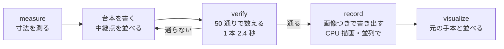
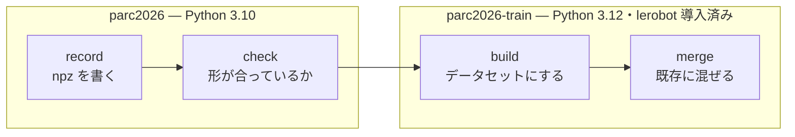

# 06. 手本を自分で作る — 台本で 300 歩に収める

**手本より速く動く方策は育たない。** 方策は手本を真似るので、手本が 400 歩
かけている動きを 300 歩で終えるようにはならない。**打ち切りが 300 歩である
以上、手本が全部 300 歩を超えるタスクは、どれだけ学習しても解けない。**

このページは、そのタスクの手本を**シミュレータの中で自分で作った**記録である。
読み終えると、次の 3 つが分かる。

- どのタスクが「原理的に解けない」のか、その根拠
- 台本で作った軌道が何歩で、どこまで通ったのか
- 次に何を確かめると、これが本番のスコアに効くかどうかが決まるのか

## 原理的に解けないタスクは 1 つだけある

学習データ `lerobot/libero_plus` の全 14,347 本を、指示文ごとに数え直した。

| 指示文 | 本数 | 最短 | 中央値 | 最長 | **300 歩以下** |
|---|---|---|---|---|---|
| **put both moka pots on the stove** | 146 | **341** | 396 | 505 | **0 本** |
| put both the alphabet soup and the tomato sauce in the basket | 240 | 245 | 282 | 367 | 170 本 |
| put the yellow and white mug in the microwave and close it | 160 | 224 | 287 | 449 | 115 本 |
| put both the alphabet soup and the cream cheese box in the basket | 370 | 219 | 267 | 323 | 335 本 |
| turn on the stove and put the moka pot on it | 390 | 218 | 265 | 323 | 340 本 |
| put both the cream cheese box and the butter in the basket | 480 | 234 | 254 | 322 | 440 本 |

**40 タスクのうち、300 歩以下の手本が 1 本も無いのは `put both moka pots on
the stove` だけである。** 残りは「多くが超えている」だけで、収まる手本がある。

> **出典。** `outputs/tmp/libero_plus_episodes.parquet`（`lerobot/libero_plus` の
> `meta/episodes` そのもの）の `length` 列と `tasks` 列。数え直す手順は
> [scripted_demo.py](../../solution/tools/scripted_demo.py) の冒頭にある。

## 自分で作った手本を学習に使ってよい

運営 Q&A No.33（motofukao さん）への回答が、そのまま許可している。

> 禁止対象の「評価観測を保存しての後続学習」は、運営の採点(本番評価)で得られた
> 観測・結果を利用することを指します。ご自身の環境での実行はこれに含まれません。
> したがって、(1) 配布 kit(PARC2026_pre)をご自身の環境で実行し、ご自身で選んだ
> LIBERO-plus タスクのロールアウト(観測画像・状態・行動)を保存して学習データに
> 使うことは可能です。(2) 配布 kit を経由せず LIBERO 環境を直接動かして収集した
> データも同様に可能です。

## 結果 — 230 歩で解けた

中継点を順に追うだけの台本で、**初期配置 50 通りのうち 45〜47 本が成功**した。

| | 人の手本（146 本） | **台本** |
|---|---|---|
| 歩数の中央値 | 396 | **230** |
| 最短 | 341 | **216** |
| 最長 | 505 | **242** |
| 300 歩に収まる割合 | **0 / 146** | **全部**（上限まで 58 歩の余裕） |
| 初期配置 50 通りの成功 | — | 45〜47 |
| 衝突（対象外の物体が 1mm 超動く） | — | 0 件 |

**取りこぼした数本は書き出されないだけである。** `record` は成功した回しか
保存しないので、学習データを作るぶんにはこの歩留まりで足りる。落ちた回を
再実行すると成功するので、原因は台本ではなく実行ごとの揺れである
（下の「初期配置は 50 通りだが」の節）。

**見た目の摂動を掛けた変種でも歩数は変わらない。** 照明（`_light_2`）・
背景 2 種（`_table_28`・`_tb_9`）で、いずれも 50/50・中央値 210 歩だった
（**滑らかにする前の版で測った値**。物理は変わらないので、いまの版でも同じ
歩数になる）。**1 本の軌道をそのまま全変種で使える。**

並べた動画と 1 枚絵は `outputs/scripted_demo/` にある。人の手本には掴み直しと
往復が入っており、台本にはそれが無い。**削れた 111 歩の中身はそこである。**

## 作り方 — 推測せずシミュレータに聞く

**画像を見ながら数値を微調整する必要はない。** シミュレータは物体の正確な
位置と大きさを持っているので、先に測れば中継点は計算で決まる。



道具は 2 つある。

| 道具 | 何をするか |
|---|---|
| [scripted_demo.py](../../solution/tools/scripted_demo.py) | `measure` 寸法を測る / `verify` 通るか数える / `record` 学習データに書き出す |
| [visualize_demo.py](../../solution/tools/visualize_demo.py) | 元の手本と作った軌道を左右に並べた mp4 と 1 枚絵を作る |

### 先に測る 3 つ

**この 3 つを測らずに台本を書くと必ず失敗する。** 実際に踏んだ。

| 測るもの | moka pots での値 | 測らないとどうなるか |
|---|---|---|
| 指の開き | **4.8 cm** | 鍋の本体は 5cm 角なので**掴めない**。掴めるのは蓋のつまみ（原点から 7.2cm 上）だけ |
| 什器の当たる上端 | コンロ **0.9652** | 運搬中の鍋の底が 0.922 で 8mm 潜り、ぶつけて落とす |
| 1 歩で進む距離 | **1.25 cm** | 歩数の見積もりが立たない。行動の上限は 5cm だが OSC の追従が遅く届かない |

### 中継点の追い方

毎歩、目標との差から行動を作る。

```python
delta  = waypoint - eef_position
action = clip(delta / full_speed_within, -1, +1)
```

`full_speed_within` を 1 歩ぶん（1.2cm）に取ると、**目標の近くに来るまで行動が
振り切れたまま**になり、全速で動いて手前で自然に減速する。差にそのまま比例
させると、遠いうちから減速してしまい**同じ移動に 171 歩かかった**（振り切れる
形なら 19 歩）。

### つまずいた所

| 症状 | 原因 |
|---|---|
| 掴んだのに運搬中に落ちる | 掴む高さが物体の肩。指が当たって 4.5cm 手前で止まっていた |
| 置く前に物体が飛ぶ | 運ぶ高さが低く、什器の天面にぶつけていた |
| `set_state_from_flattened` が落ちる | **`reset()` のたびに `sim` は作り直される。** 取り置いた参照は使えない |
| 変種で置き場所が外れる | 什器は初期配置ごとに数 mm ずれる。**置き先は絶対座標でなくゴール判定の site からの相対で持つ** |

## 軌道のガタつきを取る

最初の版は動画で見るとガタガタ揺れていた。**滑らかさは採点の指標
（`avg_cartesian_jerk` と SPARC）に直接入っている**ので、そのまま学習
データにはしない。原因は 2 つあり、どちらも指令の作り方の問題だった。

| 原因 | 何が起きていたか | 直し方 |
|---|---|---|
| **軸ごとに ±1 で切っていた** | 遠いうちは 3 軸とも振り切れて「立方体の角の向き」に進む。近づくと軸ごとに順番に飽和が解け、**そのたび進行方向が折れる** | **いちばん大きい軸がちょうど振り切れる大きさに揃える。** 向きは目標を指したまま、速度は全部使える |
| **中継点ごとに止まっていた** | 継ぎ目が毎回ゼロ速度の角になる | 通過点は `blend_radius`（5cm）手前で見切って**止まらずに通る** |

結果は次のとおり。

| | 直す前 | 直した後 |
|---|---|---|
| 平均ジャーク | 18.32 | **11.30（−38%）** |
| 1 歩あたりの向きの変化（中央値） | 6.7° | **2.1°** |
| 手先の移動距離 | 2.10 m | **1.88 m** |
| 歩数（中央値） | 209 | 230 |
| 初期配置 50 通りの成功 | 50/50 | 47/50 |

**取りこぼした 3 本は書き出されないだけである。** `record` は成功した回しか
保存しないので、学習データを作るぶんには 94% で足りる。

### 滑らかにする過程で分かった 3 つ

**指令をなます（EMA）のは割に合わなかった。** 強さ 0.6 で 234 歩・0.35 で
264 歩まで伸びるのに、ジャークはほとんど下がらない。**上の 2 つを直した
時点でガタつきの原因は無くなっており、なましは遅れを足すだけだった。**

**掴む・置くの詰めは滑らかにしてはいけない。** なましを掛けると、指令が
小さくなる終盤で這って `budget` を使い切る（3.8cm 進むのに 25 歩）。
角を丸めると、置く位置へ斜めに降りて**先に置いた鍋を横から弾き飛ばす。**
**弧は「置く少し前」で終え、最後は真下へまっすぐ降ろす。**

**角を丸めると終点に速度が残る。** そのまま離すと物体を引きずり、置き場所が
狙いから 2.4cm ずれた。**最後の 1 点だけ 4.5cm かけて減速し、離す前に 6 歩
止まる。** これで戻った。

> **`carry_z` を上げるのは逆効果だった。** 角を丸めるぶん高く取ろうとして
> 1.14 → 1.19 にしたら 29/50 まで落ちた。原因は高さ不足ではなく、
> 上の「終点に残る速度」だった。**症状から原因を推測せず、失敗した回の
> 物体の位置を見ること。**

### 初期配置は 50 通りだが、成否には数 % の揺れがある

**コンロは `reset()` のたびに置き直され、`.pruned_init` では固定されない。**
什器は自由関節を持たないので、初期状態の書き戻しが効かない。実際
ゴール判定の枠の中心は実行ごとに数 mm 動く（-0.0599 → -0.0543 → -0.0538）。

**そのため置き先は絶対座標で持てない。** 実行時にゴール判定の site を読んで、
そこからの相対で決めている。同じ理由で、**同じ初期配置でも成否が変わることが
ある**（失敗した 4 本のうち 3 本は再実行で成功した）。1 回の 50 通りの結果を
0.1 の差で読まないこと。

## 学習データの形式にする

書き出した npz は、そのままでは学習に載らない。変換先は
`lerobot/libero_plus` と同じ **LeRobot v3.0**（`meta/info.json` で確認）。

| 宣言 | 値 |
|---|---|
| `codebase_version` | v3.0 |
| `fps` | 20 |
| `observation.images.front` / `.wrist` | 動画 256×256×3（AV1） |
| `observation.state` | float32 8 次元 |
| `action` | float32 7 次元 |

**道具は 2 つの環境にまたがる。** シミュレータ側（Python 3.10）と
学習側（Python 3.12）で動く場所が違うためである。



**lerobot はシミュレータ側では動かない。** PEP 695 の型構文を使っており、
Python 3.10 では構文エラーになる（`def f[T: X](...)`）。だから npz を
間に挟んでいる。**形の食い違いは `check` が持って行く前に見つける**ので、
学習側へ移してから落ちることはない。

**どちらも Ubuntu の GPU マシンにある。** `solution/train/Dockerfile` が
`python:3.12-slim` に lerobot v0.6.0 を入れており、**Colab は要らない。**
手順（コマンド・EGL の設定・詰まる場所）は
[../howto/05_scripted_demos.md](../howto/05_scripted_demos.md) にある。

**`check` は手元で通っている**（形・データ型・コマ数が本物の宣言と一致。
食い違ったら 0 以外で終わる）。**`build` と `merge` はまだ実行していない。**
呼び出しは lerobot のソース（`work/lerobot-src`）の署名と突き合わせてあるが、
動かして確かめるのは GPU マシンの `parc2026-train` の中になる。

> **8/12 に見つけた不具合。作った npz は作り直しが要る。**
> `observation.state` の 3〜5 番目（姿勢を軸角にした値）を自前で書いており、
> **折り返しの扱いが学習データと違っていた。** LeRobot と LIBERO-plus 側は
> `2·acos(w)`（折り返さない）で、こちらは ±π に折り返していた。
> Panda の下向き把持は `w ≈ 0` に居るので符号が絶えず反転し、
> **そのたびに state が 2π ぶん飛ぶ。**
>
> `robosuite.utils.transform_utils.quat2axisangle` に差し替えた
> （`lerobot/libero_plus` を作った `LIBERO-plus/scripts/create_dataset.py` が
> 使っているのと同じ関数。実装が `2·acos(w)`・折り返し無しであることを
> コンテナ内で読んで確認した）。**制御には使っていない値なので、歩数・
> ジャーク・成功率の結果は有効である。** 書き出した npz だけ作り直す。
>
> **どれだけ壊れていたかを同じ軌道で数えた**（227 歩）。
>
> | | 1 歩あたりの軸角の変化（最大） | 3 rad を超えて飛んだ歩数 |
> |---|---|---|
> | 直す前 | **6.470**（≒ 2π） | **18** |
> | 直した後 | 0.025 | **0** |
>
> w の符号が反転した歩数（18）と飛んだ歩数が一致する。**全コマの約 8%** である。

## まだ分かっていないこと

**この軌道が本番のスコアに効くかは、まだ分からない。**

採点環境は 8 エピソードで、**中身は非公開**である（[reference/12_production_scale.md](../reference/12_production_scale.md)）。
採点ログから読めるのは歩数の並びだけで、5 回の提出すべてで
**1〜4 本目が 300 歩に張り付いている。**

| 提出 | 8 本の歩数 | ゴール到達 | 総合スコア |
|---|---|---|---|
| 8/10 n=10 | 300, 300, 300, 300, 128, 164, 300, 186 | 3 | 0.096 |
| 8/10 EMA 0.3 | 300, 300, 300, 300, 138, 132, 174, 182 | 4 | 0.141 |
| 8/11 追加学習 | 300, 300, 300, 300, 234, 300, 139, 300 | 2 | 0.016 |
| 8/12 λ=0.25 | 300, 300, 300, 300, 143, 177, 300, 168 | 3 | 0.095 |
| 8/12 weak3x | 300, 300, 300, 300, 131, 132, 139, 190 | 4 | 0.144 |

**総合スコアはゴールに届いた本数でほぼ決まっている**（2 本→0.016、3 本→0.095、
4 本→0.141）。**残りの伸びしろは 1〜4 本目に全部ある。**

その 4 本が「長すぎるタスク」なら、この取り組みが直接効く。一方、公開されて
いる T1 の 4 タスクは手本が全部短い（中央値 99〜150 歩、最長 196 歩）ので、
**採点 8 本がその 4 タスク × 2 なら、300 歩に張り付く原因は長さではない。**

**これは手元で確かめられる。** 同じ重みで公開 4 タスク × 2 エピソードを回し、
歩数の並びが採点ログと揃うかを見る（[compare_with_production.py](../../solution/tools/compare_with_production.py)）。
揃えば採点 8 本の正体が決まる。**軌道づくりより先に済ませる価値がある。**

## 次にやること

| 順 | やること | 出た結果で何が決まるか |
|---|---|---|
| **1** | 公開 4 タスク × 2 エピソードを回し、歩数の並びを採点ログと突き合わせる | **採点 8 本の正体。** 揃えば「長さの問題ではない」と分かり、狙いを変えられる |
| 2 | GPU マシンで `build` を通す（[howto/05](../howto/05_scripted_demos.md) の 5 節） | 変換が本当に動くか。**呼び出しは書けているが未実行** |
| 3 | 見た目の摂動を掛けた変種で撮り直し、本数を増やす | 1 本の軌道から数十本。**照明・背景は物理を変えないので撮り直すだけ** |
| 4 | 作った手本だけで学習し、同じタスクで推論する | **台本を真似られるか**が分かる。提出はできない（他 39 タスクを忘れる） |
| 5 | 既存データに混ぜて学習する | **提出候補になる。** 混ぜる比率をここで決める |
| 6 | 他の長いタスクに広げる | 収まる手本が増える。台本の枠は共通で、中継点だけ差し替える |

**4 と 5 は別物である。** 1 タスクぶんの手本だけで学習すると、残り 39
タスクの性能は落ちる。実際 8/11 の追加学習は本番 0.1409 → 0.016 に崩れた。
**4 は「台本が学習可能か」を見るための実験であって、提出物ではない。**

## 作った軌道の癖

**台本の行動は人の手本より振り切れている。** 位置の指令のうち 30.6% が
上限に張り付いており、絶対値の平均は 0.387 である。速く動かすためにそう
しているので当然だが、**元の手本とは分布が違う。** これが学習に効くかは
まだ測っていない。混ぜる比率（順序 5）を決めるときに一緒に見る。
