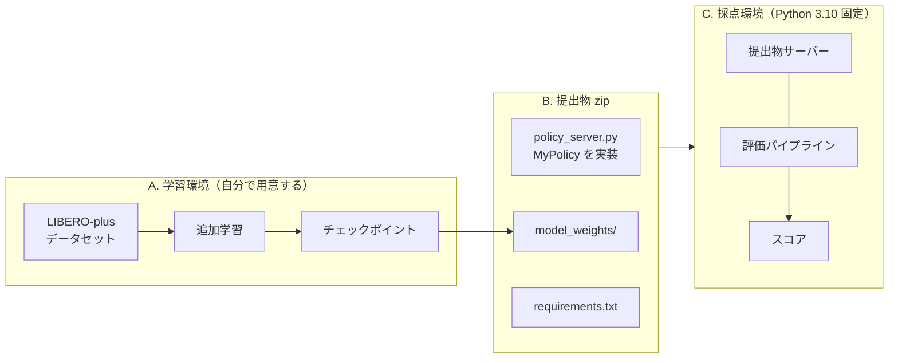
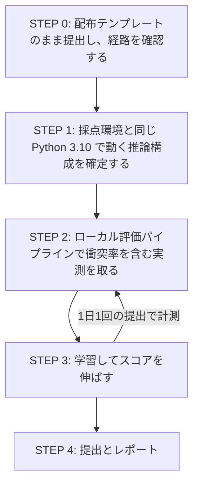

# PARC2026 予選（Track 1）作業手順

配布リポジトリ（[../../README.md](../../README.md)）と参加者ガイド
（[../PARC2026開発コンペティション_予選.pdf](../PARC2026開発コンペティション_予選.pdf)）は
「環境の仕様」と「ルール」を説明している。このディレクトリはその一段先、
**実際にどの順で手を動かすか**をまとめた作業手順である。

## このコンペの構造

やることは一見単純である。VLA モデルを追加学習し、推論する HTTP サーバーを zip で出す。
しかし配布物をそのまま繋ぐと通らない箇所が 3 つある。ここが作業時間の大半を食う。

| # | 詰まる場所 | 何が起きるか | 対処を書いた文書 |
|---|---|---|---|
| ① | A と C で Python のバージョンが違う | 学習はできたのに提出物サーバーが起動しない | [02_環境戦略.md](02_環境戦略.md) |
| ② | B の `MyPolicy` は自分で書く必要がある | 学習した重みを置いただけでは反映されない | [04_提出物の実装と検証.md](04_提出物の実装と検証.md) |
| ③ | C の成功判定に 1mm の衝突判定が入る | 学習側の成功率と本番スコアが大きく乖離する | [01_勝ち筋と評価の読み解き.md](01_勝ち筋と評価の読み解き.md) |

## 進める順序

**最初にやるのは学習ではなく、提出経路を通すことである。** 提出は 1 日 1 回、採点に 15〜20 分かかる。
経路が通っていない状態でモデルだけ良くしても、締切前に「提出できない」で終わる。
配布テンプレートは編集前（ランダムポリシー）でもそのまま動く。まずこれで一往復させる。

| STEP | やること | 完了の判断 | 詳細 |
|---|---|---|---|
| 0 | 配布テンプレートを zip 化して提出する | リーダーボードに 0 点でも「採点完了」が出る | [04](04_提出物の実装と検証.md) |
| 1 | Python 3.10 で自分のモデルが `import` でき、推論できることを本番相当コンテナで確認する | `torch.cuda.is_available()` が True で `/act` が (7,) float32 を返す | [02](02_環境戦略.md) |
| 2 | `python -m pipeline` を回し、成功率と `collision_rate` を見る | ノートブック評価ではなくこちらの数字で判断できる状態 | [01](01_勝ち筋と評価の読み解き.md) |
| 3 | データ・学習条件を組み直す | 成功率が上がる | [03_学習とデータの方針.md](03_学習とデータの方針.md) |
| 4 | 最終提出とレポート提出 | レポートの必須項目が全部埋まっている | [04](04_提出物の実装と検証.md) |

## 文書一覧

| 文書 | 読むタイミング |
|---|---|
| [01_勝ち筋と評価の読み解き.md](01_勝ち筋と評価の読み解き.md) | 最初。何を最適化すべきかを決める |
| [02_環境戦略.md](02_環境戦略.md) | STEP 1。Python 3.10 / 3.12 問題の判断材料 |
| [03_学習とデータの方針.md](03_学習とデータの方針.md) | STEP 3。配布ノートブックのどこを変えるか |
| [04_提出物の実装と検証.md](04_提出物の実装と検証.md) | STEP 0 と STEP 4。実装・検証・提出運用 |
| [NOTES_FOR_CLAUDE.md](NOTES_FOR_CLAUDE.md) | 調査で判明したリポジトリの非自明な挙動（英語・機械向け） |
