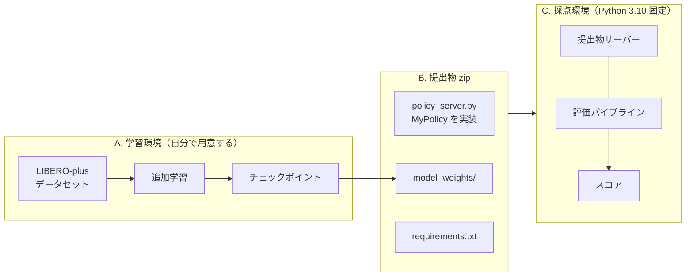
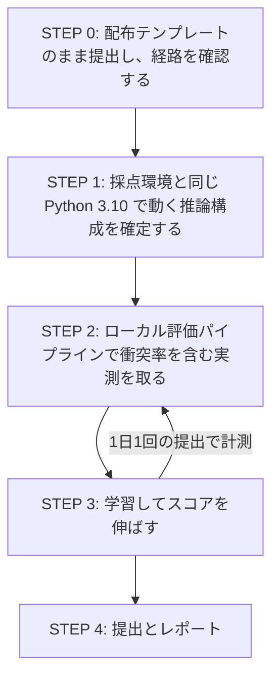

# PARC2026 予選（Track 1）作業手順

配布リポジトリ（[../../README.md](../../README.md)）と参加者ガイド
（[../PARC2026開発コンペティション_予選.pdf](../PARC2026開発コンペティション_予選.pdf)）は
「環境の仕様」と「ルール」を説明している。このディレクトリはその一段先、
**実際にどの順で手を動かすか**をまとめた作業手順である。

## 用語

配布物・LIBERO・LIBERO-plus・運営資料で**同じ語が違うものを指す**ことがあり、
ここを揃えないと文書が読めない。以降の文書はこの定義に従う。

### 階層

```
LIBERO（元のベンチマーク）
└── スイート suite ── 4 つ：libero_spatial / libero_object / libero_goal / libero_10
    └── タスク task ── 各スイート 10 個、計 40 個
        │              例：「黒いボウルを皿に置く」
        └── デモ ── 元の LIBERO では 1 タスクあたり 50 本の人手デモ

LIBERO-plus（LIBERO に摂動を加えた拡張）
└── タスク変種 ── 40 タスクに摂動を掛けたもの、計 10,030 個
    ├── id ─────────────── T1_TASKS.csv の libero_plus_id と同じ
    ├── name ───────────── <元タスク名>_<接尾辞>_<番号>   例：..._table_2
    ├── category ───────── 摂動カテゴリ 7 種
    └── difficulty_level ─ L1〜L5
```

### 語の対応

| 語 | 何を指すか | 注意 |
|---|---|---|
| **トラック** track | コンペの部門。予選は Track 1 のみ | スイートとは無関係。`--track track1` |
| **スイート** suite | LIBERO の 4 分類 | LIBERO のコードでは `problem_folder` |
| **ベンチマーク** benchmark | LIBERO への登録単位 | 実質スイートと同義に使われる |
| **タスク** task | 40 個の基本タスク | 学習データでは「指示 instruction」1 つ = 1 タスク |
| **タスク変種** | 摂動を掛けた 10,030 個 | `T1_TASKS.csv` の `task_id` はこちら |
| **摂動** perturbation | 見た目や初期状態を変える操作 | |
| **摂動カテゴリ** category | 摂動の種類 7 つ | `task_classification.json` の `category` |
| **エピソード** episode | 1 回のロールアウト | 学習データの 1 本 ＝ 評価の 1 試行 |
| **試行** trial | 評価時の 1 エピソード | パイプラインでは `n_eval_episodes` |

### 同名異義に注意

| 見かけ | 実際は |
|---|---|
| `T1_TASKS.csv` の **`suite` 列** | **元の**スイート（libero_spatial 等）。`compe/t1` が登録する `libero_t1` とは別物 |
| `compe/t1` の **`libero_t1`** | example 4 件をまとめた**新しいスイート**。中身は 3 つの元スイートにまたがる |
| `T1_TASKS.csv` の **`task_id`** | タスク**変種**の名前（接尾辞つき）。`instruction` は自然言語の指示文 |
| LeRobot データセットの **`task`** | 自然言語の指示文 40 種。**摂動のラベルは付いていない** |

### 接尾辞と摂動カテゴリの対応

`task_classification.json` の全 10,030 件から集計した実測である。

| 接尾辞 | 摂動カテゴリ | 件数 | 一意に決まるか |
|---|---|---|---|
| `_light_N` | Light Conditions | 1,142 | ○ |
| `_table_N` / `_tb_N` | Background Textures | 1,076 | ○ |
| `_noise_N` | Sensor Noise | 1,601 | ○ |
| `_add_N` ほか | Objects Layout | 1,525 | ○ |
| `_initstate_N` | Camera Viewpoints / Language Instructions / Robot Initial States | 4,686 | **✗ 3 カテゴリで共用** |

**接尾辞だけでは摂動カテゴリを一意に決められない。** `_initstate_N` は 3 カテゴリで
共用されているため、カテゴリを知るには `task_classification.json` を引く必要がある。

Track 1 の example 4 件はすべて `_table_N` / `_light_N` であり、
**視覚摂動の 2 カテゴリ**に収まっている。

## 現在の状況と次のアクション

> 2026-08-09 時点のスナップショット。進捗に応じて書き換えること。

### 確定したこと

| 項目 | 結果 |
|---|---|
| **本番採点が通った** | **スコア 0.05832**（素の重み・追加学習なし）。配布学習例の参考値 0.0633 とほぼ同水準 |
| 実装の正しさ | **問題なし**。3 つの独立した証拠で確認（下記） |
| Python 3.10 での推論構成（方式 A） | **成立**。`validate_submission.py` 静的 PASS |
| GPU 推論時間 | **0.85 秒**（Colab T4）／上限 10 秒 |
| GPU 起動時間 | **41.5 秒**（重みロード）／上限 120 秒 |
| 観測変換の正しさ | コードレベルで確認済み |
| スコアの `time` の定義 | **ステップ数ベース**（運営 Q&A No.23） |
| Action の後処理 | **禁止事項に含まれない**（運営 Q&A No.10） |
| `requirements.txt` に `lerobot` を書く方式 | **採点環境で失敗する**（`evdev` がビルドできない。参加者報告） |
| 学習データの拡張（H の (a)(b)） | 40 タスク × 5 本 = 200 エピソード、明るさの幅はデータセット全体と一致 |

**測った数字はすべて [05_実測結果.md](05_実測結果.md) にある。** 以下は要約である。

| | n_action_steps=50 | **n_action_steps=10** |
|---|---|---|
| **本番スコア** | 0.05832 | **0.096** |
| ローカル評価の成功率 | 0.0625 | **0.875** |
| ローカル評価の衝突率 | 0.3375 | 0.087 |

ローカルは 20 エピソード/タスク（計 80 本、初期状態 0〜19）である。

> **ローカル評価は本番の代理にならない。** かつてここには「再現する」と
> 書いていたが**間違いだった**。ローカルで 0.875 まで上げても本番は 0.096 である。
> **`T1_TASKS.csv` の 4 件は example であり、本番は非公開タスクで採点される**
> （[../../compe/t1/README.md](../../compe/t1/README.md)）。
> 1 回目に両者が近かったのは、どちらもほぼ全滅の水準だったからにすぎない。

### 実装が正しいことの根拠

成功率 0% に見えた局面で、実装を疑って 3 通りに切り分けた。**すべて白**である。

| 検証 | 方法 | 結果 |
|---|---|---|
| 画像の向き | 学習データの実フレームと、評価環境の画像を 180 度回転したものを並べた | **一致**。反転は正しい方向 |
| 重みと前処理 | 学習データの観測を方策に入れ、記録済み action と比較（講義資料のデバッグ順序 3 番） | **再現**。グリッパは完全一致 |
| 方策の能力 | example タスク 4 を 1 本走らせた | **`done=True`（step 107）でタスクを解いた** |

ローカル評価の 0/12 は、真の成功率 10% なら **0.9¹² = 28%** の確率で起きる。
バグの証拠ではなかった。**`remote_policy.py` は seed をサーバーへ渡さない**ため
flow matching のサンプリングは実行ごとに変わり、同じ初期状態でも結果が揺れる。

### 何が足りないのか

| | スコア | 推定成功率 |
|---|---|---|
| 私たち（素の重み） | 0.05832 | 約 10% |
| 配布学習例（参考値） | 0.0633 | 同程度 |
| **トップ** | **0.6396** | **64〜80%** |

スコアはゲートを通ったエピソードだけが滑らかさで採点される構造なので、
0.6396 には成功率 64% 以上が要る。**8 倍近い差**であり、学習量だけでは説明しにくい。

### 次のアクション

> **`PARC_N_ACTION_STEPS` を 50 から 10 に変えたら、成功率が 0.0625 → 0.875 になった。**
> [policy_server.py](../../solution/policy_server.py) の既定値を 10 に変更済み。
> 詳細は [05_実測結果.md](05_実測結果.md)。以下はこれを踏まえた計画である。

| # | やること | 担当 | 状態 |
|---|---|---|---|
| **1** | **追加学習を回す** | 人 | **必須要件**（運営 Q&A No.36） |
| 2 | 予選最終提出の枠が Omnicampus にあるか確認 | 人 | No.40 が未回答 |
| 3 | `MAX_STEPS=300` ＋ 検証スイートで測り直す | 人 | 打ち切りは 600 ではなく 300 だった |
| 4 | 指示文の正規化を実装（学習データの 40 種へ寄せる） | Claude | No.29 / No.31 で許可された |
| 5 | 停滞の検知 → 計画の引き直しを実装 | Claude | No.30 で許可された |
| 6 | 残り 2 回のリーダーボード提出を実験に使う | 人 | 順位に直結しないと判明 |
| 7 | Docker イメージ（CPU 版）のビルド検証 | 人 | 権限で 2 回とも拒否された |

**#1 はスコアの話ではなく資格の話である。** 運営 Q&A No.36 は
「形式変換・名称変更・**推論パラメータ変更のみの提出は不可**」と明言している。
いまの提出物は素の重みにつまみを掛けただけで、**要件を満たしていない。**

**#3 が要る理由。** 手元の評価は example 4 件しか見ておらず、そこで 0.875 を
出しても本番は 0.096 だった。さらに本番の打ち切りは 300 歩で、配布既定の
600 歩で測ると**倍の時間を与えたことになる。**

**評価タスクは 3 段階ですべて違う。** 手元の 4 件 → リーダーボード →
予選最終評価。**特定タスクへの最適化には意味が無く、素の汎化性能を上げるしかない。**

**学習の優先度を上げ直した。** 「素の重みで 0.875 に達したので学習の余地は
0.125 しかない」と書いていたが、**その 0.875 が example 4 件での数字**だった。
本番は 0.096 で、トップの 0.6396 までは 0.54 の開きがある。
**足りないのは未知タスクへの汎化であり、それは学習でしか埋まらない。**

**#6 のリスクは下がった。** 別の参加者が同じ質問（No.36）をしており未回答のままだが、
**運営の採点環境自体が `lerobot` の pip install を通せない**ことが判明し
（依存の `evdev` がビルドできない）、さらに**同梱方式で実際に採点が通った**。
同梱を否定するのは筋が通らない。

## このコンペの構造

やることは一見単純である。VLA モデルを追加学習し、推論する HTTP サーバーを zip で出す。
しかし配布物をそのまま繋ぐと通らない箇所が 3 つある。ここが作業時間の大半を食う。



| # | 詰まる場所 | 何が起きるか | 対処を書いた文書 |
|---|---|---|---|
| ① | A と C で Python のバージョンが違う | 学習はできたのに提出物サーバーが起動しない | [02_環境戦略.md](02_環境戦略.md) |
| ② | B の `MyPolicy` は自分で書く必要がある | 学習した重みを置いただけでは反映されない | [04_提出物の実装と検証.md](04_提出物の実装と検証.md) |
| ③ | C の成功判定に 1mm の衝突判定が入る | 学習側の成功率と本番スコアが大きく乖離する | [01_勝ち筋と評価の読み解き.md](01_勝ち筋と評価の読み解き.md) |

## 進める順序

**最初にやるのは学習ではなく、提出経路を通すことである。** 提出は 1 日 1 回、採点に 15〜20 分かかる。
経路が通っていない状態でモデルだけ良くしても、締切前に「提出できない」で終わる。
配布テンプレートは編集前（ランダムポリシー）でもそのまま動く。まずこれで一往復させる。



| STEP | やること | 完了の判断 | 詳細 |
|---|---|---|---|
| 0 | 配布テンプレートを zip 化して提出する | リーダーボードに 0 点でも「採点完了」が出る | [04](04_提出物の実装と検証.md) |
| 1 | Python 3.10 で自分のモデルが `import` でき、推論できることを本番相当コンテナで確認する | `torch.cuda.is_available()` が True で `/act` が (7,) float32 を返す | [02](02_環境戦略.md) |
| 2 | `python -m pipeline` を回し、成功率と `collision_rate` を見る | ノートブック評価ではなくこちらの数字で判断できる状態 | [01](01_勝ち筋と評価の読み解き.md) |
| 3 | データ・学習条件を組み直す | 成功率が上がる | [03_学習とデータの方針.md](03_学習とデータの方針.md) |
| 4 | 最終提出とレポート提出 | レポートの必須項目が全部埋まっている | [04](04_提出物の実装と検証.md) |

## 文書一覧

| 文書 | 読むタイミング |
|---|---|
| **この README の[用語](#用語)** | 最初。以降の文書はここの定義に従う |
| [01_勝ち筋と評価の読み解き.md](01_勝ち筋と評価の読み解き.md) | 最初。何を最適化すべきかを決める |
| [02_環境戦略.md](02_環境戦略.md) | STEP 1。Python 3.10 / 3.12 問題の判断材料 |
| [03_学習とデータの方針.md](03_学習とデータの方針.md) | STEP 3。配布ノートブックの**どこを変えるか（なぜ）** |
| **[05_実測結果.md](05_実測結果.md)** | **測った数字はすべてここ。** 判断の前に必ず見る |
| **[06_scripted_demos.md](06_scripted_demos.md)** | **手本が全部 300 歩を超えるタスクを、台本で 208 歩にした記録。** 手本を自分で作る |
| [../solution/COLAB.md](../solution/COLAB.md) | STEP 3。Colab で**どう変えるか（貼れるコード）** |
| [../solution/colab_eval/](../solution/colab_eval/README.md) | Colab GPU で評価を回す（84 件 45 分。28 件 × 3 に割る） |
| **[../howto/01_retrain.md](../howto/01_retrain.md)** | **手を動かすとき。** 再学習の手順（Docker / Colab） |
| **[../howto/02_build_submission.md](../howto/02_build_submission.md)** | **手を動かすとき。** zip の組み立てから提出まで |
| [04_提出物の実装と検証.md](04_提出物の実装と検証.md) | STEP 0 と STEP 4。実装・検証・提出運用 |
| [NOTES_FOR_CLAUDE.md](NOTES_FOR_CLAUDE.md) | 調査で判明したリポジトリの非自明な挙動（英語・機械向け） |
