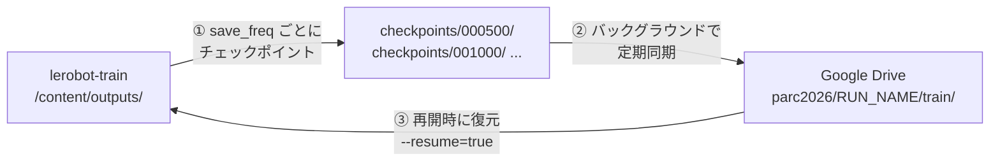
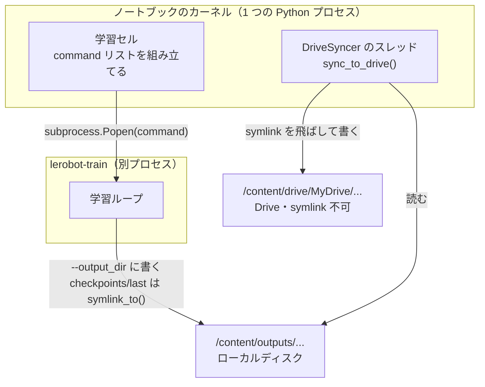

# Colab で学習を回す — 切断に耐える構成

配布ノートブック [examples/smolvla_libero_spatial_lora.ipynb](../examples/smolvla_libero_spatial_lora.ipynb)
は、学習結果を `/content` にしか置かない。Colab のセッションが切れた時点で全部消える。

このメモは、**セッションが切れても学習をやり直さずに済む形**へノートブックを直す手順である。
差し込む位置と、そのまま貼れるセルの中身を示す。

## 「完了したらアップロード」では足りない

危険なのは完了後ではなく**学習中の切断**である。完了時にしか保存しない構成では、
切れた瞬間にそれまでの計算が全部消える。必要なのは次の 3 つである。



| # | 何を | なぜ |
|---|---|---|
| ① | `--save_freq` を刻む | 既定は `save_freq=STEPS` で**最後にしか保存しない** |
| ② | Drive へ定期同期 | `/content` はセッションと一緒に消える |
| ③ | `--resume=true` で再開 | 復元しても再開できなければ意味がない |

## 対象のセルの見分け方

Colab はセル番号を表示しないので、**直前の見出しと、セルの先頭・末尾の行**で示す。
以降はこの呼び名を使う。

| 呼び名 | 直前の見出し | セルの先頭 | セルの末尾 |
|---|---|---|---|
| **ランタイム確認セル** | `## 1. Colabランタイムを確認する` | `import importlib` | `print(f"GPU: {torch.cuda.get_device_name(0)}")` |
| **設定セル** | `## 4. 学習・評価条件を設定する` | `BASE_MODEL_REPO = "lerobot/smolvla_libero_plus"` | `MIXED_PRECISION = (...)` |
| **学習セル** | `## 8. LoRA学習を実行する` | `import re`／`from collections import deque` | `print("Training complete.")` |
| **マージセル** | `## 9. LoRAをマージしてモデル全体を保存する` | `import contextlib` | `print("Merged model ready.")` |
| **比較セル** | `## 13. 成功率を比較する` | `import pandas as pd` | `print(f"Overall: ...")` |

## 登場人物

以降の説明は「誰が何をするか」が分からないと読めない。先に実体を並べる。
**ポイントは、学習が別プロセスで動いていることである。**

| 実体 | 何か | 何を触るか |
|---|---|---|
| **ノートブックのカーネル** | Colab がセルを実行する Python プロセス。1 つだけ | 下の A〜F のコードは全部ここで動く。Drive のマウントも同期スレッドもここ |
| **`lerobot-train`** | LeRobot が pip で入れるコマンド。実体は `lerobot.scripts.lerobot_train:main`。カーネルとは**別のプロセス** | `--output_dir` に渡されたディレクトリへ書く |
| **`/content/outputs/...`** | Colab VM のローカルディスク | 速い。**セッションが切れると消える** |
| **`/content/drive/MyDrive/...`** | Drive の FUSE マウント | 遅い。**symlink を作れない**。セッションが切れても残る |



つまり 2 つのプロセスが**同じローカルディスクを介して**やり取りする。
`lerobot-train` は Drive を一切知らない。Drive へ運ぶのはカーネル側の仕事である。

## CLI 引数はどこで指定されるのか

`--policy.path` や `--resume` は、**学習セルが組み立てる `command` というリスト**に
文字列として並べる。それが `subprocess.Popen(command, ...)` で `lerobot-train` の
コマンドライン引数になる。設定ファイルや環境変数ではない。

配布ノートブックの学習セルは次の構造をしている（行番号はセル内の相対行）。

```
  9: command = [
 10:     "lerobot-train",
 11:     f"--policy.path={BASE_MODEL_LOCAL}",           ← 初期重みの場所
 ..
 29:     f"--output_dir={OUTPUT_DIR}",                  ← 書き出し先
 31:     f"--steps={STEPS}",
 39:     f"--save_freq={STEPS}",                        ← 修正 D-1 でここを SAVE_FREQ に
 ..
 64: shutil.rmtree(OUTPUT_DIR, ignore_errors=True)      ← 修正 D-2 で再開時は実行しない
 68: process = subprocess.Popen(command, ...)           ← ここで別プロセスとして起動
118: return_code = process.wait()
```

`OUTPUT_DIR` は**設定セル**で `Path("/content/outputs/smolvla_libero_plus_spatial_lora")`
と定義されている。`--resume` と `--config_path` は配布ノートブックには**存在しない**。
修正 D-1 で、再開するときだけ付け足す。

| 引数 | 受け取る側 | 意味 |
|---|---|---|
| `--policy.path` | `TrainPipelineConfig._resolve_pretrained_from_cli()` | 初期重みの場所 |
| `--resume` | 同上 | 前回の続きから始めるか |
| `--config_path` | `_resolve_resume_checkpoint()` | どのチェックポイントから再開するか |
| `--output_dir` | `TrainPipelineConfig.output_dir` | 書き出し先 |
| `--save_freq` | `TrainPipelineConfig.save_freq` | 何ステップごとに保存するか |

## 先に踏んではいけない罠

### 罠 1: `OUTPUT_DIR` を Drive 配下にしてはいけない

「Drive に直接書けば同期が要らない」と考えたくなるが、失敗する。

**`lerobot-train` プロセス**はチェックポイントを保存するたびに
`update_last_checkpoint()` を呼び、`<output_dir>/checkpoints/last` を
**`symlink_to()`** で作る。**Drive の FUSE マウントは symlink を作れない**ため、
最初のチェックポイント保存でここが例外になる。

したがって役割を分ける。

| 誰が | 何を |
|---|---|
| `lerobot-train`（別プロセス） | `/content/outputs/...`（ローカルディスク）にだけ書く |
| `sync_to_drive()`（カーネル側、セル A で定義） | それを読んで Drive へコピーする。`path.is_symlink()` の行で symlink を除外する |

この結果 `checkpoints/last` は Drive に現れない。だから**再開はステップ番号の
ディレクトリ（`checkpoints/001500` など）を直接指す**。セル C がそうしている。

### 罠 2: `--policy.path` と `--resume` は排他

`train.py` の `_resolve_pretrained_from_cli()` は
`reward_model path → policy path → resume` の優先順で解決する。
そのため再開時に `--policy.path` を残すと、**`--resume` は黙って無視され、
最初から学習し直す**。エラーにならないので気づきにくい。

## 差し込む位置

| 位置 | 操作 | 内容 |
|---|---|---|
| **ランタイム確認セル**の直後 | 新規セル **A** | Drive をマウントし、同期ヘルパーを定義する |
| **設定セル**の末尾 | 追記 **B** | `SAVE_FREQ` と `RESUME` を足す |
| **学習セル**の直前 | 新規セル **C** | Drive から復元し、同期スレッドを用意する |
| **学習セル**の中 | 修正 **D** | `save_freq` / 再開 / 同期の開始・停止（3 か所） |
| **マージセル**の直後 | 新規セル **E** | マージ済みモデルを Drive へ |
| **比較セル**の直後 | 新規セル **F** | 評価結果と比較 CSV を Drive へ |
| **マージセル**より後ならどこでも | 新規セル **G** | 推論 1 チャンクの所要時間を GPU で測る |

A〜F は切断対策である。**G だけは目的が違い**、本番の 10 秒制限をクリアできるかを
確かめるための計測で、学習とは独立に実行できる。

最後の `## 14. 学習済みモデルと比較結果をダウンロードする` のセル
（`files.download(...)` があるもの）はそのままでよい。Drive にあれば必須ではない。

---

## A. Drive のマウントと同期ヘルパー

**ランタイム確認セル**（`print(f"GPU: ...")` で終わるもの）の**直後に新規セル**を作る。

```python
# === Google Drive への同期 ===
import shutil
import threading
from pathlib import Path

from google.colab import drive

MOUNT_POINT = Path("/content/drive")
drive.mount(str(MOUNT_POINT))


def resolve_drive_home() -> Path:
    """マウントされた Drive のマイドライブ直下を返す。

    フォルダ名は環境によって違う。古い Colab は "My Drive"（スペースあり）、
    現在は "MyDrive"（スペースなし）を使う。決め打ちすると片方で壊れるため、
    実際に存在するものを選ぶ。
    """
    for name in ("MyDrive", "My Drive", "マイドライブ"):
        candidate = MOUNT_POINT / name
        if candidate.is_dir():
            return candidate

    found = sorted(p.name for p in MOUNT_POINT.iterdir()) if MOUNT_POINT.is_dir() else []
    raise RuntimeError(f"マイドライブが見つかりません。{MOUNT_POINT} の中身: {found}")


# 実行を識別する名前。再開するときは前回と同じ名前にする。
RUN_NAME = "smolvla_spatial_lora_001"
DRIVE_RUN_DIR = resolve_drive_home() / "parc2026" / RUN_NAME
DRIVE_RUN_DIR.mkdir(parents=True, exist_ok=True)

SYNC_INTERVAL_SEC = 300


def sync_to_drive(source: Path, destination: Path) -> int:
    """source を destination へ差分コピーし、コピーしたファイル数を返す。

    symlink は飛ばす。Drive のマウントは symlink を作れず、LeRobot が
    checkpoints/last を symlink で作るため、飛ばさないと必ず失敗する。

    チェックポイントのディレクトリは一度書かれたら変わらないので、
    サイズと更新時刻が一致していればコピーを省略してよい。
    """
    if not source.exists():
        return 0

    copied = 0
    for path in sorted(source.rglob("*")):
        if path.is_symlink() or not path.is_file():
            continue

        target = destination / path.relative_to(source)
        if target.exists():
            source_stat, target_stat = path.stat(), target.stat()
            same_size = source_stat.st_size == target_stat.st_size
            # Drive 側の更新時刻は丸められることがあるため 2 秒の余裕を見る。
            not_older = target_stat.st_mtime + 2 >= source_stat.st_mtime
            if same_size and not_older:
                continue

        target.parent.mkdir(parents=True, exist_ok=True)
        shutil.copy2(path, target)
        copied += 1

    return copied


class DriveSyncer:
    """学習中、バックグラウンドで定期的に Drive へ同期する。"""

    def __init__(self, source: Path, destination: Path, interval: int = SYNC_INTERVAL_SEC):
        self._source = source
        self._destination = destination
        self._interval = interval
        self._stop = threading.Event()
        self._thread = None

    def start(self) -> None:
        self._stop.clear()
        self._thread = threading.Thread(target=self._loop, daemon=True)
        self._thread.start()
        print(f"[drive] 同期開始（{self._interval}秒ごと） -> {self._destination}")

    def _loop(self) -> None:
        while not self._stop.wait(self._interval):
            self.sync_once("periodic")

    def sync_once(self, label: str = "manual") -> None:
        try:
            copied = sync_to_drive(self._source, self._destination)
            print(f"[drive:{label}] {copied} files synced")
        except Exception as error:
            # 同期の失敗で学習を止めない。次の周期で取り返せる。
            print(f"[drive:{label}] 同期に失敗: {error}")

    def stop(self) -> None:
        self._stop.set()
        if self._thread is not None:
            self._thread.join(timeout=30)
        self.sync_once("final")


print("Drive ready:", DRIVE_RUN_DIR)
```

### `ValueError: mount failed` が出たとき

`drive.mount()` は**ブラウザ側の対話認証**に依存する。失敗の大半は Colab VM ではなく
ブラウザや Google アカウントの側に原因がある。

エラーメッセージが `mount failed` **だけ**なら、タイムアウトではない
（タイムアウトの場合は FAQ の URL が後ろに付く）。認証そのものが通っていない。

まず状況を確認する。

```python
import os
import subprocess
import sys

print("python           :", sys.version.split()[0])
# ホストされた Colab ランタイムなら値が入る。None ならローカルランタイム。
print("COLAB_RELEASE_TAG:", os.environ.get("COLAB_RELEASE_TAG"))
print("/content/drive   :",
      os.listdir("/content/drive") if os.path.isdir("/content/drive") else "(存在しない)")
print(subprocess.run(
    ["bash", "-lc", "mount | grep -i drive || echo '(drive はマウントされていない)'"],
    capture_output=True, text=True).stdout)
```

`COLAB_RELEASE_TAG` が `None` ならローカルランタイムであり、そこで確定する
（`drive.mount` はホストされたランタイムでしか動かない）。
`/content/drive` が**存在しない**場合は、マウント先が作られる前に止まっている。
残骸が無いので `force_remount=True` も効かない。

次にこれを実行すると、認証基盤の問題か Drive 固有の問題かを分けられる。

```python
from google.colab import auth
auth.authenticate_user()
```

| 結果 | 意味 |
|---|---|
| これは通るのに `drive.mount` だけ失敗する | 認証は生きていて **Drive へのアクセスだけが塞がれている**。Workspace の管理者ポリシーが濃厚で、ブラウザ設定では回避できない。後述の HF リポジトリ方式へ切り替える |
| これも失敗する | 認証フロー自体が通っていない。下の表の 2・3・6 を疑う |

原因は上から順に疑う。

| # | 原因 | 確認・対処 |
|---|---|---|
| 1 | **前回のマウントが中途半端に残っている** | `drive.mount("/content/drive", force_remount=True)` で再実行する |
| 2 | **ブラウザがサードパーティ Cookie をブロックしている** | 認証は iframe 内で行われる。Chrome の設定で `accounts.google.com` と `drive.google.com` の Cookie を許可する。シークレットウィンドウ／Brave／Safari の既定設定でよく起きる |
| 3 | **複数の Google アカウントにログインしている** | 認証が別アカウントに解決されて失敗する。Colab を開いているアカウント 1 つだけにするか、そのアカウントのプロファイルで開き直す |
| 4 | **ローカルランタイムに接続している** | 上の `COLAB_RELEASE_TAG` が `None` ならこれ。`drive.mount` は**ホストされたランタイムでしか動かない**。ランタイムを「ホストされたランタイム」に切り替える |
| 5 | **組織（Google Workspace）のポリシー** | 管理者が Colab から Drive へのアクセスを禁止している場合がある。個人アカウントで試すと切り分けられる |
| 6 | **ポップアップブロック** | 認証ウィンドウが開けていない。ポップアップを許可する |

1 と 2 で解決しないときは、ランタイムを一度**「ランタイムを接続解除して削除」**してから
やり直すと通ることがある。`/content/drive` に中途半端な状態が残るためである。

### Drive がどうしても使えない場合

**Drive でなくても目的は達成できる。** 必要なのは「セッションの外に置ける保存先」
だけである。配布ノートブックは既に `huggingface_hub` を使っているので、
**自分の private リポジトリ**を保存先にする手もある。

| | Google Drive | HF の private リポジトリ |
|---|---|---|
| 認証 | 対話認証が毎回必要 | トークンを Colab のシークレットに置けば自動 |
| symlink | 扱えない（罠 1） | 関係ない |
| 取り出し | ブラウザまたは同期 | どのマシンからでも `snapshot_download` |
| 注意 | — | **必ず private にする**。公開すると PDF p.5 の「他の参加者への共有」に触れる |

この方式に切り替える場合は `sync_to_drive()` を
`huggingface_hub.upload_folder()` に置き換えるだけで、
セル C 以降の構成（`save_freq` を刻む・`--resume` で再開）はそのまま使える。

## B. 学習条件の追加

**設定セル**（`BASE_MODEL_REPO = ...` で始まるもの）の**末尾に追記**する。

```python
# チェックポイントを刻む間隔。既定の save_freq=STEPS は最後にしか保存しないため、
# セッションが切れるとそこまでの学習が全部消える。
SAVE_FREQ = 500

# 前回の続きから再開する場合は True にする（RUN_NAME を前回と同じにしておくこと）。
RESUME = False
```

`SAVE_FREQ` は「切断で失ってよいステップ数」で決める。細かくするほど Drive の
容量と同期時間を食うので、**チェックポイント 1 個の実サイズを 1 回測ってから**調整する。
LoRA 学習では保存されるのは主に `adapter_model.safetensors` なので、
フル学習より大幅に小さいはずである。

## C. Drive からの復元と同期の準備

**学習セル**（`print("Training complete.")` で終わるもの）の**直前に新規セル**を作る。

```python
# === 中断からの再開 ===
LOCAL_RUN_DIR = OUTPUT_DIR
DRIVE_TRAIN_DIR = DRIVE_RUN_DIR / "train"

resume_checkpoint = None

if RESUME:
    restored = sync_to_drive(DRIVE_TRAIN_DIR, LOCAL_RUN_DIR)
    print(f"[drive] Drive から {restored} ファイルを復元")

    checkpoint_root = LOCAL_RUN_DIR / "checkpoints"
    checkpoints = sorted(
        path for path in checkpoint_root.glob("*") if path.is_dir() and path.name.isdigit()
    ) if checkpoint_root.is_dir() else []

    if checkpoints:
        resume_checkpoint = checkpoints[-1]
        print("再開するチェックポイント:", resume_checkpoint.name)
    else:
        print("チェックポイントが無いため最初から学習する")

syncer = DriveSyncer(LOCAL_RUN_DIR, DRIVE_TRAIN_DIR)
```

## D. 学習セルの修正

3 か所を直す。

### D-1. `command` の組み立て

既存の `command = [...]` を、次のように分岐させる。

```python
if resume_checkpoint is None:
    command = [
        "lerobot-train",
        f"--policy.path={BASE_MODEL_LOCAL}",
        # ... 既存の引数をそのまま ...
        f"--save_freq={SAVE_FREQ}",   # ← f"--save_freq={STEPS}" を置き換える
        # ... 以下も既存のまま ...
    ]
else:
    # --policy.path を残すと resume が無視されるため、再開時は必ず外す。
    # 残りの学習条件はチェックポイントの train_config.json から復元される。
    command = [
        "lerobot-train",
        "--resume=true",
        f"--config_path={resume_checkpoint}/pretrained_model/train_config.json",
        f"--output_dir={OUTPUT_DIR}",
        f"--steps={STEPS}",
    ]
```

### D-2. 出力ディレクトリを消さない

```python
# 既存: shutil.rmtree(OUTPUT_DIR, ignore_errors=True)
if not RESUME:
    shutil.rmtree(OUTPUT_DIR, ignore_errors=True)
```

**これを直さないと、C で復元したチェックポイントを消してから学習を始める。**

### D-3. 同期スレッドの開始と停止

`subprocess.Popen(...)` の呼び出しを `try` / `finally` で挟む。

```python
syncer.start()
try:
    process = subprocess.Popen(
        command,
        cwd=LEROBOT_DIR,
        env=training_env,
        stdout=subprocess.PIPE,
        stderr=subprocess.STDOUT,
        text=True,
        bufsize=1,
    )

    # ... 既存の出力読み取りループと process.wait() ...

finally:
    syncer.stop()   # 失敗しても最後に 1 回同期する
```

## E. マージ済みモデルを Drive へ

**マージセル**（`print("Merged model ready.")` で終わるもの）の**直後に新規セル**を作る。

```python
merged_on_drive = DRIVE_RUN_DIR / "merged_model"
copied = sync_to_drive(MERGED_MODEL_DIR, merged_on_drive)
print(f"[drive] マージ済みモデルを保存: {copied} files -> {merged_on_drive}")
```

**ここまで到達すれば提出物は作れる。** これより後ろの評価まわりのセル
（`## 11. LIBERO-plus評価環境を準備する` 以降）が失敗しても、
Drive のこのディレクトリを持ち帰れば済む。

## F. 評価結果を Drive へ

**比較セル**（`import pandas as pd` で始まるもの）の**直後に新規セル**を作る。

```python
shutil.copy2(COMPARISON_CSV_PATH, DRIVE_RUN_DIR / COMPARISON_CSV_PATH.name)
sync_to_drive(BASE_EVAL_DIR, DRIVE_RUN_DIR / "eval" / "base")
sync_to_drive(FINETUNED_EVAL_DIR, DRIVE_RUN_DIR / "eval" / "spatial_lora")
print("[drive] 評価結果を保存:", DRIVE_RUN_DIR)
```

---

## G. 推論時間を GPU で測る（重要）

[README.md](README.md) に残っている**未検証項目のうち最も重いのがこれ**である。
本番の制約は「`/act` の 1 リクエストが 10 秒以内。1 回でも超えたらトラック全体が 0 点」。
CPU 2 コアのコンテナでは **23.4 秒**かかっており、GPU で収まるかどうかが未確認である。

Colab の GPU は本番の L4 とは別物（T4 が割り当てられることが多い）だが、
**T4 で収まれば L4 では確実に収まる**。逆に T4 で 10 秒に迫るなら対策が要る。

**マージセル**（`print("Merged model ready.")` で終わるもの）**より後**に新規セルを作る。
追加学習前の素の重みで測るだけなら、`## 7. 初期重みを準備する` のセルより後ならどこでもよい。

```python
# === 推論 1 チャンクの所要時間を測る ===
# SmolVLA は chunk_size=50 なので、重い推論は 50 ステップに 1 回だけ走る。
# 本番の 10 秒制限が効くのはその 1 回である。
import time

import numpy as np
import torch

from lerobot.configs import PreTrainedConfig
from lerobot.policies.factory import make_pre_post_processors
from lerobot.policies.smolvla.modeling_smolvla import SmolVLAPolicy
from lerobot.processor import PolicyProcessorPipeline
from lerobot.processor.env_processor import LiberoProcessorStep

# 追加学習後を測るなら MERGED_MODEL_DIR、素の初期重みなら BASE_MODEL_LOCAL
WEIGHTS = MERGED_MODEL_DIR if MERGED_MODEL_DIR.exists() else BASE_MODEL_LOCAL
DEVICE = "cuda"
EVAL_CAMERA = 128   # 採点パイプラインが渡してくる解像度

config = PreTrainedConfig.from_pretrained(WEIGHTS)
config.device = DEVICE
config.load_vlm_weights = False   # 重みはチェックポイントに含まれる

load_start = time.time()
policy = SmolVLAPolicy.from_pretrained(WEIGHTS, config=config)
policy.to(DEVICE).eval()
preprocessor, postprocessor = make_pre_post_processors(
    config, str(WEIGHTS),
    preprocessor_overrides={"device_processor": {"device": DEVICE}},
)
env_preprocessor = PolicyProcessorPipeline(steps=[LiberoProcessorStep()])
load_sec = time.time() - load_start
print(f"重みロード : {load_sec:6.1f} 秒   （本番の起動上限 120 秒）")


def build_batch(instruction: str, seed: int = 0):
    """policy_server.py の MyPolicy._build_batch と同じ形の入力を作る。"""
    rng = np.random.default_rng(seed)

    def image():
        array = rng.integers(0, 255, (EVAL_CAMERA, EVAL_CAMERA, 3), dtype=np.uint8)
        return torch.from_numpy(array).permute(2, 0, 1).unsqueeze(0).float() / 255.0

    observation = {
        "observation.images.front": image(),
        "observation.images.wrist": image(),
        "observation.robot_state": {
            "eef": {
                "pos": torch.tensor([[-0.04, 0.03, 0.74]]),
                "quat": torch.tensor([[0.0, 0.0, 0.0, 1.0]]),
            },
            "gripper": {"qpos": torch.tensor([[0.03, -0.03]])},
        },
        "task": [instruction],
    }
    return preprocessor(env_preprocessor(observation))


INSTRUCTION = "pick up the black bowl and place it on the plate"

# 1 回目は CUDA の初期化を含むため計測から外す。
# 提出物側も __init__ で同じことをして初回 /act を速くしている。
with torch.no_grad():
    policy.select_action(build_batch(INSTRUCTION))
torch.cuda.synchronize()

policy.reset()   # chunk のキャッシュを捨てて本計測へ
latencies = []
for index in range(4):
    batch = build_batch(INSTRUCTION, seed=index)
    torch.cuda.synchronize()
    started = time.time()
    with torch.no_grad():
        action = postprocessor(policy.select_action(batch))
    torch.cuda.synchronize()
    latencies.append(time.time() - started)
    print(f"  act[{index}] {latencies[-1]:8.3f} 秒   {np.round(action[0].cpu().numpy(), 3)}")

heavy = max(latencies)
print(f"\nGPU            : {torch.cuda.get_device_name(0)}")
print(f"重い推論(最大) : {heavy:6.2f} 秒   （本番の上限 10 秒）")
print(f"キャッシュ時   : {min(latencies):6.4f} 秒")
if heavy < 3:
    print("判定           : 余裕あり")
elif heavy < 10:
    print("判定           : 収まるが余裕は小さい。L4 は T4 より速いので実際はもう少し楽になる")
else:
    print("判定           : 超過。chunk あたりの推論を軽くする対策が要る")
```

### 見るべき点

| 出力 | 意味 |
|---|---|
| `act[0]` だけ大きく、`act[1..3]` がほぼ 0 | chunk のキャッシュが効いている。**期待どおり** |
| `重い推論(最大)` | ここが 10 秒を超えると本番で 0 点になる |
| `重みロード` | 本番の起動上限 120 秒に対する余裕。GPU 転送を含む |

`act[1..3]` まで重い場合は、`n_action_steps` が 1 になっているなど chunk が
効いていない。`policy.config.n_action_steps` を確認する。

### 超過していた場合の打ち手

1. **`config.n_action_steps` を減らさない**（減らすと推論回数が増えて逆効果）
2. 推論を半精度にする（`policy.to(torch.bfloat16)`）。精度への影響は要評価
3. flow matching のステップ数を減らす（`policy.config` の該当項目）。挙動が変わるため要再評価
4. それでも駄目なら、より小さいベースモデルに変える

なお **Colab は Python 3.12 なので、ここで動いても 3.10 の動作確認にはならない**。
3.10 の確認は Docker 側で行うこと（[README.md](README.md) の「検証」）。

---

## 中断したときの再開手順

1. 新しい Colab セッションを開き、**先頭から順に実行**する
   （セル A の `drive.mount` は対話認証が必要なので自動化できない）
2. **設定セル**の追記 B で **`RESUME = True`**、`RUN_NAME` を前回と同じ値にする
3. セル C を実行し、`再開するチェックポイント: 001500` のような表示を確認する
4. **学習セル**を実行する

`## 2. システムパッケージを準備する`・`## 3. LeRobotをインストールする`・
`## 7. 初期重みを準備する` のセルはやり直しになる。
数分で済むが、`RUN_NAME` を間違えると別の run として最初から学習し直すので注意する。

## 持ち帰ったあとの手順

Drive の `merged_model/` の中身で、ローカルの
`work/artifacts/model_weights/` 直下を差し替える。

| ファイル | 差し替え |
|---|---|
| `config.json` | ✓ |
| `model.safetensors` | ✓ |
| `policy_preprocessor.json` / `policy_preprocessor_step_*.safetensors` | ✓ |
| `policy_postprocessor.json` / `policy_postprocessor_step_*.safetensors` | ✓ |
| `vlm/` | **そのまま残す**。ノートブックは作らない。学習で変わらない |
| `train_config.json` | 不要（推論は `config.json` を読む） |

そのあと [README.md](README.md) の手順で zip を作り直し、**必ず
`validate_submission.py` を通す**。追加学習で `config.json` の
`input_features` がデータセットから再導出されるため、
`MyPolicy` が想定どおり動くかを毎回確認する。

```bash
work/venv310/bin/python solution/tools/build_submission.py
```

## 注意点

- **同期の一貫性**: 書きかけのチェックポイントをコピーする可能性はあるが、
  次の周期で上書きされる。最悪でも 1 つ前のチェックポイントは無事なので、
  **古いチェックポイントを消さない**運用にすること
- **Drive の容量**: チェックポイントを刻むほど容量を食う。`SAVE_FREQ` を
  小さくする前に 1 個の実サイズを測る
- **同期の失敗で学習を止めない**: `sync_once` は例外を握り潰す。
  握り潰さない設計にすると、Drive の一時的なエラーで学習ごと落ちる
- **Colab の制約は消えない**: 無料枠は連続実行時間に上限がある。
  学習を長く回すなら、PDF p.9 が認めている外部の有料クラウドの方が確実である
