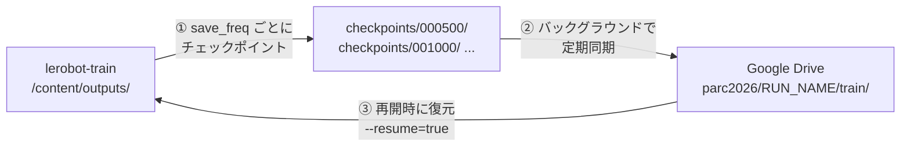

# Colab で学習を回す — 切断に耐える構成

配布ノートブック [examples/smolvla_libero_spatial_lora.ipynb](../examples/smolvla_libero_spatial_lora.ipynb)
は、学習結果を `/content` にしか置かない。Colab のセッションが切れた時点で全部消える。

このメモは、**セッションが切れても学習をやり直さずに済む形**へノートブックを直す手順である。
差し込む位置と、そのまま貼れるセルの中身を示す。

## 「完了したらアップロード」では足りない

危険なのは完了後ではなく**学習中の切断**である。完了時にしか保存しない構成では、
切れた瞬間にそれまでの計算が全部消える。必要なのは次の 3 つである。



| # | 何を | なぜ |
|---|---|---|
| ① | `--save_freq` を刻む | 既定は `save_freq=STEPS` で**最後にしか保存しない** |
| ② | Drive へ定期同期 | `/content` はセッションと一緒に消える |
| ③ | `--resume=true` で再開 | 復元しても再開できなければ意味がない |

## 先に踏んではいけない罠

**`--output_dir` を Drive の中に直接指定してはいけない。** LeRobot は
`checkpoints/last` を `symlink_to()` で作るが、Drive のマウント（FUSE）は
symlink を扱えないため、最初のチェックポイント保存で失敗する。

したがって**学習は `/content` に書き、そこから Drive へコピーする**。
同期側で symlink を飛ばすので、`checkpoints/last` は Drive に現れない。
再開はステップ番号のディレクトリを直接指すことで行う。

もう 1 つ。**`--policy.path` と `--resume` は排他である。** `train.py` の
`_resolve_pretrained_from_cli()` は `policy path → resume` の優先順で解決するため、
再開時に `--policy.path` を残すと **resume が黙って無視され、最初から学習し直す**。

## 差し込む位置

配布ノートブックのセル番号（先頭を 0 とする）で示す。

| 位置 | 操作 | 内容 |
|---|---|---|
| セル 2 の直後 | **新規セル A** | Drive をマウントし、同期ヘルパーを定義する |
| セル 8 の末尾 | **追記 B** | `SAVE_FREQ` と `RESUME` を足す |
| セル 16 の直前 | **新規セル C** | Drive から復元し、同期スレッドを用意する |
| セル 16 | **修正 D** | `save_freq` / 再開 / 同期の開始・停止 |
| セル 18 の直後 | **新規セル E** | マージ済みモデルを Drive へ |
| セル 26 の直後 | **新規セル F** | 評価結果と比較 CSV を Drive へ |

セル 28（`files.download`）はそのままでよい。Drive にあれば必須ではない。

---

## A. Drive のマウントと同期ヘルパー（セル 2 の直後に新規セル）

```python
# === Google Drive への同期 ===
import shutil
import threading
from pathlib import Path

from google.colab import drive

drive.mount("/content/drive")

# 実行を識別する名前。再開するときは前回と同じ名前にする。
RUN_NAME = "smolvla_spatial_lora_001"
DRIVE_RUN_DIR = Path("/content/drive/MyDrive/parc2026") / RUN_NAME
DRIVE_RUN_DIR.mkdir(parents=True, exist_ok=True)

SYNC_INTERVAL_SEC = 300


def sync_to_drive(source: Path, destination: Path) -> int:
    """source を destination へ差分コピーし、コピーしたファイル数を返す。

    symlink は飛ばす。Drive のマウントは symlink を作れず、LeRobot が
    checkpoints/last を symlink で作るため、飛ばさないと必ず失敗する。

    チェックポイントのディレクトリは一度書かれたら変わらないので、
    サイズと更新時刻が一致していればコピーを省略してよい。
    """
    if not source.exists():
        return 0

    copied = 0
    for path in sorted(source.rglob("*")):
        if path.is_symlink() or not path.is_file():
            continue

        target = destination / path.relative_to(source)
        if target.exists():
            source_stat, target_stat = path.stat(), target.stat()
            same_size = source_stat.st_size == target_stat.st_size
            # Drive 側の更新時刻は丸められることがあるため 2 秒の余裕を見る。
            not_older = target_stat.st_mtime + 2 >= source_stat.st_mtime
            if same_size and not_older:
                continue

        target.parent.mkdir(parents=True, exist_ok=True)
        shutil.copy2(path, target)
        copied += 1

    return copied


class DriveSyncer:
    """学習中、バックグラウンドで定期的に Drive へ同期する。"""

    def __init__(self, source: Path, destination: Path, interval: int = SYNC_INTERVAL_SEC):
        self._source = source
        self._destination = destination
        self._interval = interval
        self._stop = threading.Event()
        self._thread = None

    def start(self) -> None:
        self._stop.clear()
        self._thread = threading.Thread(target=self._loop, daemon=True)
        self._thread.start()
        print(f"[drive] 同期開始（{self._interval}秒ごと） -> {self._destination}")

    def _loop(self) -> None:
        while not self._stop.wait(self._interval):
            self.sync_once("periodic")

    def sync_once(self, label: str = "manual") -> None:
        try:
            copied = sync_to_drive(self._source, self._destination)
            print(f"[drive:{label}] {copied} files synced")
        except Exception as error:
            # 同期の失敗で学習を止めない。次の周期で取り返せる。
            print(f"[drive:{label}] 同期に失敗: {error}")

    def stop(self) -> None:
        self._stop.set()
        if self._thread is not None:
            self._thread.join(timeout=30)
        self.sync_once("final")


print("Drive ready:", DRIVE_RUN_DIR)
```

## B. 学習条件の追加（セル 8 の末尾に追記）

```python
# チェックポイントを刻む間隔。既定の save_freq=STEPS は最後にしか保存しないため、
# セッションが切れるとそこまでの学習が全部消える。
SAVE_FREQ = 500

# 前回の続きから再開する場合は True にする（RUN_NAME を前回と同じにしておくこと）。
RESUME = False
```

`SAVE_FREQ` は「切断で失ってよいステップ数」で決める。細かくするほど Drive の
容量と同期時間を食うので、**チェックポイント 1 個の実サイズを 1 回測ってから**調整する。
LoRA 学習では保存されるのは主に `adapter_model.safetensors` なので、
フル学習より大幅に小さいはずである。

## C. Drive からの復元と同期の準備（セル 16 の直前に新規セル）

```python
# === 中断からの再開 ===
LOCAL_RUN_DIR = OUTPUT_DIR
DRIVE_TRAIN_DIR = DRIVE_RUN_DIR / "train"

resume_checkpoint = None

if RESUME:
    restored = sync_to_drive(DRIVE_TRAIN_DIR, LOCAL_RUN_DIR)
    print(f"[drive] Drive から {restored} ファイルを復元")

    checkpoint_root = LOCAL_RUN_DIR / "checkpoints"
    checkpoints = sorted(
        path for path in checkpoint_root.glob("*") if path.is_dir() and path.name.isdigit()
    ) if checkpoint_root.is_dir() else []

    if checkpoints:
        resume_checkpoint = checkpoints[-1]
        print("再開するチェックポイント:", resume_checkpoint.name)
    else:
        print("チェックポイントが無いため最初から学習する")

syncer = DriveSyncer(LOCAL_RUN_DIR, DRIVE_TRAIN_DIR)
```

## D. 学習セルの修正（セル 16）

3 か所を直す。

### D-1. `command` の組み立て

既存の `command = [...]` を、次のように分岐させる。

```python
if resume_checkpoint is None:
    command = [
        "lerobot-train",
        f"--policy.path={BASE_MODEL_LOCAL}",
        # ... 既存の引数をそのまま ...
        f"--save_freq={SAVE_FREQ}",   # ← f"--save_freq={STEPS}" を置き換える
        # ... 以下も既存のまま ...
    ]
else:
    # --policy.path を残すと resume が無視されるため、再開時は必ず外す。
    # 残りの学習条件はチェックポイントの train_config.json から復元される。
    command = [
        "lerobot-train",
        "--resume=true",
        f"--config_path={resume_checkpoint}/pretrained_model/train_config.json",
        f"--output_dir={OUTPUT_DIR}",
        f"--steps={STEPS}",
    ]
```

### D-2. 出力ディレクトリを消さない

```python
# 既存: shutil.rmtree(OUTPUT_DIR, ignore_errors=True)
if not RESUME:
    shutil.rmtree(OUTPUT_DIR, ignore_errors=True)
```

**これを直さないと、C で復元したチェックポイントを消してから学習を始める。**

### D-3. 同期スレッドの開始と停止

`subprocess.Popen(...)` の呼び出しを `try` / `finally` で挟む。

```python
syncer.start()
try:
    process = subprocess.Popen(
        command,
        cwd=LEROBOT_DIR,
        env=training_env,
        stdout=subprocess.PIPE,
        stderr=subprocess.STDOUT,
        text=True,
        bufsize=1,
    )

    # ... 既存の出力読み取りループと process.wait() ...

finally:
    syncer.stop()   # 失敗しても最後に 1 回同期する
```

## E. マージ済みモデルを Drive へ（セル 18 の直後に新規セル）

```python
merged_on_drive = DRIVE_RUN_DIR / "merged_model"
copied = sync_to_drive(MERGED_MODEL_DIR, merged_on_drive)
print(f"[drive] マージ済みモデルを保存: {copied} files -> {merged_on_drive}")
```

**ここまで到達すれば提出物は作れる。** 以降の評価セル（21〜26）が失敗しても、
Drive のこのディレクトリを持ち帰れば済む。

## F. 評価結果を Drive へ（セル 26 の直後に新規セル）

```python
shutil.copy2(COMPARISON_CSV_PATH, DRIVE_RUN_DIR / COMPARISON_CSV_PATH.name)
sync_to_drive(BASE_EVAL_DIR, DRIVE_RUN_DIR / "eval" / "base")
sync_to_drive(FINETUNED_EVAL_DIR, DRIVE_RUN_DIR / "eval" / "spatial_lora")
print("[drive] 評価結果を保存:", DRIVE_RUN_DIR)
```

---

## 中断したときの再開手順

1. 新しい Colab セッションを開き、**セル 0 から順に実行**する
   （セル A の `drive.mount` は対話認証が必要なので自動化できない）
2. セル 8 の追記部分で **`RESUME = True`**、`RUN_NAME` を前回と同じ値にする
3. セル C を実行し、`再開するチェックポイント: 001500` のような表示を確認する
4. セル 16 を実行する

セル 4・6（apt と LeRobot の導入）とセル 14（初期重みの取得）はやり直しになる。
数分で済むが、`RUN_NAME` を間違えると別の run として最初から学習し直すので注意する。

## 持ち帰ったあとの手順

Drive の `merged_model/` の中身で、ローカルの
`work/artifacts/model_weights/` 直下を差し替える。

| ファイル | 差し替え |
|---|---|
| `config.json` | ✓ |
| `model.safetensors` | ✓ |
| `policy_preprocessor.json` / `policy_preprocessor_step_*.safetensors` | ✓ |
| `policy_postprocessor.json` / `policy_postprocessor_step_*.safetensors` | ✓ |
| `vlm/` | **そのまま残す**。ノートブックは作らない。学習で変わらない |
| `train_config.json` | 不要（推論は `config.json` を読む） |

そのあと [README.md](README.md) の手順で zip を作り直し、**必ず
`validate_submission.py` を通す**。追加学習で `config.json` の
`input_features` がデータセットから再導出されるため、
`MyPolicy` が想定どおり動くかを毎回確認する。

```bash
work/venv310/bin/python solution/tools/build_submission.py
```

## 注意点

- **同期の一貫性**: 書きかけのチェックポイントをコピーする可能性はあるが、
  次の周期で上書きされる。最悪でも 1 つ前のチェックポイントは無事なので、
  **古いチェックポイントを消さない**運用にすること
- **Drive の容量**: チェックポイントを刻むほど容量を食う。`SAVE_FREQ` を
  小さくする前に 1 個の実サイズを測る
- **同期の失敗で学習を止めない**: `sync_once` は例外を握り潰す。
  握り潰さない設計にすると、Drive の一時的なエラーで学習ごと落ちる
- **Colab の制約は消えない**: 無料枠は連続実行時間に上限がある。
  学習を長く回すなら、PDF p.9 が認めている外部の有料クラウドの方が確実である

## ついでに測れること

Colab の GPU では、[README.md](README.md) に残っている**未検証項目のうち
「推論 1 チャンクが 10 秒に収まるか」を測れる**。T4 は本番の L4 とは別物だが、
CPU 2 コアの 23.4 秒よりははるかに近い数字が出る。

`solution/tools/vendor_lerobot.py` と `solution/policy_server.py` と
`solution/requirements.txt` を Colab にアップロードすれば、その場で組み立てて計測できる。
ただし **Colab は Python 3.12 なので、3.10 での動作確認にはならない**。
3.10 の確認は Docker 側で行うこと。
