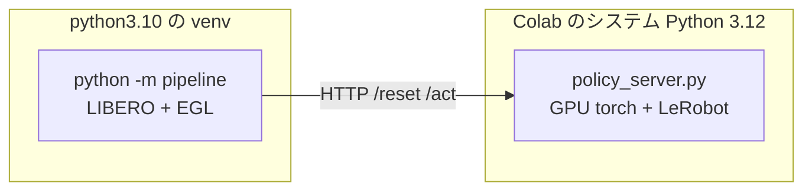

# Colab GPU で評価を回す

手元の CPU コンテナでは **12 エピソードに 2.5 時間**かかる。成功率 10% と 20% を
統計的に区別するには 50〜100 エピソード必要で、それでは何も判断できない。

Colab の GPU（EGL 描画）に移すと桁が変わる。

| | CPU コンテナ（osmesa） | Colab GPU（EGL） |
|---|---|---|
| `env.step` | 300 ms | **39 ms** |
| 重い推論（chunk 1 回） | 23 秒 | **0.85 秒** |
| 1 エピソード（600 ステップ） | 約 12 分 | **約 34 秒** |
| 80 エピソード | 16 時間 | **約 45 分** |

`env.step` の実測値は運営 Q&A No.3 で参加者が L4 上で計測したもの、
推論はこちらで Colab T4 上で実測したものである。

**学習セッションとは別のアカウントで開くこと。** 学習は止めない。

## なぜ 2 プロセスに分けるのか

評価側と方策側は**依存が正面衝突する**。

| | 必要なもの | 衝突 |
|---|---|---|
| 評価パイプライン | `numpy==1.26.4` / `gym==0.25.2` / `robosuite==1.4.0` / CPU torch | 古い固定版 |
| 方策 | LeRobot v0.6.0 / GPU torch / transformers | 新しい版 |

1 つの環境に押し込むと片方が壊れる。配布キットが HTTP サーバー方式を採っているのは
まさにこのためで、**本番採点も 2 プロセス構成**である。同じ形をそのまま使う。



**提出物の zip は使わない。** `policy_server.py` は `vendor/` が無ければ
インストール済みの LeRobot を使うため、Colab ではそのまま動く。
測りたいのは推論の中身であって Python 3.10 互換ではない
（3.10 の確認は Docker 側で済んでいる）。

---

## A. GPU と EGL を確認する

新しいノートブックを作り、**ランタイムのタイプを GPU に変更**してから最初のセルに貼る。

```python
# === GPU と EGL の確認 ===
# MuJoCo は EGL を使うと GPU で描画する。ここが CPU に落ちると
# シミュレーションが 8 倍遅くなり、この手順の意味が無くなる。
import subprocess, sys

print(subprocess.run(["nvidia-smi", "--query-gpu=name,memory.total",
                      "--format=csv,noheader"], capture_output=True, text=True).stdout.strip())
print("python:", sys.version.split()[0])

import ctypes
try:
    ctypes.CDLL("libEGL.so.1")
    print("libEGL: あり")
except OSError:
    print("libEGL: 無し → 次のセルの apt で入る")
```

GPU 名が出なければ**ランタイムのタイプが GPU になっていない**。先に直すこと。

---

## B. 配布キットを取得してセットアップする

**5〜10 分かかる。** `setup.sh` をそのまま使う（本番と同じ手順）。
キットは公開リポジトリなので clone できる。

```python
# === 配布キットのセットアップ ===
# setup.sh は python3.10 を前提にしている。Colab は 3.12 なので apt で 3.10 を足す。
# 評価パイプライン側は 3.10 の venv に閉じ込め、方策側は Colab の 3.12 を使う。
import os, subprocess, textwrap
from pathlib import Path

KIT_DIR = Path("/content/PARC2026_pre")

def run(command: str, check: bool = True) -> None:
    print(f"$ {command}")
    result = subprocess.run(command, shell=True, capture_output=True, text=True)
    tail = (result.stdout + result.stderr).strip().splitlines()[-6:]
    print("\n".join(tail))
    if check and result.returncode != 0:
        raise RuntimeError(f"失敗 ({result.returncode}): {command}")

run("apt-get -qq update")
run("apt-get -qq install -y python3.10 python3.10-venv "
    "libosmesa6 libegl1 libglfw3 libglew-dev libmagickwand-dev unzip")

if not KIT_DIR.exists():
    run(f"git clone --depth 1 https://github.com/matsuolab/PARC2026_pre {KIT_DIR}")

os.chdir(KIT_DIR)
run("PYTHON=python3.10 bash setup.sh")
print("キットのセットアップ完了")
```

> **`setup.sh` は `~/.libero/config.yaml` を書き換える。** Colab は使い捨てなので問題ないが、
> ローカルで同じことをすると既存の LIBERO 設定が `.bak` に退避される。

---

## C. 重みを用意する

**素の重み**と**追加学習した重み**のどちらを測るかで分岐する。まず素の重みで
基準を取り、そのあと学習後と比べるのが順序である。

```python
# === 評価する重みを用意する ===
# USE_FINETUNED = False なら HF から素の重みを取る（Drive 不要）。
# True なら Drive のマージ済みモデルを使う。
USE_FINETUNED = False
DRIVE_MERGED_DIR = "/content/drive/MyDrive/parc2026/<RUN_NAME>/merged"

from pathlib import Path
from huggingface_hub import snapshot_download

WEIGHTS_DIR = Path("/content/model_weights")

if USE_FINETUNED:
    from google.colab import drive
    drive.mount("/content/drive")
    run(f"rm -rf {WEIGHTS_DIR} && cp -r '{DRIVE_MERGED_DIR}' {WEIGHTS_DIR}")
else:
    snapshot_download(
        "lerobot/smolvla_libero_plus",
        revision="7bb70aa5bc92b82c9239142775d3a173103567ff",
        local_dir=str(WEIGHTS_DIR),
    )

# policy_server.py は model_weights/vlm/ からトークナイザを読む。
# VLM 本体の重みはポリシー側に含まれるので、設定とトークナイザだけで足りる。
snapshot_download(
    "HuggingFaceTB/SmolVLM2-500M-Video-Instruct",
    local_dir=str(WEIGHTS_DIR / "vlm"),
    allow_patterns=["*.json", "*.txt", "*.model", "tokenizer*"],
)
print("重みの準備完了:", sorted(p.name for p in WEIGHTS_DIR.iterdir()))
```

---

## D. 方策サーバー側の依存を入れる

Colab のシステム Python（3.12）に、`policy_server.py` が要るものだけ足す。
LeRobot は学習用ノートブックと同じ手順で入れる。

```python
# === 方策サーバー側の依存 ===
# 学習用ノートブックと同じ手順で LeRobot v0.6.0 を入れる。手順を変えると
# 学習時と推論時でモデルの挙動が変わり、比較の意味が無くなる。
import shutil, sys
from pathlib import Path

import torch

LEROBOT_TAG = "v0.6.0"
LEROBOT_DIR = Path("/content/lerobot")

run("pip install -q fastapi uvicorn msgpack")

if not LEROBOT_DIR.exists():
    run(f"pip uninstall -y -q lerobot torchao", check=False)
    run(f"git clone --quiet --depth 1 --branch {LEROBOT_TAG} "
        f"https://github.com/huggingface/lerobot.git {LEROBOT_DIR}")

    # bf16 非対応の GPU（T4 など）では fp16 に書き換える。
    # 学習用ノートブックが同じ置換をしており、揃えないと挙動が変わる。
    if not torch.cuda.is_bf16_supported():
        smolvlm = LEROBOT_DIR / "src/lerobot/policies/smolvla/smolvlm_with_expert.py"
        source = smolvlm.read_text(encoding="utf-8")
        smolvlm.write_text(
            source.replace('torch_dtype="bfloat16",', 'torch_dtype="float16",', 1),
            encoding="utf-8",
        )
        print("bf16 非対応の GPU のため fp16 へ書き換えました")

    run(f"pip install -q --upgrade -e '{LEROBOT_DIR}[smolvla]'")
    run("pip uninstall -y -q torchao", check=False)

for name in [m for m in sys.modules if m == "lerobot" or m.startswith("lerobot.")]:
    del sys.modules[name]

import lerobot
print("lerobot:", Path(lerobot.__file__).parent)
print("bf16 対応:", torch.cuda.is_bf16_supported())
```

> **`torch.cuda.is_bf16_supported()` が False なら、必ず上の書き換えを通すこと。**
> T4 は bf16 非対応である。L4（本番と同じ）や A100 なら不要。
> 学習を T4 で回して評価を L4 で回すと、この一点だけ条件が変わる。

`policy_server.py` をアップロードする。**左のファイルペインへドラッグ**するか、
Drive 経由で置く。置き場所は `/content/policy_server.py`。

```python
# === policy_server.py の配置を確認する ===
from pathlib import Path
import shutil

SERVER = Path("/content/policy_server.py")
assert SERVER.is_file(), "policy_server.py を /content/ に置いてください"

# model_weights は policy_server.py と同じ階層に無ければならない。
target = SERVER.parent / "model_weights"
if not target.exists():
    target.symlink_to(WEIGHTS_DIR)
print("配置 OK:", SERVER, "->", sorted(p.name for p in target.iterdir())[:4], "…")
```

---

## E. 評価を回す

サーバーを起動し、キットのパイプラインを当てる。**`MUJOCO_GL=egl` が肝**である。

```python
# === 評価の実行 ===
# N_EPISODES を増やすほど成功率の推定が安定する。
# 4 タスク × 20 エピソード = 80 エピソードで約 45 分。
N_EPISODES = 20
MAX_STEPS = 600
PORT = 8000

# 推論時の後処理。既定（空文字）なら素の挙動。掃引はここを変える。
POLICY_ENV = {
    # "PARC_N_ACTION_STEPS": "25",
    # "PARC_BLEND_STEPS": "3",
}

import os, subprocess, time, urllib.request, json
from pathlib import Path

server_env = dict(os.environ)
server_env.update({k: v for k, v in POLICY_ENV.items() if v})
# policy_server.py は setdefault で offline を立てる。Colab は通信できるので
# 明示的に解除しておく。**採点環境は遮断されるため、オフラインの確認は
# Docker 側で別途行うこと。**
server_env["HF_HUB_OFFLINE"] = "0"
server_env["TRANSFORMERS_OFFLINE"] = "0"
server_env["CUDA_VISIBLE_DEVICES"] = "0"

log = open("/content/server.log", "w")
server = subprocess.Popen(
    ["python", str(SERVER), "--port", str(PORT)],
    cwd="/content", env=server_env, stdout=log, stderr=subprocess.STDOUT,
)
print(f"サーバー起動 (pid={server.pid})  設定: {POLICY_ENV or '既定'}")

for elapsed in range(300):
    try:
        urllib.request.urlopen(f"http://localhost:{PORT}/health", timeout=2)
        print(f"/health 応答（{elapsed} 秒）")
        break
    except Exception:
        if server.poll() is not None:
            print(open("/content/server.log").read()[-3000:])
            raise RuntimeError("サーバーが起動に失敗しました")
        time.sleep(1)

eval_env = dict(os.environ)
eval_env.update({
    "MUJOCO_GL": "egl",                                     # GPU 描画。ここが要
    "PYTHONPATH": f"{KIT_DIR}/LIBERO-plus:{KIT_DIR}:{KIT_DIR}/compe",
    "LIBERO_ROOT": f"{KIT_DIR}/LIBERO-plus",
})

started = time.time()
try:
    process = subprocess.Popen(
        [f"{KIT_DIR}/venv/bin/python", "-m", "pipeline",
         "--server-url", f"http://localhost:{PORT}",
         "--track", "track1",
         "--n-episodes", str(N_EPISODES),
         "--max-steps", str(MAX_STEPS),
         "--output-dir", "/content/results"],
        cwd=str(KIT_DIR), env=eval_env,
        stdout=subprocess.PIPE, stderr=subprocess.STDOUT, text=True, bufsize=1,
    )
    for line in process.stdout:
        if any(word in line for word in ("Episode", "成功", "失敗", "スコア", "Track")):
            print(line.rstrip())
    process.wait()
finally:
    server.terminate()

print(f"所要 {time.time() - started:.0f} 秒")
```

> **`--timeout` は指定しない。** 既定の 10 秒が本番と同じであり、GPU なら
> 推論 0.85 秒で余裕がある。ここで落ちるなら本番でも落ちる。

---

## F. 結果を読む

```python
# === 結果の読み取り ===
import json
from pathlib import Path

result = json.loads(Path("/content/results/server_8000.json").read_text())
track = result["tracks"][0]
overall = track["overall_metrics"]

episodes = overall["n_total_episodes"]
rate = overall["mean_success_rate"]
# 二項分布の 95% 信頼区間（Wilson）。何エピソード回せば足りるかの判断に使う。
import math
z = 1.96
denominator = 1 + z**2 / episodes
center = (rate + z**2 / (2 * episodes)) / denominator
margin = z * math.sqrt(rate * (1 - rate) / episodes + z**2 / (4 * episodes**2)) / denominator

print(f"成功率   {rate:.3f}   95%CI [{center - margin:.3f}, {center + margin:.3f}]  n={episodes}")
print(f"衝突率   {overall['mean_collision_rate']:.3f}")
print()
for task in track["tasks"]:
    print(f"  成功 {task['success_rate']:.2f}  衝突 {task['metrics']['collision_rate']:.2f}  {task['task_name'][:50]}")
print()
for key in ("mean_avg_cartesian_jerk", "mean_rms_cartesian_jerk", "mean_sparc",
            "mean_cartesian_path_length"):
    print(f"  {key:32s} {overall[key]:9.4f}")
```

**信頼区間を必ず見ること。** 20 エピソードで成功率 0.10 なら 95%CI は
おおよそ [0.03, 0.30] で、0.20 との差は判定できない。
**条件を比べるなら 1 条件あたり 80 エピソード以上**が要る。

---

## G. 掃引の回し方

セル E の `POLICY_ENV` を変えて回し直す。**変えるのは 1 度に 1 つ**。

| 順番 | 設定 | 狙い | 注意 |
|---|---|---|---|
| 1 | 既定（空） | 基準を取る | まずこれ |
| 2 | `PARC_N_ACTION_STEPS=25` | 再計画を 2 倍に | 総時間も 1.3 倍 |
| 3 | `PARC_N_ACTION_STEPS=10` | 再計画を 5 倍に | **1 時間制限に注意**（後述） |
| 4 | `PARC_BLEND_STEPS=3` | 境界の段差を消す | 成功率が出てから |

**見る順序を間違えないこと。** スコアは「ゲートを通ったエピソードだけが
滑らかさで採点される」構造なので、

1. `mean_success_rate` と `mean_collision_rate` が下がっていないか
2. そのうえで jerk / SPARC / 軌道長が改善しているか

**成功率を下げる設定は、滑らかさがどれだけ良くても採用してはいけない。**

### 1 時間制限の確認

本番はトラック全体で 1 時間である。評価タスク数と試行数は非公開なので、
**1 エピソードあたりの所要秒数**を測って余裕を見積もる。

```python
# === 1 エピソードあたりの実測時間 ===
elapsed = result["total_elapsed_sec"]
episodes = result["tracks"][0]["overall_metrics"]["n_total_episodes"]
print(f"1 エピソード {elapsed / episodes:.1f} 秒")
print(f"1 時間で回せるエピソード数の目安: {3600 / (elapsed / episodes):.0f}")
```

配布既定の `n_eval_episodes=20` がそのまま使われるなら、
4 タスクでも 80 エピソードになる。**1 エピソード 45 秒を超えると危ない。**

---

## 注意点

| 項目 | 内容 |
|---|---|
| **本番との違い** | Colab は通信できる。採点環境は遮断される。**オフライン検証は Docker 側で行うこと** |
| **Python の版** | Colab は 3.12。採点環境は 3.10。ここでの成功は 3.10 の保証にならない |
| **CUDA の版** | Colab は CUDA 12 系。採点環境は 13。`torchvision` の互換はここでは確認できない |
| **セッション切断** | 評価は 45 分程度なので学習ほど深刻ではないが、結果 JSON は Drive に退避しておくと安全 |
| **学習との同居** | **別アカウントで開くこと。** 同一アカウントで 2 つ GPU を使うと片方が止められる |
