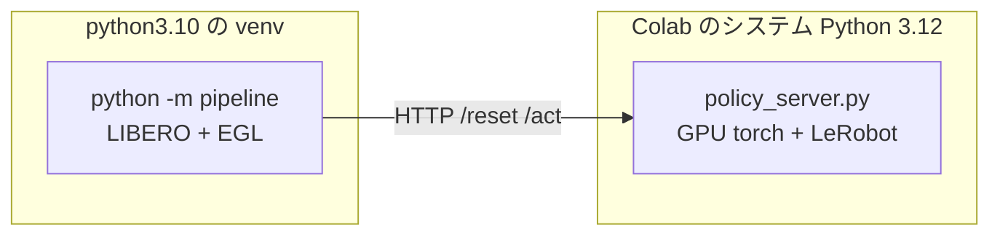

# Colab GPU で評価を回す

手元の CPU コンテナでは **12 エピソードに 2.5 時間**かかる。成功率 10% と 20% を
統計的に区別するには 50〜100 エピソード必要で、それでは何も判断できない。

Colab の GPU（EGL 描画）に移すと桁が変わる。

| | CPU コンテナ（osmesa） | Colab GPU（EGL） |
|---|---|---|
| `env.step` | 300 ms | **39 ms** |
| 重い推論（chunk 1 回） | 23 秒 | **0.85 秒** |
| 1 エピソード（600 ステップ） | 約 12 分 | **約 34 秒** |
| 80 エピソード | 16 時間 | **約 45 分** |

`env.step` の実測値は運営 Q&A No.3 で参加者が L4 上で計測したもの、
推論はこちらで Colab T4 上で実測したものである。

**学習セッションとは別のアカウントで開くこと。** 学習は止めない。

## なぜ 2 プロセスに分けるのか

評価側と方策側は**依存が正面衝突する**。

| | 必要なもの | 衝突 |
|---|---|---|
| 評価パイプライン | `numpy==1.26.4` / `gym==0.25.2` / `robosuite==1.4.0` / CPU torch | 古い固定版 |
| 方策 | LeRobot v0.6.0 / GPU torch / transformers | 新しい版 |

1 つの環境に押し込むと片方が壊れる。配布キットが HTTP サーバー方式を採っているのは
まさにこのためで、**本番採点も 2 プロセス構成**である。同じ形をそのまま使う。



**提出物の zip は使わない。** `policy_server.py` は `vendor/` が無ければ
インストール済みの LeRobot を使うため、Colab ではそのまま動く。
測りたいのは推論の中身であって Python 3.10 互換ではない
（3.10 の確認は Docker 側で済んでいる）。

---

## A. GPU と EGL を確認する

新しいノートブックを作り、**ランタイムのタイプを GPU に変更**してから最初のセルに貼る。

```python
# === GPU と EGL の確認 ===
# MuJoCo は EGL を使うと GPU で描画する。ここが CPU に落ちると
# シミュレーションが 8 倍遅くなり、この手順の意味が無くなる。
import subprocess, sys

print(subprocess.run(["nvidia-smi", "--query-gpu=name,memory.total",
                      "--format=csv,noheader"], capture_output=True, text=True).stdout.strip())
print("python:", sys.version.split()[0])

import ctypes
try:
    ctypes.CDLL("libEGL.so.1")
    print("libEGL: あり")
except OSError:
    print("libEGL: 無し → 次のセルの apt で入る")
```

GPU 名が出なければ**ランタイムのタイプが GPU になっていない**。先に直すこと。

---

## B. 配布キットを取得してセットアップする

**5〜10 分かかる。** `setup.sh` をそのまま使う（本番と同じ手順）。
キットは公開リポジトリなので clone できる。

```python
# === 配布キットのセットアップ ===
# setup.sh は python3.10 を前提にしている。Colab は 3.12 なので apt で 3.10 を足す。
# 評価パイプライン側は 3.10 の venv に閉じ込め、方策側は Colab の 3.12 を使う。
#
# 失敗したときに原因が分かるよう、出力は多めに残す。
import os, subprocess, shutil
from pathlib import Path

KIT_DIR = Path("/content/PARC2026_pre")
LOG_DIR = Path("/content/setup_logs"); LOG_DIR.mkdir(exist_ok=True)

def run(command: str, check: bool = True, tail: int = 30, log: str | None = None) -> int:
    """シェルコマンドを実行し、出力の末尾を表示する。全文はログに残す。"""
    print(f"$ {command}")
    result = subprocess.run(command, shell=True, capture_output=True, text=True)
    output = result.stdout + result.stderr

    if log:
        (LOG_DIR / log).write_text(output, encoding="utf-8")

    lines = output.strip().splitlines()
    if result.returncode != 0:
        print(f"--- 失敗 (returncode={result.returncode}) 末尾 {tail} 行 ---")
        print("\n".join(lines[-tail:]))
        if log:
            print(f"--- 全文: {LOG_DIR / log} ---")
        if check:
            raise RuntimeError(f"失敗 ({result.returncode}): {command}")
    else:
        print("\n".join(lines[-4:]) if lines else "(出力なし)")
    return result.returncode

run("apt-get -qq update", log="apt_update.log")
run("apt-get -qq install -y libosmesa6 libegl1 libglfw3 libglew-dev "
    "libmagickwand-dev unzip build-essential", log="apt_system.log")

# python3.10 が入るなら使う。入らなければ Colab の Python（3.12）で作る。
# ここは採点環境への忠実性の話ではない（それは Docker 側で済んでいる）。
# キットが gym==0.25.2 / robosuite==1.4.0 という古い版を固定しているため、
# 素性の分かっている 3.10 の方が安全というだけである。
import sys
run("apt-get -qq install -y python3.10 python3.10-venv python3.10-dev",
    check=False, log="apt_python310.log")

KIT_PYTHON = shutil.which("python3.10") or sys.executable
print(f"\nキット側の Python: {KIT_PYTHON}")
if "3.10" not in KIT_PYTHON:
    print("  python3.10 が使えないため Colab の Python を使う。"
          "gym / robosuite が古いため、後段で落ちたらログを見ること。")

if not KIT_DIR.exists():
    run(f"git clone --depth 1 https://github.com/matsuolab/PARC2026_pre {KIT_DIR}")

os.chdir(KIT_DIR)

# Colab は MPLBACKEND に matplotlib_inline を設定している。キットの venv には
# そのパッケージが無いため、libero が matplotlib を import した瞬間に
# 「'module://matplotlib_inline.backend_inline' is not a valid value for backend」
# で落ちる。評価は画面表示をしないので、以降ずっと Agg にしておく。
os.environ["MPLBACKEND"] = "Agg"

run(f"PYTHON={KIT_PYTHON} bash setup.sh", tail=40, log="setup.log")

# torch 2.11.0 は setuptools<82 を要求するが、Colab の venv には新しいものが入る。
# 警告のまま放置すると import で落ちることがあるため揃えておく。
run(f"{KIT_DIR}/venv/bin/pip install -q 'setuptools<82'", check=False)

# 動作確認。setup.sh 自身の確認は MPLBACKEND のせいで落ちるため、ここでやり直す。
verify = (
    f'MPLBACKEND=Agg PYTHONPATH="{KIT_DIR}/LIBERO-plus:{KIT_DIR}:{KIT_DIR}/compe" '
    f'{KIT_DIR}/venv/bin/python -c '
    '"import torch, libero.libero.benchmark; '
    'from compe.t1 import register_t1; register_t1(); '
    'print(\'suite 登録 OK / torch\', torch.__version__)"'
)
run(verify, tail=20, log="verify.log")
print("キットのセットアップ完了")
```

> **`setup.sh` の最後の「動作確認（suite 登録）」は Colab では必ず失敗する。**
> `MPLBACKEND` が原因であり、セットアップ自体（`1/5`〜`5/5`）が完了していれば問題ない。
> 上のセルは `setup.sh` を通したあとに、環境変数を直して確認をやり直している。
> `setup.sh` は再実行しても venv・clone・アセットを作り直さないため、
> 失敗後にこのセルをもう一度流すだけでよい。

> **どちらの Python でも `setup.sh` は `venv` を作る。** 方策側（Colab の 3.12 本体）とは
> 別の環境になるため、`numpy==1.26.4` が方策側へ漏れることはない。
> **2 プロセス構成は Python の版に関係なく必要である。**

### `setup.sh` が失敗したとき

失敗すると末尾 40 行が表示され、全文が `/content/setup_logs/setup.log` に残る。
**`[setup] N/5` のどこまで進んだかで切り分ける。**

| 止まった段階 | 何が起きているか | 対処 |
|---|---|---|
| `1/5 venv + 依存` | `python3.10` が無い、または pip が失敗 | 下記「python3.10 が入らないとき」 |
| `2/5 LIBERO-plus / LIBERO の取得` | git clone の失敗 | 再実行する（一時的な失敗が多い） |
| `3/5 パッチ` | ほぼ起きない | ログを見る |
| `4/5 アセット` | `assets.zip`（HF）の取得や `unzip` の失敗 | `unzip` が入っているか確認して再実行 |
| `5/5 libero 設定` | ほぼ起きない | ログを見る |

止まった段階が分からないときは次で確認する。

```python
print((LOG_DIR / "setup.log").read_text()[-4000:])
```

#### 依存のインストールで落ちるとき（`1/5` で止まる）

`gym==0.25.2` や `robosuite==1.4.0` は 2022 年前後の版で、
**新しい Python では wheel が無い / ビルドに失敗する**ことがある。
どのパッケージで落ちたかはログの末尾に出る。

```python
print((LOG_DIR / "setup.log").read_text()[-4000:])
```

`python3.10` が使えていればまず起きない。Colab の Python（3.12）で落ちた場合は、
`python3.10` を入れられないか先に確認する価値がある。

```python
run("apt-cache policy python3.10", check=False)
```

`Candidate: (none)` なら apt に無い。その場合は deadsnakes を足す手もあるが、
**そこまでするより先に、落ちたパッケージ 1 つだけを新しい版で入れて
`setup.sh` を再実行する**方が速いことが多い。

> **`setup.sh` は `~/.libero/config.yaml` を書き換える。** Colab は使い捨てなので問題ないが、
> ローカルで同じことをすると既存の LIBERO 設定が `.bak` に退避される。

---

## C. 重みを用意する

**素の重み**と**追加学習した重み**のどちらを測るかで分岐する。まず素の重みで
基準を取り、そのあと学習後と比べるのが順序である。

素の重みは **`0.05832` を出した提出物とまったく同じもの**なので、
ここで出る数字は本番スコアと直接比べられる。

```python
# === 評価する重みを用意する ===
# USE_FINETUNED = False なら HF から素の重みを取る（Drive 不要）。
# True なら Drive のマージ済みモデルを使う。
#
# DRIVE_MERGED_DIR は COLAB.md のセル E が書き出す先である。
#   merged_on_drive = DRIVE_RUN_DIR / "merged_model"
# つまり  /content/drive/MyDrive/parc2026/<RUN_NAME>/merged_model  になる。
# <RUN_NAME> は学習セルの同期ログに出ている名前をそのまま使う。
# **マージセルを実行するまで存在しない。** 学習中は False のままにすること。
USE_FINETUNED = False
DRIVE_MERGED_DIR = "/content/drive/MyDrive/parc2026/<RUN_NAME>/merged_model"

from pathlib import Path
from huggingface_hub import snapshot_download

WEIGHTS_DIR = Path("/content/model_weights")

if USE_FINETUNED:
    from google.colab import drive
    drive.mount("/content/drive")
    source = Path(DRIVE_MERGED_DIR)
    assert source.is_dir(), (
        f"{source} がありません。COLAB.md のセル E（マージ済みモデルを Drive へ）"
        "まで実行されているか確認してください"
    )
    run(f"rm -rf {WEIGHTS_DIR} && cp -r '{source}' {WEIGHTS_DIR}")
else:
    # このリポジトリには eval/（評価動画 402 ファイル・25.6 MB）が入っている。
    # 推論には不要なので除外する。落とすのはルート直下の 7 ファイルだけでよい。
    snapshot_download(
        "lerobot/smolvla_libero_plus",
        revision="7bb70aa5bc92b82c9239142775d3a173103567ff",
        local_dir=str(WEIGHTS_DIR),
        ignore_patterns=["eval/*", "eval/**"],
    )

# policy_server.py は model_weights/vlm/ からトークナイザを読む。
# VLM 本体の重みはポリシー側のチェックポイントに含まれるので、
# 設定とトークナイザだけで足りる（*.safetensors は落とさない）。
snapshot_download(
    "HuggingFaceTB/SmolVLM2-500M-Video-Instruct",
    local_dir=str(WEIGHTS_DIR / "vlm"),
    allow_patterns=["*.json", "*.txt", "*.model", "tokenizer*"],
)

# 推論に必須のファイル。train_config.json は学習スクリプトが書くもので、
# マージ済みモデル（save_pretrained の出力）には無いため必須にしない。
required = {
    "config.json", "model.safetensors",
    "policy_preprocessor.json", "policy_postprocessor.json",
    "policy_preprocessor_step_5_normalizer_processor.safetensors",
    "policy_postprocessor_step_0_unnormalizer_processor.safetensors",
}
present = {p.name for p in WEIGHTS_DIR.iterdir() if p.is_file()}
missing = required - present
assert not missing, f"重みが足りません: {missing}"
assert (WEIGHTS_DIR / "vlm" / "tokenizer_config.json").is_file(), "vlm のトークナイザがありません"

import json
config = json.loads((WEIGHTS_DIR / "config.json").read_text())
assert not config.get("use_peft"), "use_peft が真です。LoRA がマージされていません"

total = sum(p.stat().st_size for p in WEIGHTS_DIR.rglob("*") if p.is_file())
print(f"重みの準備完了: {total / 1e6:.0f} MB  （追加学習: {'あり' if USE_FINETUNED else 'なし'}）")
print(sorted(present))
```

> 提出物の `model_weights/` はこのセルと**同じ中身**である
> （ルート直下の 6 ファイル ＋ `train_config.json` ＋ `vlm/`）。
> 素の重みでは `README.md` と `.gitattributes` が余分に落ちるが、
> 読み込みには影響しない。

---

## D. 方策サーバー側の依存を入れる

Colab のシステム Python（3.12）に、`policy_server.py` が要るものだけ足す。
LeRobot は学習用ノートブックと同じ手順で入れる。

```python
# === 方策サーバー側の依存 ===
# 学習用ノートブックと同じ手順で LeRobot v0.6.0 を入れる。手順を変えると
# 学習時と推論時でモデルの挙動が変わり、比較の意味が無くなる。
import shutil, sys
from pathlib import Path

import torch

LEROBOT_TAG = "v0.6.0"
LEROBOT_DIR = Path("/content/lerobot")

# av が要る理由は非自明なので記録しておく。
# lerobot/policies/factory.py は groot の設定を import し、その連鎖で
# groot/processor_groot.py に到達する。そこは
#     if TYPE_CHECKING or _datasets_available:
#         from lerobot.datasets.lerobot_dataset import LeRobotDataset
# という分岐になっており、`datasets` が入っていると通る。すると
# lerobot/datasets/__init__.py が require_package("av") を呼ぶ。
# **Colab には datasets が既定で入っているため、av も必要になる。**
# 提出物の環境には datasets が無いので分岐がスキップされ、av は要らない。
#
# バージョンを固定するのは、LeRobot v0.6.0 が av>=15,<16 を宣言しているため。
# 素で入れると 17 系になり、lerobot/datasets/pyav_utils.py が使う
# av.option が無くなっていて AttributeError になる。
run("pip install -q fastapi uvicorn msgpack 'av>=15.0.0,<16.0.0'")

if not LEROBOT_DIR.exists():
    run(f"pip uninstall -y -q lerobot torchao", check=False)
    run(f"git clone --quiet --depth 1 --branch {LEROBOT_TAG} "
        f"https://github.com/huggingface/lerobot.git {LEROBOT_DIR}")

    # bf16 非対応の GPU（T4 など）では fp16 に書き換える。
    # 学習用ノートブックが同じ置換をしており、揃えないと挙動が変わる。
    if not torch.cuda.is_bf16_supported():
        smolvlm = LEROBOT_DIR / "src/lerobot/policies/smolvla/smolvlm_with_expert.py"
        source = smolvlm.read_text(encoding="utf-8")
        smolvlm.write_text(
            source.replace('torch_dtype="bfloat16",', 'torch_dtype="float16",', 1),
            encoding="utf-8",
        )
        print("bf16 非対応の GPU のため fp16 へ書き換えました")

    run(f"pip install -q --upgrade -e '{LEROBOT_DIR}[smolvla]'")
    run("pip uninstall -y -q torchao", check=False)

# clone 先 /content/lerobot には __init__.py が無いため、`import lerobot` が
# これを名前空間パッケージとして掴んでしまい lerobot.__file__ が None になる。
# 学習用ノートブックと同じく、実体のある src/ を sys.path の先頭へ置く。
LEROBOT_SRC = LEROBOT_DIR / "src"

for name in [m for m in sys.modules if m == "lerobot" or m.startswith("lerobot.")]:
    del sys.modules[name]

sys.path = [p for p in sys.path if p not in {str(LEROBOT_DIR), str(LEROBOT_SRC)}]
sys.path.insert(0, str(LEROBOT_SRC))

import importlib
importlib.invalidate_caches()

import lerobot
assert lerobot.__file__ is not None, "lerobot が名前空間パッケージとして読まれています"
assert LEROBOT_SRC.resolve() in Path(lerobot.__file__).resolve().parents, \
    f"LeRobot の読込先が正しくありません: {lerobot.__file__}"

print("lerobot:", Path(lerobot.__file__).parent)
print("bf16 対応:", torch.cuda.is_bf16_supported())
```

> **`torch.cuda.is_bf16_supported()` が False なら、必ず上の書き換えを通すこと。**
> T4 は bf16 非対応である。L4（本番と同じ）や A100 なら不要。
> 学習を T4 で回して評価を L4 で回すと、この一点だけ条件が変わる。

> **`lerobot.__file__` が `None` になるのは、clone 先の `/content/lerobot` が
> `__init__.py` を持たないためである。** `/content` が `sys.path` に入っていると
> そこが名前空間パッケージとして拾われ、実体の `src/lerobot` に届かない。
> 上の 3 行（`sys.modules` の掃除・`sys.path` の差し替え・`invalidate_caches`）が
> それを避けている。**この対処は別プロセスには効かない**ので、
> サーバー起動時にも同じ手当てが要る（セル E で `PYTHONPATH` に入れている）。

### それでも `av` 関連で落ちるとき

`lerobot.datasets` の中で別の不整合が出る場合は、**`datasets` を消して分岐そのものを
通らなくする**方が確実である。提出物の環境と同じ状態になり、起動も速くなる。

```python
run("pip uninstall -y -q datasets", check=False)

# 分岐が閉じたことを確認する
check = (
    f"PYTHONPATH={LEROBOT_SRC} python -c "
    "\"from lerobot.utils.import_utils import _datasets_available; "
    "print('datasets available:', _datasets_available); "
    "from lerobot.policies.factory import make_pre_post_processors; "
    "print('factory の import: 成功')\""
)
run(check, tail=20)
```

`datasets available: False` と出れば、`lerobot.datasets` は読まれない。
この評価では `datasets` を使わないので消して問題ない。

### どの `policy_server.py` を使うか

**リポジトリの [policy_server.py](policy_server.py) をそのまま使う。**
提出した zip の中身と同一のファイルであり、書き換えは要らない。

| | |
|---|---|
| 場所 | `solution/policy_server.py`（このファイルと同じディレクトリ） |
| 提出物との関係 | **完全に同一**。zip はこのファイルをルート直下に入れているだけ |
| Colab での違い | `vendor/` が無いので、同梱版ではなくインストール済みの LeRobot を使う |
| 後処理 | `PARC_*` を設定しなければ**すべて無効**。既定は素の挙動 |

**左のファイルペインへドラッグ**するか、Drive 経由で置く。
置き場所は `/content/policy_server.py`（下のセルが専用ディレクトリへ移す）。

```python
# === policy_server.py を専用ディレクトリへ配置する ===
# /content 直下のままだと、サーバーの別プロセスで `import lerobot` が
# clone 先の /content/lerobot（__init__.py 無し）を掴んでしまう。
# スクリプトの置き場所は sys.path の先頭に入るため、隣に lerobot/ が
# 無いディレクトリへ移しておく。
from pathlib import Path
import shutil

SUBMISSION_DIR = Path("/content/submission")
SUBMISSION_DIR.mkdir(exist_ok=True)
SERVER = SUBMISSION_DIR / "policy_server.py"

uploaded = Path("/content/policy_server.py")
if uploaded.is_file():
    shutil.copy2(uploaded, SERVER)
assert SERVER.is_file(), "policy_server.py を /content/ に置いてください"

# model_weights は policy_server.py と同じ階層に無ければならない。
weights_link = SUBMISSION_DIR / "model_weights"
if not weights_link.exists():
    weights_link.symlink_to(WEIGHTS_DIR)

assert not (SUBMISSION_DIR / "lerobot").exists(), \
    "この階層に lerobot/ があると import が壊れます"
print("配置 OK:", SERVER)
print("  重み:", sorted(p.name for p in weights_link.iterdir())[:4], "…")
```

---

## E. 評価を回す

サーバーを起動し、キットのパイプラインを当てる。**`MUJOCO_GL=egl` が肝**である。

```python
# === 評価の実行 ===
# N_EPISODES を増やすほど成功率の推定が安定する。
# 4 タスク × 20 エピソード = 80 エピソードで約 45 分。
N_EPISODES = 20
MAX_STEPS = 600
PORT = 8000

# 推論時の後処理。既定（空文字）なら素の挙動。掃引はここを変える。
POLICY_ENV = {
    # "PARC_N_ACTION_STEPS": "25",
    # "PARC_BLEND_STEPS": "3",
}

import os, subprocess, sys, time, urllib.request, json
from pathlib import Path

server_env = dict(os.environ)
server_env.update({k: v for k, v in POLICY_ENV.items() if v})
# policy_server.py は setdefault で offline を立てる。Colab は通信できるので
# 明示的に解除しておく。**採点環境は遮断されるため、オフラインの確認は
# Docker 側で別途行うこと。**
server_env["HF_HUB_OFFLINE"] = "0"
server_env["TRANSFORMERS_OFFLINE"] = "0"
server_env["CUDA_VISIBLE_DEVICES"] = "0"
# 別プロセスなので、ノートブック側の sys.path 操作は効かない。
# 実体のある src/ を PYTHONPATH で明示する。
server_env["PYTHONPATH"] = str(LEROBOT_SRC)

log = open("/content/server.log", "w")
server = subprocess.Popen(
    [sys.executable, str(SERVER), "--port", str(PORT)],
    cwd=str(SUBMISSION_DIR), env=server_env, stdout=log, stderr=subprocess.STDOUT,
)
print(f"サーバー起動 (pid={server.pid})  設定: {POLICY_ENV or '既定'}")

for elapsed in range(300):
    try:
        urllib.request.urlopen(f"http://localhost:{PORT}/health", timeout=2)
        print(f"/health 応答（{elapsed} 秒）")
        break
    except Exception:
        if server.poll() is not None:
            print(open("/content/server.log").read()[-3000:])
            raise RuntimeError("サーバーが起動に失敗しました")
        time.sleep(1)

eval_env = dict(os.environ)
eval_env.update({
    "MUJOCO_GL": "egl",                                     # GPU 描画。ここが要
    "MPLBACKEND": "Agg",                                    # Colab の既定値だと落ちる
    "PYTHONPATH": f"{KIT_DIR}/LIBERO-plus:{KIT_DIR}:{KIT_DIR}/compe",
    "LIBERO_ROOT": f"{KIT_DIR}/LIBERO-plus",
})

started = time.time()
try:
    process = subprocess.Popen(
        [f"{KIT_DIR}/venv/bin/python", "-m", "pipeline",
         "--server-url", f"http://localhost:{PORT}",
         "--track", "track1",
         "--n-episodes", str(N_EPISODES),
         "--max-steps", str(MAX_STEPS),
         "--output-dir", "/content/results"],
        cwd=str(KIT_DIR), env=eval_env,
        stdout=subprocess.PIPE, stderr=subprocess.STDOUT, text=True, bufsize=1,
    )
    for line in process.stdout:
        if any(word in line for word in ("Episode", "成功", "失敗", "スコア", "Track")):
            print(line.rstrip())
    process.wait()
finally:
    server.terminate()

print(f"所要 {time.time() - started:.0f} 秒")
```

> **`--timeout` は指定しない。** 既定の 10 秒が本番と同じであり、GPU なら
> 推論 0.85 秒で余裕がある。ここで落ちるなら本番でも落ちる。

---

## F. 結果を読む

```python
# === 結果の読み取り ===
import json
from pathlib import Path

result = json.loads(Path("/content/results/server_8000.json").read_text())
track = result["tracks"][0]
overall = track["overall_metrics"]

episodes = overall["n_total_episodes"]
rate = overall["mean_success_rate"]
# 二項分布の 95% 信頼区間（Wilson）。何エピソード回せば足りるかの判断に使う。
import math
z = 1.96
denominator = 1 + z**2 / episodes
center = (rate + z**2 / (2 * episodes)) / denominator
margin = z * math.sqrt(rate * (1 - rate) / episodes + z**2 / (4 * episodes**2)) / denominator

print(f"成功率   {rate:.3f}   95%CI [{center - margin:.3f}, {center + margin:.3f}]  n={episodes}")
print(f"衝突率   {overall['mean_collision_rate']:.3f}")
print()
for task in track["tasks"]:
    print(f"  成功 {task['success_rate']:.2f}  衝突 {task['metrics']['collision_rate']:.2f}  {task['task_name'][:50]}")
print()
for key in ("mean_avg_cartesian_jerk", "mean_rms_cartesian_jerk", "mean_sparc",
            "mean_cartesian_path_length"):
    print(f"  {key:32s} {overall[key]:9.4f}")
```

**信頼区間を必ず見ること。** 20 エピソードで成功率 0.10 なら 95%CI は
おおよそ [0.03, 0.30] で、0.20 との差は判定できない。
**条件を比べるなら 1 条件あたり 80 エピソード以上**が要る。

---

## G. 掃引の回し方

セル E の `POLICY_ENV` を変えて回し直す。**変えるのは 1 度に 1 つ**。

| 順番 | 設定 | 狙い | 注意 |
|---|---|---|---|
| 1 | 既定（空） | 基準を取る | まずこれ |
| 2 | `PARC_N_ACTION_STEPS=25` | 再計画を 2 倍に | 総時間も 1.3 倍 |
| 3 | `PARC_N_ACTION_STEPS=10` | 再計画を 5 倍に | **1 時間制限に注意**（後述） |
| 4 | `PARC_BLEND_STEPS=3` | 境界の段差を消す | 成功率が出てから |

**見る順序を間違えないこと。** スコアは「ゲートを通ったエピソードだけが
滑らかさで採点される」構造なので、

1. `mean_success_rate` と `mean_collision_rate` が下がっていないか
2. そのうえで jerk / SPARC / 軌道長が改善しているか

**成功率を下げる設定は、滑らかさがどれだけ良くても採用してはいけない。**

### 1 時間制限の確認

本番はトラック全体で 1 時間である。評価タスク数と試行数は非公開なので、
**1 エピソードあたりの所要秒数**を測って余裕を見積もる。

```python
# === 1 エピソードあたりの実測時間 ===
elapsed = result["total_elapsed_sec"]
episodes = result["tracks"][0]["overall_metrics"]["n_total_episodes"]
print(f"1 エピソード {elapsed / episodes:.1f} 秒")
print(f"1 時間で回せるエピソード数の目安: {3600 / (elapsed / episodes):.0f}")
```

配布既定の `n_eval_episodes=20` がそのまま使われるなら、
4 タスクでも 80 エピソードになる。**1 エピソード 45 秒を超えると危ない。**

---

## 注意点

| 項目 | 内容 |
|---|---|
| **本番との違い** | Colab は通信できる。採点環境は遮断される。**オフライン検証は Docker 側で行うこと** |
| **Python の版** | Colab は 3.12。採点環境は 3.10。ここでの成功は 3.10 の保証にならない |
| **CUDA の版** | Colab は CUDA 12 系。採点環境は 13。`torchvision` の互換はここでは確認できない |
| **セッション切断** | 評価は 45 分程度なので学習ほど深刻ではないが、結果 JSON は Drive に退避しておくと安全 |
| **学習との同居** | **別アカウントで開くこと。** 同一アカウントで 2 つ GPU を使うと片方が止められる |
