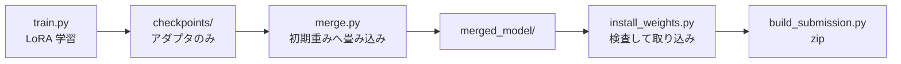

# Ubuntu の GPU マシンで Docker 学習を回す

Colab には**セッション上限**があり、20,000 ステップ（約 7 時間）を回しきれずに
9,100 ステップで切れた。GPU マシンが使えるなら、その制約が消える。

| | Colab | Docker（GPU マシン） |
|---|---|---|
| 上限 | セッションが切れる | **無し** |
| 出力 | Drive へ同期しないと消える | **ホストのディレクトリに残る** |
| 切断対策 | A〜F の仕掛けが必要 | **不要**（`--resume` だけ用意） |
| 再現性 | ノートブックの手動編集 | **イメージと引数で固定** |

`solution/train/` の 3 つで完結する。

| ファイル | 役割 |
|---|---|
| [train/Dockerfile](train/Dockerfile) | 学習用イメージ。LeRobot v0.6.0 と GPU torch |
| [train/train.py](train/train.py) | エピソード選択（H の (a)(b)）＋ 学習の実行 |
| [train/merge.py](train/merge.py) | LoRA を初期重みへ畳み込み、提出できる形にする |

## 前提

ホスト側に次が要る。**コンテナに CUDA は入れないため、ドライバだけあればよい。**

```bash
nvidia-smi                                    # ドライバが入っていること
docker run --rm --gpus all ubuntu nvidia-smi  # nvidia-container-toolkit が効くこと
```

`--gpus all` が通らない場合は
[nvidia-container-toolkit](https://docs.nvidia.com/datacenter/cloud-native/container-toolkit/latest/install-guide.html)
を入れる。

## 1. イメージを作る

```bash
docker build -t parc2026-train solution/train
```

torch は wheel に同梱された CUDA を使う。**ホストのドライバに合わせて index を変える。**

| ドライバ | 指定 |
|---|---|
| 550 以降（既定） | そのまま |
| より新しい | `--build-arg TORCH_INDEX=https://download.pytorch.org/whl/cu128` |
| GPU 無しで配線だけ見る | `--build-arg TORCH_INDEX=https://download.pytorch.org/whl/cpu` |

## 2. 学習する

```bash
mkdir -p work/train

docker run --gpus all --rm -it \
    -v "$PWD/work/train:/out" \
    -v "$HOME/.cache/huggingface:/root/.cache/huggingface" \
    parc2026-train \
    python /workspace/train.py --steps 20000 --batch-size 8
```

**HF のキャッシュをホストへマウントすること。** しないとコンテナを作り直すたびに
学習データ（6.4 GB）を取り直すことになる。

主な引数は次のとおり。既定値は Colab で回していた条件に揃えてある。

| 引数 | 既定 | 意味 |
|---|---|---|
| `--steps` | `20000` | 学習率はこの値をかけて減衰する。途中で止めると焼き鈍しが効かない |
| `--batch-size` | `8` | VRAM に合わせる。Colab の T4 では 4 が上限だった |
| `--episodes-per-task` | `5` | 全 40 タスクから選ぶ。5 を超えると転送量が 6.4 GB → 15.8 GB に跳ねる |
| `--num-workers` | `4` | 動画デコードが律速。Colab は 0 だったのでここが効く見込み |
| `--save-freq` | `500` | チェックポイントの間隔 |
| `--no-image-transforms` | — | 付けると画像拡張を切る（既定は有効） |

実行すると、まず選んだエピソードの確認が出る。

```
[train] 40 タスク × 5 本 = 200 エピソード
[train]   選んだ分の明るさ 0.086 〜 0.723
[train]   データセット全体 0.086 〜 0.723
```

**この 2 行が一致していれば、H の (b)（明るさで散らす）が効いている。**

### 中断したとき

```bash
docker run --gpus all --rm -it \
    -v "$PWD/work/train:/out" -v "$HOME/.cache/huggingface:/root/.cache/huggingface" \
    parc2026-train \
    python /workspace/train.py --resume
```

最新のチェックポイントを数値順で選び、**最小限の引数だけ**渡す。

```
lerobot-train
--resume=true
--config_path=/out/<run-name>/checkpoints/009000/pretrained_model/train_config.json
--output_dir=/out/<run-name>
--batch_size=8 --num_workers=4 --persistent_workers=true --save_freq=500
```

**再開時に学習条件を渡し直してはいけない。** 条件はチェックポイントの
`train_config.json` から復元される。重ねて渡すと元の条件を上書きしてしまう。

| 引数 | 再開時に渡すか | 理由 |
|---|---|---|
| `--policy.*` | **渡さない** | `--policy.path` は `_resolve_pretrained_from_cli()` が優先するため、渡すと**再開が黙って無視される** |
| `--dataset.*` | **渡さない** | エピソードの選択も画像拡張も config に入っている |
| `--steps` | **渡さない** | 学習率は `scheduler_decay_steps` で決まる。変えるとスケジュールが途中で別物になる |
| `--output_dir` | **必ず渡す** | config には**元の環境のパス**（Colab なら `/content/outputs/...`）が入っている |
| `--batch_size` / `--num_workers` / `--save_freq` | 渡してよい | 学習条件を壊さない |

### Colab で作ったチェックポイントから続ける

**必要なのは 2 つのディレクトリで、両方揃っていないと再開できない。**

```
work/train/<run-name>/checkpoints/009000/
├── pretrained_model/
│   ├── config.json                                      … 方策の設定
│   ├── adapter_model.safetensors                        … LoRA の重み
│   ├── train_config.json                                … 学習条件（--config_path が指す先）
│   ├── policy_preprocessor.json / *.safetensors         … 前処理
│   └── policy_postprocessor.json / *.safetensors        … 後処理
└── training_state/
    ├── optimizer_state.safetensors                      … 最適化器
    ├── optimizer_param_groups.json
    ├── scheduler_state.json                             … 学習率スケジュール
    ├── rng_state.safetensors                            … 乱数
    └── training_step.json                               … **何ステップ目か**
```

Drive から丸ごと持ってくればよい。

```bash
mkdir -p work/train/smolvla_lora_all_suites
cp -r "<Drive>/parc2026/260809_smolvla_lora_multiple_suites_001/train/checkpoints" \
      work/train/smolvla_lora_all_suites/

# 中身の確認。両方あることを必ず見る
ls work/train/smolvla_lora_all_suites/checkpoints/009000/
```

**ディレクトリ名はゼロ埋め 6 桁である**（桁数は `max(6, len(str(steps)))`）。
`--steps 20000` なら `009000` になる。Colab で作られたものをそのまま使えばよい。

#### ステップ数をコードに伝える必要は無い

`load_training_state` が `training_state/training_step.json` から読む。
`train.py` はチェックポイントのディレクトリを数値順に並べて最新を選ぶだけで、
何ステップ目かは一切渡していない。

```python
def load_training_step(save_dir: Path) -> int:
    training_step = load_json(save_dir / TRAINING_STEP)
    return training_step["step"]
```

**`training_state/` を持ってこないと、ここで `NotADirectoryError` になる。**
`pretrained_model/` だけコピーすると、再開ではなく「そのチェックポイントを
初期重みとして最初から学習」に近い状態になってしまうため、必ず両方入れる。

#### バッチサイズを変えても構わない

Colab では VRAM の都合で小さくしていたはずだが、GPU マシンでは上げてよい。
チェックポイントには当時のバッチサイズが記録されており、食い違うと警告が出るが
**エポックとオフセットは正しく復元される**。

```
Resuming with batch_size=8 but the checkpoint was written with batch_size=4.
The data order resumes at the right epoch/offset, but per-rank sample-exactness
requires the same batch size.
```

サンプル単位で完全に同じ順序にはならない、というだけの話である。

## 3. マージする

**学習しただけでは提出できない。** チェックポイントには LoRA アダプタしか入っていない。

```bash
docker run --rm -it \
    -v "$PWD/work/train:/out" -v "$HOME/.cache/huggingface:/root/.cache/huggingface" \
    parc2026-train \
    python /workspace/merge.py
```

`--step` を省略すると最新を使う。途中で打ち切った場合は、学習率がどこまで
落ちているかを見てから選ぶ（[COLAB.md](COLAB.md) の「途中のチェックポイントで
打ち切るとき」の表）。**GPU は不要**なので `--gpus` は付けなくてよい。

出力は `work/train/<run-name>/merged_model/` である。

## 4. 提出物へ取り込む

```bash
work/venv310/bin/python solution/tools/install_weights.py \
    work/train/smolvla_lora_all_suites/merged_model --dry-run

work/venv310/bin/python solution/tools/install_weights.py \
    work/train/smolvla_lora_all_suites/merged_model

work/venv310/bin/python solution/tools/build_submission.py
```

`install_weights.py` が LoRA の残留・テンソル構成・必須ファイルを検査し、
既存の重みを `.bak` へ退避する。詳細は [README.md](README.md) の
「追加学習した重みへの差し替え」を参照。

## 全体の流れ



## 注意点

| 項目 | 内容 |
|---|---|
| **Python の版** | 学習側は 3.12。採点環境の 3.10 互換は `vendor_lerobot.py` が別途担保する |
| **CUDA の版** | 学習側は torch の wheel 同梱版。採点環境の CUDA 13 とは無関係 |
| **bf16** | `train.py` が起動時に GPU を見て、非対応なら fp16 へ書き換える。Colab と同じ処理 |
| **`--steps` の変更** | 学習率スケジュールが変わる。再開時は前回と同じ値にすること |
| **HF キャッシュ** | ホストへマウントしないと 6.4 GB を毎回取り直す |
